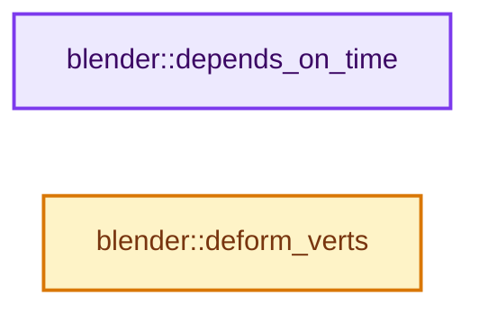
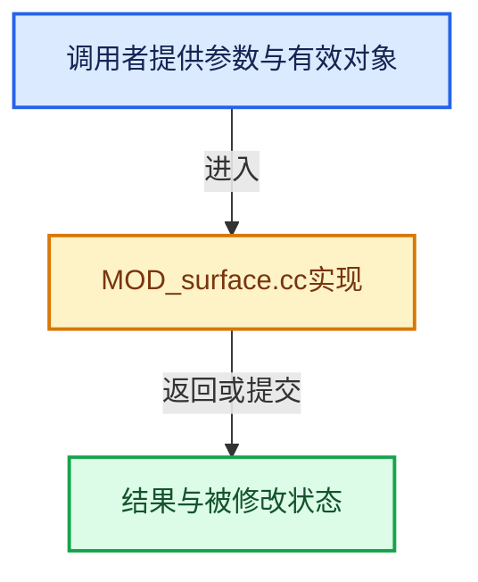

# 实现依赖专题：source/blender/modifiers/intern/MOD_surface.cc

[方向导航](README.md) · [符号索引](../%E7%AC%A6%E5%8F%B7%E4%BE%9D%E8%B5%96%E4%B8%8E%E5%AE%9E%E7%8E%B0%E7%B4%A2%E5%BC%95.md)

本专题从正文实际调用进入，集中保存共享实现。函数有稳定锚点，可从调用处直接跳到对应完整函数；递归与互相调用通过回链组织。

## 本文件的实现关系






## 完整成员与函数实现

<a id="f-0ee31349451cba32"></a>

### `blender::depends_on_time`

实现位置：[source/blender/modifiers/intern/MOD_surface.cc](../../../../../source/blender/modifiers/intern/MOD_surface.cc) · L73—L76。

接口参数：

- `Scene *`
- `ModifierData *`

**教学注释版**

<!-- annotated:c762cc717a3a86 -->

```cpp
static bool depends_on_time(Scene * /*scene*/, ModifierData * /*md*/)
{
  return true;
}
```

<details>
<summary>核对原始源码：source/blender/modifiers/intern/MOD_surface.cc · L73—L76</summary>

<!-- original:c762cc717a3a86:source/blender/modifiers/intern/MOD_surface.cc:73:76 -->

```cpp
static bool depends_on_time(Scene * /*scene*/, ModifierData * /*md*/)
{
  return true;
}
```

</details>

**结果出口**

- `return true;`

**继续追踪实现**

本实现没有需要继续展开的显式调用；检查返回表达式、对象转换和调用者前置条件。

<a id="f-de03bdbc3c06dedc"></a>

### `blender::deform_verts`

实现位置：[source/blender/modifiers/intern/MOD_surface.cc](../../../../../source/blender/modifiers/intern/MOD_surface.cc) · L78—L155。

接口参数：

- `ModifierData *md`
- `const ModifierEvalContext *ctx`
- `Mesh *mesh`
- `MutableSpan<float3> positions`

**教学注释版**

<!-- annotated:523e0851100e19 -->

```cpp
static void deform_verts(ModifierData *md,
                         const ModifierEvalContext *ctx,
                         Mesh *mesh,
                         MutableSpan<float3> positions)
{
  SurfaceModifierData *surmd = reinterpret_cast<SurfaceModifierData *>(md);
  const int cfra = int(DEG_get_ctime(ctx->depsgraph));

  /* Free mesh and BVH cache. */
  surmd->runtime.bvhtree = nullptr;
  if (surmd->runtime.mesh) {
    BKE_id_free(nullptr, surmd->runtime.mesh);
    surmd->runtime.mesh = nullptr;
  }

  if (mesh) {
    surmd->runtime.mesh = BKE_mesh_copy_for_eval(*mesh);
  }

  if (!ctx->object->pd) {
    printf("SurfaceModifier deform_verts: Should not happen!\n");
    return;
  }

  if (surmd->runtime.mesh) {
    uint mesh_verts_num = 0, i = 0;
    int init = 0;

    surmd->runtime.mesh->vert_positions_for_write().copy_from(positions);
    surmd->runtime.mesh->tag_positions_changed();

    mesh_verts_num = surmd->runtime.mesh->verts_num;

    if ((mesh_verts_num != surmd->runtime.verts_num) ||
        (surmd->runtime.vert_positions_prev == nullptr) ||
        (surmd->runtime.vert_velocities == nullptr) || (cfra != surmd->runtime.cfra_prev + 1))
    {

      MEM_SAFE_DELETE(surmd->runtime.vert_positions_prev);
      MEM_SAFE_DELETE(surmd->runtime.vert_velocities);

      surmd->runtime.vert_positions_prev = MEM_new_array_zeroed<float[3]>(mesh_verts_num,
                                                                          __func__);
      surmd->runtime.vert_velocities = MEM_new_array_zeroed<float[3]>(mesh_verts_num, __func__);

      surmd->runtime.verts_num = mesh_verts_num;

      init = 1;
    }

    /* convert to global coordinates and calculate velocity */
    MutableSpan<float3> positions = surmd->runtime.mesh->vert_positions_for_write();
    for (i = 0; i < mesh_verts_num; i++) {
      float *vec = positions[i];
      mul_m4_v3(ctx->object->object_to_world().ptr(), vec);

      if (init) {
        zero_v3(surmd->runtime.vert_velocities[i]);
      }
      else {
        sub_v3_v3v3(surmd->runtime.vert_velocities[i], vec, surmd->runtime.vert_positions_prev[i]);
      }

      copy_v3_v3(surmd->runtime.vert_positions_prev[i], vec);
    }

    surmd->runtime.cfra_prev = cfra;

    const bool has_face = surmd->runtime.mesh->faces_num > 0;
    const bool has_edge = surmd->runtime.mesh->edges_num > 0;
    if (has_face) {
      surmd->runtime.bvhtree = &surmd->runtime.mesh->bvh_tris();
    }
    else if (has_edge) {
      surmd->runtime.bvhtree = &surmd->runtime.mesh->bvh_edges();
    }
  }
}
```

<details>
<summary>核对原始源码：source/blender/modifiers/intern/MOD_surface.cc · L78—L155</summary>

<!-- original:523e0851100e19:source/blender/modifiers/intern/MOD_surface.cc:78:155 -->

```cpp
static void deform_verts(ModifierData *md,
                         const ModifierEvalContext *ctx,
                         Mesh *mesh,
                         MutableSpan<float3> positions)
{
  SurfaceModifierData *surmd = reinterpret_cast<SurfaceModifierData *>(md);
  const int cfra = int(DEG_get_ctime(ctx->depsgraph));

  /* Free mesh and BVH cache. */
  surmd->runtime.bvhtree = nullptr;
  if (surmd->runtime.mesh) {
    BKE_id_free(nullptr, surmd->runtime.mesh);
    surmd->runtime.mesh = nullptr;
  }

  if (mesh) {
    surmd->runtime.mesh = BKE_mesh_copy_for_eval(*mesh);
  }

  if (!ctx->object->pd) {
    printf("SurfaceModifier deform_verts: Should not happen!\n");
    return;
  }

  if (surmd->runtime.mesh) {
    uint mesh_verts_num = 0, i = 0;
    int init = 0;

    surmd->runtime.mesh->vert_positions_for_write().copy_from(positions);
    surmd->runtime.mesh->tag_positions_changed();

    mesh_verts_num = surmd->runtime.mesh->verts_num;

    if ((mesh_verts_num != surmd->runtime.verts_num) ||
        (surmd->runtime.vert_positions_prev == nullptr) ||
        (surmd->runtime.vert_velocities == nullptr) || (cfra != surmd->runtime.cfra_prev + 1))
    {

      MEM_SAFE_DELETE(surmd->runtime.vert_positions_prev);
      MEM_SAFE_DELETE(surmd->runtime.vert_velocities);

      surmd->runtime.vert_positions_prev = MEM_new_array_zeroed<float[3]>(mesh_verts_num,
                                                                          __func__);
      surmd->runtime.vert_velocities = MEM_new_array_zeroed<float[3]>(mesh_verts_num, __func__);

      surmd->runtime.verts_num = mesh_verts_num;

      init = 1;
    }

    /* convert to global coordinates and calculate velocity */
    MutableSpan<float3> positions = surmd->runtime.mesh->vert_positions_for_write();
    for (i = 0; i < mesh_verts_num; i++) {
      float *vec = positions[i];
      mul_m4_v3(ctx->object->object_to_world().ptr(), vec);

      if (init) {
        zero_v3(surmd->runtime.vert_velocities[i]);
      }
      else {
        sub_v3_v3v3(surmd->runtime.vert_velocities[i], vec, surmd->runtime.vert_positions_prev[i]);
      }

      copy_v3_v3(surmd->runtime.vert_positions_prev[i], vec);
    }

    surmd->runtime.cfra_prev = cfra;

    const bool has_face = surmd->runtime.mesh->faces_num > 0;
    const bool has_edge = surmd->runtime.mesh->edges_num > 0;
    if (has_face) {
      surmd->runtime.bvhtree = &surmd->runtime.mesh->bvh_tris();
    }
    else if (has_edge) {
      surmd->runtime.bvhtree = &surmd->runtime.mesh->bvh_edges();
    }
  }
}
```

</details>

**沿实际写入检查状态**

- `surmd->runtime.bvhtree = nullptr;`
- `surmd->runtime.mesh = nullptr;`
- `surmd->runtime.mesh = BKE_mesh_copy_for_eval(*mesh);`
- `mesh_verts_num = surmd->runtime.mesh->verts_num;`
- `surmd->runtime.vert_positions_prev = MEM_new_array_zeroed<float[3]>(mesh_verts_num,`
- `surmd->runtime.vert_velocities = MEM_new_array_zeroed<float[3]>(mesh_verts_num, __func__);`
- `surmd->runtime.verts_num = mesh_verts_num;`
- `init = 1;`
- `surmd->runtime.cfra_prev = cfra;`
- `surmd->runtime.bvhtree = &surmd->runtime.mesh->bvh_tris();`
- `surmd->runtime.bvhtree = &surmd->runtime.mesh->bvh_edges();`

**继续追踪实现**

- `DEG_get_ctime` → [blender::DEG_get_ctime · L105](../11-Depsgraph%E4%B8%8E%E5%B9%B6%E8%A1%8C%E4%BB%BB%E5%8A%A1%E7%B3%BB%E7%BB%9F/%E4%BE%9D%E8%B5%96-depsgraph_query-e8b1e4.md#f-156dee0918a22f2f)。
- `BKE_id_free` → [blender::BKE_id_free · L224](%E4%BE%9D%E8%B5%96-lib_id_delete-0cb33f.md#f-28ed02c41d0f2d5b)。
- `BKE_mesh_copy_for_eval` → [BKE_mesh_copy_for_eval · L1577](03-MPoly%E8%BF%81%E7%A7%BB%E4%B8%8E%E5%85%BC%E5%AE%B9.md#f-32e8f0e51faecc10)。
- `printf` → [外部契约](https://eel.is/c++draft/)：这个边界按实际表达式及所属类型核对参数、返回值、寿命与失败行为。这里提供接口入口，不声称已解释该第三方版本的内部实现。
- `surmd->runtime.mesh->vert_positions_for_write().copy_from` → [调用协议](../%E6%A8%A1%E6%9D%BF%E5%AE%8F%E4%B8%8E%E5%8A%A8%E6%80%81%E5%88%86%E6%B4%BE%E5%8D%8F%E8%AE%AE.md)：接收对象类型依赖auto、返回值或模板实例；不按同名猜测目标。调用位置L106。
- `surmd->runtime.mesh->vert_positions_for_write` → [调用协议](../%E6%A8%A1%E6%9D%BF%E5%AE%8F%E4%B8%8E%E5%8A%A8%E6%80%81%E5%88%86%E6%B4%BE%E5%8D%8F%E8%AE%AE.md)：接收对象类型依赖auto、返回值或模板实例；不按同名猜测目标。调用位置L106。
- `surmd->runtime.mesh->tag_positions_changed` → [调用协议](../%E6%A8%A1%E6%9D%BF%E5%AE%8F%E4%B8%8E%E5%8A%A8%E6%80%81%E5%88%86%E6%B4%BE%E5%8D%8F%E8%AE%AE.md)：接收对象类型依赖auto、返回值或模板实例；不按同名猜测目标。调用位置L107。
- `MEM_SAFE_DELETE` → [MEM_SAFE_DELETE · L436](../03-%E5%86%85%E5%AD%98%E5%88%86%E9%85%8D%E4%B8%8E%E8%BF%90%E8%A1%8C%E6%97%B6%E7%B1%BB%E5%9E%8B/%E4%BE%9D%E8%B5%96-MEM_guardedalloc-b54eca.md#m-eadb3bc5b902)。宏定义由构建条件选择。
- `MEM_new_array_zeroed<float[3]>` → [MEM_new_array_zeroed · L566](../03-%E5%86%85%E5%AD%98%E5%88%86%E9%85%8D%E4%B8%8E%E8%BF%90%E8%A1%8C%E6%97%B6%E7%B1%BB%E5%9E%8B/%E4%BE%9D%E8%B5%96-MEM_guardedalloc-b54eca.md#f-3a0cf63fb5216500)；[MEM_new_array_zeroed · L119](../03-%E5%86%85%E5%AD%98%E5%88%86%E9%85%8D%E4%B8%8E%E8%BF%90%E8%A1%8C%E6%97%B6%E7%B1%BB%E5%9E%8B/%E4%BE%9D%E8%B5%96-mallocn-afdcd4.md#f-6825557da566fdbe)。同名重载需按实参类型选择。
- `mul_m4_v3` → [blender::mul_m4_v3 · L677](../12-%E7%A9%BA%E9%97%B4%E6%95%B0%E6%8D%AE%E7%BB%93%E6%9E%84%E4%B8%8E%E5%87%A0%E4%BD%95%E7%AE%97%E6%B3%95/%E4%BE%9D%E8%B5%96-math_matrix_c-004123.md#f-14a8c267710d47a3)。
- `ctx->object->object_to_world().ptr` → [调用协议](../%E6%A8%A1%E6%9D%BF%E5%AE%8F%E4%B8%8E%E5%8A%A8%E6%80%81%E5%88%86%E6%B4%BE%E5%8D%8F%E8%AE%AE.md)：接收对象类型依赖auto、返回值或模板实例；不按同名猜测目标。调用位置L132。
- `ctx->object->object_to_world` → [调用协议](../%E6%A8%A1%E6%9D%BF%E5%AE%8F%E4%B8%8E%E5%8A%A8%E6%80%81%E5%88%86%E6%B4%BE%E5%8D%8F%E8%AE%AE.md)：接收对象类型依赖auto、返回值或模板实例；不按同名猜测目标。调用位置L132。
- `zero_v3` → [blender::zero_v3 · L26](../12-%E7%A9%BA%E9%97%B4%E6%95%B0%E6%8D%AE%E7%BB%93%E6%9E%84%E4%B8%8E%E5%87%A0%E4%BD%95%E7%AE%97%E6%B3%95/%E4%BE%9D%E8%B5%96-math_vector_inline-0c8541.md#f-13235b08fdecb098)。
- `sub_v3_v3v3` → [blender::sub_v3_v3v3 · L360](../12-%E7%A9%BA%E9%97%B4%E6%95%B0%E6%8D%AE%E7%BB%93%E6%9E%84%E4%B8%8E%E5%87%A0%E4%BD%95%E7%AE%97%E6%B3%95/%E4%BE%9D%E8%B5%96-math_vector_inline-0c8541.md#f-23781c252db8b30c)。
- `copy_v3_v3` → [blender::copy_v3_v3 · L47](../12-%E7%A9%BA%E9%97%B4%E6%95%B0%E6%8D%AE%E7%BB%93%E6%9E%84%E4%B8%8E%E5%87%A0%E4%BD%95%E7%AE%97%E6%B3%95/%E4%BE%9D%E8%B5%96-math_vector_inline-0c8541.md#f-037a0d5fa5060bd6)。
- `surmd->runtime.mesh->bvh_tris` → [调用协议](../%E6%A8%A1%E6%9D%BF%E5%AE%8F%E4%B8%8E%E5%8A%A8%E6%80%81%E5%88%86%E6%B4%BE%E5%8D%8F%E8%AE%AE.md)：接收对象类型依赖auto、返回值或模板实例；不按同名猜测目标。调用位置L149。
- `surmd->runtime.mesh->bvh_edges` → [调用协议](../%E6%A8%A1%E6%9D%BF%E5%AE%8F%E4%B8%8E%E5%8A%A8%E6%80%81%E5%88%86%E6%B4%BE%E5%8D%8F%E8%AE%AE.md)：接收对象类型依赖auto、返回值或模板实例；不按同名猜测目标。调用位置L152。
