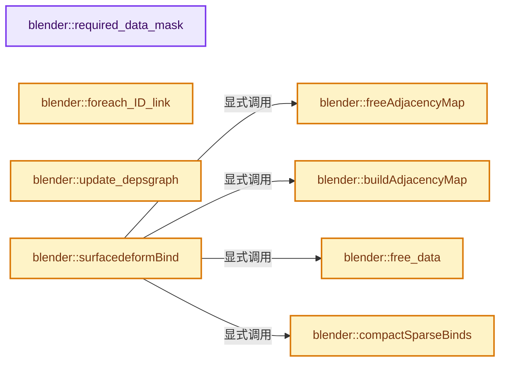
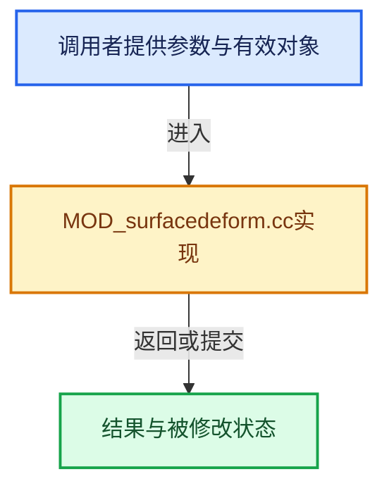

# 实现依赖专题：source/blender/modifiers/intern/MOD_surfacedeform.cc

[方向导航](README.md) · [符号索引](../%E7%AC%A6%E5%8F%B7%E4%BE%9D%E8%B5%96%E4%B8%8E%E5%AE%9E%E7%8E%B0%E7%B4%A2%E5%BC%95.md)

本专题从正文实际调用进入，集中保存共享实现。函数有稳定锚点，可从调用处直接跳到对应完整函数；递归与互相调用通过回链组织。

## 本文件的实现关系






## 完整成员与函数实现

<a id="f-31576bc3ae3328b9"></a>

### `blender::required_data_mask`

实现位置：[source/blender/modifiers/intern/MOD_surfacedeform.cc](../../../../../source/blender/modifiers/intern/MOD_surfacedeform.cc) · L200—L208。

接口参数：

- `ModifierData *md`
- `CustomData_MeshMasks *r_cddata_masks`

**教学注释版**

<!-- annotated:9a7b62ab7bfc36 -->

```cpp
static void required_data_mask(ModifierData *md, CustomData_MeshMasks *r_cddata_masks)
{
  SurfaceDeformModifierData *smd = reinterpret_cast<SurfaceDeformModifierData *>(md);

  /* Ask for vertex groups if we need them. */
  if (smd->defgrp_name[0] != '\0') {
    r_cddata_masks->vmask |= CD_MASK_MDEFORMVERT;
  }
}
```

<details>
<summary>核对原始源码：source/blender/modifiers/intern/MOD_surfacedeform.cc · L200—L208</summary>

<!-- original:9a7b62ab7bfc36:source/blender/modifiers/intern/MOD_surfacedeform.cc:200:208 -->

```cpp
static void required_data_mask(ModifierData *md, CustomData_MeshMasks *r_cddata_masks)
{
  SurfaceDeformModifierData *smd = reinterpret_cast<SurfaceDeformModifierData *>(md);

  /* Ask for vertex groups if we need them. */
  if (smd->defgrp_name[0] != '\0') {
    r_cddata_masks->vmask |= CD_MASK_MDEFORMVERT;
  }
}
```

</details>

**沿实际写入检查状态**

- `r_cddata_masks->vmask |= CD_MASK_MDEFORMVERT;`

**继续追踪实现**

本实现没有需要继续展开的显式调用；检查返回表达式、对象转换和调用者前置条件。

<a id="f-dbfd8d834d45992a"></a>

### `blender::free_data`

实现位置：[source/blender/modifiers/intern/MOD_surfacedeform.cc](../../../../../source/blender/modifiers/intern/MOD_surfacedeform.cc) · L237—L241。

接口参数：

- `ModifierData *md`

**教学注释版**

<!-- annotated:97587f44dbe12f -->

```cpp
static void free_data(ModifierData *md)
{
  SurfaceDeformModifierData *smd = reinterpret_cast<SurfaceDeformModifierData *>(md);
  implicit_sharing::free_shared_data(&smd->verts, &smd->verts_sharing_info);
}
```

<details>
<summary>核对原始源码：source/blender/modifiers/intern/MOD_surfacedeform.cc · L237—L241</summary>

<!-- original:97587f44dbe12f:source/blender/modifiers/intern/MOD_surfacedeform.cc:237:241 -->

```cpp
static void free_data(ModifierData *md)
{
  SurfaceDeformModifierData *smd = reinterpret_cast<SurfaceDeformModifierData *>(md);
  implicit_sharing::free_shared_data(&smd->verts, &smd->verts_sharing_info);
}
```

</details>

**继续追踪实现**

- `implicit_sharing::free_shared_data` → [blender::implicit_sharing::free_shared_data · L287](../06-%E9%9A%90%E5%BC%8F%E5%85%B1%E4%BA%AB%E4%B8%8E%E7%BC%93%E5%AD%98%E7%B3%BB%E7%BB%9F/02-ImplicitSharingInfo%E8%AE%A1%E6%95%B0.md#f-8e443cc043206969)。

<a id="f-0028eb0143a39536"></a>

### `blender::foreach_ID_link`

实现位置：[source/blender/modifiers/intern/MOD_surfacedeform.cc](../../../../../source/blender/modifiers/intern/MOD_surfacedeform.cc) · L254—L259。

接口参数：

- `ModifierData *md`
- `Object *ob`
- `IDWalkFunc walk`
- `void *user_data`

**教学注释版**

<!-- annotated:9fc887b1fda25b -->

```cpp
static void foreach_ID_link(ModifierData *md, Object *ob, IDWalkFunc walk, void *user_data)
{
  SurfaceDeformModifierData *smd = reinterpret_cast<SurfaceDeformModifierData *>(md);

  walk(user_data, ob, reinterpret_cast<ID **>(&smd->target), IDWALK_CB_NOP);
}
```

<details>
<summary>核对原始源码：source/blender/modifiers/intern/MOD_surfacedeform.cc · L254—L259</summary>

<!-- original:9fc887b1fda25b:source/blender/modifiers/intern/MOD_surfacedeform.cc:254:259 -->

```cpp
static void foreach_ID_link(ModifierData *md, Object *ob, IDWalkFunc walk, void *user_data)
{
  SurfaceDeformModifierData *smd = reinterpret_cast<SurfaceDeformModifierData *>(md);

  walk(user_data, ob, reinterpret_cast<ID **>(&smd->target), IDWALK_CB_NOP);
}
```

</details>

**继续追踪实现**

- `walk` → [调用协议](../%E6%A8%A1%E6%9D%BF%E5%AE%8F%E4%B8%8E%E5%8A%A8%E6%80%81%E5%88%86%E6%B4%BE%E5%8D%8F%E8%AE%AE.md)：局部可调用对象，须结合其初始化与捕获环境。调用位置L258。

<a id="f-2ef462ca32f17813"></a>

### `blender::update_depsgraph`

实现位置：[source/blender/modifiers/intern/MOD_surfacedeform.cc](../../../../../source/blender/modifiers/intern/MOD_surfacedeform.cc) · L261—L268。

接口参数：

- `ModifierData *md`
- `const ModifierUpdateDepsgraphContext *ctx`

**教学注释版**

<!-- annotated:de2450bf24d326 -->

```cpp
static void update_depsgraph(ModifierData *md, const ModifierUpdateDepsgraphContext *ctx)
{
  SurfaceDeformModifierData *smd = reinterpret_cast<SurfaceDeformModifierData *>(md);
  if (smd->target != nullptr) {
    DEG_add_object_relation(
        ctx->node, smd->target, DEG_OB_COMP_GEOMETRY, "Surface Deform Modifier");
  }
}
```

<details>
<summary>核对原始源码：source/blender/modifiers/intern/MOD_surfacedeform.cc · L261—L268</summary>

<!-- original:de2450bf24d326:source/blender/modifiers/intern/MOD_surfacedeform.cc:261:268 -->

```cpp
static void update_depsgraph(ModifierData *md, const ModifierUpdateDepsgraphContext *ctx)
{
  SurfaceDeformModifierData *smd = reinterpret_cast<SurfaceDeformModifierData *>(md);
  if (smd->target != nullptr) {
    DEG_add_object_relation(
        ctx->node, smd->target, DEG_OB_COMP_GEOMETRY, "Surface Deform Modifier");
  }
}
```

</details>

**继续追踪实现**

- `DEG_add_object_relation` → [blender::DEG_add_object_relation · L123](../11-Depsgraph%E4%B8%8E%E5%B9%B6%E8%A1%8C%E4%BB%BB%E5%8A%A1%E7%B3%BB%E7%BB%9F/%E4%BE%9D%E8%B5%96-depsgraph_build-ea2fc8.md#f-f570cffae97e273c)。

<a id="f-50a641273928e008"></a>

### `blender::freeAdjacencyMap`

实现位置：[source/blender/modifiers/intern/MOD_surfacedeform.cc](../../../../../source/blender/modifiers/intern/MOD_surfacedeform.cc) · L270—L279。

接口参数：

- `SDefAdjacencyArray *const vert_edges`
- `SDefAdjacency *const adj_ref`
- `SDefEdgePolys *const edge_polys`

**教学注释版**

<!-- annotated:346a0112360d35 -->

```cpp
static void freeAdjacencyMap(SDefAdjacencyArray *const vert_edges,
                             SDefAdjacency *const adj_ref,
                             SDefEdgePolys *const edge_polys)
{
  MEM_delete(edge_polys);

  MEM_delete(adj_ref);

  MEM_delete(vert_edges);
}
```

<details>
<summary>核对原始源码：source/blender/modifiers/intern/MOD_surfacedeform.cc · L270—L279</summary>

<!-- original:346a0112360d35:source/blender/modifiers/intern/MOD_surfacedeform.cc:270:279 -->

```cpp
static void freeAdjacencyMap(SDefAdjacencyArray *const vert_edges,
                             SDefAdjacency *const adj_ref,
                             SDefEdgePolys *const edge_polys)
{
  MEM_delete(edge_polys);

  MEM_delete(adj_ref);

  MEM_delete(vert_edges);
}
```

</details>

**继续追踪实现**

- `MEM_delete` → [MEM_delete · L400](../03-%E5%86%85%E5%AD%98%E5%88%86%E9%85%8D%E4%B8%8E%E8%BF%90%E8%A1%8C%E6%97%B6%E7%B1%BB%E5%9E%8B/%E4%BE%9D%E8%B5%96-MEM_guardedalloc-b54eca.md#f-9049ffdd1682887c)。

<a id="f-1d28dc43953baaae"></a>

### `blender::buildAdjacencyMap`

实现位置：[source/blender/modifiers/intern/MOD_surfacedeform.cc](../../../../../source/blender/modifiers/intern/MOD_surfacedeform.cc) · L281—L323。

接口参数：

- `const OffsetIndices<int> polys`
- `const Span<int2> edges`
- `const Span<int> corner_edges`
- `SDefAdjacencyArray *const vert_edges`
- `SDefAdjacency *adj`
- `SDefEdgePolys *const edge_polys`

**教学注释版**

<!-- annotated:31d967acf31f26 -->

```cpp
static int buildAdjacencyMap(const OffsetIndices<int> polys,
                             const Span<int2> edges,
                             const Span<int> corner_edges,
                             SDefAdjacencyArray *const vert_edges,
                             SDefAdjacency *adj,
                             SDefEdgePolys *const edge_polys)
{
  /* Find polygons adjacent to edges. */
  for (const int i : polys.index_range()) {
    // [讲解] corner_edges.slice：建立原连续范围的子视图。
    for (const int edge_i : corner_edges.slice(polys[i])) {
      if (edge_polys[edge_i].num == 0) {
        edge_polys[edge_i].polys[0] = i;
        edge_polys[edge_i].polys[1] = -1;
        edge_polys[edge_i].num++;
      }
      else if (edge_polys[edge_i].num == 1) {
        edge_polys[edge_i].polys[1] = i;
        edge_polys[edge_i].num++;
      }
      else {
        return MOD_SDEF_BIND_RESULT_NONMANY_ERR;
      }
    }
  }

  /* Find edges adjacent to vertices */
  // [讲解] edges.index_range：查询视图长度或生成对应有效索引区间。
  for (const int i : edges.index_range()) {
    const int2 &edge = edges[i];
    adj->next = vert_edges[edge[0]].first;
    adj->index = i;
    vert_edges[edge[0]].first = adj;
    vert_edges[edge[0]].num += edge_polys[i].num;
    adj++;

    adj->next = vert_edges[edge[1]].first;
    adj->index = i;
    vert_edges[edge[1]].first = adj;
    vert_edges[edge[1]].num += edge_polys[i].num;
    adj++;
  }

  return MOD_SDEF_BIND_RESULT_SUCCESS;
}
```

<details>
<summary>核对原始源码：source/blender/modifiers/intern/MOD_surfacedeform.cc · L281—L323</summary>

<!-- original:31d967acf31f26:source/blender/modifiers/intern/MOD_surfacedeform.cc:281:323 -->

```cpp
static int buildAdjacencyMap(const OffsetIndices<int> polys,
                             const Span<int2> edges,
                             const Span<int> corner_edges,
                             SDefAdjacencyArray *const vert_edges,
                             SDefAdjacency *adj,
                             SDefEdgePolys *const edge_polys)
{
  /* Find polygons adjacent to edges. */
  for (const int i : polys.index_range()) {
    for (const int edge_i : corner_edges.slice(polys[i])) {
      if (edge_polys[edge_i].num == 0) {
        edge_polys[edge_i].polys[0] = i;
        edge_polys[edge_i].polys[1] = -1;
        edge_polys[edge_i].num++;
      }
      else if (edge_polys[edge_i].num == 1) {
        edge_polys[edge_i].polys[1] = i;
        edge_polys[edge_i].num++;
      }
      else {
        return MOD_SDEF_BIND_RESULT_NONMANY_ERR;
      }
    }
  }

  /* Find edges adjacent to vertices */
  for (const int i : edges.index_range()) {
    const int2 &edge = edges[i];
    adj->next = vert_edges[edge[0]].first;
    adj->index = i;
    vert_edges[edge[0]].first = adj;
    vert_edges[edge[0]].num += edge_polys[i].num;
    adj++;

    adj->next = vert_edges[edge[1]].first;
    adj->index = i;
    vert_edges[edge[1]].first = adj;
    vert_edges[edge[1]].num += edge_polys[i].num;
    adj++;
  }

  return MOD_SDEF_BIND_RESULT_SUCCESS;
}
```

</details>

**沿实际写入检查状态**

- `edge_polys[edge_i].polys[0] = i;`
- `edge_polys[edge_i].polys[1] = -1;`
- `edge_polys[edge_i].polys[1] = i;`
- `adj->next = vert_edges[edge[0]].first;`
- `adj->index = i;`
- `vert_edges[edge[0]].first = adj;`
- `vert_edges[edge[0]].num += edge_polys[i].num;`
- `adj->next = vert_edges[edge[1]].first;`
- `vert_edges[edge[1]].first = adj;`
- `vert_edges[edge[1]].num += edge_polys[i].num;`

**结果出口**

- `return MOD_SDEF_BIND_RESULT_NONMANY_ERR;`
- `return MOD_SDEF_BIND_RESULT_SUCCESS;`

**继续追踪实现**

- `polys.index_range` → [blender::offset_indices::OffsetIndices::index_range · L77](02-OffsetIndices%E5%AE%8C%E6%95%B4%E6%8E%A5%E5%8F%A3.md#f-19b5ca1456de007d)。
- `corner_edges.slice` → [blender::Span::slice · L141](../01-%E5%9F%BA%E7%A1%80%E5%AE%B9%E5%99%A8%E4%B8%8E%E7%8E%B0%E4%BB%A3CPP/05-Span%E5%8F%AA%E8%AF%BB%E8%BF%9E%E7%BB%AD%E8%A7%86%E5%9B%BE.md#f-380a0e8fdcbd53cc)；[blender::Span::slice · L149](../01-%E5%9F%BA%E7%A1%80%E5%AE%B9%E5%99%A8%E4%B8%8E%E7%8E%B0%E4%BB%A3CPP/05-Span%E5%8F%AA%E8%AF%BB%E8%BF%9E%E7%BB%AD%E8%A7%86%E5%9B%BE.md#f-9b9c15e78dd54eec)。同名重载需按实参类型选择。
- `edges.index_range` → [blender::Span::index_range · L405](../01-%E5%9F%BA%E7%A1%80%E5%AE%B9%E5%99%A8%E4%B8%8E%E7%8E%B0%E4%BB%A3CPP/05-Span%E5%8F%AA%E8%AF%BB%E8%BF%9E%E7%BB%AD%E8%A7%86%E5%9B%BE.md#f-caaa9b06e13e53e0)。

<a id="f-2aff740012d55e1c"></a>

### `blender::compactSparseBinds`

实现位置：[source/blender/modifiers/intern/MOD_surfacedeform.cc](../../../../../source/blender/modifiers/intern/MOD_surfacedeform.cc) · L1138—L1164。

接口参数：

- `SurfaceDeformModifierData *smd`

**教学注释版**

<!-- annotated:7ba0a6559b1544 -->

```cpp
static void compactSparseBinds(SurfaceDeformModifierData *smd)
{
  smd->bind_verts_num = 0;

  for (uint i = 0; i < smd->mesh_verts_num; i++) {
    if (smd->verts[i].binds_num > 0) {
      smd->bind_verts_num++;
    }
  }

  SDefVert *new_verts = MEM_new_array<SDefVert>(size_t(smd->bind_verts_num), __func__);

  /* Move data to new_verts. */
  BLI_assert(smd->verts_sharing_info->is_mutable());
  int dst_index = 0;
  for (uint i = 0; i < smd->mesh_verts_num; i++) {
    if (smd->verts[i].binds_num > 0) {
      new_verts[dst_index++] = smd->verts[i];
      smd->verts[i] = {};
    }
  }

  smd->verts_sharing_info->remove_user_and_delete_if_last();
  smd->verts = new_verts;
  smd->verts_sharing_info = MEM_new<BindVertsImplicitSharing>(
      __func__, smd->verts, smd->bind_verts_num);
}
```

<details>
<summary>核对原始源码：source/blender/modifiers/intern/MOD_surfacedeform.cc · L1138—L1164</summary>

<!-- original:7ba0a6559b1544:source/blender/modifiers/intern/MOD_surfacedeform.cc:1138:1164 -->

```cpp
static void compactSparseBinds(SurfaceDeformModifierData *smd)
{
  smd->bind_verts_num = 0;

  for (uint i = 0; i < smd->mesh_verts_num; i++) {
    if (smd->verts[i].binds_num > 0) {
      smd->bind_verts_num++;
    }
  }

  SDefVert *new_verts = MEM_new_array<SDefVert>(size_t(smd->bind_verts_num), __func__);

  /* Move data to new_verts. */
  BLI_assert(smd->verts_sharing_info->is_mutable());
  int dst_index = 0;
  for (uint i = 0; i < smd->mesh_verts_num; i++) {
    if (smd->verts[i].binds_num > 0) {
      new_verts[dst_index++] = smd->verts[i];
      smd->verts[i] = {};
    }
  }

  smd->verts_sharing_info->remove_user_and_delete_if_last();
  smd->verts = new_verts;
  smd->verts_sharing_info = MEM_new<BindVertsImplicitSharing>(
      __func__, smd->verts, smd->bind_verts_num);
}
```

</details>

**沿实际写入检查状态**

- `smd->bind_verts_num = 0;`
- `smd->verts[i] = {};`
- `smd->verts = new_verts;`
- `smd->verts_sharing_info = MEM_new<BindVertsImplicitSharing>(`

**继续追踪实现**

- `MEM_new_array<SDefVert>` → [MEM_new_array · L372](../03-%E5%86%85%E5%AD%98%E5%88%86%E9%85%8D%E4%B8%8E%E8%BF%90%E8%A1%8C%E6%97%B6%E7%B1%BB%E5%9E%8B/%E4%BE%9D%E8%B5%96-MEM_guardedalloc-b54eca.md#f-56b8fe3d391af460)。
- `BLI_assert` → [BLI_assert · L48](../01-%E5%9F%BA%E7%A1%80%E5%AE%B9%E5%99%A8%E4%B8%8E%E7%8E%B0%E4%BB%A3CPP/%E4%BE%9D%E8%B5%96-BLI_assert-cc98e8.md#m-57a88495704d)；[BLI_assert · L63](../01-%E5%9F%BA%E7%A1%80%E5%AE%B9%E5%99%A8%E4%B8%8E%E7%8E%B0%E4%BB%A3CPP/%E4%BE%9D%E8%B5%96-BLI_assert-cc98e8.md#m-d07050020cb5)。宏定义由构建条件选择。
- `smd->verts_sharing_info->is_mutable` → [调用协议](../%E6%A8%A1%E6%9D%BF%E5%AE%8F%E4%B8%8E%E5%8A%A8%E6%80%81%E5%88%86%E6%B4%BE%E5%8D%8F%E8%AE%AE.md)：接收对象类型依赖auto、返回值或模板实例；不按同名猜测目标。调用位置L1151。
- `smd->verts_sharing_info->remove_user_and_delete_if_last` → [调用协议](../%E6%A8%A1%E6%9D%BF%E5%AE%8F%E4%B8%8E%E5%8A%A8%E6%80%81%E5%88%86%E6%B4%BE%E5%8D%8F%E8%AE%AE.md)：接收对象类型依赖auto、返回值或模板实例；不按同名猜测目标。调用位置L1160。
- `MEM_new<BindVertsImplicitSharing>` → [MEM_new · L351](../03-%E5%86%85%E5%AD%98%E5%88%86%E9%85%8D%E4%B8%8E%E8%BF%90%E8%A1%8C%E6%97%B6%E7%B1%BB%E5%9E%8B/%E4%BE%9D%E8%B5%96-MEM_guardedalloc-b54eca.md#f-115f9b6784f89912)。

<a id="f-260f6d95c9e0bd9e"></a>

### `blender::surfacedeformBind`

实现位置：[source/blender/modifiers/intern/MOD_surfacedeform.cc](../../../../../source/blender/modifiers/intern/MOD_surfacedeform.cc) · L1166—L1330。

接口参数：

- `Object *ob`
- `SurfaceDeformModifierData *smd_orig`
- `SurfaceDeformModifierData *smd_eval`
- `float (*vertexCos)[3]`
- `uint verts_num`
- `uint target_faces_num`
- `uint target_verts_num`
- `Mesh *target`
- `Mesh *mesh`

**教学注释版**

<!-- annotated:cdda16327b268a -->

```cpp
static bool surfacedeformBind(Object *ob,
                              SurfaceDeformModifierData *smd_orig,
                              SurfaceDeformModifierData *smd_eval,
                              float (*vertexCos)[3],
                              uint verts_num,
                              uint target_faces_num,
                              uint target_verts_num,
                              Mesh *target,
                              Mesh *mesh)
{
  const Span<float3> positions = target->vert_positions();
  const Span<int2> edges = target->edges();
  const OffsetIndices polys = target->faces();
  const Span<int> corner_verts = target->corner_verts();
  const Span<int> corner_edges = target->corner_edges();
  uint tedges_num = target->edges_num;
  int adj_result;

  if (target->faces_num == 0) {
    BKE_modifier_set_error(ob, reinterpret_cast<ModifierData *>(smd_eval), "Target has no faces");
    return false;
  }

  SDefAdjacencyArray *vert_edges = MEM_new_array_zeroed<SDefAdjacencyArray>(target_verts_num,
                                                                            "SDefVertEdgeMap");
  if (vert_edges == nullptr) {
    BKE_modifier_set_error(ob, reinterpret_cast<ModifierData *>(smd_eval), "Out of memory");
    return false;
  }

  SDefAdjacency *adj_array = MEM_new_array_uninitialized<SDefAdjacency>(2 * size_t(tedges_num),
                                                                        "SDefVertEdge");
  if (adj_array == nullptr) {
    BKE_modifier_set_error(ob, reinterpret_cast<ModifierData *>(smd_eval), "Out of memory");
    MEM_delete(vert_edges);
    return false;
  }

  SDefEdgePolys *edge_polys = MEM_new_array_zeroed<SDefEdgePolys>(tedges_num, "SDefEdgeFaceMap");
  if (edge_polys == nullptr) {
    BKE_modifier_set_error(ob, reinterpret_cast<ModifierData *>(smd_eval), "Out of memory");
    MEM_delete(vert_edges);
    MEM_delete(adj_array);
    return false;
  }

  smd_orig->verts = MEM_new_array<SDefVert>(size_t(verts_num), "SDefBindVerts");
  if (smd_orig->verts == nullptr) {
    BKE_modifier_set_error(ob, reinterpret_cast<ModifierData *>(smd_eval), "Out of memory");
    freeAdjacencyMap(vert_edges, adj_array, edge_polys);
    return false;
  }
  smd_orig->verts_sharing_info = MEM_new<BindVertsImplicitSharing>(
      __func__, smd_orig->verts, verts_num);

  const bke::bvh::Tree &treeData = target->bvh_tris();

  adj_result = buildAdjacencyMap(polys, edges, corner_edges, vert_edges, adj_array, edge_polys);

  if (adj_result == MOD_SDEF_BIND_RESULT_NONMANY_ERR) {
    BKE_modifier_set_error(ob,
                           reinterpret_cast<ModifierData *>(smd_eval),
                           "Target has edges with more than two polygons");
    freeAdjacencyMap(vert_edges, adj_array, edge_polys);
    implicit_sharing::free_shared_data(&smd_orig->verts, &smd_orig->verts_sharing_info);
    return false;
  }

  smd_orig->mesh_verts_num = verts_num;
  smd_orig->target_verts_num = target_verts_num;
  smd_orig->target_polys_num = target_faces_num;

  int defgrp_index;
  const MDeformVert *dvert;
  MOD_get_vgroup(ob, mesh, smd_orig->defgrp_name, &dvert, &defgrp_index);
  const bool invert_vgroup = (smd_orig->flags & MOD_SDEF_INVERT_VGROUP) != 0;
  const bool sparse_bind = (smd_orig->flags & MOD_SDEF_SPARSE_BIND) != 0;

  SDefBindCalcData data{};
  data.treeData = &treeData;
  data.vert_edges = vert_edges;
  data.edge_polys = edge_polys;
  data.polys = polys;
  data.edges = edges;
  data.corner_verts = corner_verts;
  data.corner_edges = corner_edges;
  data.corner_tris = target->corner_tris();
  data.tri_faces = target->corner_tri_faces();
  data.targetCos = MEM_new_array_uninitialized<float[3]>(size_t(target_verts_num),
                                                         "SDefTargetBindVertArray");
  data.bind_verts = smd_orig->verts;
  data.vertexCos = vertexCos;
  data.falloff = smd_orig->falloff;
  data.success = MOD_SDEF_BIND_RESULT_SUCCESS;
  data.dvert = dvert;
  data.defgrp_index = defgrp_index;
  data.invert_vgroup = invert_vgroup;
  data.sparse_bind = sparse_bind;

  if (data.targetCos == nullptr) {
    BKE_modifier_set_error(ob, reinterpret_cast<ModifierData *>(smd_eval), "Out of memory");
    free_data(reinterpret_cast<ModifierData *>(smd_orig));
    return false;
  }

  invert_m4_m4(data.imat, smd_orig->mat);

  for (int i = 0; i < target_verts_num; i++) {
    mul_v3_m4v3(data.targetCos[i], smd_orig->mat, positions[i]);
  }

  TaskParallelSettings settings;
  BLI_parallel_range_settings_defaults(&settings);
  settings.use_threading = (verts_num > 10000);
  BLI_task_parallel_range(0, verts_num, &data, bindVert, &settings);

  MEM_delete(data.targetCos);

  if (sparse_bind) {
    compactSparseBinds(smd_orig);
  }
  else {
    smd_orig->bind_verts_num = verts_num;
  }

  if (data.success == MOD_SDEF_BIND_RESULT_MEM_ERR) {
    BKE_modifier_set_error(ob, reinterpret_cast<ModifierData *>(smd_eval), "Out of memory");
    free_data(reinterpret_cast<ModifierData *>(smd_orig));
  }
  else if (data.success == MOD_SDEF_BIND_RESULT_NONMANY_ERR) {
    BKE_modifier_set_error(ob,
                           reinterpret_cast<ModifierData *>(smd_eval),
                           "Target has edges with more than two polygons");
    free_data(reinterpret_cast<ModifierData *>(smd_orig));
  }
  else if (data.success == MOD_SDEF_BIND_RESULT_CONCAVE_ERR) {
    BKE_modifier_set_error(
        ob, reinterpret_cast<ModifierData *>(smd_eval), "Target contains concave polygons");
    free_data(reinterpret_cast<ModifierData *>(smd_orig));
  }
  else if (data.success == MOD_SDEF_BIND_RESULT_OVERLAP_ERR) {
    BKE_modifier_set_error(
        ob, reinterpret_cast<ModifierData *>(smd_eval), "Target contains overlapping vertices");
    free_data(reinterpret_cast<ModifierData *>(smd_orig));
  }
  else if (data.success == MOD_SDEF_BIND_RESULT_GENERIC_ERR) {
    /* I know this message is vague, but I could not think of a way
     * to explain this with a reasonably sized message.
     * Though it shouldn't really matter all that much,
     * because this is very unlikely to occur */
    BKE_modifier_set_error(
        ob, reinterpret_cast<ModifierData *>(smd_eval), "Target contains invalid polygons");
    free_data(reinterpret_cast<ModifierData *>(smd_orig));
  }
  else if (smd_orig->bind_verts_num == 0 || !smd_orig->verts) {
    data.success = MOD_SDEF_BIND_RESULT_GENERIC_ERR;
    BKE_modifier_set_error(
        ob, reinterpret_cast<ModifierData *>(smd_eval), "No vertices were bound");
    free_data(reinterpret_cast<ModifierData *>(smd_orig));
  }

  freeAdjacencyMap(vert_edges, adj_array, edge_polys);

  return data.success == 1;
}
```

<details>
<summary>核对原始源码：source/blender/modifiers/intern/MOD_surfacedeform.cc · L1166—L1330</summary>

<!-- original:cdda16327b268a:source/blender/modifiers/intern/MOD_surfacedeform.cc:1166:1330 -->

```cpp
static bool surfacedeformBind(Object *ob,
                              SurfaceDeformModifierData *smd_orig,
                              SurfaceDeformModifierData *smd_eval,
                              float (*vertexCos)[3],
                              uint verts_num,
                              uint target_faces_num,
                              uint target_verts_num,
                              Mesh *target,
                              Mesh *mesh)
{
  const Span<float3> positions = target->vert_positions();
  const Span<int2> edges = target->edges();
  const OffsetIndices polys = target->faces();
  const Span<int> corner_verts = target->corner_verts();
  const Span<int> corner_edges = target->corner_edges();
  uint tedges_num = target->edges_num;
  int adj_result;

  if (target->faces_num == 0) {
    BKE_modifier_set_error(ob, reinterpret_cast<ModifierData *>(smd_eval), "Target has no faces");
    return false;
  }

  SDefAdjacencyArray *vert_edges = MEM_new_array_zeroed<SDefAdjacencyArray>(target_verts_num,
                                                                            "SDefVertEdgeMap");
  if (vert_edges == nullptr) {
    BKE_modifier_set_error(ob, reinterpret_cast<ModifierData *>(smd_eval), "Out of memory");
    return false;
  }

  SDefAdjacency *adj_array = MEM_new_array_uninitialized<SDefAdjacency>(2 * size_t(tedges_num),
                                                                        "SDefVertEdge");
  if (adj_array == nullptr) {
    BKE_modifier_set_error(ob, reinterpret_cast<ModifierData *>(smd_eval), "Out of memory");
    MEM_delete(vert_edges);
    return false;
  }

  SDefEdgePolys *edge_polys = MEM_new_array_zeroed<SDefEdgePolys>(tedges_num, "SDefEdgeFaceMap");
  if (edge_polys == nullptr) {
    BKE_modifier_set_error(ob, reinterpret_cast<ModifierData *>(smd_eval), "Out of memory");
    MEM_delete(vert_edges);
    MEM_delete(adj_array);
    return false;
  }

  smd_orig->verts = MEM_new_array<SDefVert>(size_t(verts_num), "SDefBindVerts");
  if (smd_orig->verts == nullptr) {
    BKE_modifier_set_error(ob, reinterpret_cast<ModifierData *>(smd_eval), "Out of memory");
    freeAdjacencyMap(vert_edges, adj_array, edge_polys);
    return false;
  }
  smd_orig->verts_sharing_info = MEM_new<BindVertsImplicitSharing>(
      __func__, smd_orig->verts, verts_num);

  const bke::bvh::Tree &treeData = target->bvh_tris();

  adj_result = buildAdjacencyMap(polys, edges, corner_edges, vert_edges, adj_array, edge_polys);

  if (adj_result == MOD_SDEF_BIND_RESULT_NONMANY_ERR) {
    BKE_modifier_set_error(ob,
                           reinterpret_cast<ModifierData *>(smd_eval),
                           "Target has edges with more than two polygons");
    freeAdjacencyMap(vert_edges, adj_array, edge_polys);
    implicit_sharing::free_shared_data(&smd_orig->verts, &smd_orig->verts_sharing_info);
    return false;
  }

  smd_orig->mesh_verts_num = verts_num;
  smd_orig->target_verts_num = target_verts_num;
  smd_orig->target_polys_num = target_faces_num;

  int defgrp_index;
  const MDeformVert *dvert;
  MOD_get_vgroup(ob, mesh, smd_orig->defgrp_name, &dvert, &defgrp_index);
  const bool invert_vgroup = (smd_orig->flags & MOD_SDEF_INVERT_VGROUP) != 0;
  const bool sparse_bind = (smd_orig->flags & MOD_SDEF_SPARSE_BIND) != 0;

  SDefBindCalcData data{};
  data.treeData = &treeData;
  data.vert_edges = vert_edges;
  data.edge_polys = edge_polys;
  data.polys = polys;
  data.edges = edges;
  data.corner_verts = corner_verts;
  data.corner_edges = corner_edges;
  data.corner_tris = target->corner_tris();
  data.tri_faces = target->corner_tri_faces();
  data.targetCos = MEM_new_array_uninitialized<float[3]>(size_t(target_verts_num),
                                                         "SDefTargetBindVertArray");
  data.bind_verts = smd_orig->verts;
  data.vertexCos = vertexCos;
  data.falloff = smd_orig->falloff;
  data.success = MOD_SDEF_BIND_RESULT_SUCCESS;
  data.dvert = dvert;
  data.defgrp_index = defgrp_index;
  data.invert_vgroup = invert_vgroup;
  data.sparse_bind = sparse_bind;

  if (data.targetCos == nullptr) {
    BKE_modifier_set_error(ob, reinterpret_cast<ModifierData *>(smd_eval), "Out of memory");
    free_data(reinterpret_cast<ModifierData *>(smd_orig));
    return false;
  }

  invert_m4_m4(data.imat, smd_orig->mat);

  for (int i = 0; i < target_verts_num; i++) {
    mul_v3_m4v3(data.targetCos[i], smd_orig->mat, positions[i]);
  }

  TaskParallelSettings settings;
  BLI_parallel_range_settings_defaults(&settings);
  settings.use_threading = (verts_num > 10000);
  BLI_task_parallel_range(0, verts_num, &data, bindVert, &settings);

  MEM_delete(data.targetCos);

  if (sparse_bind) {
    compactSparseBinds(smd_orig);
  }
  else {
    smd_orig->bind_verts_num = verts_num;
  }

  if (data.success == MOD_SDEF_BIND_RESULT_MEM_ERR) {
    BKE_modifier_set_error(ob, reinterpret_cast<ModifierData *>(smd_eval), "Out of memory");
    free_data(reinterpret_cast<ModifierData *>(smd_orig));
  }
  else if (data.success == MOD_SDEF_BIND_RESULT_NONMANY_ERR) {
    BKE_modifier_set_error(ob,
                           reinterpret_cast<ModifierData *>(smd_eval),
                           "Target has edges with more than two polygons");
    free_data(reinterpret_cast<ModifierData *>(smd_orig));
  }
  else if (data.success == MOD_SDEF_BIND_RESULT_CONCAVE_ERR) {
    BKE_modifier_set_error(
        ob, reinterpret_cast<ModifierData *>(smd_eval), "Target contains concave polygons");
    free_data(reinterpret_cast<ModifierData *>(smd_orig));
  }
  else if (data.success == MOD_SDEF_BIND_RESULT_OVERLAP_ERR) {
    BKE_modifier_set_error(
        ob, reinterpret_cast<ModifierData *>(smd_eval), "Target contains overlapping vertices");
    free_data(reinterpret_cast<ModifierData *>(smd_orig));
  }
  else if (data.success == MOD_SDEF_BIND_RESULT_GENERIC_ERR) {
    /* I know this message is vague, but I could not think of a way
     * to explain this with a reasonably sized message.
     * Though it shouldn't really matter all that much,
     * because this is very unlikely to occur */
    BKE_modifier_set_error(
        ob, reinterpret_cast<ModifierData *>(smd_eval), "Target contains invalid polygons");
    free_data(reinterpret_cast<ModifierData *>(smd_orig));
  }
  else if (smd_orig->bind_verts_num == 0 || !smd_orig->verts) {
    data.success = MOD_SDEF_BIND_RESULT_GENERIC_ERR;
    BKE_modifier_set_error(
        ob, reinterpret_cast<ModifierData *>(smd_eval), "No vertices were bound");
    free_data(reinterpret_cast<ModifierData *>(smd_orig));
  }

  freeAdjacencyMap(vert_edges, adj_array, edge_polys);

  return data.success == 1;
}
```

</details>

**沿实际写入检查状态**

- `smd_orig->verts = MEM_new_array<SDefVert>(size_t(verts_num), "SDefBindVerts");`
- `smd_orig->verts_sharing_info = MEM_new<BindVertsImplicitSharing>(`
- `adj_result = buildAdjacencyMap(polys, edges, corner_edges, vert_edges, adj_array, edge_polys);`
- `smd_orig->mesh_verts_num = verts_num;`
- `smd_orig->target_verts_num = target_verts_num;`
- `smd_orig->target_polys_num = target_faces_num;`
- `data.treeData = &treeData;`
- `data.vert_edges = vert_edges;`
- `data.edge_polys = edge_polys;`
- `data.polys = polys;`
- `data.edges = edges;`
- `data.corner_verts = corner_verts;`
- `data.corner_edges = corner_edges;`
- `data.corner_tris = target->corner_tris();`
- `data.tri_faces = target->corner_tri_faces();`
- `data.targetCos = MEM_new_array_uninitialized<float[3]>(size_t(target_verts_num),`
- `data.bind_verts = smd_orig->verts;`
- `data.vertexCos = vertexCos;`
- `data.falloff = smd_orig->falloff;`
- `data.success = MOD_SDEF_BIND_RESULT_SUCCESS;`
- `data.dvert = dvert;`
- `data.defgrp_index = defgrp_index;`
- `data.invert_vgroup = invert_vgroup;`
- `data.sparse_bind = sparse_bind;`
- `settings.use_threading = (verts_num > 10000);`
- `smd_orig->bind_verts_num = verts_num;`
- `data.success = MOD_SDEF_BIND_RESULT_GENERIC_ERR;`

**结果出口**

- `return false;`
- `return data.success == 1;`

**继续追踪实现**

- `target->vert_positions` → [Mesh::vert_positions · L1193](03-MPoly%E8%BF%81%E7%A7%BB%E4%B8%8E%E5%85%BC%E5%AE%B9.md#f-ae4177e5c5f2b371)。
- `target->edges` → [Mesh::edges · L1205](03-MPoly%E8%BF%81%E7%A7%BB%E4%B8%8E%E5%85%BC%E5%AE%B9.md#f-7232f6756b674d12)。
- `target->faces` → [Mesh::faces · L1217](03-MPoly%E8%BF%81%E7%A7%BB%E4%B8%8E%E5%85%BC%E5%AE%B9.md#f-ea444760154e17b2)。
- `target->corner_verts` → [Mesh::corner_verts · L1238](03-MPoly%E8%BF%81%E7%A7%BB%E4%B8%8E%E5%85%BC%E5%AE%B9.md#f-a59c61f583b64bc4)。
- `target->corner_edges` → [Mesh::corner_edges · L1252](03-MPoly%E8%BF%81%E7%A7%BB%E4%B8%8E%E5%85%BC%E5%AE%B9.md#f-687b790868e7f257)。
- `BKE_modifier_set_error` → [blender::BKE_modifier_set_error · L416](%E4%BE%9D%E8%B5%96-modifier-ab0273.md#f-6241829f21c08456)。
- `MEM_new_array_zeroed<SDefAdjacencyArray>` → [MEM_new_array_zeroed · L566](../03-%E5%86%85%E5%AD%98%E5%88%86%E9%85%8D%E4%B8%8E%E8%BF%90%E8%A1%8C%E6%97%B6%E7%B1%BB%E5%9E%8B/%E4%BE%9D%E8%B5%96-MEM_guardedalloc-b54eca.md#f-3a0cf63fb5216500)；[MEM_new_array_zeroed · L119](../03-%E5%86%85%E5%AD%98%E5%88%86%E9%85%8D%E4%B8%8E%E8%BF%90%E8%A1%8C%E6%97%B6%E7%B1%BB%E5%9E%8B/%E4%BE%9D%E8%B5%96-mallocn-afdcd4.md#f-6825557da566fdbe)。同名重载需按实参类型选择。
- `MEM_new_array_uninitialized<SDefAdjacency>` → [MEM_new_array_uninitialized · L608](../03-%E5%86%85%E5%AD%98%E5%88%86%E9%85%8D%E4%B8%8E%E8%BF%90%E8%A1%8C%E6%97%B6%E7%B1%BB%E5%9E%8B/%E4%BE%9D%E8%B5%96-MEM_guardedalloc-b54eca.md#f-b7103eae8eb57b05)；[MEM_new_array_uninitialized · L129](../03-%E5%86%85%E5%AD%98%E5%88%86%E9%85%8D%E4%B8%8E%E8%BF%90%E8%A1%8C%E6%97%B6%E7%B1%BB%E5%9E%8B/%E4%BE%9D%E8%B5%96-mallocn-afdcd4.md#f-bf6ef4ddcfb6e5df)。同名重载需按实参类型选择。
- `MEM_delete` → [MEM_delete · L400](../03-%E5%86%85%E5%AD%98%E5%88%86%E9%85%8D%E4%B8%8E%E8%BF%90%E8%A1%8C%E6%97%B6%E7%B1%BB%E5%9E%8B/%E4%BE%9D%E8%B5%96-MEM_guardedalloc-b54eca.md#f-9049ffdd1682887c)。
- `MEM_new_array_zeroed<SDefEdgePolys>` → [MEM_new_array_zeroed · L566](../03-%E5%86%85%E5%AD%98%E5%88%86%E9%85%8D%E4%B8%8E%E8%BF%90%E8%A1%8C%E6%97%B6%E7%B1%BB%E5%9E%8B/%E4%BE%9D%E8%B5%96-MEM_guardedalloc-b54eca.md#f-3a0cf63fb5216500)；[MEM_new_array_zeroed · L119](../03-%E5%86%85%E5%AD%98%E5%88%86%E9%85%8D%E4%B8%8E%E8%BF%90%E8%A1%8C%E6%97%B6%E7%B1%BB%E5%9E%8B/%E4%BE%9D%E8%B5%96-mallocn-afdcd4.md#f-6825557da566fdbe)。同名重载需按实参类型选择。
- `MEM_new_array<SDefVert>` → [MEM_new_array · L372](../03-%E5%86%85%E5%AD%98%E5%88%86%E9%85%8D%E4%B8%8E%E8%BF%90%E8%A1%8C%E6%97%B6%E7%B1%BB%E5%9E%8B/%E4%BE%9D%E8%B5%96-MEM_guardedalloc-b54eca.md#f-56b8fe3d391af460)。
- `freeAdjacencyMap` → [blender::freeAdjacencyMap · L270](%E4%BE%9D%E8%B5%96-MOD_surfacedeform-984aaa.md#f-50a641273928e008)。
- `MEM_new<BindVertsImplicitSharing>` → [MEM_new · L351](../03-%E5%86%85%E5%AD%98%E5%88%86%E9%85%8D%E4%B8%8E%E8%BF%90%E8%A1%8C%E6%97%B6%E7%B1%BB%E5%9E%8B/%E4%BE%9D%E8%B5%96-MEM_guardedalloc-b54eca.md#f-115f9b6784f89912)。
- `target->bvh_tris` → [blender::Mesh::bvh_tris · L786](../06-%E9%9A%90%E5%BC%8F%E5%85%B1%E4%BA%AB%E4%B8%8E%E7%BC%93%E5%AD%98%E7%B3%BB%E7%BB%9F/09-BVH%E5%85%B1%E4%BA%AB%E4%B8%8E%E8%BF%90%E8%A1%8C%E6%97%B6%E6%95%B0%E6%8D%AE.md#f-22c52773bbb2366e)。
- `buildAdjacencyMap` → [blender::buildAdjacencyMap · L281](%E4%BE%9D%E8%B5%96-MOD_surfacedeform-984aaa.md#f-1d28dc43953baaae)。
- `implicit_sharing::free_shared_data` → [blender::implicit_sharing::free_shared_data · L287](../06-%E9%9A%90%E5%BC%8F%E5%85%B1%E4%BA%AB%E4%B8%8E%E7%BC%93%E5%AD%98%E7%B3%BB%E7%BB%9F/02-ImplicitSharingInfo%E8%AE%A1%E6%95%B0.md#f-8e443cc043206969)。
- `MOD_get_vgroup` → [blender::MOD_get_vgroup · L158](%E4%BE%9D%E8%B5%96-MOD_util-83ca4b.md#f-f461611d86b94405)。
- `target->corner_tris` → [blender::Mesh::corner_tris · L264](../06-%E9%9A%90%E5%BC%8F%E5%85%B1%E4%BA%AB%E4%B8%8E%E7%BC%93%E5%AD%98%E7%B3%BB%E7%BB%9F/10-%E5%B1%80%E9%83%A8%E6%9B%B4%E6%96%B0%E4%B8%8E%E5%A4%B1%E6%95%88%E4%BF%AE%E5%A4%8D.md#f-9bb421790000fc20)。
- `target->corner_tri_faces` → [blender::Mesh::corner_tri_faces · L285](../06-%E9%9A%90%E5%BC%8F%E5%85%B1%E4%BA%AB%E4%B8%8E%E7%BC%93%E5%AD%98%E7%B3%BB%E7%BB%9F/10-%E5%B1%80%E9%83%A8%E6%9B%B4%E6%96%B0%E4%B8%8E%E5%A4%B1%E6%95%88%E4%BF%AE%E5%A4%8D.md#f-94cfee90bf521ed4)。
- `MEM_new_array_uninitialized<float[3]>` → [MEM_new_array_uninitialized · L608](../03-%E5%86%85%E5%AD%98%E5%88%86%E9%85%8D%E4%B8%8E%E8%BF%90%E8%A1%8C%E6%97%B6%E7%B1%BB%E5%9E%8B/%E4%BE%9D%E8%B5%96-MEM_guardedalloc-b54eca.md#f-b7103eae8eb57b05)；[MEM_new_array_uninitialized · L129](../03-%E5%86%85%E5%AD%98%E5%88%86%E9%85%8D%E4%B8%8E%E8%BF%90%E8%A1%8C%E6%97%B6%E7%B1%BB%E5%9E%8B/%E4%BE%9D%E8%B5%96-mallocn-afdcd4.md#f-bf6ef4ddcfb6e5df)。同名重载需按实参类型选择。
- `free_data` → [blender::free_data · L237](%E4%BE%9D%E8%B5%96-MOD_surfacedeform-984aaa.md#f-dbfd8d834d45992a)。
- `invert_m4_m4` → [blender::invert_m4_m4 · L1150](../12-%E7%A9%BA%E9%97%B4%E6%95%B0%E6%8D%AE%E7%BB%93%E6%9E%84%E4%B8%8E%E5%87%A0%E4%BD%95%E7%AE%97%E6%B3%95/%E4%BE%9D%E8%B5%96-math_matrix_c-004123.md#f-c75789f10cdd5b92)。
- `mul_v3_m4v3` → [blender::mul_v3_m4v3 · L687](../12-%E7%A9%BA%E9%97%B4%E6%95%B0%E6%8D%AE%E7%BB%93%E6%9E%84%E4%B8%8E%E5%87%A0%E4%BD%95%E7%AE%97%E6%B3%95/%E4%BE%9D%E8%B5%96-math_matrix_c-004123.md#f-31076c71c40783a8)。
- `BLI_parallel_range_settings_defaults` → [blender::BLI_parallel_range_settings_defaults · L218](../01-%E5%9F%BA%E7%A1%80%E5%AE%B9%E5%99%A8%E4%B8%8E%E7%8E%B0%E4%BB%A3CPP/%E4%BE%9D%E8%B5%96-BLI_task_c-917a71.md#f-3858ad801a98e123)。
- `BLI_task_parallel_range` → [blender::BLI_task_parallel_range · L101](../11-Depsgraph%E4%B8%8E%E5%B9%B6%E8%A1%8C%E4%BB%BB%E5%8A%A1%E7%B3%BB%E7%BB%9F/08-%E4%BB%BB%E5%8A%A1%E9%9A%94%E7%A6%BB%E6%AD%BB%E9%94%81%E4%B8%8E%E5%AE%9E%E6%88%98.md#f-9d237d7e4e78d7e2)。
- `compactSparseBinds` → [blender::compactSparseBinds · L1138](%E4%BE%9D%E8%B5%96-MOD_surfacedeform-984aaa.md#f-2aff740012d55e1c)。

<a id="f-b96aef4089ad6287"></a>

### `blender::surfacedeformModifier_do`

实现位置：[source/blender/modifiers/intern/MOD_surfacedeform.cc](../../../../../source/blender/modifiers/intern/MOD_surfacedeform.cc) · L1421—L1563。

接口参数：

- `ModifierData *md`
- `const ModifierEvalContext *ctx`
- `float (*vertexCos)[3]`
- `uint verts_num`
- `Object *ob`
- `Mesh *mesh`

**教学注释版**

<!-- annotated:0b60ddc48c3080 -->

```cpp
static void surfacedeformModifier_do(ModifierData *md,
                                     const ModifierEvalContext *ctx,
                                     float (*vertexCos)[3],
                                     uint verts_num,
                                     Object *ob,
                                     Mesh *mesh)
{
  SurfaceDeformModifierData *smd = reinterpret_cast<SurfaceDeformModifierData *>(md);
  Mesh *target;
  uint target_verts_num, target_faces_num;

  /* Exit function if bind flag is not set (free bind data if any). */
  if (!(smd->flags & MOD_SDEF_BIND)) {
    if (smd->verts != nullptr) {
      if (!DEG_is_active(ctx->depsgraph)) {
        BKE_modifier_set_error(ob, md, "Attempt to bind from inactive dependency graph");
        return;
      }
      ModifierData *md_orig = BKE_modifier_get_original(ob, md);
      free_data(md_orig);
    }
    return;
  }

  Object *ob_target = smd->target;
  target = BKE_modifier_get_evaluated_mesh_from_evaluated_object(ob_target);
  if (!target) {
    BKE_modifier_set_error(ob, md, "No valid target mesh");
    return;
  }

  target_verts_num = BKE_mesh_wrapper_vert_len(target);
  target_faces_num = BKE_mesh_wrapper_face_len(target);

  /* If not bound, execute bind. */
  if (smd->verts == nullptr) {
    if (!DEG_is_active(ctx->depsgraph)) {
      BKE_modifier_set_error(ob, md, "Attempt to unbind from inactive dependency graph");
      return;
    }

    SurfaceDeformModifierData *smd_orig = reinterpret_cast<SurfaceDeformModifierData *>(
        BKE_modifier_get_original(ob, md));
    float tmp_mat[4][4];

    invert_m4_m4(tmp_mat, ob->object_to_world().ptr());
    mul_m4_m4m4(smd_orig->mat, tmp_mat, ob_target->object_to_world().ptr());

    /* Avoid converting edit-mesh data, binding is an exception. */
    BKE_mesh_wrapper_ensure_mdata(target);

    if (!surfacedeformBind(ob,
                           smd_orig,
                           smd,
                           vertexCos,
                           verts_num,
                           target_faces_num,
                           target_verts_num,
                           target,
                           mesh))
    {
      smd->flags &= ~MOD_SDEF_BIND;
    }
    /* Early abort, this is binding 'call', no need to perform whole evaluation. */
    return;
  }

  /* Geometry count on the deforming mesh. */
  if (smd->mesh_verts_num != verts_num) {
    BKE_modifier_set_error(
        ob, md, "Vertices changed from %u to %u", smd->mesh_verts_num, verts_num);
    return;
  }

  /* Geometry count on the target mesh. */
  if (smd->target_polys_num != target_faces_num && smd->target_verts_num == 0) {
    /* Change in the number of polygons does not really imply change in the vertex count, but
     * this is how the modifier worked before the vertex count was known. Follow the legacy
     * logic without requirement to re-bind the mesh. */
    BKE_modifier_set_error(
        ob, md, "Target polygons changed from %u to %u", smd->target_polys_num, target_faces_num);
    return;
  }
  if (!ELEM(smd->target_verts_num, 0, target_verts_num)) {
    if (smd->target_verts_num > target_verts_num) {
      /* Number of vertices on the target did reduce. There is no usable recovery from this. */
      BKE_modifier_set_error(ob,
                             md,
                             "Target vertices changed from %u to %u",
                             smd->target_verts_num,
                             target_verts_num);
      return;
    }

    /* Assume the increase in the vertex count means that the "new" vertices in the target mesh are
     * added after the original ones. This covers typical case when target was at the subdivision
     * level 0 and then subdivision was increased (i.e. for the render purposes). */

    BKE_modifier_set_warning(ob,
                             md,
                             "Target vertices changed from %u to %u, continuing anyway",
                             smd->target_verts_num,
                             target_verts_num);

    /* In theory we only need the `smd->verts_num` vertices in the `targetCos` for evaluation, but
     * it is not currently possible to request a subset of coordinates: the API expects that the
     * caller needs coordinates of all vertices and asserts for it. */
  }

  /* Early out if modifier would not affect input at all - still *after* the sanity checks
   * (and potential binding) above. */
  if (smd->strength == 0.0f) {
    return;
  }

  int defgrp_index;
  const MDeformVert *dvert;
  MOD_get_vgroup(ob, mesh, smd->defgrp_name, &dvert, &defgrp_index);
  const bool invert_vgroup = (smd->flags & MOD_SDEF_INVERT_VGROUP) != 0;

  /* Actual vertex location update starts here */
  SDefDeformData data{};
  data.bind_verts = smd->verts;
  data.targetCos = MEM_new_array_uninitialized<float[3]>(size_t(target_verts_num),
                                                         "SDefTargetVertArray");
  data.vertexCos = vertexCos;
  data.dvert = dvert;
  data.defgrp_index = defgrp_index;
  data.invert_vgroup = invert_vgroup;
  data.strength = smd->strength;

  if (data.targetCos != nullptr) {
    BKE_mesh_wrapper_vert_coords_copy_with_mat4(
        target, data.targetCos, target_verts_num, smd->mat);

    TaskParallelSettings settings;
    BLI_parallel_range_settings_defaults(&settings);
    settings.use_threading = (smd->bind_verts_num > 10000);
    BLI_task_parallel_range(0, smd->bind_verts_num, &data, deformVert, &settings);

    MEM_delete(data.targetCos);
  }
}
```

<details>
<summary>核对原始源码：source/blender/modifiers/intern/MOD_surfacedeform.cc · L1421—L1563</summary>

<!-- original:0b60ddc48c3080:source/blender/modifiers/intern/MOD_surfacedeform.cc:1421:1563 -->

```cpp
static void surfacedeformModifier_do(ModifierData *md,
                                     const ModifierEvalContext *ctx,
                                     float (*vertexCos)[3],
                                     uint verts_num,
                                     Object *ob,
                                     Mesh *mesh)
{
  SurfaceDeformModifierData *smd = reinterpret_cast<SurfaceDeformModifierData *>(md);
  Mesh *target;
  uint target_verts_num, target_faces_num;

  /* Exit function if bind flag is not set (free bind data if any). */
  if (!(smd->flags & MOD_SDEF_BIND)) {
    if (smd->verts != nullptr) {
      if (!DEG_is_active(ctx->depsgraph)) {
        BKE_modifier_set_error(ob, md, "Attempt to bind from inactive dependency graph");
        return;
      }
      ModifierData *md_orig = BKE_modifier_get_original(ob, md);
      free_data(md_orig);
    }
    return;
  }

  Object *ob_target = smd->target;
  target = BKE_modifier_get_evaluated_mesh_from_evaluated_object(ob_target);
  if (!target) {
    BKE_modifier_set_error(ob, md, "No valid target mesh");
    return;
  }

  target_verts_num = BKE_mesh_wrapper_vert_len(target);
  target_faces_num = BKE_mesh_wrapper_face_len(target);

  /* If not bound, execute bind. */
  if (smd->verts == nullptr) {
    if (!DEG_is_active(ctx->depsgraph)) {
      BKE_modifier_set_error(ob, md, "Attempt to unbind from inactive dependency graph");
      return;
    }

    SurfaceDeformModifierData *smd_orig = reinterpret_cast<SurfaceDeformModifierData *>(
        BKE_modifier_get_original(ob, md));
    float tmp_mat[4][4];

    invert_m4_m4(tmp_mat, ob->object_to_world().ptr());
    mul_m4_m4m4(smd_orig->mat, tmp_mat, ob_target->object_to_world().ptr());

    /* Avoid converting edit-mesh data, binding is an exception. */
    BKE_mesh_wrapper_ensure_mdata(target);

    if (!surfacedeformBind(ob,
                           smd_orig,
                           smd,
                           vertexCos,
                           verts_num,
                           target_faces_num,
                           target_verts_num,
                           target,
                           mesh))
    {
      smd->flags &= ~MOD_SDEF_BIND;
    }
    /* Early abort, this is binding 'call', no need to perform whole evaluation. */
    return;
  }

  /* Geometry count on the deforming mesh. */
  if (smd->mesh_verts_num != verts_num) {
    BKE_modifier_set_error(
        ob, md, "Vertices changed from %u to %u", smd->mesh_verts_num, verts_num);
    return;
  }

  /* Geometry count on the target mesh. */
  if (smd->target_polys_num != target_faces_num && smd->target_verts_num == 0) {
    /* Change in the number of polygons does not really imply change in the vertex count, but
     * this is how the modifier worked before the vertex count was known. Follow the legacy
     * logic without requirement to re-bind the mesh. */
    BKE_modifier_set_error(
        ob, md, "Target polygons changed from %u to %u", smd->target_polys_num, target_faces_num);
    return;
  }
  if (!ELEM(smd->target_verts_num, 0, target_verts_num)) {
    if (smd->target_verts_num > target_verts_num) {
      /* Number of vertices on the target did reduce. There is no usable recovery from this. */
      BKE_modifier_set_error(ob,
                             md,
                             "Target vertices changed from %u to %u",
                             smd->target_verts_num,
                             target_verts_num);
      return;
    }

    /* Assume the increase in the vertex count means that the "new" vertices in the target mesh are
     * added after the original ones. This covers typical case when target was at the subdivision
     * level 0 and then subdivision was increased (i.e. for the render purposes). */

    BKE_modifier_set_warning(ob,
                             md,
                             "Target vertices changed from %u to %u, continuing anyway",
                             smd->target_verts_num,
                             target_verts_num);

    /* In theory we only need the `smd->verts_num` vertices in the `targetCos` for evaluation, but
     * it is not currently possible to request a subset of coordinates: the API expects that the
     * caller needs coordinates of all vertices and asserts for it. */
  }

  /* Early out if modifier would not affect input at all - still *after* the sanity checks
   * (and potential binding) above. */
  if (smd->strength == 0.0f) {
    return;
  }

  int defgrp_index;
  const MDeformVert *dvert;
  MOD_get_vgroup(ob, mesh, smd->defgrp_name, &dvert, &defgrp_index);
  const bool invert_vgroup = (smd->flags & MOD_SDEF_INVERT_VGROUP) != 0;

  /* Actual vertex location update starts here */
  SDefDeformData data{};
  data.bind_verts = smd->verts;
  data.targetCos = MEM_new_array_uninitialized<float[3]>(size_t(target_verts_num),
                                                         "SDefTargetVertArray");
  data.vertexCos = vertexCos;
  data.dvert = dvert;
  data.defgrp_index = defgrp_index;
  data.invert_vgroup = invert_vgroup;
  data.strength = smd->strength;

  if (data.targetCos != nullptr) {
    BKE_mesh_wrapper_vert_coords_copy_with_mat4(
        target, data.targetCos, target_verts_num, smd->mat);

    TaskParallelSettings settings;
    BLI_parallel_range_settings_defaults(&settings);
    settings.use_threading = (smd->bind_verts_num > 10000);
    BLI_task_parallel_range(0, smd->bind_verts_num, &data, deformVert, &settings);

    MEM_delete(data.targetCos);
  }
}
```

</details>

**沿实际写入检查状态**

- `target = BKE_modifier_get_evaluated_mesh_from_evaluated_object(ob_target);`
- `target_verts_num = BKE_mesh_wrapper_vert_len(target);`
- `target_faces_num = BKE_mesh_wrapper_face_len(target);`
- `smd->flags &= ~MOD_SDEF_BIND;`
- `data.bind_verts = smd->verts;`
- `data.targetCos = MEM_new_array_uninitialized<float[3]>(size_t(target_verts_num),`
- `data.vertexCos = vertexCos;`
- `data.dvert = dvert;`
- `data.defgrp_index = defgrp_index;`
- `data.invert_vgroup = invert_vgroup;`
- `data.strength = smd->strength;`
- `settings.use_threading = (smd->bind_verts_num > 10000);`

**继续追踪实现**

- `DEG_is_active` → [blender::DEG_is_active · L324](../11-Depsgraph%E4%B8%8E%E5%B9%B6%E8%A1%8C%E4%BB%BB%E5%8A%A1%E7%B3%BB%E7%BB%9F/%E4%BE%9D%E8%B5%96-depsgraph-177fcb.md#f-d561ff15ce03c64a)。
- `BKE_modifier_set_error` → [blender::BKE_modifier_set_error · L416](%E4%BE%9D%E8%B5%96-modifier-ab0273.md#f-6241829f21c08456)。
- `BKE_modifier_get_original` → [blender::BKE_modifier_get_original · L1067](%E4%BE%9D%E8%B5%96-modifier-ab0273.md#f-83d2aac14ba56a30)。
- `free_data` → [blender::free_data · L237](%E4%BE%9D%E8%B5%96-MOD_surfacedeform-984aaa.md#f-dbfd8d834d45992a)。
- `BKE_modifier_get_evaluated_mesh_from_evaluated_object` → [blender::BKE_modifier_get_evaluated_mesh_from_evaluated_object · L1041](%E4%BE%9D%E8%B5%96-modifier-ab0273.md#f-75729c35b147b115)。
- `BKE_mesh_wrapper_vert_len` → [blender::BKE_mesh_wrapper_vert_len · L253](%E4%BE%9D%E8%B5%96-mesh_wrapper-33fdae.md#f-386380c15d2cf0cb)。
- `BKE_mesh_wrapper_face_len` → [blender::BKE_mesh_wrapper_face_len · L292](%E4%BE%9D%E8%B5%96-mesh_wrapper-33fdae.md#f-0af38d22aa58cf23)。
- `invert_m4_m4` → [blender::invert_m4_m4 · L1150](../12-%E7%A9%BA%E9%97%B4%E6%95%B0%E6%8D%AE%E7%BB%93%E6%9E%84%E4%B8%8E%E5%87%A0%E4%BD%95%E7%AE%97%E6%B3%95/%E4%BE%9D%E8%B5%96-math_matrix_c-004123.md#f-c75789f10cdd5b92)。
- `ob->object_to_world().ptr` → [调用协议](../%E6%A8%A1%E6%9D%BF%E5%AE%8F%E4%B8%8E%E5%8A%A8%E6%80%81%E5%88%86%E6%B4%BE%E5%8D%8F%E8%AE%AE.md)：接收对象类型依赖auto、返回值或模板实例；不按同名猜测目标。调用位置L1466。
- `ob->object_to_world` → [blender::Object::object_to_world · L5761](%E4%BE%9D%E8%B5%96-object-843689.md#f-12fc20026327d50c)。
- `mul_m4_m4m4` → [blender::mul_m4_m4m4 · L217](../12-%E7%A9%BA%E9%97%B4%E6%95%B0%E6%8D%AE%E7%BB%93%E6%9E%84%E4%B8%8E%E5%87%A0%E4%BD%95%E7%AE%97%E6%B3%95/%E4%BE%9D%E8%B5%96-math_matrix_c-004123.md#f-b5272136b543b73b)。
- `ob_target->object_to_world().ptr` → [调用协议](../%E6%A8%A1%E6%9D%BF%E5%AE%8F%E4%B8%8E%E5%8A%A8%E6%80%81%E5%88%86%E6%B4%BE%E5%8D%8F%E8%AE%AE.md)：接收对象类型依赖auto、返回值或模板实例；不按同名猜测目标。调用位置L1467。
- `ob_target->object_to_world` → [blender::Object::object_to_world · L5761](%E4%BE%9D%E8%B5%96-object-843689.md#f-12fc20026327d50c)。
- `BKE_mesh_wrapper_ensure_mdata` → [blender::BKE_mesh_wrapper_ensure_mdata · L79](%E4%BE%9D%E8%B5%96-mesh_wrapper-33fdae.md#f-391cdba59bba6a12)。
- `surfacedeformBind` → [blender::surfacedeformBind · L1166](%E4%BE%9D%E8%B5%96-MOD_surfacedeform-984aaa.md#f-260f6d95c9e0bd9e)。
- `ELEM` → [ELEM · L88](%E4%BE%9D%E8%B5%96-GHOST_utildefines-34b996.md#m-d28724a15928)；[ELEM · L135](../01-%E5%9F%BA%E7%A1%80%E5%AE%B9%E5%99%A8%E4%B8%8E%E7%8E%B0%E4%BB%A3CPP/%E4%BE%9D%E8%B5%96-BLI_utildefines-293a0a.md#m-d6572de7cae0)。宏定义由构建条件选择。
- `BKE_modifier_set_warning` → [blender::BKE_modifier_set_warning · L443](%E4%BE%9D%E8%B5%96-modifier-ab0273.md#f-39de9f1acf732294)。
- `MOD_get_vgroup` → [blender::MOD_get_vgroup · L158](%E4%BE%9D%E8%B5%96-MOD_util-83ca4b.md#f-f461611d86b94405)。
- `MEM_new_array_uninitialized<float[3]>` → [MEM_new_array_uninitialized · L608](../03-%E5%86%85%E5%AD%98%E5%88%86%E9%85%8D%E4%B8%8E%E8%BF%90%E8%A1%8C%E6%97%B6%E7%B1%BB%E5%9E%8B/%E4%BE%9D%E8%B5%96-MEM_guardedalloc-b54eca.md#f-b7103eae8eb57b05)；[MEM_new_array_uninitialized · L129](../03-%E5%86%85%E5%AD%98%E5%88%86%E9%85%8D%E4%B8%8E%E8%BF%90%E8%A1%8C%E6%97%B6%E7%B1%BB%E5%9E%8B/%E4%BE%9D%E8%B5%96-mallocn-afdcd4.md#f-bf6ef4ddcfb6e5df)。同名重载需按实参类型选择。
- `BKE_mesh_wrapper_vert_coords_copy_with_mat4` → [blender::BKE_mesh_wrapper_vert_coords_copy_with_mat4 · L209](%E4%BE%9D%E8%B5%96-mesh_wrapper-33fdae.md#f-cb8fe0014516ca85)。
- `BLI_parallel_range_settings_defaults` → [blender::BLI_parallel_range_settings_defaults · L218](../01-%E5%9F%BA%E7%A1%80%E5%AE%B9%E5%99%A8%E4%B8%8E%E7%8E%B0%E4%BB%A3CPP/%E4%BE%9D%E8%B5%96-BLI_task_c-917a71.md#f-3858ad801a98e123)。
- `BLI_task_parallel_range` → [blender::BLI_task_parallel_range · L101](../11-Depsgraph%E4%B8%8E%E5%B9%B6%E8%A1%8C%E4%BB%BB%E5%8A%A1%E7%B3%BB%E7%BB%9F/08-%E4%BB%BB%E5%8A%A1%E9%9A%94%E7%A6%BB%E6%AD%BB%E9%94%81%E4%B8%8E%E5%AE%9E%E6%88%98.md#f-9d237d7e4e78d7e2)。
- `MEM_delete` → [MEM_delete · L400](../03-%E5%86%85%E5%AD%98%E5%88%86%E9%85%8D%E4%B8%8E%E8%BF%90%E8%A1%8C%E6%97%B6%E7%B1%BB%E5%9E%8B/%E4%BE%9D%E8%B5%96-MEM_guardedalloc-b54eca.md#f-9049ffdd1682887c)。

<a id="f-16234210ff29d27a"></a>

### `blender::deform_verts`

实现位置：[source/blender/modifiers/intern/MOD_surfacedeform.cc](../../../../../source/blender/modifiers/intern/MOD_surfacedeform.cc) · L1565—L1576。

接口参数：

- `ModifierData *md`
- `const ModifierEvalContext *ctx`
- `Mesh *mesh`
- `MutableSpan<float3> positions`

**教学注释版**

<!-- annotated:907a8adbf929b6 -->

```cpp
static void deform_verts(ModifierData *md,
                         const ModifierEvalContext *ctx,
                         Mesh *mesh,
                         MutableSpan<float3> positions)
{
  surfacedeformModifier_do(md,
                           ctx,
                           // [讲解] positions.data：返回借用范围的地址。
                           reinterpret_cast<float (*)[3]>(positions.data()),
                           // [讲解] positions.size：查询视图长度或生成对应有效索引区间。
                           positions.size(),
                           ctx->object,
                           mesh);
}
```

<details>
<summary>核对原始源码：source/blender/modifiers/intern/MOD_surfacedeform.cc · L1565—L1576</summary>

<!-- original:907a8adbf929b6:source/blender/modifiers/intern/MOD_surfacedeform.cc:1565:1576 -->

```cpp
static void deform_verts(ModifierData *md,
                         const ModifierEvalContext *ctx,
                         Mesh *mesh,
                         MutableSpan<float3> positions)
{
  surfacedeformModifier_do(md,
                           ctx,
                           reinterpret_cast<float (*)[3]>(positions.data()),
                           positions.size(),
                           ctx->object,
                           mesh);
}
```

</details>

**继续追踪实现**

- `surfacedeformModifier_do` → [blender::surfacedeformModifier_do · L1421](%E4%BE%9D%E8%B5%96-MOD_surfacedeform-984aaa.md#f-b96aef4089ad6287)。
- `positions.data` → [blender::MutableSpan::data · L545](../01-%E5%9F%BA%E7%A1%80%E5%AE%B9%E5%99%A8%E4%B8%8E%E7%8E%B0%E4%BB%A3CPP/06-MutableSpan%E5%8F%AF%E5%86%99%E8%A7%86%E5%9B%BE.md#f-eb45a6e4d8211efd)；[blender::gpu::shader::parser::MutableSpan::data · L82](%E4%BE%9D%E8%B5%96-utils-06433d.md#f-ad0a09cec9741c65)。同名重载需按实参类型选择。
- `positions.size` → [blender::MutableSpan::size · L499](../01-%E5%9F%BA%E7%A1%80%E5%AE%B9%E5%99%A8%E4%B8%8E%E7%8E%B0%E4%BB%A3CPP/06-MutableSpan%E5%8F%AF%E5%86%99%E8%A7%86%E5%9B%BE.md#f-1de6a66839c304a8)；[blender::gpu::shader::parser::MutableSpan::size · L87](%E4%BE%9D%E8%B5%96-utils-06433d.md#f-5e684af6ee7990e9)。同名重载需按实参类型选择。

<a id="f-31b5ac41acd6acf7"></a>

### `blender::is_disabled`

实现位置：[source/blender/modifiers/intern/MOD_surfacedeform.cc](../../../../../source/blender/modifiers/intern/MOD_surfacedeform.cc) · L1578—L1589。

接口参数：

- `const Scene *`
- `ModifierData *md`
- `bool`

**教学注释版**

<!-- annotated:03eba5feabc927 -->

```cpp
static bool is_disabled(const Scene * /*scene*/, ModifierData *md, bool /*use_render_params*/)
{
  SurfaceDeformModifierData *smd = reinterpret_cast<SurfaceDeformModifierData *>(md);

  /* The object type check is only needed here in case we have a placeholder
   * object assigned (because the library containing the mesh is missing).
   *
   * In other cases it should be impossible to have a type mismatch.
   */
  return (smd->target == nullptr || smd->target->type != OB_MESH) &&
         !(smd->verts != nullptr && !(smd->flags & MOD_SDEF_BIND));
}
```

<details>
<summary>核对原始源码：source/blender/modifiers/intern/MOD_surfacedeform.cc · L1578—L1589</summary>

<!-- original:03eba5feabc927:source/blender/modifiers/intern/MOD_surfacedeform.cc:1578:1589 -->

```cpp
static bool is_disabled(const Scene * /*scene*/, ModifierData *md, bool /*use_render_params*/)
{
  SurfaceDeformModifierData *smd = reinterpret_cast<SurfaceDeformModifierData *>(md);

  /* The object type check is only needed here in case we have a placeholder
   * object assigned (because the library containing the mesh is missing).
   *
   * In other cases it should be impossible to have a type mismatch.
   */
  return (smd->target == nullptr || smd->target->type != OB_MESH) &&
         !(smd->verts != nullptr && !(smd->flags & MOD_SDEF_BIND));
}
```

</details>

**结果出口**

- `return (smd->target == nullptr || smd->target->type != OB_MESH) &&`

**继续追踪实现**

本实现没有需要继续展开的显式调用；检查返回表达式、对象转换和调用者前置条件。
