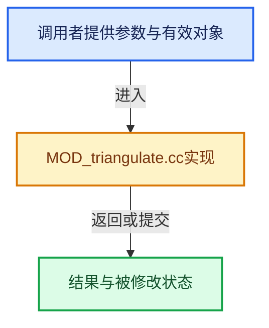

# 实现依赖专题：source/blender/modifiers/intern/MOD_triangulate.cc

[方向导航](README.md) · [符号索引](../%E7%AC%A6%E5%8F%B7%E4%BE%9D%E8%B5%96%E4%B8%8E%E5%AE%9E%E7%8E%B0%E7%B4%A2%E5%BC%95.md)

本专题从正文实际调用进入，集中保存共享实现。函数有稳定锚点，可从调用处直接跳到对应完整函数；递归与互相调用通过回链组织。

## 本文件的实现关系





## 完整成员与函数实现

<a id="f-6baa536ba9f9da29"></a>

### `blender::triangulate_mesh`

实现位置：[source/blender/modifiers/intern/MOD_triangulate.cc](../../../../../source/blender/modifiers/intern/MOD_triangulate.cc) · L33—L79。

接口参数：

- `Mesh *mesh`
- `const int quad_method`
- `const int ngon_method`
- `const int min_vertices`
- `const int flag`

**教学注释版**

<!-- annotated:86626f3ec9377f -->

```cpp
static Mesh *triangulate_mesh(Mesh *mesh,
                              const int quad_method,
                              const int ngon_method,
                              const int min_vertices,
                              const int flag)
{
  Mesh *result;
  BMesh *bm;
  CustomData_MeshMasks cd_mask_extra{};
  cd_mask_extra.vmask = CD_MASK_ORIGINDEX;
  cd_mask_extra.emask = CD_MASK_ORIGINDEX;
  cd_mask_extra.pmask = CD_MASK_ORIGINDEX;

  bool keep_clnors = (flag & MOD_TRIANGULATE_KEEP_CUSTOMLOOP_NORMALS) != 0;

  if (keep_clnors) {
    void *data = CustomData_add_layer(
        &mesh->corner_data, CD_NORMAL, CD_CONSTRUCT, mesh->corners_num);
    // [讲解] memcpy：复制字节，源与目标不应重叠。类型生命周期、对齐和可复制表示须由调用者证明，不是任意对象的复制构造。
    memcpy(data, mesh->corner_normals().data(), mesh->corner_normals().size_in_bytes());
    cd_mask_extra.lmask |= CD_MASK_NORMAL;
  }

  BMeshCreateParams bmesh_create_params{};
  BMeshFromMeshParams bmesh_from_mesh_params{};
  bmesh_from_mesh_params.calc_face_normal = true;
  bmesh_from_mesh_params.calc_vert_normal = false;
  bmesh_from_mesh_params.cd_mask_extra = cd_mask_extra;

  bm = BKE_mesh_to_bmesh_ex(mesh, &bmesh_create_params, &bmesh_from_mesh_params);

  BM_mesh_triangulate(
      bm, quad_method, ngon_method, min_vertices, false, nullptr, nullptr, nullptr);

  result = BKE_mesh_from_bmesh_for_eval_nomain(bm, &cd_mask_extra, mesh);
  BM_mesh_free(bm);

  if (keep_clnors) {
    bke::mesh_set_custom_normals_normalized(
        *result,
        {static_cast<float3 *>(
             CustomData_get_layer_for_write(&result->corner_data, CD_NORMAL, result->corners_num)),
         result->corners_num});
    CustomData_free_layers(&result->corner_data, CD_NORMAL);
  }

  return result;
}
```

<details>
<summary>核对原始源码：source/blender/modifiers/intern/MOD_triangulate.cc · L33—L79</summary>

<!-- original:86626f3ec9377f:source/blender/modifiers/intern/MOD_triangulate.cc:33:79 -->

```cpp
static Mesh *triangulate_mesh(Mesh *mesh,
                              const int quad_method,
                              const int ngon_method,
                              const int min_vertices,
                              const int flag)
{
  Mesh *result;
  BMesh *bm;
  CustomData_MeshMasks cd_mask_extra{};
  cd_mask_extra.vmask = CD_MASK_ORIGINDEX;
  cd_mask_extra.emask = CD_MASK_ORIGINDEX;
  cd_mask_extra.pmask = CD_MASK_ORIGINDEX;

  bool keep_clnors = (flag & MOD_TRIANGULATE_KEEP_CUSTOMLOOP_NORMALS) != 0;

  if (keep_clnors) {
    void *data = CustomData_add_layer(
        &mesh->corner_data, CD_NORMAL, CD_CONSTRUCT, mesh->corners_num);
    memcpy(data, mesh->corner_normals().data(), mesh->corner_normals().size_in_bytes());
    cd_mask_extra.lmask |= CD_MASK_NORMAL;
  }

  BMeshCreateParams bmesh_create_params{};
  BMeshFromMeshParams bmesh_from_mesh_params{};
  bmesh_from_mesh_params.calc_face_normal = true;
  bmesh_from_mesh_params.calc_vert_normal = false;
  bmesh_from_mesh_params.cd_mask_extra = cd_mask_extra;

  bm = BKE_mesh_to_bmesh_ex(mesh, &bmesh_create_params, &bmesh_from_mesh_params);

  BM_mesh_triangulate(
      bm, quad_method, ngon_method, min_vertices, false, nullptr, nullptr, nullptr);

  result = BKE_mesh_from_bmesh_for_eval_nomain(bm, &cd_mask_extra, mesh);
  BM_mesh_free(bm);

  if (keep_clnors) {
    bke::mesh_set_custom_normals_normalized(
        *result,
        {static_cast<float3 *>(
             CustomData_get_layer_for_write(&result->corner_data, CD_NORMAL, result->corners_num)),
         result->corners_num});
    CustomData_free_layers(&result->corner_data, CD_NORMAL);
  }

  return result;
}
```

</details>

**沿实际写入检查状态**

- `cd_mask_extra.vmask = CD_MASK_ORIGINDEX;`
- `cd_mask_extra.emask = CD_MASK_ORIGINDEX;`
- `cd_mask_extra.pmask = CD_MASK_ORIGINDEX;`
- `cd_mask_extra.lmask |= CD_MASK_NORMAL;`
- `bmesh_from_mesh_params.calc_face_normal = true;`
- `bmesh_from_mesh_params.calc_vert_normal = false;`
- `bmesh_from_mesh_params.cd_mask_extra = cd_mask_extra;`
- `bm = BKE_mesh_to_bmesh_ex(mesh, &bmesh_create_params, &bmesh_from_mesh_params);`
- `result = BKE_mesh_from_bmesh_for_eval_nomain(bm, &cd_mask_extra, mesh);`

**结果出口**

- `return result;`

**继续追踪实现**

- `CustomData_add_layer` → [blender::CustomData_add_layer · L2851](%E4%BE%9D%E8%B5%96-customdata-2eef81.md#f-4c7988e825541059)。
- `memcpy` → [外部契约](https://eel.is/c++draft/cstring.syn)：复制字节，源与目标不应重叠。类型生命周期、对齐和可复制表示须由调用者证明，不是任意对象的复制构造。
- `mesh->corner_normals().data` → [调用协议](../%E6%A8%A1%E6%9D%BF%E5%AE%8F%E4%B8%8E%E5%8A%A8%E6%80%81%E5%88%86%E6%B4%BE%E5%8D%8F%E8%AE%AE.md)：接收对象类型依赖auto、返回值或模板实例；不按同名猜测目标。调用位置L51。
- `mesh->corner_normals` → [blender::Mesh::corner_normals · L468](../06-%E9%9A%90%E5%BC%8F%E5%85%B1%E4%BA%AB%E4%B8%8E%E7%BC%93%E5%AD%98%E7%B3%BB%E7%BB%9F/08-%E6%B3%95%E7%BA%BF%E7%BC%93%E5%AD%98%E7%9A%84%E7%9C%9F%E5%AE%9E%E4%BE%9D%E8%B5%96.md#f-91d46c2a581e44bc)。
- `mesh->corner_normals().size_in_bytes` → [调用协议](../%E6%A8%A1%E6%9D%BF%E5%AE%8F%E4%B8%8E%E5%8A%A8%E6%80%81%E5%88%86%E6%B4%BE%E5%8D%8F%E8%AE%AE.md)：接收对象类型依赖auto、返回值或模板实例；不按同名猜测目标。调用位置L51。
- `BKE_mesh_to_bmesh_ex` → [BKE_mesh_to_bmesh_ex · L1583](03-MPoly%E8%BF%81%E7%A7%BB%E4%B8%8E%E5%85%BC%E5%AE%B9.md#f-dd2f413684da0188)。
- `BM_mesh_triangulate` → [blender::BM_mesh_triangulate · L80](%E4%BE%9D%E8%B5%96-bmesh_triangulate-0423c3.md#f-234e032890f12d29)。
- `BKE_mesh_from_bmesh_for_eval_nomain` → [BKE_mesh_from_bmesh_for_eval_nomain · L1620](03-MPoly%E8%BF%81%E7%A7%BB%E4%B8%8E%E5%85%BC%E5%AE%B9.md#f-92b713674a1be50c)。
- `BM_mesh_free` → [blender::BM_mesh_free · L264](%E4%BE%9D%E8%B5%96-bmesh_mesh-283e2d.md#f-3871ddd58daba48c)。
- `bke::mesh_set_custom_normals_normalized` → [blender::bke::mesh_set_custom_normals_normalized · L1700](../06-%E9%9A%90%E5%BC%8F%E5%85%B1%E4%BA%AB%E4%B8%8E%E7%BC%93%E5%AD%98%E7%B3%BB%E7%BB%9F/08-%E6%B3%95%E7%BA%BF%E7%BC%93%E5%AD%98%E7%9A%84%E7%9C%9F%E5%AE%9E%E4%BE%9D%E8%B5%96.md#f-96e05ccd6d9a9c03)。
- `CustomData_get_layer_for_write` → [blender::CustomData_get_layer_for_write · L3318](%E4%BE%9D%E8%B5%96-customdata-2eef81.md#f-6af158905e2c1274)。
- `CustomData_free_layers` → [blender::CustomData_free_layers · L2988](%E4%BE%9D%E8%B5%96-customdata-2eef81.md#f-13fed7d5cd3b8b69)。

<a id="f-f9c60fc8bb90fbca"></a>

### `blender::modify_mesh`

实现位置：[source/blender/modifiers/intern/MOD_triangulate.cc](../../../../../source/blender/modifiers/intern/MOD_triangulate.cc) · L90—L96。

接口参数：

- `ModifierData *md`
- `const ModifierEvalContext *`
- `Mesh *mesh`

**教学注释版**

<!-- annotated:93eae631e45c01 -->

```cpp
static Mesh *modify_mesh(ModifierData *md, const ModifierEvalContext * /*ctx*/, Mesh *mesh)
{
  TriangulateModifierData *tmd = reinterpret_cast<TriangulateModifierData *>(md);
  Mesh *result = triangulate_mesh(
      mesh, tmd->quad_method, tmd->ngon_method, tmd->min_vertices, tmd->flag);
  return (result) ? result : mesh;
}
```

<details>
<summary>核对原始源码：source/blender/modifiers/intern/MOD_triangulate.cc · L90—L96</summary>

<!-- original:93eae631e45c01:source/blender/modifiers/intern/MOD_triangulate.cc:90:96 -->

```cpp
static Mesh *modify_mesh(ModifierData *md, const ModifierEvalContext * /*ctx*/, Mesh *mesh)
{
  TriangulateModifierData *tmd = reinterpret_cast<TriangulateModifierData *>(md);
  Mesh *result = triangulate_mesh(
      mesh, tmd->quad_method, tmd->ngon_method, tmd->min_vertices, tmd->flag);
  return (result) ? result : mesh;
}
```

</details>

**结果出口**

- `return (result) ? result : mesh;`

**继续追踪实现**

- `triangulate_mesh` → [blender::triangulate_mesh · L33](%E4%BE%9D%E8%B5%96-MOD_triangulate-256626.md#f-6baa536ba9f9da29)。
