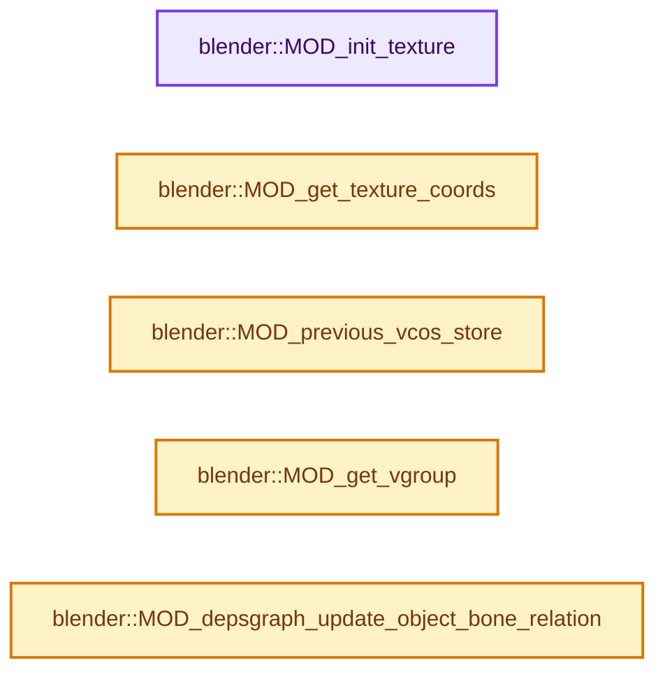
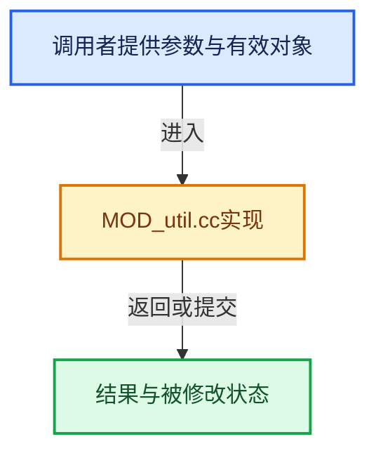

# 实现依赖专题：source/blender/modifiers/intern/MOD_util.cc

[方向导航](README.md) · [符号索引](../%E7%AC%A6%E5%8F%B7%E4%BE%9D%E8%B5%96%E4%B8%8E%E5%AE%9E%E7%8E%B0%E7%B4%A2%E5%BC%95.md)

本专题从正文实际调用进入，集中保存共享实现。函数有稳定锚点，可从调用处直接跳到对应完整函数；递归与互相调用通过回链组织。

## 本文件的实现关系






## 完整成员与函数实现

<a id="f-a8c2c947afb32236"></a>

### `blender::MOD_init_texture`

实现位置：[source/blender/modifiers/intern/MOD_util.cc](../../../../../source/blender/modifiers/intern/MOD_util.cc) · L38—L49。

接口参数：

- `MappingInfoModifierData *dmd`
- `const ModifierEvalContext *ctx`

**教学注释版**

<!-- annotated:a5009fab9e3051 -->

```cpp
void MOD_init_texture(MappingInfoModifierData *dmd, const ModifierEvalContext *ctx)
{
  Tex *tex = dmd->texture;

  if (tex == nullptr) {
    return;
  }

  if (tex->ima && BKE_image_is_animated(tex->ima)) {
    BKE_image_user_frame_calc(tex->ima, &tex->iuser, DEG_get_ctime(ctx->depsgraph));
  }
}
```

<details>
<summary>核对原始源码：source/blender/modifiers/intern/MOD_util.cc · L38—L49</summary>

<!-- original:a5009fab9e3051:source/blender/modifiers/intern/MOD_util.cc:38:49 -->

```cpp
void MOD_init_texture(MappingInfoModifierData *dmd, const ModifierEvalContext *ctx)
{
  Tex *tex = dmd->texture;

  if (tex == nullptr) {
    return;
  }

  if (tex->ima && BKE_image_is_animated(tex->ima)) {
    BKE_image_user_frame_calc(tex->ima, &tex->iuser, DEG_get_ctime(ctx->depsgraph));
  }
}
```

</details>

**继续追踪实现**

- `BKE_image_is_animated` → [blender::BKE_image_is_animated · L5671](%E4%BE%9D%E8%B5%96-image-4859ac.md#f-18fa289262d42bc0)。
- `BKE_image_user_frame_calc` → [blender::BKE_image_user_frame_calc · L5378](%E4%BE%9D%E8%B5%96-image-4859ac.md#f-0450768527d35b14)。
- `DEG_get_ctime` → [blender::DEG_get_ctime · L105](../11-Depsgraph%E4%B8%8E%E5%B9%B6%E8%A1%8C%E4%BB%BB%E5%8A%A1%E7%B3%BB%E7%BB%9F/%E4%BE%9D%E8%B5%96-depsgraph_query-e8b1e4.md#f-156dee0918a22f2f)。

<a id="f-93137e45acd248b6"></a>

### `blender::MOD_get_texture_coords`

实现位置：[source/blender/modifiers/intern/MOD_util.cc](../../../../../source/blender/modifiers/intern/MOD_util.cc) · L51—L142。

接口参数：

- `MappingInfoModifierData *dmd`
- `const ModifierEvalContext *`
- `Object *ob`
- `Mesh *mesh`
- `float (*cos)[3]`
- `float (*r_texco)[3]`

**教学注释版**

<!-- annotated:d5458ea1d6096c -->

```cpp
void MOD_get_texture_coords(MappingInfoModifierData *dmd,
                            const ModifierEvalContext * /*ctx*/,
                            Object *ob,
                            Mesh *mesh,
                            float (*cos)[3],
                            float (*r_texco)[3])
{
  /* TODO: to be renamed to `get_texture_coords` once we are done with moving modifiers to Mesh. */

  const int verts_num = mesh->verts_num;
  int i;
  int texmapping = dmd->texmapping;
  float mapref_imat[4][4];

  if (texmapping == MOD_DISP_MAP_OBJECT) {
    if (dmd->map_object != nullptr) {
      Object *map_object = dmd->map_object;
      if (dmd->map_bone[0] != '\0') {
        bPoseChannel *pchan = BKE_pose_channel_find_name(map_object->pose, dmd->map_bone);
        if (pchan) {
          float mat_bone_world[4][4];
          mul_m4_m4m4(mat_bone_world, map_object->object_to_world().ptr(), pchan->pose_mat);
          invert_m4_m4(mapref_imat, mat_bone_world);
        }
        else {
          invert_m4_m4(mapref_imat, map_object->object_to_world().ptr());
        }
      }
      else {
        invert_m4_m4(mapref_imat, map_object->object_to_world().ptr());
      }
    }
    else { /* if there is no map object, default to local */
      texmapping = MOD_DISP_MAP_LOCAL;
    }
  }

  /* UVs need special handling, since they come from faces */
  if (texmapping == MOD_DISP_MAP_UV) {
    const VectorSet<StringRefNull> uv_map_names = mesh->uv_map_names();
    // [讲解] uv_map_names.is_empty：查询活项数量或键是否存在。
    if (!uv_map_names.is_empty()) {
      const OffsetIndices faces = mesh->faces();
      const Span<int> corner_verts = mesh->corner_verts();
      BLI_bitmap *done = BLI_BITMAP_NEW(verts_num, __func__);
      // [讲解] uv_map_names.contains：查询活项数量或键是否存在。
      const StringRef uvname = uv_map_names.contains(dmd->uvlayer_name) ?
                                   dmd->uvlayer_name :
                                   mesh->active_uv_map_name();
      const bke::AttributeAccessor attributes = mesh->attributes();
      const VArraySpan uv_map = *attributes.lookup_or_default<float2>(
          uvname, bke::AttrDomain::Corner, float2(0));

      /* verts are given the UV from the first face that uses them */
      for (const int i : faces.index_range()) {
        const IndexRange face = faces[i];
        for (const int corner : face) {
          const int vert = corner_verts[corner];
          if (!BLI_BITMAP_TEST(done, vert)) {
            /* remap UVs from [0, 1] to [-1, 1] */
            r_texco[vert][0] = (uv_map[corner][0] * 2.0f) - 1.0f;
            r_texco[vert][1] = (uv_map[corner][1] * 2.0f) - 1.0f;
            BLI_BITMAP_ENABLE(done, vert);
          }
        }
      }

      MEM_delete(done);
      return;
    }

    /* if there are no UVs, default to local */
    texmapping = MOD_DISP_MAP_LOCAL;
  }

  const Span<float3> positions = mesh->vert_positions();
  for (i = 0; i < verts_num; i++, r_texco++) {
    switch (texmapping) {
      case MOD_DISP_MAP_LOCAL:
        copy_v3_v3(*r_texco, cos != nullptr ? *cos : positions[i]);
        break;
      case MOD_DISP_MAP_GLOBAL:
        mul_v3_m4v3(*r_texco, ob->object_to_world().ptr(), cos != nullptr ? *cos : positions[i]);
        break;
      case MOD_DISP_MAP_OBJECT:
        mul_v3_m4v3(*r_texco, ob->object_to_world().ptr(), cos != nullptr ? *cos : positions[i]);
        mul_m4_v3(mapref_imat, *r_texco);
        break;
    }
    if (cos != nullptr) {
      cos++;
    }
  }
}
```

<details>
<summary>核对原始源码：source/blender/modifiers/intern/MOD_util.cc · L51—L142</summary>

<!-- original:d5458ea1d6096c:source/blender/modifiers/intern/MOD_util.cc:51:142 -->

```cpp
void MOD_get_texture_coords(MappingInfoModifierData *dmd,
                            const ModifierEvalContext * /*ctx*/,
                            Object *ob,
                            Mesh *mesh,
                            float (*cos)[3],
                            float (*r_texco)[3])
{
  /* TODO: to be renamed to `get_texture_coords` once we are done with moving modifiers to Mesh. */

  const int verts_num = mesh->verts_num;
  int i;
  int texmapping = dmd->texmapping;
  float mapref_imat[4][4];

  if (texmapping == MOD_DISP_MAP_OBJECT) {
    if (dmd->map_object != nullptr) {
      Object *map_object = dmd->map_object;
      if (dmd->map_bone[0] != '\0') {
        bPoseChannel *pchan = BKE_pose_channel_find_name(map_object->pose, dmd->map_bone);
        if (pchan) {
          float mat_bone_world[4][4];
          mul_m4_m4m4(mat_bone_world, map_object->object_to_world().ptr(), pchan->pose_mat);
          invert_m4_m4(mapref_imat, mat_bone_world);
        }
        else {
          invert_m4_m4(mapref_imat, map_object->object_to_world().ptr());
        }
      }
      else {
        invert_m4_m4(mapref_imat, map_object->object_to_world().ptr());
      }
    }
    else { /* if there is no map object, default to local */
      texmapping = MOD_DISP_MAP_LOCAL;
    }
  }

  /* UVs need special handling, since they come from faces */
  if (texmapping == MOD_DISP_MAP_UV) {
    const VectorSet<StringRefNull> uv_map_names = mesh->uv_map_names();
    if (!uv_map_names.is_empty()) {
      const OffsetIndices faces = mesh->faces();
      const Span<int> corner_verts = mesh->corner_verts();
      BLI_bitmap *done = BLI_BITMAP_NEW(verts_num, __func__);
      const StringRef uvname = uv_map_names.contains(dmd->uvlayer_name) ?
                                   dmd->uvlayer_name :
                                   mesh->active_uv_map_name();
      const bke::AttributeAccessor attributes = mesh->attributes();
      const VArraySpan uv_map = *attributes.lookup_or_default<float2>(
          uvname, bke::AttrDomain::Corner, float2(0));

      /* verts are given the UV from the first face that uses them */
      for (const int i : faces.index_range()) {
        const IndexRange face = faces[i];
        for (const int corner : face) {
          const int vert = corner_verts[corner];
          if (!BLI_BITMAP_TEST(done, vert)) {
            /* remap UVs from [0, 1] to [-1, 1] */
            r_texco[vert][0] = (uv_map[corner][0] * 2.0f) - 1.0f;
            r_texco[vert][1] = (uv_map[corner][1] * 2.0f) - 1.0f;
            BLI_BITMAP_ENABLE(done, vert);
          }
        }
      }

      MEM_delete(done);
      return;
    }

    /* if there are no UVs, default to local */
    texmapping = MOD_DISP_MAP_LOCAL;
  }

  const Span<float3> positions = mesh->vert_positions();
  for (i = 0; i < verts_num; i++, r_texco++) {
    switch (texmapping) {
      case MOD_DISP_MAP_LOCAL:
        copy_v3_v3(*r_texco, cos != nullptr ? *cos : positions[i]);
        break;
      case MOD_DISP_MAP_GLOBAL:
        mul_v3_m4v3(*r_texco, ob->object_to_world().ptr(), cos != nullptr ? *cos : positions[i]);
        break;
      case MOD_DISP_MAP_OBJECT:
        mul_v3_m4v3(*r_texco, ob->object_to_world().ptr(), cos != nullptr ? *cos : positions[i]);
        mul_m4_v3(mapref_imat, *r_texco);
        break;
    }
    if (cos != nullptr) {
      cos++;
    }
  }
}
```

</details>

**沿实际写入检查状态**

- `texmapping = MOD_DISP_MAP_LOCAL;`
- `r_texco[vert][0] = (uv_map[corner][0] * 2.0f) - 1.0f;`
- `r_texco[vert][1] = (uv_map[corner][1] * 2.0f) - 1.0f;`

**继续追踪实现**

- `BKE_pose_channel_find_name` → [blender::BKE_pose_channel_find_name · L895](%E4%BE%9D%E8%B5%96-action-b3a47a.md#f-5997206551bfc9f9)。
- `mul_m4_m4m4` → [blender::mul_m4_m4m4 · L217](../12-%E7%A9%BA%E9%97%B4%E6%95%B0%E6%8D%AE%E7%BB%93%E6%9E%84%E4%B8%8E%E5%87%A0%E4%BD%95%E7%AE%97%E6%B3%95/%E4%BE%9D%E8%B5%96-math_matrix_c-004123.md#f-b5272136b543b73b)。
- `map_object->object_to_world().ptr` → [调用协议](../%E6%A8%A1%E6%9D%BF%E5%AE%8F%E4%B8%8E%E5%8A%A8%E6%80%81%E5%88%86%E6%B4%BE%E5%8D%8F%E8%AE%AE.md)：接收对象类型依赖auto、返回值或模板实例；不按同名猜测目标。调用位置L72。
- `map_object->object_to_world` → [blender::Object::object_to_world · L5761](%E4%BE%9D%E8%B5%96-object-843689.md#f-12fc20026327d50c)。
- `invert_m4_m4` → [blender::invert_m4_m4 · L1150](../12-%E7%A9%BA%E9%97%B4%E6%95%B0%E6%8D%AE%E7%BB%93%E6%9E%84%E4%B8%8E%E5%87%A0%E4%BD%95%E7%AE%97%E6%B3%95/%E4%BE%9D%E8%B5%96-math_matrix_c-004123.md#f-c75789f10cdd5b92)。
- `mesh->uv_map_names` → [Mesh::uv_map_names · L1308](03-MPoly%E8%BF%81%E7%A7%BB%E4%B8%8E%E5%85%BC%E5%AE%B9.md#f-6f71b15466566fad)。
- `uv_map_names.is_empty` → [blender::VectorSet::is_empty · L619](../01-%E5%9F%BA%E7%A1%80%E5%AE%B9%E5%99%A8%E4%B8%8E%E7%8E%B0%E4%BB%A3CPP/14-VectorSet%E7%A8%B3%E5%AE%9A%E7%B4%A2%E5%BC%95%E4%B8%8E%E5%8E%BB%E9%87%8D.md#f-0d62a24040f63dec)。
- `mesh->faces` → [Mesh::faces · L1217](03-MPoly%E8%BF%81%E7%A7%BB%E4%B8%8E%E5%85%BC%E5%AE%B9.md#f-ea444760154e17b2)。
- `mesh->corner_verts` → [Mesh::corner_verts · L1238](03-MPoly%E8%BF%81%E7%A7%BB%E4%B8%8E%E5%85%BC%E5%AE%B9.md#f-a59c61f583b64bc4)。
- `BLI_BITMAP_NEW` → [BLI_BITMAP_NEW · L39](../02-%E5%93%88%E5%B8%8C%E8%A1%A8%E4%B8%8E%E5%85%B3%E8%81%94%E6%95%B0%E6%8D%AE%E7%BB%93%E6%9E%84/%E4%BE%9D%E8%B5%96-BLI_bitmap-693b86.md#m-77dce9cd8859)。宏定义由构建条件选择。
- `uv_map_names.contains` → [blender::VectorSet::contains · L406](../01-%E5%9F%BA%E7%A1%80%E5%AE%B9%E5%99%A8%E4%B8%8E%E7%8E%B0%E4%BB%A3CPP/14-VectorSet%E7%A8%B3%E5%AE%9A%E7%B4%A2%E5%BC%95%E4%B8%8E%E5%8E%BB%E9%87%8D.md#f-c940dd79693ca442)。
- `mesh->active_uv_map_name` → [Mesh::active_uv_map_name · L1319](03-MPoly%E8%BF%81%E7%A7%BB%E4%B8%8E%E5%85%BC%E5%AE%B9.md#f-9b4762e851836e79)。
- `mesh->attributes` → [Mesh::attributes · L1298](03-MPoly%E8%BF%81%E7%A7%BB%E4%B8%8E%E5%85%BC%E5%AE%B9.md#f-607bbfe3e57cfc7f)。
- `attributes.lookup_or_default<float2>` → [blender::bke::AttributeAccessor::lookup_or_default · L415](%E4%BE%9D%E8%B5%96-attribute_access-bceef3.md#f-a0cc3e316f1da4bd)；[blender::bke::AttributeAccessor::lookup_or_default · L643](08-AttributeAccessor%E6%8E%A5%E5%8F%A3.md#f-e3d2ed81ebe0af61)。同名重载需按实参类型选择。
- `float2` → [float2::float2 · L45](%E4%BE%9D%E8%B5%96-sky_math-8091a6.md#f-04c2783f21f996aa)；[float2::float2 · L47](%E4%BE%9D%E8%B5%96-sky_math-8091a6.md#f-dba79c4c10e5ea46)；[float2::float2 · L49](%E4%BE%9D%E8%B5%96-sky_math-8091a6.md#f-920ca90efa37bf0b)；[float2::float2 · L51](%E4%BE%9D%E8%B5%96-sky_math-8091a6.md#f-4b3fbf848d719a63)；[float2::float2 · L53](%E4%BE%9D%E8%B5%96-sky_math-8091a6.md#f-9b2acd8475cc2843)；[float2::float2 · L55](%E4%BE%9D%E8%B5%96-sky_math-8091a6.md#f-1e9233a9a231be51)。同名重载需按实参类型选择。
- `faces.index_range` → [blender::offset_indices::OffsetIndices::index_range · L77](02-OffsetIndices%E5%AE%8C%E6%95%B4%E6%8E%A5%E5%8F%A3.md#f-19b5ca1456de007d)。
- `BLI_BITMAP_TEST` → [BLI_BITMAP_TEST · L63](../02-%E5%93%88%E5%B8%8C%E8%A1%A8%E4%B8%8E%E5%85%B3%E8%81%94%E6%95%B0%E6%8D%AE%E7%BB%93%E6%9E%84/%E4%BE%9D%E8%B5%96-BLI_bitmap-693b86.md#m-631c4702a77d)。宏定义由构建条件选择。
- `BLI_BITMAP_ENABLE` → [BLI_BITMAP_ENABLE · L80](../02-%E5%93%88%E5%B8%8C%E8%A1%A8%E4%B8%8E%E5%85%B3%E8%81%94%E6%95%B0%E6%8D%AE%E7%BB%93%E6%9E%84/%E4%BE%9D%E8%B5%96-BLI_bitmap-693b86.md#m-6b0abc936749)。宏定义由构建条件选择。
- `MEM_delete` → [MEM_delete · L400](../03-%E5%86%85%E5%AD%98%E5%88%86%E9%85%8D%E4%B8%8E%E8%BF%90%E8%A1%8C%E6%97%B6%E7%B1%BB%E5%9E%8B/%E4%BE%9D%E8%B5%96-MEM_guardedalloc-b54eca.md#f-9049ffdd1682887c)。
- `mesh->vert_positions` → [Mesh::vert_positions · L1193](03-MPoly%E8%BF%81%E7%A7%BB%E4%B8%8E%E5%85%BC%E5%AE%B9.md#f-ae4177e5c5f2b371)。
- `copy_v3_v3` → [blender::copy_v3_v3 · L47](../12-%E7%A9%BA%E9%97%B4%E6%95%B0%E6%8D%AE%E7%BB%93%E6%9E%84%E4%B8%8E%E5%87%A0%E4%BD%95%E7%AE%97%E6%B3%95/%E4%BE%9D%E8%B5%96-math_vector_inline-0c8541.md#f-037a0d5fa5060bd6)。
- `mul_v3_m4v3` → [blender::mul_v3_m4v3 · L687](../12-%E7%A9%BA%E9%97%B4%E6%95%B0%E6%8D%AE%E7%BB%93%E6%9E%84%E4%B8%8E%E5%87%A0%E4%BD%95%E7%AE%97%E6%B3%95/%E4%BE%9D%E8%B5%96-math_matrix_c-004123.md#f-31076c71c40783a8)。
- `ob->object_to_world().ptr` → [调用协议](../%E6%A8%A1%E6%9D%BF%E5%AE%8F%E4%B8%8E%E5%8A%A8%E6%80%81%E5%88%86%E6%B4%BE%E5%8D%8F%E8%AE%AE.md)：接收对象类型依赖auto、返回值或模板实例；不按同名猜测目标。调用位置L131。
- `ob->object_to_world` → [blender::Object::object_to_world · L5761](%E4%BE%9D%E8%B5%96-object-843689.md#f-12fc20026327d50c)。
- `mul_m4_v3` → [blender::mul_m4_v3 · L677](../12-%E7%A9%BA%E9%97%B4%E6%95%B0%E6%8D%AE%E7%BB%93%E6%9E%84%E4%B8%8E%E5%87%A0%E4%BD%95%E7%AE%97%E6%B3%95/%E4%BE%9D%E8%B5%96-math_matrix_c-004123.md#f-14a8c267710d47a3)。

<a id="f-3c67667357b76b7a"></a>

### `blender::MOD_previous_vcos_store`

实现位置：[source/blender/modifiers/intern/MOD_util.cc](../../../../../source/blender/modifiers/intern/MOD_util.cc) · L144—L156。

接口参数：

- `ModifierData *md`
- `const float (*vert_coords)[3]`

**教学注释版**

<!-- annotated:bd10ad2c30f936 -->

```cpp
void MOD_previous_vcos_store(ModifierData *md, const float (*vert_coords)[3])
{
  while ((md = md->next) && md->type == eModifierType_Armature) {
    ArmatureModifierData *amd = reinterpret_cast<ArmatureModifierData *>(md);
    if (amd->multi && amd->vert_coords_prev == nullptr) {
      amd->vert_coords_prev = MEM_dupalloc(vert_coords);
    }
    else {
      break;
    }
  }
  /* lattice/mesh modifier too */
}
```

<details>
<summary>核对原始源码：source/blender/modifiers/intern/MOD_util.cc · L144—L156</summary>

<!-- original:bd10ad2c30f936:source/blender/modifiers/intern/MOD_util.cc:144:156 -->

```cpp
void MOD_previous_vcos_store(ModifierData *md, const float (*vert_coords)[3])
{
  while ((md = md->next) && md->type == eModifierType_Armature) {
    ArmatureModifierData *amd = reinterpret_cast<ArmatureModifierData *>(md);
    if (amd->multi && amd->vert_coords_prev == nullptr) {
      amd->vert_coords_prev = MEM_dupalloc(vert_coords);
    }
    else {
      break;
    }
  }
  /* lattice/mesh modifier too */
}
```

</details>

**沿实际写入检查状态**

- `amd->vert_coords_prev = MEM_dupalloc(vert_coords);`

**继续追踪实现**

- `MEM_dupalloc` → [MEM_dupalloc · L627](../03-%E5%86%85%E5%AD%98%E5%88%86%E9%85%8D%E4%B8%8E%E8%BF%90%E8%A1%8C%E6%97%B6%E7%B1%BB%E5%9E%8B/%E4%BE%9D%E8%B5%96-MEM_guardedalloc-b54eca.md#f-78a72b71e3c57010)。

<a id="f-f461611d86b94405"></a>

### `blender::MOD_get_vgroup`

实现位置：[source/blender/modifiers/intern/MOD_util.cc](../../../../../source/blender/modifiers/intern/MOD_util.cc) · L158—L186。

接口参数：

- `const Object *ob`
- `const Mesh *mesh`
- `const char *name`
- `const MDeformVert **dvert`
- `int *defgrp_index`

**教学注释版**

<!-- annotated:523dcb798bf480 -->

```cpp
void MOD_get_vgroup(const Object *ob,
                    const Mesh *mesh,
                    const char *name,
                    const MDeformVert **dvert,
                    int *defgrp_index)
{
  if (mesh) {
    *defgrp_index = BKE_id_defgroup_name_index(&mesh->id, name);
    if (*defgrp_index != -1) {
      *dvert = mesh->deform_verts().data();
    }
    else {
      *dvert = nullptr;
    }
  }
  else if (OB_TYPE_SUPPORT_VGROUP(ob->type)) {
    *defgrp_index = BKE_object_defgroup_name_index(ob, name);
    if (*defgrp_index != -1 && ob->type == OB_LATTICE) {
      *dvert = BKE_lattice_deform_verts_get(ob);
    }
    else {
      *dvert = nullptr;
    }
  }
  else {
    *defgrp_index = -1;
    *dvert = nullptr;
  }
}
```

<details>
<summary>核对原始源码：source/blender/modifiers/intern/MOD_util.cc · L158—L186</summary>

<!-- original:523dcb798bf480:source/blender/modifiers/intern/MOD_util.cc:158:186 -->

```cpp
void MOD_get_vgroup(const Object *ob,
                    const Mesh *mesh,
                    const char *name,
                    const MDeformVert **dvert,
                    int *defgrp_index)
{
  if (mesh) {
    *defgrp_index = BKE_id_defgroup_name_index(&mesh->id, name);
    if (*defgrp_index != -1) {
      *dvert = mesh->deform_verts().data();
    }
    else {
      *dvert = nullptr;
    }
  }
  else if (OB_TYPE_SUPPORT_VGROUP(ob->type)) {
    *defgrp_index = BKE_object_defgroup_name_index(ob, name);
    if (*defgrp_index != -1 && ob->type == OB_LATTICE) {
      *dvert = BKE_lattice_deform_verts_get(ob);
    }
    else {
      *dvert = nullptr;
    }
  }
  else {
    *defgrp_index = -1;
    *dvert = nullptr;
  }
}
```

</details>

**继续追踪实现**

- `BKE_id_defgroup_name_index` → [blender::BKE_id_defgroup_name_index · L557](%E4%BE%9D%E8%B5%96-deform-6949f4.md#f-886667bbd10fa710)。
- `mesh->deform_verts().data` → [调用协议](../%E6%A8%A1%E6%9D%BF%E5%AE%8F%E4%B8%8E%E5%8A%A8%E6%80%81%E5%88%86%E6%B4%BE%E5%8D%8F%E8%AE%AE.md)：接收对象类型依赖auto、返回值或模板实例；不按同名猜测目标。调用位置L167。
- `mesh->deform_verts` → [Mesh::deform_verts · L1266](03-MPoly%E8%BF%81%E7%A7%BB%E4%B8%8E%E5%85%BC%E5%AE%B9.md#f-4c0433aad24aa301)。
- `OB_TYPE_SUPPORT_VGROUP` → [OB_TYPE_SUPPORT_VGROUP · L734](%E4%BE%9D%E8%B5%96-DNA_object_types-2c8fa3.md#m-418d8ceae920)。宏定义由构建条件选择。
- `BKE_object_defgroup_name_index` → [blender::BKE_object_defgroup_name_index · L597](%E4%BE%9D%E8%B5%96-deform-6949f4.md#f-ad856e5bba5cd758)。
- `BKE_lattice_deform_verts_get` → [blender::BKE_lattice_deform_verts_get · L583](%E4%BE%9D%E8%B5%96-lattice-b3920b.md#f-93c02e0870685a74)。

<a id="f-b4d8d5d84915768b"></a>

### `blender::MOD_depsgraph_update_object_bone_relation`

实现位置：[source/blender/modifiers/intern/MOD_util.cc](../../../../../source/blender/modifiers/intern/MOD_util.cc) · L188—L202。

接口参数：

- `DepsNodeHandle *node`
- `Object *object`
- `const char *bonename`
- `const char *description`

**教学注释版**

<!-- annotated:e6b231900811bd -->

```cpp
void MOD_depsgraph_update_object_bone_relation(DepsNodeHandle *node,
                                               Object *object,
                                               const char *bonename,
                                               const char *description)
{
  if (object == nullptr) {
    return;
  }
  if (bonename[0] != '\0' && object->type == OB_ARMATURE) {
    DEG_add_object_relation(node, object, DEG_OB_COMP_EVAL_POSE, description);
  }
  else {
    DEG_add_object_relation(node, object, DEG_OB_COMP_TRANSFORM, description);
  }
}
```

<details>
<summary>核对原始源码：source/blender/modifiers/intern/MOD_util.cc · L188—L202</summary>

<!-- original:e6b231900811bd:source/blender/modifiers/intern/MOD_util.cc:188:202 -->

```cpp
void MOD_depsgraph_update_object_bone_relation(DepsNodeHandle *node,
                                               Object *object,
                                               const char *bonename,
                                               const char *description)
{
  if (object == nullptr) {
    return;
  }
  if (bonename[0] != '\0' && object->type == OB_ARMATURE) {
    DEG_add_object_relation(node, object, DEG_OB_COMP_EVAL_POSE, description);
  }
  else {
    DEG_add_object_relation(node, object, DEG_OB_COMP_TRANSFORM, description);
  }
}
```

</details>

**继续追踪实现**

- `DEG_add_object_relation` → [blender::DEG_add_object_relation · L123](../11-Depsgraph%E4%B8%8E%E5%B9%B6%E8%A1%8C%E4%BB%BB%E5%8A%A1%E7%B3%BB%E7%BB%9F/%E4%BE%9D%E8%B5%96-depsgraph_build-ea2fc8.md#f-f570cffae97e273c)。
