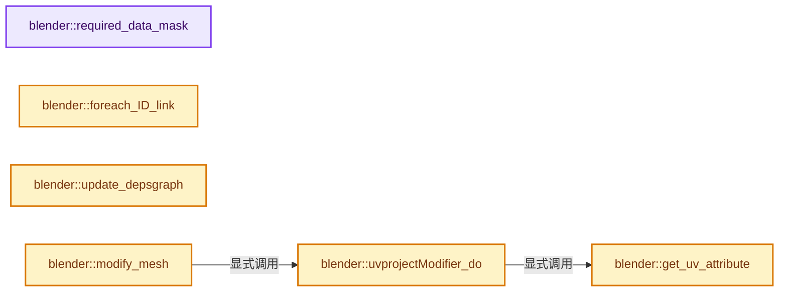

# 实现依赖专题：source/blender/modifiers/intern/MOD_uvproject.cc

[方向导航](README.md) · [符号索引](../%E7%AC%A6%E5%8F%B7%E4%BE%9D%E8%B5%96%E4%B8%8E%E5%AE%9E%E7%8E%B0%E7%B4%A2%E5%BC%95.md)

本专题从正文实际调用进入，集中保存共享实现。函数有稳定锚点，可从调用处直接跳到对应完整函数；递归与互相调用通过回链组织。

## 本文件的实现关系




## 完整成员与函数实现

<a id="f-2e1541473026ca83"></a>

### `blender::required_data_mask`

实现位置：[source/blender/modifiers/intern/MOD_uvproject.cc](../../../../../source/blender/modifiers/intern/MOD_uvproject.cc) · L53—L57。

接口参数：

- `ModifierData *`
- `CustomData_MeshMasks *r_cddata_masks`

**教学注释版**

<!-- annotated:872d8ea5f3e52d -->

```cpp
static void required_data_mask(ModifierData * /*md*/, CustomData_MeshMasks *r_cddata_masks)
{
  /* ask for UV coordinates */
  r_cddata_masks->lmask |= CD_MASK_PROP_FLOAT2;
}
```

<details>
<summary>核对原始源码：source/blender/modifiers/intern/MOD_uvproject.cc · L53—L57</summary>

<!-- original:872d8ea5f3e52d:source/blender/modifiers/intern/MOD_uvproject.cc:53:57 -->

```cpp
static void required_data_mask(ModifierData * /*md*/, CustomData_MeshMasks *r_cddata_masks)
{
  /* ask for UV coordinates */
  r_cddata_masks->lmask |= CD_MASK_PROP_FLOAT2;
}
```

</details>

**沿实际写入检查状态**

- `r_cddata_masks->lmask |= CD_MASK_PROP_FLOAT2;`

**继续追踪实现**

本实现没有需要继续展开的显式调用；检查返回表达式、对象转换和调用者前置条件。

<a id="f-7a84f03a144c35f8"></a>

### `blender::foreach_ID_link`

实现位置：[source/blender/modifiers/intern/MOD_uvproject.cc](../../../../../source/blender/modifiers/intern/MOD_uvproject.cc) · L59—L65。

接口参数：

- `ModifierData *md`
- `Object *ob`
- `IDWalkFunc walk`
- `void *user_data`

**教学注释版**

<!-- annotated:09456dab47e9cf -->

```cpp
static void foreach_ID_link(ModifierData *md, Object *ob, IDWalkFunc walk, void *user_data)
{
  UVProjectModifierData *umd = reinterpret_cast<UVProjectModifierData *>(md);
  for (int i = 0; i < MOD_UVPROJECT_MAXPROJECTORS; i++) {
    walk(user_data, ob, reinterpret_cast<ID **>(&umd->projectors[i]), IDWALK_CB_NOP);
  }
}
```

<details>
<summary>核对原始源码：source/blender/modifiers/intern/MOD_uvproject.cc · L59—L65</summary>

<!-- original:09456dab47e9cf:source/blender/modifiers/intern/MOD_uvproject.cc:59:65 -->

```cpp
static void foreach_ID_link(ModifierData *md, Object *ob, IDWalkFunc walk, void *user_data)
{
  UVProjectModifierData *umd = reinterpret_cast<UVProjectModifierData *>(md);
  for (int i = 0; i < MOD_UVPROJECT_MAXPROJECTORS; i++) {
    walk(user_data, ob, reinterpret_cast<ID **>(&umd->projectors[i]), IDWALK_CB_NOP);
  }
}
```

</details>

**继续追踪实现**

- `walk` → [调用协议](../%E6%A8%A1%E6%9D%BF%E5%AE%8F%E4%B8%8E%E5%8A%A8%E6%80%81%E5%88%86%E6%B4%BE%E5%8D%8F%E8%AE%AE.md)：局部可调用对象，须结合其初始化与捕获环境。调用位置L63。

<a id="f-45460d898dd29262"></a>

### `blender::update_depsgraph`

实现位置：[source/blender/modifiers/intern/MOD_uvproject.cc](../../../../../source/blender/modifiers/intern/MOD_uvproject.cc) · L67—L81。

接口参数：

- `ModifierData *md`
- `const ModifierUpdateDepsgraphContext *ctx`

**教学注释版**

<!-- annotated:d9fe660e06fdf3 -->

```cpp
static void update_depsgraph(ModifierData *md, const ModifierUpdateDepsgraphContext *ctx)
{
  UVProjectModifierData *umd = reinterpret_cast<UVProjectModifierData *>(md);
  bool do_add_own_transform = false;
  for (int i = 0; i < umd->projectors_num; i++) {
    if (umd->projectors[i] != nullptr) {
      DEG_add_object_relation(
          ctx->node, umd->projectors[i], DEG_OB_COMP_TRANSFORM, "UV Project Modifier");
      do_add_own_transform = true;
    }
  }
  if (do_add_own_transform) {
    DEG_add_depends_on_transform_relation(ctx->node, "UV Project Modifier");
  }
}
```

<details>
<summary>核对原始源码：source/blender/modifiers/intern/MOD_uvproject.cc · L67—L81</summary>

<!-- original:d9fe660e06fdf3:source/blender/modifiers/intern/MOD_uvproject.cc:67:81 -->

```cpp
static void update_depsgraph(ModifierData *md, const ModifierUpdateDepsgraphContext *ctx)
{
  UVProjectModifierData *umd = reinterpret_cast<UVProjectModifierData *>(md);
  bool do_add_own_transform = false;
  for (int i = 0; i < umd->projectors_num; i++) {
    if (umd->projectors[i] != nullptr) {
      DEG_add_object_relation(
          ctx->node, umd->projectors[i], DEG_OB_COMP_TRANSFORM, "UV Project Modifier");
      do_add_own_transform = true;
    }
  }
  if (do_add_own_transform) {
    DEG_add_depends_on_transform_relation(ctx->node, "UV Project Modifier");
  }
}
```

</details>

**沿实际写入检查状态**

- `do_add_own_transform = true;`

**继续追踪实现**

- `DEG_add_object_relation` → [blender::DEG_add_object_relation · L123](../11-Depsgraph%E4%B8%8E%E5%B9%B6%E8%A1%8C%E4%BB%BB%E5%8A%A1%E7%B3%BB%E7%BB%9F/%E4%BE%9D%E8%B5%96-depsgraph_build-ea2fc8.md#f-f570cffae97e273c)。
- `DEG_add_depends_on_transform_relation` → [blender::DEG_add_depends_on_transform_relation · L240](../11-Depsgraph%E4%B8%8E%E5%B9%B6%E8%A1%8C%E4%BB%BB%E5%8A%A1%E7%B3%BB%E7%BB%9F/%E4%BE%9D%E8%B5%96-depsgraph_build-ea2fc8.md#f-47c32a354defa20d)。

<a id="f-5de8f940f4e6a67d"></a>

### `blender::get_uv_attribute`

实现位置：[source/blender/modifiers/intern/MOD_uvproject.cc](../../../../../source/blender/modifiers/intern/MOD_uvproject.cc) · L90—L106。

接口参数：

- `Mesh &mesh`
- `const StringRef md_name`

**教学注释版**

<!-- annotated:58439e6a2186d0 -->

```cpp
static bke::SpanAttributeWriter<float2> get_uv_attribute(Mesh &mesh, const StringRef md_name)
{
  bke::MutableAttributeAccessor attributes = mesh.attributes_for_write();
  if (md_name.is_empty()) {
    const StringRef name = mesh.active_uv_map_name();
    return attributes.lookup_or_add_for_write_span<float2>(name.is_empty() ? "Float2" : name,
                                                           bke::AttrDomain::Corner);
  }
  if (bke::SpanAttributeWriter<float2> attribute = attributes.lookup_or_add_for_write_span<float2>(
          md_name, bke::AttrDomain::Corner))
  {
    return attribute;
  }
  AttributeOwner owner = AttributeOwner::from_id(&mesh.id);
  const std::string name = BKE_attribute_calc_unique_name(owner, md_name);
  return attributes.lookup_or_add_for_write_span<float2>(name, bke::AttrDomain::Corner);
}
```

<details>
<summary>核对原始源码：source/blender/modifiers/intern/MOD_uvproject.cc · L90—L106</summary>

<!-- original:58439e6a2186d0:source/blender/modifiers/intern/MOD_uvproject.cc:90:106 -->

```cpp
static bke::SpanAttributeWriter<float2> get_uv_attribute(Mesh &mesh, const StringRef md_name)
{
  bke::MutableAttributeAccessor attributes = mesh.attributes_for_write();
  if (md_name.is_empty()) {
    const StringRef name = mesh.active_uv_map_name();
    return attributes.lookup_or_add_for_write_span<float2>(name.is_empty() ? "Float2" : name,
                                                           bke::AttrDomain::Corner);
  }
  if (bke::SpanAttributeWriter<float2> attribute = attributes.lookup_or_add_for_write_span<float2>(
          md_name, bke::AttrDomain::Corner))
  {
    return attribute;
  }
  AttributeOwner owner = AttributeOwner::from_id(&mesh.id);
  const std::string name = BKE_attribute_calc_unique_name(owner, md_name);
  return attributes.lookup_or_add_for_write_span<float2>(name, bke::AttrDomain::Corner);
}
```

</details>

**结果出口**

- `return attributes.lookup_or_add_for_write_span<float2>(name.is_empty() ? "Float2" : name,`
- `return attribute;`
- `return attributes.lookup_or_add_for_write_span<float2>(name, bke::AttrDomain::Corner);`

**继续追踪实现**

- `mesh.attributes_for_write` → [Mesh::attributes_for_write · L1303](03-MPoly%E8%BF%81%E7%A7%BB%E4%B8%8E%E5%85%BC%E5%AE%B9.md#f-ca7af2f1a15f0bc4)。
- `md_name.is_empty` → [blender::Bounds<T>::is_empty · L533](../12-%E7%A9%BA%E9%97%B4%E6%95%B0%E6%8D%AE%E7%BB%93%E6%9E%84%E4%B8%8E%E5%87%A0%E4%BD%95%E7%AE%97%E6%B3%95/07-Bounds%E4%B8%8EBVH%E5%AF%B9%E6%AF%94.md#f-55ac376b3d0a0944)；[blender::GVArrayCommon::is_empty · L767](../04-%E8%99%9A%E6%8B%9F%E6%95%B0%E7%BB%84%E4%B8%8E%E7%B4%A2%E5%BC%95%E9%80%89%E6%8B%A9/05-GVArray%E8%BF%90%E8%A1%8C%E6%97%B6%E7%B1%BB%E5%9E%8B.md#f-c1da602ffc5555f9)；[blender::StringRefBase::is_empty · L201](../01-%E5%9F%BA%E7%A1%80%E5%AE%B9%E5%99%A8%E4%B8%8E%E7%8E%B0%E4%BB%A3CPP/15-StringRef%E5%AD%97%E7%AC%A6%E4%B8%B2%E8%A7%86%E5%9B%BE.md#f-9f6c3d2da1cb1796)；[blender::KDTreeNew<T>::is_empty · L498](../12-%E7%A9%BA%E9%97%B4%E6%95%B0%E6%8D%AE%E7%BB%93%E6%9E%84%E4%B8%8E%E5%87%A0%E4%BD%95%E7%AE%97%E6%B3%95/05-K%E8%BF%91%E9%82%BB%E4%B8%8E%E8%8C%83%E5%9B%B4%E6%9F%A5%E8%AF%A2.md#f-67f0ff91cf00b00b)。同名重载需按实参类型选择。
- `mesh.active_uv_map_name` → [Mesh::active_uv_map_name · L1319](03-MPoly%E8%BF%81%E7%A7%BB%E4%B8%8E%E5%85%BC%E5%AE%B9.md#f-9b4762e851836e79)。
- `attributes.lookup_or_add_for_write_span<float2>` → [blender::bke::MutableAttributeAccessor::lookup_or_add_for_write_span · L533](%E4%BE%9D%E8%B5%96-attribute_access-bceef3.md#f-c533eff1b9a4973e)；[blender::bke::MutableAttributeAccessor::lookup_or_add_for_write_span · L861](08-AttributeAccessor%E6%8E%A5%E5%8F%A3.md#f-aa4c0d5a61437381)。同名重载需按实参类型选择。
- `name.is_empty` → [外部契约](https://eel.is/c++draft/)：这个边界按实际表达式及所属类型核对参数、返回值、寿命与失败行为。这里提供接口入口，不声称已解释该第三方版本的内部实现。
- `AttributeOwner::from_id` → [blender::AttributeOwner::from_id · L46](%E4%BE%9D%E8%B5%96-attribute-2d9c29.md#f-866554bb7829a861)。
- `BKE_attribute_calc_unique_name` → [blender::BKE_attribute_calc_unique_name · L351](%E4%BE%9D%E8%B5%96-attribute-2d9c29.md#f-c4ca40dc5668ffb2)。

<a id="f-cbf35c1403e286df"></a>

### `blender::uvprojectModifier_do`

实现位置：[source/blender/modifiers/intern/MOD_uvproject.cc](../../../../../source/blender/modifiers/intern/MOD_uvproject.cc) · L108—L280。

接口参数：

- `UVProjectModifierData *umd`
- `const ModifierEvalContext *`
- `Object *ob`
- `Mesh *mesh`

**教学注释版**

<!-- annotated:b1121788c534ca -->

```cpp
static Mesh *uvprojectModifier_do(UVProjectModifierData *umd,
                                  const ModifierEvalContext * /*ctx*/,
                                  Object *ob,
                                  Mesh *mesh)
{
  Projector projectors[MOD_UVPROJECT_MAXPROJECTORS];
  int projectors_num = 0;
  float aspx = umd->aspectx ? umd->aspectx : 1.0f;
  float aspy = umd->aspecty ? umd->aspecty : 1.0f;
  float scax = umd->scalex ? umd->scalex : 1.0f;
  float scay = umd->scaley ? umd->scaley : 1.0f;
  bool free_uci = false;

  for (int i = 0; i < umd->projectors_num; i++) {
    if (umd->projectors[i] != nullptr) {
      projectors[projectors_num++].ob = umd->projectors[i];
    }
  }

  if (projectors_num == 0) {
    return mesh;
  }

  bke::SpanAttributeWriter uv_attribute = get_uv_attribute(*mesh, umd->uvlayer_name);
  if (!uv_attribute) {
    return mesh;
  }

  /* calculate a projection matrix and normal for each projector */
  for (int i = 0; i < projectors_num; i++) {
    float tmpmat[4][4];
    float offsetmat[4][4];
    /* calculate projection matrix */
    invert_m4_m4(projectors[i].projmat, projectors[i].ob->object_to_world().ptr());

    projectors[i].uci = nullptr;

    if (projectors[i].ob->type == OB_CAMERA) {
      const Camera *cam = id_cast<const Camera *>(projectors[i].ob->data);
      if (cam->type == CAM_PANO) {
        projectors[i].uci = BKE_uvproject_camera_info(projectors[i].ob, nullptr, aspx, aspy);
        BKE_uvproject_camera_info_scale(
            static_cast<ProjCameraInfo *>(projectors[i].uci), scax, scay);
        free_uci = true;
      }
      else {
        CameraParams params;

        /* setup parameters */
        BKE_camera_params_init(&params);
        BKE_camera_params_from_object(&params, projectors[i].ob);

        /* Compute matrix, view-plane, etc. */
        BKE_camera_params_compute_viewplane(&params, 1, 1, aspx, aspy);

        /* scale the view-plane */
        params.viewplane.xmin *= scax;
        params.viewplane.xmax *= scax;
        params.viewplane.ymin *= scay;
        params.viewplane.ymax *= scay;

        BKE_camera_params_compute_matrix(&params);
        mul_m4_m4m4(tmpmat, params.winmat, projectors[i].projmat);
      }
    }
    else {
      copy_m4_m4(tmpmat, projectors[i].projmat);
    }

    unit_m4(offsetmat);
    mul_mat3_m4_fl(offsetmat, 0.5);
    offsetmat[3][0] = offsetmat[3][1] = offsetmat[3][2] = 0.5;

    mul_m4_m4m4(projectors[i].projmat, offsetmat, tmpmat);

    /* Calculate world-space projector normal (for best projector test). */
    projectors[i].normal[0] = 0;
    projectors[i].normal[1] = 0;
    projectors[i].normal[2] = 1;
    mul_mat3_m4_v3(projectors[i].ob->object_to_world().ptr(), projectors[i].normal);
  }

  const Span<float3> positions = mesh->vert_positions();
  const OffsetIndices faces = mesh->faces();
  const Span<int> corner_verts = mesh->corner_verts();
  MutableSpan<float2> mloop_uv = uv_attribute.span;

  /* Convert coords to world-space. */
  // [讲解] positions.size：查询视图长度或生成对应有效索引区间。
  Array<float3> coords(positions.size());
  for (int64_t i = 0; i < positions.size(); i++) {
    mul_v3_m4v3(coords[i], ob->object_to_world().ptr(), positions[i]);
  }

  /* if only one projector, project coords to UVs */
  if (projectors_num == 1 && projectors[0].uci == nullptr) {
    for (int64_t i = 0; i < coords.size(); i++) {
      mul_project_m4_v3(projectors[0].projmat, coords[i]);
    }
  }

  /* apply coords as UVs */
  for (const int i : faces.index_range()) {
    const IndexRange face = faces[i];
    if (projectors_num == 1) {
      if (projectors[0].uci) {
        for (const int corner : face) {
          const int vert = corner_verts[corner];
          BKE_uvproject_from_camera(
              mloop_uv[corner], coords[vert], static_cast<ProjCameraInfo *>(projectors[0].uci));
        }
      }
      else {
        /* apply transformed coords as UVs */
        for (const int corner : face) {
          const int vert = corner_verts[corner];
          copy_v2_v2(mloop_uv[corner], coords[vert]);
        }
      }
    }
    else {
      /* multiple projectors, select the closest to face normal direction */
      int j;
      Projector *best_projector;
      float best_dot;

      /* get the untransformed face normal */
      // [讲解] corner_verts.slice：建立原连续范围的子视图。
      const float3 face_no = bke::mesh::face_normal_calc(positions, corner_verts.slice(face));

      /* find the projector which the face points at most directly
       * (projector normal with largest dot product is best)
       */
      best_dot = dot_v3v3(projectors[0].normal, face_no);
      best_projector = &projectors[0];

      for (j = 1; j < projectors_num; j++) {
        float tmp_dot = dot_v3v3(projectors[j].normal, face_no);
        if (tmp_dot > best_dot) {
          best_dot = tmp_dot;
          best_projector = &projectors[j];
        }
      }

      if (best_projector->uci) {
        for (const int corner : face) {
          const int vert = corner_verts[corner];
          BKE_uvproject_from_camera(
              mloop_uv[corner], coords[vert], static_cast<ProjCameraInfo *>(best_projector->uci));
        }
      }
      else {
        for (const int corner : face) {
          const int vert = corner_verts[corner];
          mul_v2_project_m4_v3(mloop_uv[corner], best_projector->projmat, coords[vert]);
        }
      }
    }
  }

  if (free_uci) {
    int j;
    for (j = 0; j < projectors_num; j++) {
      if (projectors[j].uci) {
        // [讲解] MEM_delete_void：以原始存储释放约定调用当前后端。
        MEM_delete_void(projectors[j].uci);
      }
    }
  }

  uv_attribute.finish();

  mesh->runtime->is_original_bmesh = false;

  return mesh;
}
```

<details>
<summary>核对原始源码：source/blender/modifiers/intern/MOD_uvproject.cc · L108—L280</summary>

<!-- original:b1121788c534ca:source/blender/modifiers/intern/MOD_uvproject.cc:108:280 -->

```cpp
static Mesh *uvprojectModifier_do(UVProjectModifierData *umd,
                                  const ModifierEvalContext * /*ctx*/,
                                  Object *ob,
                                  Mesh *mesh)
{
  Projector projectors[MOD_UVPROJECT_MAXPROJECTORS];
  int projectors_num = 0;
  float aspx = umd->aspectx ? umd->aspectx : 1.0f;
  float aspy = umd->aspecty ? umd->aspecty : 1.0f;
  float scax = umd->scalex ? umd->scalex : 1.0f;
  float scay = umd->scaley ? umd->scaley : 1.0f;
  bool free_uci = false;

  for (int i = 0; i < umd->projectors_num; i++) {
    if (umd->projectors[i] != nullptr) {
      projectors[projectors_num++].ob = umd->projectors[i];
    }
  }

  if (projectors_num == 0) {
    return mesh;
  }

  bke::SpanAttributeWriter uv_attribute = get_uv_attribute(*mesh, umd->uvlayer_name);
  if (!uv_attribute) {
    return mesh;
  }

  /* calculate a projection matrix and normal for each projector */
  for (int i = 0; i < projectors_num; i++) {
    float tmpmat[4][4];
    float offsetmat[4][4];
    /* calculate projection matrix */
    invert_m4_m4(projectors[i].projmat, projectors[i].ob->object_to_world().ptr());

    projectors[i].uci = nullptr;

    if (projectors[i].ob->type == OB_CAMERA) {
      const Camera *cam = id_cast<const Camera *>(projectors[i].ob->data);
      if (cam->type == CAM_PANO) {
        projectors[i].uci = BKE_uvproject_camera_info(projectors[i].ob, nullptr, aspx, aspy);
        BKE_uvproject_camera_info_scale(
            static_cast<ProjCameraInfo *>(projectors[i].uci), scax, scay);
        free_uci = true;
      }
      else {
        CameraParams params;

        /* setup parameters */
        BKE_camera_params_init(&params);
        BKE_camera_params_from_object(&params, projectors[i].ob);

        /* Compute matrix, view-plane, etc. */
        BKE_camera_params_compute_viewplane(&params, 1, 1, aspx, aspy);

        /* scale the view-plane */
        params.viewplane.xmin *= scax;
        params.viewplane.xmax *= scax;
        params.viewplane.ymin *= scay;
        params.viewplane.ymax *= scay;

        BKE_camera_params_compute_matrix(&params);
        mul_m4_m4m4(tmpmat, params.winmat, projectors[i].projmat);
      }
    }
    else {
      copy_m4_m4(tmpmat, projectors[i].projmat);
    }

    unit_m4(offsetmat);
    mul_mat3_m4_fl(offsetmat, 0.5);
    offsetmat[3][0] = offsetmat[3][1] = offsetmat[3][2] = 0.5;

    mul_m4_m4m4(projectors[i].projmat, offsetmat, tmpmat);

    /* Calculate world-space projector normal (for best projector test). */
    projectors[i].normal[0] = 0;
    projectors[i].normal[1] = 0;
    projectors[i].normal[2] = 1;
    mul_mat3_m4_v3(projectors[i].ob->object_to_world().ptr(), projectors[i].normal);
  }

  const Span<float3> positions = mesh->vert_positions();
  const OffsetIndices faces = mesh->faces();
  const Span<int> corner_verts = mesh->corner_verts();
  MutableSpan<float2> mloop_uv = uv_attribute.span;

  /* Convert coords to world-space. */
  Array<float3> coords(positions.size());
  for (int64_t i = 0; i < positions.size(); i++) {
    mul_v3_m4v3(coords[i], ob->object_to_world().ptr(), positions[i]);
  }

  /* if only one projector, project coords to UVs */
  if (projectors_num == 1 && projectors[0].uci == nullptr) {
    for (int64_t i = 0; i < coords.size(); i++) {
      mul_project_m4_v3(projectors[0].projmat, coords[i]);
    }
  }

  /* apply coords as UVs */
  for (const int i : faces.index_range()) {
    const IndexRange face = faces[i];
    if (projectors_num == 1) {
      if (projectors[0].uci) {
        for (const int corner : face) {
          const int vert = corner_verts[corner];
          BKE_uvproject_from_camera(
              mloop_uv[corner], coords[vert], static_cast<ProjCameraInfo *>(projectors[0].uci));
        }
      }
      else {
        /* apply transformed coords as UVs */
        for (const int corner : face) {
          const int vert = corner_verts[corner];
          copy_v2_v2(mloop_uv[corner], coords[vert]);
        }
      }
    }
    else {
      /* multiple projectors, select the closest to face normal direction */
      int j;
      Projector *best_projector;
      float best_dot;

      /* get the untransformed face normal */
      const float3 face_no = bke::mesh::face_normal_calc(positions, corner_verts.slice(face));

      /* find the projector which the face points at most directly
       * (projector normal with largest dot product is best)
       */
      best_dot = dot_v3v3(projectors[0].normal, face_no);
      best_projector = &projectors[0];

      for (j = 1; j < projectors_num; j++) {
        float tmp_dot = dot_v3v3(projectors[j].normal, face_no);
        if (tmp_dot > best_dot) {
          best_dot = tmp_dot;
          best_projector = &projectors[j];
        }
      }

      if (best_projector->uci) {
        for (const int corner : face) {
          const int vert = corner_verts[corner];
          BKE_uvproject_from_camera(
              mloop_uv[corner], coords[vert], static_cast<ProjCameraInfo *>(best_projector->uci));
        }
      }
      else {
        for (const int corner : face) {
          const int vert = corner_verts[corner];
          mul_v2_project_m4_v3(mloop_uv[corner], best_projector->projmat, coords[vert]);
        }
      }
    }
  }

  if (free_uci) {
    int j;
    for (j = 0; j < projectors_num; j++) {
      if (projectors[j].uci) {
        MEM_delete_void(projectors[j].uci);
      }
    }
  }

  uv_attribute.finish();

  mesh->runtime->is_original_bmesh = false;

  return mesh;
}
```

</details>

**沿实际写入检查状态**

- `projectors[i].uci = nullptr;`
- `projectors[i].uci = BKE_uvproject_camera_info(projectors[i].ob, nullptr, aspx, aspy);`
- `free_uci = true;`
- `params.viewplane.xmin *= scax;`
- `params.viewplane.xmax *= scax;`
- `params.viewplane.ymin *= scay;`
- `params.viewplane.ymax *= scay;`
- `offsetmat[3][0] = offsetmat[3][1] = offsetmat[3][2] = 0.5;`
- `projectors[i].normal[0] = 0;`
- `projectors[i].normal[1] = 0;`
- `projectors[i].normal[2] = 1;`
- `best_dot = dot_v3v3(projectors[0].normal, face_no);`
- `best_projector = &projectors[0];`
- `best_dot = tmp_dot;`
- `best_projector = &projectors[j];`
- `mesh->runtime->is_original_bmesh = false;`

**结果出口**

- `return mesh;`

**继续追踪实现**

- `get_uv_attribute` → [blender::get_uv_attribute · L90](%E4%BE%9D%E8%B5%96-MOD_uvproject-0da7db.md#f-5de8f940f4e6a67d)。
- `invert_m4_m4` → [blender::invert_m4_m4 · L1150](../12-%E7%A9%BA%E9%97%B4%E6%95%B0%E6%8D%AE%E7%BB%93%E6%9E%84%E4%B8%8E%E5%87%A0%E4%BD%95%E7%AE%97%E6%B3%95/%E4%BE%9D%E8%B5%96-math_matrix_c-004123.md#f-c75789f10cdd5b92)。
- `projectors[i].ob->object_to_world().ptr` → [调用协议](../%E6%A8%A1%E6%9D%BF%E5%AE%8F%E4%B8%8E%E5%8A%A8%E6%80%81%E5%88%86%E6%B4%BE%E5%8D%8F%E8%AE%AE.md)：接收对象类型依赖auto、返回值或模板实例；不按同名猜测目标。调用位置L141。
- `projectors[i].ob->object_to_world` → [调用协议](../%E6%A8%A1%E6%9D%BF%E5%AE%8F%E4%B8%8E%E5%8A%A8%E6%80%81%E5%88%86%E6%B4%BE%E5%8D%8F%E8%AE%AE.md)：接收对象类型依赖auto、返回值或模板实例；不按同名猜测目标。调用位置L141。
- `id_cast<const Camera *>` → [blender::id_cast · L1417](%E4%BE%9D%E8%B5%96-DNA_ID-3eb091.md#f-6c8ac6412850ac5a)。
- `BKE_uvproject_camera_info` → [blender::BKE_uvproject_camera_info · L127](%E4%BE%9D%E8%B5%96-uvproject-7f0c3e.md#f-da1f42d3225f5fa7)。
- `BKE_uvproject_camera_info_scale` → [blender::BKE_uvproject_camera_info_scale · L197](%E4%BE%9D%E8%B5%96-uvproject-7f0c3e.md#f-deab22a6871fad54)。
- `BKE_camera_params_init` → [blender::BKE_camera_params_init · L365](%E4%BE%9D%E8%B5%96-camera-dbe667.md#f-01921b9d54f56ab2)。
- `BKE_camera_params_from_object` → [blender::BKE_camera_params_from_object · L381](%E4%BE%9D%E8%B5%96-camera-dbe667.md#f-8105a1058cdbd883)。
- `BKE_camera_params_compute_viewplane` → [blender::BKE_camera_params_compute_viewplane · L483](%E4%BE%9D%E8%B5%96-camera-dbe667.md#f-27e265da4ca74d77)。
- `BKE_camera_params_compute_matrix` → [blender::BKE_camera_params_compute_matrix · L567](%E4%BE%9D%E8%B5%96-camera-dbe667.md#f-b7c25e1f7e6601c3)。
- `mul_m4_m4m4` → [blender::mul_m4_m4m4 · L217](../12-%E7%A9%BA%E9%97%B4%E6%95%B0%E6%8D%AE%E7%BB%93%E6%9E%84%E4%B8%8E%E5%87%A0%E4%BD%95%E7%AE%97%E6%B3%95/%E4%BE%9D%E8%B5%96-math_matrix_c-004123.md#f-b5272136b543b73b)。
- `copy_m4_m4` → [blender::copy_m4_m4 · L84](../12-%E7%A9%BA%E9%97%B4%E6%95%B0%E6%8D%AE%E7%BB%93%E6%9E%84%E4%B8%8E%E5%87%A0%E4%BD%95%E7%AE%97%E6%B3%95/%E4%BE%9D%E8%B5%96-math_matrix_c-004123.md#f-b4390cf8c94710f5)。
- `unit_m4` → [blender::unit_m4 · L55](../12-%E7%A9%BA%E9%97%B4%E6%95%B0%E6%8D%AE%E7%BB%93%E6%9E%84%E4%B8%8E%E5%87%A0%E4%BD%95%E7%AE%97%E6%B3%95/%E4%BE%9D%E8%B5%96-math_matrix_c-004123.md#f-e6cd812aae119176)。
- `mul_mat3_m4_fl` → [blender::mul_mat3_m4_fl · L905](../12-%E7%A9%BA%E9%97%B4%E6%95%B0%E6%8D%AE%E7%BB%93%E6%9E%84%E4%B8%8E%E5%87%A0%E4%BD%95%E7%AE%97%E6%B3%95/%E4%BE%9D%E8%B5%96-math_matrix_c-004123.md#f-48f7c61bbb98e791)。
- `mul_mat3_m4_v3` → [blender::mul_mat3_m4_v3 · L738](../12-%E7%A9%BA%E9%97%B4%E6%95%B0%E6%8D%AE%E7%BB%93%E6%9E%84%E4%B8%8E%E5%87%A0%E4%BD%95%E7%AE%97%E6%B3%95/%E4%BE%9D%E8%B5%96-math_matrix_c-004123.md#f-85a92f87ede557ca)。
- `mesh->vert_positions` → [Mesh::vert_positions · L1193](03-MPoly%E8%BF%81%E7%A7%BB%E4%B8%8E%E5%85%BC%E5%AE%B9.md#f-ae4177e5c5f2b371)。
- `mesh->faces` → [Mesh::faces · L1217](03-MPoly%E8%BF%81%E7%A7%BB%E4%B8%8E%E5%85%BC%E5%AE%B9.md#f-ea444760154e17b2)。
- `mesh->corner_verts` → [Mesh::corner_verts · L1238](03-MPoly%E8%BF%81%E7%A7%BB%E4%B8%8E%E5%85%BC%E5%AE%B9.md#f-a59c61f583b64bc4)。
- `positions.size` → [blender::Span::size · L256](../01-%E5%9F%BA%E7%A1%80%E5%AE%B9%E5%99%A8%E4%B8%8E%E7%8E%B0%E4%BB%A3CPP/05-Span%E5%8F%AA%E8%AF%BB%E8%BF%9E%E7%BB%AD%E8%A7%86%E5%9B%BE.md#f-5f80fa006089c998)。
- `mul_v3_m4v3` → [blender::mul_v3_m4v3 · L687](../12-%E7%A9%BA%E9%97%B4%E6%95%B0%E6%8D%AE%E7%BB%93%E6%9E%84%E4%B8%8E%E5%87%A0%E4%BD%95%E7%AE%97%E6%B3%95/%E4%BE%9D%E8%B5%96-math_matrix_c-004123.md#f-31076c71c40783a8)。
- `ob->object_to_world().ptr` → [调用协议](../%E6%A8%A1%E6%9D%BF%E5%AE%8F%E4%B8%8E%E5%8A%A8%E6%80%81%E5%88%86%E6%B4%BE%E5%8D%8F%E8%AE%AE.md)：接收对象类型依赖auto、返回值或模板实例；不按同名猜测目标。调用位置L198。
- `ob->object_to_world` → [blender::Object::object_to_world · L5761](%E4%BE%9D%E8%B5%96-object-843689.md#f-12fc20026327d50c)。
- `coords.size` → [blender::Array::size · L267](../01-%E5%9F%BA%E7%A1%80%E5%AE%B9%E5%99%A8%E4%B8%8E%E7%8E%B0%E4%BB%A3CPP/08-Array%E5%A4%8D%E5%88%B6%E7%A7%BB%E5%8A%A8%E4%B8%8E%E9%94%80%E6%AF%81.md#f-c13f1b5a44f423b2)。
- `mul_project_m4_v3` → [blender::mul_project_m4_v3 · L768](../12-%E7%A9%BA%E9%97%B4%E6%95%B0%E6%8D%AE%E7%BB%93%E6%9E%84%E4%B8%8E%E5%87%A0%E4%BD%95%E7%AE%97%E6%B3%95/%E4%BE%9D%E8%B5%96-math_matrix_c-004123.md#f-6c5495b92b2424d9)。
- `faces.index_range` → [blender::offset_indices::OffsetIndices::index_range · L77](02-OffsetIndices%E5%AE%8C%E6%95%B4%E6%8E%A5%E5%8F%A3.md#f-19b5ca1456de007d)。
- `BKE_uvproject_from_camera` → [blender::BKE_uvproject_from_camera · L34](%E4%BE%9D%E8%B5%96-uvproject-7f0c3e.md#f-ae58e1a57e4d2ee0)。
- `copy_v2_v2` → [blender::copy_v2_v2 · L41](../12-%E7%A9%BA%E9%97%B4%E6%95%B0%E6%8D%AE%E7%BB%93%E6%9E%84%E4%B8%8E%E5%87%A0%E4%BD%95%E7%AE%97%E6%B3%95/%E4%BE%9D%E8%B5%96-math_vector_inline-0c8541.md#f-e736ee2dd71cd821)。
- `bke::mesh::face_normal_calc` → [blender::bke::mesh::face_normal_calc · L143](../06-%E9%9A%90%E5%BC%8F%E5%85%B1%E4%BA%AB%E4%B8%8E%E7%BC%93%E5%AD%98%E7%B3%BB%E7%BB%9F/08-%E6%B3%95%E7%BA%BF%E7%BC%93%E5%AD%98%E7%9A%84%E7%9C%9F%E5%AE%9E%E4%BE%9D%E8%B5%96.md#f-d62af7ecfb61b003)。
- `corner_verts.slice` → [blender::Span::slice · L141](../01-%E5%9F%BA%E7%A1%80%E5%AE%B9%E5%99%A8%E4%B8%8E%E7%8E%B0%E4%BB%A3CPP/05-Span%E5%8F%AA%E8%AF%BB%E8%BF%9E%E7%BB%AD%E8%A7%86%E5%9B%BE.md#f-380a0e8fdcbd53cc)；[blender::Span::slice · L149](../01-%E5%9F%BA%E7%A1%80%E5%AE%B9%E5%99%A8%E4%B8%8E%E7%8E%B0%E4%BB%A3CPP/05-Span%E5%8F%AA%E8%AF%BB%E8%BF%9E%E7%BB%AD%E8%A7%86%E5%9B%BE.md#f-9b9c15e78dd54eec)。同名重载需按实参类型选择。
- `dot_v3v3` → [blender::dot_v3v3 · L646](../12-%E7%A9%BA%E9%97%B4%E6%95%B0%E6%8D%AE%E7%BB%93%E6%9E%84%E4%B8%8E%E5%87%A0%E4%BD%95%E7%AE%97%E6%B3%95/%E4%BE%9D%E8%B5%96-math_vector_inline-0c8541.md#f-c88befa67d07591a)。
- `mul_v2_project_m4_v3` → [blender::mul_v2_project_m4_v3 · L789](../12-%E7%A9%BA%E9%97%B4%E6%95%B0%E6%8D%AE%E7%BB%93%E6%9E%84%E4%B8%8E%E5%87%A0%E4%BD%95%E7%AE%97%E6%B3%95/%E4%BE%9D%E8%B5%96-math_matrix_c-004123.md#f-b930b6fd62bfac17)。
- `MEM_delete_void` → [MEM_delete_void · L647](../03-%E5%86%85%E5%AD%98%E5%88%86%E9%85%8D%E4%B8%8E%E8%BF%90%E8%A1%8C%E6%97%B6%E7%B1%BB%E5%9E%8B/%E4%BE%9D%E8%B5%96-MEM_guardedalloc-b54eca.md#f-642896c7c62ff8b9)；[MEM_delete_void · L109](../03-%E5%86%85%E5%AD%98%E5%88%86%E9%85%8D%E4%B8%8E%E8%BF%90%E8%A1%8C%E6%97%B6%E7%B1%BB%E5%9E%8B/%E4%BE%9D%E8%B5%96-mallocn-afdcd4.md#f-9a07b26421f2bee6)。同名重载需按实参类型选择。
- `uv_attribute.finish` → [blender::bke::SpanAttributeWriter::finish · L279](08-AttributeAccessor%E6%8E%A5%E5%8F%A3.md#f-585970a3b1bd4da4)。

<a id="f-521196bc0893d619"></a>

### `blender::modify_mesh`

实现位置：[source/blender/modifiers/intern/MOD_uvproject.cc](../../../../../source/blender/modifiers/intern/MOD_uvproject.cc) · L282—L290。

接口参数：

- `ModifierData *md`
- `const ModifierEvalContext *ctx`
- `Mesh *mesh`

**教学注释版**

<!-- annotated:da42850f2f39a3 -->

```cpp
static Mesh *modify_mesh(ModifierData *md, const ModifierEvalContext *ctx, Mesh *mesh)
{
  Mesh *result;
  UVProjectModifierData *umd = reinterpret_cast<UVProjectModifierData *>(md);

  result = uvprojectModifier_do(umd, ctx, ctx->object, mesh);

  return result;
}
```

<details>
<summary>核对原始源码：source/blender/modifiers/intern/MOD_uvproject.cc · L282—L290</summary>

<!-- original:da42850f2f39a3:source/blender/modifiers/intern/MOD_uvproject.cc:282:290 -->

```cpp
static Mesh *modify_mesh(ModifierData *md, const ModifierEvalContext *ctx, Mesh *mesh)
{
  Mesh *result;
  UVProjectModifierData *umd = reinterpret_cast<UVProjectModifierData *>(md);

  result = uvprojectModifier_do(umd, ctx, ctx->object, mesh);

  return result;
}
```

</details>

**沿实际写入检查状态**

- `result = uvprojectModifier_do(umd, ctx, ctx->object, mesh);`

**结果出口**

- `return result;`

**继续追踪实现**

- `uvprojectModifier_do` → [blender::uvprojectModifier_do · L108](%E4%BE%9D%E8%B5%96-MOD_uvproject-0da7db.md#f-cbf35c1403e286df)。
