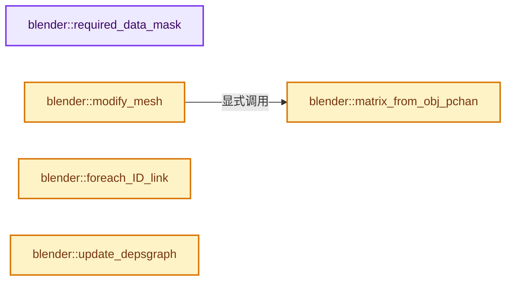
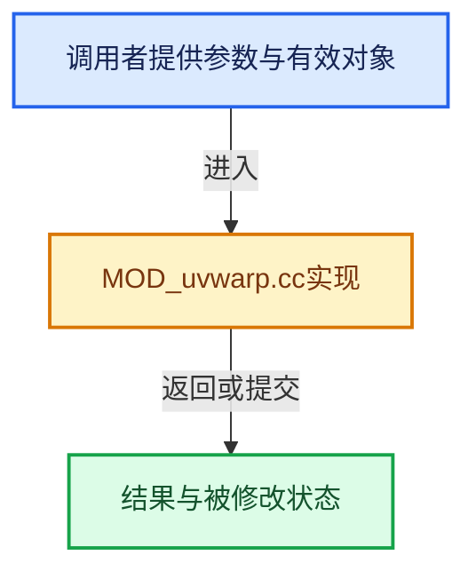

# 实现依赖专题：source/blender/modifiers/intern/MOD_uvwarp.cc

[方向导航](README.md) · [符号索引](../%E7%AC%A6%E5%8F%B7%E4%BE%9D%E8%B5%96%E4%B8%8E%E5%AE%9E%E7%8E%B0%E7%B4%A2%E5%BC%95.md)

本专题从正文实际调用进入，集中保存共享实现。函数有稳定锚点，可从调用处直接跳到对应完整函数；递归与互相调用通过回链组织。

## 本文件的实现关系






## 完整成员与函数实现

<a id="f-559fe35187393b9a"></a>

### `blender::required_data_mask`

实现位置：[source/blender/modifiers/intern/MOD_uvwarp.cc](../../../../../source/blender/modifiers/intern/MOD_uvwarp.cc) · L60—L68。

接口参数：

- `ModifierData *md`
- `CustomData_MeshMasks *r_cddata_masks`

**教学注释版**

<!-- annotated:b6e5bf1f341b39 -->

```cpp
static void required_data_mask(ModifierData *md, CustomData_MeshMasks *r_cddata_masks)
{
  UVWarpModifierData *umd = reinterpret_cast<UVWarpModifierData *>(md);

  /* Ask for vertex-groups if we need them. */
  if (umd->vgroup_name[0] != '\0') {
    r_cddata_masks->vmask |= CD_MASK_MDEFORMVERT;
  }
}
```

<details>
<summary>核对原始源码：source/blender/modifiers/intern/MOD_uvwarp.cc · L60—L68</summary>

<!-- original:b6e5bf1f341b39:source/blender/modifiers/intern/MOD_uvwarp.cc:60:68 -->

```cpp
static void required_data_mask(ModifierData *md, CustomData_MeshMasks *r_cddata_masks)
{
  UVWarpModifierData *umd = reinterpret_cast<UVWarpModifierData *>(md);

  /* Ask for vertex-groups if we need them. */
  if (umd->vgroup_name[0] != '\0') {
    r_cddata_masks->vmask |= CD_MASK_MDEFORMVERT;
  }
}
```

</details>

**沿实际写入检查状态**

- `r_cddata_masks->vmask |= CD_MASK_MDEFORMVERT;`

**继续追踪实现**

本实现没有需要继续展开的显式调用；检查返回表达式、对象转换和调用者前置条件。

<a id="f-baf818db92396fb6"></a>

### `blender::matrix_from_obj_pchan`

实现位置：[source/blender/modifiers/intern/MOD_uvwarp.cc](../../../../../source/blender/modifiers/intern/MOD_uvwarp.cc) · L70—L79。

接口参数：

- `float mat[4][4]`
- `Object *ob`
- `const char *bonename`

**教学注释版**

<!-- annotated:77f0195ae448a5 -->

```cpp
static void matrix_from_obj_pchan(float mat[4][4], Object *ob, const char *bonename)
{
  bPoseChannel *pchan = BKE_pose_channel_find_name(ob->pose, bonename);
  if (pchan) {
    mul_m4_m4m4(mat, ob->object_to_world().ptr(), pchan->pose_mat);
  }
  else {
    copy_m4_m4(mat, ob->object_to_world().ptr());
  }
}
```

<details>
<summary>核对原始源码：source/blender/modifiers/intern/MOD_uvwarp.cc · L70—L79</summary>

<!-- original:77f0195ae448a5:source/blender/modifiers/intern/MOD_uvwarp.cc:70:79 -->

```cpp
static void matrix_from_obj_pchan(float mat[4][4], Object *ob, const char *bonename)
{
  bPoseChannel *pchan = BKE_pose_channel_find_name(ob->pose, bonename);
  if (pchan) {
    mul_m4_m4m4(mat, ob->object_to_world().ptr(), pchan->pose_mat);
  }
  else {
    copy_m4_m4(mat, ob->object_to_world().ptr());
  }
}
```

</details>

**继续追踪实现**

- `BKE_pose_channel_find_name` → [blender::BKE_pose_channel_find_name · L895](%E4%BE%9D%E8%B5%96-action-b3a47a.md#f-5997206551bfc9f9)。
- `mul_m4_m4m4` → [blender::mul_m4_m4m4 · L217](../12-%E7%A9%BA%E9%97%B4%E6%95%B0%E6%8D%AE%E7%BB%93%E6%9E%84%E4%B8%8E%E5%87%A0%E4%BD%95%E7%AE%97%E6%B3%95/%E4%BE%9D%E8%B5%96-math_matrix_c-004123.md#f-b5272136b543b73b)。
- `ob->object_to_world().ptr` → [调用协议](../%E6%A8%A1%E6%9D%BF%E5%AE%8F%E4%B8%8E%E5%8A%A8%E6%80%81%E5%88%86%E6%B4%BE%E5%8D%8F%E8%AE%AE.md)：接收对象类型依赖auto、返回值或模板实例；不按同名猜测目标。调用位置L74。
- `ob->object_to_world` → [blender::Object::object_to_world · L5761](%E4%BE%9D%E8%B5%96-object-843689.md#f-12fc20026327d50c)。
- `copy_m4_m4` → [blender::copy_m4_m4 · L84](../12-%E7%A9%BA%E9%97%B4%E6%95%B0%E6%8D%AE%E7%BB%93%E6%9E%84%E4%B8%8E%E5%87%A0%E4%BD%95%E7%AE%97%E6%B3%95/%E4%BE%9D%E8%B5%96-math_matrix_c-004123.md#f-b4390cf8c94710f5)。

<a id="f-4b428d054f564867"></a>

### `blender::modify_mesh`

实现位置：[source/blender/modifiers/intern/MOD_uvwarp.cc](../../../../../source/blender/modifiers/intern/MOD_uvwarp.cc) · L129—L222。

接口参数：

- `ModifierData *md`
- `const ModifierEvalContext *ctx`
- `Mesh *mesh`

**教学注释版**

<!-- annotated:f878a23aa6d85d -->

```cpp
static Mesh *modify_mesh(ModifierData *md, const ModifierEvalContext *ctx, Mesh *mesh)
{
  UVWarpModifierData *umd = reinterpret_cast<UVWarpModifierData *>(md);
  const MDeformVert *dvert;
  int defgrp_index;
  float warp_mat[4][4];
  const int axis_u = umd->axis_u;
  const int axis_v = umd->axis_v;
  const bool invert_vgroup = (umd->flag & MOD_UVWARP_INVERT_VGROUP) != 0;

  /* make sure there are UV Maps available */
  if (mesh->uv_map_names().is_empty()) {
    return mesh;
  }

  if (!ELEM(nullptr, umd->object_src, umd->object_dst)) {
    float mat_src[4][4];
    float mat_dst[4][4];
    float imat_dst[4][4];
    float shuf_mat[4][4];

    /* make sure anything moving UVs is available */
    matrix_from_obj_pchan(mat_src, umd->object_src, umd->bone_src);
    matrix_from_obj_pchan(mat_dst, umd->object_dst, umd->bone_dst);

    invert_m4_m4(imat_dst, mat_dst);
    mul_m4_m4m4(warp_mat, imat_dst, mat_src);

    /* apply warp */
    if (!is_zero_v2(umd->center)) {
      float mat_cent[4][4];
      float imat_cent[4][4];

      unit_m4(mat_cent);
      mat_cent[3][axis_u] = umd->center[0];
      mat_cent[3][axis_v] = umd->center[1];

      invert_m4_m4(imat_cent, mat_cent);

      mul_m4_m4m4(warp_mat, warp_mat, imat_cent);
      mul_m4_m4m4(warp_mat, mat_cent, warp_mat);
    }

    const int shuf_indices[4] = {axis_u, axis_v, -1, 3};
    shuffle_m4(shuf_mat, shuf_indices);
    mul_m4_m4m4(warp_mat, shuf_mat, warp_mat);
    transpose_m4(shuf_mat);
    mul_m4_m4m4(warp_mat, warp_mat, shuf_mat);
  }
  else {
    unit_m4(warp_mat);
  }

  /* Apply direct 2d transform. */
  translate_m4(warp_mat, umd->center[0], umd->center[1], 0.0f);
  const float scale[3] = {umd->scale[0], umd->scale[1], 1.0f};
  rescale_m4(warp_mat, scale);
  rotate_m4(warp_mat, 'Z', umd->rotation);
  translate_m4(warp_mat, umd->offset[0], umd->offset[1], 0.0f);
  translate_m4(warp_mat, -umd->center[0], -umd->center[1], 0.0f);

  /* make sure we're using an existing layer */
  const StringRef uvname = mesh->uv_map_names().contains(umd->uvlayer_name) ?
                               umd->uvlayer_name :
                               mesh->active_uv_map_name();

  const OffsetIndices faces = mesh->faces();
  const Span<int> corner_verts = mesh->corner_verts();

  bke::MutableAttributeAccessor attributes = mesh->attributes_for_write();
  bke::SpanAttributeWriter uv_map = attributes.lookup_or_add_for_write_span<float2>(
      uvname, bke::AttrDomain::Corner);
  MOD_get_vgroup(ctx->object, mesh, umd->vgroup_name, &dvert, &defgrp_index);

  UVWarpData data{};
  data.faces = faces;
  data.corner_verts = corner_verts;
  data.uv_map = uv_map.span;
  data.dvert = dvert;
  data.defgrp_index = defgrp_index;
  data.warp_mat = warp_mat;
  data.invert_vgroup = invert_vgroup;

  TaskParallelSettings settings;
  BLI_parallel_range_settings_defaults(&settings);
  // [讲解] faces.size：读取连续区间或分组的边界信息。
  settings.use_threading = (faces.size() > 1000);
  BLI_task_parallel_range(0, faces.size(), &data, uv_warp_compute, &settings);

  mesh->runtime->is_original_bmesh = false;

  uv_map.finish();

  return mesh;
}
```

<details>
<summary>核对原始源码：source/blender/modifiers/intern/MOD_uvwarp.cc · L129—L222</summary>

<!-- original:f878a23aa6d85d:source/blender/modifiers/intern/MOD_uvwarp.cc:129:222 -->

```cpp
static Mesh *modify_mesh(ModifierData *md, const ModifierEvalContext *ctx, Mesh *mesh)
{
  UVWarpModifierData *umd = reinterpret_cast<UVWarpModifierData *>(md);
  const MDeformVert *dvert;
  int defgrp_index;
  float warp_mat[4][4];
  const int axis_u = umd->axis_u;
  const int axis_v = umd->axis_v;
  const bool invert_vgroup = (umd->flag & MOD_UVWARP_INVERT_VGROUP) != 0;

  /* make sure there are UV Maps available */
  if (mesh->uv_map_names().is_empty()) {
    return mesh;
  }

  if (!ELEM(nullptr, umd->object_src, umd->object_dst)) {
    float mat_src[4][4];
    float mat_dst[4][4];
    float imat_dst[4][4];
    float shuf_mat[4][4];

    /* make sure anything moving UVs is available */
    matrix_from_obj_pchan(mat_src, umd->object_src, umd->bone_src);
    matrix_from_obj_pchan(mat_dst, umd->object_dst, umd->bone_dst);

    invert_m4_m4(imat_dst, mat_dst);
    mul_m4_m4m4(warp_mat, imat_dst, mat_src);

    /* apply warp */
    if (!is_zero_v2(umd->center)) {
      float mat_cent[4][4];
      float imat_cent[4][4];

      unit_m4(mat_cent);
      mat_cent[3][axis_u] = umd->center[0];
      mat_cent[3][axis_v] = umd->center[1];

      invert_m4_m4(imat_cent, mat_cent);

      mul_m4_m4m4(warp_mat, warp_mat, imat_cent);
      mul_m4_m4m4(warp_mat, mat_cent, warp_mat);
    }

    const int shuf_indices[4] = {axis_u, axis_v, -1, 3};
    shuffle_m4(shuf_mat, shuf_indices);
    mul_m4_m4m4(warp_mat, shuf_mat, warp_mat);
    transpose_m4(shuf_mat);
    mul_m4_m4m4(warp_mat, warp_mat, shuf_mat);
  }
  else {
    unit_m4(warp_mat);
  }

  /* Apply direct 2d transform. */
  translate_m4(warp_mat, umd->center[0], umd->center[1], 0.0f);
  const float scale[3] = {umd->scale[0], umd->scale[1], 1.0f};
  rescale_m4(warp_mat, scale);
  rotate_m4(warp_mat, 'Z', umd->rotation);
  translate_m4(warp_mat, umd->offset[0], umd->offset[1], 0.0f);
  translate_m4(warp_mat, -umd->center[0], -umd->center[1], 0.0f);

  /* make sure we're using an existing layer */
  const StringRef uvname = mesh->uv_map_names().contains(umd->uvlayer_name) ?
                               umd->uvlayer_name :
                               mesh->active_uv_map_name();

  const OffsetIndices faces = mesh->faces();
  const Span<int> corner_verts = mesh->corner_verts();

  bke::MutableAttributeAccessor attributes = mesh->attributes_for_write();
  bke::SpanAttributeWriter uv_map = attributes.lookup_or_add_for_write_span<float2>(
      uvname, bke::AttrDomain::Corner);
  MOD_get_vgroup(ctx->object, mesh, umd->vgroup_name, &dvert, &defgrp_index);

  UVWarpData data{};
  data.faces = faces;
  data.corner_verts = corner_verts;
  data.uv_map = uv_map.span;
  data.dvert = dvert;
  data.defgrp_index = defgrp_index;
  data.warp_mat = warp_mat;
  data.invert_vgroup = invert_vgroup;

  TaskParallelSettings settings;
  BLI_parallel_range_settings_defaults(&settings);
  settings.use_threading = (faces.size() > 1000);
  BLI_task_parallel_range(0, faces.size(), &data, uv_warp_compute, &settings);

  mesh->runtime->is_original_bmesh = false;

  uv_map.finish();

  return mesh;
}
```

</details>

**沿实际写入检查状态**

- `mat_cent[3][axis_u] = umd->center[0];`
- `mat_cent[3][axis_v] = umd->center[1];`
- `data.faces = faces;`
- `data.corner_verts = corner_verts;`
- `data.uv_map = uv_map.span;`
- `data.dvert = dvert;`
- `data.defgrp_index = defgrp_index;`
- `data.warp_mat = warp_mat;`
- `data.invert_vgroup = invert_vgroup;`
- `settings.use_threading = (faces.size() > 1000);`
- `mesh->runtime->is_original_bmesh = false;`

**结果出口**

- `return mesh;`

**继续追踪实现**

- `mesh->uv_map_names().is_empty` → [调用协议](../%E6%A8%A1%E6%9D%BF%E5%AE%8F%E4%B8%8E%E5%8A%A8%E6%80%81%E5%88%86%E6%B4%BE%E5%8D%8F%E8%AE%AE.md)：接收对象类型依赖auto、返回值或模板实例；不按同名猜测目标。调用位置L140。
- `mesh->uv_map_names` → [Mesh::uv_map_names · L1308](03-MPoly%E8%BF%81%E7%A7%BB%E4%B8%8E%E5%85%BC%E5%AE%B9.md#f-6f71b15466566fad)。
- `ELEM` → [ELEM · L88](%E4%BE%9D%E8%B5%96-GHOST_utildefines-34b996.md#m-d28724a15928)；[ELEM · L135](../01-%E5%9F%BA%E7%A1%80%E5%AE%B9%E5%99%A8%E4%B8%8E%E7%8E%B0%E4%BB%A3CPP/%E4%BE%9D%E8%B5%96-BLI_utildefines-293a0a.md#m-d6572de7cae0)。宏定义由构建条件选择。
- `matrix_from_obj_pchan` → [blender::matrix_from_obj_pchan · L70](%E4%BE%9D%E8%B5%96-MOD_uvwarp-2ac084.md#f-baf818db92396fb6)。
- `invert_m4_m4` → [blender::invert_m4_m4 · L1150](../12-%E7%A9%BA%E9%97%B4%E6%95%B0%E6%8D%AE%E7%BB%93%E6%9E%84%E4%B8%8E%E5%87%A0%E4%BD%95%E7%AE%97%E6%B3%95/%E4%BE%9D%E8%B5%96-math_matrix_c-004123.md#f-c75789f10cdd5b92)。
- `mul_m4_m4m4` → [blender::mul_m4_m4m4 · L217](../12-%E7%A9%BA%E9%97%B4%E6%95%B0%E6%8D%AE%E7%BB%93%E6%9E%84%E4%B8%8E%E5%87%A0%E4%BD%95%E7%AE%97%E6%B3%95/%E4%BE%9D%E8%B5%96-math_matrix_c-004123.md#f-b5272136b543b73b)。
- `is_zero_v2` → [blender::is_zero_v2 · L958](../12-%E7%A9%BA%E9%97%B4%E6%95%B0%E6%8D%AE%E7%BB%93%E6%9E%84%E4%B8%8E%E5%87%A0%E4%BD%95%E7%AE%97%E6%B3%95/%E4%BE%9D%E8%B5%96-math_vector_inline-0c8541.md#f-bf045935d051b884)。
- `unit_m4` → [blender::unit_m4 · L55](../12-%E7%A9%BA%E9%97%B4%E6%95%B0%E6%8D%AE%E7%BB%93%E6%9E%84%E4%B8%8E%E5%87%A0%E4%BD%95%E7%AE%97%E6%B3%95/%E4%BE%9D%E8%B5%96-math_matrix_c-004123.md#f-e6cd812aae119176)。
- `shuffle_m4` → [blender::shuffle_m4 · L201](../12-%E7%A9%BA%E9%97%B4%E6%95%B0%E6%8D%AE%E7%BB%93%E6%9E%84%E4%B8%8E%E5%87%A0%E4%BD%95%E7%AE%97%E6%B3%95/%E4%BE%9D%E8%B5%96-math_matrix_c-004123.md#f-5eb7f5d435838158)。
- `transpose_m4` → [blender::transpose_m4 · L1244](../12-%E7%A9%BA%E9%97%B4%E6%95%B0%E6%8D%AE%E7%BB%93%E6%9E%84%E4%B8%8E%E5%87%A0%E4%BD%95%E7%AE%97%E6%B3%95/%E4%BE%9D%E8%B5%96-math_matrix_c-004123.md#f-21ae38279292b2d6)。
- `translate_m4` → [blender::translate_m4 · L2108](../12-%E7%A9%BA%E9%97%B4%E6%95%B0%E6%8D%AE%E7%BB%93%E6%9E%84%E4%B8%8E%E5%87%A0%E4%BD%95%E7%AE%97%E6%B3%95/%E4%BE%9D%E8%B5%96-math_matrix_c-004123.md#f-e05a7854c4f638e6)。
- `rescale_m4` → [blender::rescale_m4 · L2152](../12-%E7%A9%BA%E9%97%B4%E6%95%B0%E6%8D%AE%E7%BB%93%E6%9E%84%E4%B8%8E%E5%87%A0%E4%BD%95%E7%AE%97%E6%B3%95/%E4%BE%9D%E8%B5%96-math_matrix_c-004123.md#f-9e3942c439579fa1)。
- `rotate_m4` → [blender::rotate_m4 · L2115](../12-%E7%A9%BA%E9%97%B4%E6%95%B0%E6%8D%AE%E7%BB%93%E6%9E%84%E4%B8%8E%E5%87%A0%E4%BD%95%E7%AE%97%E6%B3%95/%E4%BE%9D%E8%B5%96-math_matrix_c-004123.md#f-c255c473f69e9d03)。
- `mesh->uv_map_names().contains` → [调用协议](../%E6%A8%A1%E6%9D%BF%E5%AE%8F%E4%B8%8E%E5%8A%A8%E6%80%81%E5%88%86%E6%B4%BE%E5%8D%8F%E8%AE%AE.md)：接收对象类型依赖auto、返回值或模板实例；不按同名猜测目标。调用位置L191。
- `mesh->active_uv_map_name` → [Mesh::active_uv_map_name · L1319](03-MPoly%E8%BF%81%E7%A7%BB%E4%B8%8E%E5%85%BC%E5%AE%B9.md#f-9b4762e851836e79)。
- `mesh->faces` → [Mesh::faces · L1217](03-MPoly%E8%BF%81%E7%A7%BB%E4%B8%8E%E5%85%BC%E5%AE%B9.md#f-ea444760154e17b2)。
- `mesh->corner_verts` → [Mesh::corner_verts · L1238](03-MPoly%E8%BF%81%E7%A7%BB%E4%B8%8E%E5%85%BC%E5%AE%B9.md#f-a59c61f583b64bc4)。
- `mesh->attributes_for_write` → [Mesh::attributes_for_write · L1303](03-MPoly%E8%BF%81%E7%A7%BB%E4%B8%8E%E5%85%BC%E5%AE%B9.md#f-ca7af2f1a15f0bc4)。
- `attributes.lookup_or_add_for_write_span<float2>` → [blender::bke::MutableAttributeAccessor::lookup_or_add_for_write_span · L533](%E4%BE%9D%E8%B5%96-attribute_access-bceef3.md#f-c533eff1b9a4973e)；[blender::bke::MutableAttributeAccessor::lookup_or_add_for_write_span · L861](08-AttributeAccessor%E6%8E%A5%E5%8F%A3.md#f-aa4c0d5a61437381)。同名重载需按实参类型选择。
- `MOD_get_vgroup` → [blender::MOD_get_vgroup · L158](%E4%BE%9D%E8%B5%96-MOD_util-83ca4b.md#f-f461611d86b94405)。
- `BLI_parallel_range_settings_defaults` → [blender::BLI_parallel_range_settings_defaults · L218](../01-%E5%9F%BA%E7%A1%80%E5%AE%B9%E5%99%A8%E4%B8%8E%E7%8E%B0%E4%BB%A3CPP/%E4%BE%9D%E8%B5%96-BLI_task_c-917a71.md#f-3858ad801a98e123)。
- `faces.size` → [blender::offset_indices::OffsetIndices::size · L67](02-OffsetIndices%E5%AE%8C%E6%95%B4%E6%8E%A5%E5%8F%A3.md#f-e238abc62ed42abd)。
- `BLI_task_parallel_range` → [blender::BLI_task_parallel_range · L101](../11-Depsgraph%E4%B8%8E%E5%B9%B6%E8%A1%8C%E4%BB%BB%E5%8A%A1%E7%B3%BB%E7%BB%9F/08-%E4%BB%BB%E5%8A%A1%E9%9A%94%E7%A6%BB%E6%AD%BB%E9%94%81%E4%B8%8E%E5%AE%9E%E6%88%98.md#f-9d237d7e4e78d7e2)。
- `uv_map.finish` → [blender::bke::SpanAttributeWriter::finish · L279](08-AttributeAccessor%E6%8E%A5%E5%8F%A3.md#f-585970a3b1bd4da4)。

<a id="f-9ea823fd71b6fb78"></a>

### `blender::foreach_ID_link`

实现位置：[source/blender/modifiers/intern/MOD_uvwarp.cc](../../../../../source/blender/modifiers/intern/MOD_uvwarp.cc) · L224—L230。

接口参数：

- `ModifierData *md`
- `Object *ob`
- `IDWalkFunc walk`
- `void *user_data`

**教学注释版**

<!-- annotated:e6bc93107a24ef -->

```cpp
static void foreach_ID_link(ModifierData *md, Object *ob, IDWalkFunc walk, void *user_data)
{
  UVWarpModifierData *umd = reinterpret_cast<UVWarpModifierData *>(md);

  walk(user_data, ob, reinterpret_cast<ID **>(&umd->object_dst), IDWALK_CB_NOP);
  walk(user_data, ob, reinterpret_cast<ID **>(&umd->object_src), IDWALK_CB_NOP);
}
```

<details>
<summary>核对原始源码：source/blender/modifiers/intern/MOD_uvwarp.cc · L224—L230</summary>

<!-- original:e6bc93107a24ef:source/blender/modifiers/intern/MOD_uvwarp.cc:224:230 -->

```cpp
static void foreach_ID_link(ModifierData *md, Object *ob, IDWalkFunc walk, void *user_data)
{
  UVWarpModifierData *umd = reinterpret_cast<UVWarpModifierData *>(md);

  walk(user_data, ob, reinterpret_cast<ID **>(&umd->object_dst), IDWALK_CB_NOP);
  walk(user_data, ob, reinterpret_cast<ID **>(&umd->object_src), IDWALK_CB_NOP);
}
```

</details>

**继续追踪实现**

- `walk` → [调用协议](../%E6%A8%A1%E6%9D%BF%E5%AE%8F%E4%B8%8E%E5%8A%A8%E6%80%81%E5%88%86%E6%B4%BE%E5%8D%8F%E8%AE%AE.md)：局部可调用对象，须结合其初始化与捕获环境。调用位置L228。

<a id="f-770fc96aaf2864cc"></a>

### `blender::update_depsgraph`

实现位置：[source/blender/modifiers/intern/MOD_uvwarp.cc](../../../../../source/blender/modifiers/intern/MOD_uvwarp.cc) · L232—L242。

接口参数：

- `ModifierData *md`
- `const ModifierUpdateDepsgraphContext *ctx`

**教学注释版**

<!-- annotated:5cfc8e20aabf26 -->

```cpp
static void update_depsgraph(ModifierData *md, const ModifierUpdateDepsgraphContext *ctx)
{
  UVWarpModifierData *umd = reinterpret_cast<UVWarpModifierData *>(md);

  MOD_depsgraph_update_object_bone_relation(
      ctx->node, umd->object_src, umd->bone_src, "UVWarp Modifier");
  MOD_depsgraph_update_object_bone_relation(
      ctx->node, umd->object_dst, umd->bone_dst, "UVWarp Modifier");

  DEG_add_depends_on_transform_relation(ctx->node, "UVWarp Modifier");
}
```

<details>
<summary>核对原始源码：source/blender/modifiers/intern/MOD_uvwarp.cc · L232—L242</summary>

<!-- original:5cfc8e20aabf26:source/blender/modifiers/intern/MOD_uvwarp.cc:232:242 -->

```cpp
static void update_depsgraph(ModifierData *md, const ModifierUpdateDepsgraphContext *ctx)
{
  UVWarpModifierData *umd = reinterpret_cast<UVWarpModifierData *>(md);

  MOD_depsgraph_update_object_bone_relation(
      ctx->node, umd->object_src, umd->bone_src, "UVWarp Modifier");
  MOD_depsgraph_update_object_bone_relation(
      ctx->node, umd->object_dst, umd->bone_dst, "UVWarp Modifier");

  DEG_add_depends_on_transform_relation(ctx->node, "UVWarp Modifier");
}
```

</details>

**继续追踪实现**

- `MOD_depsgraph_update_object_bone_relation` → [blender::MOD_depsgraph_update_object_bone_relation · L188](%E4%BE%9D%E8%B5%96-MOD_util-83ca4b.md#f-b4d8d5d84915768b)。
- `DEG_add_depends_on_transform_relation` → [blender::DEG_add_depends_on_transform_relation · L240](../11-Depsgraph%E4%B8%8E%E5%B9%B6%E8%A1%8C%E4%BB%BB%E5%8A%A1%E7%B3%BB%E7%BB%9F/%E4%BE%9D%E8%B5%96-depsgraph_build-ea2fc8.md#f-47c32a354defa20d)。
