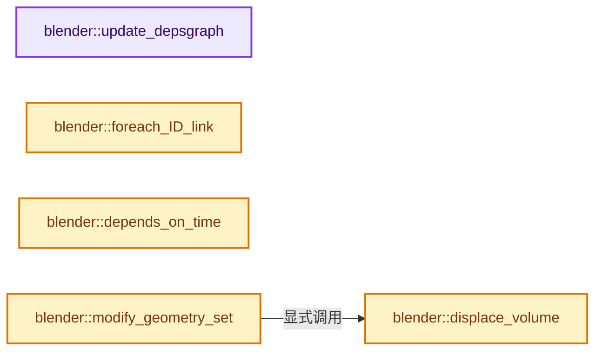
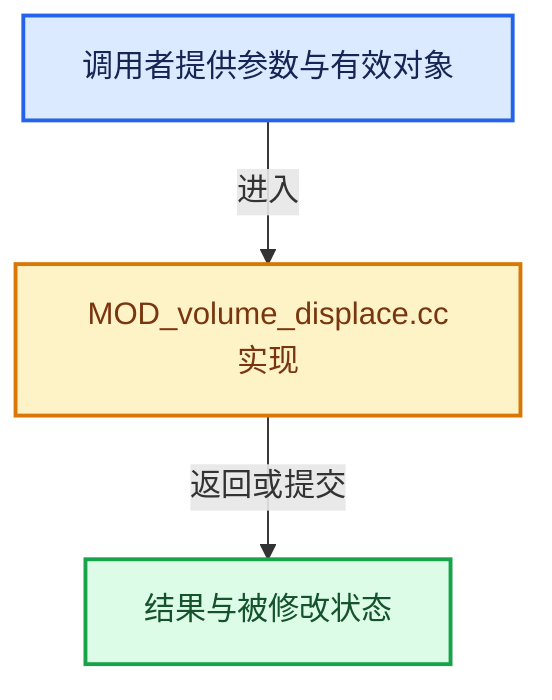

# 实现依赖专题：source/blender/modifiers/intern/MOD_volume_displace.cc

[方向导航](README.md) · [符号索引](../%E7%AC%A6%E5%8F%B7%E4%BE%9D%E8%B5%96%E4%B8%8E%E5%AE%9E%E7%8E%B0%E7%B4%A2%E5%BC%95.md)

本专题从正文实际调用进入，集中保存共享实现。函数有稳定锚点，可从调用处直接跳到对应完整函数；递归与互相调用通过回链组织。

## 本文件的实现关系






## 完整成员与函数实现

<a id="f-10d266131f8c370d"></a>

### `blender::update_depsgraph`

实现位置：[source/blender/modifiers/intern/MOD_volume_displace.cc](../../../../../source/blender/modifiers/intern/MOD_volume_displace.cc) · L59—L71。

接口参数：

- `ModifierData *md`
- `const ModifierUpdateDepsgraphContext *ctx`

**教学注释版**

<!-- annotated:50d10ac97b7966 -->

```cpp
static void update_depsgraph(ModifierData *md, const ModifierUpdateDepsgraphContext *ctx)
{
  VolumeDisplaceModifierData *vdmd = reinterpret_cast<VolumeDisplaceModifierData *>(md);
  if (vdmd->texture != nullptr) {
    DEG_add_generic_id_relation(ctx->node, &vdmd->texture->id, "Volume Displace Modifier");
  }
  if (vdmd->texture_map_mode == MOD_VOLUME_DISPLACE_MAP_OBJECT) {
    if (vdmd->texture_map_object != nullptr) {
      DEG_add_object_relation(
          ctx->node, vdmd->texture_map_object, DEG_OB_COMP_TRANSFORM, "Volume Displace Modifier");
    }
  }
}
```

<details>
<summary>核对原始源码：source/blender/modifiers/intern/MOD_volume_displace.cc · L59—L71</summary>

<!-- original:50d10ac97b7966:source/blender/modifiers/intern/MOD_volume_displace.cc:59:71 -->

```cpp
static void update_depsgraph(ModifierData *md, const ModifierUpdateDepsgraphContext *ctx)
{
  VolumeDisplaceModifierData *vdmd = reinterpret_cast<VolumeDisplaceModifierData *>(md);
  if (vdmd->texture != nullptr) {
    DEG_add_generic_id_relation(ctx->node, &vdmd->texture->id, "Volume Displace Modifier");
  }
  if (vdmd->texture_map_mode == MOD_VOLUME_DISPLACE_MAP_OBJECT) {
    if (vdmd->texture_map_object != nullptr) {
      DEG_add_object_relation(
          ctx->node, vdmd->texture_map_object, DEG_OB_COMP_TRANSFORM, "Volume Displace Modifier");
    }
  }
}
```

</details>

**继续追踪实现**

- `DEG_add_generic_id_relation` → [blender::DEG_add_generic_id_relation · L232](../11-Depsgraph%E4%B8%8E%E5%B9%B6%E8%A1%8C%E4%BB%BB%E5%8A%A1%E7%B3%BB%E7%BB%9F/%E4%BE%9D%E8%B5%96-depsgraph_build-ea2fc8.md#f-43ef8aa495db0d98)。
- `DEG_add_object_relation` → [blender::DEG_add_object_relation · L123](../11-Depsgraph%E4%B8%8E%E5%B9%B6%E8%A1%8C%E4%BB%BB%E5%8A%A1%E7%B3%BB%E7%BB%9F/%E4%BE%9D%E8%B5%96-depsgraph_build-ea2fc8.md#f-f570cffae97e273c)。

<a id="f-e657d49db24766eb"></a>

### `blender::foreach_ID_link`

实现位置：[source/blender/modifiers/intern/MOD_volume_displace.cc](../../../../../source/blender/modifiers/intern/MOD_volume_displace.cc) · L73—L78。

接口参数：

- `ModifierData *md`
- `Object *ob`
- `IDWalkFunc walk`
- `void *user_data`

**教学注释版**

<!-- annotated:c0fc1ca8eb0288 -->

```cpp
static void foreach_ID_link(ModifierData *md, Object *ob, IDWalkFunc walk, void *user_data)
{
  VolumeDisplaceModifierData *vdmd = reinterpret_cast<VolumeDisplaceModifierData *>(md);
  walk(user_data, ob, reinterpret_cast<ID **>(&vdmd->texture), IDWALK_CB_USER);
  walk(user_data, ob, reinterpret_cast<ID **>(&vdmd->texture_map_object), IDWALK_CB_USER);
}
```

<details>
<summary>核对原始源码：source/blender/modifiers/intern/MOD_volume_displace.cc · L73—L78</summary>

<!-- original:c0fc1ca8eb0288:source/blender/modifiers/intern/MOD_volume_displace.cc:73:78 -->

```cpp
static void foreach_ID_link(ModifierData *md, Object *ob, IDWalkFunc walk, void *user_data)
{
  VolumeDisplaceModifierData *vdmd = reinterpret_cast<VolumeDisplaceModifierData *>(md);
  walk(user_data, ob, reinterpret_cast<ID **>(&vdmd->texture), IDWALK_CB_USER);
  walk(user_data, ob, reinterpret_cast<ID **>(&vdmd->texture_map_object), IDWALK_CB_USER);
}
```

</details>

**继续追踪实现**

- `walk` → [调用协议](../%E6%A8%A1%E6%9D%BF%E5%AE%8F%E4%B8%8E%E5%8A%A8%E6%80%81%E5%88%86%E6%B4%BE%E5%8D%8F%E8%AE%AE.md)：局部可调用对象，须结合其初始化与捕获环境。调用位置L76。

<a id="f-a3cb1432d858b58b"></a>

### `blender::depends_on_time`

实现位置：[source/blender/modifiers/intern/MOD_volume_displace.cc](../../../../../source/blender/modifiers/intern/MOD_volume_displace.cc) · L87—L94。

接口参数：

- `Scene *`
- `ModifierData *md`

**教学注释版**

<!-- annotated:ca681bf3ed64a9 -->

```cpp
static bool depends_on_time(Scene * /*scene*/, ModifierData *md)
{
  VolumeDisplaceModifierData *vdmd = reinterpret_cast<VolumeDisplaceModifierData *>(md);
  if (vdmd->texture) {
    return BKE_texture_dependsOnTime(vdmd->texture);
  }
  return false;
}
```

<details>
<summary>核对原始源码：source/blender/modifiers/intern/MOD_volume_displace.cc · L87—L94</summary>

<!-- original:ca681bf3ed64a9:source/blender/modifiers/intern/MOD_volume_displace.cc:87:94 -->

```cpp
static bool depends_on_time(Scene * /*scene*/, ModifierData *md)
{
  VolumeDisplaceModifierData *vdmd = reinterpret_cast<VolumeDisplaceModifierData *>(md);
  if (vdmd->texture) {
    return BKE_texture_dependsOnTime(vdmd->texture);
  }
  return false;
}
```

</details>

**结果出口**

- `return BKE_texture_dependsOnTime(vdmd->texture);`
- `return false;`

**继续追踪实现**

- `BKE_texture_dependsOnTime` → [blender::BKE_texture_dependsOnTime · L600](%E4%BE%9D%E8%B5%96-texture-60b86b.md#f-d94d173f823e5f13)。

<a id="f-d6f2fe1578d2ed48"></a>

### `blender::displace_volume`

实现位置：[source/blender/modifiers/intern/MOD_volume_displace.cc](../../../../../source/blender/modifiers/intern/MOD_volume_displace.cc) · L276—L301。

接口参数：

- `ModifierData *md`
- `const ModifierEvalContext *ctx`
- `Volume *volume`

**教学注释版**

<!-- annotated:09814eb606abf7 -->

```cpp
static void displace_volume(ModifierData *md, const ModifierEvalContext *ctx, Volume *volume)
{
#ifdef WITH_OPENVDB
  VolumeDisplaceModifierData *vdmd = reinterpret_cast<VolumeDisplaceModifierData *>(md);

  /* Iterate over all grids and displace them one by one. */
  BKE_volume_load(volume, DEG_get_bmain(ctx->depsgraph));
  const int grid_amount = BKE_volume_num_grids(volume);
  for (int grid_index = 0; grid_index < grid_amount; grid_index++) {
    bke::VolumeGridData *volume_grid = BKE_volume_grid_get_for_write(volume, grid_index);
    BLI_assert(volume_grid);

    bke::VolumeTreeAccessToken tree_token;
    openvdb::GridBase &grid = volume_grid->grid_for_write(tree_token);
    VolumeGridType grid_type = volume_grid->grid_type();

    DisplaceGridOp displace_grid_op{grid, *vdmd, *ctx};
    BKE_volume_grid_type_operation(grid_type, displace_grid_op);
    volume_grid->tag_tree_modified();
  }

#else
  UNUSED_VARS(md, volume, ctx);
  BKE_modifier_set_error(ctx->object, md, "Compiled without OpenVDB");
#endif
}
```

<details>
<summary>核对原始源码：source/blender/modifiers/intern/MOD_volume_displace.cc · L276—L301</summary>

<!-- original:09814eb606abf7:source/blender/modifiers/intern/MOD_volume_displace.cc:276:301 -->

```cpp
static void displace_volume(ModifierData *md, const ModifierEvalContext *ctx, Volume *volume)
{
#ifdef WITH_OPENVDB
  VolumeDisplaceModifierData *vdmd = reinterpret_cast<VolumeDisplaceModifierData *>(md);

  /* Iterate over all grids and displace them one by one. */
  BKE_volume_load(volume, DEG_get_bmain(ctx->depsgraph));
  const int grid_amount = BKE_volume_num_grids(volume);
  for (int grid_index = 0; grid_index < grid_amount; grid_index++) {
    bke::VolumeGridData *volume_grid = BKE_volume_grid_get_for_write(volume, grid_index);
    BLI_assert(volume_grid);

    bke::VolumeTreeAccessToken tree_token;
    openvdb::GridBase &grid = volume_grid->grid_for_write(tree_token);
    VolumeGridType grid_type = volume_grid->grid_type();

    DisplaceGridOp displace_grid_op{grid, *vdmd, *ctx};
    BKE_volume_grid_type_operation(grid_type, displace_grid_op);
    volume_grid->tag_tree_modified();
  }

#else
  UNUSED_VARS(md, volume, ctx);
  BKE_modifier_set_error(ctx->object, md, "Compiled without OpenVDB");
#endif
}
```

</details>

**继续追踪实现**

- `BKE_volume_load` → [blender::BKE_volume_load · L486](%E4%BE%9D%E8%B5%96-volume-8dd0eb.md#f-8e25dd9f84cc04f9)。
- `DEG_get_bmain` → [blender::DEG_get_bmain · L93](../11-Depsgraph%E4%B8%8E%E5%B9%B6%E8%A1%8C%E4%BB%BB%E5%8A%A1%E7%B3%BB%E7%BB%9F/%E4%BE%9D%E8%B5%96-depsgraph_query-e8b1e4.md#f-9dfed3e433db8080)。
- `BKE_volume_num_grids` → [blender::BKE_volume_num_grids · L856](%E4%BE%9D%E8%B5%96-volume-8dd0eb.md#f-bba3632a80fe4c9d)。
- `BKE_volume_grid_get_for_write` → [blender::BKE_volume_grid_get_for_write · L902](%E4%BE%9D%E8%B5%96-volume-8dd0eb.md#f-dd3d3b6de227d387)。
- `BLI_assert` → [BLI_assert · L48](../01-%E5%9F%BA%E7%A1%80%E5%AE%B9%E5%99%A8%E4%B8%8E%E7%8E%B0%E4%BB%A3CPP/%E4%BE%9D%E8%B5%96-BLI_assert-cc98e8.md#m-57a88495704d)；[BLI_assert · L63](../01-%E5%9F%BA%E7%A1%80%E5%AE%B9%E5%99%A8%E4%B8%8E%E7%8E%B0%E4%BB%A3CPP/%E4%BE%9D%E8%B5%96-BLI_assert-cc98e8.md#m-d07050020cb5)。宏定义由构建条件选择。
- `volume_grid->grid_for_write` → [blender::bke::volume_grid::VolumeGridData::grid_for_write · L90](%E4%BE%9D%E8%B5%96-volume_grid-a7c9da.md#f-c64fdc65ed03800c)。
- `volume_grid->grid_type` → [blender::bke::volume_grid::VolumeGridData::grid_type · L162](%E4%BE%9D%E8%B5%96-volume_grid-a7c9da.md#f-0a131609bd285679)。
- `BKE_volume_grid_type_operation` → [blender::BKE_volume_grid_type_operation · L51](%E4%BE%9D%E8%B5%96-BKE_volume_openvdb-4fd2e3.md#f-1d1852185d7a47bd)。
- `volume_grid->tag_tree_modified` → [blender::bke::volume_grid::VolumeGridData::tag_tree_modified · L194](%E4%BE%9D%E8%B5%96-volume_grid-a7c9da.md#f-8ef835c0175ba6d1)。
- `UNUSED_VARS` → [UNUSED_VARS · L522](../01-%E5%9F%BA%E7%A1%80%E5%AE%B9%E5%99%A8%E4%B8%8E%E7%8E%B0%E4%BB%A3CPP/%E4%BE%9D%E8%B5%96-BLI_utildefines-293a0a.md#m-013582537634)；[UNUSED_VARS · L41](%E4%BE%9D%E8%B5%96-GPU_shader_shared_utils-0adda3.md#m-05d9d7a33da0)；[UNUSED_VARS · L62](%E4%BE%9D%E8%B5%96-GPU_shader_shared_utils-0adda3.md#m-e12c683a4aca)。宏定义由构建条件选择。
- `BKE_modifier_set_error` → [blender::BKE_modifier_set_error · L416](%E4%BE%9D%E8%B5%96-modifier-ab0273.md#f-6241829f21c08456)。

<a id="f-ebaffe948c472b25"></a>

### `blender::modify_geometry_set`

实现位置：[source/blender/modifiers/intern/MOD_volume_displace.cc](../../../../../source/blender/modifiers/intern/MOD_volume_displace.cc) · L303—L311。

接口参数：

- `ModifierData *md`
- `const ModifierEvalContext *ctx`
- `bke::GeometrySet *geometry_set`

**教学注释版**

<!-- annotated:b36ae677ddbfd5 -->

```cpp
static void modify_geometry_set(ModifierData *md,
                                const ModifierEvalContext *ctx,
                                bke::GeometrySet *geometry_set)
{
  Volume *input_volume = geometry_set->get_volume_for_write();
  if (input_volume != nullptr) {
    displace_volume(md, ctx, input_volume);
  }
}
```

<details>
<summary>核对原始源码：source/blender/modifiers/intern/MOD_volume_displace.cc · L303—L311</summary>

<!-- original:b36ae677ddbfd5:source/blender/modifiers/intern/MOD_volume_displace.cc:303:311 -->

```cpp
static void modify_geometry_set(ModifierData *md,
                                const ModifierEvalContext *ctx,
                                bke::GeometrySet *geometry_set)
{
  Volume *input_volume = geometry_set->get_volume_for_write();
  if (input_volume != nullptr) {
    displace_volume(md, ctx, input_volume);
  }
}
```

</details>

**继续追踪实现**

- `geometry_set->get_volume_for_write` → [blender::bke::GeometrySet::get_volume_for_write · L574](../06-%E9%9A%90%E5%BC%8F%E5%85%B1%E4%BA%AB%E4%B8%8E%E7%BC%93%E5%AD%98%E7%B3%BB%E7%BB%9F/05-GeometrySet%E8%AF%BB%E5%86%99%E4%B8%8E%E5%A4%8D%E5%88%B6.md#f-9a13760c4934e3d8)。
- `displace_volume` → [blender::displace_volume · L276](%E4%BE%9D%E8%B5%96-MOD_volume_displace-d9d5ed.md#f-d6f2fe1578d2ed48)。
