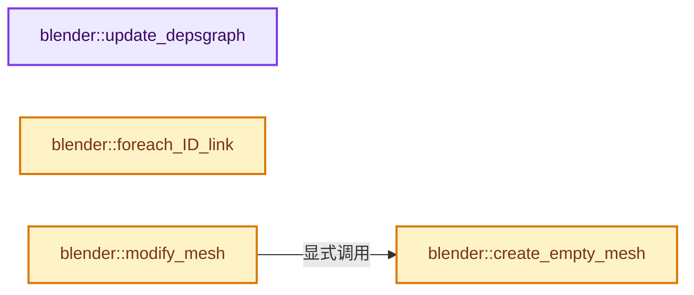
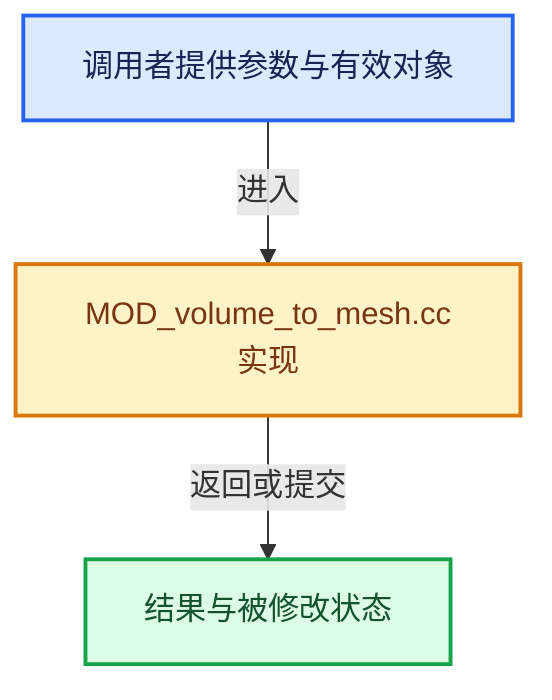

# 实现依赖专题：source/blender/modifiers/intern/MOD_volume_to_mesh.cc

[方向导航](README.md) · [符号索引](../%E7%AC%A6%E5%8F%B7%E4%BE%9D%E8%B5%96%E4%B8%8E%E5%AE%9E%E7%8E%B0%E7%B4%A2%E5%BC%95.md)

本专题从正文实际调用进入，集中保存共享实现。函数有稳定锚点，可从调用处直接跳到对应完整函数；递归与互相调用通过回链组织。

## 本文件的实现关系






## 完整成员与函数实现

<a id="f-7a9c112708ce6179"></a>

### `blender::update_depsgraph`

实现位置：[source/blender/modifiers/intern/MOD_volume_to_mesh.cc](../../../../../source/blender/modifiers/intern/MOD_volume_to_mesh.cc) · L56—L66。

接口参数：

- `ModifierData *md`
- `const ModifierUpdateDepsgraphContext *ctx`

**教学注释版**

<!-- annotated:9bd7e89c2e99d9 -->

```cpp
static void update_depsgraph(ModifierData *md, const ModifierUpdateDepsgraphContext *ctx)
{
  VolumeToMeshModifierData *vmmd = reinterpret_cast<VolumeToMeshModifierData *>(md);
  DEG_add_depends_on_transform_relation(ctx->node, "Volume to Mesh Modifier");
  if (vmmd->object) {
    DEG_add_object_relation(
        ctx->node, vmmd->object, DEG_OB_COMP_GEOMETRY, "Volume to Mesh Modifier");
    DEG_add_object_relation(
        ctx->node, vmmd->object, DEG_OB_COMP_TRANSFORM, "Volume to Mesh Modifier");
  }
}
```

<details>
<summary>核对原始源码：source/blender/modifiers/intern/MOD_volume_to_mesh.cc · L56—L66</summary>

<!-- original:9bd7e89c2e99d9:source/blender/modifiers/intern/MOD_volume_to_mesh.cc:56:66 -->

```cpp
static void update_depsgraph(ModifierData *md, const ModifierUpdateDepsgraphContext *ctx)
{
  VolumeToMeshModifierData *vmmd = reinterpret_cast<VolumeToMeshModifierData *>(md);
  DEG_add_depends_on_transform_relation(ctx->node, "Volume to Mesh Modifier");
  if (vmmd->object) {
    DEG_add_object_relation(
        ctx->node, vmmd->object, DEG_OB_COMP_GEOMETRY, "Volume to Mesh Modifier");
    DEG_add_object_relation(
        ctx->node, vmmd->object, DEG_OB_COMP_TRANSFORM, "Volume to Mesh Modifier");
  }
}
```

</details>

**继续追踪实现**

- `DEG_add_depends_on_transform_relation` → [blender::DEG_add_depends_on_transform_relation · L240](../11-Depsgraph%E4%B8%8E%E5%B9%B6%E8%A1%8C%E4%BB%BB%E5%8A%A1%E7%B3%BB%E7%BB%9F/%E4%BE%9D%E8%B5%96-depsgraph_build-ea2fc8.md#f-47c32a354defa20d)。
- `DEG_add_object_relation` → [blender::DEG_add_object_relation · L123](../11-Depsgraph%E4%B8%8E%E5%B9%B6%E8%A1%8C%E4%BB%BB%E5%8A%A1%E7%B3%BB%E7%BB%9F/%E4%BE%9D%E8%B5%96-depsgraph_build-ea2fc8.md#f-f570cffae97e273c)。

<a id="f-43444339e908a376"></a>

### `blender::foreach_ID_link`

实现位置：[source/blender/modifiers/intern/MOD_volume_to_mesh.cc](../../../../../source/blender/modifiers/intern/MOD_volume_to_mesh.cc) · L68—L72。

接口参数：

- `ModifierData *md`
- `Object *ob`
- `IDWalkFunc walk`
- `void *user_data`

**教学注释版**

<!-- annotated:9d87def1d36233 -->

```cpp
static void foreach_ID_link(ModifierData *md, Object *ob, IDWalkFunc walk, void *user_data)
{
  VolumeToMeshModifierData *vmmd = reinterpret_cast<VolumeToMeshModifierData *>(md);
  walk(user_data, ob, reinterpret_cast<ID **>(&vmmd->object), IDWALK_CB_NOP);
}
```

<details>
<summary>核对原始源码：source/blender/modifiers/intern/MOD_volume_to_mesh.cc · L68—L72</summary>

<!-- original:9d87def1d36233:source/blender/modifiers/intern/MOD_volume_to_mesh.cc:68:72 -->

```cpp
static void foreach_ID_link(ModifierData *md, Object *ob, IDWalkFunc walk, void *user_data)
{
  VolumeToMeshModifierData *vmmd = reinterpret_cast<VolumeToMeshModifierData *>(md);
  walk(user_data, ob, reinterpret_cast<ID **>(&vmmd->object), IDWALK_CB_NOP);
}
```

</details>

**继续追踪实现**

- `walk` → [调用协议](../%E6%A8%A1%E6%9D%BF%E5%AE%8F%E4%B8%8E%E5%8A%A8%E6%80%81%E5%88%86%E6%B4%BE%E5%8D%8F%E8%AE%AE.md)：局部可调用对象，须结合其初始化与捕获环境。调用位置L71。

<a id="f-f459736041e53655"></a>

### `blender::create_empty_mesh`

实现位置：[source/blender/modifiers/intern/MOD_volume_to_mesh.cc](../../../../../source/blender/modifiers/intern/MOD_volume_to_mesh.cc) · L115—L120。

接口参数：

- `const Mesh *input_mesh`

**教学注释版**

<!-- annotated:5e800e9dfa9f9b -->

```cpp
static Mesh *create_empty_mesh(const Mesh *input_mesh)
{
  Mesh *new_mesh = BKE_mesh_new_nomain(0, 0, 0, 0);
  BKE_mesh_copy_parameters_for_eval(new_mesh, input_mesh);
  return new_mesh;
}
```

<details>
<summary>核对原始源码：source/blender/modifiers/intern/MOD_volume_to_mesh.cc · L115—L120</summary>

<!-- original:5e800e9dfa9f9b:source/blender/modifiers/intern/MOD_volume_to_mesh.cc:115:120 -->

```cpp
static Mesh *create_empty_mesh(const Mesh *input_mesh)
{
  Mesh *new_mesh = BKE_mesh_new_nomain(0, 0, 0, 0);
  BKE_mesh_copy_parameters_for_eval(new_mesh, input_mesh);
  return new_mesh;
}
```

</details>

**结果出口**

- `return new_mesh;`

**继续追踪实现**

- `BKE_mesh_new_nomain` → [BKE_mesh_new_nomain · L1376](03-MPoly%E8%BF%81%E7%A7%BB%E4%B8%8E%E5%85%BC%E5%AE%B9.md#f-d63806a6e34190f2)。
- `BKE_mesh_copy_parameters_for_eval` → [BKE_mesh_copy_parameters_for_eval · L1484](03-MPoly%E8%BF%81%E7%A7%BB%E4%B8%8E%E5%85%BC%E5%AE%B9.md#f-71bebe4e73fe4c13)。

<a id="f-447259e37a88bc45"></a>

### `blender::modify_mesh`

实现位置：[source/blender/modifiers/intern/MOD_volume_to_mesh.cc](../../../../../source/blender/modifiers/intern/MOD_volume_to_mesh.cc) · L122—L189。

接口参数：

- `ModifierData *md`
- `const ModifierEvalContext *ctx`
- `Mesh *input_mesh`

**教学注释版**

<!-- annotated:690057541837ab -->

```cpp
static Mesh *modify_mesh(ModifierData *md, const ModifierEvalContext *ctx, Mesh *input_mesh)
{
#ifdef WITH_OPENVDB
  VolumeToMeshModifierData *vmmd = reinterpret_cast<VolumeToMeshModifierData *>(md);
  if (vmmd->object == nullptr) {
    return create_empty_mesh(input_mesh);
  }
  if (vmmd->object->type != OB_VOLUME) {
    return create_empty_mesh(input_mesh);
  }
  if (vmmd->resolution_mode == VOLUME_TO_MESH_RESOLUTION_MODE_VOXEL_SIZE &&
      vmmd->voxel_size == 0.0f)
  {
    return create_empty_mesh(input_mesh);
  }
  if (vmmd->resolution_mode == VOLUME_TO_MESH_RESOLUTION_MODE_VOXEL_AMOUNT &&
      vmmd->voxel_amount == 0)
  {
    return create_empty_mesh(input_mesh);
  }

  const Volume *volume = id_cast<Volume *>(vmmd->object->data);

  BKE_volume_load(volume, DEG_get_bmain(ctx->depsgraph));
  const bke::VolumeGridData *volume_grid = BKE_volume_grid_find(volume, vmmd->grid_name);
  if (volume_grid == nullptr) {
    BKE_modifier_set_error(ctx->object, md, "Cannot find '%s' grid", vmmd->grid_name);
    return create_empty_mesh(input_mesh);
  }

  bke::VolumeTreeAccessToken tree_token;
  const openvdb::GridBase &local_grid = volume_grid->grid(tree_token);

  openvdb::math::Transform::Ptr transform = local_grid.transform().copy();
  transform->postMult(openvdb::Mat4d(vmmd->object->object_to_world().base_ptr()));
  openvdb::Mat4d imat = openvdb::Mat4d(ctx->object->world_to_object().base_ptr());
  /* `imat` had floating point issues and wasn't affine. */
  imat.setCol(3, openvdb::Vec4d(0, 0, 0, 1));
  transform->postMult(imat);

  /* Create a temporary transformed grid. The underlying tree is shared. */
  openvdb::GridBase::ConstPtr transformed_grid = local_grid.copyGridReplacingTransform(transform);

  bke::VolumeToMeshResolution resolution;
  resolution.mode = (VolumeToMeshResolutionMode)vmmd->resolution_mode;
  if (resolution.mode == VOLUME_TO_MESH_RESOLUTION_MODE_VOXEL_AMOUNT) {
    resolution.settings.voxel_amount = vmmd->voxel_amount;
  }
  if (resolution.mode == VOLUME_TO_MESH_RESOLUTION_MODE_VOXEL_SIZE) {
    resolution.settings.voxel_size = vmmd->voxel_size;
  }

  Mesh *mesh = bke::volume_to_mesh(
      *transformed_grid, resolution, vmmd->threshold, vmmd->adaptivity);
  if (mesh == nullptr) {
    BKE_modifier_set_error(ctx->object, md, "Could not generate mesh from grid");
    return create_empty_mesh(input_mesh);
  }

  BKE_mesh_copy_parameters_for_eval(mesh, input_mesh);
  bke::mesh_smooth_set(*mesh, vmmd->flag & VOLUME_TO_MESH_USE_SMOOTH_SHADE);
  return mesh;
#else
  UNUSED_VARS(md);
  BKE_modifier_set_error(ctx->object, md, "Compiled without OpenVDB");
  return create_empty_mesh(input_mesh);
#endif
}
```

<details>
<summary>核对原始源码：source/blender/modifiers/intern/MOD_volume_to_mesh.cc · L122—L189</summary>

<!-- original:690057541837ab:source/blender/modifiers/intern/MOD_volume_to_mesh.cc:122:189 -->

```cpp
static Mesh *modify_mesh(ModifierData *md, const ModifierEvalContext *ctx, Mesh *input_mesh)
{
#ifdef WITH_OPENVDB
  VolumeToMeshModifierData *vmmd = reinterpret_cast<VolumeToMeshModifierData *>(md);
  if (vmmd->object == nullptr) {
    return create_empty_mesh(input_mesh);
  }
  if (vmmd->object->type != OB_VOLUME) {
    return create_empty_mesh(input_mesh);
  }
  if (vmmd->resolution_mode == VOLUME_TO_MESH_RESOLUTION_MODE_VOXEL_SIZE &&
      vmmd->voxel_size == 0.0f)
  {
    return create_empty_mesh(input_mesh);
  }
  if (vmmd->resolution_mode == VOLUME_TO_MESH_RESOLUTION_MODE_VOXEL_AMOUNT &&
      vmmd->voxel_amount == 0)
  {
    return create_empty_mesh(input_mesh);
  }

  const Volume *volume = id_cast<Volume *>(vmmd->object->data);

  BKE_volume_load(volume, DEG_get_bmain(ctx->depsgraph));
  const bke::VolumeGridData *volume_grid = BKE_volume_grid_find(volume, vmmd->grid_name);
  if (volume_grid == nullptr) {
    BKE_modifier_set_error(ctx->object, md, "Cannot find '%s' grid", vmmd->grid_name);
    return create_empty_mesh(input_mesh);
  }

  bke::VolumeTreeAccessToken tree_token;
  const openvdb::GridBase &local_grid = volume_grid->grid(tree_token);

  openvdb::math::Transform::Ptr transform = local_grid.transform().copy();
  transform->postMult(openvdb::Mat4d(vmmd->object->object_to_world().base_ptr()));
  openvdb::Mat4d imat = openvdb::Mat4d(ctx->object->world_to_object().base_ptr());
  /* `imat` had floating point issues and wasn't affine. */
  imat.setCol(3, openvdb::Vec4d(0, 0, 0, 1));
  transform->postMult(imat);

  /* Create a temporary transformed grid. The underlying tree is shared. */
  openvdb::GridBase::ConstPtr transformed_grid = local_grid.copyGridReplacingTransform(transform);

  bke::VolumeToMeshResolution resolution;
  resolution.mode = (VolumeToMeshResolutionMode)vmmd->resolution_mode;
  if (resolution.mode == VOLUME_TO_MESH_RESOLUTION_MODE_VOXEL_AMOUNT) {
    resolution.settings.voxel_amount = vmmd->voxel_amount;
  }
  if (resolution.mode == VOLUME_TO_MESH_RESOLUTION_MODE_VOXEL_SIZE) {
    resolution.settings.voxel_size = vmmd->voxel_size;
  }

  Mesh *mesh = bke::volume_to_mesh(
      *transformed_grid, resolution, vmmd->threshold, vmmd->adaptivity);
  if (mesh == nullptr) {
    BKE_modifier_set_error(ctx->object, md, "Could not generate mesh from grid");
    return create_empty_mesh(input_mesh);
  }

  BKE_mesh_copy_parameters_for_eval(mesh, input_mesh);
  bke::mesh_smooth_set(*mesh, vmmd->flag & VOLUME_TO_MESH_USE_SMOOTH_SHADE);
  return mesh;
#else
  UNUSED_VARS(md);
  BKE_modifier_set_error(ctx->object, md, "Compiled without OpenVDB");
  return create_empty_mesh(input_mesh);
#endif
}
```

</details>

**沿实际写入检查状态**

- `resolution.mode = (VolumeToMeshResolutionMode)vmmd->resolution_mode;`
- `resolution.settings.voxel_amount = vmmd->voxel_amount;`
- `resolution.settings.voxel_size = vmmd->voxel_size;`

**结果出口**

- `return create_empty_mesh(input_mesh);`
- `return mesh;`

**继续追踪实现**

- `create_empty_mesh` → [blender::create_empty_mesh · L115](%E4%BE%9D%E8%B5%96-MOD_volume_to_mesh-299535.md#f-f459736041e53655)。
- `id_cast<Volume *>` → [blender::id_cast · L1417](%E4%BE%9D%E8%B5%96-DNA_ID-3eb091.md#f-6c8ac6412850ac5a)。
- `BKE_volume_load` → [blender::BKE_volume_load · L486](%E4%BE%9D%E8%B5%96-volume-8dd0eb.md#f-8e25dd9f84cc04f9)。
- `DEG_get_bmain` → [blender::DEG_get_bmain · L93](../11-Depsgraph%E4%B8%8E%E5%B9%B6%E8%A1%8C%E4%BB%BB%E5%8A%A1%E7%B3%BB%E7%BB%9F/%E4%BE%9D%E8%B5%96-depsgraph_query-e8b1e4.md#f-9dfed3e433db8080)。
- `BKE_volume_grid_find` → [blender::BKE_volume_grid_find · L929](%E4%BE%9D%E8%B5%96-volume-8dd0eb.md#f-608bcd50b8731ea5)。
- `BKE_modifier_set_error` → [blender::BKE_modifier_set_error · L416](%E4%BE%9D%E8%B5%96-modifier-ab0273.md#f-6241829f21c08456)。
- `volume_grid->grid` → [blender::bke::volume_grid::VolumeGridData::grid · L85](%E4%BE%9D%E8%B5%96-volume_grid-a7c9da.md#f-6f4e1ca70438fb12)。
- `local_grid.transform().copy` → [调用协议](../%E6%A8%A1%E6%9D%BF%E5%AE%8F%E4%B8%8E%E5%8A%A8%E6%80%81%E5%88%86%E6%B4%BE%E5%8D%8F%E8%AE%AE.md)：接收对象类型依赖auto、返回值或模板实例；不按同名猜测目标。调用位置L155。
- `local_grid.transform` → [调用协议](../%E6%A8%A1%E6%9D%BF%E5%AE%8F%E4%B8%8E%E5%8A%A8%E6%80%81%E5%88%86%E6%B4%BE%E5%8D%8F%E8%AE%AE.md)：由接收对象具体类型或运行时策略提供实现。调用位置L155。
- `transform->postMult` → [调用协议](../%E6%A8%A1%E6%9D%BF%E5%AE%8F%E4%B8%8E%E5%8A%A8%E6%80%81%E5%88%86%E6%B4%BE%E5%8D%8F%E8%AE%AE.md)：由接收对象具体类型或运行时策略提供实现。调用位置L156。
- `openvdb::Mat4d` → [外部契约](https://eel.is/c++draft/)：这个边界按实际表达式及所属类型核对参数、返回值、寿命与失败行为。这里提供接口入口，不声称已解释该第三方版本的内部实现。
- `vmmd->object->object_to_world().base_ptr` → [调用协议](../%E6%A8%A1%E6%9D%BF%E5%AE%8F%E4%B8%8E%E5%8A%A8%E6%80%81%E5%88%86%E6%B4%BE%E5%8D%8F%E8%AE%AE.md)：接收对象类型依赖auto、返回值或模板实例；不按同名猜测目标。调用位置L156。
- `vmmd->object->object_to_world` → [调用协议](../%E6%A8%A1%E6%9D%BF%E5%AE%8F%E4%B8%8E%E5%8A%A8%E6%80%81%E5%88%86%E6%B4%BE%E5%8D%8F%E8%AE%AE.md)：接收对象类型依赖auto、返回值或模板实例；不按同名猜测目标。调用位置L156。
- `ctx->object->world_to_object().base_ptr` → [调用协议](../%E6%A8%A1%E6%9D%BF%E5%AE%8F%E4%B8%8E%E5%8A%A8%E6%80%81%E5%88%86%E6%B4%BE%E5%8D%8F%E8%AE%AE.md)：接收对象类型依赖auto、返回值或模板实例；不按同名猜测目标。调用位置L157。
- `ctx->object->world_to_object` → [调用协议](../%E6%A8%A1%E6%9D%BF%E5%AE%8F%E4%B8%8E%E5%8A%A8%E6%80%81%E5%88%86%E6%B4%BE%E5%8D%8F%E8%AE%AE.md)：接收对象类型依赖auto、返回值或模板实例；不按同名猜测目标。调用位置L157。
- `imat.setCol` → [调用协议](../%E6%A8%A1%E6%9D%BF%E5%AE%8F%E4%B8%8E%E5%8A%A8%E6%80%81%E5%88%86%E6%B4%BE%E5%8D%8F%E8%AE%AE.md)：由接收对象具体类型或运行时策略提供实现。调用位置L159。
- `openvdb::Vec4d` → [外部契约](https://eel.is/c++draft/)：这个边界按实际表达式及所属类型核对参数、返回值、寿命与失败行为。这里提供接口入口，不声称已解释该第三方版本的内部实现。
- `local_grid.copyGridReplacingTransform` → [调用协议](../%E6%A8%A1%E6%9D%BF%E5%AE%8F%E4%B8%8E%E5%8A%A8%E6%80%81%E5%88%86%E6%B4%BE%E5%8D%8F%E8%AE%AE.md)：由接收对象具体类型或运行时策略提供实现。调用位置L163。
- `bke::volume_to_mesh` → [blender::bke::volume_to_mesh · L175](%E4%BE%9D%E8%B5%96-volume_to_mesh-a35075.md#f-2c90e976a0e44237)。
- `BKE_mesh_copy_parameters_for_eval` → [BKE_mesh_copy_parameters_for_eval · L1484](03-MPoly%E8%BF%81%E7%A7%BB%E4%B8%8E%E5%85%BC%E5%AE%B9.md#f-71bebe4e73fe4c13)。
- `bke::mesh_smooth_set` → [bke::mesh_smooth_set · L1900](03-MPoly%E8%BF%81%E7%A7%BB%E4%B8%8E%E5%85%BC%E5%AE%B9.md#f-61497df030106e04)。
- `UNUSED_VARS` → [UNUSED_VARS · L522](../01-%E5%9F%BA%E7%A1%80%E5%AE%B9%E5%99%A8%E4%B8%8E%E7%8E%B0%E4%BB%A3CPP/%E4%BE%9D%E8%B5%96-BLI_utildefines-293a0a.md#m-013582537634)；[UNUSED_VARS · L41](%E4%BE%9D%E8%B5%96-GPU_shader_shared_utils-0adda3.md#m-05d9d7a33da0)；[UNUSED_VARS · L62](%E4%BE%9D%E8%B5%96-GPU_shader_shared_utils-0adda3.md#m-e12c683a4aca)。宏定义由构建条件选择。
