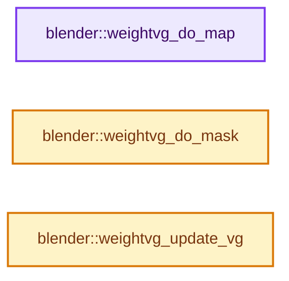

# 实现依赖专题：source/blender/modifiers/intern/MOD_weightvg_util.cc

[方向导航](README.md) · [符号索引](../%E7%AC%A6%E5%8F%B7%E4%BE%9D%E8%B5%96%E4%B8%8E%E5%AE%9E%E7%8E%B0%E7%B4%A2%E5%BC%95.md)

本专题从正文实际调用进入，集中保存共享实现。函数有稳定锚点，可从调用处直接跳到对应完整函数；递归与互相调用通过回链组织。

## 本文件的实现关系




## 完整成员与函数实现

<a id="f-0c6e095a13c7c096"></a>

### `blender::weightvg_do_map`

实现位置：[source/blender/modifiers/intern/MOD_weightvg_util.cc](../../../../../source/blender/modifiers/intern/MOD_weightvg_util.cc) · L46—L107。

接口参数：

- `int num`
- `float *new_w`
- `short falloff_type`
- `const bool do_invert`
- `CurveMapping *cmap`
- `RNG *rng`

**教学注释版**

<!-- annotated:2a32c4e3c3c522 -->

```cpp
void weightvg_do_map(
    int num, float *new_w, short falloff_type, const bool do_invert, CurveMapping *cmap, RNG *rng)
{
  int i;

  /* Return immediately, if we have nothing to do! */
  /* Also security checks... */
  if (!do_invert && (((falloff_type == MOD_WVG_MAPPING_CURVE) && (cmap == nullptr)) ||
                     !ELEM(falloff_type,
                           MOD_WVG_MAPPING_CURVE,
                           MOD_WVG_MAPPING_SHARP,
                           MOD_WVG_MAPPING_SMOOTH,
                           MOD_WVG_MAPPING_ROOT,
                           MOD_WVG_MAPPING_SPHERE,
                           MOD_WVG_MAPPING_RANDOM,
                           MOD_WVG_MAPPING_STEP)))
  {
    return;
  }

  if (cmap && falloff_type == MOD_WVG_MAPPING_CURVE) {
    BKE_curvemapping_init(cmap);
  }

  /* Map each weight (vertex) to its new value, accordingly to the chosen mode. */
  for (i = 0; i < num; i++) {
    float fac = new_w[i];

    /* Code borrowed from the warp modifier. */
    /* Closely matches PROP_SMOOTH and similar. */
    switch (falloff_type) {
      case MOD_WVG_MAPPING_CURVE:
        fac = BKE_curvemapping_evaluateF(cmap, 0, fac);
        break;
      case MOD_WVG_MAPPING_SHARP:
        fac = fac * fac;
        break;
      case MOD_WVG_MAPPING_SMOOTH:
        fac = 3.0f * fac * fac - 2.0f * fac * fac * fac;
        break;
      case MOD_WVG_MAPPING_ROOT:
        fac = sqrtf(fac);
        break;
      case MOD_WVG_MAPPING_SPHERE:
        fac = sqrtf(2 * fac - fac * fac);
        break;
      case MOD_WVG_MAPPING_RANDOM:
        fac = BLI_rng_get_float(rng) * fac;
        break;
      case MOD_WVG_MAPPING_STEP:
        fac = (fac >= 0.5f) ? 1.0f : 0.0f;
        break;
      case MOD_WVG_MAPPING_NONE:
        BLI_assert(do_invert);
        break;
      default:
        BLI_assert_unreachable();
    }

    new_w[i] = do_invert ? 1.0f - fac : fac;
  }
}
```

<details>
<summary>核对原始源码：source/blender/modifiers/intern/MOD_weightvg_util.cc · L46—L107</summary>

<!-- original:2a32c4e3c3c522:source/blender/modifiers/intern/MOD_weightvg_util.cc:46:107 -->

```cpp
void weightvg_do_map(
    int num, float *new_w, short falloff_type, const bool do_invert, CurveMapping *cmap, RNG *rng)
{
  int i;

  /* Return immediately, if we have nothing to do! */
  /* Also security checks... */
  if (!do_invert && (((falloff_type == MOD_WVG_MAPPING_CURVE) && (cmap == nullptr)) ||
                     !ELEM(falloff_type,
                           MOD_WVG_MAPPING_CURVE,
                           MOD_WVG_MAPPING_SHARP,
                           MOD_WVG_MAPPING_SMOOTH,
                           MOD_WVG_MAPPING_ROOT,
                           MOD_WVG_MAPPING_SPHERE,
                           MOD_WVG_MAPPING_RANDOM,
                           MOD_WVG_MAPPING_STEP)))
  {
    return;
  }

  if (cmap && falloff_type == MOD_WVG_MAPPING_CURVE) {
    BKE_curvemapping_init(cmap);
  }

  /* Map each weight (vertex) to its new value, accordingly to the chosen mode. */
  for (i = 0; i < num; i++) {
    float fac = new_w[i];

    /* Code borrowed from the warp modifier. */
    /* Closely matches PROP_SMOOTH and similar. */
    switch (falloff_type) {
      case MOD_WVG_MAPPING_CURVE:
        fac = BKE_curvemapping_evaluateF(cmap, 0, fac);
        break;
      case MOD_WVG_MAPPING_SHARP:
        fac = fac * fac;
        break;
      case MOD_WVG_MAPPING_SMOOTH:
        fac = 3.0f * fac * fac - 2.0f * fac * fac * fac;
        break;
      case MOD_WVG_MAPPING_ROOT:
        fac = sqrtf(fac);
        break;
      case MOD_WVG_MAPPING_SPHERE:
        fac = sqrtf(2 * fac - fac * fac);
        break;
      case MOD_WVG_MAPPING_RANDOM:
        fac = BLI_rng_get_float(rng) * fac;
        break;
      case MOD_WVG_MAPPING_STEP:
        fac = (fac >= 0.5f) ? 1.0f : 0.0f;
        break;
      case MOD_WVG_MAPPING_NONE:
        BLI_assert(do_invert);
        break;
      default:
        BLI_assert_unreachable();
    }

    new_w[i] = do_invert ? 1.0f - fac : fac;
  }
}
```

</details>

**沿实际写入检查状态**

- `fac = BKE_curvemapping_evaluateF(cmap, 0, fac);`
- `fac = fac * fac;`
- `fac = 3.0f * fac * fac - 2.0f * fac * fac * fac;`
- `fac = sqrtf(fac);`
- `fac = sqrtf(2 * fac - fac * fac);`
- `fac = BLI_rng_get_float(rng) * fac;`
- `fac = (fac >= 0.5f) ? 1.0f : 0.0f;`
- `new_w[i] = do_invert ? 1.0f - fac : fac;`

**继续追踪实现**

- `ELEM` → [ELEM · L88](%E4%BE%9D%E8%B5%96-GHOST_utildefines-34b996.md#m-d28724a15928)；[ELEM · L135](../01-%E5%9F%BA%E7%A1%80%E5%AE%B9%E5%99%A8%E4%B8%8E%E7%8E%B0%E4%BB%A3CPP/%E4%BE%9D%E8%B5%96-BLI_utildefines-293a0a.md#m-d6572de7cae0)。宏定义由构建条件选择。
- `BKE_curvemapping_init` → [blender::BKE_curvemapping_init · L1441](%E4%BE%9D%E8%B5%96-colortools-8bc37a.md#f-f7d75fd7ad2a5ee6)。
- `BKE_curvemapping_evaluateF` → [blender::BKE_curvemapping_evaluateF · L1177](%E4%BE%9D%E8%B5%96-colortools-8bc37a.md#f-014584e04eeb1392)。
- `sqrtf` → [外部契约](https://eel.is/c++draft/)：这个边界按实际表达式及所属类型核对参数、返回值、寿命与失败行为。这里提供接口入口，不声称已解释该第三方版本的内部实现。
- `BLI_rng_get_float` → [RNG::BLI_rng_get_float · L90](../01-%E5%9F%BA%E7%A1%80%E5%AE%B9%E5%99%A8%E4%B8%8E%E7%8E%B0%E4%BB%A3CPP/%E4%BE%9D%E8%B5%96-rand-171ca2.md#f-964cd94e36f95d8f)。
- `BLI_assert` → [BLI_assert · L48](../01-%E5%9F%BA%E7%A1%80%E5%AE%B9%E5%99%A8%E4%B8%8E%E7%8E%B0%E4%BB%A3CPP/%E4%BE%9D%E8%B5%96-BLI_assert-cc98e8.md#m-57a88495704d)；[BLI_assert · L63](../01-%E5%9F%BA%E7%A1%80%E5%AE%B9%E5%99%A8%E4%B8%8E%E7%8E%B0%E4%BB%A3CPP/%E4%BE%9D%E8%B5%96-BLI_assert-cc98e8.md#m-d07050020cb5)。宏定义由构建条件选择。
- `BLI_assert_unreachable` → [BLI_assert_unreachable · L77](../01-%E5%9F%BA%E7%A1%80%E5%AE%B9%E5%99%A8%E4%B8%8E%E7%8E%B0%E4%BB%A3CPP/%E4%BE%9D%E8%B5%96-BLI_assert-cc98e8.md#m-7a2d91a67d8e)。宏定义由构建条件选择。

<a id="f-c17381972adb0c5c"></a>

### `blender::weightvg_do_mask`

实现位置：[source/blender/modifiers/intern/MOD_weightvg_util.cc](../../../../../source/blender/modifiers/intern/MOD_weightvg_util.cc) · L109—L241。

接口参数：

- `const ModifierEvalContext *ctx`
- `const int num`
- `const int *indices`
- `float *org_w`
- `const float *new_w`
- `Object *ob`
- `Mesh *mesh`
- `const float fact`
- `const char defgrp_name[MAX_VGROUP_NAME]`
- `Scene *`
- `Tex *texture`
- `const int tex_use_channel`
- `const int tex_mapping`
- `Object *tex_map_object`
- `const char *text_map_bone`
- `const char *tex_uvlayer_name`
- `const bool invert_vgroup_mask`

**教学注释版**

<!-- annotated:5976da872f722c -->

```cpp
void weightvg_do_mask(const ModifierEvalContext *ctx,
                      const int num,
                      const int *indices,
                      float *org_w,
                      const float *new_w,
                      Object *ob,
                      Mesh *mesh,
                      const float fact,
                      const char defgrp_name[MAX_VGROUP_NAME],
                      Scene * /*scene*/,
                      Tex *texture,
                      const int tex_use_channel,
                      const int tex_mapping,
                      Object *tex_map_object,
                      const char *text_map_bone,
                      const char *tex_uvlayer_name,
                      const bool invert_vgroup_mask)
{
  int ref_didx;
  int i;

  /* If influence factor is null, nothing to do! */
  if (fact == 0.0f) {
    return;
  }

  /* If we want to mask vgroup weights from a texture. */
  if (texture != nullptr) {
    /* The texture coordinates. */
    float (*tex_co)[3];
    /* See mapping note below... */
    MappingInfoModifierData t_map;
    const int verts_num = mesh->verts_num;

    /* Use new generic get_texture_coords, but do not modify our DNA struct for it...
     * XXX Why use a ModifierData stuff here ? Why not a simple, generic struct for parameters?
     *     What e.g. if a modifier wants to use several textures?
     *     Why use only v_co, and not mesh positions (or both)?
     */
    t_map.texture = texture;
    t_map.map_object = tex_map_object;
    STRNCPY(t_map.map_bone, text_map_bone);
    STRNCPY(t_map.uvlayer_name, tex_uvlayer_name);
    t_map.texmapping = tex_mapping;

    tex_co = MEM_new_array_zeroed<float[3]>(verts_num, __func__);
    MOD_get_texture_coords(&t_map, ctx, ob, mesh, nullptr, tex_co);

    MOD_init_texture(&t_map, ctx);

    /* For each weight (vertex), make the mix between org and new weights. */
    for (i = 0; i < num; i++) {
      int idx = indices ? indices[i] : i;
      TexResult texres;
      float hsv[3]; /* For HSV color space. */
      bool do_color_manage = tex_use_channel != MOD_WVG_MASK_TEX_USE_INT;

      BKE_texture_get_value(texture, tex_co[idx], &texres, do_color_manage);
      /* Get the good channel value... */
      switch (tex_use_channel) {
        case MOD_WVG_MASK_TEX_USE_INT:
          org_w[i] = (new_w[i] * texres.tin * fact) + (org_w[i] * (1.0f - (texres.tin * fact)));
          break;
        case MOD_WVG_MASK_TEX_USE_RED:
          org_w[i] = (new_w[i] * texres.trgba[0] * fact) +
                     (org_w[i] * (1.0f - (texres.trgba[0] * fact)));
          break;
        case MOD_WVG_MASK_TEX_USE_GREEN:
          org_w[i] = (new_w[i] * texres.trgba[1] * fact) +
                     (org_w[i] * (1.0f - (texres.trgba[1] * fact)));
          break;
        case MOD_WVG_MASK_TEX_USE_BLUE:
          org_w[i] = (new_w[i] * texres.trgba[2] * fact) +
                     (org_w[i] * (1.0f - (texres.trgba[2] * fact)));
          break;
        case MOD_WVG_MASK_TEX_USE_HUE:
          rgb_to_hsv_v(texres.trgba, hsv);
          org_w[i] = (new_w[i] * hsv[0] * fact) + (org_w[i] * (1.0f - (hsv[0] * fact)));
          break;
        case MOD_WVG_MASK_TEX_USE_SAT:
          rgb_to_hsv_v(texres.trgba, hsv);
          org_w[i] = (new_w[i] * hsv[1] * fact) + (org_w[i] * (1.0f - (hsv[1] * fact)));
          break;
        case MOD_WVG_MASK_TEX_USE_VAL:
          rgb_to_hsv_v(texres.trgba, hsv);
          org_w[i] = (new_w[i] * hsv[2] * fact) + (org_w[i] * (1.0f - (hsv[2] * fact)));
          break;
        case MOD_WVG_MASK_TEX_USE_ALPHA:
          org_w[i] = (new_w[i] * texres.trgba[3] * fact) +
                     (org_w[i] * (1.0f - (texres.trgba[3] * fact)));
          break;
        default:
          org_w[i] = (new_w[i] * texres.tin * fact) + (org_w[i] * (1.0f - (texres.tin * fact)));
          break;
      }
    }

    MEM_delete(tex_co);
  }
  else if ((ref_didx = BKE_id_defgroup_name_index(&mesh->id, defgrp_name)) != -1) {
    /* Check whether we want to set vgroup weights from a constant weight factor or a vertex
     * group.
     */
    /* Get vgroup idx from its name. */

    /* Proceed only if vgroup is valid, else use constant factor. */
    /* Get actual deform-verts (ie vertex group data). */
    const MDeformVert *dvert = mesh->deform_verts().data();
    /* Proceed only if vgroup is valid, else assume factor = O. */
    if (dvert == nullptr) {
      return;
    }

    /* For each weight (vertex), make the mix between org and new weights. */
    for (i = 0; i < num; i++) {
      int idx = indices ? indices[i] : i;
      const float f = (invert_vgroup_mask ?
                           (1.0f - BKE_defvert_find_weight(&dvert[idx], ref_didx)) :
                           BKE_defvert_find_weight(&dvert[idx], ref_didx)) *
                      fact;
      org_w[i] = (new_w[i] * f) + (org_w[i] * (1.0f - f));
      /* If that vertex is not in ref vgroup, assume null factor, and hence do nothing! */
    }
  }
  else {
    /* Default "influence" behavior. */
    /* For each weight (vertex), make the mix between org and new weights. */
    const float ifact = 1.0f - fact;
    for (i = 0; i < num; i++) {
      org_w[i] = (new_w[i] * fact) + (org_w[i] * ifact);
    }
  }
}
```

<details>
<summary>核对原始源码：source/blender/modifiers/intern/MOD_weightvg_util.cc · L109—L241</summary>

<!-- original:5976da872f722c:source/blender/modifiers/intern/MOD_weightvg_util.cc:109:241 -->

```cpp
void weightvg_do_mask(const ModifierEvalContext *ctx,
                      const int num,
                      const int *indices,
                      float *org_w,
                      const float *new_w,
                      Object *ob,
                      Mesh *mesh,
                      const float fact,
                      const char defgrp_name[MAX_VGROUP_NAME],
                      Scene * /*scene*/,
                      Tex *texture,
                      const int tex_use_channel,
                      const int tex_mapping,
                      Object *tex_map_object,
                      const char *text_map_bone,
                      const char *tex_uvlayer_name,
                      const bool invert_vgroup_mask)
{
  int ref_didx;
  int i;

  /* If influence factor is null, nothing to do! */
  if (fact == 0.0f) {
    return;
  }

  /* If we want to mask vgroup weights from a texture. */
  if (texture != nullptr) {
    /* The texture coordinates. */
    float (*tex_co)[3];
    /* See mapping note below... */
    MappingInfoModifierData t_map;
    const int verts_num = mesh->verts_num;

    /* Use new generic get_texture_coords, but do not modify our DNA struct for it...
     * XXX Why use a ModifierData stuff here ? Why not a simple, generic struct for parameters?
     *     What e.g. if a modifier wants to use several textures?
     *     Why use only v_co, and not mesh positions (or both)?
     */
    t_map.texture = texture;
    t_map.map_object = tex_map_object;
    STRNCPY(t_map.map_bone, text_map_bone);
    STRNCPY(t_map.uvlayer_name, tex_uvlayer_name);
    t_map.texmapping = tex_mapping;

    tex_co = MEM_new_array_zeroed<float[3]>(verts_num, __func__);
    MOD_get_texture_coords(&t_map, ctx, ob, mesh, nullptr, tex_co);

    MOD_init_texture(&t_map, ctx);

    /* For each weight (vertex), make the mix between org and new weights. */
    for (i = 0; i < num; i++) {
      int idx = indices ? indices[i] : i;
      TexResult texres;
      float hsv[3]; /* For HSV color space. */
      bool do_color_manage = tex_use_channel != MOD_WVG_MASK_TEX_USE_INT;

      BKE_texture_get_value(texture, tex_co[idx], &texres, do_color_manage);
      /* Get the good channel value... */
      switch (tex_use_channel) {
        case MOD_WVG_MASK_TEX_USE_INT:
          org_w[i] = (new_w[i] * texres.tin * fact) + (org_w[i] * (1.0f - (texres.tin * fact)));
          break;
        case MOD_WVG_MASK_TEX_USE_RED:
          org_w[i] = (new_w[i] * texres.trgba[0] * fact) +
                     (org_w[i] * (1.0f - (texres.trgba[0] * fact)));
          break;
        case MOD_WVG_MASK_TEX_USE_GREEN:
          org_w[i] = (new_w[i] * texres.trgba[1] * fact) +
                     (org_w[i] * (1.0f - (texres.trgba[1] * fact)));
          break;
        case MOD_WVG_MASK_TEX_USE_BLUE:
          org_w[i] = (new_w[i] * texres.trgba[2] * fact) +
                     (org_w[i] * (1.0f - (texres.trgba[2] * fact)));
          break;
        case MOD_WVG_MASK_TEX_USE_HUE:
          rgb_to_hsv_v(texres.trgba, hsv);
          org_w[i] = (new_w[i] * hsv[0] * fact) + (org_w[i] * (1.0f - (hsv[0] * fact)));
          break;
        case MOD_WVG_MASK_TEX_USE_SAT:
          rgb_to_hsv_v(texres.trgba, hsv);
          org_w[i] = (new_w[i] * hsv[1] * fact) + (org_w[i] * (1.0f - (hsv[1] * fact)));
          break;
        case MOD_WVG_MASK_TEX_USE_VAL:
          rgb_to_hsv_v(texres.trgba, hsv);
          org_w[i] = (new_w[i] * hsv[2] * fact) + (org_w[i] * (1.0f - (hsv[2] * fact)));
          break;
        case MOD_WVG_MASK_TEX_USE_ALPHA:
          org_w[i] = (new_w[i] * texres.trgba[3] * fact) +
                     (org_w[i] * (1.0f - (texres.trgba[3] * fact)));
          break;
        default:
          org_w[i] = (new_w[i] * texres.tin * fact) + (org_w[i] * (1.0f - (texres.tin * fact)));
          break;
      }
    }

    MEM_delete(tex_co);
  }
  else if ((ref_didx = BKE_id_defgroup_name_index(&mesh->id, defgrp_name)) != -1) {
    /* Check whether we want to set vgroup weights from a constant weight factor or a vertex
     * group.
     */
    /* Get vgroup idx from its name. */

    /* Proceed only if vgroup is valid, else use constant factor. */
    /* Get actual deform-verts (ie vertex group data). */
    const MDeformVert *dvert = mesh->deform_verts().data();
    /* Proceed only if vgroup is valid, else assume factor = O. */
    if (dvert == nullptr) {
      return;
    }

    /* For each weight (vertex), make the mix between org and new weights. */
    for (i = 0; i < num; i++) {
      int idx = indices ? indices[i] : i;
      const float f = (invert_vgroup_mask ?
                           (1.0f - BKE_defvert_find_weight(&dvert[idx], ref_didx)) :
                           BKE_defvert_find_weight(&dvert[idx], ref_didx)) *
                      fact;
      org_w[i] = (new_w[i] * f) + (org_w[i] * (1.0f - f));
      /* If that vertex is not in ref vgroup, assume null factor, and hence do nothing! */
    }
  }
  else {
    /* Default "influence" behavior. */
    /* For each weight (vertex), make the mix between org and new weights. */
    const float ifact = 1.0f - fact;
    for (i = 0; i < num; i++) {
      org_w[i] = (new_w[i] * fact) + (org_w[i] * ifact);
    }
  }
}
```

</details>

**沿实际写入检查状态**

- `t_map.texture = texture;`
- `t_map.map_object = tex_map_object;`
- `t_map.texmapping = tex_mapping;`
- `tex_co = MEM_new_array_zeroed<float[3]>(verts_num, __func__);`
- `org_w[i] = (new_w[i] * texres.tin * fact) + (org_w[i] * (1.0f - (texres.tin * fact)));`
- `org_w[i] = (new_w[i] * texres.trgba[0] * fact) +`
- `org_w[i] = (new_w[i] * texres.trgba[1] * fact) +`
- `org_w[i] = (new_w[i] * texres.trgba[2] * fact) +`
- `org_w[i] = (new_w[i] * hsv[0] * fact) + (org_w[i] * (1.0f - (hsv[0] * fact)));`
- `org_w[i] = (new_w[i] * hsv[1] * fact) + (org_w[i] * (1.0f - (hsv[1] * fact)));`
- `org_w[i] = (new_w[i] * hsv[2] * fact) + (org_w[i] * (1.0f - (hsv[2] * fact)));`
- `org_w[i] = (new_w[i] * texres.trgba[3] * fact) +`
- `org_w[i] = (new_w[i] * f) + (org_w[i] * (1.0f - f));`
- `org_w[i] = (new_w[i] * fact) + (org_w[i] * ifact);`

**继续追踪实现**

- `STRNCPY` → [blender::STRNCPY · L690](../01-%E5%9F%BA%E7%A1%80%E5%AE%B9%E5%99%A8%E4%B8%8E%E7%8E%B0%E4%BB%A3CPP/%E4%BE%9D%E8%B5%96-BLI_string-b43058.md#f-6b2d861724026be6)。
- `MEM_new_array_zeroed<float[3]>` → [MEM_new_array_zeroed · L566](../03-%E5%86%85%E5%AD%98%E5%88%86%E9%85%8D%E4%B8%8E%E8%BF%90%E8%A1%8C%E6%97%B6%E7%B1%BB%E5%9E%8B/%E4%BE%9D%E8%B5%96-MEM_guardedalloc-b54eca.md#f-3a0cf63fb5216500)；[MEM_new_array_zeroed · L119](../03-%E5%86%85%E5%AD%98%E5%88%86%E9%85%8D%E4%B8%8E%E8%BF%90%E8%A1%8C%E6%97%B6%E7%B1%BB%E5%9E%8B/%E4%BE%9D%E8%B5%96-mallocn-afdcd4.md#f-6825557da566fdbe)。同名重载需按实参类型选择。
- `MOD_get_texture_coords` → [blender::MOD_get_texture_coords · L51](%E4%BE%9D%E8%B5%96-MOD_util-83ca4b.md#f-93137e45acd248b6)。
- `MOD_init_texture` → [blender::MOD_init_texture · L38](%E4%BE%9D%E8%B5%96-MOD_util-83ca4b.md#f-a8c2c947afb32236)。
- `BKE_texture_get_value` → [blender::BKE_texture_get_value · L640](%E4%BE%9D%E8%B5%96-texture-60b86b.md#f-39c033faea8bb059)。
- `rgb_to_hsv_v` → [blender::rgb_to_hsv_v · L322](../12-%E7%A9%BA%E9%97%B4%E6%95%B0%E6%8D%AE%E7%BB%93%E6%9E%84%E4%B8%8E%E5%87%A0%E4%BD%95%E7%AE%97%E6%B3%95/%E4%BE%9D%E8%B5%96-math_color-98507f.md#f-7312a69cee7c11bb)。
- `MEM_delete` → [MEM_delete · L400](../03-%E5%86%85%E5%AD%98%E5%88%86%E9%85%8D%E4%B8%8E%E8%BF%90%E8%A1%8C%E6%97%B6%E7%B1%BB%E5%9E%8B/%E4%BE%9D%E8%B5%96-MEM_guardedalloc-b54eca.md#f-9049ffdd1682887c)。
- `BKE_id_defgroup_name_index` → [blender::BKE_id_defgroup_name_index · L557](%E4%BE%9D%E8%B5%96-deform-6949f4.md#f-886667bbd10fa710)。
- `mesh->deform_verts().data` → [调用协议](../%E6%A8%A1%E6%9D%BF%E5%AE%8F%E4%B8%8E%E5%8A%A8%E6%80%81%E5%88%86%E6%B4%BE%E5%8D%8F%E8%AE%AE.md)：接收对象类型依赖auto、返回值或模板实例；不按同名猜测目标。调用位置L216。
- `mesh->deform_verts` → [Mesh::deform_verts · L1266](03-MPoly%E8%BF%81%E7%A7%BB%E4%B8%8E%E5%85%BC%E5%AE%B9.md#f-4c0433aad24aa301)。
- `BKE_defvert_find_weight` → [blender::BKE_defvert_find_weight · L779](%E4%BE%9D%E8%B5%96-deform-6949f4.md#f-c117fcd05c4fd453)。

<a id="f-8ef241df5407f05a"></a>

### `blender::weightvg_update_vg`

实现位置：[source/blender/modifiers/intern/MOD_weightvg_util.cc](../../../../../source/blender/modifiers/intern/MOD_weightvg_util.cc) · L243—L309。

接口参数：

- `MDeformVert *dvert`
- `int defgrp_idx`
- `MDeformWeight **dws`
- `int num`
- `const int *indices`
- `const float *weights`
- `const bool do_add`
- `const float add_thresh`
- `const bool do_rem`
- `const float rem_thresh`
- `const bool do_normalize`

**教学注释版**

<!-- annotated:92ed991de37637 -->

```cpp
void weightvg_update_vg(MDeformVert *dvert,
                        int defgrp_idx,
                        MDeformWeight **dws,
                        int num,
                        const int *indices,
                        const float *weights,
                        const bool do_add,
                        const float add_thresh,
                        const bool do_rem,
                        const float rem_thresh,
                        const bool do_normalize)
{
  int i;

  float min_w = weights[0];
  float norm_fac = 1.0f;
  if (do_normalize) {
    float max_w = weights[0];
    for (i = 1; i < num; i++) {
      const float w = weights[i];

      /* No need to clamp here, normalization will ensure we stay within [0.0, 1.0] range. */
      if (w < min_w) {
        min_w = w;
      }
      else if (w > max_w) {
        max_w = w;
      }
    }

    const float range = max_w - min_w;
    if (fabsf(range) > FLT_EPSILON) {
      norm_fac = 1.0f / range;
    }
    else {
      min_w = 0.0f;
    }
  }

  for (i = 0; i < num; i++) {
    float w = weights[i];
    MDeformVert *dv = &dvert[indices ? indices[i] : i];
    MDeformWeight *dw = dws ?
                            dws[i] :
                            ((defgrp_idx >= 0) ? BKE_defvert_find_index(dv, defgrp_idx) : nullptr);

    if (do_normalize) {
      w = (w - min_w) * norm_fac;
    }
    /* Never allow weights out of [0.0, 1.0] range. */
    CLAMP(w, 0.0f, 1.0f);

    /* If the vertex is in this vgroup, remove it if needed, or just update it. */
    if (dw != nullptr) {
      if (do_rem && w <= rem_thresh) {
        BKE_defvert_remove_group(dv, dw);
      }
      else {
        dw->weight = w;
      }
    }
    /* Else, add it if needed! */
    else if (do_add && w >= add_thresh) {
      BKE_defvert_add_index_notest(dv, defgrp_idx, w);
    }
  }
}
```

<details>
<summary>核对原始源码：source/blender/modifiers/intern/MOD_weightvg_util.cc · L243—L309</summary>

<!-- original:92ed991de37637:source/blender/modifiers/intern/MOD_weightvg_util.cc:243:309 -->

```cpp
void weightvg_update_vg(MDeformVert *dvert,
                        int defgrp_idx,
                        MDeformWeight **dws,
                        int num,
                        const int *indices,
                        const float *weights,
                        const bool do_add,
                        const float add_thresh,
                        const bool do_rem,
                        const float rem_thresh,
                        const bool do_normalize)
{
  int i;

  float min_w = weights[0];
  float norm_fac = 1.0f;
  if (do_normalize) {
    float max_w = weights[0];
    for (i = 1; i < num; i++) {
      const float w = weights[i];

      /* No need to clamp here, normalization will ensure we stay within [0.0, 1.0] range. */
      if (w < min_w) {
        min_w = w;
      }
      else if (w > max_w) {
        max_w = w;
      }
    }

    const float range = max_w - min_w;
    if (fabsf(range) > FLT_EPSILON) {
      norm_fac = 1.0f / range;
    }
    else {
      min_w = 0.0f;
    }
  }

  for (i = 0; i < num; i++) {
    float w = weights[i];
    MDeformVert *dv = &dvert[indices ? indices[i] : i];
    MDeformWeight *dw = dws ?
                            dws[i] :
                            ((defgrp_idx >= 0) ? BKE_defvert_find_index(dv, defgrp_idx) : nullptr);

    if (do_normalize) {
      w = (w - min_w) * norm_fac;
    }
    /* Never allow weights out of [0.0, 1.0] range. */
    CLAMP(w, 0.0f, 1.0f);

    /* If the vertex is in this vgroup, remove it if needed, or just update it. */
    if (dw != nullptr) {
      if (do_rem && w <= rem_thresh) {
        BKE_defvert_remove_group(dv, dw);
      }
      else {
        dw->weight = w;
      }
    }
    /* Else, add it if needed! */
    else if (do_add && w >= add_thresh) {
      BKE_defvert_add_index_notest(dv, defgrp_idx, w);
    }
  }
}
```

</details>

**沿实际写入检查状态**

- `min_w = w;`
- `max_w = w;`
- `norm_fac = 1.0f / range;`
- `min_w = 0.0f;`
- `w = (w - min_w) * norm_fac;`
- `dw->weight = w;`

**继续追踪实现**

- `fabsf` → [fabsf · L21](%E4%BE%9D%E8%B5%96-radial_tiling_shared-98abf9.md#m-02cc4c69cfb3)；[fabsf · L43](%E4%BE%9D%E8%B5%96-radial_tiling_shared-98abf9.md#m-04effe61803b)；[fabsf · L74](%E4%BE%9D%E8%B5%96-radial_tiling_shared-98abf9.md#m-927dd4eba7dc)；[fabsf · L25](../01-%E5%9F%BA%E7%A1%80%E5%AE%B9%E5%99%A8%E4%B8%8E%E7%8E%B0%E4%BB%A3CPP/%E4%BE%9D%E8%B5%96-radial_tiling_shared-7989a4.md#m-8348d6b3d08f)；[fabsf · L47](../01-%E5%9F%BA%E7%A1%80%E5%AE%B9%E5%99%A8%E4%B8%8E%E7%8E%B0%E4%BB%A3CPP/%E4%BE%9D%E8%B5%96-radial_tiling_shared-7989a4.md#m-13b7e0b6d84f)；[fabsf · L78](../01-%E5%9F%BA%E7%A1%80%E5%AE%B9%E5%99%A8%E4%B8%8E%E7%8E%B0%E4%BB%A3CPP/%E4%BE%9D%E8%B5%96-radial_tiling_shared-7989a4.md#m-326c83464a0d)；[fabsf · L21](%E4%BE%9D%E8%B5%96-node_radial_tiling_shared-b14bc2.md#m-7c3ee12fc119)；[fabsf · L43](%E4%BE%9D%E8%B5%96-node_radial_tiling_shared-b14bc2.md#m-9112db0e2dd1)；[fabsf · L74](%E4%BE%9D%E8%B5%96-node_radial_tiling_shared-b14bc2.md#m-ee4e61908a6f)；[fabsf · L167](%E4%BE%9D%E8%B5%96-compat-56205c.md#m-b039ee6c1601)；[fabsf · L265](%E4%BE%9D%E8%B5%96-compat-efe0e9.md#m-6b21869e9f3f)。宏定义由构建条件选择。
- `BKE_defvert_find_index` → [blender::BKE_defvert_find_index · L811](%E4%BE%9D%E8%B5%96-deform-6949f4.md#f-d8c22e4305ac3d34)。
- `CLAMP` → [CLAMP · L200](../01-%E5%9F%BA%E7%A1%80%E5%AE%B9%E5%99%A8%E4%B8%8E%E7%8E%B0%E4%BB%A3CPP/%E4%BE%9D%E8%B5%96-BLI_utildefines-293a0a.md#m-69703e497120)。宏定义由构建条件选择。
- `BKE_defvert_remove_group` → [blender::BKE_defvert_remove_group · L885](%E4%BE%9D%E8%B5%96-deform-6949f4.md#f-ece6b12afaa3769e)。
- `BKE_defvert_add_index_notest` → [blender::BKE_defvert_add_index_notest · L861](%E4%BE%9D%E8%B5%96-deform-6949f4.md#f-5c47b354ad3bd1c2)。
