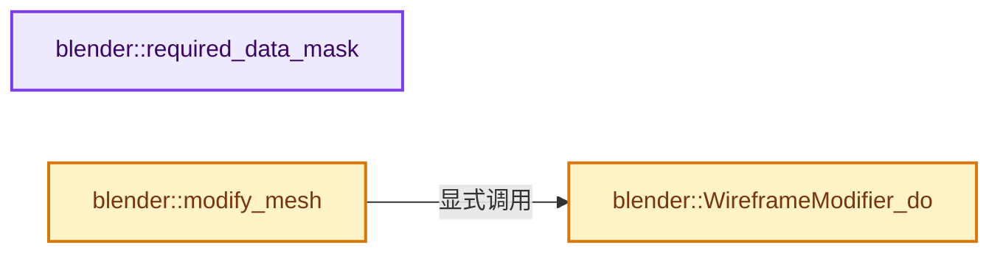

# 实现依赖专题：source/blender/modifiers/intern/MOD_wireframe.cc

[方向导航](README.md) · [符号索引](../%E7%AC%A6%E5%8F%B7%E4%BE%9D%E8%B5%96%E4%B8%8E%E5%AE%9E%E7%8E%B0%E7%B4%A2%E5%BC%95.md)

本专题从正文实际调用进入，集中保存共享实现。函数有稳定锚点，可从调用处直接跳到对应完整函数；递归与互相调用通过回链组织。

## 本文件的实现关系




## 完整成员与函数实现

<a id="f-2ae51fc2bf71f26d"></a>

### `blender::required_data_mask`

实现位置：[source/blender/modifiers/intern/MOD_wireframe.cc](../../../../../source/blender/modifiers/intern/MOD_wireframe.cc) · L42—L50。

接口参数：

- `ModifierData *md`
- `CustomData_MeshMasks *r_cddata_masks`

**教学注释版**

<!-- annotated:88e67392925463 -->

```cpp
static void required_data_mask(ModifierData *md, CustomData_MeshMasks *r_cddata_masks)
{
  WireframeModifierData *wmd = reinterpret_cast<WireframeModifierData *>(md);

  /* Ask for vertex-groups if we need them. */
  if (wmd->defgrp_name[0] != '\0') {
    r_cddata_masks->vmask |= CD_MASK_MDEFORMVERT;
  }
}
```

<details>
<summary>核对原始源码：source/blender/modifiers/intern/MOD_wireframe.cc · L42—L50</summary>

<!-- original:88e67392925463:source/blender/modifiers/intern/MOD_wireframe.cc:42:50 -->

```cpp
static void required_data_mask(ModifierData *md, CustomData_MeshMasks *r_cddata_masks)
{
  WireframeModifierData *wmd = reinterpret_cast<WireframeModifierData *>(md);

  /* Ask for vertex-groups if we need them. */
  if (wmd->defgrp_name[0] != '\0') {
    r_cddata_masks->vmask |= CD_MASK_MDEFORMVERT;
  }
}
```

</details>

**沿实际写入检查状态**

- `r_cddata_masks->vmask |= CD_MASK_MDEFORMVERT;`

**继续追踪实现**

本实现没有需要继续展开的显式调用；检查返回表达式、对象转换和调用者前置条件。

<a id="f-97bdb812c869821a"></a>

### `blender::WireframeModifier_do`

实现位置：[source/blender/modifiers/intern/MOD_wireframe.cc](../../../../../source/blender/modifiers/intern/MOD_wireframe.cc) · L52—L92。

接口参数：

- `WireframeModifierData *wmd`
- `Object *ob`
- `Mesh *mesh`

**教学注释版**

<!-- annotated:667b696b7b7904 -->

```cpp
static Mesh *WireframeModifier_do(WireframeModifierData *wmd, Object *ob, Mesh *mesh)
{
  Mesh *result;
  BMesh *bm;

  const int defgrp_index = BKE_id_defgroup_name_index(&mesh->id, wmd->defgrp_name);

  BMeshCreateParams create_params{};
  BMeshFromMeshParams convert_params{};
  convert_params.calc_face_normal = true;
  convert_params.calc_vert_normal = true;
  convert_params.add_key_index = false;
  convert_params.use_shapekey = false;
  convert_params.active_shapekey = 0;
  convert_params.cd_mask_extra.vmask = CD_MASK_ORIGINDEX;
  convert_params.cd_mask_extra.emask = CD_MASK_ORIGINDEX;
  convert_params.cd_mask_extra.pmask = CD_MASK_ORIGINDEX;

  bm = BKE_mesh_to_bmesh_ex(mesh, &create_params, &convert_params);

  BM_mesh_wireframe(bm,
                    wmd->offset,
                    wmd->offset_fac,
                    wmd->offset_fac_vg,
                    (wmd->flag & MOD_WIREFRAME_REPLACE) != 0,
                    (wmd->flag & MOD_WIREFRAME_BOUNDARY) != 0,
                    (wmd->flag & MOD_WIREFRAME_OFS_EVEN) != 0,
                    (wmd->flag & MOD_WIREFRAME_OFS_RELATIVE) != 0,
                    (wmd->flag & MOD_WIREFRAME_CREASE) != 0,
                    wmd->crease_weight,
                    defgrp_index,
                    (wmd->flag & MOD_WIREFRAME_INVERT_VGROUP) != 0,
                    wmd->mat_ofs,
                    // [讲解] std::max：按比较关系选取较大值。本讲解中的增长公式同时满足最低请求和几何增长；若保存返回引用，还需注意实参寿命。
                    std::max(ob->totcol - 1, 0),
                    false);

  result = BKE_mesh_from_bmesh_for_eval_nomain(bm, nullptr, mesh);
  BM_mesh_free(bm);

  return result;
}
```

<details>
<summary>核对原始源码：source/blender/modifiers/intern/MOD_wireframe.cc · L52—L92</summary>

<!-- original:667b696b7b7904:source/blender/modifiers/intern/MOD_wireframe.cc:52:92 -->

```cpp
static Mesh *WireframeModifier_do(WireframeModifierData *wmd, Object *ob, Mesh *mesh)
{
  Mesh *result;
  BMesh *bm;

  const int defgrp_index = BKE_id_defgroup_name_index(&mesh->id, wmd->defgrp_name);

  BMeshCreateParams create_params{};
  BMeshFromMeshParams convert_params{};
  convert_params.calc_face_normal = true;
  convert_params.calc_vert_normal = true;
  convert_params.add_key_index = false;
  convert_params.use_shapekey = false;
  convert_params.active_shapekey = 0;
  convert_params.cd_mask_extra.vmask = CD_MASK_ORIGINDEX;
  convert_params.cd_mask_extra.emask = CD_MASK_ORIGINDEX;
  convert_params.cd_mask_extra.pmask = CD_MASK_ORIGINDEX;

  bm = BKE_mesh_to_bmesh_ex(mesh, &create_params, &convert_params);

  BM_mesh_wireframe(bm,
                    wmd->offset,
                    wmd->offset_fac,
                    wmd->offset_fac_vg,
                    (wmd->flag & MOD_WIREFRAME_REPLACE) != 0,
                    (wmd->flag & MOD_WIREFRAME_BOUNDARY) != 0,
                    (wmd->flag & MOD_WIREFRAME_OFS_EVEN) != 0,
                    (wmd->flag & MOD_WIREFRAME_OFS_RELATIVE) != 0,
                    (wmd->flag & MOD_WIREFRAME_CREASE) != 0,
                    wmd->crease_weight,
                    defgrp_index,
                    (wmd->flag & MOD_WIREFRAME_INVERT_VGROUP) != 0,
                    wmd->mat_ofs,
                    std::max(ob->totcol - 1, 0),
                    false);

  result = BKE_mesh_from_bmesh_for_eval_nomain(bm, nullptr, mesh);
  BM_mesh_free(bm);

  return result;
}
```

</details>

**沿实际写入检查状态**

- `convert_params.calc_face_normal = true;`
- `convert_params.calc_vert_normal = true;`
- `convert_params.add_key_index = false;`
- `convert_params.use_shapekey = false;`
- `convert_params.active_shapekey = 0;`
- `convert_params.cd_mask_extra.vmask = CD_MASK_ORIGINDEX;`
- `convert_params.cd_mask_extra.emask = CD_MASK_ORIGINDEX;`
- `convert_params.cd_mask_extra.pmask = CD_MASK_ORIGINDEX;`
- `bm = BKE_mesh_to_bmesh_ex(mesh, &create_params, &convert_params);`
- `result = BKE_mesh_from_bmesh_for_eval_nomain(bm, nullptr, mesh);`

**结果出口**

- `return result;`

**继续追踪实现**

- `BKE_id_defgroup_name_index` → [blender::BKE_id_defgroup_name_index · L557](%E4%BE%9D%E8%B5%96-deform-6949f4.md#f-886667bbd10fa710)。
- `BKE_mesh_to_bmesh_ex` → [BKE_mesh_to_bmesh_ex · L1583](03-MPoly%E8%BF%81%E7%A7%BB%E4%B8%8E%E5%85%BC%E5%AE%B9.md#f-dd2f413684da0188)。
- `BM_mesh_wireframe` → [blender::BM_mesh_wireframe · L146](%E4%BE%9D%E8%B5%96-bmesh_wireframe-3c8392.md#f-b81e4902f56303da)。
- `std::max` → [外部契约](https://eel.is/c++draft/alg.min.max)：按比较关系选取较大值。本讲解中的增长公式同时满足最低请求和几何增长；若保存返回引用，还需注意实参寿命。
- `BKE_mesh_from_bmesh_for_eval_nomain` → [BKE_mesh_from_bmesh_for_eval_nomain · L1620](03-MPoly%E8%BF%81%E7%A7%BB%E4%B8%8E%E5%85%BC%E5%AE%B9.md#f-92b713674a1be50c)。
- `BM_mesh_free` → [blender::BM_mesh_free · L264](%E4%BE%9D%E8%B5%96-bmesh_mesh-283e2d.md#f-3871ddd58daba48c)。

<a id="f-2018bace2c01e7f2"></a>

### `blender::modify_mesh`

实现位置：[source/blender/modifiers/intern/MOD_wireframe.cc](../../../../../source/blender/modifiers/intern/MOD_wireframe.cc) · L94—L97。

接口参数：

- `ModifierData *md`
- `const ModifierEvalContext *ctx`
- `Mesh *mesh`

**教学注释版**

<!-- annotated:24a73b3055f505 -->

```cpp
static Mesh *modify_mesh(ModifierData *md, const ModifierEvalContext *ctx, Mesh *mesh)
{
  return WireframeModifier_do(reinterpret_cast<WireframeModifierData *>(md), ctx->object, mesh);
}
```

<details>
<summary>核对原始源码：source/blender/modifiers/intern/MOD_wireframe.cc · L94—L97</summary>

<!-- original:24a73b3055f505:source/blender/modifiers/intern/MOD_wireframe.cc:94:97 -->

```cpp
static Mesh *modify_mesh(ModifierData *md, const ModifierEvalContext *ctx, Mesh *mesh)
{
  return WireframeModifier_do(reinterpret_cast<WireframeModifierData *>(md), ctx->object, mesh);
}
```

</details>

**结果出口**

- `return WireframeModifier_do(reinterpret_cast<WireframeModifierData *>(md), ctx->object, mesh);`

**继续追踪实现**

- `WireframeModifier_do` → [blender::WireframeModifier_do · L52](%E4%BE%9D%E8%B5%96-MOD_wireframe-19a323.md#f-97bdb812c869821a)。
