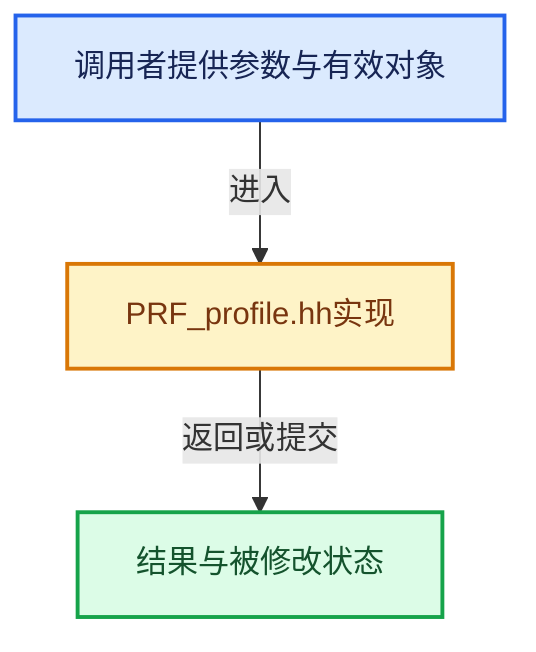

# 实现依赖专题：intern/profile/PRF_profile.hh

[方向导航](README.md) · [符号索引](../%E7%AC%A6%E5%8F%B7%E4%BE%9D%E8%B5%96%E4%B8%8E%E5%AE%9E%E7%8E%B0%E7%B4%A2%E5%BC%95.md)

本专题从正文实际调用进入，集中保存共享实现。函数有稳定锚点，可从调用处直接跳到对应完整函数；递归与互相调用通过回链组织。

## 本文件的实现关系





<a id="m-9f5e4ea0487b"></a>

## 宏 `PRF_scope`

<!-- annotated:1b15abcf7d6011 -->

```cpp
#  define PRF_scope(category) ZoneScopedC(uint32_t(category))
#  define PRF_scope_with_name(ui_name, category) ZoneScopedNC(ui_name, uint32_t(category))
```

<details>
<summary>核对原始源码：intern/profile/PRF_profile.hh · L51—L52</summary>

<!-- original:1b15abcf7d6011:intern/profile/PRF_profile.hh:51:52 -->

```cpp
#  define PRF_scope(category) ZoneScopedC(uint32_t(category))
#  define PRF_scope_with_name(ui_name, category) ZoneScopedNC(ui_name, uint32_t(category))
```

</details>

宏在预处理阶段展开，参数替换、重复求值和条件编译应直接从该定义检查。与普通函数不同，宏不会自动提供参数类型检查；构建配置选择哪个定义需结合外围条件。

<a id="m-adc22c3a3f8c"></a>

## 宏 `PRF_scope_with_name`

<!-- annotated:6b6c69eb3ea7ca -->

```cpp
#  define PRF_scope_with_name(ui_name, category) ZoneScopedNC(ui_name, uint32_t(category))

```

<details>
<summary>核对原始源码：intern/profile/PRF_profile.hh · L52—L53</summary>

<!-- original:6b6c69eb3ea7ca:intern/profile/PRF_profile.hh:52:53 -->

```cpp
#  define PRF_scope_with_name(ui_name, category) ZoneScopedNC(ui_name, uint32_t(category))

```

</details>

宏在预处理阶段展开，参数替换、重复求值和条件编译应直接从该定义检查。与普通函数不同，宏不会自动提供参数类型检查；构建配置选择哪个定义需结合外围条件。

<a id="m-27e2ed8a1ee1"></a>

## 宏 `PRF_scope_set_dynamic_name`

<!-- annotated:a91068b32ad269 -->

```cpp
#  define PRF_scope_set_dynamic_name(fmt, ...) ZoneNameF(fmt, ##__VA_ARGS__)

```

<details>
<summary>核对原始源码：intern/profile/PRF_profile.hh · L55—L56</summary>

<!-- original:a91068b32ad269:intern/profile/PRF_profile.hh:55:56 -->

```cpp
#  define PRF_scope_set_dynamic_name(fmt, ...) ZoneNameF(fmt, ##__VA_ARGS__)

```

</details>

宏在预处理阶段展开，参数替换、重复求值和条件编译应直接从该定义检查。与普通函数不同，宏不会自动提供参数类型检查；构建配置选择哪个定义需结合外围条件。

<a id="m-cc7683e7f1d1"></a>

## 宏 `PRF_memory_alloc`

<!-- annotated:73ac4887d5045e -->

```cpp
#  define PRF_memory_alloc(ptr, size) TracyAlloc(ptr, size)
#  define PRF_memory_free(ptr) TracyFree(ptr)
```

<details>
<summary>核对原始源码：intern/profile/PRF_profile.hh · L81—L82</summary>

<!-- original:73ac4887d5045e:intern/profile/PRF_profile.hh:81:82 -->

```cpp
#  define PRF_memory_alloc(ptr, size) TracyAlloc(ptr, size)
#  define PRF_memory_free(ptr) TracyFree(ptr)
```

</details>

宏在预处理阶段展开，参数替换、重复求值和条件编译应直接从该定义检查。与普通函数不同，宏不会自动提供参数类型检查；构建配置选择哪个定义需结合外围条件。

<a id="m-7e85956a936f"></a>

## 宏 `PRF_memory_free`

<!-- annotated:c374223d2ca948 -->

```cpp
#  define PRF_memory_free(ptr) TracyFree(ptr)

```

<details>
<summary>核对原始源码：intern/profile/PRF_profile.hh · L82—L83</summary>

<!-- original:c374223d2ca948:intern/profile/PRF_profile.hh:82:83 -->

```cpp
#  define PRF_memory_free(ptr) TracyFree(ptr)

```

</details>

宏在预处理阶段展开，参数替换、重复求值和条件编译应直接从该定义检查。与普通函数不同，宏不会自动提供参数类型检查；构建配置选择哪个定义需结合外围条件。

<a id="m-8fc74ae4419e"></a>

## 宏 `PRF_scope`

<!-- annotated:030f5b9f1ae45f -->

```cpp
#  define PRF_scope(category)
#  define PRF_scope_with_name(ui_name, category)
```

<details>
<summary>核对原始源码：intern/profile/PRF_profile.hh · L90—L91</summary>

<!-- original:030f5b9f1ae45f:intern/profile/PRF_profile.hh:90:91 -->

```cpp
#  define PRF_scope(category)
#  define PRF_scope_with_name(ui_name, category)
```

</details>

宏在预处理阶段展开，参数替换、重复求值和条件编译应直接从该定义检查。与普通函数不同，宏不会自动提供参数类型检查；构建配置选择哪个定义需结合外围条件。

<a id="m-3cbbaddb89c4"></a>

## 宏 `PRF_scope_with_name`

<!-- annotated:a84086db32b064 -->

```cpp
#  define PRF_scope_with_name(ui_name, category)

```

<details>
<summary>核对原始源码：intern/profile/PRF_profile.hh · L91—L92</summary>

<!-- original:a84086db32b064:intern/profile/PRF_profile.hh:91:92 -->

```cpp
#  define PRF_scope_with_name(ui_name, category)

```

</details>

宏在预处理阶段展开，参数替换、重复求值和条件编译应直接从该定义检查。与普通函数不同，宏不会自动提供参数类型检查；构建配置选择哪个定义需结合外围条件。

<a id="m-525677247e79"></a>

## 宏 `PRF_scope_set_dynamic_name`

<!-- annotated:98cb0cdce1115e -->

```cpp
#  define PRF_scope_set_dynamic_name(fmt, ...)
#  define PRF_scope_add_text(fmt, ...)
```

<details>
<summary>核对原始源码：intern/profile/PRF_profile.hh · L93—L94</summary>

<!-- original:98cb0cdce1115e:intern/profile/PRF_profile.hh:93:94 -->

```cpp
#  define PRF_scope_set_dynamic_name(fmt, ...)
#  define PRF_scope_add_text(fmt, ...)
```

</details>

宏在预处理阶段展开，参数替换、重复求值和条件编译应直接从该定义检查。与普通函数不同，宏不会自动提供参数类型检查；构建配置选择哪个定义需结合外围条件。

<a id="m-e02bfcfa18fb"></a>

## 宏 `PRF_memory_alloc`

<!-- annotated:47ca1242469b1e -->

```cpp
#  define PRF_memory_alloc(ptr, size)
#  define PRF_memory_free(ptr)
```

<details>
<summary>核对原始源码：intern/profile/PRF_profile.hh · L104—L105</summary>

<!-- original:47ca1242469b1e:intern/profile/PRF_profile.hh:104:105 -->

```cpp
#  define PRF_memory_alloc(ptr, size)
#  define PRF_memory_free(ptr)
```

</details>

宏在预处理阶段展开，参数替换、重复求值和条件编译应直接从该定义检查。与普通函数不同，宏不会自动提供参数类型检查；构建配置选择哪个定义需结合外围条件。

<a id="m-afc21d064bc2"></a>

## 宏 `PRF_memory_free`

<!-- annotated:786c6e469b97c4 -->

```cpp
#  define PRF_memory_free(ptr)

```

<details>
<summary>核对原始源码：intern/profile/PRF_profile.hh · L105—L106</summary>

<!-- original:786c6e469b97c4:intern/profile/PRF_profile.hh:105:106 -->

```cpp
#  define PRF_memory_free(ptr)

```

</details>

宏在预处理阶段展开，参数替换、重复求值和条件编译应直接从该定义检查。与普通函数不同，宏不会自动提供参数类型检查；构建配置选择哪个定义需结合外围条件。

## 完整成员与函数实现
