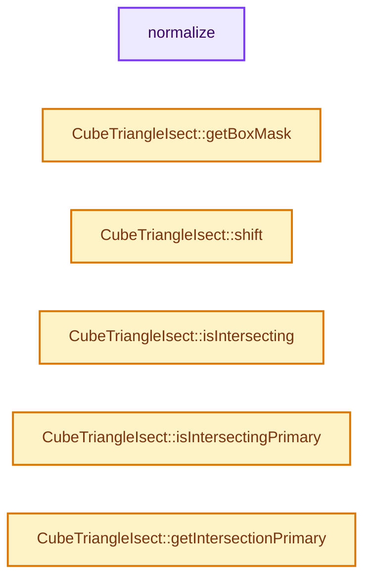
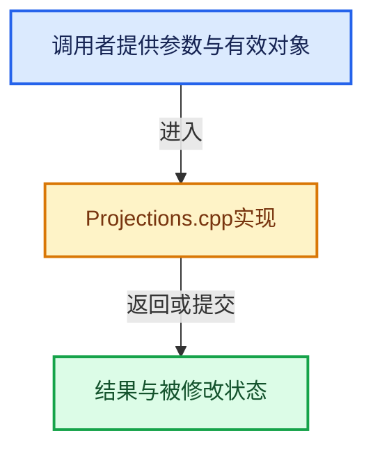

# 实现依赖专题：intern/dualcon/intern/Projections.cpp

[方向导航](README.md) · [符号索引](../%E7%AC%A6%E5%8F%B7%E4%BE%9D%E8%B5%96%E4%B8%8E%E5%AE%9E%E7%8E%B0%E7%B4%A2%E5%BC%95.md)

本专题从正文实际调用进入，集中保存共享实现。函数有稳定锚点，可从调用处直接跳到对应完整函数；递归与互相调用通过回链组织。

## 本文件的实现关系






## 完整成员与函数实现

<a id="f-15577af6ac05b036"></a>

### `normalize`

实现位置：[intern/dualcon/intern/Projections.cpp](../../../../../intern/dualcon/intern/Projections.cpp) · L77—L86。

接口参数：

- `double a[3]`

**教学注释版**

<!-- annotated:5ae1421d88547e -->

```cpp
static void normalize(double a[3])
{
  double mag = a[0] * a[0] + a[1] * a[1] + a[2] * a[2];
  if (mag > 0) {
    mag = sqrt(mag);
    a[0] /= mag;
    a[1] /= mag;
    a[2] /= mag;
  }
}
```

<details>
<summary>核对原始源码：intern/dualcon/intern/Projections.cpp · L77—L86</summary>

<!-- original:5ae1421d88547e:intern/dualcon/intern/Projections.cpp:77:86 -->

```cpp
static void normalize(double a[3])
{
  double mag = a[0] * a[0] + a[1] * a[1] + a[2] * a[2];
  if (mag > 0) {
    mag = sqrt(mag);
    a[0] /= mag;
    a[1] /= mag;
    a[2] /= mag;
  }
}
```

</details>

**沿实际写入检查状态**

- `mag = sqrt(mag);`

**继续追踪实现**

- `sqrt` → [外部契约](https://eel.is/c++draft/)：这个边界按实际表达式及所属类型核对参数、返回值、寿命与失败行为。这里提供接口入口，不声称已解释该第三方版本的内部实现。

<a id="f-81fbaccbda72e1c2"></a>

### `CubeTriangleIsect::getBoxMask`

实现位置：[intern/dualcon/intern/Projections.cpp](../../../../../intern/dualcon/intern/Projections.cpp) · L228—L260。

**教学注释版**

<!-- annotated:33457252fb48ae -->

```cpp
unsigned char CubeTriangleIsect::getBoxMask()
{
  int i, j, k;
  int bmask[3][2] = {{0, 0}, {0, 0}, {0, 0}};
  unsigned char boxmask = 0;
  int64_t child_len = cubeProj[0].edges[0] >> 1;

  for (i = 0; i < 3; i++) {
    int64_t mid = cubeProj[i].origin + child_len;

    // Check bounding box
    if (mid >= inherit->tri_proj[i][0]) {
      bmask[i][0] = 1;
    }
    if (mid < inherit->tri_proj[i][1]) {
      bmask[i][1] = 1;
    }
  }

  // Fill in masks
  int ct = 0;
  for (i = 0; i < 2; i++) {
    for (j = 0; j < 2; j++) {
      for (k = 0; k < 2; k++) {
        boxmask |= ((bmask[0][i] & bmask[1][j] & bmask[2][k]) << ct);
        ct++;
      }
    }
  }

  // Return bounding box masks
  return boxmask;
}
```

<details>
<summary>核对原始源码：intern/dualcon/intern/Projections.cpp · L228—L260</summary>

<!-- original:33457252fb48ae:intern/dualcon/intern/Projections.cpp:228:260 -->

```cpp
unsigned char CubeTriangleIsect::getBoxMask()
{
  int i, j, k;
  int bmask[3][2] = {{0, 0}, {0, 0}, {0, 0}};
  unsigned char boxmask = 0;
  int64_t child_len = cubeProj[0].edges[0] >> 1;

  for (i = 0; i < 3; i++) {
    int64_t mid = cubeProj[i].origin + child_len;

    // Check bounding box
    if (mid >= inherit->tri_proj[i][0]) {
      bmask[i][0] = 1;
    }
    if (mid < inherit->tri_proj[i][1]) {
      bmask[i][1] = 1;
    }
  }

  // Fill in masks
  int ct = 0;
  for (i = 0; i < 2; i++) {
    for (j = 0; j < 2; j++) {
      for (k = 0; k < 2; k++) {
        boxmask |= ((bmask[0][i] & bmask[1][j] & bmask[2][k]) << ct);
        ct++;
      }
    }
  }

  // Return bounding box masks
  return boxmask;
}
```

</details>

**沿实际写入检查状态**

- `bmask[i][0] = 1;`
- `bmask[i][1] = 1;`
- `boxmask |= ((bmask[0][i] & bmask[1][j] & bmask[2][k]) << ct);`

**结果出口**

- `return boxmask;`

**继续追踪实现**

本实现没有需要继续展开的显式调用；检查返回表达式、对象转换和调用者前置条件。

<a id="f-61ec5095ddb964b3"></a>

### `CubeTriangleIsect::shift`

实现位置：[intern/dualcon/intern/Projections.cpp](../../../../../intern/dualcon/intern/Projections.cpp) · L265—L271。

接口参数：

- `const int off[3]`

**教学注释版**

<!-- annotated:7877a1fe8180bb -->

```cpp
void CubeTriangleIsect::shift(const int off[3])
{
  for (int i = 0; i < NUM_AXES; i++) {
    cubeProj[i].origin += (off[0] * cubeProj[i].edges[0] + off[1] * cubeProj[i].edges[1] +
                           off[2] * cubeProj[i].edges[2]);
  }
}
```

<details>
<summary>核对原始源码：intern/dualcon/intern/Projections.cpp · L265—L271</summary>

<!-- original:7877a1fe8180bb:intern/dualcon/intern/Projections.cpp:265:271 -->

```cpp
void CubeTriangleIsect::shift(const int off[3])
{
  for (int i = 0; i < NUM_AXES; i++) {
    cubeProj[i].origin += (off[0] * cubeProj[i].edges[0] + off[1] * cubeProj[i].edges[1] +
                           off[2] * cubeProj[i].edges[2]);
  }
}
```

</details>

**沿实际写入检查状态**

- `cubeProj[i].origin += (off[0] * cubeProj[i].edges[0] + off[1] * cubeProj[i].edges[1] +`

**继续追踪实现**

本实现没有需要继续展开的显式调用；检查返回表达式、对象转换和调用者前置条件。

<a id="f-539fe055ee329b02"></a>

### `CubeTriangleIsect::isIntersecting`

实现位置：[intern/dualcon/intern/Projections.cpp](../../../../../intern/dualcon/intern/Projections.cpp) · L276—L299。

**教学注释版**

<!-- annotated:ee9f8be1237c53 -->

```cpp
int CubeTriangleIsect::isIntersecting() const
{
  for (int i = 0; i < NUM_AXES; i++) {
    /*
      int64_t proj0 = cubeProj[i][0] +
      vertmap[inherit->cubeEnds[i][0]][0] * cubeProj[i][1] +
      vertmap[inherit->cubeEnds[i][0]][1] * cubeProj[i][2] +
      vertmap[inherit->cubeEnds[i][0]][2] * cubeProj[i][3] ;
      int64_t proj1 = cubeProj[i][0] +
      vertmap[inherit->cubeEnds[i][1]][0] * cubeProj[i][1] +
      vertmap[inherit->cubeEnds[i][1]][1] * cubeProj[i][2] +
      vertmap[inherit->cubeEnds[i][1]][2] * cubeProj[i][3] ;
    */

    int64_t proj0 = cubeProj[i].origin + cubeProj[i].min;
    int64_t proj1 = cubeProj[i].origin + cubeProj[i].max;

    if (proj0 > inherit->tri_proj[i][1] || proj1 < inherit->tri_proj[i][0]) {
      return 0;
    }
  }

  return 1;
}
```

<details>
<summary>核对原始源码：intern/dualcon/intern/Projections.cpp · L276—L299</summary>

<!-- original:ee9f8be1237c53:intern/dualcon/intern/Projections.cpp:276:299 -->

```cpp
int CubeTriangleIsect::isIntersecting() const
{
  for (int i = 0; i < NUM_AXES; i++) {
    /*
      int64_t proj0 = cubeProj[i][0] +
      vertmap[inherit->cubeEnds[i][0]][0] * cubeProj[i][1] +
      vertmap[inherit->cubeEnds[i][0]][1] * cubeProj[i][2] +
      vertmap[inherit->cubeEnds[i][0]][2] * cubeProj[i][3] ;
      int64_t proj1 = cubeProj[i][0] +
      vertmap[inherit->cubeEnds[i][1]][0] * cubeProj[i][1] +
      vertmap[inherit->cubeEnds[i][1]][1] * cubeProj[i][2] +
      vertmap[inherit->cubeEnds[i][1]][2] * cubeProj[i][3] ;
    */

    int64_t proj0 = cubeProj[i].origin + cubeProj[i].min;
    int64_t proj1 = cubeProj[i].origin + cubeProj[i].max;

    if (proj0 > inherit->tri_proj[i][1] || proj1 < inherit->tri_proj[i][0]) {
      return 0;
    }
  }

  return 1;
}
```

</details>

**结果出口**

- `return 0;`
- `return 1;`

**继续追踪实现**

本实现没有需要继续展开的显式调用；检查返回表达式、对象转换和调用者前置条件。

<a id="f-7473559faf219bdc"></a>

### `CubeTriangleIsect::isIntersectingPrimary`

实现位置：[intern/dualcon/intern/Projections.cpp](../../../../../intern/dualcon/intern/Projections.cpp) · L301—L322。

接口参数：

- `int edgeInd`

**教学注释版**

<!-- annotated:43c66f73c13bc8 -->

```cpp
int CubeTriangleIsect::isIntersectingPrimary(int edgeInd) const
{
  for (int i = 0; i < NUM_AXES; i++) {

    int64_t proj0 = cubeProj[i].origin;
    int64_t proj1 = cubeProj[i].origin + cubeProj[i].edges[edgeInd];

    if (proj0 < proj1) {
      if (proj0 > inherit->tri_proj[i][1] || proj1 < inherit->tri_proj[i][0]) {
        return 0;
      }
    }
    else {
      if (proj1 > inherit->tri_proj[i][1] || proj0 < inherit->tri_proj[i][0]) {
        return 0;
      }
    }
  }

  // printf( "Intersecting: %d %d\n", edgemap[edgeInd][0], edgemap[edgeInd][1] )  ;
  return 1;
}
```

<details>
<summary>核对原始源码：intern/dualcon/intern/Projections.cpp · L301—L322</summary>

<!-- original:43c66f73c13bc8:intern/dualcon/intern/Projections.cpp:301:322 -->

```cpp
int CubeTriangleIsect::isIntersectingPrimary(int edgeInd) const
{
  for (int i = 0; i < NUM_AXES; i++) {

    int64_t proj0 = cubeProj[i].origin;
    int64_t proj1 = cubeProj[i].origin + cubeProj[i].edges[edgeInd];

    if (proj0 < proj1) {
      if (proj0 > inherit->tri_proj[i][1] || proj1 < inherit->tri_proj[i][0]) {
        return 0;
      }
    }
    else {
      if (proj1 > inherit->tri_proj[i][1] || proj0 < inherit->tri_proj[i][0]) {
        return 0;
      }
    }
  }

  // printf( "Intersecting: %d %d\n", edgemap[edgeInd][0], edgemap[edgeInd][1] )  ;
  return 1;
}
```

</details>

**结果出口**

- `return 0;`
- `return 1;`

**继续追踪实现**

本实现没有需要继续展开的显式调用；检查返回表达式、对象转换和调用者前置条件。

<a id="f-0f092e184405cafe"></a>

### `CubeTriangleIsect::getIntersectionPrimary`

实现位置：[intern/dualcon/intern/Projections.cpp](../../../../../intern/dualcon/intern/Projections.cpp) · L324—L346。

接口参数：

- `int edgeInd`

**教学注释版**

<!-- annotated:f33d93c52af6b2 -->

```cpp
float CubeTriangleIsect::getIntersectionPrimary(int edgeInd) const
{
  int i = 3;

  int64_t proj0 = cubeProj[i].origin;
  int64_t proj1 = cubeProj[i].origin + cubeProj[i].edges[edgeInd];
  int64_t proj2 = inherit->tri_proj[i][1];
  int64_t d = proj1 - proj0;
  double alpha;

  if (d == 0) {
    alpha = 0.5;
  }
  else {
    alpha = (double)((proj2 - proj0)) / (double)d;

    if (alpha < 0 || alpha > 1) {
      alpha = 0.5;
    }
  }

  return (float)alpha;
}
```

<details>
<summary>核对原始源码：intern/dualcon/intern/Projections.cpp · L324—L346</summary>

<!-- original:f33d93c52af6b2:intern/dualcon/intern/Projections.cpp:324:346 -->

```cpp
float CubeTriangleIsect::getIntersectionPrimary(int edgeInd) const
{
  int i = 3;

  int64_t proj0 = cubeProj[i].origin;
  int64_t proj1 = cubeProj[i].origin + cubeProj[i].edges[edgeInd];
  int64_t proj2 = inherit->tri_proj[i][1];
  int64_t d = proj1 - proj0;
  double alpha;

  if (d == 0) {
    alpha = 0.5;
  }
  else {
    alpha = (double)((proj2 - proj0)) / (double)d;

    if (alpha < 0 || alpha > 1) {
      alpha = 0.5;
    }
  }

  return (float)alpha;
}
```

</details>

**沿实际写入检查状态**

- `alpha = 0.5;`
- `alpha = (double)((proj2 - proj0)) / (double)d;`

**结果出口**

- `return (float)alpha;`

**继续追踪实现**

本实现没有需要继续展开的显式调用；检查返回表达式、对象转换和调用者前置条件。
