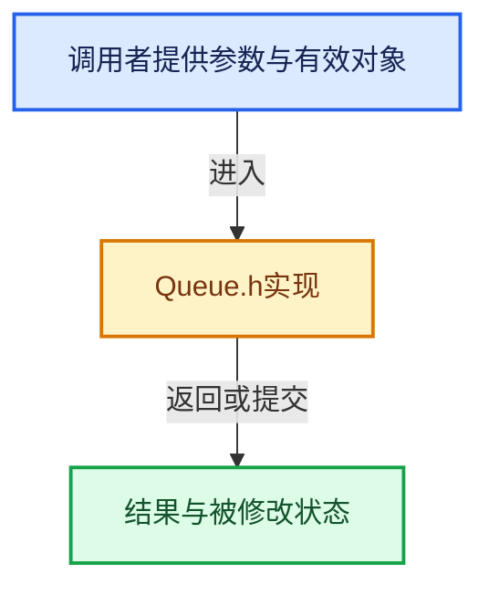

# 实现依赖专题：intern/dualcon/intern/Queue.h

[方向导航](README.md) · [符号索引](../%E7%AC%A6%E5%8F%B7%E4%BE%9D%E8%B5%96%E4%B8%8E%E5%AE%9E%E7%8E%B0%E7%B4%A2%E5%BC%95.md)

本专题从正文实际调用进入，集中保存共享实现。函数有稳定锚点，可从调用处直接跳到对应完整函数；递归与互相调用通过回链组织。

## 本文件的实现关系





## 完整成员与函数实现

<a id="f-9ed1a584697f6a2e"></a>

### `GridQueue::pushQueue`

实现位置：[intern/dualcon/intern/Queue.h](../../../../../intern/dualcon/intern/Queue.h) · L39—L55。

接口参数：

- `const int st[3]`
- `int dir`

**教学注释版**

<!-- annotated:9efa4ee94a3c7b -->

```cpp
  void pushQueue(const int st[3], int dir)
  {
    gridQueueEle *ele = new gridQueueEle;
    ele->x = st[0];
    ele->y = st[1];
    ele->z = st[2];
    ele->dir = (UCHAR)dir;
    ele->next = nullptr;
    if (head == nullptr) {
      head = ele;
    }
    else {
      tail->next = ele;
    }
    tail = ele;
    numEles++;
  }
```

<details>
<summary>核对原始源码：intern/dualcon/intern/Queue.h · L39—L55</summary>

<!-- original:9efa4ee94a3c7b:intern/dualcon/intern/Queue.h:39:55 -->

```cpp
  void pushQueue(const int st[3], int dir)
  {
    gridQueueEle *ele = new gridQueueEle;
    ele->x = st[0];
    ele->y = st[1];
    ele->z = st[2];
    ele->dir = (UCHAR)dir;
    ele->next = nullptr;
    if (head == nullptr) {
      head = ele;
    }
    else {
      tail->next = ele;
    }
    tail = ele;
    numEles++;
  }
```

</details>

**沿实际写入检查状态**

- `ele->x = st[0];`
- `ele->y = st[1];`
- `ele->z = st[2];`
- `ele->dir = (UCHAR)dir;`
- `ele->next = nullptr;`
- `head = ele;`
- `tail->next = ele;`
- `tail = ele;`

**继续追踪实现**

本实现没有需要继续展开的显式调用；检查返回表达式、对象转换和调用者前置条件。

<a id="f-2f54958d8a327b85"></a>

### `GridQueue::popQueue`

实现位置：[intern/dualcon/intern/Queue.h](../../../../../intern/dualcon/intern/Queue.h) · L57—L78。

接口参数：

- `int st[3]`
- `int &dir`

**教学注释版**

<!-- annotated:92dbf23e3c7735 -->

```cpp
  int popQueue(int st[3], int &dir)
  {
    if (head == nullptr) {
      return 0;
    }

    st[0] = head->x;
    st[1] = head->y;
    st[2] = head->z;
    dir = (int)(head->dir);

    gridQueueEle *temp = head;
    head = head->next;
    delete temp;

    if (head == nullptr) {
      tail = nullptr;
    }
    numEles--;

    return 1;
  }
```

<details>
<summary>核对原始源码：intern/dualcon/intern/Queue.h · L57—L78</summary>

<!-- original:92dbf23e3c7735:intern/dualcon/intern/Queue.h:57:78 -->

```cpp
  int popQueue(int st[3], int &dir)
  {
    if (head == nullptr) {
      return 0;
    }

    st[0] = head->x;
    st[1] = head->y;
    st[2] = head->z;
    dir = (int)(head->dir);

    gridQueueEle *temp = head;
    head = head->next;
    delete temp;

    if (head == nullptr) {
      tail = nullptr;
    }
    numEles--;

    return 1;
  }
```

</details>

**沿实际写入检查状态**

- `st[0] = head->x;`
- `st[1] = head->y;`
- `st[2] = head->z;`
- `dir = (int)(head->dir);`
- `head = head->next;`
- `tail = nullptr;`

**结果出口**

- `return 0;`
- `return 1;`

**继续追踪实现**

本实现没有需要继续展开的显式调用；检查返回表达式、对象转换和调用者前置条件。
