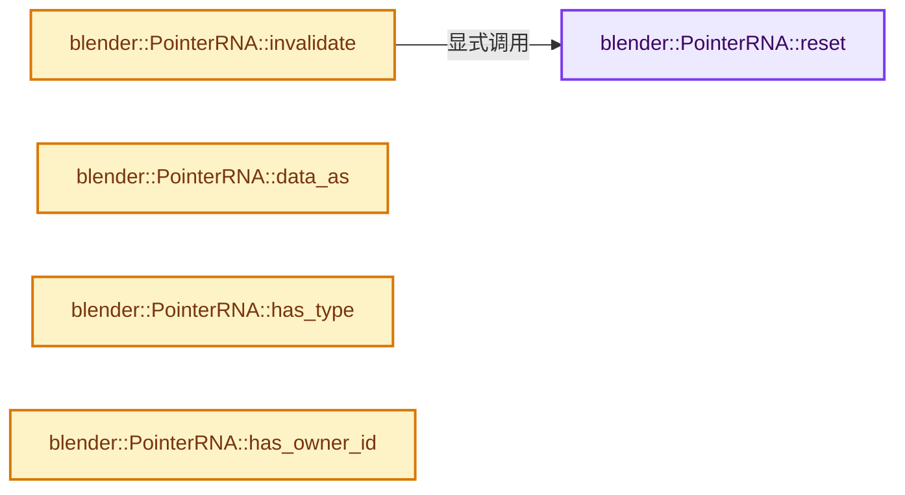
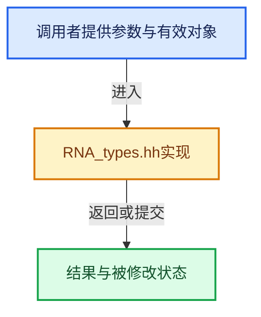

# 实现依赖专题：source/blender/makesrna/RNA_types.hh

[方向导航](README.md) · [符号索引](../%E7%AC%A6%E5%8F%B7%E4%BE%9D%E8%B5%96%E4%B8%8E%E5%AE%9E%E7%8E%B0%E7%B4%A2%E5%BC%95.md)

本专题从正文实际调用进入，集中保存共享实现。函数有稳定锚点，可从调用处直接跳到对应完整函数；递归与互相调用通过回链组织。

## 本文件的实现关系






## 相关类型布局与成员入口

<a id="t-6e7842431017"></a>

### `blender::PropertyType`

原始声明：[source/blender/makesrna/RNA_types.hh](../../../../../source/blender/makesrna/RNA_types.hh) · L209—L217。

以下保留类的数据声明与编译条件，成员函数实现通过后面的精确链接阅读。

<!-- annotated:5f9e03e807c090 -->

```cpp
enum PropertyType {
  PROP_BOOLEAN = 0,
  PROP_INT = 1,
  PROP_FLOAT = 2,
  PROP_STRING = 3,
  PROP_ENUM = 4,
  PROP_POINTER = 5,
  PROP_COLLECTION = 6,
};
```

<details>
<summary>核对原始源码：source/blender/makesrna/RNA_types.hh · L209—L217</summary>

<!-- original:5f9e03e807c090:source/blender/makesrna/RNA_types.hh:209:217 -->

```cpp
enum PropertyType {
  PROP_BOOLEAN = 0,
  PROP_INT = 1,
  PROP_FLOAT = 2,
  PROP_STRING = 3,
  PROP_ENUM = 4,
  PROP_POINTER = 5,
  PROP_COLLECTION = 6,
};
```

</details>


<a id="t-5e2fcc33b556"></a>

### `blender::PropertySubType`

原始声明：[source/blender/makesrna/RNA_types.hh](../../../../../source/blender/makesrna/RNA_types.hh) · L280—L354。

以下保留类的数据声明与编译条件，成员函数实现通过后面的精确链接阅读。

<!-- annotated:d0116fb68aa532 -->

```cpp
enum PropertySubType {
  PROP_NONE = 0,

  /* strings */
  PROP_FILEPATH = 1,
  PROP_DIRPATH = 2,
  PROP_FILENAME = 3,
  /**
   * A string which should be represented as bytes in python, NULL terminated though.
   *
   * WARNING: Default generated RNA accessor code will treat the underlying data as a regular
   * C string (using `strlen` e.g. to get its length). If the bytes array may contain null chars,
   * the RNA property _must_ have custom accessors defined (through
   * #RNA_def_property_string_funcs).
   */
  PROP_BYTESTRING = 4,
  /* 5 was used by "PROP_TRANSLATE" sub-type, which is now a flag. */
  /** A string which should not be displayed in UI. */
  PROP_PASSWORD = 6,

  /* numbers */
  /**
   * A dimension in pixel units, possibly before DPI scaling (so value may not be the final pixel
   * value but the one to apply DPI scale to).
   */
  PROP_PIXEL = 12,
  PROP_UNSIGNED = 13,
  PROP_PERCENTAGE = 14,
  PROP_FACTOR = 15,
  PROP_ANGLE = 16 | PROP_UNIT_ROTATION,
  PROP_TIME = 17 | PROP_UNIT_TIME,
  PROP_TIME_ABSOLUTE = 17 | PROP_UNIT_TIME_ABSOLUTE,
  /** Distance in 3d space, don't use for pixel distance for eg. */
  PROP_DISTANCE = 18 | PROP_UNIT_LENGTH,
  PROP_DISTANCE_CAMERA = 19 | PROP_UNIT_CAMERA,

  /* number arrays */
  PROP_COLOR = 20,
  PROP_TRANSLATION = 21 | PROP_UNIT_LENGTH,
  PROP_DIRECTION = 22,
  PROP_VELOCITY = 23 | PROP_UNIT_VELOCITY,
  PROP_ACCELERATION = 24 | PROP_UNIT_ACCELERATION,
  PROP_MATRIX = 25,
  PROP_EULER = 26 | PROP_UNIT_ROTATION,
  PROP_QUATERNION = 27,
  PROP_AXISANGLE = 28,
  PROP_XYZ = 29,
  PROP_XYZ_LENGTH = 29 | PROP_UNIT_LENGTH,
  /** Used for colors which would be color managed before display. */
  PROP_COLOR_GAMMA = 30,
  /** Generic array, no units applied, only that x/y/z/w are used (Python vector). */
  PROP_COORDS = 31,

  /* booleans */
  PROP_LAYER = 40,
  PROP_LAYER_MEMBER = 41,

  /** Light */
  PROP_POWER = 42 | PROP_UNIT_POWER,

  /* temperature */
  PROP_TEMPERATURE = 43 | PROP_UNIT_TEMPERATURE,

  /* wavelength */
  PROP_WAVELENGTH = 44 | PROP_UNIT_WAVELENGTH,

  /* wavelength */
  PROP_COLOR_TEMPERATURE = 45 | PROP_UNIT_COLOR_TEMPERATURE,

  PROP_FREQUENCY = 46 | PROP_UNIT_FREQUENCY,
  PROP_PIXEL_DIAMETER = 47,
  PROP_DISTANCE_DIAMETER = 48 | PROP_UNIT_LENGTH,
  /** Mass based on scene defined units. */
  PROP_MASS = 49 | PROP_UNIT_MASS,
};
```

<details>
<summary>核对原始源码：source/blender/makesrna/RNA_types.hh · L280—L354</summary>

<!-- original:d0116fb68aa532:source/blender/makesrna/RNA_types.hh:280:354 -->

```cpp
enum PropertySubType {
  PROP_NONE = 0,

  /* strings */
  PROP_FILEPATH = 1,
  PROP_DIRPATH = 2,
  PROP_FILENAME = 3,
  /**
   * A string which should be represented as bytes in python, NULL terminated though.
   *
   * WARNING: Default generated RNA accessor code will treat the underlying data as a regular
   * C string (using `strlen` e.g. to get its length). If the bytes array may contain null chars,
   * the RNA property _must_ have custom accessors defined (through
   * #RNA_def_property_string_funcs).
   */
  PROP_BYTESTRING = 4,
  /* 5 was used by "PROP_TRANSLATE" sub-type, which is now a flag. */
  /** A string which should not be displayed in UI. */
  PROP_PASSWORD = 6,

  /* numbers */
  /**
   * A dimension in pixel units, possibly before DPI scaling (so value may not be the final pixel
   * value but the one to apply DPI scale to).
   */
  PROP_PIXEL = 12,
  PROP_UNSIGNED = 13,
  PROP_PERCENTAGE = 14,
  PROP_FACTOR = 15,
  PROP_ANGLE = 16 | PROP_UNIT_ROTATION,
  PROP_TIME = 17 | PROP_UNIT_TIME,
  PROP_TIME_ABSOLUTE = 17 | PROP_UNIT_TIME_ABSOLUTE,
  /** Distance in 3d space, don't use for pixel distance for eg. */
  PROP_DISTANCE = 18 | PROP_UNIT_LENGTH,
  PROP_DISTANCE_CAMERA = 19 | PROP_UNIT_CAMERA,

  /* number arrays */
  PROP_COLOR = 20,
  PROP_TRANSLATION = 21 | PROP_UNIT_LENGTH,
  PROP_DIRECTION = 22,
  PROP_VELOCITY = 23 | PROP_UNIT_VELOCITY,
  PROP_ACCELERATION = 24 | PROP_UNIT_ACCELERATION,
  PROP_MATRIX = 25,
  PROP_EULER = 26 | PROP_UNIT_ROTATION,
  PROP_QUATERNION = 27,
  PROP_AXISANGLE = 28,
  PROP_XYZ = 29,
  PROP_XYZ_LENGTH = 29 | PROP_UNIT_LENGTH,
  /** Used for colors which would be color managed before display. */
  PROP_COLOR_GAMMA = 30,
  /** Generic array, no units applied, only that x/y/z/w are used (Python vector). */
  PROP_COORDS = 31,

  /* booleans */
  PROP_LAYER = 40,
  PROP_LAYER_MEMBER = 41,

  /** Light */
  PROP_POWER = 42 | PROP_UNIT_POWER,

  /* temperature */
  PROP_TEMPERATURE = 43 | PROP_UNIT_TEMPERATURE,

  /* wavelength */
  PROP_WAVELENGTH = 44 | PROP_UNIT_WAVELENGTH,

  /* wavelength */
  PROP_COLOR_TEMPERATURE = 45 | PROP_UNIT_COLOR_TEMPERATURE,

  PROP_FREQUENCY = 46 | PROP_UNIT_FREQUENCY,
  PROP_PIXEL_DIAMETER = 47,
  PROP_DISTANCE_DIAMETER = 48 | PROP_UNIT_LENGTH,
  /** Mass based on scene defined units. */
  PROP_MASS = 49 | PROP_UNIT_MASS,
};
```

</details>


<a id="t-d59a68a727c0"></a>

### `blender::PropertyFlag`

原始声明：[source/blender/makesrna/RNA_types.hh](../../../../../source/blender/makesrna/RNA_types.hh) · L370—L554。

以下保留类的数据声明与编译条件，成员函数实现通过后面的精确链接阅读。

<!-- annotated:707a923a3d1d82 -->

```cpp
enum PropertyFlag : uint32_t {
  /**
   * Editable means the property is editable in the user
   * interface, properties are editable by default except
   * for pointers and collections.
   */
  PROP_EDITABLE = (1 << 0),
  /**
   * This property is editable even if it is lib linked,
   * meaning it will get lost on reload, but it's useful
   * for editing.
   */
  PROP_LIB_EXCEPTION = (1 << 16),
  /**
   * Animatable means the property can be driven by some
   * other input, be it animation curves, expressions, ..
   * properties are animatable by default except for pointers
   * and collections.
   */
  PROP_ANIMATABLE = (1 << 1),
  /**
   * This flag means when the property's widget is in 'text-edit' mode, it will be updated
   * after every typed char, instead of waiting final validation. Used e.g. for text search-box.
   * It will also cause BUT_VALUE_CLEAR to be set for text buttons. We could add a separate flag
   * for search/filter properties, but this works just fine for now.
   */
  PROP_TEXTEDIT_UPDATE = (1u << 31),

  /* icon */
  PROP_ICONS_CONSECUTIVE = (1 << 12),
  PROP_ICONS_REVERSE = (1 << 8),

  /**
   * Hide in the user interface. That is, from auto-generated operator property UIs (like the
   * redo panel) and the outliner "Data API" display mode. Does not hide it in the keymap UI.
   *
   * Also don't save in presets, as if #PROP_SKIP_PRESET was set.
   */
  PROP_HIDDEN = (1 << 19),
  /**
   * Doesn't preserve the last value for repeated operator calls.
   *
   * Also don't save in presets, as if #PROP_SKIP_PRESET was set.
   */
  PROP_SKIP_SAVE = (1 << 28),

  /* numbers */

  /** Each value is related proportionally (object scale, image size). */
  PROP_PROPORTIONAL = (1 << 26),

  /* pointers */

  /**
   * Mark this property as handling ID user count.
   *
   * This is done automatically by the auto-generated setter function. If an RNA property has a
   * custom setter, it's the setter's responsibility to correctly update the user count.
   *
   * \note In most basic cases, makesrna will automatically set this flag, based on the
   * `STRUCT_ID_REFCOUNT` flag of the defined pointer type. This only works if makesrna can find a
   * matching DNA property though, 'virtual' RNA properties (using both a getter and setter) will
   * never get this flag defined automatically.
   */
  PROP_ID_REFCOUNT = (1 << 6),

  /**
   * Disallow assigning a variable to itself, eg an object tracking itself
   * only apply this to types that are derived from an ID ().
   */
  PROP_ID_SELF_CHECK = (1 << 20),
  /**
   * Use for...
   * - pointers: in the UI and python so unsetting or setting to None won't work.
   * - strings: so our internal generated get/length/set
   *   functions know to do NULL checks before access #30865.
   */
  PROP_NEVER_NULL = (1 << 18),
  /**
   * Currently only used for UI, this is similar to PROP_NEVER_NULL
   * except that the value may be NULL at times, used for ObData, where an Empty's will be NULL
   * but setting NULL on a mesh object is not possible.
   * So if it's not NULL, setting NULL can't be done!
   */
  PROP_NEVER_UNLINK = (1 << 25),

  /**
   * Pointers to data that is not owned by the struct.
   * Typical example: Bone.parent, Bone.child, etc., and nearly all ID pointers.
   * This is crucial information for processes that walk the whole data of an ID e.g.
   * (like library override).
   * Note that all ID pointers are enforced to this by default,
   * this probably will need to be rechecked
   * (see ugly infamous node-trees of material/texture/scene/etc.).
   */
  PROP_PTR_NO_OWNERSHIP = (1 << 7),

  /**
   * flag contains multiple enums.
   * NOTE: not to be confused with `prop->enumbitflags`
   * this exposes the flag as multiple options in python and the UI.
   *
   * \note These can't be animated so use with care.
   */
  PROP_ENUM_FLAG = (1 << 21),

  /* need context for update function */
  PROP_CONTEXT_UPDATE = (1 << 22),
  PROP_CONTEXT_PROPERTY_UPDATE = PROP_CONTEXT_UPDATE | (1 << 27),

  /* registering */
  PROP_REGISTER = (1 << 4),
  PROP_REGISTER_OPTIONAL = PROP_REGISTER | (1 << 5),

  /**
   * Use for allocated function return values of arrays or strings
   * for any data that should not have a reference kept.
   *
   * It can be used for properties which are dynamically allocated too.
   *
   * \note Currently dynamic sized thick wrapped data isn't supported.
   * This would be a useful addition and avoid a fixed maximum sized as in done at the moment.
   */
  PROP_THICK_WRAP = (1 << 23),

  /** This is an IDProperty, not a DNA one. */
  PROP_IDPROPERTY = (1 << 10),
  /** For dynamic arrays & return values of type string. */
  PROP_DYNAMIC = (1 << 17),
  /** For enum that shouldn't be contextual */
  PROP_ENUM_NO_CONTEXT = (1 << 24),
  /** For enums not to be translated (e.g. view-layers' names in nodes). */
  PROP_ENUM_NO_TRANSLATE = (1 << 29),

  /**
   * Don't do dependency graph tag from a property update callback.
   * Use this for properties which defines interface state, for example,
   * properties which denotes whether modifier panel is collapsed or not.
   */
  PROP_NO_DEG_UPDATE = (1 << 30),

  /**
   * Property needs to ensure evaluated data-blocks are in sync with their original counter-part
   * but the property does not affect evaluation itself.
   */
  PROP_DEG_SYNC_ONLY = (1 << 9),

  /**
   * File-paths that refer to output get a special treatment such
   * as having the +/- operators available in the file browser.
   */
  PROP_PATH_OUTPUT = (1 << 2),
  /**
   * Path supports relative prefix: `//`,
   * paths which don't support the relative suffix show a warning if the suffix is used.
   */
  PROP_PATH_SUPPORTS_BLEND_RELATIVE = (1 << 15),

  /**
   * Paths that are evaluated with templating.
   *
   * Note that this doesn't cause the property to support templating, but rather
   * *indicates* to other parts of Blender whether it supports templating.
   * Support for templating needs to be manually implemented.
   *
   * When this is set, the property's `path_template_type` field should also be
   * set.
   *
   * \see The top-level documentation of BKE_path_templates.hh.
   */
  PROP_PATH_SUPPORTS_TEMPLATES = (1 << 14),

  /** Do not write in presets (#PROP_HIDDEN and #PROP_SKIP_SAVE won't either). */
  PROP_SKIP_PRESET = (1 << 11),

  /** Use full geometry depsgraph evaluation when this property changes. */
  PROP_FORCE_GEOMETRY_EVAL = (1 << 3),

  /**
   * When set, this property always performs an undo,
   * even when #STRUCT_UNDO is unset on the struct it contains.
   */
  PROP_FORCE_UNDO = (1 << 13),

};
```

<details>
<summary>核对原始源码：source/blender/makesrna/RNA_types.hh · L370—L554</summary>

<!-- original:707a923a3d1d82:source/blender/makesrna/RNA_types.hh:370:554 -->

```cpp
enum PropertyFlag : uint32_t {
  /**
   * Editable means the property is editable in the user
   * interface, properties are editable by default except
   * for pointers and collections.
   */
  PROP_EDITABLE = (1 << 0),
  /**
   * This property is editable even if it is lib linked,
   * meaning it will get lost on reload, but it's useful
   * for editing.
   */
  PROP_LIB_EXCEPTION = (1 << 16),
  /**
   * Animatable means the property can be driven by some
   * other input, be it animation curves, expressions, ..
   * properties are animatable by default except for pointers
   * and collections.
   */
  PROP_ANIMATABLE = (1 << 1),
  /**
   * This flag means when the property's widget is in 'text-edit' mode, it will be updated
   * after every typed char, instead of waiting final validation. Used e.g. for text search-box.
   * It will also cause BUT_VALUE_CLEAR to be set for text buttons. We could add a separate flag
   * for search/filter properties, but this works just fine for now.
   */
  PROP_TEXTEDIT_UPDATE = (1u << 31),

  /* icon */
  PROP_ICONS_CONSECUTIVE = (1 << 12),
  PROP_ICONS_REVERSE = (1 << 8),

  /**
   * Hide in the user interface. That is, from auto-generated operator property UIs (like the
   * redo panel) and the outliner "Data API" display mode. Does not hide it in the keymap UI.
   *
   * Also don't save in presets, as if #PROP_SKIP_PRESET was set.
   */
  PROP_HIDDEN = (1 << 19),
  /**
   * Doesn't preserve the last value for repeated operator calls.
   *
   * Also don't save in presets, as if #PROP_SKIP_PRESET was set.
   */
  PROP_SKIP_SAVE = (1 << 28),

  /* numbers */

  /** Each value is related proportionally (object scale, image size). */
  PROP_PROPORTIONAL = (1 << 26),

  /* pointers */

  /**
   * Mark this property as handling ID user count.
   *
   * This is done automatically by the auto-generated setter function. If an RNA property has a
   * custom setter, it's the setter's responsibility to correctly update the user count.
   *
   * \note In most basic cases, makesrna will automatically set this flag, based on the
   * `STRUCT_ID_REFCOUNT` flag of the defined pointer type. This only works if makesrna can find a
   * matching DNA property though, 'virtual' RNA properties (using both a getter and setter) will
   * never get this flag defined automatically.
   */
  PROP_ID_REFCOUNT = (1 << 6),

  /**
   * Disallow assigning a variable to itself, eg an object tracking itself
   * only apply this to types that are derived from an ID ().
   */
  PROP_ID_SELF_CHECK = (1 << 20),
  /**
   * Use for...
   * - pointers: in the UI and python so unsetting or setting to None won't work.
   * - strings: so our internal generated get/length/set
   *   functions know to do NULL checks before access #30865.
   */
  PROP_NEVER_NULL = (1 << 18),
  /**
   * Currently only used for UI, this is similar to PROP_NEVER_NULL
   * except that the value may be NULL at times, used for ObData, where an Empty's will be NULL
   * but setting NULL on a mesh object is not possible.
   * So if it's not NULL, setting NULL can't be done!
   */
  PROP_NEVER_UNLINK = (1 << 25),

  /**
   * Pointers to data that is not owned by the struct.
   * Typical example: Bone.parent, Bone.child, etc., and nearly all ID pointers.
   * This is crucial information for processes that walk the whole data of an ID e.g.
   * (like library override).
   * Note that all ID pointers are enforced to this by default,
   * this probably will need to be rechecked
   * (see ugly infamous node-trees of material/texture/scene/etc.).
   */
  PROP_PTR_NO_OWNERSHIP = (1 << 7),

  /**
   * flag contains multiple enums.
   * NOTE: not to be confused with `prop->enumbitflags`
   * this exposes the flag as multiple options in python and the UI.
   *
   * \note These can't be animated so use with care.
   */
  PROP_ENUM_FLAG = (1 << 21),

  /* need context for update function */
  PROP_CONTEXT_UPDATE = (1 << 22),
  PROP_CONTEXT_PROPERTY_UPDATE = PROP_CONTEXT_UPDATE | (1 << 27),

  /* registering */
  PROP_REGISTER = (1 << 4),
  PROP_REGISTER_OPTIONAL = PROP_REGISTER | (1 << 5),

  /**
   * Use for allocated function return values of arrays or strings
   * for any data that should not have a reference kept.
   *
   * It can be used for properties which are dynamically allocated too.
   *
   * \note Currently dynamic sized thick wrapped data isn't supported.
   * This would be a useful addition and avoid a fixed maximum sized as in done at the moment.
   */
  PROP_THICK_WRAP = (1 << 23),

  /** This is an IDProperty, not a DNA one. */
  PROP_IDPROPERTY = (1 << 10),
  /** For dynamic arrays & return values of type string. */
  PROP_DYNAMIC = (1 << 17),
  /** For enum that shouldn't be contextual */
  PROP_ENUM_NO_CONTEXT = (1 << 24),
  /** For enums not to be translated (e.g. view-layers' names in nodes). */
  PROP_ENUM_NO_TRANSLATE = (1 << 29),

  /**
   * Don't do dependency graph tag from a property update callback.
   * Use this for properties which defines interface state, for example,
   * properties which denotes whether modifier panel is collapsed or not.
   */
  PROP_NO_DEG_UPDATE = (1 << 30),

  /**
   * Property needs to ensure evaluated data-blocks are in sync with their original counter-part
   * but the property does not affect evaluation itself.
   */
  PROP_DEG_SYNC_ONLY = (1 << 9),

  /**
   * File-paths that refer to output get a special treatment such
   * as having the +/- operators available in the file browser.
   */
  PROP_PATH_OUTPUT = (1 << 2),
  /**
   * Path supports relative prefix: `//`,
   * paths which don't support the relative suffix show a warning if the suffix is used.
   */
  PROP_PATH_SUPPORTS_BLEND_RELATIVE = (1 << 15),

  /**
   * Paths that are evaluated with templating.
   *
   * Note that this doesn't cause the property to support templating, but rather
   * *indicates* to other parts of Blender whether it supports templating.
   * Support for templating needs to be manually implemented.
   *
   * When this is set, the property's `path_template_type` field should also be
   * set.
   *
   * \see The top-level documentation of BKE_path_templates.hh.
   */
  PROP_PATH_SUPPORTS_TEMPLATES = (1 << 14),

  /** Do not write in presets (#PROP_HIDDEN and #PROP_SKIP_SAVE won't either). */
  PROP_SKIP_PRESET = (1 << 11),

  /** Use full geometry depsgraph evaluation when this property changes. */
  PROP_FORCE_GEOMETRY_EVAL = (1 << 3),

  /**
   * When set, this property always performs an undo,
   * even when #STRUCT_UNDO is unset on the struct it contains.
   */
  PROP_FORCE_UNDO = (1 << 13),

};
```

</details>


<a id="t-ee5ab11da3fb"></a>

### `blender::RawPropertyType`

原始声明：[source/blender/makesrna/RNA_types.hh](../../../../../source/blender/makesrna/RNA_types.hh) · L708—L721。

以下保留类的数据声明与编译条件，成员函数实现通过后面的精确链接阅读。

<!-- annotated:19a32db08840bd -->

```cpp
enum RawPropertyType {
  PROP_RAW_UNSET = -1,
  PROP_RAW_INT, /* XXX: abused for types that are not set, eg. MFace.verts, needs fixing. */
  PROP_RAW_SHORT,
  PROP_RAW_CHAR,
  PROP_RAW_BOOLEAN,
  PROP_RAW_DOUBLE,
  PROP_RAW_FLOAT,
  PROP_RAW_UINT8,
  PROP_RAW_UINT16,
  PROP_RAW_INT64,
  PROP_RAW_UINT64,
  PROP_RAW_INT8,
};
```

<details>
<summary>核对原始源码：source/blender/makesrna/RNA_types.hh · L708—L721</summary>

<!-- original:19a32db08840bd:source/blender/makesrna/RNA_types.hh:708:721 -->

```cpp
enum RawPropertyType {
  PROP_RAW_UNSET = -1,
  PROP_RAW_INT, /* XXX: abused for types that are not set, eg. MFace.verts, needs fixing. */
  PROP_RAW_SHORT,
  PROP_RAW_CHAR,
  PROP_RAW_BOOLEAN,
  PROP_RAW_DOUBLE,
  PROP_RAW_FLOAT,
  PROP_RAW_UINT8,
  PROP_RAW_UINT16,
  PROP_RAW_INT64,
  PROP_RAW_UINT64,
  PROP_RAW_INT8,
};
```

</details>


<a id="m-0642c47c628a"></a>

## 宏 `RNA_SUBTYPE_UNIT`

<!-- annotated:54eee2c6cac540 -->

```cpp
#define RNA_SUBTYPE_UNIT(subtype) ((subtype) & 0x00FF0000)
#define RNA_SUBTYPE_VALUE(subtype) ((subtype) & ~0x00FF0000)
```

<details>
<summary>核对原始源码：source/blender/makesrna/RNA_types.hh · L266—L267</summary>

<!-- original:54eee2c6cac540:source/blender/makesrna/RNA_types.hh:266:267 -->

```cpp
#define RNA_SUBTYPE_UNIT(subtype) ((subtype) & 0x00FF0000)
#define RNA_SUBTYPE_VALUE(subtype) ((subtype) & ~0x00FF0000)
```

</details>

宏在预处理阶段展开，参数替换、重复求值和条件编译应直接从该定义检查。与普通函数不同，宏不会自动提供参数类型检查；构建配置选择哪个定义需结合外围条件。

<a id="m-3bd609e7d4c8"></a>

## 宏 `RNA_SUBTYPE_UNIT_VALUE`

<!-- annotated:d77b3958127b4d -->

```cpp
#define RNA_SUBTYPE_UNIT_VALUE(subtype) ((subtype) >> 16)

```

<details>
<summary>核对原始源码：source/blender/makesrna/RNA_types.hh · L268—L269</summary>

<!-- original:d77b3958127b4d:source/blender/makesrna/RNA_types.hh:268:269 -->

```cpp
#define RNA_SUBTYPE_UNIT_VALUE(subtype) ((subtype) >> 16)

```

</details>

宏在预处理阶段展开，参数替换、重复求值和条件编译应直接从该定义检查。与普通函数不同，宏不会自动提供参数类型检查；构建配置选择哪个定义需结合外围条件。

## 完整成员与函数实现

<a id="f-16ec549d9037706c"></a>

### `blender::PointerRNA::reset`

实现位置：[source/blender/makesrna/RNA_types.hh](../../../../../source/blender/makesrna/RNA_types.hh) · L114—L117。

**教学注释版**

<!-- annotated:684f85c86693da -->

```cpp
  void reset()
  {
    *this = {};
  }
```

<details>
<summary>核对原始源码：source/blender/makesrna/RNA_types.hh · L114—L117</summary>

<!-- original:684f85c86693da:source/blender/makesrna/RNA_types.hh:114:117 -->

```cpp
  void reset()
  {
    *this = {};
  }
```

</details>

**继续追踪实现**

本实现没有需要继续展开的显式调用；检查返回表达式、对象转换和调用者前置条件。

<a id="f-94ef17636fa837af"></a>

### `blender::PointerRNA::invalidate`

实现位置：[source/blender/makesrna/RNA_types.hh](../../../../../source/blender/makesrna/RNA_types.hh) · L125—L128。

**教学注释版**

<!-- annotated:41c9442c2a556b -->

```cpp
  void invalidate()
  {
    this->reset();
  }
```

<details>
<summary>核对原始源码：source/blender/makesrna/RNA_types.hh · L125—L128</summary>

<!-- original:41c9442c2a556b:source/blender/makesrna/RNA_types.hh:125:128 -->

```cpp
  void invalidate()
  {
    this->reset();
  }
```

</details>

**继续追踪实现**

- `this->reset` → [blender::PointerRNA::reset · L114](%E4%BE%9D%E8%B5%96-RNA_types-240f9f.md#f-16ec549d9037706c)。

<a id="f-db7f1e7ce3e9dfbb"></a>

### `blender::PointerRNA::data_as`

实现位置：[source/blender/makesrna/RNA_types.hh](../../../../../source/blender/makesrna/RNA_types.hh) · L139—L142。

**教学注释版**

<!-- annotated:8f45df74151699 -->

```cpp
  template<typename T> T *data_as() const
  {
    return static_cast<T *>(this->data);
  }
```

<details>
<summary>核对原始源码：source/blender/makesrna/RNA_types.hh · L139—L142</summary>

<!-- original:8f45df74151699:source/blender/makesrna/RNA_types.hh:139:142 -->

```cpp
  template<typename T> T *data_as() const
  {
    return static_cast<T *>(this->data);
  }
```

</details>

**结果出口**

- `return static_cast<T *>(this->data);`

**继续追踪实现**

本实现没有需要继续展开的显式调用；检查返回表达式、对象转换和调用者前置条件。

<a id="f-6af0d77c8dc96e2d"></a>

### `blender::PointerRNA::has_type`

实现位置：[source/blender/makesrna/RNA_types.hh](../../../../../source/blender/makesrna/RNA_types.hh) · L180—L183。

**教学注释版**

<!-- annotated:44959cbfcba3c9 -->

```cpp
  bool has_type() const
  {
    return this->type != nullptr;
  }
```

<details>
<summary>核对原始源码：source/blender/makesrna/RNA_types.hh · L180—L183</summary>

<!-- original:44959cbfcba3c9:source/blender/makesrna/RNA_types.hh:180:183 -->

```cpp
  bool has_type() const
  {
    return this->type != nullptr;
  }
```

</details>

**结果出口**

- `return this->type != nullptr;`

**继续追踪实现**

本实现没有需要继续展开的显式调用；检查返回表达式、对象转换和调用者前置条件。

<a id="f-cbf91657dbf38780"></a>

### `blender::PointerRNA::has_owner_id`

实现位置：[source/blender/makesrna/RNA_types.hh](../../../../../source/blender/makesrna/RNA_types.hh) · L186—L189。

**教学注释版**

<!-- annotated:847e0dfd8257b7 -->

```cpp
  bool has_owner_id() const
  {
    return this->owner_id != nullptr;
  }
```

<details>
<summary>核对原始源码：source/blender/makesrna/RNA_types.hh · L186—L189</summary>

<!-- original:847e0dfd8257b7:source/blender/makesrna/RNA_types.hh:186:189 -->

```cpp
  bool has_owner_id() const
  {
    return this->owner_id != nullptr;
  }
```

</details>

**结果出口**

- `return this->owner_id != nullptr;`

**继续追踪实现**

本实现没有需要继续展开的显式调用；检查返回表达式、对象转换和调用者前置条件。
