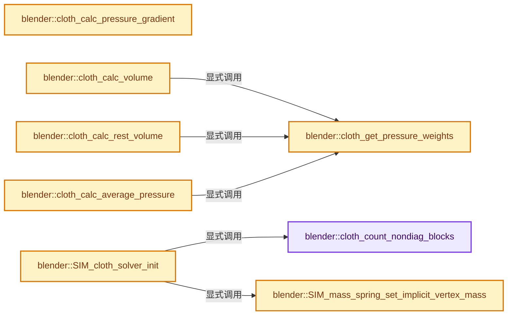
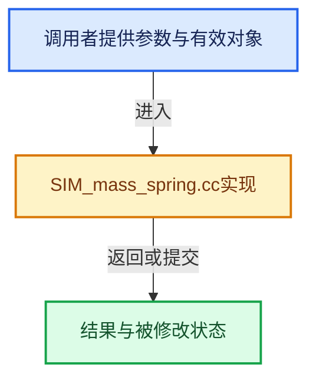

# 实现依赖专题：source/blender/simulation/intern/SIM_mass_spring.cc

[方向导航](README.md) · [符号索引](../%E7%AC%A6%E5%8F%B7%E4%BE%9D%E8%B5%96%E4%B8%8E%E5%AE%9E%E7%8E%B0%E7%B4%A2%E5%BC%95.md)

本专题从正文实际调用进入，集中保存共享实现。函数有稳定锚点，可从调用处直接跳到对应完整函数；递归与互相调用通过回链组织。

## 本文件的实现关系






## 完整成员与函数实现

<a id="f-f1a45d371dd73d37"></a>

### `blender::cloth_count_nondiag_blocks`

实现位置：[source/blender/simulation/intern/SIM_mass_spring.cc](../../../../../source/blender/simulation/intern/SIM_mass_spring.cc) · L40—L61。

接口参数：

- `Cloth *cloth`

**教学注释版**

<!-- annotated:8b3145d9d96cf2 -->

```cpp
static int cloth_count_nondiag_blocks(Cloth *cloth)
{
  LinkNode *link;
  int nondiag = 0;

  for (link = cloth->springs; link; link = link->next) {
    ClothSpring *spring = static_cast<ClothSpring *>(link->link);
    switch (spring->type) {
      case CLOTH_SPRING_TYPE_BENDING_HAIR:
        /* angular bending combines 3 vertices */
        nondiag += 3;
        break;

      default:
        /* all other springs depend on 2 vertices only */
        nondiag += 1;
        break;
    }
  }

  return nondiag;
}
```

<details>
<summary>核对原始源码：source/blender/simulation/intern/SIM_mass_spring.cc · L40—L61</summary>

<!-- original:8b3145d9d96cf2:source/blender/simulation/intern/SIM_mass_spring.cc:40:61 -->

```cpp
static int cloth_count_nondiag_blocks(Cloth *cloth)
{
  LinkNode *link;
  int nondiag = 0;

  for (link = cloth->springs; link; link = link->next) {
    ClothSpring *spring = static_cast<ClothSpring *>(link->link);
    switch (spring->type) {
      case CLOTH_SPRING_TYPE_BENDING_HAIR:
        /* angular bending combines 3 vertices */
        nondiag += 3;
        break;

      default:
        /* all other springs depend on 2 vertices only */
        nondiag += 1;
        break;
    }
  }

  return nondiag;
}
```

</details>

**沿实际写入检查状态**

- `nondiag += 3;`
- `nondiag += 1;`

**结果出口**

- `return nondiag;`

**继续追踪实现**

本实现没有需要继续展开的显式调用；检查返回表达式、对象转换和调用者前置条件。

<a id="f-5bed375c76145435"></a>

### `blender::cloth_get_pressure_weights`

实现位置：[source/blender/simulation/intern/SIM_mass_spring.cc](../../../../../source/blender/simulation/intern/SIM_mass_spring.cc) · L63—L83。

接口参数：

- `ClothModifierData *clmd`
- `const int3 &vert_tri`
- `float *r_weights`

**教学注释版**

<!-- annotated:49f7dc42bb37a9 -->

```cpp
static bool cloth_get_pressure_weights(ClothModifierData *clmd,
                                       const int3 &vert_tri,
                                       float *r_weights)
{
  /* We have custom vertex weights for pressure. */
  if (clmd->sim_parms->vgroup_pressure > 0) {
    Cloth *cloth = clmd->clothObject;
    ClothVertex *verts = cloth->verts;

    for (uint j = 0; j < 3; j++) {
      r_weights[j] = verts[vert_tri[j]].pressure_factor;

      /* Skip the entire triangle if it has a zero weight. */
      if (r_weights[j] == 0.0f) {
        return false;
      }
    }
  }

  return true;
}
```

<details>
<summary>核对原始源码：source/blender/simulation/intern/SIM_mass_spring.cc · L63—L83</summary>

<!-- original:49f7dc42bb37a9:source/blender/simulation/intern/SIM_mass_spring.cc:63:83 -->

```cpp
static bool cloth_get_pressure_weights(ClothModifierData *clmd,
                                       const int3 &vert_tri,
                                       float *r_weights)
{
  /* We have custom vertex weights for pressure. */
  if (clmd->sim_parms->vgroup_pressure > 0) {
    Cloth *cloth = clmd->clothObject;
    ClothVertex *verts = cloth->verts;

    for (uint j = 0; j < 3; j++) {
      r_weights[j] = verts[vert_tri[j]].pressure_factor;

      /* Skip the entire triangle if it has a zero weight. */
      if (r_weights[j] == 0.0f) {
        return false;
      }
    }
  }

  return true;
}
```

</details>

**沿实际写入检查状态**

- `r_weights[j] = verts[vert_tri[j]].pressure_factor;`

**结果出口**

- `return false;`
- `return true;`

**继续追踪实现**

本实现没有需要继续展开的显式调用；检查返回表达式、对象转换和调用者前置条件。

<a id="f-1d504e469d323e72"></a>

### `blender::cloth_calc_pressure_gradient`

实现位置：[source/blender/simulation/intern/SIM_mass_spring.cc](../../../../../source/blender/simulation/intern/SIM_mass_spring.cc) · L85—L98。

接口参数：

- `ClothModifierData *clmd`
- `const float gradient_vector[3]`
- `float *r_vertex_pressure`

**教学注释版**

<!-- annotated:3176470c4ffab3 -->

```cpp
static void cloth_calc_pressure_gradient(ClothModifierData *clmd,
                                         const float gradient_vector[3],
                                         float *r_vertex_pressure)
{
  Cloth *cloth = clmd->clothObject;
  Implicit_Data *data = cloth->implicit;
  uint mvert_num = cloth->mvert_num;
  float pt[3];

  for (uint i = 0; i < mvert_num; i++) {
    SIM_mass_spring_get_position(data, i, pt);
    r_vertex_pressure[i] = dot_v3v3(pt, gradient_vector);
  }
}
```

<details>
<summary>核对原始源码：source/blender/simulation/intern/SIM_mass_spring.cc · L85—L98</summary>

<!-- original:3176470c4ffab3:source/blender/simulation/intern/SIM_mass_spring.cc:85:98 -->

```cpp
static void cloth_calc_pressure_gradient(ClothModifierData *clmd,
                                         const float gradient_vector[3],
                                         float *r_vertex_pressure)
{
  Cloth *cloth = clmd->clothObject;
  Implicit_Data *data = cloth->implicit;
  uint mvert_num = cloth->mvert_num;
  float pt[3];

  for (uint i = 0; i < mvert_num; i++) {
    SIM_mass_spring_get_position(data, i, pt);
    r_vertex_pressure[i] = dot_v3v3(pt, gradient_vector);
  }
}
```

</details>

**沿实际写入检查状态**

- `r_vertex_pressure[i] = dot_v3v3(pt, gradient_vector);`

**继续追踪实现**

- `SIM_mass_spring_get_position` → [blender::SIM_mass_spring_get_position · L1226](%E4%BE%9D%E8%B5%96-implicit_blender-1544a5.md#f-4e6eb3d56a27316c)。
- `dot_v3v3` → [blender::dot_v3v3 · L646](../12-%E7%A9%BA%E9%97%B4%E6%95%B0%E6%8D%AE%E7%BB%93%E6%9E%84%E4%B8%8E%E5%87%A0%E4%BD%95%E7%AE%97%E6%B3%95/%E4%BE%9D%E8%B5%96-math_vector_inline-0c8541.md#f-c88befa67d07591a)。

<a id="f-3f12c86a66dd79e9"></a>

### `blender::cloth_calc_volume`

实现位置：[source/blender/simulation/intern/SIM_mass_spring.cc](../../../../../source/blender/simulation/intern/SIM_mass_spring.cc) · L100—L126。

接口参数：

- `ClothModifierData *clmd`

**教学注释版**

<!-- annotated:558f605eff5313 -->

```cpp
static float cloth_calc_volume(ClothModifierData *clmd)
{
  /* Calculate the (closed) cloth volume. */
  Cloth *cloth = clmd->clothObject;
  const int3 *vert_tris = cloth->vert_tris;
  Implicit_Data *data = cloth->implicit;
  float weights[3] = {1.0f, 1.0f, 1.0f};
  float vol = 0;

  /* Early exit for hair, as it never has volume. */
  if (clmd->hairdata) {
    return 0.0f;
  }

  for (uint i = 0; i < cloth->primitive_num; i++) {
    const int3 tri = vert_tris[i];

    if (cloth_get_pressure_weights(clmd, tri, weights)) {
      vol += SIM_tri_tetra_volume_signed_6x(data, tri[0], tri[1], tri[2]);
    }
  }

  /* We need to divide by 6 to get the actual volume. */
  vol = vol / 6.0f;

  return vol;
}
```

<details>
<summary>核对原始源码：source/blender/simulation/intern/SIM_mass_spring.cc · L100—L126</summary>

<!-- original:558f605eff5313:source/blender/simulation/intern/SIM_mass_spring.cc:100:126 -->

```cpp
static float cloth_calc_volume(ClothModifierData *clmd)
{
  /* Calculate the (closed) cloth volume. */
  Cloth *cloth = clmd->clothObject;
  const int3 *vert_tris = cloth->vert_tris;
  Implicit_Data *data = cloth->implicit;
  float weights[3] = {1.0f, 1.0f, 1.0f};
  float vol = 0;

  /* Early exit for hair, as it never has volume. */
  if (clmd->hairdata) {
    return 0.0f;
  }

  for (uint i = 0; i < cloth->primitive_num; i++) {
    const int3 tri = vert_tris[i];

    if (cloth_get_pressure_weights(clmd, tri, weights)) {
      vol += SIM_tri_tetra_volume_signed_6x(data, tri[0], tri[1], tri[2]);
    }
  }

  /* We need to divide by 6 to get the actual volume. */
  vol = vol / 6.0f;

  return vol;
}
```

</details>

**沿实际写入检查状态**

- `vol += SIM_tri_tetra_volume_signed_6x(data, tri[0], tri[1], tri[2]);`
- `vol = vol / 6.0f;`

**结果出口**

- `return 0.0f;`
- `return vol;`

**继续追踪实现**

- `cloth_get_pressure_weights` → [blender::cloth_get_pressure_weights · L63](%E4%BE%9D%E8%B5%96-SIM_mass_spring-63efc8.md#f-5bed375c76145435)。
- `SIM_tri_tetra_volume_signed_6x` → [blender::SIM_tri_tetra_volume_signed_6x · L1522](%E4%BE%9D%E8%B5%96-implicit_blender-1544a5.md#f-b1f91b1cca98b645)。

<a id="f-122f438f4fbd2dc0"></a>

### `blender::cloth_calc_rest_volume`

实现位置：[source/blender/simulation/intern/SIM_mass_spring.cc](../../../../../source/blender/simulation/intern/SIM_mass_spring.cc) · L128—L155。

接口参数：

- `ClothModifierData *clmd`

**教学注释版**

<!-- annotated:4688fb5b57615f -->

```cpp
static float cloth_calc_rest_volume(ClothModifierData *clmd)
{
  /* Calculate the (closed) cloth volume. */
  Cloth *cloth = clmd->clothObject;
  const int3 *vert_tris = cloth->vert_tris;
  const ClothVertex *v = cloth->verts;
  float weights[3] = {1.0f, 1.0f, 1.0f};
  float vol = 0;

  /* Early exit for hair, as it never has volume. */
  if (clmd->hairdata) {
    return 0.0f;
  }

  for (uint i = 0; i < cloth->primitive_num; i++) {
    const int3 tri = vert_tris[i];

    if (cloth_get_pressure_weights(clmd, tri, weights)) {
      vol += volume_tri_tetrahedron_signed_v3_6x(
          v[tri[0]].xrest, v[tri[1]].xrest, v[tri[2]].xrest);
    }
  }

  /* We need to divide by 6 to get the actual volume. */
  vol = vol / 6.0f;

  return vol;
}
```

<details>
<summary>核对原始源码：source/blender/simulation/intern/SIM_mass_spring.cc · L128—L155</summary>

<!-- original:4688fb5b57615f:source/blender/simulation/intern/SIM_mass_spring.cc:128:155 -->

```cpp
static float cloth_calc_rest_volume(ClothModifierData *clmd)
{
  /* Calculate the (closed) cloth volume. */
  Cloth *cloth = clmd->clothObject;
  const int3 *vert_tris = cloth->vert_tris;
  const ClothVertex *v = cloth->verts;
  float weights[3] = {1.0f, 1.0f, 1.0f};
  float vol = 0;

  /* Early exit for hair, as it never has volume. */
  if (clmd->hairdata) {
    return 0.0f;
  }

  for (uint i = 0; i < cloth->primitive_num; i++) {
    const int3 tri = vert_tris[i];

    if (cloth_get_pressure_weights(clmd, tri, weights)) {
      vol += volume_tri_tetrahedron_signed_v3_6x(
          v[tri[0]].xrest, v[tri[1]].xrest, v[tri[2]].xrest);
    }
  }

  /* We need to divide by 6 to get the actual volume. */
  vol = vol / 6.0f;

  return vol;
}
```

</details>

**沿实际写入检查状态**

- `vol += volume_tri_tetrahedron_signed_v3_6x(`
- `vol = vol / 6.0f;`

**结果出口**

- `return 0.0f;`
- `return vol;`

**继续追踪实现**

- `cloth_get_pressure_weights` → [blender::cloth_get_pressure_weights · L63](%E4%BE%9D%E8%B5%96-SIM_mass_spring-63efc8.md#f-5bed375c76145435)。
- `volume_tri_tetrahedron_signed_v3_6x` → [blender::volume_tri_tetrahedron_signed_v3_6x · L275](../12-%E7%A9%BA%E9%97%B4%E6%95%B0%E6%8D%AE%E7%BB%93%E6%9E%84%E4%B8%8E%E5%87%A0%E4%BD%95%E7%AE%97%E6%B3%95/%E4%BE%9D%E8%B5%96-math_geom-8d91a3.md#f-859f3c7fcf7cda5c)。

<a id="f-58b8e94de060438f"></a>

### `blender::cloth_calc_average_pressure`

实现位置：[source/blender/simulation/intern/SIM_mass_spring.cc](../../../../../source/blender/simulation/intern/SIM_mass_spring.cc) · L157—L180。

接口参数：

- `ClothModifierData *clmd`
- `const float *vertex_pressure`

**教学注释版**

<!-- annotated:d54142e6e4f96a -->

```cpp
static float cloth_calc_average_pressure(ClothModifierData *clmd, const float *vertex_pressure)
{
  Cloth *cloth = clmd->clothObject;
  const int3 *vert_tris = cloth->vert_tris;
  Implicit_Data *data = cloth->implicit;
  float weights[3] = {1.0f, 1.0f, 1.0f};
  float total_force = 0;
  float total_area = 0;

  for (uint i = 0; i < cloth->primitive_num; i++) {
    const int3 tri = vert_tris[i];

    if (cloth_get_pressure_weights(clmd, tri, weights)) {
      float area = SIM_tri_area(data, tri[0], tri[1], tri[2]);

      total_force += (vertex_pressure[tri[0]] + vertex_pressure[tri[1]] +
                      vertex_pressure[tri[2]]) *
                     area / 3.0f;
      total_area += area;
    }
  }

  return total_force / total_area;
}
```

<details>
<summary>核对原始源码：source/blender/simulation/intern/SIM_mass_spring.cc · L157—L180</summary>

<!-- original:d54142e6e4f96a:source/blender/simulation/intern/SIM_mass_spring.cc:157:180 -->

```cpp
static float cloth_calc_average_pressure(ClothModifierData *clmd, const float *vertex_pressure)
{
  Cloth *cloth = clmd->clothObject;
  const int3 *vert_tris = cloth->vert_tris;
  Implicit_Data *data = cloth->implicit;
  float weights[3] = {1.0f, 1.0f, 1.0f};
  float total_force = 0;
  float total_area = 0;

  for (uint i = 0; i < cloth->primitive_num; i++) {
    const int3 tri = vert_tris[i];

    if (cloth_get_pressure_weights(clmd, tri, weights)) {
      float area = SIM_tri_area(data, tri[0], tri[1], tri[2]);

      total_force += (vertex_pressure[tri[0]] + vertex_pressure[tri[1]] +
                      vertex_pressure[tri[2]]) *
                     area / 3.0f;
      total_area += area;
    }
  }

  return total_force / total_area;
}
```

</details>

**沿实际写入检查状态**

- `total_force += (vertex_pressure[tri[0]] + vertex_pressure[tri[1]] +`
- `total_area += area;`

**结果出口**

- `return total_force / total_area;`

**继续追踪实现**

- `cloth_get_pressure_weights` → [blender::cloth_get_pressure_weights · L63](%E4%BE%9D%E8%B5%96-SIM_mass_spring-63efc8.md#f-5bed375c76145435)。
- `SIM_tri_area` → [blender::SIM_tri_area · L1528](%E4%BE%9D%E8%B5%96-implicit_blender-1544a5.md#f-24e488ec4f62385d)。

<a id="f-2b7b94b1b15b6b03"></a>

### `blender::SIM_cloth_solver_init`

实现位置：[source/blender/simulation/intern/SIM_mass_spring.cc](../../../../../source/blender/simulation/intern/SIM_mass_spring.cc) · L182—L202。

接口参数：

- `Object *`
- `ClothModifierData *clmd`

**教学注释版**

<!-- annotated:aa1bbc2ba1e778 -->

```cpp
int SIM_cloth_solver_init(Object * /*ob*/, ClothModifierData *clmd)
{
  Cloth *cloth = clmd->clothObject;
  ClothVertex *verts = cloth->verts;
  const float ZERO[3] = {0.0f, 0.0f, 0.0f};
  Implicit_Data *id;
  uint i, nondiag;

  nondiag = cloth_count_nondiag_blocks(cloth);
  cloth->implicit = id = SIM_mass_spring_solver_create(cloth->mvert_num, nondiag);

  for (i = 0; i < cloth->mvert_num; i++) {
    SIM_mass_spring_set_implicit_vertex_mass(id, i, verts[i].mass);
  }

  for (i = 0; i < cloth->mvert_num; i++) {
    SIM_mass_spring_set_motion_state(id, i, verts[i].x, ZERO);
  }

  return 1;
}
```

<details>
<summary>核对原始源码：source/blender/simulation/intern/SIM_mass_spring.cc · L182—L202</summary>

<!-- original:aa1bbc2ba1e778:source/blender/simulation/intern/SIM_mass_spring.cc:182:202 -->

```cpp
int SIM_cloth_solver_init(Object * /*ob*/, ClothModifierData *clmd)
{
  Cloth *cloth = clmd->clothObject;
  ClothVertex *verts = cloth->verts;
  const float ZERO[3] = {0.0f, 0.0f, 0.0f};
  Implicit_Data *id;
  uint i, nondiag;

  nondiag = cloth_count_nondiag_blocks(cloth);
  cloth->implicit = id = SIM_mass_spring_solver_create(cloth->mvert_num, nondiag);

  for (i = 0; i < cloth->mvert_num; i++) {
    SIM_mass_spring_set_implicit_vertex_mass(id, i, verts[i].mass);
  }

  for (i = 0; i < cloth->mvert_num; i++) {
    SIM_mass_spring_set_motion_state(id, i, verts[i].x, ZERO);
  }

  return 1;
}
```

</details>

**沿实际写入检查状态**

- `nondiag = cloth_count_nondiag_blocks(cloth);`
- `cloth->implicit = id = SIM_mass_spring_solver_create(cloth->mvert_num, nondiag);`

**结果出口**

- `return 1;`

**继续追踪实现**

- `cloth_count_nondiag_blocks` → [blender::cloth_count_nondiag_blocks · L40](%E4%BE%9D%E8%B5%96-SIM_mass_spring-63efc8.md#f-f1a45d371dd73d37)。
- `SIM_mass_spring_solver_create` → [blender::SIM_mass_spring_solver_create · L660](%E4%BE%9D%E8%B5%96-implicit_blender-1544a5.md#f-f74e09625934b07d)。
- `SIM_mass_spring_set_implicit_vertex_mass` → [blender::SIM_mass_spring_set_implicit_vertex_mass · L204](%E4%BE%9D%E8%B5%96-SIM_mass_spring-63efc8.md#f-314f70eebe0122fb)。
- `SIM_mass_spring_set_motion_state` → [blender::SIM_mass_spring_set_motion_state · L1197](%E4%BE%9D%E8%B5%96-implicit_blender-1544a5.md#f-e94bb880fcf08cdc)。

<a id="f-314f70eebe0122fb"></a>

### `blender::SIM_mass_spring_set_implicit_vertex_mass`

实现位置：[source/blender/simulation/intern/SIM_mass_spring.cc](../../../../../source/blender/simulation/intern/SIM_mass_spring.cc) · L204—L207。

接口参数：

- `Implicit_Data *data`
- `int index`
- `float mass`

**教学注释版**

<!-- annotated:86a1fbb153ca4f -->

```cpp
void SIM_mass_spring_set_implicit_vertex_mass(Implicit_Data *data, int index, float mass)
{
  SIM_mass_spring_set_vertex_mass(data, index, mass);
}
```

<details>
<summary>核对原始源码：source/blender/simulation/intern/SIM_mass_spring.cc · L204—L207</summary>

<!-- original:86a1fbb153ca4f:source/blender/simulation/intern/SIM_mass_spring.cc:204:207 -->

```cpp
void SIM_mass_spring_set_implicit_vertex_mass(Implicit_Data *data, int index, float mass)
{
  SIM_mass_spring_set_vertex_mass(data, index, mass);
}
```

</details>

**继续追踪实现**

- `SIM_mass_spring_set_vertex_mass` → [blender::SIM_mass_spring_set_vertex_mass · L1181](%E4%BE%9D%E8%B5%96-implicit_blender-1544a5.md#f-b11e5dc05d72ac54)。

<a id="f-e98f3b69c0d262c2"></a>

### `blender::SIM_cloth_solver_free`

实现位置：[source/blender/simulation/intern/SIM_mass_spring.cc](../../../../../source/blender/simulation/intern/SIM_mass_spring.cc) · L209—L217。

接口参数：

- `ClothModifierData *clmd`

**教学注释版**

<!-- annotated:925b7cf238511d -->

```cpp
void SIM_cloth_solver_free(ClothModifierData *clmd)
{
  Cloth *cloth = clmd->clothObject;

  if (cloth->implicit) {
    SIM_mass_spring_solver_free(cloth->implicit);
    cloth->implicit = nullptr;
  }
}
```

<details>
<summary>核对原始源码：source/blender/simulation/intern/SIM_mass_spring.cc · L209—L217</summary>

<!-- original:925b7cf238511d:source/blender/simulation/intern/SIM_mass_spring.cc:209:217 -->

```cpp
void SIM_cloth_solver_free(ClothModifierData *clmd)
{
  Cloth *cloth = clmd->clothObject;

  if (cloth->implicit) {
    SIM_mass_spring_solver_free(cloth->implicit);
    cloth->implicit = nullptr;
  }
}
```

</details>

**沿实际写入检查状态**

- `cloth->implicit = nullptr;`

**继续追踪实现**

- `SIM_mass_spring_solver_free` → [blender::SIM_mass_spring_solver_free · L688](%E4%BE%9D%E8%B5%96-implicit_blender-1544a5.md#f-fbc259227c8e5919)。

<a id="f-decff8c76a8d65f1"></a>

### `blender::SIM_cloth_solver_set_positions`

实现位置：[source/blender/simulation/intern/SIM_mass_spring.cc](../../../../../source/blender/simulation/intern/SIM_mass_spring.cc) · L219—L238。

接口参数：

- `ClothModifierData *clmd`

**教学注释版**

<!-- annotated:d2386517ee47fd -->

```cpp
void SIM_cloth_solver_set_positions(ClothModifierData *clmd)
{
  Cloth *cloth = clmd->clothObject;
  ClothVertex *verts = cloth->verts;
  uint mvert_num = cloth->mvert_num, i;
  ClothHairData *cloth_hairdata = clmd->hairdata;
  Implicit_Data *id = cloth->implicit;

  for (i = 0; i < mvert_num; i++) {
    if (cloth_hairdata) {
      ClothHairData *root = &cloth_hairdata[i];
      SIM_mass_spring_set_rest_transform(id, i, root->rot);
    }
    else {
      SIM_mass_spring_set_rest_transform(id, i, I3);
    }

    SIM_mass_spring_set_motion_state(id, i, verts[i].x, verts[i].v);
  }
}
```

<details>
<summary>核对原始源码：source/blender/simulation/intern/SIM_mass_spring.cc · L219—L238</summary>

<!-- original:d2386517ee47fd:source/blender/simulation/intern/SIM_mass_spring.cc:219:238 -->

```cpp
void SIM_cloth_solver_set_positions(ClothModifierData *clmd)
{
  Cloth *cloth = clmd->clothObject;
  ClothVertex *verts = cloth->verts;
  uint mvert_num = cloth->mvert_num, i;
  ClothHairData *cloth_hairdata = clmd->hairdata;
  Implicit_Data *id = cloth->implicit;

  for (i = 0; i < mvert_num; i++) {
    if (cloth_hairdata) {
      ClothHairData *root = &cloth_hairdata[i];
      SIM_mass_spring_set_rest_transform(id, i, root->rot);
    }
    else {
      SIM_mass_spring_set_rest_transform(id, i, I3);
    }

    SIM_mass_spring_set_motion_state(id, i, verts[i].x, verts[i].v);
  }
}
```

</details>

**继续追踪实现**

- `SIM_mass_spring_set_rest_transform` → [blender::SIM_mass_spring_set_rest_transform · L1187](%E4%BE%9D%E8%B5%96-implicit_blender-1544a5.md#f-4dcfcc3d94908275)。
- `SIM_mass_spring_set_motion_state` → [blender::SIM_mass_spring_set_motion_state · L1197](%E4%BE%9D%E8%B5%96-implicit_blender-1544a5.md#f-e94bb880fcf08cdc)。

<a id="f-6d55313a77cb465c"></a>

### `blender::SIM_cloth_solver_set_volume`

实现位置：[source/blender/simulation/intern/SIM_mass_spring.cc](../../../../../source/blender/simulation/intern/SIM_mass_spring.cc) · L240—L245。

接口参数：

- `ClothModifierData *clmd`

**教学注释版**

<!-- annotated:69d5285540bc29 -->

```cpp
void SIM_cloth_solver_set_volume(ClothModifierData *clmd)
{
  Cloth *cloth = clmd->clothObject;

  cloth->initial_mesh_volume = cloth_calc_rest_volume(clmd);
}
```

<details>
<summary>核对原始源码：source/blender/simulation/intern/SIM_mass_spring.cc · L240—L245</summary>

<!-- original:69d5285540bc29:source/blender/simulation/intern/SIM_mass_spring.cc:240:245 -->

```cpp
void SIM_cloth_solver_set_volume(ClothModifierData *clmd)
{
  Cloth *cloth = clmd->clothObject;

  cloth->initial_mesh_volume = cloth_calc_rest_volume(clmd);
}
```

</details>

**沿实际写入检查状态**

- `cloth->initial_mesh_volume = cloth_calc_rest_volume(clmd);`

**继续追踪实现**

- `cloth_calc_rest_volume` → [blender::cloth_calc_rest_volume · L128](%E4%BE%9D%E8%B5%96-SIM_mass_spring-63efc8.md#f-122f438f4fbd2dc0)。

<a id="f-f5d56f59f95b735f"></a>

### `blender::cloth_setup_constraints`

实现位置：[source/blender/simulation/intern/SIM_mass_spring.cc](../../../../../source/blender/simulation/intern/SIM_mass_spring.cc) · L251—L271。

接口参数：

- `ClothModifierData *clmd`

**教学注释版**

<!-- annotated:ffe9d0243b04c2 -->

```cpp
static void cloth_setup_constraints(ClothModifierData *clmd)
{
  Cloth *cloth = clmd->clothObject;
  Implicit_Data *data = cloth->implicit;
  ClothVertex *verts = cloth->verts;
  int mvert_num = cloth->mvert_num;
  int v;

  const float ZERO[3] = {0.0f, 0.0f, 0.0f};

  SIM_mass_spring_clear_constraints(data);

  for (v = 0; v < mvert_num; v++) {
    if (verts[v].flags & CLOTH_VERT_FLAG_PINNED) {
      /* pinned vertex constraints */
      SIM_mass_spring_add_constraint_ndof0(data, v, ZERO); /* velocity is defined externally */
    }

    verts[v].impulse_count = 0;
  }
}
```

<details>
<summary>核对原始源码：source/blender/simulation/intern/SIM_mass_spring.cc · L251—L271</summary>

<!-- original:ffe9d0243b04c2:source/blender/simulation/intern/SIM_mass_spring.cc:251:271 -->

```cpp
static void cloth_setup_constraints(ClothModifierData *clmd)
{
  Cloth *cloth = clmd->clothObject;
  Implicit_Data *data = cloth->implicit;
  ClothVertex *verts = cloth->verts;
  int mvert_num = cloth->mvert_num;
  int v;

  const float ZERO[3] = {0.0f, 0.0f, 0.0f};

  SIM_mass_spring_clear_constraints(data);

  for (v = 0; v < mvert_num; v++) {
    if (verts[v].flags & CLOTH_VERT_FLAG_PINNED) {
      /* pinned vertex constraints */
      SIM_mass_spring_add_constraint_ndof0(data, v, ZERO); /* velocity is defined externally */
    }

    verts[v].impulse_count = 0;
  }
}
```

</details>

**沿实际写入检查状态**

- `verts[v].impulse_count = 0;`

**继续追踪实现**

- `SIM_mass_spring_clear_constraints` → [blender::SIM_mass_spring_clear_constraints · L1276](%E4%BE%9D%E8%B5%96-implicit_blender-1544a5.md#f-2e6f45a073550357)。
- `SIM_mass_spring_add_constraint_ndof0` → [blender::SIM_mass_spring_add_constraint_ndof0 · L1285](%E4%BE%9D%E8%B5%96-implicit_blender-1544a5.md#f-b30da7a7eabaf72a)。

<a id="f-5fd3462cab419a83"></a>

### `blender::cloth_calc_spring_force`

实现位置：[source/blender/simulation/intern/SIM_mass_spring.cc](../../../../../source/blender/simulation/intern/SIM_mass_spring.cc) · L358—L550。

接口参数：

- `ClothModifierData *clmd`
- `ClothSpring *s`

**教学注释版**

<!-- annotated:9d86a0fe82d082 -->

```cpp
BLI_INLINE void cloth_calc_spring_force(ClothModifierData *clmd, ClothSpring *s)
{
  Cloth *cloth = clmd->clothObject;
  ClothSimSettings *parms = clmd->sim_parms;
  Implicit_Data *data = cloth->implicit;
  bool using_angular = parms->bending_model == CLOTH_BENDING_ANGULAR;
  bool resist_compress = (parms->flags & CLOTH_SIMSETTINGS_FLAG_RESIST_SPRING_COMPRESS) &&
                         !using_angular;

  s->flags &= ~CLOTH_SPRING_FLAG_NEEDED;

  /* Calculate force of bending springs. */
  if ((s->type & CLOTH_SPRING_TYPE_BENDING) && using_angular) {
#ifdef CLOTH_FORCE_SPRING_BEND
    float k, scaling;

    s->flags |= CLOTH_SPRING_FLAG_NEEDED;

    scaling = parms->bending + s->ang_stiffness * fabsf(parms->max_bend - parms->bending);
    /* Multiplying by 0.1, just to scale the forces to more reasonable values. */
    k = scaling * s->restlen * 0.1f;

    SIM_mass_spring_force_spring_angular(
        data, s->ij, s->kl, s->pa, s->pb, s->la, s->lb, s->restang, k, parms->bending_damping);
#endif
  }

  /* Calculate force of structural + shear springs. */
  if (s->type &
      (CLOTH_SPRING_TYPE_STRUCTURAL | CLOTH_SPRING_TYPE_SEWING | CLOTH_SPRING_TYPE_INTERNAL))
  {
#ifdef CLOTH_FORCE_SPRING_STRUCTURAL
    float k_tension, scaling_tension;

    s->flags |= CLOTH_SPRING_FLAG_NEEDED;

    scaling_tension = parms->tension +
                      s->lin_stiffness * fabsf(parms->max_tension - parms->tension);
    k_tension = scaling_tension / (parms->avg_spring_len + FLT_EPSILON);

    if (s->type & CLOTH_SPRING_TYPE_SEWING) {
      /* TODO: verify, half verified (couldn't see error)
       * sewing springs usually have a large distance at first so clamp the force so we don't get
       * tunneling through collision objects. */
      SIM_mass_spring_force_spring_linear(data,
                                          s->ij,
                                          s->kl,
                                          s->restlen,
                                          k_tension,
                                          parms->tension_damp,
                                          0.0f,
                                          0.0f,
                                          false,
                                          false,
                                          parms->max_sewing);
    }
    else if (s->type & CLOTH_SPRING_TYPE_STRUCTURAL) {
      float k_compression, scaling_compression;
      scaling_compression = parms->compression +
                            s->lin_stiffness * fabsf(parms->max_compression - parms->compression);
      k_compression = scaling_compression / (parms->avg_spring_len + FLT_EPSILON);

      SIM_mass_spring_force_spring_linear(data,
                                          s->ij,
                                          s->kl,
                                          s->restlen,
                                          k_tension,
                                          parms->tension_damp,
                                          k_compression,
                                          parms->compression_damp,
                                          resist_compress,
                                          using_angular,
                                          0.0f);
    }
    else {
      /* CLOTH_SPRING_TYPE_INTERNAL */
      BLI_assert(s->type & CLOTH_SPRING_TYPE_INTERNAL);

      scaling_tension = parms->internal_tension +
                        s->lin_stiffness *
                            fabsf(parms->max_internal_tension - parms->internal_tension);
      k_tension = scaling_tension / (parms->avg_spring_len + FLT_EPSILON);
      float scaling_compression = parms->internal_compression +
                                  s->lin_stiffness * fabsf(parms->max_internal_compression -
                                                           parms->internal_compression);
      float k_compression = scaling_compression / (parms->avg_spring_len + FLT_EPSILON);

      float k_tension_damp = parms->tension_damp;
      float k_compression_damp = parms->compression_damp;

      if (k_tension == 0.0f) {
        /* No damping so it behaves as if no tension spring was there at all. */
        k_tension_damp = 0.0f;
      }

      if (k_compression == 0.0f) {
        /* No damping so it behaves as if no compression spring was there at all. */
        k_compression_damp = 0.0f;
      }

      SIM_mass_spring_force_spring_linear(data,
                                          s->ij,
                                          s->kl,
                                          s->restlen,
                                          k_tension,
                                          k_tension_damp,
                                          k_compression,
                                          k_compression_damp,
                                          resist_compress,
                                          using_angular,
                                          0.0f);
    }
#endif
  }
  else if (s->type & CLOTH_SPRING_TYPE_SHEAR) {
#ifdef CLOTH_FORCE_SPRING_SHEAR
    float k, scaling;

    s->flags |= CLOTH_SPRING_FLAG_NEEDED;

    scaling = parms->shear + s->lin_stiffness * fabsf(parms->max_shear - parms->shear);
    k = scaling / (parms->avg_spring_len + FLT_EPSILON);

    SIM_mass_spring_force_spring_linear(data,
                                        s->ij,
                                        s->kl,
                                        s->restlen,
                                        k,
                                        parms->shear_damp,
                                        0.0f,
                                        0.0f,
                                        resist_compress,
                                        false,
                                        0.0f);
#endif
  }
  else if (s->type & CLOTH_SPRING_TYPE_BENDING) { /* calculate force of bending springs */
#ifdef CLOTH_FORCE_SPRING_BEND
    float kb, cb, scaling;

    s->flags |= CLOTH_SPRING_FLAG_NEEDED;

    scaling = parms->bending + s->lin_stiffness * fabsf(parms->max_bend - parms->bending);
    kb = scaling / (20.0f * (parms->avg_spring_len + FLT_EPSILON));

    /* Fix for #45084 for cloth stiffness must have cb proportional to kb */
    cb = kb * parms->bending_damping;

    SIM_mass_spring_force_spring_bending(data, s->ij, s->kl, s->restlen, kb, cb);
#endif
  }
  else if (s->type & CLOTH_SPRING_TYPE_BENDING_HAIR) {
#ifdef CLOTH_FORCE_SPRING_BEND
    float kb, cb, scaling;

    s->flags |= CLOTH_SPRING_FLAG_NEEDED;

    /* XXX WARNING: angular bending springs for hair apply stiffness factor as an overall factor,
     * unlike cloth springs! this is crap, but needed due to cloth/hair mixing ... max_bend factor
     * is not even used for hair, so ...
     */
    scaling = s->lin_stiffness * parms->bending;
    kb = scaling / (20.0f * (parms->avg_spring_len + FLT_EPSILON));

    /* Fix for #45084 for cloth stiffness must have cb proportional to kb */
    cb = kb * parms->bending_damping;

    /* XXX assuming same restlen for ij and jk segments here,
     * this can be done correctly for hair later. */
    SIM_mass_spring_force_spring_bending_hair(data, s->ij, s->kl, s->mn, s->target, kb, cb);

#  if 0
    {
      float x_kl[3], x_mn[3], v[3], d[3];

      SIM_mass_spring_get_motion_state(data, s->kl, x_kl, v);
      SIM_mass_spring_get_motion_state(data, s->mn, x_mn, v);

      BKE_sim_debug_data_add_dot(clmd->debug_data, x_kl, 0.9, 0.9, 0.9, "target", 7980, s->kl);
      BKE_sim_debug_data_add_line(
          clmd->debug_data, x_kl, x_mn, 0.8, 0.8, 0.8, "target", 7981, s->kl);

      copy_v3_v3(d, s->target);
      BKE_sim_debug_data_add_vector(
          clmd->debug_data, x_kl, d, 0.8, 0.8, 0.2, "target", 7982, s->kl);

      // copy_v3_v3(d, s->target_ij);
      // BKE_sim_debug_data_add_vector(clmd->debug_data, x, d, 1, 0.4, 0.4, "target", 7983, s->kl);
    }
#  endif
#endif
  }
}
```

<details>
<summary>核对原始源码：source/blender/simulation/intern/SIM_mass_spring.cc · L358—L550</summary>

<!-- original:9d86a0fe82d082:source/blender/simulation/intern/SIM_mass_spring.cc:358:550 -->

```cpp
BLI_INLINE void cloth_calc_spring_force(ClothModifierData *clmd, ClothSpring *s)
{
  Cloth *cloth = clmd->clothObject;
  ClothSimSettings *parms = clmd->sim_parms;
  Implicit_Data *data = cloth->implicit;
  bool using_angular = parms->bending_model == CLOTH_BENDING_ANGULAR;
  bool resist_compress = (parms->flags & CLOTH_SIMSETTINGS_FLAG_RESIST_SPRING_COMPRESS) &&
                         !using_angular;

  s->flags &= ~CLOTH_SPRING_FLAG_NEEDED;

  /* Calculate force of bending springs. */
  if ((s->type & CLOTH_SPRING_TYPE_BENDING) && using_angular) {
#ifdef CLOTH_FORCE_SPRING_BEND
    float k, scaling;

    s->flags |= CLOTH_SPRING_FLAG_NEEDED;

    scaling = parms->bending + s->ang_stiffness * fabsf(parms->max_bend - parms->bending);
    /* Multiplying by 0.1, just to scale the forces to more reasonable values. */
    k = scaling * s->restlen * 0.1f;

    SIM_mass_spring_force_spring_angular(
        data, s->ij, s->kl, s->pa, s->pb, s->la, s->lb, s->restang, k, parms->bending_damping);
#endif
  }

  /* Calculate force of structural + shear springs. */
  if (s->type &
      (CLOTH_SPRING_TYPE_STRUCTURAL | CLOTH_SPRING_TYPE_SEWING | CLOTH_SPRING_TYPE_INTERNAL))
  {
#ifdef CLOTH_FORCE_SPRING_STRUCTURAL
    float k_tension, scaling_tension;

    s->flags |= CLOTH_SPRING_FLAG_NEEDED;

    scaling_tension = parms->tension +
                      s->lin_stiffness * fabsf(parms->max_tension - parms->tension);
    k_tension = scaling_tension / (parms->avg_spring_len + FLT_EPSILON);

    if (s->type & CLOTH_SPRING_TYPE_SEWING) {
      /* TODO: verify, half verified (couldn't see error)
       * sewing springs usually have a large distance at first so clamp the force so we don't get
       * tunneling through collision objects. */
      SIM_mass_spring_force_spring_linear(data,
                                          s->ij,
                                          s->kl,
                                          s->restlen,
                                          k_tension,
                                          parms->tension_damp,
                                          0.0f,
                                          0.0f,
                                          false,
                                          false,
                                          parms->max_sewing);
    }
    else if (s->type & CLOTH_SPRING_TYPE_STRUCTURAL) {
      float k_compression, scaling_compression;
      scaling_compression = parms->compression +
                            s->lin_stiffness * fabsf(parms->max_compression - parms->compression);
      k_compression = scaling_compression / (parms->avg_spring_len + FLT_EPSILON);

      SIM_mass_spring_force_spring_linear(data,
                                          s->ij,
                                          s->kl,
                                          s->restlen,
                                          k_tension,
                                          parms->tension_damp,
                                          k_compression,
                                          parms->compression_damp,
                                          resist_compress,
                                          using_angular,
                                          0.0f);
    }
    else {
      /* CLOTH_SPRING_TYPE_INTERNAL */
      BLI_assert(s->type & CLOTH_SPRING_TYPE_INTERNAL);

      scaling_tension = parms->internal_tension +
                        s->lin_stiffness *
                            fabsf(parms->max_internal_tension - parms->internal_tension);
      k_tension = scaling_tension / (parms->avg_spring_len + FLT_EPSILON);
      float scaling_compression = parms->internal_compression +
                                  s->lin_stiffness * fabsf(parms->max_internal_compression -
                                                           parms->internal_compression);
      float k_compression = scaling_compression / (parms->avg_spring_len + FLT_EPSILON);

      float k_tension_damp = parms->tension_damp;
      float k_compression_damp = parms->compression_damp;

      if (k_tension == 0.0f) {
        /* No damping so it behaves as if no tension spring was there at all. */
        k_tension_damp = 0.0f;
      }

      if (k_compression == 0.0f) {
        /* No damping so it behaves as if no compression spring was there at all. */
        k_compression_damp = 0.0f;
      }

      SIM_mass_spring_force_spring_linear(data,
                                          s->ij,
                                          s->kl,
                                          s->restlen,
                                          k_tension,
                                          k_tension_damp,
                                          k_compression,
                                          k_compression_damp,
                                          resist_compress,
                                          using_angular,
                                          0.0f);
    }
#endif
  }
  else if (s->type & CLOTH_SPRING_TYPE_SHEAR) {
#ifdef CLOTH_FORCE_SPRING_SHEAR
    float k, scaling;

    s->flags |= CLOTH_SPRING_FLAG_NEEDED;

    scaling = parms->shear + s->lin_stiffness * fabsf(parms->max_shear - parms->shear);
    k = scaling / (parms->avg_spring_len + FLT_EPSILON);

    SIM_mass_spring_force_spring_linear(data,
                                        s->ij,
                                        s->kl,
                                        s->restlen,
                                        k,
                                        parms->shear_damp,
                                        0.0f,
                                        0.0f,
                                        resist_compress,
                                        false,
                                        0.0f);
#endif
  }
  else if (s->type & CLOTH_SPRING_TYPE_BENDING) { /* calculate force of bending springs */
#ifdef CLOTH_FORCE_SPRING_BEND
    float kb, cb, scaling;

    s->flags |= CLOTH_SPRING_FLAG_NEEDED;

    scaling = parms->bending + s->lin_stiffness * fabsf(parms->max_bend - parms->bending);
    kb = scaling / (20.0f * (parms->avg_spring_len + FLT_EPSILON));

    /* Fix for #45084 for cloth stiffness must have cb proportional to kb */
    cb = kb * parms->bending_damping;

    SIM_mass_spring_force_spring_bending(data, s->ij, s->kl, s->restlen, kb, cb);
#endif
  }
  else if (s->type & CLOTH_SPRING_TYPE_BENDING_HAIR) {
#ifdef CLOTH_FORCE_SPRING_BEND
    float kb, cb, scaling;

    s->flags |= CLOTH_SPRING_FLAG_NEEDED;

    /* XXX WARNING: angular bending springs for hair apply stiffness factor as an overall factor,
     * unlike cloth springs! this is crap, but needed due to cloth/hair mixing ... max_bend factor
     * is not even used for hair, so ...
     */
    scaling = s->lin_stiffness * parms->bending;
    kb = scaling / (20.0f * (parms->avg_spring_len + FLT_EPSILON));

    /* Fix for #45084 for cloth stiffness must have cb proportional to kb */
    cb = kb * parms->bending_damping;

    /* XXX assuming same restlen for ij and jk segments here,
     * this can be done correctly for hair later. */
    SIM_mass_spring_force_spring_bending_hair(data, s->ij, s->kl, s->mn, s->target, kb, cb);

#  if 0
    {
      float x_kl[3], x_mn[3], v[3], d[3];

      SIM_mass_spring_get_motion_state(data, s->kl, x_kl, v);
      SIM_mass_spring_get_motion_state(data, s->mn, x_mn, v);

      BKE_sim_debug_data_add_dot(clmd->debug_data, x_kl, 0.9, 0.9, 0.9, "target", 7980, s->kl);
      BKE_sim_debug_data_add_line(
          clmd->debug_data, x_kl, x_mn, 0.8, 0.8, 0.8, "target", 7981, s->kl);

      copy_v3_v3(d, s->target);
      BKE_sim_debug_data_add_vector(
          clmd->debug_data, x_kl, d, 0.8, 0.8, 0.2, "target", 7982, s->kl);

      // copy_v3_v3(d, s->target_ij);
      // BKE_sim_debug_data_add_vector(clmd->debug_data, x, d, 1, 0.4, 0.4, "target", 7983, s->kl);
    }
#  endif
#endif
  }
}
```

</details>

**沿实际写入检查状态**

- `s->flags &= ~CLOTH_SPRING_FLAG_NEEDED;`
- `s->flags |= CLOTH_SPRING_FLAG_NEEDED;`
- `scaling = parms->bending + s->ang_stiffness * fabsf(parms->max_bend - parms->bending);`
- `k = scaling * s->restlen * 0.1f;`
- `scaling_tension = parms->tension +`
- `k_tension = scaling_tension / (parms->avg_spring_len + FLT_EPSILON);`
- `scaling_compression = parms->compression +`
- `k_compression = scaling_compression / (parms->avg_spring_len + FLT_EPSILON);`
- `scaling_tension = parms->internal_tension +`
- `k_tension_damp = 0.0f;`
- `k_compression_damp = 0.0f;`
- `scaling = parms->shear + s->lin_stiffness * fabsf(parms->max_shear - parms->shear);`
- `k = scaling / (parms->avg_spring_len + FLT_EPSILON);`
- `scaling = parms->bending + s->lin_stiffness * fabsf(parms->max_bend - parms->bending);`
- `kb = scaling / (20.0f * (parms->avg_spring_len + FLT_EPSILON));`
- `cb = kb * parms->bending_damping;`
- `scaling = s->lin_stiffness * parms->bending;`

**继续追踪实现**

- `fabsf` → [fabsf · L21](%E4%BE%9D%E8%B5%96-radial_tiling_shared-98abf9.md#m-02cc4c69cfb3)；[fabsf · L43](%E4%BE%9D%E8%B5%96-radial_tiling_shared-98abf9.md#m-04effe61803b)；[fabsf · L74](%E4%BE%9D%E8%B5%96-radial_tiling_shared-98abf9.md#m-927dd4eba7dc)；[fabsf · L25](../01-%E5%9F%BA%E7%A1%80%E5%AE%B9%E5%99%A8%E4%B8%8E%E7%8E%B0%E4%BB%A3CPP/%E4%BE%9D%E8%B5%96-radial_tiling_shared-7989a4.md#m-8348d6b3d08f)；[fabsf · L47](../01-%E5%9F%BA%E7%A1%80%E5%AE%B9%E5%99%A8%E4%B8%8E%E7%8E%B0%E4%BB%A3CPP/%E4%BE%9D%E8%B5%96-radial_tiling_shared-7989a4.md#m-13b7e0b6d84f)；[fabsf · L78](../01-%E5%9F%BA%E7%A1%80%E5%AE%B9%E5%99%A8%E4%B8%8E%E7%8E%B0%E4%BB%A3CPP/%E4%BE%9D%E8%B5%96-radial_tiling_shared-7989a4.md#m-326c83464a0d)；[fabsf · L21](%E4%BE%9D%E8%B5%96-node_radial_tiling_shared-b14bc2.md#m-7c3ee12fc119)；[fabsf · L43](%E4%BE%9D%E8%B5%96-node_radial_tiling_shared-b14bc2.md#m-9112db0e2dd1)；[fabsf · L74](%E4%BE%9D%E8%B5%96-node_radial_tiling_shared-b14bc2.md#m-ee4e61908a6f)；[fabsf · L167](%E4%BE%9D%E8%B5%96-compat-56205c.md#m-b039ee6c1601)；[fabsf · L265](%E4%BE%9D%E8%B5%96-compat-efe0e9.md#m-6b21869e9f3f)。宏定义由构建条件选择。
- `SIM_mass_spring_force_spring_angular` → [blender::SIM_mass_spring_force_spring_angular · L1935](%E4%BE%9D%E8%B5%96-implicit_blender-1544a5.md#f-db361cd88d9b6c30)。
- `SIM_mass_spring_force_spring_linear` → [blender::SIM_mass_spring_force_spring_linear · L1769](%E4%BE%9D%E8%B5%96-implicit_blender-1544a5.md#f-062c4ec8de1c1ea0)。
- `BLI_assert` → [BLI_assert · L48](../01-%E5%9F%BA%E7%A1%80%E5%AE%B9%E5%99%A8%E4%B8%8E%E7%8E%B0%E4%BB%A3CPP/%E4%BE%9D%E8%B5%96-BLI_assert-cc98e8.md#m-57a88495704d)；[BLI_assert · L63](../01-%E5%9F%BA%E7%A1%80%E5%AE%B9%E5%99%A8%E4%B8%8E%E7%8E%B0%E4%BB%A3CPP/%E4%BE%9D%E8%B5%96-BLI_assert-cc98e8.md#m-d07050020cb5)。宏定义由构建条件选择。
- `SIM_mass_spring_force_spring_bending` → [blender::SIM_mass_spring_force_spring_bending · L1829](%E4%BE%9D%E8%B5%96-implicit_blender-1544a5.md#f-581070b23ced218d)。
- `SIM_mass_spring_force_spring_bending_hair` → [blender::SIM_mass_spring_force_spring_bending_hair · L2153](%E4%BE%9D%E8%B5%96-implicit_blender-1544a5.md#f-3dc329c95321fcaa)。
- `SIM_mass_spring_get_motion_state` → [blender::SIM_mass_spring_get_motion_state · L1216](%E4%BE%9D%E8%B5%96-implicit_blender-1544a5.md#f-2796da4fc2e7e7d8)。
- `BKE_sim_debug_data_add_dot` → [BKE_sim_debug_data_add_dot · L244](%E4%BE%9D%E8%B5%96-BKE_effect-aa7436.md#m-29f834e20bcb)。宏定义由构建条件选择。
- `BKE_sim_debug_data_add_line` → [BKE_sim_debug_data_add_line · L258](%E4%BE%9D%E8%B5%96-BKE_effect-aa7436.md#m-55515c00e176)。宏定义由构建条件选择。
- `copy_v3_v3` → [blender::copy_v3_v3 · L47](../12-%E7%A9%BA%E9%97%B4%E6%95%B0%E6%8D%AE%E7%BB%93%E6%9E%84%E4%B8%8E%E5%87%A0%E4%BD%95%E7%AE%97%E6%B3%95/%E4%BE%9D%E8%B5%96-math_vector_inline-0c8541.md#f-037a0d5fa5060bd6)。
- `BKE_sim_debug_data_add_vector` → [BKE_sim_debug_data_add_vector · L264](%E4%BE%9D%E8%B5%96-BKE_effect-aa7436.md#m-d2afd0808e91)。宏定义由构建条件选择。

<a id="f-ca09abd260fdcefc"></a>

### `blender::hair_get_boundbox`

实现位置：[source/blender/simulation/intern/SIM_mass_spring.cc](../../../../../source/blender/simulation/intern/SIM_mass_spring.cc) · L552—L565。

接口参数：

- `ClothModifierData *clmd`
- `float3 &gmin`
- `float3 &gmax`

**教学注释版**

<!-- annotated:cda87f09630cf8 -->

```cpp
static void hair_get_boundbox(ClothModifierData *clmd, float3 &gmin, float3 &gmax)
{
  Cloth *cloth = clmd->clothObject;
  Implicit_Data *data = cloth->implicit;
  uint mvert_num = cloth->mvert_num;
  int i;

  INIT_MINMAX(gmin, gmax);
  for (i = 0; i < mvert_num; i++) {
    float3 x;
    SIM_mass_spring_get_motion_state(data, i, x, nullptr);
    math::min_max(x, gmin, gmax);
  }
}
```

<details>
<summary>核对原始源码：source/blender/simulation/intern/SIM_mass_spring.cc · L552—L565</summary>

<!-- original:cda87f09630cf8:source/blender/simulation/intern/SIM_mass_spring.cc:552:565 -->

```cpp
static void hair_get_boundbox(ClothModifierData *clmd, float3 &gmin, float3 &gmax)
{
  Cloth *cloth = clmd->clothObject;
  Implicit_Data *data = cloth->implicit;
  uint mvert_num = cloth->mvert_num;
  int i;

  INIT_MINMAX(gmin, gmax);
  for (i = 0; i < mvert_num; i++) {
    float3 x;
    SIM_mass_spring_get_motion_state(data, i, x, nullptr);
    math::min_max(x, gmin, gmax);
  }
}
```

</details>

**继续追踪实现**

- `INIT_MINMAX` → [INIT_MINMAX · L31](../01-%E5%9F%BA%E7%A1%80%E5%AE%B9%E5%99%A8%E4%B8%8E%E7%8E%B0%E4%BB%A3CPP/%E4%BE%9D%E8%B5%96-BLI_utildefines-293a0a.md#m-958c70eca94e)。宏定义由构建条件选择。
- `SIM_mass_spring_get_motion_state` → [blender::SIM_mass_spring_get_motion_state · L1216](%E4%BE%9D%E8%B5%96-implicit_blender-1544a5.md#f-2796da4fc2e7e7d8)。
- `math::min_max` → [blender::math::min_max · L331](../12-%E7%A9%BA%E9%97%B4%E6%95%B0%E6%8D%AE%E7%BB%93%E6%9E%84%E4%B8%8E%E5%87%A0%E4%BD%95%E7%AE%97%E6%B3%95/%E4%BE%9D%E8%B5%96-BLI_math_vector-906a87.md#f-d0ca25e982d9489c)；[blender::math::min_max · L99](../12-%E7%A9%BA%E9%97%B4%E6%95%B0%E6%8D%AE%E7%BB%93%E6%9E%84%E4%B8%8E%E5%87%A0%E4%BD%95%E7%AE%97%E6%B3%95/%E4%BE%9D%E8%B5%96-BLI_math_base-0728eb.md#f-d076aca4030981e7)。同名重载需按实参类型选择。

<a id="f-2fd545c8cdd75ce2"></a>

### `blender::cloth_calc_force`

实现位置：[source/blender/simulation/intern/SIM_mass_spring.cc](../../../../../source/blender/simulation/intern/SIM_mass_spring.cc) · L567—L786。

接口参数：

- `Scene *scene`
- `ClothModifierData *clmd`
- `float`
- `ListBaseT<EffectorCache> *effectors`
- `float time`

**教学注释版**

<!-- annotated:21112e13bafe59 -->

```cpp
static void cloth_calc_force(Scene *scene,
                             ClothModifierData *clmd,
                             float /*frame*/,
                             ListBaseT<EffectorCache> *effectors,
                             float time)
{
  /* Collect forces and derivatives: F, dFdX, dFdV. */
  Cloth *cloth = clmd->clothObject;
  ClothSimSettings *parms = clmd->sim_parms;
  Implicit_Data *data = cloth->implicit;
  uint i = 0;
  float drag = clmd->sim_parms->Cvi * 0.01f; /* viscosity of air scaled in percent */
  float gravity[3] = {0.0f, 0.0f, 0.0f};
  const int3 *vert_tris = cloth->vert_tris;
  uint mvert_num = cloth->mvert_num;
  ClothVertex *vert;

#ifdef CLOTH_FORCE_GRAVITY
  /* global acceleration (gravitation) */
  if (scene->physics_settings.flag & PHYS_GLOBAL_GRAVITY) {
    /* scale gravity force */
    mul_v3_v3fl(gravity,
                scene->physics_settings.gravity,
                0.001f * clmd->sim_parms->effector_weights->global_gravity);
  }

  vert = cloth->verts;
  for (i = 0; i < cloth->mvert_num; i++, vert++) {
    SIM_mass_spring_force_gravity(data, i, vert->mass, gravity);

    /* Vertex goal springs */
    if (!(vert->flags & CLOTH_VERT_FLAG_PINNED) && (vert->goal > FLT_EPSILON)) {
      float goal_x[3], goal_v[3];
      float k;

      /* divide by time_scale to prevent goal vertices' delta locations from being multiplied */
      interp_v3_v3v3(goal_x, vert->xold, vert->xconst, time / clmd->sim_parms->time_scale);
      sub_v3_v3v3(goal_v, vert->xconst, vert->xold); /* distance covered over dt==1 */

      k = vert->goal * clmd->sim_parms->goalspring /
          (clmd->sim_parms->avg_spring_len + FLT_EPSILON);

      SIM_mass_spring_force_spring_goal(
          data, i, goal_x, goal_v, k, clmd->sim_parms->goalfrict * 0.01f);
    }
  }
#endif

  // cloth_calc_volume_force(clmd);

#ifdef CLOTH_FORCE_DRAG
  SIM_mass_spring_force_drag(data, drag);
#endif
  /* handle pressure forces (making sure that this never gets computed for hair). */
  if ((parms->flags & CLOTH_SIMSETTINGS_FLAG_PRESSURE) && (clmd->hairdata == nullptr)) {
    /* The difference in pressure between the inside and outside of the mesh. */
    float pressure_difference = 0.0f;
    float volume_factor = 1.0f;

    float init_vol;
    if (parms->flags & CLOTH_SIMSETTINGS_FLAG_PRESSURE_VOL) {
      init_vol = clmd->sim_parms->target_volume;
    }
    else {
      init_vol = cloth->initial_mesh_volume;
    }

    /* Check if we need to calculate the volume of the mesh. */
    if (init_vol > 1E-6f) {
      float f;
      float vol = cloth_calc_volume(clmd);

      /* If the volume is the same don't apply any pressure. */
      volume_factor = init_vol / vol;
      pressure_difference = volume_factor - 1;

      /* Calculate an artificial maximum value for cloth pressure. */
      f = fabs(clmd->sim_parms->uniform_pressure_force) + 200.0f;

      /* Clamp the cloth pressure to the calculated maximum value. */
      CLAMP_MAX(pressure_difference, f);
    }

    pressure_difference += clmd->sim_parms->uniform_pressure_force;
    pressure_difference *= clmd->sim_parms->pressure_factor;

    /* Compute the hydrostatic pressure gradient if enabled. */
    float fluid_density = clmd->sim_parms->fluid_density * 1000; /* kg/l -> kg/m3 */
    float *hydrostatic_pressure = nullptr;

    if (fabs(fluid_density) > 1e-6f) {
      float hydrostatic_vector[3];
      copy_v3_v3(hydrostatic_vector, gravity);

      /* When the fluid is inside the object, factor in the acceleration of
       * the object into the pressure field, as gravity is indistinguishable
       * from acceleration from the inside. */
      if (fluid_density > 0) {
        sub_v3_v3(hydrostatic_vector, cloth->average_acceleration);

        /* Preserve the total mass by scaling density to match the change in volume. */
        fluid_density *= volume_factor;
      }

      mul_v3_fl(hydrostatic_vector, fluid_density);

      /* Compute an array of per-vertex hydrostatic pressure, and subtract the average. */
      hydrostatic_pressure = MEM_new_array_uninitialized<float>(mvert_num,
                                                                "hydrostatic pressure gradient");

      cloth_calc_pressure_gradient(clmd, hydrostatic_vector, hydrostatic_pressure);

      pressure_difference -= cloth_calc_average_pressure(clmd, hydrostatic_pressure);
    }

    /* Apply pressure. */
    if (hydrostatic_pressure || fabs(pressure_difference) > 1E-6f) {
      float weights[3] = {1.0f, 1.0f, 1.0f};

      for (i = 0; i < cloth->primitive_num; i++) {
        const int3 tri = vert_tris[i];

        if (cloth_get_pressure_weights(clmd, tri, weights)) {
          SIM_mass_spring_force_pressure(
              data, tri[0], tri[1], tri[2], pressure_difference, hydrostatic_pressure, weights);
        }
      }
    }

    if (hydrostatic_pressure) {
      MEM_delete(hydrostatic_pressure);
    }
  }

  /* handle external forces like wind */
  if (effectors) {
    bool is_not_hair = (clmd->hairdata == nullptr) && (cloth->primitive_num > 0);
    bool has_wind = false, has_force = false;

    /* cache per-vertex forces to avoid redundant calculation */
    float (*winvec)[3] = MEM_new_array_zeroed<float[3]>(mvert_num * 2, "effector forces");
    float (*forcevec)[3] = is_not_hair ? winvec + mvert_num : winvec;

    for (i = 0; i < cloth->mvert_num; i++) {
      float x[3], v[3];
      EffectedPoint epoint;

      SIM_mass_spring_get_motion_state(data, i, x, v);
      pd_point_from_loc(scene, x, v, i, &epoint);
      BKE_effectors_apply(effectors,
                          nullptr,
                          clmd->sim_parms->effector_weights,
                          &epoint,
                          forcevec[i],
                          winvec[i],
                          nullptr);

      has_wind = has_wind || !is_zero_v3(winvec[i]);
      has_force = has_force || !is_zero_v3(forcevec[i]);
    }

    /* Hair has only edges. */
    if (is_not_hair) {
      for (i = 0; i < cloth->primitive_num; i++) {
        const int3 tri = vert_tris[i];
        if (has_wind) {
          SIM_mass_spring_force_face_wind(data, tri[0], tri[1], tri[2], winvec);
        }
        if (has_force) {
          SIM_mass_spring_force_face_extern(data, tri[0], tri[1], tri[2], forcevec);
        }
      }
    }
    else {
#if 0
      ClothHairData *hairdata = clmd->hairdata;
      ClothHairData *hair_ij, *hair_kl;

      for (LinkNode *link = cloth->springs; link; link = link->next) {
        ClothSpring *spring = (ClothSpring *)link->link;
        if (spring->type == CLOTH_SPRING_TYPE_STRUCTURAL) {
          if (hairdata) {
            hair_ij = &hairdata[spring->ij];
            hair_kl = &hairdata[spring->kl];
            SIM_mass_spring_force_edge_wind(
                data, spring->ij, spring->kl, hair_ij->radius, hair_kl->radius, winvec);
          }
          else {
            SIM_mass_spring_force_edge_wind(data, spring->ij, spring->kl, 1.0f, 1.0f, winvec);
          }
        }
      }
#else
      ClothHairData *hairdata = clmd->hairdata;

      vert = cloth->verts;
      for (i = 0; i < cloth->mvert_num; i++, vert++) {
        if (hairdata) {
          ClothHairData *hair = &hairdata[i];
          SIM_mass_spring_force_vertex_wind(data, i, hair->radius, winvec);
        }
        else {
          SIM_mass_spring_force_vertex_wind(data, i, 1.0f, winvec);
        }
      }
#endif
    }

    MEM_delete(winvec);
  }

  /* calculate spring forces */
  for (LinkNode *link = cloth->springs; link; link = link->next) {
    ClothSpring *spring = static_cast<ClothSpring *>(link->link);
    /* only handle active springs */
    if (!(spring->flags & CLOTH_SPRING_FLAG_DEACTIVATE)) {
      cloth_calc_spring_force(clmd, spring);
    }
  }
}
```

<details>
<summary>核对原始源码：source/blender/simulation/intern/SIM_mass_spring.cc · L567—L786</summary>

<!-- original:21112e13bafe59:source/blender/simulation/intern/SIM_mass_spring.cc:567:786 -->

```cpp
static void cloth_calc_force(Scene *scene,
                             ClothModifierData *clmd,
                             float /*frame*/,
                             ListBaseT<EffectorCache> *effectors,
                             float time)
{
  /* Collect forces and derivatives: F, dFdX, dFdV. */
  Cloth *cloth = clmd->clothObject;
  ClothSimSettings *parms = clmd->sim_parms;
  Implicit_Data *data = cloth->implicit;
  uint i = 0;
  float drag = clmd->sim_parms->Cvi * 0.01f; /* viscosity of air scaled in percent */
  float gravity[3] = {0.0f, 0.0f, 0.0f};
  const int3 *vert_tris = cloth->vert_tris;
  uint mvert_num = cloth->mvert_num;
  ClothVertex *vert;

#ifdef CLOTH_FORCE_GRAVITY
  /* global acceleration (gravitation) */
  if (scene->physics_settings.flag & PHYS_GLOBAL_GRAVITY) {
    /* scale gravity force */
    mul_v3_v3fl(gravity,
                scene->physics_settings.gravity,
                0.001f * clmd->sim_parms->effector_weights->global_gravity);
  }

  vert = cloth->verts;
  for (i = 0; i < cloth->mvert_num; i++, vert++) {
    SIM_mass_spring_force_gravity(data, i, vert->mass, gravity);

    /* Vertex goal springs */
    if (!(vert->flags & CLOTH_VERT_FLAG_PINNED) && (vert->goal > FLT_EPSILON)) {
      float goal_x[3], goal_v[3];
      float k;

      /* divide by time_scale to prevent goal vertices' delta locations from being multiplied */
      interp_v3_v3v3(goal_x, vert->xold, vert->xconst, time / clmd->sim_parms->time_scale);
      sub_v3_v3v3(goal_v, vert->xconst, vert->xold); /* distance covered over dt==1 */

      k = vert->goal * clmd->sim_parms->goalspring /
          (clmd->sim_parms->avg_spring_len + FLT_EPSILON);

      SIM_mass_spring_force_spring_goal(
          data, i, goal_x, goal_v, k, clmd->sim_parms->goalfrict * 0.01f);
    }
  }
#endif

  // cloth_calc_volume_force(clmd);

#ifdef CLOTH_FORCE_DRAG
  SIM_mass_spring_force_drag(data, drag);
#endif
  /* handle pressure forces (making sure that this never gets computed for hair). */
  if ((parms->flags & CLOTH_SIMSETTINGS_FLAG_PRESSURE) && (clmd->hairdata == nullptr)) {
    /* The difference in pressure between the inside and outside of the mesh. */
    float pressure_difference = 0.0f;
    float volume_factor = 1.0f;

    float init_vol;
    if (parms->flags & CLOTH_SIMSETTINGS_FLAG_PRESSURE_VOL) {
      init_vol = clmd->sim_parms->target_volume;
    }
    else {
      init_vol = cloth->initial_mesh_volume;
    }

    /* Check if we need to calculate the volume of the mesh. */
    if (init_vol > 1E-6f) {
      float f;
      float vol = cloth_calc_volume(clmd);

      /* If the volume is the same don't apply any pressure. */
      volume_factor = init_vol / vol;
      pressure_difference = volume_factor - 1;

      /* Calculate an artificial maximum value for cloth pressure. */
      f = fabs(clmd->sim_parms->uniform_pressure_force) + 200.0f;

      /* Clamp the cloth pressure to the calculated maximum value. */
      CLAMP_MAX(pressure_difference, f);
    }

    pressure_difference += clmd->sim_parms->uniform_pressure_force;
    pressure_difference *= clmd->sim_parms->pressure_factor;

    /* Compute the hydrostatic pressure gradient if enabled. */
    float fluid_density = clmd->sim_parms->fluid_density * 1000; /* kg/l -> kg/m3 */
    float *hydrostatic_pressure = nullptr;

    if (fabs(fluid_density) > 1e-6f) {
      float hydrostatic_vector[3];
      copy_v3_v3(hydrostatic_vector, gravity);

      /* When the fluid is inside the object, factor in the acceleration of
       * the object into the pressure field, as gravity is indistinguishable
       * from acceleration from the inside. */
      if (fluid_density > 0) {
        sub_v3_v3(hydrostatic_vector, cloth->average_acceleration);

        /* Preserve the total mass by scaling density to match the change in volume. */
        fluid_density *= volume_factor;
      }

      mul_v3_fl(hydrostatic_vector, fluid_density);

      /* Compute an array of per-vertex hydrostatic pressure, and subtract the average. */
      hydrostatic_pressure = MEM_new_array_uninitialized<float>(mvert_num,
                                                                "hydrostatic pressure gradient");

      cloth_calc_pressure_gradient(clmd, hydrostatic_vector, hydrostatic_pressure);

      pressure_difference -= cloth_calc_average_pressure(clmd, hydrostatic_pressure);
    }

    /* Apply pressure. */
    if (hydrostatic_pressure || fabs(pressure_difference) > 1E-6f) {
      float weights[3] = {1.0f, 1.0f, 1.0f};

      for (i = 0; i < cloth->primitive_num; i++) {
        const int3 tri = vert_tris[i];

        if (cloth_get_pressure_weights(clmd, tri, weights)) {
          SIM_mass_spring_force_pressure(
              data, tri[0], tri[1], tri[2], pressure_difference, hydrostatic_pressure, weights);
        }
      }
    }

    if (hydrostatic_pressure) {
      MEM_delete(hydrostatic_pressure);
    }
  }

  /* handle external forces like wind */
  if (effectors) {
    bool is_not_hair = (clmd->hairdata == nullptr) && (cloth->primitive_num > 0);
    bool has_wind = false, has_force = false;

    /* cache per-vertex forces to avoid redundant calculation */
    float (*winvec)[3] = MEM_new_array_zeroed<float[3]>(mvert_num * 2, "effector forces");
    float (*forcevec)[3] = is_not_hair ? winvec + mvert_num : winvec;

    for (i = 0; i < cloth->mvert_num; i++) {
      float x[3], v[3];
      EffectedPoint epoint;

      SIM_mass_spring_get_motion_state(data, i, x, v);
      pd_point_from_loc(scene, x, v, i, &epoint);
      BKE_effectors_apply(effectors,
                          nullptr,
                          clmd->sim_parms->effector_weights,
                          &epoint,
                          forcevec[i],
                          winvec[i],
                          nullptr);

      has_wind = has_wind || !is_zero_v3(winvec[i]);
      has_force = has_force || !is_zero_v3(forcevec[i]);
    }

    /* Hair has only edges. */
    if (is_not_hair) {
      for (i = 0; i < cloth->primitive_num; i++) {
        const int3 tri = vert_tris[i];
        if (has_wind) {
          SIM_mass_spring_force_face_wind(data, tri[0], tri[1], tri[2], winvec);
        }
        if (has_force) {
          SIM_mass_spring_force_face_extern(data, tri[0], tri[1], tri[2], forcevec);
        }
      }
    }
    else {
#if 0
      ClothHairData *hairdata = clmd->hairdata;
      ClothHairData *hair_ij, *hair_kl;

      for (LinkNode *link = cloth->springs; link; link = link->next) {
        ClothSpring *spring = (ClothSpring *)link->link;
        if (spring->type == CLOTH_SPRING_TYPE_STRUCTURAL) {
          if (hairdata) {
            hair_ij = &hairdata[spring->ij];
            hair_kl = &hairdata[spring->kl];
            SIM_mass_spring_force_edge_wind(
                data, spring->ij, spring->kl, hair_ij->radius, hair_kl->radius, winvec);
          }
          else {
            SIM_mass_spring_force_edge_wind(data, spring->ij, spring->kl, 1.0f, 1.0f, winvec);
          }
        }
      }
#else
      ClothHairData *hairdata = clmd->hairdata;

      vert = cloth->verts;
      for (i = 0; i < cloth->mvert_num; i++, vert++) {
        if (hairdata) {
          ClothHairData *hair = &hairdata[i];
          SIM_mass_spring_force_vertex_wind(data, i, hair->radius, winvec);
        }
        else {
          SIM_mass_spring_force_vertex_wind(data, i, 1.0f, winvec);
        }
      }
#endif
    }

    MEM_delete(winvec);
  }

  /* calculate spring forces */
  for (LinkNode *link = cloth->springs; link; link = link->next) {
    ClothSpring *spring = static_cast<ClothSpring *>(link->link);
    /* only handle active springs */
    if (!(spring->flags & CLOTH_SPRING_FLAG_DEACTIVATE)) {
      cloth_calc_spring_force(clmd, spring);
    }
  }
}
```

</details>

**沿实际写入检查状态**

- `vert = cloth->verts;`
- `k = vert->goal * clmd->sim_parms->goalspring /`
- `init_vol = clmd->sim_parms->target_volume;`
- `init_vol = cloth->initial_mesh_volume;`
- `volume_factor = init_vol / vol;`
- `pressure_difference = volume_factor - 1;`
- `f = fabs(clmd->sim_parms->uniform_pressure_force) + 200.0f;`
- `pressure_difference += clmd->sim_parms->uniform_pressure_force;`
- `pressure_difference *= clmd->sim_parms->pressure_factor;`
- `fluid_density *= volume_factor;`
- `hydrostatic_pressure = MEM_new_array_uninitialized<float>(mvert_num,`
- `pressure_difference -= cloth_calc_average_pressure(clmd, hydrostatic_pressure);`
- `has_wind = has_wind || !is_zero_v3(winvec[i]);`
- `has_force = has_force || !is_zero_v3(forcevec[i]);`
- `hair_ij = &hairdata[spring->ij];`
- `hair_kl = &hairdata[spring->kl];`

**继续追踪实现**

- `mul_v3_v3fl` → [blender::mul_v3_v3fl · L428](../12-%E7%A9%BA%E9%97%B4%E6%95%B0%E6%8D%AE%E7%BB%93%E6%9E%84%E4%B8%8E%E5%87%A0%E4%BD%95%E7%AE%97%E6%B3%95/%E4%BE%9D%E8%B5%96-math_vector_inline-0c8541.md#f-c3cb822497b967a8)。
- `SIM_mass_spring_force_gravity` → [blender::SIM_mass_spring_force_gravity · L1396](%E4%BE%9D%E8%B5%96-implicit_blender-1544a5.md#f-4c6c53f8e56102b5)。
- `interp_v3_v3v3` → [blender::interp_v3_v3v3 · L41](../12-%E7%A9%BA%E9%97%B4%E6%95%B0%E6%8D%AE%E7%BB%93%E6%9E%84%E4%B8%8E%E5%87%A0%E4%BD%95%E7%AE%97%E6%B3%95/%E4%BE%9D%E8%B5%96-math_vector-5f35fa.md#f-18251c70c00824d7)。
- `sub_v3_v3v3` → [blender::sub_v3_v3v3 · L360](../12-%E7%A9%BA%E9%97%B4%E6%95%B0%E6%8D%AE%E7%BB%93%E6%9E%84%E4%B8%8E%E5%87%A0%E4%BD%95%E7%AE%97%E6%B3%95/%E4%BE%9D%E8%B5%96-math_vector_inline-0c8541.md#f-23781c252db8b30c)。
- `SIM_mass_spring_force_spring_goal` → [blender::SIM_mass_spring_force_spring_goal · L2305](%E4%BE%9D%E8%B5%96-implicit_blender-1544a5.md#f-b1ccf83d1c42c416)。
- `SIM_mass_spring_force_drag` → [blender::SIM_mass_spring_force_drag · L1406](%E4%BE%9D%E8%B5%96-implicit_blender-1544a5.md#f-29ca3baf6518fe07)。
- `cloth_calc_volume` → [blender::cloth_calc_volume · L100](%E4%BE%9D%E8%B5%96-SIM_mass_spring-63efc8.md#f-3f12c86a66dd79e9)。
- `fabs` → [外部契约](https://eel.is/c++draft/)：这个边界按实际表达式及所属类型核对参数、返回值、寿命与失败行为。这里提供接口入口，不声称已解释该第三方版本的内部实现。
- `CLAMP_MAX` → [CLAMP_MAX · L211](../01-%E5%9F%BA%E7%A1%80%E5%AE%B9%E5%99%A8%E4%B8%8E%E7%8E%B0%E4%BB%A3CPP/%E4%BE%9D%E8%B5%96-BLI_utildefines-293a0a.md#m-ff513c0bdcc5)。宏定义由构建条件选择。
- `copy_v3_v3` → [blender::copy_v3_v3 · L47](../12-%E7%A9%BA%E9%97%B4%E6%95%B0%E6%8D%AE%E7%BB%93%E6%9E%84%E4%B8%8E%E5%87%A0%E4%BD%95%E7%AE%97%E6%B3%95/%E4%BE%9D%E8%B5%96-math_vector_inline-0c8541.md#f-037a0d5fa5060bd6)。
- `sub_v3_v3` → [blender::sub_v3_v3 · L353](../12-%E7%A9%BA%E9%97%B4%E6%95%B0%E6%8D%AE%E7%BB%93%E6%9E%84%E4%B8%8E%E5%87%A0%E4%BD%95%E7%AE%97%E6%B3%95/%E4%BE%9D%E8%B5%96-math_vector_inline-0c8541.md#f-da39d7342c417f4b)。
- `mul_v3_fl` → [blender::mul_v3_fl · L414](../12-%E7%A9%BA%E9%97%B4%E6%95%B0%E6%8D%AE%E7%BB%93%E6%9E%84%E4%B8%8E%E5%87%A0%E4%BD%95%E7%AE%97%E6%B3%95/%E4%BE%9D%E8%B5%96-math_vector_inline-0c8541.md#f-00165156a06d1224)。
- `MEM_new_array_uninitialized<float>` → [MEM_new_array_uninitialized · L608](../03-%E5%86%85%E5%AD%98%E5%88%86%E9%85%8D%E4%B8%8E%E8%BF%90%E8%A1%8C%E6%97%B6%E7%B1%BB%E5%9E%8B/%E4%BE%9D%E8%B5%96-MEM_guardedalloc-b54eca.md#f-b7103eae8eb57b05)；[MEM_new_array_uninitialized · L129](../03-%E5%86%85%E5%AD%98%E5%88%86%E9%85%8D%E4%B8%8E%E8%BF%90%E8%A1%8C%E6%97%B6%E7%B1%BB%E5%9E%8B/%E4%BE%9D%E8%B5%96-mallocn-afdcd4.md#f-bf6ef4ddcfb6e5df)。同名重载需按实参类型选择。
- `cloth_calc_pressure_gradient` → [blender::cloth_calc_pressure_gradient · L85](%E4%BE%9D%E8%B5%96-SIM_mass_spring-63efc8.md#f-1d504e469d323e72)。
- `cloth_calc_average_pressure` → [blender::cloth_calc_average_pressure · L157](%E4%BE%9D%E8%B5%96-SIM_mass_spring-63efc8.md#f-58b8e94de060438f)。
- `cloth_get_pressure_weights` → [blender::cloth_get_pressure_weights · L63](%E4%BE%9D%E8%B5%96-SIM_mass_spring-63efc8.md#f-5bed375c76145435)。
- `SIM_mass_spring_force_pressure` → [blender::SIM_mass_spring_force_pressure · L1535](%E4%BE%9D%E8%B5%96-implicit_blender-1544a5.md#f-9a95f49b8a29b6ea)。
- `MEM_delete` → [MEM_delete · L400](../03-%E5%86%85%E5%AD%98%E5%88%86%E9%85%8D%E4%B8%8E%E8%BF%90%E8%A1%8C%E6%97%B6%E7%B1%BB%E5%9E%8B/%E4%BE%9D%E8%B5%96-MEM_guardedalloc-b54eca.md#f-9049ffdd1682887c)。
- `MEM_new_array_zeroed<float[3]>` → [MEM_new_array_zeroed · L566](../03-%E5%86%85%E5%AD%98%E5%88%86%E9%85%8D%E4%B8%8E%E8%BF%90%E8%A1%8C%E6%97%B6%E7%B1%BB%E5%9E%8B/%E4%BE%9D%E8%B5%96-MEM_guardedalloc-b54eca.md#f-3a0cf63fb5216500)；[MEM_new_array_zeroed · L119](../03-%E5%86%85%E5%AD%98%E5%88%86%E9%85%8D%E4%B8%8E%E8%BF%90%E8%A1%8C%E6%97%B6%E7%B1%BB%E5%9E%8B/%E4%BE%9D%E8%B5%96-mallocn-afdcd4.md#f-6825557da566fdbe)。同名重载需按实参类型选择。
- `SIM_mass_spring_get_motion_state` → [blender::SIM_mass_spring_get_motion_state · L1216](%E4%BE%9D%E8%B5%96-implicit_blender-1544a5.md#f-2796da4fc2e7e7d8)。
- `pd_point_from_loc` → [blender::pd_point_from_loc · L424](%E4%BE%9D%E8%B5%96-effect-9eb97f.md#f-c6a0e283b271201a)。
- `BKE_effectors_apply` → [blender::BKE_effectors_apply · L1134](%E4%BE%9D%E8%B5%96-effect-9eb97f.md#f-4cbe970efb58ee4f)。
- `is_zero_v3` → [blender::is_zero_v3 · L963](../12-%E7%A9%BA%E9%97%B4%E6%95%B0%E6%8D%AE%E7%BB%93%E6%9E%84%E4%B8%8E%E5%87%A0%E4%BD%95%E7%AE%97%E6%B3%95/%E4%BE%9D%E8%B5%96-math_vector_inline-0c8541.md#f-80d0c8ecffdfad5b)。
- `SIM_mass_spring_force_face_wind` → [blender::SIM_mass_spring_force_face_wind · L1448](%E4%BE%9D%E8%B5%96-implicit_blender-1544a5.md#f-0b62994ab87e23d3)。
- `SIM_mass_spring_force_face_extern` → [blender::SIM_mass_spring_force_face_extern · L1491](%E4%BE%9D%E8%B5%96-implicit_blender-1544a5.md#f-3cba6bd5bf41805c)。
- `SIM_mass_spring_force_edge_wind` → [blender::SIM_mass_spring_force_edge_wind · L1603](%E4%BE%9D%E8%B5%96-implicit_blender-1544a5.md#f-201c32874d9de1a8)。
- `SIM_mass_spring_force_vertex_wind` → [blender::SIM_mass_spring_force_vertex_wind · L1621](%E4%BE%9D%E8%B5%96-implicit_blender-1544a5.md#f-f05eddb331b58e8e)。
- `cloth_calc_spring_force` → [blender::cloth_calc_spring_force · L358](%E4%BE%9D%E8%B5%96-SIM_mass_spring-63efc8.md#f-5fd3462cab419a83)。

<a id="f-3ffb09e43016232d"></a>

### `blender::cloth_get_grid_location`

实现位置：[source/blender/simulation/intern/SIM_mass_spring.cc](../../../../../source/blender/simulation/intern/SIM_mass_spring.cc) · L789—L801。

接口参数：

- `Implicit_Data *data`
- `float cell_scale`
- `const float cell_offset[3]`
- `int index`
- `float x[3]`
- `float v[3]`

**教学注释版**

<!-- annotated:d117168ae0125f -->

```cpp
BLI_INLINE void cloth_get_grid_location(Implicit_Data *data,
                                        float cell_scale,
                                        const float cell_offset[3],
                                        int index,
                                        float x[3],
                                        float v[3])
{
  SIM_mass_spring_get_position(data, index, x);
  SIM_mass_spring_get_new_velocity(data, index, v);

  mul_v3_fl(x, cell_scale);
  add_v3_v3(x, cell_offset);
}
```

<details>
<summary>核对原始源码：source/blender/simulation/intern/SIM_mass_spring.cc · L789—L801</summary>

<!-- original:d117168ae0125f:source/blender/simulation/intern/SIM_mass_spring.cc:789:801 -->

```cpp
BLI_INLINE void cloth_get_grid_location(Implicit_Data *data,
                                        float cell_scale,
                                        const float cell_offset[3],
                                        int index,
                                        float x[3],
                                        float v[3])
{
  SIM_mass_spring_get_position(data, index, x);
  SIM_mass_spring_get_new_velocity(data, index, v);

  mul_v3_fl(x, cell_scale);
  add_v3_v3(x, cell_offset);
}
```

</details>

**继续追踪实现**

- `SIM_mass_spring_get_position` → [blender::SIM_mass_spring_get_position · L1226](%E4%BE%9D%E8%B5%96-implicit_blender-1544a5.md#f-4e6eb3d56a27316c)。
- `SIM_mass_spring_get_new_velocity` → [blender::SIM_mass_spring_get_new_velocity · L1246](%E4%BE%9D%E8%B5%96-implicit_blender-1544a5.md#f-30433481204e70d3)。
- `mul_v3_fl` → [blender::mul_v3_fl · L414](../12-%E7%A9%BA%E9%97%B4%E6%95%B0%E6%8D%AE%E7%BB%93%E6%9E%84%E4%B8%8E%E5%87%A0%E4%BD%95%E7%AE%97%E6%B3%95/%E4%BE%9D%E8%B5%96-math_vector_inline-0c8541.md#f-00165156a06d1224)。
- `add_v3_v3` → [blender::add_v3_v3 · L286](../12-%E7%A9%BA%E9%97%B4%E6%95%B0%E6%8D%AE%E7%BB%93%E6%9E%84%E4%B8%8E%E5%87%A0%E4%BD%95%E7%AE%97%E6%B3%95/%E4%BE%9D%E8%B5%96-math_vector_inline-0c8541.md#f-e7930c6fdefe462c)。

<a id="f-5705ff71c1bd5c27"></a>

### `blender::hair_spring_next`

实现位置：[source/blender/simulation/intern/SIM_mass_spring.cc](../../../../../source/blender/simulation/intern/SIM_mass_spring.cc) · L804—L815。

接口参数：

- `LinkNode *spring_link`

**教学注释版**

<!-- annotated:ec4435d02d3df8 -->

```cpp
BLI_INLINE LinkNode *hair_spring_next(LinkNode *spring_link)
{
  ClothSpring *spring = static_cast<ClothSpring *>(spring_link->link);
  LinkNode *next = spring_link->next;
  if (next) {
    ClothSpring *next_spring = static_cast<ClothSpring *>(next->link);
    if (next_spring->type == CLOTH_SPRING_TYPE_STRUCTURAL && next_spring->kl == spring->ij) {
      return next;
    }
  }
  return nullptr;
}
```

<details>
<summary>核对原始源码：source/blender/simulation/intern/SIM_mass_spring.cc · L804—L815</summary>

<!-- original:ec4435d02d3df8:source/blender/simulation/intern/SIM_mass_spring.cc:804:815 -->

```cpp
BLI_INLINE LinkNode *hair_spring_next(LinkNode *spring_link)
{
  ClothSpring *spring = static_cast<ClothSpring *>(spring_link->link);
  LinkNode *next = spring_link->next;
  if (next) {
    ClothSpring *next_spring = static_cast<ClothSpring *>(next->link);
    if (next_spring->type == CLOTH_SPRING_TYPE_STRUCTURAL && next_spring->kl == spring->ij) {
      return next;
    }
  }
  return nullptr;
}
```

</details>

**结果出口**

- `return next;`
- `return nullptr;`

**继续追踪实现**

本实现没有需要继续展开的显式调用；检查返回表达式、对象转换和调用者前置条件。

<a id="f-31153f1acdc74520"></a>

### `blender::cloth_continuum_add_hair_segments`

实现位置：[source/blender/simulation/intern/SIM_mass_spring.cc](../../../../../source/blender/simulation/intern/SIM_mass_spring.cc) · L824—L907。

接口参数：

- `HairGrid *grid`
- `const float cell_scale`
- `const float cell_offset[3]`
- `Cloth *cloth`
- `LinkNode *spring_link`

**教学注释版**

<!-- annotated:cfaf52ca6b7809 -->

```cpp
static LinkNode *cloth_continuum_add_hair_segments(HairGrid *grid,
                                                   const float cell_scale,
                                                   const float cell_offset[3],
                                                   Cloth *cloth,
                                                   LinkNode *spring_link)
{
  Implicit_Data *data = cloth->implicit;
  LinkNode *next_spring_link = nullptr; /* return value */
  ClothSpring *spring1, *spring2, *spring3;
  // ClothVertex *verts = cloth->verts;
  // ClothVertex *vert3, *vert4;
  float x1[3], v1[3], x2[3], v2[3], x3[3], v3[3], x4[3], v4[3];
  float dir1[3], dir2[3], dir3[3];

  spring1 = nullptr;
  spring2 = nullptr;
  spring3 = static_cast<ClothSpring *>(spring_link->link);

  zero_v3(x1);
  zero_v3(v1);
  zero_v3(dir1);
  zero_v3(x2);
  zero_v3(v2);
  zero_v3(dir2);

  // vert3 = &verts[spring3->kl];
  cloth_get_grid_location(data, cell_scale, cell_offset, spring3->kl, x3, v3);
  // vert4 = &verts[spring3->ij];
  cloth_get_grid_location(data, cell_scale, cell_offset, spring3->ij, x4, v4);
  sub_v3_v3v3(dir3, x4, x3);
  normalize_v3(dir3);

  while (spring_link) {
    /* move on */
    spring1 = spring2;
    spring2 = spring3;

    // vert3 = vert4;

    copy_v3_v3(x1, x2);
    copy_v3_v3(v1, v2);
    copy_v3_v3(x2, x3);
    copy_v3_v3(v2, v3);
    copy_v3_v3(x3, x4);
    copy_v3_v3(v3, v4);

    copy_v3_v3(dir1, dir2);
    copy_v3_v3(dir2, dir3);

    /* read next segment */
    next_spring_link = spring_link->next;
    spring_link = hair_spring_next(spring_link);

    if (spring_link) {
      spring3 = static_cast<ClothSpring *>(spring_link->link);
      // vert4 = &verts[spring3->ij];
      cloth_get_grid_location(data, cell_scale, cell_offset, spring3->ij, x4, v4);
      sub_v3_v3v3(dir3, x4, x3);
      normalize_v3(dir3);
    }
    else {
      spring3 = nullptr;
      // vert4 = nullptr;
      zero_v3(x4);
      zero_v3(v4);
      zero_v3(dir3);
    }

    SIM_hair_volume_add_segment(grid,
                                x1,
                                v1,
                                x2,
                                v2,
                                x3,
                                v3,
                                x4,
                                v4,
                                spring1 ? dir1 : nullptr,
                                dir2,
                                spring3 ? dir3 : nullptr);
  }

  return next_spring_link;
}
```

<details>
<summary>核对原始源码：source/blender/simulation/intern/SIM_mass_spring.cc · L824—L907</summary>

<!-- original:cfaf52ca6b7809:source/blender/simulation/intern/SIM_mass_spring.cc:824:907 -->

```cpp
static LinkNode *cloth_continuum_add_hair_segments(HairGrid *grid,
                                                   const float cell_scale,
                                                   const float cell_offset[3],
                                                   Cloth *cloth,
                                                   LinkNode *spring_link)
{
  Implicit_Data *data = cloth->implicit;
  LinkNode *next_spring_link = nullptr; /* return value */
  ClothSpring *spring1, *spring2, *spring3;
  // ClothVertex *verts = cloth->verts;
  // ClothVertex *vert3, *vert4;
  float x1[3], v1[3], x2[3], v2[3], x3[3], v3[3], x4[3], v4[3];
  float dir1[3], dir2[3], dir3[3];

  spring1 = nullptr;
  spring2 = nullptr;
  spring3 = static_cast<ClothSpring *>(spring_link->link);

  zero_v3(x1);
  zero_v3(v1);
  zero_v3(dir1);
  zero_v3(x2);
  zero_v3(v2);
  zero_v3(dir2);

  // vert3 = &verts[spring3->kl];
  cloth_get_grid_location(data, cell_scale, cell_offset, spring3->kl, x3, v3);
  // vert4 = &verts[spring3->ij];
  cloth_get_grid_location(data, cell_scale, cell_offset, spring3->ij, x4, v4);
  sub_v3_v3v3(dir3, x4, x3);
  normalize_v3(dir3);

  while (spring_link) {
    /* move on */
    spring1 = spring2;
    spring2 = spring3;

    // vert3 = vert4;

    copy_v3_v3(x1, x2);
    copy_v3_v3(v1, v2);
    copy_v3_v3(x2, x3);
    copy_v3_v3(v2, v3);
    copy_v3_v3(x3, x4);
    copy_v3_v3(v3, v4);

    copy_v3_v3(dir1, dir2);
    copy_v3_v3(dir2, dir3);

    /* read next segment */
    next_spring_link = spring_link->next;
    spring_link = hair_spring_next(spring_link);

    if (spring_link) {
      spring3 = static_cast<ClothSpring *>(spring_link->link);
      // vert4 = &verts[spring3->ij];
      cloth_get_grid_location(data, cell_scale, cell_offset, spring3->ij, x4, v4);
      sub_v3_v3v3(dir3, x4, x3);
      normalize_v3(dir3);
    }
    else {
      spring3 = nullptr;
      // vert4 = nullptr;
      zero_v3(x4);
      zero_v3(v4);
      zero_v3(dir3);
    }

    SIM_hair_volume_add_segment(grid,
                                x1,
                                v1,
                                x2,
                                v2,
                                x3,
                                v3,
                                x4,
                                v4,
                                spring1 ? dir1 : nullptr,
                                dir2,
                                spring3 ? dir3 : nullptr);
  }

  return next_spring_link;
}
```

</details>

**沿实际写入检查状态**

- `spring1 = nullptr;`
- `spring2 = nullptr;`
- `spring3 = static_cast<ClothSpring *>(spring_link->link);`
- `spring1 = spring2;`
- `spring2 = spring3;`
- `next_spring_link = spring_link->next;`
- `spring_link = hair_spring_next(spring_link);`
- `spring3 = nullptr;`

**结果出口**

- `return next_spring_link;`

**继续追踪实现**

- `zero_v3` → [blender::zero_v3 · L26](../12-%E7%A9%BA%E9%97%B4%E6%95%B0%E6%8D%AE%E7%BB%93%E6%9E%84%E4%B8%8E%E5%87%A0%E4%BD%95%E7%AE%97%E6%B3%95/%E4%BE%9D%E8%B5%96-math_vector_inline-0c8541.md#f-13235b08fdecb098)。
- `cloth_get_grid_location` → [blender::cloth_get_grid_location · L789](%E4%BE%9D%E8%B5%96-SIM_mass_spring-63efc8.md#f-3ffb09e43016232d)。
- `sub_v3_v3v3` → [blender::sub_v3_v3v3 · L360](../12-%E7%A9%BA%E9%97%B4%E6%95%B0%E6%8D%AE%E7%BB%93%E6%9E%84%E4%B8%8E%E5%87%A0%E4%BD%95%E7%AE%97%E6%B3%95/%E4%BE%9D%E8%B5%96-math_vector_inline-0c8541.md#f-23781c252db8b30c)。
- `normalize_v3` → [blender::normalize_v3 · L933](../12-%E7%A9%BA%E9%97%B4%E6%95%B0%E6%8D%AE%E7%BB%93%E6%9E%84%E4%B8%8E%E5%87%A0%E4%BD%95%E7%AE%97%E6%B3%95/%E4%BE%9D%E8%B5%96-math_vector_inline-0c8541.md#f-5f3257e657ef732c)。
- `copy_v3_v3` → [blender::copy_v3_v3 · L47](../12-%E7%A9%BA%E9%97%B4%E6%95%B0%E6%8D%AE%E7%BB%93%E6%9E%84%E4%B8%8E%E5%87%A0%E4%BD%95%E7%AE%97%E6%B3%95/%E4%BE%9D%E8%B5%96-math_vector_inline-0c8541.md#f-037a0d5fa5060bd6)。
- `hair_spring_next` → [blender::hair_spring_next · L804](%E4%BE%9D%E8%B5%96-SIM_mass_spring-63efc8.md#f-5705ff71c1bd5c27)。
- `SIM_hair_volume_add_segment` → [SIM_hair_volume_add_segment · L492](%E4%BE%9D%E8%B5%96-hair_volume-8dd8f5.md#f-45d81730f8ef87be)；[SIM_hair_volume_add_segment · L619](%E4%BE%9D%E8%B5%96-hair_volume-8dd8f5.md#f-24923b574326cd65)。同名重载需按实参类型选择。

<a id="f-b45b1a8aa485fa0e"></a>

### `blender::cloth_continuum_fill_grid`

实现位置：[source/blender/simulation/intern/SIM_mass_spring.cc](../../../../../source/blender/simulation/intern/SIM_mass_spring.cc) · L909—L947。

接口参数：

- `HairGrid *grid`
- `Cloth *cloth`

**教学注释版**

<!-- annotated:d478d35fa927ca -->

```cpp
static void cloth_continuum_fill_grid(HairGrid *grid, Cloth *cloth)
{
#if 0
  Implicit_Data *data = cloth->implicit;
  int mvert_num = cloth->mvert_num;
  ClothVertex *vert;
  int i;

  for (i = 0, vert = cloth->verts; i < mvert_num; i++, vert++) {
    float x[3], v[3];

    cloth_get_vertex_motion_state(data, vert, x, v);
    SIM_hair_volume_add_vertex(grid, x, v);
  }
#else
  LinkNode *link;
  float cellsize, gmin[3], cell_scale, cell_offset[3];

  /* scale and offset for transforming vertex locations into grid space
   * (cell size is 0..1, gmin becomes origin)
   */
  SIM_hair_volume_grid_geometry(grid, &cellsize, nullptr, gmin, nullptr);
  cell_scale = cellsize > 0.0f ? 1.0f / cellsize : 0.0f;
  mul_v3_v3fl(cell_offset, gmin, cell_scale);
  negate_v3(cell_offset);

  link = cloth->springs;
  while (link) {
    ClothSpring *spring = static_cast<ClothSpring *>(link->link);
    if (spring->type == CLOTH_SPRING_TYPE_STRUCTURAL) {
      link = cloth_continuum_add_hair_segments(grid, cell_scale, cell_offset, cloth, link);
    }
    else {
      link = link->next;
    }
  }
#endif
  SIM_hair_volume_normalize_vertex_grid(grid);
}
```

<details>
<summary>核对原始源码：source/blender/simulation/intern/SIM_mass_spring.cc · L909—L947</summary>

<!-- original:d478d35fa927ca:source/blender/simulation/intern/SIM_mass_spring.cc:909:947 -->

```cpp
static void cloth_continuum_fill_grid(HairGrid *grid, Cloth *cloth)
{
#if 0
  Implicit_Data *data = cloth->implicit;
  int mvert_num = cloth->mvert_num;
  ClothVertex *vert;
  int i;

  for (i = 0, vert = cloth->verts; i < mvert_num; i++, vert++) {
    float x[3], v[3];

    cloth_get_vertex_motion_state(data, vert, x, v);
    SIM_hair_volume_add_vertex(grid, x, v);
  }
#else
  LinkNode *link;
  float cellsize, gmin[3], cell_scale, cell_offset[3];

  /* scale and offset for transforming vertex locations into grid space
   * (cell size is 0..1, gmin becomes origin)
   */
  SIM_hair_volume_grid_geometry(grid, &cellsize, nullptr, gmin, nullptr);
  cell_scale = cellsize > 0.0f ? 1.0f / cellsize : 0.0f;
  mul_v3_v3fl(cell_offset, gmin, cell_scale);
  negate_v3(cell_offset);

  link = cloth->springs;
  while (link) {
    ClothSpring *spring = static_cast<ClothSpring *>(link->link);
    if (spring->type == CLOTH_SPRING_TYPE_STRUCTURAL) {
      link = cloth_continuum_add_hair_segments(grid, cell_scale, cell_offset, cloth, link);
    }
    else {
      link = link->next;
    }
  }
#endif
  SIM_hair_volume_normalize_vertex_grid(grid);
}
```

</details>

**沿实际写入检查状态**

- `cell_scale = cellsize > 0.0f ? 1.0f / cellsize : 0.0f;`
- `link = cloth->springs;`
- `link = cloth_continuum_add_hair_segments(grid, cell_scale, cell_offset, cloth, link);`
- `link = link->next;`

**继续追踪实现**

- `cloth_get_vertex_motion_state` → [调用协议](../%E6%A8%A1%E6%9D%BF%E5%AE%8F%E4%B8%8E%E5%8A%A8%E6%80%81%E5%88%86%E6%B4%BE%E5%8D%8F%E8%AE%AE.md)：函数指针、局部可调用对象或未展开的宏；必须结合调用者环境。调用位置L920。
- `SIM_hair_volume_add_vertex` → [blender::SIM_hair_volume_add_vertex · L350](%E4%BE%9D%E8%B5%96-hair_volume-8dd8f5.md#f-8950a672289dbae1)。
- `SIM_hair_volume_grid_geometry` → [SIM_hair_volume_grid_geometry · L1169](%E4%BE%9D%E8%B5%96-hair_volume-8dd8f5.md#f-9f1d955145853a2e)。
- `mul_v3_v3fl` → [blender::mul_v3_v3fl · L428](../12-%E7%A9%BA%E9%97%B4%E6%95%B0%E6%8D%AE%E7%BB%93%E6%9E%84%E4%B8%8E%E5%87%A0%E4%BD%95%E7%AE%97%E6%B3%95/%E4%BE%9D%E8%B5%96-math_vector_inline-0c8541.md#f-c3cb822497b967a8)。
- `negate_v3` → [blender::negate_v3 · L571](../12-%E7%A9%BA%E9%97%B4%E6%95%B0%E6%8D%AE%E7%BB%93%E6%9E%84%E4%B8%8E%E5%87%A0%E4%BD%95%E7%AE%97%E6%B3%95/%E4%BE%9D%E8%B5%96-math_vector_inline-0c8541.md#f-10baf09f690bcba8)。
- `cloth_continuum_add_hair_segments` → [blender::cloth_continuum_add_hair_segments · L824](%E4%BE%9D%E8%B5%96-SIM_mass_spring-63efc8.md#f-31153f1acdc74520)。
- `SIM_hair_volume_normalize_vertex_grid` → [SIM_hair_volume_normalize_vertex_grid · L673](%E4%BE%9D%E8%B5%96-hair_volume-8dd8f5.md#f-93cbdef7e777f5a5)。

<a id="f-eced70c10b70ff3d"></a>

### `blender::cloth_continuum_step`

实现位置：[source/blender/simulation/intern/SIM_mass_spring.cc](../../../../../source/blender/simulation/intern/SIM_mass_spring.cc) · L949—L1087。

接口参数：

- `ClothModifierData *clmd`
- `float dt`

**教学注释版**

<!-- annotated:4b6d946edc059d -->

```cpp
static void cloth_continuum_step(ClothModifierData *clmd, float dt)
{
  ClothSimSettings *parms = clmd->sim_parms;
  Cloth *cloth = clmd->clothObject;
  Implicit_Data *data = cloth->implicit;
  int mvert_num = cloth->mvert_num;

  const float fluid_factor = 0.95f; /* blend between PIC and FLIP methods */
  float smoothfac = parms->velocity_smooth;
  /* XXX FIXME arbitrary factor!!! this should be based on some intuitive value instead,
   * like number of hairs per cell and time decay instead of "strength"
   */
  float density_target = parms->density_target;
  float density_strength = parms->density_strength;
  float3 gmin, gmax;
  int i;

  /* clear grid info */
  zero_v3_int(clmd->hair_grid_res);
  zero_v3(clmd->hair_grid_min);
  zero_v3(clmd->hair_grid_max);
  clmd->hair_grid_cellsize = 0.0f;

  hair_get_boundbox(clmd, gmin, gmax);

  /* gather velocities & density */
  if (smoothfac > 0.0f || density_strength > 0.0f) {
    HairGrid *grid = SIM_hair_volume_create_vertex_grid(
        clmd->sim_parms->voxel_cell_size, gmin, gmax);

    cloth_continuum_fill_grid(grid, cloth);

    /* main hair continuum solver */
    SIM_hair_volume_solve_divergence(grid, dt, density_target, density_strength);

    for (i = 0; i < mvert_num; i++) {
      float x[3], v[3], nv[3];

      /* calculate volumetric velocity influence */
      SIM_mass_spring_get_position(data, i, x);
      SIM_mass_spring_get_new_velocity(data, i, v);

      SIM_hair_volume_grid_velocity(grid, x, v, fluid_factor, nv);

      interp_v3_v3v3(nv, v, nv, smoothfac);

      /* apply on hair data */
      SIM_mass_spring_set_new_velocity(data, i, nv);
    }

    /* store basic grid info in the modifier data */
    SIM_hair_volume_grid_geometry(grid,
                                  &clmd->hair_grid_cellsize,
                                  clmd->hair_grid_res,
                                  clmd->hair_grid_min,
                                  clmd->hair_grid_max);

#if 0 /* DEBUG hair velocity vector field */
    {
      const int size = 64;
      int i, j;
      float offset[3], a[3], b[3];
      const int axis = 0;
      const float shift = 0.0f;

      copy_v3_v3(offset, clmd->hair_grid_min);
      zero_v3(a);
      zero_v3(b);

      offset[axis] = shift * clmd->hair_grid_cellsize;
      a[(axis + 1) % 3] = clmd->hair_grid_max[(axis + 1) % 3] -
                          clmd->hair_grid_min[(axis + 1) % 3];
      b[(axis + 2) % 3] = clmd->hair_grid_max[(axis + 2) % 3] -
                          clmd->hair_grid_min[(axis + 2) % 3];

      BKE_sim_debug_data_clear_category(clmd->debug_data, "grid velocity");
      for (j = 0; j < size; j++) {
        for (i = 0; i < size; i++) {
          float x[3], v[3], gvel[3], gvel_smooth[3], gdensity;

          madd_v3_v3v3fl(x, offset, a, float(i) / float(size - 1));
          madd_v3_v3fl(x, b, float(j) / float(size - 1));
          zero_v3(v);

          SIM_hair_volume_grid_interpolate(
              grid, x, &gdensity, gvel, gvel_smooth, nullptr, nullptr);

#  if 0
          BKE_sim_debug_data_add_circle(
              clmd->debug_data, x, gdensity, 0.7, 0.3, 1, "grid density", i, j, 3111);
#  endif
          if (!is_zero_v3(gvel) || !is_zero_v3(gvel_smooth)) {
            float dvel[3];
            sub_v3_v3v3(dvel, gvel_smooth, gvel);
#  if 0
            BKE_sim_debug_data_add_vector(
                clmd->debug_data, x, gvel, 0.4, 0, 1, "grid velocity", i, j, 3112);
            BKE_sim_debug_data_add_vector(
                clmd->debug_data, x, gvel_smooth, 0.6, 1, 1, "grid velocity", i, j, 3113);
#  endif
            BKE_sim_debug_data_add_vector(
                clmd->debug_data, x, dvel, 0.4, 1, 0.7, "grid velocity", i, j, 3114);
#  if 0
            if (gdensity > 0.0f) {
              float col0[3] = {0.0, 0.0, 0.0};
              float col1[3] = {0.0, 1.0, 0.0};
              float col[3];

              interp_v3_v3v3(col,
                             col0,
                             col1,
                             std::clamp(gdensity * clmd->sim_parms->density_strength, 0.0, 1.0));
#    if 0
              BKE_sim_debug_data_add_circle(clmd->debug_data,
                                            x,
                                            gdensity * clmd->sim_parms->density_strength,
                                            0,
                                            1,
                                            0.4,
                                            "grid velocity",
                                            i,
                                            j,
                                            3115);
              BKE_sim_debug_data_add_dot(
                  clmd->debug_data, x, col[0], col[1], col[2], "grid velocity", i, j, 3115);
#    endif
              BKE_sim_debug_data_add_circle(
                  clmd->debug_data, x, 0.01f, col[0], col[1], col[2], "grid velocity", i, j, 3115);
            }
#  endif
          }
        }
      }
    }
#endif

    SIM_hair_volume_free_vertex_grid(grid);
  }
}
```

<details>
<summary>核对原始源码：source/blender/simulation/intern/SIM_mass_spring.cc · L949—L1087</summary>

<!-- original:4b6d946edc059d:source/blender/simulation/intern/SIM_mass_spring.cc:949:1087 -->

```cpp
static void cloth_continuum_step(ClothModifierData *clmd, float dt)
{
  ClothSimSettings *parms = clmd->sim_parms;
  Cloth *cloth = clmd->clothObject;
  Implicit_Data *data = cloth->implicit;
  int mvert_num = cloth->mvert_num;

  const float fluid_factor = 0.95f; /* blend between PIC and FLIP methods */
  float smoothfac = parms->velocity_smooth;
  /* XXX FIXME arbitrary factor!!! this should be based on some intuitive value instead,
   * like number of hairs per cell and time decay instead of "strength"
   */
  float density_target = parms->density_target;
  float density_strength = parms->density_strength;
  float3 gmin, gmax;
  int i;

  /* clear grid info */
  zero_v3_int(clmd->hair_grid_res);
  zero_v3(clmd->hair_grid_min);
  zero_v3(clmd->hair_grid_max);
  clmd->hair_grid_cellsize = 0.0f;

  hair_get_boundbox(clmd, gmin, gmax);

  /* gather velocities & density */
  if (smoothfac > 0.0f || density_strength > 0.0f) {
    HairGrid *grid = SIM_hair_volume_create_vertex_grid(
        clmd->sim_parms->voxel_cell_size, gmin, gmax);

    cloth_continuum_fill_grid(grid, cloth);

    /* main hair continuum solver */
    SIM_hair_volume_solve_divergence(grid, dt, density_target, density_strength);

    for (i = 0; i < mvert_num; i++) {
      float x[3], v[3], nv[3];

      /* calculate volumetric velocity influence */
      SIM_mass_spring_get_position(data, i, x);
      SIM_mass_spring_get_new_velocity(data, i, v);

      SIM_hair_volume_grid_velocity(grid, x, v, fluid_factor, nv);

      interp_v3_v3v3(nv, v, nv, smoothfac);

      /* apply on hair data */
      SIM_mass_spring_set_new_velocity(data, i, nv);
    }

    /* store basic grid info in the modifier data */
    SIM_hair_volume_grid_geometry(grid,
                                  &clmd->hair_grid_cellsize,
                                  clmd->hair_grid_res,
                                  clmd->hair_grid_min,
                                  clmd->hair_grid_max);

#if 0 /* DEBUG hair velocity vector field */
    {
      const int size = 64;
      int i, j;
      float offset[3], a[3], b[3];
      const int axis = 0;
      const float shift = 0.0f;

      copy_v3_v3(offset, clmd->hair_grid_min);
      zero_v3(a);
      zero_v3(b);

      offset[axis] = shift * clmd->hair_grid_cellsize;
      a[(axis + 1) % 3] = clmd->hair_grid_max[(axis + 1) % 3] -
                          clmd->hair_grid_min[(axis + 1) % 3];
      b[(axis + 2) % 3] = clmd->hair_grid_max[(axis + 2) % 3] -
                          clmd->hair_grid_min[(axis + 2) % 3];

      BKE_sim_debug_data_clear_category(clmd->debug_data, "grid velocity");
      for (j = 0; j < size; j++) {
        for (i = 0; i < size; i++) {
          float x[3], v[3], gvel[3], gvel_smooth[3], gdensity;

          madd_v3_v3v3fl(x, offset, a, float(i) / float(size - 1));
          madd_v3_v3fl(x, b, float(j) / float(size - 1));
          zero_v3(v);

          SIM_hair_volume_grid_interpolate(
              grid, x, &gdensity, gvel, gvel_smooth, nullptr, nullptr);

#  if 0
          BKE_sim_debug_data_add_circle(
              clmd->debug_data, x, gdensity, 0.7, 0.3, 1, "grid density", i, j, 3111);
#  endif
          if (!is_zero_v3(gvel) || !is_zero_v3(gvel_smooth)) {
            float dvel[3];
            sub_v3_v3v3(dvel, gvel_smooth, gvel);
#  if 0
            BKE_sim_debug_data_add_vector(
                clmd->debug_data, x, gvel, 0.4, 0, 1, "grid velocity", i, j, 3112);
            BKE_sim_debug_data_add_vector(
                clmd->debug_data, x, gvel_smooth, 0.6, 1, 1, "grid velocity", i, j, 3113);
#  endif
            BKE_sim_debug_data_add_vector(
                clmd->debug_data, x, dvel, 0.4, 1, 0.7, "grid velocity", i, j, 3114);
#  if 0
            if (gdensity > 0.0f) {
              float col0[3] = {0.0, 0.0, 0.0};
              float col1[3] = {0.0, 1.0, 0.0};
              float col[3];

              interp_v3_v3v3(col,
                             col0,
                             col1,
                             std::clamp(gdensity * clmd->sim_parms->density_strength, 0.0, 1.0));
#    if 0
              BKE_sim_debug_data_add_circle(clmd->debug_data,
                                            x,
                                            gdensity * clmd->sim_parms->density_strength,
                                            0,
                                            1,
                                            0.4,
                                            "grid velocity",
                                            i,
                                            j,
                                            3115);
              BKE_sim_debug_data_add_dot(
                  clmd->debug_data, x, col[0], col[1], col[2], "grid velocity", i, j, 3115);
#    endif
              BKE_sim_debug_data_add_circle(
                  clmd->debug_data, x, 0.01f, col[0], col[1], col[2], "grid velocity", i, j, 3115);
            }
#  endif
          }
        }
      }
    }
#endif

    SIM_hair_volume_free_vertex_grid(grid);
  }
}
```

</details>

**沿实际写入检查状态**

- `clmd->hair_grid_cellsize = 0.0f;`
- `offset[axis] = shift * clmd->hair_grid_cellsize;`

**继续追踪实现**

- `zero_v3_int` → [blender::zero_v3_int · L122](../12-%E7%A9%BA%E9%97%B4%E6%95%B0%E6%8D%AE%E7%BB%93%E6%9E%84%E4%B8%8E%E5%87%A0%E4%BD%95%E7%AE%97%E6%B3%95/%E4%BE%9D%E8%B5%96-math_vector_inline-0c8541.md#f-892d5a9f668d603d)。
- `zero_v3` → [blender::zero_v3 · L26](../12-%E7%A9%BA%E9%97%B4%E6%95%B0%E6%8D%AE%E7%BB%93%E6%9E%84%E4%B8%8E%E5%87%A0%E4%BD%95%E7%AE%97%E6%B3%95/%E4%BE%9D%E8%B5%96-math_vector_inline-0c8541.md#f-13235b08fdecb098)。
- `hair_get_boundbox` → [blender::hair_get_boundbox · L552](%E4%BE%9D%E8%B5%96-SIM_mass_spring-63efc8.md#f-ca09abd260fdcefc)。
- `SIM_hair_volume_create_vertex_grid` → [SIM_hair_volume_create_vertex_grid · L1102](%E4%BE%9D%E8%B5%96-hair_volume-8dd8f5.md#f-c2118c6aa68c3836)。
- `cloth_continuum_fill_grid` → [blender::cloth_continuum_fill_grid · L909](%E4%BE%9D%E8%B5%96-SIM_mass_spring-63efc8.md#f-b45b1a8aa485fa0e)。
- `SIM_hair_volume_solve_divergence` → [SIM_hair_volume_solve_divergence · L703](%E4%BE%9D%E8%B5%96-hair_volume-8dd8f5.md#f-e50b5b88fc8b8a1d)。
- `SIM_mass_spring_get_position` → [blender::SIM_mass_spring_get_position · L1226](%E4%BE%9D%E8%B5%96-implicit_blender-1544a5.md#f-4e6eb3d56a27316c)。
- `SIM_mass_spring_get_new_velocity` → [blender::SIM_mass_spring_get_new_velocity · L1246](%E4%BE%9D%E8%B5%96-implicit_blender-1544a5.md#f-30433481204e70d3)。
- `SIM_hair_volume_grid_velocity` → [blender::SIM_hair_volume_grid_velocity · L252](%E4%BE%9D%E8%B5%96-hair_volume-8dd8f5.md#f-7faa559f5aecbf24)。
- `interp_v3_v3v3` → [blender::interp_v3_v3v3 · L41](../12-%E7%A9%BA%E9%97%B4%E6%95%B0%E6%8D%AE%E7%BB%93%E6%9E%84%E4%B8%8E%E5%87%A0%E4%BD%95%E7%AE%97%E6%B3%95/%E4%BE%9D%E8%B5%96-math_vector-5f35fa.md#f-18251c70c00824d7)。
- `SIM_mass_spring_set_new_velocity` → [blender::SIM_mass_spring_set_new_velocity · L1251](%E4%BE%9D%E8%B5%96-implicit_blender-1544a5.md#f-af7e758520d83d15)。
- `SIM_hair_volume_grid_geometry` → [SIM_hair_volume_grid_geometry · L1169](%E4%BE%9D%E8%B5%96-hair_volume-8dd8f5.md#f-9f1d955145853a2e)。
- `copy_v3_v3` → [blender::copy_v3_v3 · L47](../12-%E7%A9%BA%E9%97%B4%E6%95%B0%E6%8D%AE%E7%BB%93%E6%9E%84%E4%B8%8E%E5%87%A0%E4%BD%95%E7%AE%97%E6%B3%95/%E4%BE%9D%E8%B5%96-math_vector_inline-0c8541.md#f-037a0d5fa5060bd6)。
- `BKE_sim_debug_data_clear_category` → [blender::BKE_sim_debug_data_clear_category · L1398](%E4%BE%9D%E8%B5%96-effect-9eb97f.md#f-08d729ebe86ff217)。
- `madd_v3_v3v3fl` → [blender::madd_v3_v3v3fl · L514](../12-%E7%A9%BA%E9%97%B4%E6%95%B0%E6%8D%AE%E7%BB%93%E6%9E%84%E4%B8%8E%E5%87%A0%E4%BD%95%E7%AE%97%E6%B3%95/%E4%BE%9D%E8%B5%96-math_vector_inline-0c8541.md#f-862faf7c108f3bb8)。
- `madd_v3_v3fl` → [blender::madd_v3_v3fl · L501](../12-%E7%A9%BA%E9%97%B4%E6%95%B0%E6%8D%AE%E7%BB%93%E6%9E%84%E4%B8%8E%E5%87%A0%E4%BD%95%E7%AE%97%E6%B3%95/%E4%BE%9D%E8%B5%96-math_vector_inline-0c8541.md#f-4f81667c5d595c80)。
- `SIM_hair_volume_grid_interpolate` → [blender::SIM_hair_volume_grid_interpolate · L232](%E4%BE%9D%E8%B5%96-hair_volume-8dd8f5.md#f-109e76fb048f23dc)。
- `BKE_sim_debug_data_add_circle` → [BKE_sim_debug_data_add_circle · L251](%E4%BE%9D%E8%B5%96-BKE_effect-aa7436.md#m-1adc53101d3d)。宏定义由构建条件选择。
- `is_zero_v3` → [blender::is_zero_v3 · L963](../12-%E7%A9%BA%E9%97%B4%E6%95%B0%E6%8D%AE%E7%BB%93%E6%9E%84%E4%B8%8E%E5%87%A0%E4%BD%95%E7%AE%97%E6%B3%95/%E4%BE%9D%E8%B5%96-math_vector_inline-0c8541.md#f-80d0c8ecffdfad5b)。
- `sub_v3_v3v3` → [blender::sub_v3_v3v3 · L360](../12-%E7%A9%BA%E9%97%B4%E6%95%B0%E6%8D%AE%E7%BB%93%E6%9E%84%E4%B8%8E%E5%87%A0%E4%BD%95%E7%AE%97%E6%B3%95/%E4%BE%9D%E8%B5%96-math_vector_inline-0c8541.md#f-23781c252db8b30c)。
- `BKE_sim_debug_data_add_vector` → [BKE_sim_debug_data_add_vector · L264](%E4%BE%9D%E8%B5%96-BKE_effect-aa7436.md#m-d2afd0808e91)。宏定义由构建条件选择。
- `std::clamp` → [外部契约](https://eel.is/c++draft/)：这个边界按实际表达式及所属类型核对参数、返回值、寿命与失败行为。这里提供接口入口，不声称已解释该第三方版本的内部实现。
- `BKE_sim_debug_data_add_dot` → [BKE_sim_debug_data_add_dot · L244](%E4%BE%9D%E8%B5%96-BKE_effect-aa7436.md#m-29f834e20bcb)。宏定义由构建条件选择。
- `SIM_hair_volume_free_vertex_grid` → [SIM_hair_volume_free_vertex_grid · L1159](%E4%BE%9D%E8%B5%96-hair_volume-8dd8f5.md#f-7465a92737a6030b)。

<a id="f-d9d94dcddb88ba15"></a>

### `blender::cloth_calc_average_acceleration`

实现位置：[source/blender/simulation/intern/SIM_mass_spring.cc](../../../../../source/blender/simulation/intern/SIM_mass_spring.cc) · L1149—L1171。

接口参数：

- `ClothModifierData *clmd`
- `float dt`

**教学注释版**

<!-- annotated:6cefcbd41d5d8d -->

```cpp
static void cloth_calc_average_acceleration(ClothModifierData *clmd, float dt)
{
  Cloth *cloth = clmd->clothObject;
  Implicit_Data *data = cloth->implicit;
  int i, mvert_num = cloth->mvert_num;
  float total[3] = {0.0f, 0.0f, 0.0f};

  for (i = 0; i < mvert_num; i++) {
    float v[3], nv[3];

    SIM_mass_spring_get_velocity(data, i, v);
    SIM_mass_spring_get_new_velocity(data, i, nv);

    sub_v3_v3(nv, v);
    add_v3_v3(total, nv);
  }

  mul_v3_fl(total, 1.0f / dt / mvert_num);

  /* Smooth the data using a running average to prevent instability.
   * This is effectively an abstraction of the wave propagation speed in fluid. */
  interp_v3_v3v3(cloth->average_acceleration, total, cloth->average_acceleration, powf(0.25f, dt));
}
```

<details>
<summary>核对原始源码：source/blender/simulation/intern/SIM_mass_spring.cc · L1149—L1171</summary>

<!-- original:6cefcbd41d5d8d:source/blender/simulation/intern/SIM_mass_spring.cc:1149:1171 -->

```cpp
static void cloth_calc_average_acceleration(ClothModifierData *clmd, float dt)
{
  Cloth *cloth = clmd->clothObject;
  Implicit_Data *data = cloth->implicit;
  int i, mvert_num = cloth->mvert_num;
  float total[3] = {0.0f, 0.0f, 0.0f};

  for (i = 0; i < mvert_num; i++) {
    float v[3], nv[3];

    SIM_mass_spring_get_velocity(data, i, v);
    SIM_mass_spring_get_new_velocity(data, i, nv);

    sub_v3_v3(nv, v);
    add_v3_v3(total, nv);
  }

  mul_v3_fl(total, 1.0f / dt / mvert_num);

  /* Smooth the data using a running average to prevent instability.
   * This is effectively an abstraction of the wave propagation speed in fluid. */
  interp_v3_v3v3(cloth->average_acceleration, total, cloth->average_acceleration, powf(0.25f, dt));
}
```

</details>

**继续追踪实现**

- `SIM_mass_spring_get_velocity` → [blender::SIM_mass_spring_get_velocity · L1231](%E4%BE%9D%E8%B5%96-implicit_blender-1544a5.md#f-91c47800cad929d0)。
- `SIM_mass_spring_get_new_velocity` → [blender::SIM_mass_spring_get_new_velocity · L1246](%E4%BE%9D%E8%B5%96-implicit_blender-1544a5.md#f-30433481204e70d3)。
- `sub_v3_v3` → [blender::sub_v3_v3 · L353](../12-%E7%A9%BA%E9%97%B4%E6%95%B0%E6%8D%AE%E7%BB%93%E6%9E%84%E4%B8%8E%E5%87%A0%E4%BD%95%E7%AE%97%E6%B3%95/%E4%BE%9D%E8%B5%96-math_vector_inline-0c8541.md#f-da39d7342c417f4b)。
- `add_v3_v3` → [blender::add_v3_v3 · L286](../12-%E7%A9%BA%E9%97%B4%E6%95%B0%E6%8D%AE%E7%BB%93%E6%9E%84%E4%B8%8E%E5%87%A0%E4%BD%95%E7%AE%97%E6%B3%95/%E4%BE%9D%E8%B5%96-math_vector_inline-0c8541.md#f-e7930c6fdefe462c)。
- `mul_v3_fl` → [blender::mul_v3_fl · L414](../12-%E7%A9%BA%E9%97%B4%E6%95%B0%E6%8D%AE%E7%BB%93%E6%9E%84%E4%B8%8E%E5%87%A0%E4%BD%95%E7%AE%97%E6%B3%95/%E4%BE%9D%E8%B5%96-math_vector_inline-0c8541.md#f-00165156a06d1224)。
- `interp_v3_v3v3` → [blender::interp_v3_v3v3 · L41](../12-%E7%A9%BA%E9%97%B4%E6%95%B0%E6%8D%AE%E7%BB%93%E6%9E%84%E4%B8%8E%E5%87%A0%E4%BD%95%E7%AE%97%E6%B3%95/%E4%BE%9D%E8%B5%96-math_vector-5f35fa.md#f-18251c70c00824d7)。
- `powf` → [powf · L188](%E4%BE%9D%E8%B5%96-compat-56205c.md#m-d8a2a165b5d3)；[powf · L264](%E4%BE%9D%E8%B5%96-compat-efe0e9.md#m-3de6a9230b53)；[powf · L95](%E4%BE%9D%E8%B5%96-compat-9e0a25.md#m-22a964b66221)；[powf · L93](%E4%BE%9D%E8%B5%96-compat-e9eab7.md#m-64340c9f6eb3)。宏定义由构建条件选择。

<a id="f-15b27e76faf31340"></a>

### `blender::cloth_solve_collisions`

实现位置：[source/blender/simulation/intern/SIM_mass_spring.cc](../../../../../source/blender/simulation/intern/SIM_mass_spring.cc) · L1173—L1216。

接口参数：

- `Depsgraph *depsgraph`
- `Object *ob`
- `ClothModifierData *clmd`
- `float step`
- `float dt`

**教学注释版**

<!-- annotated:18841051901a0a -->

```cpp
static void cloth_solve_collisions(
    Depsgraph *depsgraph, Object *ob, ClothModifierData *clmd, float step, float dt)
{
  Cloth *cloth = clmd->clothObject;
  Implicit_Data *id = cloth->implicit;
  ClothVertex *verts = cloth->verts;
  int mvert_num = cloth->mvert_num;
  const float time_multiplier = 1.0f / (clmd->sim_parms->dt * clmd->sim_parms->timescale);
  int i;

  if (!(clmd->coll_parms->flags &
        (CLOTH_COLLSETTINGS_FLAG_ENABLED | CLOTH_COLLSETTINGS_FLAG_SELF)))
  {
    return;
  }

  if (!clmd->clothObject->bvhtree) {
    return;
  }

  SIM_mass_spring_solve_positions(id, dt);

  /* Update verts to current positions. */
  for (i = 0; i < mvert_num; i++) {
    SIM_mass_spring_get_new_position(id, i, verts[i].tx);

    sub_v3_v3v3(verts[i].tv, verts[i].tx, verts[i].txold);
    zero_v3(verts[i].dcvel);
  }

  if (cloth_bvh_collision(
          depsgraph, ob, clmd, step / clmd->sim_parms->timescale, dt / clmd->sim_parms->timescale))
  {
    for (i = 0; i < mvert_num; i++) {
      if ((clmd->sim_parms->vgroup_mass > 0) && (verts[i].flags & CLOTH_VERT_FLAG_PINNED)) {
        continue;
      }

      SIM_mass_spring_get_new_velocity(id, i, verts[i].tv);
      madd_v3_v3fl(verts[i].tv, verts[i].dcvel, time_multiplier);
      SIM_mass_spring_set_new_velocity(id, i, verts[i].tv);
    }
  }
}
```

<details>
<summary>核对原始源码：source/blender/simulation/intern/SIM_mass_spring.cc · L1173—L1216</summary>

<!-- original:18841051901a0a:source/blender/simulation/intern/SIM_mass_spring.cc:1173:1216 -->

```cpp
static void cloth_solve_collisions(
    Depsgraph *depsgraph, Object *ob, ClothModifierData *clmd, float step, float dt)
{
  Cloth *cloth = clmd->clothObject;
  Implicit_Data *id = cloth->implicit;
  ClothVertex *verts = cloth->verts;
  int mvert_num = cloth->mvert_num;
  const float time_multiplier = 1.0f / (clmd->sim_parms->dt * clmd->sim_parms->timescale);
  int i;

  if (!(clmd->coll_parms->flags &
        (CLOTH_COLLSETTINGS_FLAG_ENABLED | CLOTH_COLLSETTINGS_FLAG_SELF)))
  {
    return;
  }

  if (!clmd->clothObject->bvhtree) {
    return;
  }

  SIM_mass_spring_solve_positions(id, dt);

  /* Update verts to current positions. */
  for (i = 0; i < mvert_num; i++) {
    SIM_mass_spring_get_new_position(id, i, verts[i].tx);

    sub_v3_v3v3(verts[i].tv, verts[i].tx, verts[i].txold);
    zero_v3(verts[i].dcvel);
  }

  if (cloth_bvh_collision(
          depsgraph, ob, clmd, step / clmd->sim_parms->timescale, dt / clmd->sim_parms->timescale))
  {
    for (i = 0; i < mvert_num; i++) {
      if ((clmd->sim_parms->vgroup_mass > 0) && (verts[i].flags & CLOTH_VERT_FLAG_PINNED)) {
        continue;
      }

      SIM_mass_spring_get_new_velocity(id, i, verts[i].tv);
      madd_v3_v3fl(verts[i].tv, verts[i].dcvel, time_multiplier);
      SIM_mass_spring_set_new_velocity(id, i, verts[i].tv);
    }
  }
}
```

</details>

**继续追踪实现**

- `SIM_mass_spring_solve_positions` → [blender::SIM_mass_spring_solve_positions · L1164](%E4%BE%9D%E8%B5%96-implicit_blender-1544a5.md#f-81b477591530929c)。
- `SIM_mass_spring_get_new_position` → [blender::SIM_mass_spring_get_new_position · L1236](%E4%BE%9D%E8%B5%96-implicit_blender-1544a5.md#f-df0df2b397de5df4)。
- `sub_v3_v3v3` → [blender::sub_v3_v3v3 · L360](../12-%E7%A9%BA%E9%97%B4%E6%95%B0%E6%8D%AE%E7%BB%93%E6%9E%84%E4%B8%8E%E5%87%A0%E4%BD%95%E7%AE%97%E6%B3%95/%E4%BE%9D%E8%B5%96-math_vector_inline-0c8541.md#f-23781c252db8b30c)。
- `zero_v3` → [blender::zero_v3 · L26](../12-%E7%A9%BA%E9%97%B4%E6%95%B0%E6%8D%AE%E7%BB%93%E6%9E%84%E4%B8%8E%E5%87%A0%E4%BD%95%E7%AE%97%E6%B3%95/%E4%BE%9D%E8%B5%96-math_vector_inline-0c8541.md#f-13235b08fdecb098)。
- `cloth_bvh_collision` → [blender::cloth_bvh_collision · L1547](%E4%BE%9D%E8%B5%96-collision-f2e5c0.md#f-8941b7a81072a78c)。
- `SIM_mass_spring_get_new_velocity` → [blender::SIM_mass_spring_get_new_velocity · L1246](%E4%BE%9D%E8%B5%96-implicit_blender-1544a5.md#f-30433481204e70d3)。
- `madd_v3_v3fl` → [blender::madd_v3_v3fl · L501](../12-%E7%A9%BA%E9%97%B4%E6%95%B0%E6%8D%AE%E7%BB%93%E6%9E%84%E4%B8%8E%E5%87%A0%E4%BD%95%E7%AE%97%E6%B3%95/%E4%BE%9D%E8%B5%96-math_vector_inline-0c8541.md#f-4f81667c5d595c80)。
- `SIM_mass_spring_set_new_velocity` → [blender::SIM_mass_spring_set_new_velocity · L1251](%E4%BE%9D%E8%B5%96-implicit_blender-1544a5.md#f-af7e758520d83d15)。

<a id="f-97a187313d06c20d"></a>

### `blender::cloth_clear_result`

实现位置：[source/blender/simulation/intern/SIM_mass_spring.cc](../../../../../source/blender/simulation/intern/SIM_mass_spring.cc) · L1218—L1226。

接口参数：

- `ClothModifierData *clmd`

**教学注释版**

<!-- annotated:8dc18d6acb5c23 -->

```cpp
static void cloth_clear_result(ClothModifierData *clmd)
{
  ClothSolverResult *sres = clmd->solver_result;

  sres->status = 0;
  sres->max_error = sres->min_error = sres->avg_error = 0.0f;
  sres->max_iterations = sres->min_iterations = 0;
  sres->avg_iterations = 0.0f;
}
```

<details>
<summary>核对原始源码：source/blender/simulation/intern/SIM_mass_spring.cc · L1218—L1226</summary>

<!-- original:8dc18d6acb5c23:source/blender/simulation/intern/SIM_mass_spring.cc:1218:1226 -->

```cpp
static void cloth_clear_result(ClothModifierData *clmd)
{
  ClothSolverResult *sres = clmd->solver_result;

  sres->status = 0;
  sres->max_error = sres->min_error = sres->avg_error = 0.0f;
  sres->max_iterations = sres->min_iterations = 0;
  sres->avg_iterations = 0.0f;
}
```

</details>

**沿实际写入检查状态**

- `sres->status = 0;`
- `sres->max_error = sres->min_error = sres->avg_error = 0.0f;`
- `sres->max_iterations = sres->min_iterations = 0;`
- `sres->avg_iterations = 0.0f;`

**继续追踪实现**

本实现没有需要继续展开的显式调用；检查返回表达式、对象转换和调用者前置条件。

<a id="f-84c44430b055b328"></a>

### `blender::cloth_record_result`

实现位置：[source/blender/simulation/intern/SIM_mass_spring.cc](../../../../../source/blender/simulation/intern/SIM_mass_spring.cc) · L1228—L1256。

接口参数：

- `ClothModifierData *clmd`
- `ImplicitSolverResult *result`
- `float dt`

**教学注释版**

<!-- annotated:c8fbb891fc9a0e -->

```cpp
static void cloth_record_result(ClothModifierData *clmd, ImplicitSolverResult *result, float dt)
{
  ClothSolverResult *sres = clmd->solver_result;

  if (sres->status) { /* already initialized ? */
    /* error only makes sense for successful iterations */
    if (result->status == SIM_SOLVER_SUCCESS) {
      sres->min_error = min_ff(sres->min_error, result->error);
      sres->max_error = max_ff(sres->max_error, result->error);
      sres->avg_error += result->error * dt;
    }

    sres->min_iterations = min_ii(sres->min_iterations, result->iterations);
    sres->max_iterations = max_ii(sres->max_iterations, result->iterations);
    sres->avg_iterations += float(result->iterations) * dt;
  }
  else {
    /* error only makes sense for successful iterations */
    if (result->status == SIM_SOLVER_SUCCESS) {
      sres->min_error = sres->max_error = result->error;
      sres->avg_error += result->error * dt;
    }

    sres->min_iterations = sres->max_iterations = result->iterations;
    sres->avg_iterations += float(result->iterations) * dt;
  }

  sres->status |= result->status;
}
```

<details>
<summary>核对原始源码：source/blender/simulation/intern/SIM_mass_spring.cc · L1228—L1256</summary>

<!-- original:c8fbb891fc9a0e:source/blender/simulation/intern/SIM_mass_spring.cc:1228:1256 -->

```cpp
static void cloth_record_result(ClothModifierData *clmd, ImplicitSolverResult *result, float dt)
{
  ClothSolverResult *sres = clmd->solver_result;

  if (sres->status) { /* already initialized ? */
    /* error only makes sense for successful iterations */
    if (result->status == SIM_SOLVER_SUCCESS) {
      sres->min_error = min_ff(sres->min_error, result->error);
      sres->max_error = max_ff(sres->max_error, result->error);
      sres->avg_error += result->error * dt;
    }

    sres->min_iterations = min_ii(sres->min_iterations, result->iterations);
    sres->max_iterations = max_ii(sres->max_iterations, result->iterations);
    sres->avg_iterations += float(result->iterations) * dt;
  }
  else {
    /* error only makes sense for successful iterations */
    if (result->status == SIM_SOLVER_SUCCESS) {
      sres->min_error = sres->max_error = result->error;
      sres->avg_error += result->error * dt;
    }

    sres->min_iterations = sres->max_iterations = result->iterations;
    sres->avg_iterations += float(result->iterations) * dt;
  }

  sres->status |= result->status;
}
```

</details>

**沿实际写入检查状态**

- `sres->min_error = min_ff(sres->min_error, result->error);`
- `sres->max_error = max_ff(sres->max_error, result->error);`
- `sres->avg_error += result->error * dt;`
- `sres->min_iterations = min_ii(sres->min_iterations, result->iterations);`
- `sres->max_iterations = max_ii(sres->max_iterations, result->iterations);`
- `sres->avg_iterations += float(result->iterations) * dt;`
- `sres->min_error = sres->max_error = result->error;`
- `sres->min_iterations = sres->max_iterations = result->iterations;`
- `sres->status |= result->status;`

**继续追踪实现**

- `min_ff` → [blender::min_ff · L321](../12-%E7%A9%BA%E9%97%B4%E6%95%B0%E6%8D%AE%E7%BB%93%E6%9E%84%E4%B8%8E%E5%87%A0%E4%BD%95%E7%AE%97%E6%B3%95/%E4%BE%9D%E8%B5%96-math_base_inline-546b00.md#f-5b8d83d6f191be1a)。
- `max_ff` → [blender::max_ff · L325](../12-%E7%A9%BA%E9%97%B4%E6%95%B0%E6%8D%AE%E7%BB%93%E6%9E%84%E4%B8%8E%E5%87%A0%E4%BD%95%E7%AE%97%E6%B3%95/%E4%BE%9D%E8%B5%96-math_base_inline-546b00.md#f-05a351a3afd7dc2a)。
- `min_ii` → [blender::min_ii · L364](../12-%E7%A9%BA%E9%97%B4%E6%95%B0%E6%8D%AE%E7%BB%93%E6%9E%84%E4%B8%8E%E5%87%A0%E4%BD%95%E7%AE%97%E6%B3%95/%E4%BE%9D%E8%B5%96-math_base_inline-546b00.md#f-30336db35b2810b8)。
- `max_ii` → [blender::max_ii · L368](../12-%E7%A9%BA%E9%97%B4%E6%95%B0%E6%8D%AE%E7%BB%93%E6%9E%84%E4%B8%8E%E5%87%A0%E4%BD%95%E7%AE%97%E6%B3%95/%E4%BE%9D%E8%B5%96-math_base_inline-546b00.md#f-c45aa7b373adb94c)。

<a id="f-d776b4c3f5055e59"></a>

### `blender::SIM_cloth_solve`

实现位置：[source/blender/simulation/intern/SIM_mass_spring.cc](../../../../../source/blender/simulation/intern/SIM_mass_spring.cc) · L1258—L1364。

接口参数：

- `Depsgraph *depsgraph`
- `Object *ob`
- `float frame`
- `ClothModifierData *clmd`
- `ListBaseT<EffectorCache> *effectors`

**教学注释版**

<!-- annotated:9176fccf48c76a -->

```cpp
int SIM_cloth_solve(Depsgraph *depsgraph,
                    Object *ob,
                    float frame,
                    ClothModifierData *clmd,
                    ListBaseT<EffectorCache> *effectors)
{
  /* Hair currently is a cloth sim in disguise ...
   * Collision detection and volumetrics work differently then.
   * Bad design, TODO
   */
  Scene *scene = DEG_get_evaluated_scene(depsgraph);
  const bool is_hair = (clmd->hairdata != nullptr);

  uint i = 0;
  float step = 0.0f, tf = clmd->sim_parms->timescale;
  Cloth *cloth = clmd->clothObject;
  ClothVertex *verts = cloth->verts /*, *cv*/;
  uint mvert_num = cloth->mvert_num;
  float dt = clmd->sim_parms->dt * clmd->sim_parms->timescale;
  Implicit_Data *id = cloth->implicit;

  /* Hydrostatic pressure gradient of the fluid inside the object is affected by acceleration. */
  bool use_acceleration = (clmd->sim_parms->flags & CLOTH_SIMSETTINGS_FLAG_PRESSURE) &&
                          (clmd->sim_parms->fluid_density > 0);

  BKE_sim_debug_data_clear_category("collision");

  if (!clmd->solver_result) {
    clmd->solver_result = MEM_new_zeroed<ClothSolverResult>("cloth solver result");
  }
  cloth_clear_result(clmd);

  if (clmd->sim_parms->vgroup_mass > 0) { /* Do goal stuff. */
    for (i = 0; i < mvert_num; i++) {
      /* update velocities with constrained velocities from pinned verts */
      if (verts[i].flags & CLOTH_VERT_FLAG_PINNED) {
        float v[3];
        sub_v3_v3v3(v, verts[i].xconst, verts[i].xold);
        // mul_v3_fl(v, clmd->sim_parms->stepsPerFrame);
        /* divide by time_scale to prevent constrained velocities from being multiplied */
        mul_v3_fl(v, 1.0f / clmd->sim_parms->time_scale);
        SIM_mass_spring_set_velocity(id, i, v);
      }
    }
  }

  if (!use_acceleration) {
    zero_v3(cloth->average_acceleration);
  }

  while (step < tf) {
    ImplicitSolverResult result;

    /* setup vertex constraints for pinned vertices */
    cloth_setup_constraints(clmd);

    /* initialize forces to zero */
    SIM_mass_spring_clear_forces(id);

    /* calculate forces */
    cloth_calc_force(scene, clmd, frame, effectors, step);

    /* calculate new velocity and position */
    SIM_mass_spring_solve_velocities(id, dt, &result);
    cloth_record_result(clmd, &result, dt);

    /* Calculate collision impulses. */
    cloth_solve_collisions(depsgraph, ob, clmd, step, dt);

    if (is_hair) {
      cloth_continuum_step(clmd, dt);
    }

    if (use_acceleration) {
      cloth_calc_average_acceleration(clmd, dt);
    }

    SIM_mass_spring_solve_positions(id, dt);
    SIM_mass_spring_apply_result(id);

    /* move pinned verts to correct position */
    for (i = 0; i < mvert_num; i++) {
      if (clmd->sim_parms->vgroup_mass > 0) {
        if (verts[i].flags & CLOTH_VERT_FLAG_PINNED) {
          float x[3];
          /* divide by time_scale to prevent pinned vertices'
           * delta locations from being multiplied */
          interp_v3_v3v3(
              x, verts[i].xold, verts[i].xconst, (step + dt) / clmd->sim_parms->time_scale);
          SIM_mass_spring_set_position(id, i, x);
        }
      }

      SIM_mass_spring_get_motion_state(id, i, verts[i].txold, nullptr);
    }

    step += dt;
  }

  /* copy results back to cloth data */
  for (i = 0; i < mvert_num; i++) {
    SIM_mass_spring_get_motion_state(id, i, verts[i].x, verts[i].v);
    copy_v3_v3(verts[i].txold, verts[i].x);
  }

  return 1;
}
```

<details>
<summary>核对原始源码：source/blender/simulation/intern/SIM_mass_spring.cc · L1258—L1364</summary>

<!-- original:9176fccf48c76a:source/blender/simulation/intern/SIM_mass_spring.cc:1258:1364 -->

```cpp
int SIM_cloth_solve(Depsgraph *depsgraph,
                    Object *ob,
                    float frame,
                    ClothModifierData *clmd,
                    ListBaseT<EffectorCache> *effectors)
{
  /* Hair currently is a cloth sim in disguise ...
   * Collision detection and volumetrics work differently then.
   * Bad design, TODO
   */
  Scene *scene = DEG_get_evaluated_scene(depsgraph);
  const bool is_hair = (clmd->hairdata != nullptr);

  uint i = 0;
  float step = 0.0f, tf = clmd->sim_parms->timescale;
  Cloth *cloth = clmd->clothObject;
  ClothVertex *verts = cloth->verts /*, *cv*/;
  uint mvert_num = cloth->mvert_num;
  float dt = clmd->sim_parms->dt * clmd->sim_parms->timescale;
  Implicit_Data *id = cloth->implicit;

  /* Hydrostatic pressure gradient of the fluid inside the object is affected by acceleration. */
  bool use_acceleration = (clmd->sim_parms->flags & CLOTH_SIMSETTINGS_FLAG_PRESSURE) &&
                          (clmd->sim_parms->fluid_density > 0);

  BKE_sim_debug_data_clear_category("collision");

  if (!clmd->solver_result) {
    clmd->solver_result = MEM_new_zeroed<ClothSolverResult>("cloth solver result");
  }
  cloth_clear_result(clmd);

  if (clmd->sim_parms->vgroup_mass > 0) { /* Do goal stuff. */
    for (i = 0; i < mvert_num; i++) {
      /* update velocities with constrained velocities from pinned verts */
      if (verts[i].flags & CLOTH_VERT_FLAG_PINNED) {
        float v[3];
        sub_v3_v3v3(v, verts[i].xconst, verts[i].xold);
        // mul_v3_fl(v, clmd->sim_parms->stepsPerFrame);
        /* divide by time_scale to prevent constrained velocities from being multiplied */
        mul_v3_fl(v, 1.0f / clmd->sim_parms->time_scale);
        SIM_mass_spring_set_velocity(id, i, v);
      }
    }
  }

  if (!use_acceleration) {
    zero_v3(cloth->average_acceleration);
  }

  while (step < tf) {
    ImplicitSolverResult result;

    /* setup vertex constraints for pinned vertices */
    cloth_setup_constraints(clmd);

    /* initialize forces to zero */
    SIM_mass_spring_clear_forces(id);

    /* calculate forces */
    cloth_calc_force(scene, clmd, frame, effectors, step);

    /* calculate new velocity and position */
    SIM_mass_spring_solve_velocities(id, dt, &result);
    cloth_record_result(clmd, &result, dt);

    /* Calculate collision impulses. */
    cloth_solve_collisions(depsgraph, ob, clmd, step, dt);

    if (is_hair) {
      cloth_continuum_step(clmd, dt);
    }

    if (use_acceleration) {
      cloth_calc_average_acceleration(clmd, dt);
    }

    SIM_mass_spring_solve_positions(id, dt);
    SIM_mass_spring_apply_result(id);

    /* move pinned verts to correct position */
    for (i = 0; i < mvert_num; i++) {
      if (clmd->sim_parms->vgroup_mass > 0) {
        if (verts[i].flags & CLOTH_VERT_FLAG_PINNED) {
          float x[3];
          /* divide by time_scale to prevent pinned vertices'
           * delta locations from being multiplied */
          interp_v3_v3v3(
              x, verts[i].xold, verts[i].xconst, (step + dt) / clmd->sim_parms->time_scale);
          SIM_mass_spring_set_position(id, i, x);
        }
      }

      SIM_mass_spring_get_motion_state(id, i, verts[i].txold, nullptr);
    }

    step += dt;
  }

  /* copy results back to cloth data */
  for (i = 0; i < mvert_num; i++) {
    SIM_mass_spring_get_motion_state(id, i, verts[i].x, verts[i].v);
    copy_v3_v3(verts[i].txold, verts[i].x);
  }

  return 1;
}
```

</details>

**沿实际写入检查状态**

- `clmd->solver_result = MEM_new_zeroed<ClothSolverResult>("cloth solver result");`
- `step += dt;`

**结果出口**

- `return 1;`

**继续追踪实现**

- `DEG_get_evaluated_scene` → [blender::DEG_get_evaluated_scene · L212](../11-Depsgraph%E4%B8%8E%E5%B9%B6%E8%A1%8C%E4%BB%BB%E5%8A%A1%E7%B3%BB%E7%BB%9F/%E4%BE%9D%E8%B5%96-depsgraph_query-e8b1e4.md#f-be7729d26a71d3fd)。
- `BKE_sim_debug_data_clear_category` → [blender::BKE_sim_debug_data_clear_category · L1398](%E4%BE%9D%E8%B5%96-effect-9eb97f.md#f-08d729ebe86ff217)。
- `MEM_new_zeroed<ClothSolverResult>` → [MEM_new_zeroed · L550](../03-%E5%86%85%E5%AD%98%E5%88%86%E9%85%8D%E4%B8%8E%E8%BF%90%E8%A1%8C%E6%97%B6%E7%B1%BB%E5%9E%8B/%E4%BE%9D%E8%B5%96-MEM_guardedalloc-b54eca.md#f-eeb1e2a7f57dd231)；[MEM_new_zeroed · L114](../03-%E5%86%85%E5%AD%98%E5%88%86%E9%85%8D%E4%B8%8E%E8%BF%90%E8%A1%8C%E6%97%B6%E7%B1%BB%E5%9E%8B/%E4%BE%9D%E8%B5%96-mallocn-afdcd4.md#f-e04cf01c64c8b180)。同名重载需按实参类型选择。
- `cloth_clear_result` → [blender::cloth_clear_result · L1218](%E4%BE%9D%E8%B5%96-SIM_mass_spring-63efc8.md#f-97a187313d06c20d)。
- `sub_v3_v3v3` → [blender::sub_v3_v3v3 · L360](../12-%E7%A9%BA%E9%97%B4%E6%95%B0%E6%8D%AE%E7%BB%93%E6%9E%84%E4%B8%8E%E5%87%A0%E4%BD%95%E7%AE%97%E6%B3%95/%E4%BE%9D%E8%B5%96-math_vector_inline-0c8541.md#f-23781c252db8b30c)。
- `mul_v3_fl` → [blender::mul_v3_fl · L414](../12-%E7%A9%BA%E9%97%B4%E6%95%B0%E6%8D%AE%E7%BB%93%E6%9E%84%E4%B8%8E%E5%87%A0%E4%BD%95%E7%AE%97%E6%B3%95/%E4%BE%9D%E8%B5%96-math_vector_inline-0c8541.md#f-00165156a06d1224)。
- `SIM_mass_spring_set_velocity` → [blender::SIM_mass_spring_set_velocity · L1211](%E4%BE%9D%E8%B5%96-implicit_blender-1544a5.md#f-6c89f0f157122cac)。
- `zero_v3` → [blender::zero_v3 · L26](../12-%E7%A9%BA%E9%97%B4%E6%95%B0%E6%8D%AE%E7%BB%93%E6%9E%84%E4%B8%8E%E5%87%A0%E4%BD%95%E7%AE%97%E6%B3%95/%E4%BE%9D%E8%B5%96-math_vector_inline-0c8541.md#f-13235b08fdecb098)。
- `cloth_setup_constraints` → [blender::cloth_setup_constraints · L251](%E4%BE%9D%E8%B5%96-SIM_mass_spring-63efc8.md#f-f5d56f59f95b735f)。
- `SIM_mass_spring_clear_forces` → [blender::SIM_mass_spring_clear_forces · L1331](%E4%BE%9D%E8%B5%96-implicit_blender-1544a5.md#f-3032e73f728f673e)。
- `cloth_calc_force` → [blender::cloth_calc_force · L567](%E4%BE%9D%E8%B5%96-SIM_mass_spring-63efc8.md#f-2fd545c8cdd75ce2)。
- `SIM_mass_spring_solve_velocities` → [blender::SIM_mass_spring_solve_velocities · L1127](%E4%BE%9D%E8%B5%96-implicit_blender-1544a5.md#f-68d2f7e57e1020b0)。
- `cloth_record_result` → [blender::cloth_record_result · L1228](%E4%BE%9D%E8%B5%96-SIM_mass_spring-63efc8.md#f-84c44430b055b328)。
- `cloth_solve_collisions` → [blender::cloth_solve_collisions · L1173](%E4%BE%9D%E8%B5%96-SIM_mass_spring-63efc8.md#f-15b27e76faf31340)。
- `cloth_continuum_step` → [blender::cloth_continuum_step · L949](%E4%BE%9D%E8%B5%96-SIM_mass_spring-63efc8.md#f-eced70c10b70ff3d)。
- `cloth_calc_average_acceleration` → [blender::cloth_calc_average_acceleration · L1149](%E4%BE%9D%E8%B5%96-SIM_mass_spring-63efc8.md#f-d9d94dcddb88ba15)。
- `SIM_mass_spring_solve_positions` → [blender::SIM_mass_spring_solve_positions · L1164](%E4%BE%9D%E8%B5%96-implicit_blender-1544a5.md#f-81b477591530929c)。
- `SIM_mass_spring_apply_result` → [blender::SIM_mass_spring_apply_result · L1174](%E4%BE%9D%E8%B5%96-implicit_blender-1544a5.md#f-ef2ecebdfde3d644)。
- `interp_v3_v3v3` → [blender::interp_v3_v3v3 · L41](../12-%E7%A9%BA%E9%97%B4%E6%95%B0%E6%8D%AE%E7%BB%93%E6%9E%84%E4%B8%8E%E5%87%A0%E4%BD%95%E7%AE%97%E6%B3%95/%E4%BE%9D%E8%B5%96-math_vector-5f35fa.md#f-18251c70c00824d7)。
- `SIM_mass_spring_set_position` → [blender::SIM_mass_spring_set_position · L1206](%E4%BE%9D%E8%B5%96-implicit_blender-1544a5.md#f-d7e63c5c35724137)。
- `SIM_mass_spring_get_motion_state` → [blender::SIM_mass_spring_get_motion_state · L1216](%E4%BE%9D%E8%B5%96-implicit_blender-1544a5.md#f-2796da4fc2e7e7d8)。
- `copy_v3_v3` → [blender::copy_v3_v3 · L47](../12-%E7%A9%BA%E9%97%B4%E6%95%B0%E6%8D%AE%E7%BB%93%E6%9E%84%E4%B8%8E%E5%87%A0%E4%BD%95%E7%AE%97%E6%B3%95/%E4%BE%9D%E8%B5%96-math_vector_inline-0c8541.md#f-037a0d5fa5060bd6)。
