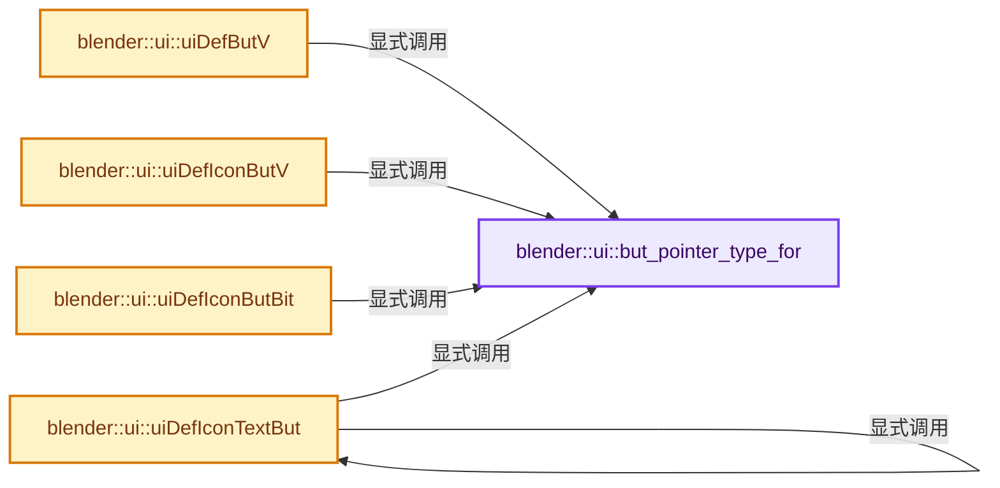

# 实现依赖专题：source/blender/editors/include/UI_interface_c.hh

[方向导航](README.md) · [符号索引](../%E7%AC%A6%E5%8F%B7%E4%BE%9D%E8%B5%96%E4%B8%8E%E5%AE%9E%E7%8E%B0%E7%B4%A2%E5%BC%95.md)

本专题从正文实际调用进入，集中保存共享实现。函数有稳定锚点，可从调用处直接跳到对应完整函数；递归与互相调用通过回链组织。

## 本文件的实现关系




## 相关类型布局与成员入口

<a id="t-abde657606f4"></a>

### `blender::MTex`

原始声明：[source/blender/editors/include/UI_interface_c.hh](../../../../../source/blender/editors/include/UI_interface_c.hh) · L46—L46。

以下保留类的数据声明与编译条件，成员函数实现通过后面的精确链接阅读。

<!-- annotated:173606041b37e3 -->

```cpp
struct MTex;
```

<details>
<summary>核对原始源码：source/blender/editors/include/UI_interface_c.hh · L46—L46</summary>

<!-- original:173606041b37e3:source/blender/editors/include/UI_interface_c.hh:46:46 -->

```cpp
struct MTex;
```

</details>


<a id="m-4958d35ca4c1"></a>

## 宏 `button_is_decorator`

<!-- annotated:4c0e2bb9ff2d0a -->

```cpp
#define button_is_decorator(but) ((but)->type == ButtonType::Decorator)

```

<details>
<summary>核对原始源码：source/blender/editors/include/UI_interface_c.hh · L895—L896</summary>

<!-- original:4c0e2bb9ff2d0a:source/blender/editors/include/UI_interface_c.hh:895:896 -->

```cpp
#define button_is_decorator(but) ((but)->type == ButtonType::Decorator)

```

</details>

宏在预处理阶段展开，参数替换、重复求值和条件编译应直接从该定义检查。与普通函数不同，宏不会自动提供参数类型检查；构建配置选择哪个定义需结合外围条件。

## 完整成员与函数实现

<a id="f-39e03d2980d98fa1"></a>

### `blender::ui::but_pointer_type_for`

实现位置：[source/blender/editors/include/UI_interface_c.hh](../../../../../source/blender/editors/include/UI_interface_c.hh) · L626—L638。

**教学注释版**

<!-- annotated:c6752ac1d1fd99 -->

```cpp
template<typename T> constexpr ButPointerType but_pointer_type_for()
{
  constexpr ButPointerType ptr_type = (std::is_same_v<T, float>) ?
                                          ButPointerType::Float :
                                      (std::is_integral_v<T> || std::is_enum_v<T>) ?
                                          (sizeof(T) == 1) ? ButPointerType::Char :
                                          (sizeof(T) == 2) ? ButPointerType::Short :
                                          (sizeof(T) == 4) ? ButPointerType::Int :
                                                             ButPointerType::None :
                                          ButPointerType::None;
  static_assert(ptr_type != ButPointerType::None, "Incompatible uiDefBut pointer type");
  return ptr_type;
}
```

<details>
<summary>核对原始源码：source/blender/editors/include/UI_interface_c.hh · L626—L638</summary>

<!-- original:c6752ac1d1fd99:source/blender/editors/include/UI_interface_c.hh:626:638 -->

```cpp
template<typename T> constexpr ButPointerType but_pointer_type_for()
{
  constexpr ButPointerType ptr_type = (std::is_same_v<T, float>) ?
                                          ButPointerType::Float :
                                      (std::is_integral_v<T> || std::is_enum_v<T>) ?
                                          (sizeof(T) == 1) ? ButPointerType::Char :
                                          (sizeof(T) == 2) ? ButPointerType::Short :
                                          (sizeof(T) == 4) ? ButPointerType::Int :
                                                             ButPointerType::None :
                                          ButPointerType::None;
  static_assert(ptr_type != ButPointerType::None, "Incompatible uiDefBut pointer type");
  return ptr_type;
}
```

</details>

**结果出口**

- `return ptr_type;`

**继续追踪实现**

本实现没有需要继续展开的显式调用；检查返回表达式、对象转换和调用者前置条件。

<a id="f-a01c44fd0562bd8e"></a>

### `blender::ui::uiDefButV`

实现位置：[source/blender/editors/include/UI_interface_c.hh](../../../../../source/blender/editors/include/UI_interface_c.hh) · L1340—L1355。

接口参数：

- `Block *block`
- `ButtonType type`
- `StringRef str`
- `int x`
- `int y`
- `short width`
- `short height`
- `T *poin`
- `float min`
- `float max`
- `std::optional<StringRef> tip`

**教学注释版**

<!-- annotated:b3cd9031c0e9ad -->

```cpp
template<typename T>
Button *uiDefButV(Block *block,
                  ButtonType type,
                  StringRef str,
                  int x,
                  int y,
                  short width,
                  short height,
                  T *poin,
                  float min,
                  float max,
                  std::optional<StringRef> tip)
{
  return uiDefBut(
      block, {type, but_pointer_type_for<T>()}, str, x, y, width, height, poin, min, max, tip);
}
```

<details>
<summary>核对原始源码：source/blender/editors/include/UI_interface_c.hh · L1340—L1355</summary>

<!-- original:b3cd9031c0e9ad:source/blender/editors/include/UI_interface_c.hh:1340:1355 -->

```cpp
template<typename T>
Button *uiDefButV(Block *block,
                  ButtonType type,
                  StringRef str,
                  int x,
                  int y,
                  short width,
                  short height,
                  T *poin,
                  float min,
                  float max,
                  std::optional<StringRef> tip)
{
  return uiDefBut(
      block, {type, but_pointer_type_for<T>()}, str, x, y, width, height, poin, min, max, tip);
}
```

</details>

**结果出口**

- `return uiDefBut(`

**继续追踪实现**

- `uiDefBut` → [blender::ui::uiDefBut · L5283](%E4%BE%9D%E8%B5%96-interface-11578b.md#f-48c75396a251b6a7)。
- `but_pointer_type_for<T>` → [blender::ui::but_pointer_type_for · L626](%E4%BE%9D%E8%B5%96-UI_interface_c-54f196.md#f-39e03d2980d98fa1)。

<a id="f-412f29eee5d4496a"></a>

### `blender::ui::uiDefIconButV`

实现位置：[source/blender/editors/include/UI_interface_c.hh](../../../../../source/blender/editors/include/UI_interface_c.hh) · L1459—L1474。

接口参数：

- `Block *block`
- `ButtonType type`
- `int icon`
- `int x`
- `int y`
- `short width`
- `short height`
- `T *poin`
- `float min`
- `float max`
- `std::optional<StringRef> tip`

**教学注释版**

<!-- annotated:99b3d1dc10c3bd -->

```cpp
template<typename T>
Button *uiDefIconButV(Block *block,
                      ButtonType type,
                      int icon,
                      int x,
                      int y,
                      short width,
                      short height,
                      T *poin,
                      float min,
                      float max,
                      std::optional<StringRef> tip)
{
  return uiDefIconBut(
      block, {type, but_pointer_type_for<T>()}, icon, x, y, width, height, poin, min, max, tip);
}
```

<details>
<summary>核对原始源码：source/blender/editors/include/UI_interface_c.hh · L1459—L1474</summary>

<!-- original:99b3d1dc10c3bd:source/blender/editors/include/UI_interface_c.hh:1459:1474 -->

```cpp
template<typename T>
Button *uiDefIconButV(Block *block,
                      ButtonType type,
                      int icon,
                      int x,
                      int y,
                      short width,
                      short height,
                      T *poin,
                      float min,
                      float max,
                      std::optional<StringRef> tip)
{
  return uiDefIconBut(
      block, {type, but_pointer_type_for<T>()}, icon, x, y, width, height, poin, min, max, tip);
}
```

</details>

**结果出口**

- `return uiDefIconBut(`

**继续追踪实现**

- `uiDefIconBut` → [blender::ui::uiDefIconBut · L5545](%E4%BE%9D%E8%B5%96-interface-11578b.md#f-e6df2a452ca14d24)。
- `but_pointer_type_for<T>` → [blender::ui::but_pointer_type_for · L626](%E4%BE%9D%E8%B5%96-UI_interface_c-54f196.md#f-39e03d2980d98fa1)。

<a id="f-82e79d87b55df1e8"></a>

### `blender::ui::uiDefIconButBit`

实现位置：[source/blender/editors/include/UI_interface_c.hh](../../../../../source/blender/editors/include/UI_interface_c.hh) · L1475—L1504。

接口参数：

- `Block *block`
- `ButtonType type`
- `int bit`
- `int icon`
- `int x`
- `int y`
- `short width`
- `short height`
- `T *poin`
- `float min`
- `float max`
- `std::optional<StringRef> tip`

**教学注释版**

<!-- annotated:721e014440f16d -->

```cpp
template<typename T>
Button *uiDefIconButBit(Block *block,
                        ButtonType type,
                        int bit,
                        int icon,
                        int x,
                        int y,
                        short width,
                        short height,
                        T *poin,
                        float min,
                        float max,
                        std::optional<StringRef> tip)
{
  const int bit_idx = std::has_single_bit(uint(bit)) ? std::countr_zero(uint(bit)) : -1;
  if (bit_idx == -1) {
    return nullptr;
  }
  return uiDefIconBut(block,
                      {type, but_pointer_type_for<T>() | ButPointerType::Bit, bit_idx},
                      icon,
                      x,
                      y,
                      width,
                      height,
                      poin,
                      min,
                      max,
                      tip);
}
```

<details>
<summary>核对原始源码：source/blender/editors/include/UI_interface_c.hh · L1475—L1504</summary>

<!-- original:721e014440f16d:source/blender/editors/include/UI_interface_c.hh:1475:1504 -->

```cpp
template<typename T>
Button *uiDefIconButBit(Block *block,
                        ButtonType type,
                        int bit,
                        int icon,
                        int x,
                        int y,
                        short width,
                        short height,
                        T *poin,
                        float min,
                        float max,
                        std::optional<StringRef> tip)
{
  const int bit_idx = std::has_single_bit(uint(bit)) ? std::countr_zero(uint(bit)) : -1;
  if (bit_idx == -1) {
    return nullptr;
  }
  return uiDefIconBut(block,
                      {type, but_pointer_type_for<T>() | ButPointerType::Bit, bit_idx},
                      icon,
                      x,
                      y,
                      width,
                      height,
                      poin,
                      min,
                      max,
                      tip);
}
```

</details>

**结果出口**

- `return nullptr;`
- `return uiDefIconBut(block,`

**继续追踪实现**

- `std::has_single_bit` → [外部契约](https://eel.is/c++draft/)：这个边界按实际表达式及所属类型核对参数、返回值、寿命与失败行为。这里提供接口入口，不声称已解释该第三方版本的内部实现。
- `std::countr_zero` → [外部契约](https://eel.is/c++draft/)：这个边界按实际表达式及所属类型核对参数、返回值、寿命与失败行为。这里提供接口入口，不声称已解释该第三方版本的内部实现。
- `uiDefIconBut` → [blender::ui::uiDefIconBut · L5545](%E4%BE%9D%E8%B5%96-interface-11578b.md#f-e6df2a452ca14d24)。
- `but_pointer_type_for<T>` → [blender::ui::but_pointer_type_for · L626](%E4%BE%9D%E8%B5%96-UI_interface_c-54f196.md#f-39e03d2980d98fa1)。

<a id="f-a6da6bbf7fe0d88f"></a>

### `blender::ui::uiDefIconTextBut`

实现位置：[source/blender/editors/include/UI_interface_c.hh](../../../../../source/blender/editors/include/UI_interface_c.hh) · L1576—L1590。

接口参数：

- `Block *block`
- `ButtonType type`
- `int icon`
- `StringRef str`
- `int x`
- `int y`
- `short width`
- `short height`
- `T *poin`
- `std::optional<StringRef> tip`

**教学注释版**

<!-- annotated:078ba568932e87 -->

```cpp
template<typename T>
Button *uiDefIconTextBut(Block *block,
                         ButtonType type,
                         int icon,
                         StringRef str,
                         int x,
                         int y,
                         short width,
                         short height,
                         T *poin,
                         std::optional<StringRef> tip)
{
  return uiDefIconTextBut(
      block, {type, but_pointer_type_for<T>()}, icon, str, x, y, width, height, poin, tip);
}
```

<details>
<summary>核对原始源码：source/blender/editors/include/UI_interface_c.hh · L1576—L1590</summary>

<!-- original:078ba568932e87:source/blender/editors/include/UI_interface_c.hh:1576:1590 -->

```cpp
template<typename T>
Button *uiDefIconTextBut(Block *block,
                         ButtonType type,
                         int icon,
                         StringRef str,
                         int x,
                         int y,
                         short width,
                         short height,
                         T *poin,
                         std::optional<StringRef> tip)
{
  return uiDefIconTextBut(
      block, {type, but_pointer_type_for<T>()}, icon, str, x, y, width, height, poin, tip);
}
```

</details>

**结果出口**

- `return uiDefIconTextBut(`

**继续追踪实现**

- `uiDefIconTextBut` → [blender::ui::uiDefIconTextBut · L1576](%E4%BE%9D%E8%B5%96-UI_interface_c-54f196.md#f-a6da6bbf7fe0d88f)。
- `but_pointer_type_for<T>` → [blender::ui::but_pointer_type_for · L626](%E4%BE%9D%E8%B5%96-UI_interface_c-54f196.md#f-39e03d2980d98fa1)。
