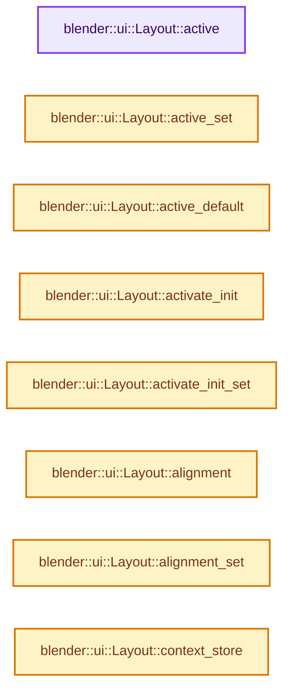
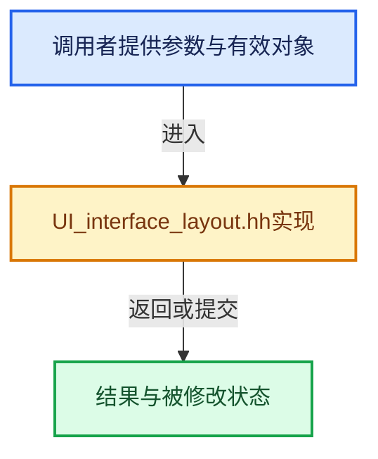

# 实现依赖专题：source/blender/editors/include/UI_interface_layout.hh

[方向导航](README.md) · [符号索引](../%E7%AC%A6%E5%8F%B7%E4%BE%9D%E8%B5%96%E4%B8%8E%E5%AE%9E%E7%8E%B0%E7%B4%A2%E5%BC%95.md)

本专题从正文实际调用进入，集中保存共享实现。函数有稳定锚点，可从调用处直接跳到对应完整函数；递归与互相调用通过回链组织。

## 本文件的实现关系






## 相关类型布局与成员入口

<a id="t-504aef6f2569"></a>

### `blender::wm::OpCallContext`

原始声明：[source/blender/editors/include/UI_interface_layout.hh](../../../../../source/blender/editors/include/UI_interface_layout.hh) · L40—L40。

以下保留类的数据声明与编译条件，成员函数实现通过后面的精确链接阅读。

<!-- annotated:832c876fef3fbd -->

```cpp
enum class OpCallContext : int8_t;
```

<details>
<summary>核对原始源码：source/blender/editors/include/UI_interface_layout.hh · L40—L40</summary>

<!-- original:832c876fef3fbd:source/blender/editors/include/UI_interface_layout.hh:40:40 -->

```cpp
enum class OpCallContext : int8_t;
```

</details>


## 完整成员与函数实现

<a id="f-f0f97c057891aae3"></a>

### `blender::ui::Layout::active`

实现位置：[source/blender/editors/include/UI_interface_layout.hh](../../../../../source/blender/editors/include/UI_interface_layout.hh) · L774—L777。

**教学注释版**

<!-- annotated:b8473a83c678cd -->

```cpp
inline bool Layout::active() const
{
  return active_;
}
```

<details>
<summary>核对原始源码：source/blender/editors/include/UI_interface_layout.hh · L774—L777</summary>

<!-- original:b8473a83c678cd:source/blender/editors/include/UI_interface_layout.hh:774:777 -->

```cpp
inline bool Layout::active() const
{
  return active_;
}
```

</details>

**结果出口**

- `return active_;`

**继续追踪实现**

本实现没有需要继续展开的显式调用；检查返回表达式、对象转换和调用者前置条件。

<a id="f-832c07a1949d07c0"></a>

### `blender::ui::Layout::active_set`

实现位置：[source/blender/editors/include/UI_interface_layout.hh](../../../../../source/blender/editors/include/UI_interface_layout.hh) · L778—L781。

接口参数：

- `bool active`

**教学注释版**

<!-- annotated:c213dc72aad714 -->

```cpp
inline void Layout::active_set(bool active)
{
  active_ = active;
}
```

<details>
<summary>核对原始源码：source/blender/editors/include/UI_interface_layout.hh · L778—L781</summary>

<!-- original:c213dc72aad714:source/blender/editors/include/UI_interface_layout.hh:778:781 -->

```cpp
inline void Layout::active_set(bool active)
{
  active_ = active;
}
```

</details>

**沿实际写入检查状态**

- `active_ = active;`

**继续追踪实现**

本实现没有需要继续展开的显式调用；检查返回表达式、对象转换和调用者前置条件。

<a id="f-c2e582226dcb1675"></a>

### `blender::ui::Layout::active_default`

实现位置：[source/blender/editors/include/UI_interface_layout.hh](../../../../../source/blender/editors/include/UI_interface_layout.hh) · L783—L786。

**教学注释版**

<!-- annotated:6839ba28bb57a8 -->

```cpp
inline bool Layout::active_default() const
{
  return active_default_;
}
```

<details>
<summary>核对原始源码：source/blender/editors/include/UI_interface_layout.hh · L783—L786</summary>

<!-- original:6839ba28bb57a8:source/blender/editors/include/UI_interface_layout.hh:783:786 -->

```cpp
inline bool Layout::active_default() const
{
  return active_default_;
}
```

</details>

**结果出口**

- `return active_default_;`

**继续追踪实现**

本实现没有需要继续展开的显式调用；检查返回表达式、对象转换和调用者前置条件。

<a id="f-34c679dd71f74913"></a>

### `blender::ui::Layout::activate_init`

实现位置：[source/blender/editors/include/UI_interface_layout.hh](../../../../../source/blender/editors/include/UI_interface_layout.hh) · L792—L795。

**教学注释版**

<!-- annotated:a42534144445d7 -->

```cpp
inline bool Layout::activate_init() const
{
  return activate_init_;
}
```

<details>
<summary>核对原始源码：source/blender/editors/include/UI_interface_layout.hh · L792—L795</summary>

<!-- original:a42534144445d7:source/blender/editors/include/UI_interface_layout.hh:792:795 -->

```cpp
inline bool Layout::activate_init() const
{
  return activate_init_;
}
```

</details>

**结果出口**

- `return activate_init_;`

**继续追踪实现**

本实现没有需要继续展开的显式调用；检查返回表达式、对象转换和调用者前置条件。

<a id="f-c1c0836268fd7e96"></a>

### `blender::ui::Layout::activate_init_set`

实现位置：[source/blender/editors/include/UI_interface_layout.hh](../../../../../source/blender/editors/include/UI_interface_layout.hh) · L796—L799。

接口参数：

- `bool activate_init`

**教学注释版**

<!-- annotated:e5a665362d55a1 -->

```cpp
inline void Layout::activate_init_set(bool activate_init)
{
  activate_init_ = activate_init;
}
```

<details>
<summary>核对原始源码：source/blender/editors/include/UI_interface_layout.hh · L796—L799</summary>

<!-- original:e5a665362d55a1:source/blender/editors/include/UI_interface_layout.hh:796:799 -->

```cpp
inline void Layout::activate_init_set(bool activate_init)
{
  activate_init_ = activate_init;
}
```

</details>

**沿实际写入检查状态**

- `activate_init_ = activate_init;`

**继续追踪实现**

本实现没有需要继续展开的显式调用；检查返回表达式、对象转换和调用者前置条件。

<a id="f-f41a0a1aeb21e92d"></a>

### `blender::ui::Layout::alignment`

实现位置：[source/blender/editors/include/UI_interface_layout.hh](../../../../../source/blender/editors/include/UI_interface_layout.hh) · L801—L804。

**教学注释版**

<!-- annotated:db3a13303b6de0 -->

```cpp
inline LayoutAlign Layout::alignment() const
{
  return alignment_;
}
```

<details>
<summary>核对原始源码：source/blender/editors/include/UI_interface_layout.hh · L801—L804</summary>

<!-- original:db3a13303b6de0:source/blender/editors/include/UI_interface_layout.hh:801:804 -->

```cpp
inline LayoutAlign Layout::alignment() const
{
  return alignment_;
}
```

</details>

**结果出口**

- `return alignment_;`

**继续追踪实现**

本实现没有需要继续展开的显式调用；检查返回表达式、对象转换和调用者前置条件。

<a id="f-37bd9cf9d18c4c17"></a>

### `blender::ui::Layout::alignment_set`

实现位置：[source/blender/editors/include/UI_interface_layout.hh](../../../../../source/blender/editors/include/UI_interface_layout.hh) · L806—L809。

接口参数：

- `LayoutAlign alignment`

**教学注释版**

<!-- annotated:c4d251da402111 -->

```cpp
inline void Layout::alignment_set(LayoutAlign alignment)
{
  alignment_ = alignment;
}
```

<details>
<summary>核对原始源码：source/blender/editors/include/UI_interface_layout.hh · L806—L809</summary>

<!-- original:c4d251da402111:source/blender/editors/include/UI_interface_layout.hh:806:809 -->

```cpp
inline void Layout::alignment_set(LayoutAlign alignment)
{
  alignment_ = alignment;
}
```

</details>

**沿实际写入检查状态**

- `alignment_ = alignment;`

**继续追踪实现**

本实现没有需要继续展开的显式调用；检查返回表达式、对象转换和调用者前置条件。

<a id="f-430647150eb37c84"></a>

### `blender::ui::Layout::context_store`

实现位置：[source/blender/editors/include/UI_interface_layout.hh](../../../../../source/blender/editors/include/UI_interface_layout.hh) · L811—L814。

**教学注释版**

<!-- annotated:efb46b5dc9611d -->

```cpp
inline bContextStore *Layout::context_store() const
{
  return context_;
}
```

<details>
<summary>核对原始源码：source/blender/editors/include/UI_interface_layout.hh · L811—L814</summary>

<!-- original:efb46b5dc9611d:source/blender/editors/include/UI_interface_layout.hh:811:814 -->

```cpp
inline bContextStore *Layout::context_store() const
{
  return context_;
}
```

</details>

**结果出口**

- `return context_;`

**继续追踪实现**

本实现没有需要继续展开的显式调用；检查返回表达式、对象转换和调用者前置条件。

<a id="f-c1e3cfcaa80623af"></a>

### `blender::ui::Layout::enabled`

实现位置：[source/blender/editors/include/UI_interface_layout.hh](../../../../../source/blender/editors/include/UI_interface_layout.hh) · L816—L819。

**教学注释版**

<!-- annotated:c8b688e27bcce2 -->

```cpp
inline bool Layout::enabled() const
{
  return enabled_;
}
```

<details>
<summary>核对原始源码：source/blender/editors/include/UI_interface_layout.hh · L816—L819</summary>

<!-- original:c8b688e27bcce2:source/blender/editors/include/UI_interface_layout.hh:816:819 -->

```cpp
inline bool Layout::enabled() const
{
  return enabled_;
}
```

</details>

**结果出口**

- `return enabled_;`

**继续追踪实现**

本实现没有需要继续展开的显式调用；检查返回表达式、对象转换和调用者前置条件。

<a id="f-26a620dac8af2301"></a>

### `blender::ui::Layout::enabled_set`

实现位置：[source/blender/editors/include/UI_interface_layout.hh](../../../../../source/blender/editors/include/UI_interface_layout.hh) · L820—L823。

接口参数：

- `bool enabled`

**教学注释版**

<!-- annotated:05784a404e9969 -->

```cpp
inline void Layout::enabled_set(bool enabled)
{
  enabled_ = enabled;
}
```

<details>
<summary>核对原始源码：source/blender/editors/include/UI_interface_layout.hh · L820—L823</summary>

<!-- original:05784a404e9969:source/blender/editors/include/UI_interface_layout.hh:820:823 -->

```cpp
inline void Layout::enabled_set(bool enabled)
{
  enabled_ = enabled;
}
```

</details>

**沿实际写入检查状态**

- `enabled_ = enabled;`

**继续追踪实现**

本实现没有需要继续展开的显式调用；检查返回表达式、对象转换和调用者前置条件。

<a id="f-f66a8ef04c913b50"></a>

### `blender::ui::Layout::red_alert`

实现位置：[source/blender/editors/include/UI_interface_layout.hh](../../../../../source/blender/editors/include/UI_interface_layout.hh) · L825—L828。

**教学注释版**

<!-- annotated:2e9b1a6656c4fe -->

```cpp
inline bool Layout::red_alert() const
{
  return redalert_;
}
```

<details>
<summary>核对原始源码：source/blender/editors/include/UI_interface_layout.hh · L825—L828</summary>

<!-- original:2e9b1a6656c4fe:source/blender/editors/include/UI_interface_layout.hh:825:828 -->

```cpp
inline bool Layout::red_alert() const
{
  return redalert_;
}
```

</details>

**结果出口**

- `return redalert_;`

**继续追踪实现**

本实现没有需要继续展开的显式调用；检查返回表达式、对象转换和调用者前置条件。

<a id="f-ac68f12cf1ee83da"></a>

### `blender::ui::Layout::scale_x`

实现位置：[source/blender/editors/include/UI_interface_layout.hh](../../../../../source/blender/editors/include/UI_interface_layout.hh) · L843—L846。

**教学注释版**

<!-- annotated:4a81f7b3a85610 -->

```cpp
inline float Layout::scale_x() const
{
  return scale_[0];
}
```

<details>
<summary>核对原始源码：source/blender/editors/include/UI_interface_layout.hh · L843—L846</summary>

<!-- original:4a81f7b3a85610:source/blender/editors/include/UI_interface_layout.hh:843:846 -->

```cpp
inline float Layout::scale_x() const
{
  return scale_[0];
}
```

</details>

**结果出口**

- `return scale_[0];`

**继续追踪实现**

本实现没有需要继续展开的显式调用；检查返回表达式、对象转换和调用者前置条件。

<a id="f-a120613ef2758fa8"></a>

### `blender::ui::Layout::scale_y`

实现位置：[source/blender/editors/include/UI_interface_layout.hh](../../../../../source/blender/editors/include/UI_interface_layout.hh) · L852—L855。

**教学注释版**

<!-- annotated:18944a53bd69f1 -->

```cpp
inline float Layout::scale_y() const
{
  return scale_[1];
}
```

<details>
<summary>核对原始源码：source/blender/editors/include/UI_interface_layout.hh · L852—L855</summary>

<!-- original:18944a53bd69f1:source/blender/editors/include/UI_interface_layout.hh:852:855 -->

```cpp
inline float Layout::scale_y() const
{
  return scale_[1];
}
```

</details>

**结果出口**

- `return scale_[1];`

**继续追踪实现**

本实现没有需要继续展开的显式调用；检查返回表达式、对象转换和调用者前置条件。

<a id="f-1f0ff0b8b7084296"></a>

### `blender::ui::Layout::ui_units_x`

实现位置：[source/blender/editors/include/UI_interface_layout.hh](../../../../../source/blender/editors/include/UI_interface_layout.hh) · L861—L864。

**教学注释版**

<!-- annotated:23fa106e52c702 -->

```cpp
inline float Layout::ui_units_x() const
{
  return units_[0];
}
```

<details>
<summary>核对原始源码：source/blender/editors/include/UI_interface_layout.hh · L861—L864</summary>

<!-- original:23fa106e52c702:source/blender/editors/include/UI_interface_layout.hh:861:864 -->

```cpp
inline float Layout::ui_units_x() const
{
  return units_[0];
}
```

</details>

**结果出口**

- `return units_[0];`

**继续追踪实现**

本实现没有需要继续展开的显式调用；检查返回表达式、对象转换和调用者前置条件。

<a id="f-6769b9beb2a4fbcd"></a>

### `blender::ui::Layout::ui_units_y`

实现位置：[source/blender/editors/include/UI_interface_layout.hh](../../../../../source/blender/editors/include/UI_interface_layout.hh) · L870—L873。

**教学注释版**

<!-- annotated:d002c3b7a8c37f -->

```cpp
inline float Layout::ui_units_y() const
{
  return units_[1];
}
```

<details>
<summary>核对原始源码：source/blender/editors/include/UI_interface_layout.hh · L870—L873</summary>

<!-- original:d002c3b7a8c37f:source/blender/editors/include/UI_interface_layout.hh:870:873 -->

```cpp
inline float Layout::ui_units_y() const
{
  return units_[1];
}
```

</details>

**结果出口**

- `return units_[1];`

**继续追踪实现**

本实现没有需要继续展开的显式调用；检查返回表达式、对象转换和调用者前置条件。

<a id="f-ba00deeb5b07d25d"></a>

### `blender::ui::Layout::width`

实现位置：[source/blender/editors/include/UI_interface_layout.hh](../../../../../source/blender/editors/include/UI_interface_layout.hh) · L879—L882。

**教学注释版**

<!-- annotated:a2d3a790dcbcd2 -->

```cpp
inline int Layout::width() const
{
  return this->w_;
}
```

<details>
<summary>核对原始源码：source/blender/editors/include/UI_interface_layout.hh · L879—L882</summary>

<!-- original:a2d3a790dcbcd2:source/blender/editors/include/UI_interface_layout.hh:879:882 -->

```cpp
inline int Layout::width() const
{
  return this->w_;
}
```

</details>

**结果出口**

- `return this->w_;`

**继续追踪实现**

本实现没有需要继续展开的显式调用；检查返回表达式、对象转换和调用者前置条件。
