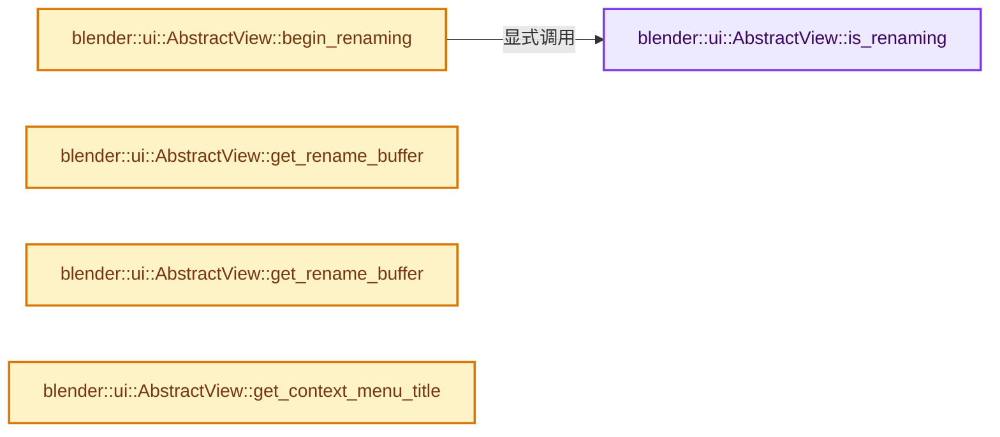
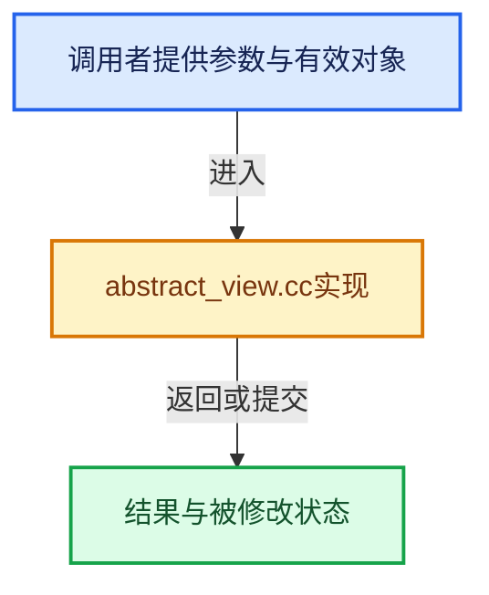

# 实现依赖专题：source/blender/editors/interface/views/abstract_view.cc

[方向导航](README.md) · [符号索引](../%E7%AC%A6%E5%8F%B7%E4%BE%9D%E8%B5%96%E4%B8%8E%E5%AE%9E%E7%8E%B0%E7%B4%A2%E5%BC%95.md)

本专题从正文实际调用进入，集中保存共享实现。函数有稳定锚点，可从调用处直接跳到对应完整函数；递归与互相调用通过回链组织。

## 本文件的实现关系






## 完整成员与函数实现

<a id="f-f095ef95126ca0c9"></a>

### `blender::ui::AbstractView::is_renaming`

实现位置：[source/blender/editors/interface/views/abstract_view.cc](../../../../../source/blender/editors/interface/views/abstract_view.cc) · L197—L200。

**教学注释版**

<!-- annotated:91a6d83a2d8ea2 -->

```cpp
bool AbstractView::is_renaming() const
{
  return rename_buffer_ != nullptr;
}
```

<details>
<summary>核对原始源码：source/blender/editors/interface/views/abstract_view.cc · L197—L200</summary>

<!-- original:91a6d83a2d8ea2:source/blender/editors/interface/views/abstract_view.cc:197:200 -->

```cpp
bool AbstractView::is_renaming() const
{
  return rename_buffer_ != nullptr;
}
```

</details>

**结果出口**

- `return rename_buffer_ != nullptr;`

**继续追踪实现**

本实现没有需要继续展开的显式调用；检查返回表达式、对象转换和调用者前置条件。

<a id="f-ca8a0248d9dfafe9"></a>

### `blender::ui::AbstractView::begin_renaming`

实现位置：[source/blender/editors/interface/views/abstract_view.cc](../../../../../source/blender/editors/interface/views/abstract_view.cc) · L202—L210。

**教学注释版**

<!-- annotated:4ceefacbc69924 -->

```cpp
bool AbstractView::begin_renaming()
{
  if (this->is_renaming()) {
    return false;
  }

  // [讲解] std::make_unique<decltype(rename_buffer_)::element_type>：创建独占拥有的对象，拥有关系可移动，get返回的借用指针不自动延长寿命。
  rename_buffer_ = std::make_unique<decltype(rename_buffer_)::element_type>();
  return true;
}
```

<details>
<summary>核对原始源码：source/blender/editors/interface/views/abstract_view.cc · L202—L210</summary>

<!-- original:4ceefacbc69924:source/blender/editors/interface/views/abstract_view.cc:202:210 -->

```cpp
bool AbstractView::begin_renaming()
{
  if (this->is_renaming()) {
    return false;
  }

  rename_buffer_ = std::make_unique<decltype(rename_buffer_)::element_type>();
  return true;
}
```

</details>

**沿实际写入检查状态**

- `rename_buffer_ = std::make_unique<decltype(rename_buffer_)::element_type>();`

**结果出口**

- `return false;`
- `return true;`

**继续追踪实现**

- `this->is_renaming` → [blender::ui::AbstractView::is_renaming · L197](%E4%BE%9D%E8%B5%96-abstract_view-b1199e.md#f-f095ef95126ca0c9)。
- `std::make_unique<decltype(rename_buffer_)::element_type>` → [外部契约](https://eel.is/c++draft/unique.ptr.create)：创建独占拥有的对象，拥有关系可移动，get返回的借用指针不自动延长寿命。

<a id="f-ce9d074f3e690cb8"></a>

### `blender::ui::AbstractView::get_rename_buffer`

实现位置：[source/blender/editors/interface/views/abstract_view.cc](../../../../../source/blender/editors/interface/views/abstract_view.cc) · L218—L221。

**教学注释版**

<!-- annotated:36447d68c7014d -->

```cpp
Span<char> AbstractView::get_rename_buffer() const
{
  return *rename_buffer_;
}
```

<details>
<summary>核对原始源码：source/blender/editors/interface/views/abstract_view.cc · L218—L221</summary>

<!-- original:36447d68c7014d:source/blender/editors/interface/views/abstract_view.cc:218:221 -->

```cpp
Span<char> AbstractView::get_rename_buffer() const
{
  return *rename_buffer_;
}
```

</details>

**结果出口**

- `return *rename_buffer_;`

**继续追踪实现**

本实现没有需要继续展开的显式调用；检查返回表达式、对象转换和调用者前置条件。

<a id="f-5575d455f00f5846"></a>

### `blender::ui::AbstractView::get_rename_buffer`

实现位置：[source/blender/editors/interface/views/abstract_view.cc](../../../../../source/blender/editors/interface/views/abstract_view.cc) · L222—L225。

**教学注释版**

<!-- annotated:24ba860c05d91a -->

```cpp
MutableSpan<char> AbstractView::get_rename_buffer()
{
  return *rename_buffer_;
}
```

<details>
<summary>核对原始源码：source/blender/editors/interface/views/abstract_view.cc · L222—L225</summary>

<!-- original:24ba860c05d91a:source/blender/editors/interface/views/abstract_view.cc:222:225 -->

```cpp
MutableSpan<char> AbstractView::get_rename_buffer()
{
  return *rename_buffer_;
}
```

</details>

**结果出口**

- `return *rename_buffer_;`

**继续追踪实现**

本实现没有需要继续展开的显式调用；检查返回表达式、对象转换和调用者前置条件。

<a id="f-523ebb5ec43ebf25"></a>

### `blender::ui::AbstractView::get_context_menu_title`

实现位置：[source/blender/editors/interface/views/abstract_view.cc](../../../../../source/blender/editors/interface/views/abstract_view.cc) · L232—L235。

**教学注释版**

<!-- annotated:3920aac1a898d1 -->

```cpp
std::string AbstractView::get_context_menu_title() const
{
  return context_menu_title;
}
```

<details>
<summary>核对原始源码：source/blender/editors/interface/views/abstract_view.cc · L232—L235</summary>

<!-- original:3920aac1a898d1:source/blender/editors/interface/views/abstract_view.cc:232:235 -->

```cpp
std::string AbstractView::get_context_menu_title() const
{
  return context_menu_title;
}
```

</details>

**结果出口**

- `return context_menu_title;`

**继续追踪实现**

本实现没有需要继续展开的显式调用；检查返回表达式、对象转换和调用者前置条件。
