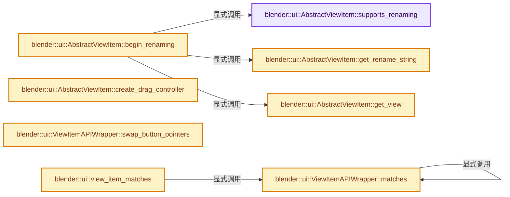

# 实现依赖专题：source/blender/editors/interface/views/abstract_view_item.cc

[方向导航](README.md) · [符号索引](../%E7%AC%A6%E5%8F%B7%E4%BE%9D%E8%B5%96%E4%B8%8E%E5%AE%9E%E7%8E%B0%E7%B4%A2%E5%BC%95.md)

本专题从正文实际调用进入，集中保存共享实现。函数有稳定锚点，可从调用处直接跳到对应完整函数；递归与互相调用通过回链组织。

## 本文件的实现关系




## 完整成员与函数实现

<a id="f-e355948717640bbb"></a>

### `blender::ui::AbstractViewItem::supports_renaming`

实现位置：[source/blender/editors/interface/views/abstract_view_item.cc](../../../../../source/blender/editors/interface/views/abstract_view_item.cc) · L147—L151。

**教学注释版**

<!-- annotated:e583c8ac726f21 -->

```cpp
bool AbstractViewItem::supports_renaming() const
{
  /* No renaming by default. */
  return false;
}
```

<details>
<summary>核对原始源码：source/blender/editors/interface/views/abstract_view_item.cc · L147—L151</summary>

<!-- original:e583c8ac726f21:source/blender/editors/interface/views/abstract_view_item.cc:147:151 -->

```cpp
bool AbstractViewItem::supports_renaming() const
{
  /* No renaming by default. */
  return false;
}
```

</details>

**结果出口**

- `return false;`

**继续追踪实现**

本实现没有需要继续展开的显式调用；检查返回表达式、对象转换和调用者前置条件。

<a id="f-40eb2f87d39e99a9"></a>

### `blender::ui::AbstractViewItem::get_rename_string`

实现位置：[source/blender/editors/interface/views/abstract_view_item.cc](../../../../../source/blender/editors/interface/views/abstract_view_item.cc) · L158—L162。

**教学注释版**

<!-- annotated:446d53c811a8d8 -->

```cpp
StringRef AbstractViewItem::get_rename_string() const
{
  /* No rename string by default. */
  return {};
}
```

<details>
<summary>核对原始源码：source/blender/editors/interface/views/abstract_view_item.cc · L158—L162</summary>

<!-- original:446d53c811a8d8:source/blender/editors/interface/views/abstract_view_item.cc:158:162 -->

```cpp
StringRef AbstractViewItem::get_rename_string() const
{
  /* No rename string by default. */
  return {};
}
```

</details>

**结果出口**

- `return {};`

**继续追踪实现**

本实现没有需要继续展开的显式调用；检查返回表达式、对象转换和调用者前置条件。

<a id="f-f6f488d33420aa5f"></a>

### `blender::ui::AbstractViewItem::begin_renaming`

实现位置：[source/blender/editors/interface/views/abstract_view_item.cc](../../../../../source/blender/editors/interface/views/abstract_view_item.cc) · L169—L182。

**教学注释版**

<!-- annotated:8b186329d49179 -->

```cpp
void AbstractViewItem::begin_renaming()
{
  AbstractView &view = this->get_view();
  if (view.is_renaming() || !supports_renaming()) {
    return;
  }

  if (view.begin_renaming()) {
    is_renaming_ = true;
  }

  StringRef initial_str = this->get_rename_string();
  std::copy(std::begin(initial_str), std::end(initial_str), std::begin(view.get_rename_buffer()));
}
```

<details>
<summary>核对原始源码：source/blender/editors/interface/views/abstract_view_item.cc · L169—L182</summary>

<!-- original:8b186329d49179:source/blender/editors/interface/views/abstract_view_item.cc:169:182 -->

```cpp
void AbstractViewItem::begin_renaming()
{
  AbstractView &view = this->get_view();
  if (view.is_renaming() || !supports_renaming()) {
    return;
  }

  if (view.begin_renaming()) {
    is_renaming_ = true;
  }

  StringRef initial_str = this->get_rename_string();
  std::copy(std::begin(initial_str), std::end(initial_str), std::begin(view.get_rename_buffer()));
}
```

</details>

**沿实际写入检查状态**

- `is_renaming_ = true;`

**继续追踪实现**

- `this->get_view` → [blender::ui::AbstractViewItem::get_view · L309](%E4%BE%9D%E8%B5%96-abstract_view_item-cb1cf2.md#f-36a19d6c21bd84b2)。
- `view.is_renaming` → [blender::ui::AbstractView::is_renaming · L197](%E4%BE%9D%E8%B5%96-abstract_view-b1199e.md#f-f095ef95126ca0c9)。
- `supports_renaming` → [blender::ui::AbstractViewItem::supports_renaming · L147](%E4%BE%9D%E8%B5%96-abstract_view_item-cb1cf2.md#f-e355948717640bbb)。
- `view.begin_renaming` → [blender::ui::AbstractView::begin_renaming · L202](%E4%BE%9D%E8%B5%96-abstract_view-b1199e.md#f-ca8a0248d9dfafe9)。
- `this->get_rename_string` → [blender::ui::AbstractViewItem::get_rename_string · L158](%E4%BE%9D%E8%B5%96-abstract_view_item-cb1cf2.md#f-40eb2f87d39e99a9)。
- `std::copy` → [外部契约](https://eel.is/c++draft/)：这个边界按实际表达式及所属类型核对参数、返回值、寿命与失败行为。这里提供接口入口，不声称已解释该第三方版本的内部实现。
- `std::begin` → [外部契约](https://eel.is/c++draft/)：这个边界按实际表达式及所属类型核对参数、返回值、寿命与失败行为。这里提供接口入口，不声称已解释该第三方版本的内部实现。
- `std::end` → [外部契约](https://eel.is/c++draft/)：这个边界按实际表达式及所属类型核对参数、返回值、寿命与失败行为。这里提供接口入口，不声称已解释该第三方版本的内部实现。
- `view.get_rename_buffer` → [blender::ui::AbstractView::get_rename_buffer · L218](%E4%BE%9D%E8%B5%96-abstract_view-b1199e.md#f-ce9d074f3e690cb8)；[blender::ui::AbstractView::get_rename_buffer · L222](%E4%BE%9D%E8%B5%96-abstract_view-b1199e.md#f-5575d455f00f5846)。同名重载需按实参类型选择。

<a id="f-50ebcd3e46ff54e4"></a>

### `blender::ui::AbstractViewItem::create_drag_controller`

实现位置：[source/blender/editors/interface/views/abstract_view_item.cc](../../../../../source/blender/editors/interface/views/abstract_view_item.cc) · L279—L283。

**教学注释版**

<!-- annotated:78d7bd966f1dda -->

```cpp
std::unique_ptr<AbstractViewItemDragController> AbstractViewItem::create_drag_controller() const
{
  /* There's no drag controller (and hence no drag support) by default. */
  return nullptr;
}
```

<details>
<summary>核对原始源码：source/blender/editors/interface/views/abstract_view_item.cc · L279—L283</summary>

<!-- original:78d7bd966f1dda:source/blender/editors/interface/views/abstract_view_item.cc:279:283 -->

```cpp
std::unique_ptr<AbstractViewItemDragController> AbstractViewItem::create_drag_controller() const
{
  /* There's no drag controller (and hence no drag support) by default. */
  return nullptr;
}
```

</details>

**结果出口**

- `return nullptr;`

**继续追踪实现**

本实现没有需要继续展开的显式调用；检查返回表达式、对象转换和调用者前置条件。

<a id="f-36a19d6c21bd84b2"></a>

### `blender::ui::AbstractViewItem::get_view`

实现位置：[source/blender/editors/interface/views/abstract_view_item.cc](../../../../../source/blender/editors/interface/views/abstract_view_item.cc) · L309—L316。

**教学注释版**

<!-- annotated:d6822cf9495caf -->

```cpp
AbstractView &AbstractViewItem::get_view() const
{
  if (!view_) [[unlikely]] {
    throw std::runtime_error(
        "Invalid state, item must be registered through AbstractView::register_item()");
  }
  return *view_;
}
```

<details>
<summary>核对原始源码：source/blender/editors/interface/views/abstract_view_item.cc · L309—L316</summary>

<!-- original:d6822cf9495caf:source/blender/editors/interface/views/abstract_view_item.cc:309:316 -->

```cpp
AbstractView &AbstractViewItem::get_view() const
{
  if (!view_) [[unlikely]] {
    throw std::runtime_error(
        "Invalid state, item must be registered through AbstractView::register_item()");
  }
  return *view_;
}
```

</details>

**结果出口**

- `return *view_;`

**继续追踪实现**

- `std::runtime_error` → [外部契约](https://eel.is/c++draft/)：这个边界按实际表达式及所属类型核对参数、返回值、寿命与失败行为。这里提供接口入口，不声称已解释该第三方版本的内部实现。

<a id="f-767a873a4d624999"></a>

### `blender::ui::ViewItemAPIWrapper::matches`

实现位置：[source/blender/editors/interface/views/abstract_view_item.cc](../../../../../source/blender/editors/interface/views/abstract_view_item.cc) · L396—L403。

接口参数：

- `const AbstractViewItem &a`
- `const AbstractViewItem &b`

**教学注释版**

<!-- annotated:326b83f60af49e -->

```cpp
  static bool matches(const AbstractViewItem &a, const AbstractViewItem &b)
  {
    if (typeid(a) != typeid(b)) {
      return false;
    }
    /* TODO should match the view as well. */
    return a.matches(b);
  }
```

<details>
<summary>核对原始源码：source/blender/editors/interface/views/abstract_view_item.cc · L396—L403</summary>

<!-- original:326b83f60af49e:source/blender/editors/interface/views/abstract_view_item.cc:396:403 -->

```cpp
  static bool matches(const AbstractViewItem &a, const AbstractViewItem &b)
  {
    if (typeid(a) != typeid(b)) {
      return false;
    }
    /* TODO should match the view as well. */
    return a.matches(b);
  }
```

</details>

**结果出口**

- `return false;`
- `return a.matches(b);`

**继续追踪实现**

- `typeid` → [调用协议](../%E6%A8%A1%E6%9D%BF%E5%AE%8F%E4%B8%8E%E5%8A%A8%E6%80%81%E5%88%86%E6%B4%BE%E5%8D%8F%E8%AE%AE.md)：函数指针、局部可调用对象或未展开的宏；必须结合调用者环境。调用位置L398。
- `a.matches` → [blender::ui::ViewItemAPIWrapper::matches · L396](%E4%BE%9D%E8%B5%96-abstract_view_item-cb1cf2.md#f-767a873a4d624999)。

<a id="f-007585a516ee7b56"></a>

### `blender::ui::ViewItemAPIWrapper::swap_button_pointers`

实现位置：[source/blender/editors/interface/views/abstract_view_item.cc](../../../../../source/blender/editors/interface/views/abstract_view_item.cc) · L405—L408。

接口参数：

- `AbstractViewItem &a`
- `AbstractViewItem &b`

**教学注释版**

<!-- annotated:ab1a037388625a -->

```cpp
  static void swap_button_pointers(AbstractViewItem &a, AbstractViewItem &b)
  {
    std::swap(a.view_item_but_, b.view_item_but_);
  }
```

<details>
<summary>核对原始源码：source/blender/editors/interface/views/abstract_view_item.cc · L405—L408</summary>

<!-- original:ab1a037388625a:source/blender/editors/interface/views/abstract_view_item.cc:405:408 -->

```cpp
  static void swap_button_pointers(AbstractViewItem &a, AbstractViewItem &b)
  {
    std::swap(a.view_item_but_, b.view_item_but_);
  }
```

</details>

**继续追踪实现**

- `std::swap` → [外部契约](https://eel.is/c++draft/)：这个边界按实际表达式及所属类型核对参数、返回值、寿命与失败行为。这里提供接口入口，不声称已解释该第三方版本的内部实现。

<a id="f-0ffde7c53134a8a1"></a>

### `blender::ui::view_item_matches`

实现位置：[source/blender/editors/interface/views/abstract_view_item.cc](../../../../../source/blender/editors/interface/views/abstract_view_item.cc) · L411—L414。

接口参数：

- `const AbstractViewItem &a`
- `const AbstractViewItem &b`

**教学注释版**

<!-- annotated:e5537ea5254f71 -->

```cpp
bool view_item_matches(const AbstractViewItem &a, const AbstractViewItem &b)
{
  return ViewItemAPIWrapper::matches(a, b);
}
```

<details>
<summary>核对原始源码：source/blender/editors/interface/views/abstract_view_item.cc · L411—L414</summary>

<!-- original:e5537ea5254f71:source/blender/editors/interface/views/abstract_view_item.cc:411:414 -->

```cpp
bool view_item_matches(const AbstractViewItem &a, const AbstractViewItem &b)
{
  return ViewItemAPIWrapper::matches(a, b);
}
```

</details>

**结果出口**

- `return ViewItemAPIWrapper::matches(a, b);`

**继续追踪实现**

- `ViewItemAPIWrapper::matches` → [blender::ui::ViewItemAPIWrapper::matches · L396](%E4%BE%9D%E8%B5%96-abstract_view_item-cb1cf2.md#f-767a873a4d624999)。

<a id="f-f7e9938896678bc3"></a>

### `blender::ui::view_item_swap_button_pointers`

实现位置：[source/blender/editors/interface/views/abstract_view_item.cc](../../../../../source/blender/editors/interface/views/abstract_view_item.cc) · L416—L419。

接口参数：

- `AbstractViewItem &a`
- `AbstractViewItem &b`

**教学注释版**

<!-- annotated:4b3ea4cc18a422 -->

```cpp
void view_item_swap_button_pointers(AbstractViewItem &a, AbstractViewItem &b)
{
  ViewItemAPIWrapper::swap_button_pointers(a, b);
}
```

<details>
<summary>核对原始源码：source/blender/editors/interface/views/abstract_view_item.cc · L416—L419</summary>

<!-- original:4b3ea4cc18a422:source/blender/editors/interface/views/abstract_view_item.cc:416:419 -->

```cpp
void view_item_swap_button_pointers(AbstractViewItem &a, AbstractViewItem &b)
{
  ViewItemAPIWrapper::swap_button_pointers(a, b);
}
```

</details>

**继续追踪实现**

- `ViewItemAPIWrapper::swap_button_pointers` → [blender::ui::ViewItemAPIWrapper::swap_button_pointers · L405](%E4%BE%9D%E8%B5%96-abstract_view_item-cb1cf2.md#f-007585a516ee7b56)。

<a id="f-00f7a1b612bcb1f4"></a>

### `blender::ui::view_item_can_rename`

实现位置：[source/blender/editors/interface/views/abstract_view_item.cc](../../../../../source/blender/editors/interface/views/abstract_view_item.cc) · L421—L425。

接口参数：

- `const AbstractViewItem &item`

**教学注释版**

<!-- annotated:f4d1cb1090e46e -->

```cpp
bool view_item_can_rename(const AbstractViewItem &item)
{
  const AbstractView &view = item.get_view();
  return !view.is_renaming() && item.supports_renaming();
}
```

<details>
<summary>核对原始源码：source/blender/editors/interface/views/abstract_view_item.cc · L421—L425</summary>

<!-- original:f4d1cb1090e46e:source/blender/editors/interface/views/abstract_view_item.cc:421:425 -->

```cpp
bool view_item_can_rename(const AbstractViewItem &item)
{
  const AbstractView &view = item.get_view();
  return !view.is_renaming() && item.supports_renaming();
}
```

</details>

**结果出口**

- `return !view.is_renaming() && item.supports_renaming();`

**继续追踪实现**

- `item.get_view` → [blender::ui::AbstractViewItem::get_view · L309](%E4%BE%9D%E8%B5%96-abstract_view_item-cb1cf2.md#f-36a19d6c21bd84b2)。
- `view.is_renaming` → [blender::ui::AbstractView::is_renaming · L197](%E4%BE%9D%E8%B5%96-abstract_view-b1199e.md#f-f095ef95126ca0c9)。
- `item.supports_renaming` → [blender::ui::AbstractViewItem::supports_renaming · L147](%E4%BE%9D%E8%B5%96-abstract_view_item-cb1cf2.md#f-e355948717640bbb)。

<a id="f-da4e031ebbf16d5d"></a>

### `blender::ui::view_item_begin_rename`

实现位置：[source/blender/editors/interface/views/abstract_view_item.cc](../../../../../source/blender/editors/interface/views/abstract_view_item.cc) · L427—L430。

接口参数：

- `AbstractViewItem &item`

**教学注释版**

<!-- annotated:614dd5b9db31ff -->

```cpp
void view_item_begin_rename(AbstractViewItem &item)
{
  item.begin_renaming();
}
```

<details>
<summary>核对原始源码：source/blender/editors/interface/views/abstract_view_item.cc · L427—L430</summary>

<!-- original:614dd5b9db31ff:source/blender/editors/interface/views/abstract_view_item.cc:427:430 -->

```cpp
void view_item_begin_rename(AbstractViewItem &item)
{
  item.begin_renaming();
}
```

</details>

**继续追踪实现**

- `item.begin_renaming` → [blender::ui::AbstractViewItem::begin_renaming · L169](%E4%BE%9D%E8%B5%96-abstract_view_item-cb1cf2.md#f-f6f488d33420aa5f)。

<a id="f-ef5b780132cdf5c6"></a>

### `blender::ui::view_item_supports_drag`

实现位置：[source/blender/editors/interface/views/abstract_view_item.cc](../../../../../source/blender/editors/interface/views/abstract_view_item.cc) · L432—L435。

接口参数：

- `const AbstractViewItem &item`

**教学注释版**

<!-- annotated:2a5c71b19a7fc7 -->

```cpp
bool view_item_supports_drag(const AbstractViewItem &item)
{
  return item.create_drag_controller() != nullptr;
}
```

<details>
<summary>核对原始源码：source/blender/editors/interface/views/abstract_view_item.cc · L432—L435</summary>

<!-- original:2a5c71b19a7fc7:source/blender/editors/interface/views/abstract_view_item.cc:432:435 -->

```cpp
bool view_item_supports_drag(const AbstractViewItem &item)
{
  return item.create_drag_controller() != nullptr;
}
```

</details>

**结果出口**

- `return item.create_drag_controller() != nullptr;`

**继续追踪实现**

- `item.create_drag_controller` → [blender::ui::AbstractViewItem::create_drag_controller · L279](%E4%BE%9D%E8%B5%96-abstract_view_item-cb1cf2.md#f-50ebcd3e46ff54e4)。

<a id="f-dad46026c4eaf96c"></a>

### `blender::ui::view_item_popup_keep_open`

实现位置：[source/blender/editors/interface/views/abstract_view_item.cc](../../../../../source/blender/editors/interface/views/abstract_view_item.cc) · L437—L440。

接口参数：

- `const AbstractViewItem &item`

**教学注释版**

<!-- annotated:b47f5dff75393b -->

```cpp
bool view_item_popup_keep_open(const AbstractViewItem &item)
{
  return item.get_view().get_popup_keep_open();
}
```

<details>
<summary>核对原始源码：source/blender/editors/interface/views/abstract_view_item.cc · L437—L440</summary>

<!-- original:b47f5dff75393b:source/blender/editors/interface/views/abstract_view_item.cc:437:440 -->

```cpp
bool view_item_popup_keep_open(const AbstractViewItem &item)
{
  return item.get_view().get_popup_keep_open();
}
```

</details>

**结果出口**

- `return item.get_view().get_popup_keep_open();`

**继续追踪实现**

- `item.get_view().get_popup_keep_open` → [调用协议](../%E6%A8%A1%E6%9D%BF%E5%AE%8F%E4%B8%8E%E5%8A%A8%E6%80%81%E5%88%86%E6%B4%BE%E5%8D%8F%E8%AE%AE.md)：接收对象类型依赖auto、返回值或模板实例；不按同名猜测目标。调用位置L439。
- `item.get_view` → [blender::ui::AbstractViewItem::get_view · L309](%E4%BE%9D%E8%B5%96-abstract_view_item-cb1cf2.md#f-36a19d6c21bd84b2)。

<a id="f-20fb2bcf06668caf"></a>

### `blender::ui::view_item_drag_start`

实现位置：[source/blender/editors/interface/views/abstract_view_item.cc](../../../../../source/blender/editors/interface/views/abstract_view_item.cc) · L442—L457。

接口参数：

- `bContext &C`
- `AbstractViewItem &item`

**教学注释版**

<!-- annotated:8eeb575122769b -->

```cpp
bool view_item_drag_start(bContext &C, AbstractViewItem &item)
{
  const std::unique_ptr<AbstractViewItemDragController> drag_controller =
      item.create_drag_controller();
  if (!drag_controller) {
    return false;
  }

  if (const std::optional<eWM_DragDataType> drag_type = drag_controller->get_drag_type()) {
    WM_event_start_drag(
        &C, ICON_NONE, *drag_type, drag_controller->create_drag_data(), WM_DRAG_FREE_DATA);
  }
  drag_controller->on_drag_start(C, item);

  return true;
}
```

<details>
<summary>核对原始源码：source/blender/editors/interface/views/abstract_view_item.cc · L442—L457</summary>

<!-- original:8eeb575122769b:source/blender/editors/interface/views/abstract_view_item.cc:442:457 -->

```cpp
bool view_item_drag_start(bContext &C, AbstractViewItem &item)
{
  const std::unique_ptr<AbstractViewItemDragController> drag_controller =
      item.create_drag_controller();
  if (!drag_controller) {
    return false;
  }

  if (const std::optional<eWM_DragDataType> drag_type = drag_controller->get_drag_type()) {
    WM_event_start_drag(
        &C, ICON_NONE, *drag_type, drag_controller->create_drag_data(), WM_DRAG_FREE_DATA);
  }
  drag_controller->on_drag_start(C, item);

  return true;
}
```

</details>

**结果出口**

- `return false;`
- `return true;`

**继续追踪实现**

- `item.create_drag_controller` → [blender::ui::AbstractViewItem::create_drag_controller · L279](%E4%BE%9D%E8%B5%96-abstract_view_item-cb1cf2.md#f-50ebcd3e46ff54e4)。
- `drag_controller->get_drag_type` → [外部契约](https://eel.is/c++draft/)：这个边界按实际表达式及所属类型核对参数、返回值、寿命与失败行为。这里提供接口入口，不声称已解释该第三方版本的内部实现。
- `WM_event_start_drag` → [blender::WM_event_start_drag · L355](%E4%BE%9D%E8%B5%96-wm_dragdrop-8d9d4e.md#f-1cc22b3125da160c)。
- `drag_controller->create_drag_data` → [外部契约](https://eel.is/c++draft/)：这个边界按实际表达式及所属类型核对参数、返回值、寿命与失败行为。这里提供接口入口，不声称已解释该第三方版本的内部实现。
- `drag_controller->on_drag_start` → [外部契约](https://eel.is/c++draft/)：这个边界按实际表达式及所属类型核对参数、返回值、寿命与失败行为。这里提供接口入口，不声称已解释该第三方版本的内部实现。
