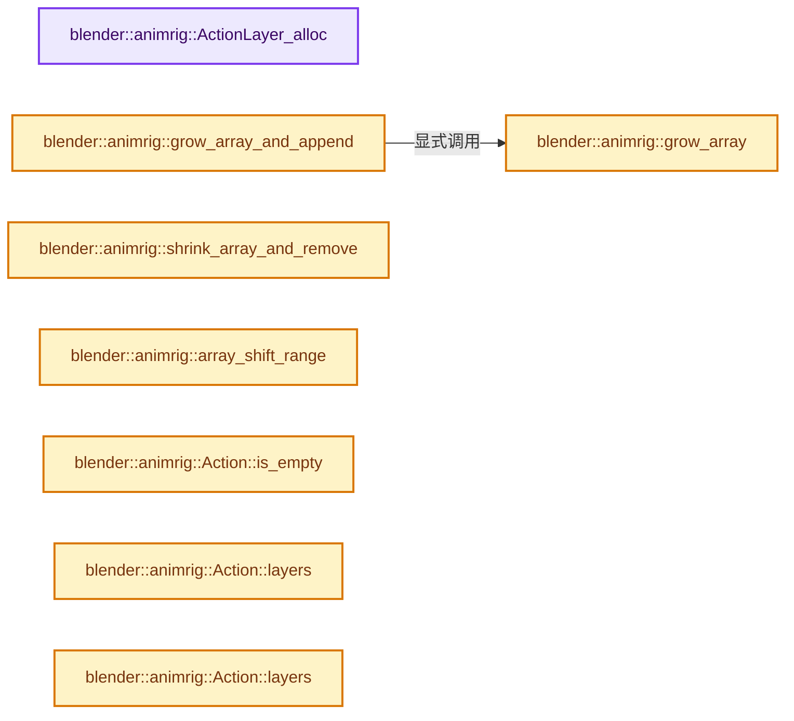
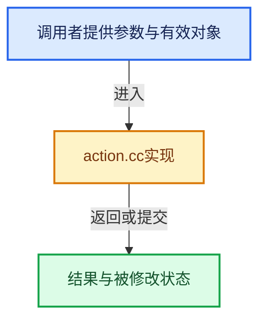

# 实现依赖专题：source/blender/animrig/intern/action.cc

[方向导航](README.md) · [符号索引](../%E7%AC%A6%E5%8F%B7%E4%BE%9D%E8%B5%96%E4%B8%8E%E5%AE%9E%E7%8E%B0%E7%B4%A2%E5%BC%95.md)

本专题从正文实际调用进入，集中保存共享实现。函数有稳定锚点，可从调用处直接跳到对应完整函数；递归与互相调用通过回链组织。

## 本文件的实现关系






## 完整成员与函数实现

<a id="f-f3d8c3525ad2307f"></a>

### `blender::animrig::ActionLayer_alloc`

实现位置：[source/blender/animrig/intern/action.cc](../../../../../source/blender/animrig/intern/action.cc) · L80—L84。

**教学注释版**

<!-- annotated:3ce6b1c2ff7017 -->

```cpp
static animrig::Layer &ActionLayer_alloc()
{
  ActionLayer *layer = MEM_new<ActionLayer>(__func__);
  return layer->wrap();
}
```

<details>
<summary>核对原始源码：source/blender/animrig/intern/action.cc · L80—L84</summary>

<!-- original:3ce6b1c2ff7017:source/blender/animrig/intern/action.cc:80:84 -->

```cpp
static animrig::Layer &ActionLayer_alloc()
{
  ActionLayer *layer = MEM_new<ActionLayer>(__func__);
  return layer->wrap();
}
```

</details>

**结果出口**

- `return layer->wrap();`

**继续追踪实现**

- `MEM_new<ActionLayer>` → [MEM_new · L351](../03-%E5%86%85%E5%AD%98%E5%88%86%E9%85%8D%E4%B8%8E%E8%BF%90%E8%A1%8C%E6%97%B6%E7%B1%BB%E5%9E%8B/%E4%BE%9D%E8%B5%96-MEM_guardedalloc-b54eca.md#f-115f9b6784f89912)。
- `layer->wrap` → [blender::ActionLayer::wrap · L1938](%E4%BE%9D%E8%B5%96-ANIM_action-8e402f.md#f-29caef4c2f0f968e)；[blender::ActionLayer::wrap · L1942](%E4%BE%9D%E8%B5%96-ANIM_action-8e402f.md#f-c2a34899dde2a503)。同名重载需按实参类型选择。

<a id="f-7a302650f7335fc1"></a>

### `blender::animrig::grow_array`

实现位置：[source/blender/animrig/intern/action.cc](../../../../../source/blender/animrig/intern/action.cc) · L88—L99。

接口参数：

- `T **array`
- `int *num`
- `const int add_num`

**教学注释版**

<!-- annotated:58000d107d8911 -->

```cpp
template<typename T> static void grow_array(T **array, int *num, const int add_num)
{
  BLI_assert(add_num > 0);
  const int new_array_num = *num + add_num;
  T *new_array = MEM_new_array_zeroed<T>(new_array_num, "animrig::action/grow_array");

  // [讲解] uninitialized_relocate_n：在目标原始存储建立对象，再结束源对象寿命。
  uninitialized_relocate_n(*array, *num, new_array);
  MEM_SAFE_DELETE(*array);

  *array = new_array;
  *num = new_array_num;
}
```

<details>
<summary>核对原始源码：source/blender/animrig/intern/action.cc · L88—L99</summary>

<!-- original:58000d107d8911:source/blender/animrig/intern/action.cc:88:99 -->

```cpp
template<typename T> static void grow_array(T **array, int *num, const int add_num)
{
  BLI_assert(add_num > 0);
  const int new_array_num = *num + add_num;
  T *new_array = MEM_new_array_zeroed<T>(new_array_num, "animrig::action/grow_array");

  uninitialized_relocate_n(*array, *num, new_array);
  MEM_SAFE_DELETE(*array);

  *array = new_array;
  *num = new_array_num;
}
```

</details>

**继续追踪实现**

- `BLI_assert` → [BLI_assert · L48](../01-%E5%9F%BA%E7%A1%80%E5%AE%B9%E5%99%A8%E4%B8%8E%E7%8E%B0%E4%BB%A3CPP/%E4%BE%9D%E8%B5%96-BLI_assert-cc98e8.md#m-57a88495704d)；[BLI_assert · L63](../01-%E5%9F%BA%E7%A1%80%E5%AE%B9%E5%99%A8%E4%B8%8E%E7%8E%B0%E4%BB%A3CPP/%E4%BE%9D%E8%B5%96-BLI_assert-cc98e8.md#m-d07050020cb5)。宏定义由构建条件选择。
- `MEM_new_array_zeroed<T>` → [MEM_new_array_zeroed · L566](../03-%E5%86%85%E5%AD%98%E5%88%86%E9%85%8D%E4%B8%8E%E8%BF%90%E8%A1%8C%E6%97%B6%E7%B1%BB%E5%9E%8B/%E4%BE%9D%E8%B5%96-MEM_guardedalloc-b54eca.md#f-3a0cf63fb5216500)；[MEM_new_array_zeroed · L119](../03-%E5%86%85%E5%AD%98%E5%88%86%E9%85%8D%E4%B8%8E%E8%BF%90%E8%A1%8C%E6%97%B6%E7%B1%BB%E5%9E%8B/%E4%BE%9D%E8%B5%96-mallocn-afdcd4.md#f-6825557da566fdbe)。同名重载需按实参类型选择。
- `uninitialized_relocate_n` → [blender::uninitialized_relocate_n · L80](../01-%E5%9F%BA%E7%A1%80%E5%AE%B9%E5%99%A8%E4%B8%8E%E7%8E%B0%E4%BB%A3CPP/01-%E5%AF%B9%E8%B1%A1%E7%94%9F%E5%91%BD%E5%91%A8%E6%9C%9F%E4%B8%8E%E5%80%BC%E7%B1%BB%E5%88%AB.md#f-9de0365b9a47fd68)。
- `MEM_SAFE_DELETE` → [MEM_SAFE_DELETE · L436](../03-%E5%86%85%E5%AD%98%E5%88%86%E9%85%8D%E4%B8%8E%E8%BF%90%E8%A1%8C%E6%97%B6%E7%B1%BB%E5%9E%8B/%E4%BE%9D%E8%B5%96-MEM_guardedalloc-b54eca.md#m-eadb3bc5b902)。宏定义由构建条件选择。

<a id="f-60e9a43b8ed85c47"></a>

### `blender::animrig::grow_array_and_append`

实现位置：[source/blender/animrig/intern/action.cc](../../../../../source/blender/animrig/intern/action.cc) · L101—L105。

接口参数：

- `T **array`
- `int *num`
- `T item`

**教学注释版**

<!-- annotated:de2d51bdd6003a -->

```cpp
template<typename T> static void grow_array_and_append(T **array, int *num, T item)
{
  grow_array(array, num, 1);
  (*array)[*num - 1] = item;
}
```

<details>
<summary>核对原始源码：source/blender/animrig/intern/action.cc · L101—L105</summary>

<!-- original:de2d51bdd6003a:source/blender/animrig/intern/action.cc:101:105 -->

```cpp
template<typename T> static void grow_array_and_append(T **array, int *num, T item)
{
  grow_array(array, num, 1);
  (*array)[*num - 1] = item;
}
```

</details>

**继续追踪实现**

- `grow_array` → [blender::animrig::grow_array · L88](%E4%BE%9D%E8%B5%96-action-a70714.md#f-7a302650f7335fc1)。

<a id="f-a2e55dbe7e1529ca"></a>

### `blender::animrig::shrink_array_and_remove`

实现位置：[source/blender/animrig/intern/action.cc](../../../../../source/blender/animrig/intern/action.cc) · L144—L156。

接口参数：

- `T **array`
- `int *num`
- `const int index`

**教学注释版**

<!-- annotated:ce2b3494b53c51 -->

```cpp
template<typename T> static void shrink_array_and_remove(T **array, int *num, const int index)
{
  BLI_assert(index >= 0 && index < *num);
  const int new_array_num = *num - 1;
  T *new_array = MEM_new_array_zeroed<T>(new_array_num, __func__);

  // [讲解] uninitialized_move_n：通过移动迭代器驱动标准未初始化复制算法，实现目标移动构造。
  uninitialized_move_n(*array, index, new_array);
  uninitialized_move_n(*array + index + 1, *num - index - 1, new_array + index);
  MEM_delete(*array);

  *array = new_array;
  *num = new_array_num;
}
```

<details>
<summary>核对原始源码：source/blender/animrig/intern/action.cc · L144—L156</summary>

<!-- original:ce2b3494b53c51:source/blender/animrig/intern/action.cc:144:156 -->

```cpp
template<typename T> static void shrink_array_and_remove(T **array, int *num, const int index)
{
  BLI_assert(index >= 0 && index < *num);
  const int new_array_num = *num - 1;
  T *new_array = MEM_new_array_zeroed<T>(new_array_num, __func__);

  uninitialized_move_n(*array, index, new_array);
  uninitialized_move_n(*array + index + 1, *num - index - 1, new_array + index);
  MEM_delete(*array);

  *array = new_array;
  *num = new_array_num;
}
```

</details>

**继续追踪实现**

- `BLI_assert` → [BLI_assert · L48](../01-%E5%9F%BA%E7%A1%80%E5%AE%B9%E5%99%A8%E4%B8%8E%E7%8E%B0%E4%BB%A3CPP/%E4%BE%9D%E8%B5%96-BLI_assert-cc98e8.md#m-57a88495704d)；[BLI_assert · L63](../01-%E5%9F%BA%E7%A1%80%E5%AE%B9%E5%99%A8%E4%B8%8E%E7%8E%B0%E4%BB%A3CPP/%E4%BE%9D%E8%B5%96-BLI_assert-cc98e8.md#m-d07050020cb5)。宏定义由构建条件选择。
- `MEM_new_array_zeroed<T>` → [MEM_new_array_zeroed · L566](../03-%E5%86%85%E5%AD%98%E5%88%86%E9%85%8D%E4%B8%8E%E8%BF%90%E8%A1%8C%E6%97%B6%E7%B1%BB%E5%9E%8B/%E4%BE%9D%E8%B5%96-MEM_guardedalloc-b54eca.md#f-3a0cf63fb5216500)；[MEM_new_array_zeroed · L119](../03-%E5%86%85%E5%AD%98%E5%88%86%E9%85%8D%E4%B8%8E%E8%BF%90%E8%A1%8C%E6%97%B6%E7%B1%BB%E5%9E%8B/%E4%BE%9D%E8%B5%96-mallocn-afdcd4.md#f-6825557da566fdbe)。同名重载需按实参类型选择。
- `uninitialized_move_n` → [blender::uninitialized_move_n · L69](../01-%E5%9F%BA%E7%A1%80%E5%AE%B9%E5%99%A8%E4%B8%8E%E7%8E%B0%E4%BB%A3CPP/01-%E5%AF%B9%E8%B1%A1%E7%94%9F%E5%91%BD%E5%91%A8%E6%9C%9F%E4%B8%8E%E5%80%BC%E7%B1%BB%E5%88%AB.md#f-fc5f51bf717c3b5a)。
- `MEM_delete` → [MEM_delete · L400](../03-%E5%86%85%E5%AD%98%E5%88%86%E9%85%8D%E4%B8%8E%E8%BF%90%E8%A1%8C%E6%97%B6%E7%B1%BB%E5%9E%8B/%E4%BE%9D%E8%B5%96-MEM_guardedalloc-b54eca.md#f-9049ffdd1682887c)。

<a id="f-b52c2434aab90ad2"></a>

### `blender::animrig::array_shift_range`

实现位置：[source/blender/animrig/intern/action.cc](../../../../../source/blender/animrig/intern/action.cc) · L189—L214。

接口参数：

- `T *array`
- `const int num`
- `const int range_start`
- `const int range_end`
- `const int to`

**教学注释版**

<!-- annotated:cf3f75206d4f89 -->

```cpp
template<typename T>
static void array_shift_range(
    T *array, const int num, const int range_start, const int range_end, const int to)
{
  BLI_assert(range_start <= range_end);
  BLI_assert(range_end <= num);
  BLI_assert(to <= num + range_start - range_end);
  UNUSED_VARS_NDEBUG(num);

  if (ELEM(range_start, range_end, to)) {
    return;
  }

  if (to < range_start) {
    T *start = array + to;
    T *mid = array + range_start;
    T *end = array + range_end;
    std::rotate(start, mid, end);
  }
  else {
    T *start = array + range_start;
    T *mid = array + range_end;
    T *end = array + to + range_end - range_start;
    std::rotate(start, mid, end);
  }
}
```

<details>
<summary>核对原始源码：source/blender/animrig/intern/action.cc · L189—L214</summary>

<!-- original:cf3f75206d4f89:source/blender/animrig/intern/action.cc:189:214 -->

```cpp
template<typename T>
static void array_shift_range(
    T *array, const int num, const int range_start, const int range_end, const int to)
{
  BLI_assert(range_start <= range_end);
  BLI_assert(range_end <= num);
  BLI_assert(to <= num + range_start - range_end);
  UNUSED_VARS_NDEBUG(num);

  if (ELEM(range_start, range_end, to)) {
    return;
  }

  if (to < range_start) {
    T *start = array + to;
    T *mid = array + range_start;
    T *end = array + range_end;
    std::rotate(start, mid, end);
  }
  else {
    T *start = array + range_start;
    T *mid = array + range_end;
    T *end = array + to + range_end - range_start;
    std::rotate(start, mid, end);
  }
}
```

</details>

**继续追踪实现**

- `BLI_assert` → [BLI_assert · L48](../01-%E5%9F%BA%E7%A1%80%E5%AE%B9%E5%99%A8%E4%B8%8E%E7%8E%B0%E4%BB%A3CPP/%E4%BE%9D%E8%B5%96-BLI_assert-cc98e8.md#m-57a88495704d)；[BLI_assert · L63](../01-%E5%9F%BA%E7%A1%80%E5%AE%B9%E5%99%A8%E4%B8%8E%E7%8E%B0%E4%BB%A3CPP/%E4%BE%9D%E8%B5%96-BLI_assert-cc98e8.md#m-d07050020cb5)。宏定义由构建条件选择。
- `UNUSED_VARS_NDEBUG` → [UNUSED_VARS_NDEBUG · L526](../01-%E5%9F%BA%E7%A1%80%E5%AE%B9%E5%99%A8%E4%B8%8E%E7%8E%B0%E4%BB%A3CPP/%E4%BE%9D%E8%B5%96-BLI_utildefines-293a0a.md#m-fea439f7d366)；[UNUSED_VARS_NDEBUG · L528](../01-%E5%9F%BA%E7%A1%80%E5%AE%B9%E5%99%A8%E4%B8%8E%E7%8E%B0%E4%BB%A3CPP/%E4%BE%9D%E8%B5%96-BLI_utildefines-293a0a.md#m-a8f8cfac06c0)。宏定义由构建条件选择。
- `ELEM` → [ELEM · L88](%E4%BE%9D%E8%B5%96-GHOST_utildefines-34b996.md#m-d28724a15928)；[ELEM · L135](../01-%E5%9F%BA%E7%A1%80%E5%AE%B9%E5%99%A8%E4%B8%8E%E7%8E%B0%E4%BB%A3CPP/%E4%BE%9D%E8%B5%96-BLI_utildefines-293a0a.md#m-d6572de7cae0)。宏定义由构建条件选择。
- `std::rotate` → [外部契约](https://eel.is/c++draft/)：这个边界按实际表达式及所属类型核对参数、返回值、寿命与失败行为。这里提供接口入口，不声称已解释该第三方版本的内部实现。

<a id="f-ac5fa5477cb9b770"></a>

### `blender::animrig::Action::is_empty`

实现位置：[source/blender/animrig/intern/action.cc](../../../../../source/blender/animrig/intern/action.cc) · L218—L226。

**教学注释版**

<!-- annotated:b6faee320f5a7f -->

```cpp
bool Action::is_empty() const
{
  /* The check for emptiness has to include the check for an empty `groups` ListBaseT because of
   * the animation filtering code. With the functions `rearrange_action_channels` and
   * `join_groups_action_temp` the ownership of FCurves is temporarily transferred to the `groups`
   * ListBaseT leaving `curves` potentially empty. */
  return this->layer_array_num == 0 && this->slot_array_num == 0 && this->curves.is_empty() &&
         this->groups.is_empty();
}
```

<details>
<summary>核对原始源码：source/blender/animrig/intern/action.cc · L218—L226</summary>

<!-- original:b6faee320f5a7f:source/blender/animrig/intern/action.cc:218:226 -->

```cpp
bool Action::is_empty() const
{
  /* The check for emptiness has to include the check for an empty `groups` ListBaseT because of
   * the animation filtering code. With the functions `rearrange_action_channels` and
   * `join_groups_action_temp` the ownership of FCurves is temporarily transferred to the `groups`
   * ListBaseT leaving `curves` potentially empty. */
  return this->layer_array_num == 0 && this->slot_array_num == 0 && this->curves.is_empty() &&
         this->groups.is_empty();
}
```

</details>

**结果出口**

- `return this->layer_array_num == 0 && this->slot_array_num == 0 && this->curves.is_empty() &&`

**继续追踪实现**

- `this->curves.is_empty` → [调用协议](../%E6%A8%A1%E6%9D%BF%E5%AE%8F%E4%B8%8E%E5%8A%A8%E6%80%81%E5%88%86%E6%B4%BE%E5%8D%8F%E8%AE%AE.md)：接收对象类型依赖auto、返回值或模板实例；不按同名猜测目标。调用位置L224。
- `this->groups.is_empty` → [调用协议](../%E6%A8%A1%E6%9D%BF%E5%AE%8F%E4%B8%8E%E5%8A%A8%E6%80%81%E5%88%86%E6%B4%BE%E5%8D%8F%E8%AE%AE.md)：接收对象类型依赖auto、返回值或模板实例；不按同名猜测目标。调用位置L225。

<a id="f-acb1b8fd444e908c"></a>

### `blender::animrig::Action::layers`

实现位置：[source/blender/animrig/intern/action.cc](../../../../../source/blender/animrig/intern/action.cc) · L228—L231。

**教学注释版**

<!-- annotated:83ada351f40218 -->

```cpp
Span<const Layer *> Action::layers() const
{
  return Span<const Layer *>{reinterpret_cast<Layer **>(this->layer_array), this->layer_array_num};
}
```

<details>
<summary>核对原始源码：source/blender/animrig/intern/action.cc · L228—L231</summary>

<!-- original:83ada351f40218:source/blender/animrig/intern/action.cc:228:231 -->

```cpp
Span<const Layer *> Action::layers() const
{
  return Span<const Layer *>{reinterpret_cast<Layer **>(this->layer_array), this->layer_array_num};
}
```

</details>

**结果出口**

- `return Span<const Layer *>{reinterpret_cast<Layer **>(this->layer_array), this->layer_array_num};`

**继续追踪实现**

本实现没有需要继续展开的显式调用；检查返回表达式、对象转换和调用者前置条件。

<a id="f-dbffb3af38ca8b15"></a>

### `blender::animrig::Action::layers`

实现位置：[source/blender/animrig/intern/action.cc](../../../../../source/blender/animrig/intern/action.cc) · L232—L235。

**教学注释版**

<!-- annotated:3455bd944a522d -->

```cpp
Span<Layer *> Action::layers()
{
  return Span<Layer *>{reinterpret_cast<Layer **>(this->layer_array), this->layer_array_num};
}
```

<details>
<summary>核对原始源码：source/blender/animrig/intern/action.cc · L232—L235</summary>

<!-- original:3455bd944a522d:source/blender/animrig/intern/action.cc:232:235 -->

```cpp
Span<Layer *> Action::layers()
{
  return Span<Layer *>{reinterpret_cast<Layer **>(this->layer_array), this->layer_array_num};
}
```

</details>

**结果出口**

- `return Span<Layer *>{reinterpret_cast<Layer **>(this->layer_array), this->layer_array_num};`

**继续追踪实现**

本实现没有需要继续展开的显式调用；检查返回表达式、对象转换和调用者前置条件。

<a id="f-fad083e74378a8e8"></a>

### `blender::animrig::Action::layer`

实现位置：[source/blender/animrig/intern/action.cc](../../../../../source/blender/animrig/intern/action.cc) · L236—L239。

接口参数：

- `const int64_t index`

**教学注释版**

<!-- annotated:c33ae9908dc15d -->

```cpp
const Layer *Action::layer(const int64_t index) const
{
  return &this->layer_array[index]->wrap();
}
```

<details>
<summary>核对原始源码：source/blender/animrig/intern/action.cc · L236—L239</summary>

<!-- original:c33ae9908dc15d:source/blender/animrig/intern/action.cc:236:239 -->

```cpp
const Layer *Action::layer(const int64_t index) const
{
  return &this->layer_array[index]->wrap();
}
```

</details>

**结果出口**

- `return &this->layer_array[index]->wrap();`

**继续追踪实现**

- `this->layer_array[index]->wrap` → [调用协议](../%E6%A8%A1%E6%9D%BF%E5%AE%8F%E4%B8%8E%E5%8A%A8%E6%80%81%E5%88%86%E6%B4%BE%E5%8D%8F%E8%AE%AE.md)：接收对象类型依赖auto、返回值或模板实例；不按同名猜测目标。调用位置L238。

<a id="f-daefbae0ffa0f357"></a>

### `blender::animrig::Action::layer`

实现位置：[source/blender/animrig/intern/action.cc](../../../../../source/blender/animrig/intern/action.cc) · L240—L243。

接口参数：

- `const int64_t index`

**教学注释版**

<!-- annotated:2af93b9d1468c4 -->

```cpp
Layer *Action::layer(const int64_t index)
{
  return &this->layer_array[index]->wrap();
}
```

<details>
<summary>核对原始源码：source/blender/animrig/intern/action.cc · L240—L243</summary>

<!-- original:2af93b9d1468c4:source/blender/animrig/intern/action.cc:240:243 -->

```cpp
Layer *Action::layer(const int64_t index)
{
  return &this->layer_array[index]->wrap();
}
```

</details>

**结果出口**

- `return &this->layer_array[index]->wrap();`

**继续追踪实现**

- `this->layer_array[index]->wrap` → [调用协议](../%E6%A8%A1%E6%9D%BF%E5%AE%8F%E4%B8%8E%E5%8A%A8%E6%80%81%E5%88%86%E6%B4%BE%E5%8D%8F%E8%AE%AE.md)：接收对象类型依赖auto、返回值或模板实例；不按同名猜测目标。调用位置L242。

<a id="f-b07f978172b35e86"></a>

### `blender::animrig::Action::layer_add`

实现位置：[source/blender/animrig/intern/action.cc](../../../../../source/blender/animrig/intern/action.cc) · L245—L268。

接口参数：

- `const std::optional<StringRefNull> name`

**教学注释版**

<!-- annotated:43af0f8c0befee -->

```cpp
Layer &Action::layer_add(const std::optional<StringRefNull> name)
{
  Layer &new_layer = ActionLayer_alloc();
  if (name.has_value()) {
    STRNCPY_UTF8(new_layer.name, name.value().c_str());
  }
  else {
    STRNCPY_UTF8(new_layer.name, DATA_(layer_default_name));
  }

  grow_array_and_append<blender::ActionLayer *>(
      &this->layer_array, &this->layer_array_num, &new_layer);
  this->layer_active_index = this->layer_array_num - 1;

  /* If this is the first layer in this Action, it means that it could have been
   * used as a legacy Action before. As a result, this->idroot may be non-zero
   * while it should be zero for layered Actions.
   *
   * And since setting this to 0 when it is already supposed to be 0 is fine,
   * there is no check for whether this is actually the first layer. */
  this->idroot = 0;

  return new_layer;
}
```

<details>
<summary>核对原始源码：source/blender/animrig/intern/action.cc · L245—L268</summary>

<!-- original:43af0f8c0befee:source/blender/animrig/intern/action.cc:245:268 -->

```cpp
Layer &Action::layer_add(const std::optional<StringRefNull> name)
{
  Layer &new_layer = ActionLayer_alloc();
  if (name.has_value()) {
    STRNCPY_UTF8(new_layer.name, name.value().c_str());
  }
  else {
    STRNCPY_UTF8(new_layer.name, DATA_(layer_default_name));
  }

  grow_array_and_append<blender::ActionLayer *>(
      &this->layer_array, &this->layer_array_num, &new_layer);
  this->layer_active_index = this->layer_array_num - 1;

  /* If this is the first layer in this Action, it means that it could have been
   * used as a legacy Action before. As a result, this->idroot may be non-zero
   * while it should be zero for layered Actions.
   *
   * And since setting this to 0 when it is already supposed to be 0 is fine,
   * there is no check for whether this is actually the first layer. */
  this->idroot = 0;

  return new_layer;
}
```

</details>

**沿实际写入检查状态**

- `this->layer_active_index = this->layer_array_num - 1;`
- `this->idroot = 0;`

**结果出口**

- `return new_layer;`

**继续追踪实现**

- `ActionLayer_alloc` → [blender::animrig::ActionLayer_alloc · L80](%E4%BE%9D%E8%B5%96-action-a70714.md#f-f3d8c3525ad2307f)。
- `name.has_value` → [外部契约](https://eel.is/c++draft/)：这个边界按实际表达式及所属类型核对参数、返回值、寿命与失败行为。这里提供接口入口，不声称已解释该第三方版本的内部实现。
- `STRNCPY_UTF8` → [STRNCPY_UTF8 · L335](../01-%E5%9F%BA%E7%A1%80%E5%AE%B9%E5%99%A8%E4%B8%8E%E7%8E%B0%E4%BB%A3CPP/%E4%BE%9D%E8%B5%96-BLI_string_utf8-bcc961.md#m-222967f0ab6a)。宏定义由构建条件选择。
- `name.value().c_str` → [调用协议](../%E6%A8%A1%E6%9D%BF%E5%AE%8F%E4%B8%8E%E5%8A%A8%E6%80%81%E5%88%86%E6%B4%BE%E5%8D%8F%E8%AE%AE.md)：接收对象类型依赖auto、返回值或模板实例；不按同名猜测目标。调用位置L249。
- `name.value` → [外部契约](https://eel.is/c++draft/)：这个边界按实际表达式及所属类型核对参数、返回值、寿命与失败行为。这里提供接口入口，不声称已解释该第三方版本的内部实现。
- `DATA_` → [DATA_ · L52](%E4%BE%9D%E8%B5%96-BLT_translation-c89e58.md#m-178736083f83)。宏定义由构建条件选择。
- `grow_array_and_append<blender::ActionLayer *>` → [blender::animrig::grow_array_and_append · L101](%E4%BE%9D%E8%B5%96-action-a70714.md#f-60e9a43b8ed85c47)。

<a id="f-5e5dfe22aaa75ef2"></a>

### `blender::animrig::Action::layer_keystrip_ensure`

实现位置：[source/blender/animrig/intern/action.cc](../../../../../source/blender/animrig/intern/action.cc) · L291—L311。

**教学注释版**

<!-- annotated:7c7120e5860510 -->

```cpp
void Action::layer_keystrip_ensure()
{
  /* Ensure a layer. */
  Layer *layer;
  if (this->layers().is_empty()) {
    layer = &this->layer_add(DATA_(layer_default_name));
  }
  else {
    layer = this->layer(0);
  }

  /* Ensure a keyframe Strip. */
  if (layer->strips().is_empty()) {
    layer->strip_add(*this, Strip::Type::Keyframe);
  }

  /* Within the limits of Baklava Phase 1, the above code should not have
   * created more than one layer, or more than one strip on the layer. And if a
   * layer + strip already existed, that must have been a keyframe strip. */
  assert_baklava_phase_1_invariants(*this);
}
```

<details>
<summary>核对原始源码：source/blender/animrig/intern/action.cc · L291—L311</summary>

<!-- original:7c7120e5860510:source/blender/animrig/intern/action.cc:291:311 -->

```cpp
void Action::layer_keystrip_ensure()
{
  /* Ensure a layer. */
  Layer *layer;
  if (this->layers().is_empty()) {
    layer = &this->layer_add(DATA_(layer_default_name));
  }
  else {
    layer = this->layer(0);
  }

  /* Ensure a keyframe Strip. */
  if (layer->strips().is_empty()) {
    layer->strip_add(*this, Strip::Type::Keyframe);
  }

  /* Within the limits of Baklava Phase 1, the above code should not have
   * created more than one layer, or more than one strip on the layer. And if a
   * layer + strip already existed, that must have been a keyframe strip. */
  assert_baklava_phase_1_invariants(*this);
}
```

</details>

**沿实际写入检查状态**

- `layer = &this->layer_add(DATA_(layer_default_name));`
- `layer = this->layer(0);`

**继续追踪实现**

- `this->layers().is_empty` → [调用协议](../%E6%A8%A1%E6%9D%BF%E5%AE%8F%E4%B8%8E%E5%8A%A8%E6%80%81%E5%88%86%E6%B4%BE%E5%8D%8F%E8%AE%AE.md)：接收对象类型依赖auto、返回值或模板实例；不按同名猜测目标。调用位置L295。
- `this->layers` → [blender::animrig::Action::layers · L228](%E4%BE%9D%E8%B5%96-action-a70714.md#f-acb1b8fd444e908c)；[blender::animrig::Action::layers · L232](%E4%BE%9D%E8%B5%96-action-a70714.md#f-dbffb3af38ca8b15)。同名重载需按实参类型选择。
- `this->layer_add` → [blender::animrig::Action::layer_add · L245](%E4%BE%9D%E8%B5%96-action-a70714.md#f-b07f978172b35e86)。
- `DATA_` → [DATA_ · L52](%E4%BE%9D%E8%B5%96-BLT_translation-c89e58.md#m-178736083f83)。宏定义由构建条件选择。
- `this->layer` → [blender::animrig::Action::layer · L236](%E4%BE%9D%E8%B5%96-action-a70714.md#f-fad083e74378a8e8)；[blender::animrig::Action::layer · L240](%E4%BE%9D%E8%B5%96-action-a70714.md#f-daefbae0ffa0f357)。同名重载需按实参类型选择。
- `layer->strips().is_empty` → [调用协议](../%E6%A8%A1%E6%9D%BF%E5%AE%8F%E4%B8%8E%E5%8A%A8%E6%80%81%E5%88%86%E6%B4%BE%E5%8D%8F%E8%AE%AE.md)：接收对象类型依赖auto、返回值或模板实例；不按同名猜测目标。调用位置L303。
- `layer->strips` → [blender::animrig::Layer::strips · L909](%E4%BE%9D%E8%B5%96-action-a70714.md#f-ae881f7558851e99)；[blender::animrig::Layer::strips · L913](%E4%BE%9D%E8%B5%96-action-a70714.md#f-54e4e722533eee5d)。同名重载需按实参类型选择。
- `layer->strip_add` → [blender::animrig::Layer::strip_add · L926](%E4%BE%9D%E8%B5%96-action-a70714.md#f-2fb3f62c5c63c3f2)。
- `assert_baklava_phase_1_invariants` → [blender::animrig::assert_baklava_phase_1_invariants · L2961](%E4%BE%9D%E8%B5%96-action-a70714.md#f-812bb12e1e3da08c)；[blender::animrig::assert_baklava_phase_1_invariants · L2971](%E4%BE%9D%E8%B5%96-action-a70714.md#f-6948412b3e455778)；[blender::animrig::assert_baklava_phase_1_invariants · L2981](%E4%BE%9D%E8%B5%96-action-a70714.md#f-34e4c11bbae41eda)。同名重载需按实参类型选择。

<a id="f-09f0ee82f767ecad"></a>

### `blender::animrig::Action::slots`

实现位置：[source/blender/animrig/intern/action.cc](../../../../../source/blender/animrig/intern/action.cc) · L335—L338。

**教学注释版**

<!-- annotated:ee88cf5e0a5a94 -->

```cpp
Span<const Slot *> Action::slots() const
{
  return Span<Slot *>{reinterpret_cast<Slot **>(this->slot_array), this->slot_array_num};
}
```

<details>
<summary>核对原始源码：source/blender/animrig/intern/action.cc · L335—L338</summary>

<!-- original:ee88cf5e0a5a94:source/blender/animrig/intern/action.cc:335:338 -->

```cpp
Span<const Slot *> Action::slots() const
{
  return Span<Slot *>{reinterpret_cast<Slot **>(this->slot_array), this->slot_array_num};
}
```

</details>

**结果出口**

- `return Span<Slot *>{reinterpret_cast<Slot **>(this->slot_array), this->slot_array_num};`

**继续追踪实现**

本实现没有需要继续展开的显式调用；检查返回表达式、对象转换和调用者前置条件。

<a id="f-908f78ba1be8926d"></a>

### `blender::animrig::Action::slots`

实现位置：[source/blender/animrig/intern/action.cc](../../../../../source/blender/animrig/intern/action.cc) · L339—L342。

**教学注释版**

<!-- annotated:a7722d7015cd20 -->

```cpp
Span<Slot *> Action::slots()
{
  return Span<Slot *>{reinterpret_cast<Slot **>(this->slot_array), this->slot_array_num};
}
```

<details>
<summary>核对原始源码：source/blender/animrig/intern/action.cc · L339—L342</summary>

<!-- original:a7722d7015cd20:source/blender/animrig/intern/action.cc:339:342 -->

```cpp
Span<Slot *> Action::slots()
{
  return Span<Slot *>{reinterpret_cast<Slot **>(this->slot_array), this->slot_array_num};
}
```

</details>

**结果出口**

- `return Span<Slot *>{reinterpret_cast<Slot **>(this->slot_array), this->slot_array_num};`

**继续追踪实现**

本实现没有需要继续展开的显式调用；检查返回表达式、对象转换和调用者前置条件。

<a id="f-02b0b1c350f019e3"></a>

### `blender::animrig::Action::slot`

实现位置：[source/blender/animrig/intern/action.cc](../../../../../source/blender/animrig/intern/action.cc) · L343—L346。

接口参数：

- `const int64_t index`

**教学注释版**

<!-- annotated:85fa8b6f97fd61 -->

```cpp
const Slot *Action::slot(const int64_t index) const
{
  return &this->slot_array[index]->wrap();
}
```

<details>
<summary>核对原始源码：source/blender/animrig/intern/action.cc · L343—L346</summary>

<!-- original:85fa8b6f97fd61:source/blender/animrig/intern/action.cc:343:346 -->

```cpp
const Slot *Action::slot(const int64_t index) const
{
  return &this->slot_array[index]->wrap();
}
```

</details>

**结果出口**

- `return &this->slot_array[index]->wrap();`

**继续追踪实现**

- `this->slot_array[index]->wrap` → [调用协议](../%E6%A8%A1%E6%9D%BF%E5%AE%8F%E4%B8%8E%E5%8A%A8%E6%80%81%E5%88%86%E6%B4%BE%E5%8D%8F%E8%AE%AE.md)：接收对象类型依赖auto、返回值或模板实例；不按同名猜测目标。调用位置L345。

<a id="f-1deb47cf988a4697"></a>

### `blender::animrig::Action::slot`

实现位置：[source/blender/animrig/intern/action.cc](../../../../../source/blender/animrig/intern/action.cc) · L347—L350。

接口参数：

- `const int64_t index`

**教学注释版**

<!-- annotated:09399f5a19fe38 -->

```cpp
Slot *Action::slot(const int64_t index)
{
  return &this->slot_array[index]->wrap();
}
```

<details>
<summary>核对原始源码：source/blender/animrig/intern/action.cc · L347—L350</summary>

<!-- original:09399f5a19fe38:source/blender/animrig/intern/action.cc:347:350 -->

```cpp
Slot *Action::slot(const int64_t index)
{
  return &this->slot_array[index]->wrap();
}
```

</details>

**结果出口**

- `return &this->slot_array[index]->wrap();`

**继续追踪实现**

- `this->slot_array[index]->wrap` → [调用协议](../%E6%A8%A1%E6%9D%BF%E5%AE%8F%E4%B8%8E%E5%8A%A8%E6%80%81%E5%88%86%E6%B4%BE%E5%8D%8F%E8%AE%AE.md)：接收对象类型依赖auto、返回值或模板实例；不按同名猜测目标。调用位置L349。

<a id="f-0ca66427ea102118"></a>

### `blender::animrig::Action::slot_for_handle`

实现位置：[source/blender/animrig/intern/action.cc](../../../../../source/blender/animrig/intern/action.cc) · L352—L356。

接口参数：

- `const slot_handle_t handle`

**教学注释版**

<!-- annotated:ecf837a7cf0b51 -->

```cpp
Slot *Action::slot_for_handle(const slot_handle_t handle)
{
  const Slot *slot = const_cast<const Action *>(this)->slot_for_handle(handle);
  return const_cast<Slot *>(slot);
}
```

<details>
<summary>核对原始源码：source/blender/animrig/intern/action.cc · L352—L356</summary>

<!-- original:ecf837a7cf0b51:source/blender/animrig/intern/action.cc:352:356 -->

```cpp
Slot *Action::slot_for_handle(const slot_handle_t handle)
{
  const Slot *slot = const_cast<const Action *>(this)->slot_for_handle(handle);
  return const_cast<Slot *>(slot);
}
```

</details>

**结果出口**

- `return const_cast<Slot *>(slot);`

**继续追踪实现**

- `const_cast<const Action *>(this)->slot_for_handle` → [调用协议](../%E6%A8%A1%E6%9D%BF%E5%AE%8F%E4%B8%8E%E5%8A%A8%E6%80%81%E5%88%86%E6%B4%BE%E5%8D%8F%E8%AE%AE.md)：接收对象类型依赖auto、返回值或模板实例；不按同名猜测目标。调用位置L354。

<a id="f-85ad4c7b53315484"></a>

### `blender::animrig::Action::slot_for_handle`

实现位置：[source/blender/animrig/intern/action.cc](../../../../../source/blender/animrig/intern/action.cc) · L358—L371。

接口参数：

- `const slot_handle_t handle`

**教学注释版**

<!-- annotated:979e4ff70e2c60 -->

```cpp
const Slot *Action::slot_for_handle(const slot_handle_t handle) const
{
  if (handle == Slot::unassigned) {
    return nullptr;
  }

  /* TODO: implement hash-map lookup. */
  for (const Slot *slot : slots()) {
    if (slot->handle == handle) {
      return slot;
    }
  }
  return nullptr;
}
```

<details>
<summary>核对原始源码：source/blender/animrig/intern/action.cc · L358—L371</summary>

<!-- original:979e4ff70e2c60:source/blender/animrig/intern/action.cc:358:371 -->

```cpp
const Slot *Action::slot_for_handle(const slot_handle_t handle) const
{
  if (handle == Slot::unassigned) {
    return nullptr;
  }

  /* TODO: implement hash-map lookup. */
  for (const Slot *slot : slots()) {
    if (slot->handle == handle) {
      return slot;
    }
  }
  return nullptr;
}
```

</details>

**结果出口**

- `return nullptr;`
- `return slot;`

**继续追踪实现**

- `slots` → [blender::animrig::Action::slots · L335](%E4%BE%9D%E8%B5%96-action-a70714.md#f-09f0ee82f767ecad)；[blender::animrig::Action::slots · L339](%E4%BE%9D%E8%B5%96-action-a70714.md#f-908f78ba1be8926d)。同名重载需按实参类型选择。

<a id="f-bc61bb439289f303"></a>

### `blender::animrig::slot_identifier_ensure_unique`

实现位置：[source/blender/animrig/intern/action.cc](../../../../../source/blender/animrig/intern/action.cc) · L373—L389。

接口参数：

- `Action &action`
- `Slot &slot`

**教学注释版**

<!-- annotated:11ebb72e014ed1 -->

```cpp
static void slot_identifier_ensure_unique(Action &action, Slot &slot)
{
  auto check_name_is_used = [&](const StringRef name) -> bool {
    for (const Slot *slot_iter : action.slots()) {
      if (slot_iter == &slot) {
        /* Don't compare against the slot that's being renamed. */
        continue;
      }
      if (slot_iter->identifier == name) {
        return true;
      }
    }
    return false;
  };

  BLI_uniquename_cb(check_name_is_used, "", '.', slot.identifier, sizeof(slot.identifier));
}
```

<details>
<summary>核对原始源码：source/blender/animrig/intern/action.cc · L373—L389</summary>

<!-- original:11ebb72e014ed1:source/blender/animrig/intern/action.cc:373:389 -->

```cpp
static void slot_identifier_ensure_unique(Action &action, Slot &slot)
{
  auto check_name_is_used = [&](const StringRef name) -> bool {
    for (const Slot *slot_iter : action.slots()) {
      if (slot_iter == &slot) {
        /* Don't compare against the slot that's being renamed. */
        continue;
      }
      if (slot_iter->identifier == name) {
        return true;
      }
    }
    return false;
  };

  BLI_uniquename_cb(check_name_is_used, "", '.', slot.identifier, sizeof(slot.identifier));
}
```

</details>

**结果出口**

- `return true;`
- `return false;`

**继续追踪实现**

- `action.slots` → [blender::animrig::Action::slots · L335](%E4%BE%9D%E8%B5%96-action-a70714.md#f-09f0ee82f767ecad)；[blender::animrig::Action::slots · L339](%E4%BE%9D%E8%B5%96-action-a70714.md#f-908f78ba1be8926d)。同名重载需按实参类型选择。
- `BLI_uniquename_cb` → [blender::BLI_uniquename_cb · L421](../01-%E5%9F%BA%E7%A1%80%E5%AE%B9%E5%99%A8%E4%B8%8E%E7%8E%B0%E4%BB%A3CPP/%E4%BE%9D%E8%B5%96-string_utils-bbfe0c.md#f-651b82b9010ddef4)；[blender::BLI_uniquename_cb · L459](../01-%E5%9F%BA%E7%A1%80%E5%AE%B9%E5%99%A8%E4%B8%8E%E7%8E%B0%E4%BB%A3CPP/%E4%BE%9D%E8%B5%96-string_utils-bbfe0c.md#f-0e0b6725b5b90a92)。同名重载需按实参类型选择。

<a id="f-d8642a85c4687e51"></a>

### `blender::animrig::Action::slot_identifier_define`

实现位置：[source/blender/animrig/intern/action.cc](../../../../../source/blender/animrig/intern/action.cc) · L427—L434。

接口参数：

- `Slot &slot`
- `const StringRefNull new_identifier`

**教学注释版**

<!-- annotated:60dfd686f21d14 -->

```cpp
void Action::slot_identifier_define(Slot &slot, const StringRefNull new_identifier)
{
  BLI_assert_msg(
      StringRef(new_identifier).size() >= Slot::identifier_length_min,
      "Action Slot identifiers must be large enough for a 2-letter ID code + the display name");
  STRNCPY_UTF8(slot.identifier, new_identifier.c_str());
  slot_identifier_ensure_unique(*this, slot);
}
```

<details>
<summary>核对原始源码：source/blender/animrig/intern/action.cc · L427—L434</summary>

<!-- original:60dfd686f21d14:source/blender/animrig/intern/action.cc:427:434 -->

```cpp
void Action::slot_identifier_define(Slot &slot, const StringRefNull new_identifier)
{
  BLI_assert_msg(
      StringRef(new_identifier).size() >= Slot::identifier_length_min,
      "Action Slot identifiers must be large enough for a 2-letter ID code + the display name");
  STRNCPY_UTF8(slot.identifier, new_identifier.c_str());
  slot_identifier_ensure_unique(*this, slot);
}
```

</details>

**继续追踪实现**

- `BLI_assert_msg` → [BLI_assert_msg · L55](../01-%E5%9F%BA%E7%A1%80%E5%AE%B9%E5%99%A8%E4%B8%8E%E7%8E%B0%E4%BB%A3CPP/%E4%BE%9D%E8%B5%96-BLI_assert-cc98e8.md#m-695eed20dceb)；[BLI_assert_msg · L64](../01-%E5%9F%BA%E7%A1%80%E5%AE%B9%E5%99%A8%E4%B8%8E%E7%8E%B0%E4%BB%A3CPP/%E4%BE%9D%E8%B5%96-BLI_assert-cc98e8.md#m-7de5563de4db)。宏定义由构建条件选择。
- `StringRef(new_identifier).size` → [调用协议](../%E6%A8%A1%E6%9D%BF%E5%AE%8F%E4%B8%8E%E5%8A%A8%E6%80%81%E5%88%86%E6%B4%BE%E5%8D%8F%E8%AE%AE.md)：接收对象类型依赖auto、返回值或模板实例；不按同名猜测目标。调用位置L430。
- `StringRef` → [blender::StringRef::StringRef · L555](../01-%E5%9F%BA%E7%A1%80%E5%AE%B9%E5%99%A8%E4%B8%8E%E7%8E%B0%E4%BB%A3CPP/15-StringRef%E5%AD%97%E7%AC%A6%E4%B8%B2%E8%A7%86%E5%9B%BE.md#f-f6aca324a36faa7e)；[blender::StringRef::StringRef · L560](../01-%E5%9F%BA%E7%A1%80%E5%AE%B9%E5%99%A8%E4%B8%8E%E7%8E%B0%E4%BB%A3CPP/15-StringRef%E5%AD%97%E7%AC%A6%E4%B8%B2%E8%A7%86%E5%9B%BE.md#f-ab9714781ca51bac)；[blender::StringRef::StringRef · L565](../01-%E5%9F%BA%E7%A1%80%E5%AE%B9%E5%99%A8%E4%B8%8E%E7%8E%B0%E4%BB%A3CPP/15-StringRef%E5%AD%97%E7%AC%A6%E4%B8%B2%E8%A7%86%E5%9B%BE.md#f-95f0b483bbdd7739)；[blender::StringRef::StringRef · L570](../01-%E5%9F%BA%E7%A1%80%E5%AE%B9%E5%99%A8%E4%B8%8E%E7%8E%B0%E4%BB%A3CPP/15-StringRef%E5%AD%97%E7%AC%A6%E4%B8%B2%E8%A7%86%E5%9B%BE.md#f-808d05699cb33334)；[blender::StringRef::StringRef · L631](../01-%E5%9F%BA%E7%A1%80%E5%AE%B9%E5%99%A8%E4%B8%8E%E7%8E%B0%E4%BB%A3CPP/15-StringRef%E5%AD%97%E7%AC%A6%E4%B8%B2%E8%A7%86%E5%9B%BE.md#f-37788e5f3fa3b736)；[blender::StringRef::StringRef · L641](../01-%E5%9F%BA%E7%A1%80%E5%AE%B9%E5%99%A8%E4%B8%8E%E7%8E%B0%E4%BB%A3CPP/15-StringRef%E5%AD%97%E7%AC%A6%E4%B8%B2%E8%A7%86%E5%9B%BE.md#f-11abd0510fb6b926)；[blender::StringRef::StringRef · L646](../01-%E5%9F%BA%E7%A1%80%E5%AE%B9%E5%99%A8%E4%B8%8E%E7%8E%B0%E4%BB%A3CPP/15-StringRef%E5%AD%97%E7%AC%A6%E4%B8%B2%E8%A7%86%E5%9B%BE.md#f-8437dbd8a582eefd)；[blender::StringRef::StringRef · L651](../01-%E5%9F%BA%E7%A1%80%E5%AE%B9%E5%99%A8%E4%B8%8E%E7%8E%B0%E4%BB%A3CPP/15-StringRef%E5%AD%97%E7%AC%A6%E4%B8%B2%E8%A7%86%E5%9B%BE.md#f-70bcb338de0db978)。同名重载需按实参类型选择。
- `STRNCPY_UTF8` → [STRNCPY_UTF8 · L335](../01-%E5%9F%BA%E7%A1%80%E5%AE%B9%E5%99%A8%E4%B8%8E%E7%8E%B0%E4%BB%A3CPP/%E4%BE%9D%E8%B5%96-BLI_string_utf8-bcc961.md#m-222967f0ab6a)。宏定义由构建条件选择。
- `new_identifier.c_str` → [blender::StringRefNull::c_str · L544](../01-%E5%9F%BA%E7%A1%80%E5%AE%B9%E5%99%A8%E4%B8%8E%E7%8E%B0%E4%BB%A3CPP/15-StringRef%E5%AD%97%E7%AC%A6%E4%B8%B2%E8%A7%86%E5%9B%BE.md#f-4a8bbfe1e6d00757)。
- `slot_identifier_ensure_unique` → [blender::animrig::slot_identifier_ensure_unique · L373](%E4%BE%9D%E8%B5%96-action-a70714.md#f-bc61bb439289f303)。

<a id="f-06821dd6c518aa1d"></a>

### `blender::animrig::Action::slot_find_by_identifier`

实现位置：[source/blender/animrig/intern/action.cc](../../../../../source/blender/animrig/intern/action.cc) · L467—L475。

接口参数：

- `const StringRefNull slot_identifier`

**教学注释版**

<!-- annotated:beea4bfe168f98 -->

```cpp
Slot *Action::slot_find_by_identifier(const StringRefNull slot_identifier)
{
  for (Slot *slot : slots()) {
    if (STREQ(slot->identifier, slot_identifier.c_str())) {
      return slot;
    }
  }
  return nullptr;
}
```

<details>
<summary>核对原始源码：source/blender/animrig/intern/action.cc · L467—L475</summary>

<!-- original:beea4bfe168f98:source/blender/animrig/intern/action.cc:467:475 -->

```cpp
Slot *Action::slot_find_by_identifier(const StringRefNull slot_identifier)
{
  for (Slot *slot : slots()) {
    if (STREQ(slot->identifier, slot_identifier.c_str())) {
      return slot;
    }
  }
  return nullptr;
}
```

</details>

**结果出口**

- `return slot;`
- `return nullptr;`

**继续追踪实现**

- `slots` → [blender::animrig::Action::slots · L335](%E4%BE%9D%E8%B5%96-action-a70714.md#f-09f0ee82f767ecad)；[blender::animrig::Action::slots · L339](%E4%BE%9D%E8%B5%96-action-a70714.md#f-908f78ba1be8926d)。同名重载需按实参类型选择。
- `STREQ` → [STREQ · L112](%E4%BE%9D%E8%B5%96-GHOST_utildefines-34b996.md#m-9549fb6aafd2)；[STREQ · L451](../01-%E5%9F%BA%E7%A1%80%E5%AE%B9%E5%99%A8%E4%B8%8E%E7%8E%B0%E4%BB%A3CPP/%E4%BE%9D%E8%B5%96-BLI_utildefines-293a0a.md#m-c7b745bcfad2)；[STREQ · L55](%E4%BE%9D%E8%B5%96-clog-a0bec8.md#m-96e78f386894)。宏定义由构建条件选择。
- `slot_identifier.c_str` → [blender::StringRefNull::c_str · L544](../01-%E5%9F%BA%E7%A1%80%E5%AE%B9%E5%99%A8%E4%B8%8E%E7%8E%B0%E4%BB%A3CPP/15-StringRef%E5%AD%97%E7%AC%A6%E4%B8%B2%E8%A7%86%E5%9B%BE.md#f-4a8bbfe1e6d00757)。

<a id="f-16a25ccda10dc096"></a>

### `blender::animrig::Action::slot_allocate`

实现位置：[source/blender/animrig/intern/action.cc](../../../../../source/blender/animrig/intern/action.cc) · L477—L489。

**教学注释版**

<!-- annotated:c2c13253d8b060 -->

```cpp
Slot &Action::slot_allocate()
{
  Slot &slot = *MEM_new<Slot>(__func__);
  this->last_slot_handle++;
  BLI_assert_msg(this->last_slot_handle > 0, "Action Slot handle overflow");
  slot.handle = this->last_slot_handle;

  /* Set the default flags. These cannot be set via the 'DNA defaults' system,
   * as that would require knowing which bit corresponds with which flag. That's
   * only known to the C++ wrapper code. */
  slot.set_expanded(true);
  return slot;
}
```

<details>
<summary>核对原始源码：source/blender/animrig/intern/action.cc · L477—L489</summary>

<!-- original:c2c13253d8b060:source/blender/animrig/intern/action.cc:477:489 -->

```cpp
Slot &Action::slot_allocate()
{
  Slot &slot = *MEM_new<Slot>(__func__);
  this->last_slot_handle++;
  BLI_assert_msg(this->last_slot_handle > 0, "Action Slot handle overflow");
  slot.handle = this->last_slot_handle;

  /* Set the default flags. These cannot be set via the 'DNA defaults' system,
   * as that would require knowing which bit corresponds with which flag. That's
   * only known to the C++ wrapper code. */
  slot.set_expanded(true);
  return slot;
}
```

</details>

**沿实际写入检查状态**

- `slot.handle = this->last_slot_handle;`

**结果出口**

- `return slot;`

**继续追踪实现**

- `MEM_new<Slot>` → [MEM_new · L351](../03-%E5%86%85%E5%AD%98%E5%88%86%E9%85%8D%E4%B8%8E%E8%BF%90%E8%A1%8C%E6%97%B6%E7%B1%BB%E5%9E%8B/%E4%BE%9D%E8%B5%96-MEM_guardedalloc-b54eca.md#f-115f9b6784f89912)。
- `BLI_assert_msg` → [BLI_assert_msg · L55](../01-%E5%9F%BA%E7%A1%80%E5%AE%B9%E5%99%A8%E4%B8%8E%E7%8E%B0%E4%BB%A3CPP/%E4%BE%9D%E8%B5%96-BLI_assert-cc98e8.md#m-695eed20dceb)；[BLI_assert_msg · L64](../01-%E5%9F%BA%E7%A1%80%E5%AE%B9%E5%99%A8%E4%B8%8E%E7%8E%B0%E4%BB%A3CPP/%E4%BE%9D%E8%B5%96-BLI_assert-cc98e8.md#m-7de5563de4db)。宏定义由构建条件选择。
- `slot.set_expanded` → [blender::animrig::Slot::set_expanded · L1030](%E4%BE%9D%E8%B5%96-action-a70714.md#f-2343f305a6413798)。

<a id="f-ff6b109a91759a3c"></a>

### `blender::animrig::Action::slot_add`

实现位置：[source/blender/animrig/intern/action.cc](../../../../../source/blender/animrig/intern/action.cc) · L491—L513。

**教学注释版**

<!-- annotated:153bfc20088dfd -->

```cpp
Slot &Action::slot_add()
{
  Slot &slot = this->slot_allocate();

  /* Assign the default name and the 'untyped' identifier prefix. */
  STRNCPY_UTF8(slot.identifier, slot_untyped_prefix);
  BLI_strncpy_utf8(slot.identifier + 2, DATA_(slot_default_name), ARRAY_SIZE(slot.identifier) - 2);

  /* Append the Slot to the Action. */
  grow_array_and_append<blender::ActionSlot *>(&this->slot_array, &this->slot_array_num, &slot);

  slot_identifier_ensure_unique(*this, slot);

  /* If this is the first slot in this Action, it means that it could have
   * been used as a legacy Action before. As a result, this->idroot may be
   * non-zero while it should be zero for layered Actions.
   *
   * And since setting this to 0 when it is already supposed to be 0 is fine,
   * there is no check for whether this is actually the first layer. */
  this->idroot = 0;

  return slot;
}
```

<details>
<summary>核对原始源码：source/blender/animrig/intern/action.cc · L491—L513</summary>

<!-- original:153bfc20088dfd:source/blender/animrig/intern/action.cc:491:513 -->

```cpp
Slot &Action::slot_add()
{
  Slot &slot = this->slot_allocate();

  /* Assign the default name and the 'untyped' identifier prefix. */
  STRNCPY_UTF8(slot.identifier, slot_untyped_prefix);
  BLI_strncpy_utf8(slot.identifier + 2, DATA_(slot_default_name), ARRAY_SIZE(slot.identifier) - 2);

  /* Append the Slot to the Action. */
  grow_array_and_append<blender::ActionSlot *>(&this->slot_array, &this->slot_array_num, &slot);

  slot_identifier_ensure_unique(*this, slot);

  /* If this is the first slot in this Action, it means that it could have
   * been used as a legacy Action before. As a result, this->idroot may be
   * non-zero while it should be zero for layered Actions.
   *
   * And since setting this to 0 when it is already supposed to be 0 is fine,
   * there is no check for whether this is actually the first layer. */
  this->idroot = 0;

  return slot;
}
```

</details>

**沿实际写入检查状态**

- `this->idroot = 0;`

**结果出口**

- `return slot;`

**继续追踪实现**

- `this->slot_allocate` → [blender::animrig::Action::slot_allocate · L477](%E4%BE%9D%E8%B5%96-action-a70714.md#f-16a25ccda10dc096)。
- `STRNCPY_UTF8` → [STRNCPY_UTF8 · L335](../01-%E5%9F%BA%E7%A1%80%E5%AE%B9%E5%99%A8%E4%B8%8E%E7%8E%B0%E4%BB%A3CPP/%E4%BE%9D%E8%B5%96-BLI_string_utf8-bcc961.md#m-222967f0ab6a)。宏定义由构建条件选择。
- `BLI_strncpy_utf8` → [blender::BLI_strncpy_utf8 · L404](../01-%E5%9F%BA%E7%A1%80%E5%AE%B9%E5%99%A8%E4%B8%8E%E7%8E%B0%E4%BB%A3CPP/%E4%BE%9D%E8%B5%96-string_utf8-3c62ca.md#f-ff7c5f28742085a0)。
- `DATA_` → [DATA_ · L52](%E4%BE%9D%E8%B5%96-BLT_translation-c89e58.md#m-178736083f83)。宏定义由构建条件选择。
- `ARRAY_SIZE` → [ARRAY_SIZE · L24](%E4%BE%9D%E8%B5%96-rna_test-e441db.md#m-4f7358f7629e)。宏定义由构建条件选择。
- `grow_array_and_append<blender::ActionSlot *>` → [blender::animrig::grow_array_and_append · L101](%E4%BE%9D%E8%B5%96-action-a70714.md#f-60e9a43b8ed85c47)。
- `slot_identifier_ensure_unique` → [blender::animrig::slot_identifier_ensure_unique · L373](%E4%BE%9D%E8%B5%96-action-a70714.md#f-bc61bb439289f303)。

<a id="f-f1c64a142cc00690"></a>

### `blender::animrig::Action::slot_add_for_id`

实现位置：[source/blender/animrig/intern/action.cc](../../../../../source/blender/animrig/intern/action.cc) · L530—L556。

接口参数：

- `const ID &animated_id`

**教学注释版**

<!-- annotated:146c8bc4066cc3 -->

```cpp
Slot &Action::slot_add_for_id(const ID &animated_id)
{
  Slot &slot = this->slot_add();
  slot.idtype = animated_id.id_type();

  /* Determine the identifier for this slot, prioritizing transparent
   * auto-selection when toggling between Actions. That's why the last-used slot
   * identifier is used here, and the ID name only as fallback. */
  const AnimData *adt = BKE_animdata_from_id(&animated_id);
  const StringRefNull last_slot_identifier = adt ? adt->last_slot_identifier : "";

  StringRefNull slot_identifier = last_slot_identifier;
  if (slot_identifier.is_empty()) {
    slot_identifier = animated_id.name;
  }

  this->slot_identifier_define(slot, slot_identifier);
  /* No need to call anim.slot_identifier_propagate() as nothing will be using
   * this brand new Slot yet. */

  /* The last-used slot might have had a different ID type through some quirk (changes to linked
   * data, for example). So better ensure that the identifier prefix is correct on this new slot,
   * instead of relying for 100% on the old one. */
  slot.identifier_ensure_prefix();

  return slot;
}
```

<details>
<summary>核对原始源码：source/blender/animrig/intern/action.cc · L530—L556</summary>

<!-- original:146c8bc4066cc3:source/blender/animrig/intern/action.cc:530:556 -->

```cpp
Slot &Action::slot_add_for_id(const ID &animated_id)
{
  Slot &slot = this->slot_add();
  slot.idtype = animated_id.id_type();

  /* Determine the identifier for this slot, prioritizing transparent
   * auto-selection when toggling between Actions. That's why the last-used slot
   * identifier is used here, and the ID name only as fallback. */
  const AnimData *adt = BKE_animdata_from_id(&animated_id);
  const StringRefNull last_slot_identifier = adt ? adt->last_slot_identifier : "";

  StringRefNull slot_identifier = last_slot_identifier;
  if (slot_identifier.is_empty()) {
    slot_identifier = animated_id.name;
  }

  this->slot_identifier_define(slot, slot_identifier);
  /* No need to call anim.slot_identifier_propagate() as nothing will be using
   * this brand new Slot yet. */

  /* The last-used slot might have had a different ID type through some quirk (changes to linked
   * data, for example). So better ensure that the identifier prefix is correct on this new slot,
   * instead of relying for 100% on the old one. */
  slot.identifier_ensure_prefix();

  return slot;
}
```

</details>

**沿实际写入检查状态**

- `slot.idtype = animated_id.id_type();`
- `slot_identifier = animated_id.name;`

**结果出口**

- `return slot;`

**继续追踪实现**

- `this->slot_add` → [blender::animrig::Action::slot_add · L491](%E4%BE%9D%E8%B5%96-action-a70714.md#f-ff6b109a91759a3c)。
- `animated_id.id_type` → [blender::ID::id_type · L544](%E4%BE%9D%E8%B5%96-DNA_ID-3eb091.md#f-ee8fe63f3948aa47)。
- `BKE_animdata_from_id` → [blender::BKE_animdata_from_id · L93](%E4%BE%9D%E8%B5%96-anim_data-56c81c.md#f-354e5421ff0a6c96)。
- `slot_identifier.is_empty` → [blender::animrig::Action::is_empty · L218](%E4%BE%9D%E8%B5%96-action-a70714.md#f-ac5fa5477cb9b770)。
- `this->slot_identifier_define` → [blender::animrig::Action::slot_identifier_define · L427](%E4%BE%9D%E8%B5%96-action-a70714.md#f-d8642a85c4687e51)。
- `slot.identifier_ensure_prefix` → [blender::animrig::Slot::identifier_ensure_prefix · L1136](%E4%BE%9D%E8%B5%96-action-a70714.md#f-01b039cb42cbe7d6)。

<a id="f-f46d69f40a7b4496"></a>

### `blender::animrig::Action::is_slot_animated`

实现位置：[source/blender/animrig/intern/action.cc](../../../../../source/blender/animrig/intern/action.cc) · L614—L622。

接口参数：

- `const slot_handle_t slot_handle`

**教学注释版**

<!-- annotated:ecc1cfeb2d50bc -->

```cpp
bool Action::is_slot_animated(const slot_handle_t slot_handle) const
{
  if (slot_handle == Slot::unassigned) {
    return false;
  }

  Span<const FCurve *> fcurves = fcurves_for_action_slot(*this, slot_handle);
  // [讲解] fcurves.is_empty：查询视图长度或生成对应有效索引区间。
  return !fcurves.is_empty();
}
```

<details>
<summary>核对原始源码：source/blender/animrig/intern/action.cc · L614—L622</summary>

<!-- original:ecc1cfeb2d50bc:source/blender/animrig/intern/action.cc:614:622 -->

```cpp
bool Action::is_slot_animated(const slot_handle_t slot_handle) const
{
  if (slot_handle == Slot::unassigned) {
    return false;
  }

  Span<const FCurve *> fcurves = fcurves_for_action_slot(*this, slot_handle);
  return !fcurves.is_empty();
}
```

</details>

**结果出口**

- `return false;`
- `return !fcurves.is_empty();`

**继续追踪实现**

- `fcurves_for_action_slot` → [blender::animrig::fcurves_for_action_slot · L2544](%E4%BE%9D%E8%B5%96-action-a70714.md#f-78c71d42065fc00f)；[blender::animrig::fcurves_for_action_slot · L2554](%E4%BE%9D%E8%B5%96-action-a70714.md#f-c1c45d131d9cf075)。同名重载需按实参类型选择。
- `fcurves.is_empty` → [blender::Span::is_empty · L264](../01-%E5%9F%BA%E7%A1%80%E5%AE%B9%E5%99%A8%E4%B8%8E%E7%8E%B0%E4%BB%A3CPP/05-Span%E5%8F%AA%E8%AF%BB%E8%BF%9E%E7%BB%AD%E8%A7%86%E5%9B%BE.md#f-8cc1d7ba8feb50e6)。

<a id="f-1e301bb7c0b1da86"></a>

### `blender::animrig::Action::strip_keyframe_data_append`

实现位置：[source/blender/animrig/intern/action.cc](../../../../../source/blender/animrig/intern/action.cc) · L624—L632。

接口参数：

- `StripKeyframeData *strip_data`

**教学注释版**

<!-- annotated:982d67c8a8c6ea -->

```cpp
int Action::strip_keyframe_data_append(StripKeyframeData *strip_data)
{
  BLI_assert(strip_data != nullptr);

  grow_array_and_append<ActionStripKeyframeData *>(
      &this->strip_keyframe_data_array, &this->strip_keyframe_data_array_num, strip_data);

  return this->strip_keyframe_data_array_num - 1;
}
```

<details>
<summary>核对原始源码：source/blender/animrig/intern/action.cc · L624—L632</summary>

<!-- original:982d67c8a8c6ea:source/blender/animrig/intern/action.cc:624:632 -->

```cpp
int Action::strip_keyframe_data_append(StripKeyframeData *strip_data)
{
  BLI_assert(strip_data != nullptr);

  grow_array_and_append<ActionStripKeyframeData *>(
      &this->strip_keyframe_data_array, &this->strip_keyframe_data_array_num, strip_data);

  return this->strip_keyframe_data_array_num - 1;
}
```

</details>

**结果出口**

- `return this->strip_keyframe_data_array_num - 1;`

**继续追踪实现**

- `BLI_assert` → [BLI_assert · L48](../01-%E5%9F%BA%E7%A1%80%E5%AE%B9%E5%99%A8%E4%B8%8E%E7%8E%B0%E4%BB%A3CPP/%E4%BE%9D%E8%B5%96-BLI_assert-cc98e8.md#m-57a88495704d)；[BLI_assert · L63](../01-%E5%9F%BA%E7%A1%80%E5%AE%B9%E5%99%A8%E4%B8%8E%E7%8E%B0%E4%BB%A3CPP/%E4%BE%9D%E8%B5%96-BLI_assert-cc98e8.md#m-d07050020cb5)。宏定义由构建条件选择。
- `grow_array_and_append<ActionStripKeyframeData *>` → [blender::animrig::grow_array_and_append · L101](%E4%BE%9D%E8%B5%96-action-a70714.md#f-60e9a43b8ed85c47)。

<a id="f-b0f2dc5e71146e80"></a>

### `blender::animrig::Action::strip_keyframe_data`

实现位置：[source/blender/animrig/intern/action.cc](../../../../../source/blender/animrig/intern/action.cc) · L670—L678。

**教学注释版**

<!-- annotated:2ed935eb74c260 -->

```cpp
Span<const StripKeyframeData *> Action::strip_keyframe_data() const
{
  /* The reinterpret cast is needed because `strip_keyframe_data_array` is for
   * pointers to the C type `ActionStripKeyframeData`, but we want the C++
   * wrapper type `StripKeyframeData`. */
  return Span<StripKeyframeData *>{
      reinterpret_cast<StripKeyframeData **>(this->strip_keyframe_data_array),
      this->strip_keyframe_data_array_num};
}
```

<details>
<summary>核对原始源码：source/blender/animrig/intern/action.cc · L670—L678</summary>

<!-- original:2ed935eb74c260:source/blender/animrig/intern/action.cc:670:678 -->

```cpp
Span<const StripKeyframeData *> Action::strip_keyframe_data() const
{
  /* The reinterpret cast is needed because `strip_keyframe_data_array` is for
   * pointers to the C type `ActionStripKeyframeData`, but we want the C++
   * wrapper type `StripKeyframeData`. */
  return Span<StripKeyframeData *>{
      reinterpret_cast<StripKeyframeData **>(this->strip_keyframe_data_array),
      this->strip_keyframe_data_array_num};
}
```

</details>

**结果出口**

- `return Span<StripKeyframeData *>{`

**继续追踪实现**

本实现没有需要继续展开的显式调用；检查返回表达式、对象转换和调用者前置条件。

<a id="f-9c7577e76d24ebe6"></a>

### `blender::animrig::Action::strip_keyframe_data`

实现位置：[source/blender/animrig/intern/action.cc](../../../../../source/blender/animrig/intern/action.cc) · L679—L687。

**教学注释版**

<!-- annotated:05dd298ddedbd1 -->

```cpp
Span<StripKeyframeData *> Action::strip_keyframe_data()
{
  /* The reinterpret cast is needed because `strip_keyframe_data_array` is for
   * pointers to the C type `ActionStripKeyframeData`, but we want the C++
   * wrapper type `StripKeyframeData`. */
  return Span<StripKeyframeData *>{
      reinterpret_cast<StripKeyframeData **>(this->strip_keyframe_data_array),
      this->strip_keyframe_data_array_num};
}
```

<details>
<summary>核对原始源码：source/blender/animrig/intern/action.cc · L679—L687</summary>

<!-- original:05dd298ddedbd1:source/blender/animrig/intern/action.cc:679:687 -->

```cpp
Span<StripKeyframeData *> Action::strip_keyframe_data()
{
  /* The reinterpret cast is needed because `strip_keyframe_data_array` is for
   * pointers to the C type `ActionStripKeyframeData`, but we want the C++
   * wrapper type `StripKeyframeData`. */
  return Span<StripKeyframeData *>{
      reinterpret_cast<StripKeyframeData **>(this->strip_keyframe_data_array),
      this->strip_keyframe_data_array_num};
}
```

</details>

**结果出口**

- `return Span<StripKeyframeData *>{`

**继续追踪实现**

本实现没有需要继续展开的显式调用；检查返回表达式、对象转换和调用者前置条件。

<a id="f-7efa01ebfa4b88c0"></a>

### `blender::animrig::Action::get_layer_for_keyframing`

实现位置：[source/blender/animrig/intern/action.cc](../../../../../source/blender/animrig/intern/action.cc) · L689—L698。

**教学注释版**

<!-- annotated:eedec372a10886 -->

```cpp
Layer *Action::get_layer_for_keyframing()
{
  assert_baklava_phase_1_invariants(*this);

  if (this->layers().is_empty()) {
    return nullptr;
  }

  return this->layer(0);
}
```

<details>
<summary>核对原始源码：source/blender/animrig/intern/action.cc · L689—L698</summary>

<!-- original:eedec372a10886:source/blender/animrig/intern/action.cc:689:698 -->

```cpp
Layer *Action::get_layer_for_keyframing()
{
  assert_baklava_phase_1_invariants(*this);

  if (this->layers().is_empty()) {
    return nullptr;
  }

  return this->layer(0);
}
```

</details>

**结果出口**

- `return nullptr;`
- `return this->layer(0);`

**继续追踪实现**

- `assert_baklava_phase_1_invariants` → [blender::animrig::assert_baklava_phase_1_invariants · L2961](%E4%BE%9D%E8%B5%96-action-a70714.md#f-812bb12e1e3da08c)；[blender::animrig::assert_baklava_phase_1_invariants · L2971](%E4%BE%9D%E8%B5%96-action-a70714.md#f-6948412b3e455778)；[blender::animrig::assert_baklava_phase_1_invariants · L2981](%E4%BE%9D%E8%B5%96-action-a70714.md#f-34e4c11bbae41eda)。同名重载需按实参类型选择。
- `this->layers().is_empty` → [调用协议](../%E6%A8%A1%E6%9D%BF%E5%AE%8F%E4%B8%8E%E5%8A%A8%E6%80%81%E5%88%86%E6%B4%BE%E5%8D%8F%E8%AE%AE.md)：接收对象类型依赖auto、返回值或模板实例；不按同名猜测目标。调用位置L693。
- `this->layers` → [blender::animrig::Action::layers · L228](%E4%BE%9D%E8%B5%96-action-a70714.md#f-acb1b8fd444e908c)；[blender::animrig::Action::layers · L232](%E4%BE%9D%E8%B5%96-action-a70714.md#f-dbffb3af38ca8b15)。同名重载需按实参类型选择。
- `this->layer` → [blender::animrig::Action::layer · L236](%E4%BE%9D%E8%B5%96-action-a70714.md#f-fad083e74378a8e8)；[blender::animrig::Action::layer · L240](%E4%BE%9D%E8%B5%96-action-a70714.md#f-daefbae0ffa0f357)。同名重载需按实参类型选择。

<a id="f-edf08531bbb88b78"></a>

### `blender::animrig::Action::slot_identifier_ensure_prefix`

实现位置：[source/blender/animrig/intern/action.cc](../../../../../source/blender/animrig/intern/action.cc) · L700—L704。

接口参数：

- `Slot &slot`

**教学注释版**

<!-- annotated:627e543b1e1b43 -->

```cpp
void Action::slot_identifier_ensure_prefix(Slot &slot)
{
  slot.identifier_ensure_prefix();
  slot_identifier_ensure_unique(*this, slot);
}
```

<details>
<summary>核对原始源码：source/blender/animrig/intern/action.cc · L700—L704</summary>

<!-- original:627e543b1e1b43:source/blender/animrig/intern/action.cc:700:704 -->

```cpp
void Action::slot_identifier_ensure_prefix(Slot &slot)
{
  slot.identifier_ensure_prefix();
  slot_identifier_ensure_unique(*this, slot);
}
```

</details>

**继续追踪实现**

- `slot.identifier_ensure_prefix` → [blender::animrig::Slot::identifier_ensure_prefix · L1136](%E4%BE%9D%E8%B5%96-action-a70714.md#f-01b039cb42cbe7d6)。
- `slot_identifier_ensure_unique` → [blender::animrig::slot_identifier_ensure_unique · L373](%E4%BE%9D%E8%B5%96-action-a70714.md#f-bc61bb439289f303)。

<a id="f-0370761826dc4cc0"></a>

### `blender::animrig::Action::slot_setup_for_id`

实现位置：[source/blender/animrig/intern/action.cc](../../../../../source/blender/animrig/intern/action.cc) · L706—L722。

接口参数：

- `Slot &slot`
- `const ID &animated_id`

**教学注释版**

<!-- annotated:98818db6acc40f -->

```cpp
void Action::slot_setup_for_id(Slot &slot, const ID &animated_id)
{
  if (!ID_IS_EDITABLE(this) || ID_IS_OVERRIDE_LIBRARY(this)) {
    /* Do not write to linked data. For now, also avoid changing the slot identifier on an
     * override. Actions cannot have library overrides at the moment, and when they do, this should
     * actually get designed. For now, it's better to avoid editing data than editing too much. */
    return;
  }

  if (slot.has_idtype()) {
    BLI_assert(slot.idtype == GS(animated_id.name));
    return;
  }

  slot.idtype = animated_id.id_type();
  this->slot_identifier_ensure_prefix(slot);
}
```

<details>
<summary>核对原始源码：source/blender/animrig/intern/action.cc · L706—L722</summary>

<!-- original:98818db6acc40f:source/blender/animrig/intern/action.cc:706:722 -->

```cpp
void Action::slot_setup_for_id(Slot &slot, const ID &animated_id)
{
  if (!ID_IS_EDITABLE(this) || ID_IS_OVERRIDE_LIBRARY(this)) {
    /* Do not write to linked data. For now, also avoid changing the slot identifier on an
     * override. Actions cannot have library overrides at the moment, and when they do, this should
     * actually get designed. For now, it's better to avoid editing data than editing too much. */
    return;
  }

  if (slot.has_idtype()) {
    BLI_assert(slot.idtype == GS(animated_id.name));
    return;
  }

  slot.idtype = animated_id.id_type();
  this->slot_identifier_ensure_prefix(slot);
}
```

</details>

**沿实际写入检查状态**

- `slot.idtype = animated_id.id_type();`

**继续追踪实现**

- `ID_IS_EDITABLE` → [ID_IS_EDITABLE · L708](%E4%BE%9D%E8%B5%96-DNA_ID-3eb091.md#m-57579f93767f)。宏定义由构建条件选择。
- `ID_IS_OVERRIDE_LIBRARY` → [ID_IS_OVERRIDE_LIBRARY · L736](%E4%BE%9D%E8%B5%96-DNA_ID-3eb091.md#m-c84b86cfb14f)。宏定义由构建条件选择。
- `slot.has_idtype` → [blender::animrig::Slot::has_idtype · L1017](%E4%BE%9D%E8%B5%96-action-a70714.md#f-121496711f9eff14)。
- `BLI_assert` → [BLI_assert · L48](../01-%E5%9F%BA%E7%A1%80%E5%AE%B9%E5%99%A8%E4%B8%8E%E7%8E%B0%E4%BB%A3CPP/%E4%BE%9D%E8%B5%96-BLI_assert-cc98e8.md#m-57a88495704d)；[BLI_assert · L63](../01-%E5%9F%BA%E7%A1%80%E5%AE%B9%E5%99%A8%E4%B8%8E%E7%8E%B0%E4%BB%A3CPP/%E4%BE%9D%E8%B5%96-BLI_assert-cc98e8.md#m-d07050020cb5)。宏定义由构建条件选择。
- `GS` → [blender::GS · L410](%E4%BE%9D%E8%B5%96-DNA_ID-3eb091.md#f-c3ff509f79f21b05)。
- `animated_id.id_type` → [blender::ID::id_type · L544](%E4%BE%9D%E8%B5%96-DNA_ID-3eb091.md#f-ee8fe63f3948aa47)。
- `this->slot_identifier_ensure_prefix` → [blender::animrig::Action::slot_identifier_ensure_prefix · L700](%E4%BE%9D%E8%B5%96-action-a70714.md#f-edf08531bbb88b78)。

<a id="f-16cbf7a3a139aa9d"></a>

### `blender::animrig::Action::is_cyclic`

实现位置：[source/blender/animrig/intern/action.cc](../../../../../source/blender/animrig/intern/action.cc) · L772—L775。

**教学注释版**

<!-- annotated:5c48dfca4a8d55 -->

```cpp
bool Action::is_cyclic() const
{
  return (this->flag & ACT_FRAME_RANGE) && (this->flag & ACT_CYCLIC);
}
```

<details>
<summary>核对原始源码：source/blender/animrig/intern/action.cc · L772—L775</summary>

<!-- original:5c48dfca4a8d55:source/blender/animrig/intern/action.cc:772:775 -->

```cpp
bool Action::is_cyclic() const
{
  return (this->flag & ACT_FRAME_RANGE) && (this->flag & ACT_CYCLIC);
}
```

</details>

**结果出口**

- `return (this->flag & ACT_FRAME_RANGE) && (this->flag & ACT_CYCLIC);`

**继续追踪实现**

本实现没有需要继续展开的显式调用；检查返回表达式、对象转换和调用者前置条件。

<a id="f-12069d42d418ffa5"></a>

### `blender::animrig::Action::get_frame_range`

实现位置：[source/blender/animrig/intern/action.cc](../../../../../source/blender/animrig/intern/action.cc) · L780—L788。

**教学注释版**

<!-- annotated:33c527186309e6 -->

```cpp
float2 Action::get_frame_range() const
{
  if (this->flag & ACT_FRAME_RANGE) {
    return {this->frame_start, this->frame_end};
  }

  Vector<const FCurve *> all_fcurves = legacy::fcurves_all(this);
  return get_frame_range_of_fcurves(all_fcurves, false);
}
```

<details>
<summary>核对原始源码：source/blender/animrig/intern/action.cc · L780—L788</summary>

<!-- original:33c527186309e6:source/blender/animrig/intern/action.cc:780:788 -->

```cpp
float2 Action::get_frame_range() const
{
  if (this->flag & ACT_FRAME_RANGE) {
    return {this->frame_start, this->frame_end};
  }

  Vector<const FCurve *> all_fcurves = legacy::fcurves_all(this);
  return get_frame_range_of_fcurves(all_fcurves, false);
}
```

</details>

**结果出口**

- `return {this->frame_start, this->frame_end};`
- `return get_frame_range_of_fcurves(all_fcurves, false);`

**继续追踪实现**

- `legacy::fcurves_all` → [blender::animrig::legacy::fcurves_all · L47](%E4%BE%9D%E8%B5%96-action_legacy-97c3c1.md#f-e942e013a955863c)；[blender::animrig::legacy::fcurves_all · L56](%E4%BE%9D%E8%B5%96-action_legacy-97c3c1.md#f-d798b01e76e711ba)。同名重载需按实参类型选择。
- `get_frame_range_of_fcurves` → [blender::animrig::get_frame_range_of_fcurves · L805](%E4%BE%9D%E8%B5%96-action-a70714.md#f-0d569d8c71a80158)。

<a id="f-0d569d8c71a80158"></a>

### `blender::animrig::get_frame_range_of_fcurves`

实现位置：[source/blender/animrig/intern/action.cc](../../../../../source/blender/animrig/intern/action.cc) · L805—L880。

接口参数：

- `Span<const FCurve *> fcurves`
- `const bool include_modifiers`

**教学注释版**

<!-- annotated:3952dbc1221565 -->

```cpp
static float2 get_frame_range_of_fcurves(Span<const FCurve *> fcurves,
                                         const bool include_modifiers)
{
  float min = 999999999.0f, max = -999999999.0f;
  bool foundvert = false, foundmod = false;

  for (const FCurve *fcu : fcurves) {
    /* if curve has keyframes, consider them first */
    if (fcu->totvert) {
      float nmin, nmax;

      /* get extents for this curve
       * - no "selected only", since this is often used in the backend
       * - no "minimum length" (we will apply this later), otherwise
       *   single-keyframe curves will increase the overall length by
       *   a phantom frame (#50354)
       */
      BKE_fcurve_calc_range(fcu, &nmin, &nmax, false);

      /* compare to the running tally */
      min = min_ff(min, nmin);
      max = max_ff(max, nmax);

      foundvert = true;
    }

    /* if include_modifiers is enabled, need to consider modifiers too
     * - only really care about the last modifier
     */
    if ((include_modifiers) && (fcu->modifiers.last())) {
      FModifier *fcm = fcu->modifiers.last();

      /* only use the maximum sensible limits of the modifiers if they are more extreme */
      switch (fcm->type) {
        case FMODIFIER_TYPE_LIMITS: /* Limits F-Modifier */
        {
          FMod_Limits *fmd = static_cast<FMod_Limits *>(fcm->data);

          if (fmd->flag & FCM_LIMIT_XMIN) {
            min = min_ff(min, fmd->rect.xmin);
          }
          if (fmd->flag & FCM_LIMIT_XMAX) {
            max = max_ff(max, fmd->rect.xmax);
          }
          break;
        }
        case FMODIFIER_TYPE_CYCLES: /* Cycles F-Modifier */
        {
          FMod_Cycles *fmd = static_cast<FMod_Cycles *>(fcm->data);

          if (fmd->before_mode != FCM_EXTRAPOLATE_NONE) {
            min = MINAFRAMEF;
          }
          if (fmd->after_mode != FCM_EXTRAPOLATE_NONE) {
            max = MAXFRAMEF;
          }
          break;
        }
          /* TODO: function modifier may need some special limits */

        default: /* all other standard modifiers are on the infinite range... */
          min = MINAFRAMEF;
          max = MAXFRAMEF;
          break;
      }

      foundmod = true;
    }
  }

  if (foundvert || foundmod) {
    return float2{max_ff(min, MINAFRAMEF), min_ff(max, MAXFRAMEF)};
  }

  return float2{0.0f, 0.0f};
}
```

<details>
<summary>核对原始源码：source/blender/animrig/intern/action.cc · L805—L880</summary>

<!-- original:3952dbc1221565:source/blender/animrig/intern/action.cc:805:880 -->

```cpp
static float2 get_frame_range_of_fcurves(Span<const FCurve *> fcurves,
                                         const bool include_modifiers)
{
  float min = 999999999.0f, max = -999999999.0f;
  bool foundvert = false, foundmod = false;

  for (const FCurve *fcu : fcurves) {
    /* if curve has keyframes, consider them first */
    if (fcu->totvert) {
      float nmin, nmax;

      /* get extents for this curve
       * - no "selected only", since this is often used in the backend
       * - no "minimum length" (we will apply this later), otherwise
       *   single-keyframe curves will increase the overall length by
       *   a phantom frame (#50354)
       */
      BKE_fcurve_calc_range(fcu, &nmin, &nmax, false);

      /* compare to the running tally */
      min = min_ff(min, nmin);
      max = max_ff(max, nmax);

      foundvert = true;
    }

    /* if include_modifiers is enabled, need to consider modifiers too
     * - only really care about the last modifier
     */
    if ((include_modifiers) && (fcu->modifiers.last())) {
      FModifier *fcm = fcu->modifiers.last();

      /* only use the maximum sensible limits of the modifiers if they are more extreme */
      switch (fcm->type) {
        case FMODIFIER_TYPE_LIMITS: /* Limits F-Modifier */
        {
          FMod_Limits *fmd = static_cast<FMod_Limits *>(fcm->data);

          if (fmd->flag & FCM_LIMIT_XMIN) {
            min = min_ff(min, fmd->rect.xmin);
          }
          if (fmd->flag & FCM_LIMIT_XMAX) {
            max = max_ff(max, fmd->rect.xmax);
          }
          break;
        }
        case FMODIFIER_TYPE_CYCLES: /* Cycles F-Modifier */
        {
          FMod_Cycles *fmd = static_cast<FMod_Cycles *>(fcm->data);

          if (fmd->before_mode != FCM_EXTRAPOLATE_NONE) {
            min = MINAFRAMEF;
          }
          if (fmd->after_mode != FCM_EXTRAPOLATE_NONE) {
            max = MAXFRAMEF;
          }
          break;
        }
          /* TODO: function modifier may need some special limits */

        default: /* all other standard modifiers are on the infinite range... */
          min = MINAFRAMEF;
          max = MAXFRAMEF;
          break;
      }

      foundmod = true;
    }
  }

  if (foundvert || foundmod) {
    return float2{max_ff(min, MINAFRAMEF), min_ff(max, MAXFRAMEF)};
  }

  return float2{0.0f, 0.0f};
}
```

</details>

**沿实际写入检查状态**

- `min = min_ff(min, nmin);`
- `max = max_ff(max, nmax);`
- `foundvert = true;`
- `min = min_ff(min, fmd->rect.xmin);`
- `max = max_ff(max, fmd->rect.xmax);`
- `min = MINAFRAMEF;`
- `max = MAXFRAMEF;`
- `foundmod = true;`

**结果出口**

- `return float2{max_ff(min, MINAFRAMEF), min_ff(max, MAXFRAMEF)};`
- `return float2{0.0f, 0.0f};`

**继续追踪实现**

- `BKE_fcurve_calc_range` → [blender::BKE_fcurve_calc_range · L748](%E4%BE%9D%E8%B5%96-fcurve-593e2e.md#f-8e5f4a5845b783b7)。
- `min_ff` → [blender::min_ff · L321](../12-%E7%A9%BA%E9%97%B4%E6%95%B0%E6%8D%AE%E7%BB%93%E6%9E%84%E4%B8%8E%E5%87%A0%E4%BD%95%E7%AE%97%E6%B3%95/%E4%BE%9D%E8%B5%96-math_base_inline-546b00.md#f-5b8d83d6f191be1a)。
- `max_ff` → [blender::max_ff · L325](../12-%E7%A9%BA%E9%97%B4%E6%95%B0%E6%8D%AE%E7%BB%93%E6%9E%84%E4%B8%8E%E5%87%A0%E4%BD%95%E7%AE%97%E6%B3%95/%E4%BE%9D%E8%B5%96-math_base_inline-546b00.md#f-05a351a3afd7dc2a)。
- `fcu->modifiers.last` → [调用协议](../%E6%A8%A1%E6%9D%BF%E5%AE%8F%E4%B8%8E%E5%8A%A8%E6%80%81%E5%88%86%E6%B4%BE%E5%8D%8F%E8%AE%AE.md)：接收对象类型依赖auto、返回值或模板实例；不按同名猜测目标。调用位置L834。

<a id="f-ae881f7558851e99"></a>

### `blender::animrig::Layer::strips`

实现位置：[source/blender/animrig/intern/action.cc](../../../../../source/blender/animrig/intern/action.cc) · L909—L912。

**教学注释版**

<!-- annotated:43151239e1f2b9 -->

```cpp
Span<const Strip *> Layer::strips() const
{
  return Span<Strip *>{reinterpret_cast<Strip **>(this->strip_array), this->strip_array_num};
}
```

<details>
<summary>核对原始源码：source/blender/animrig/intern/action.cc · L909—L912</summary>

<!-- original:43151239e1f2b9:source/blender/animrig/intern/action.cc:909:912 -->

```cpp
Span<const Strip *> Layer::strips() const
{
  return Span<Strip *>{reinterpret_cast<Strip **>(this->strip_array), this->strip_array_num};
}
```

</details>

**结果出口**

- `return Span<Strip *>{reinterpret_cast<Strip **>(this->strip_array), this->strip_array_num};`

**继续追踪实现**

本实现没有需要继续展开的显式调用；检查返回表达式、对象转换和调用者前置条件。

<a id="f-54e4e722533eee5d"></a>

### `blender::animrig::Layer::strips`

实现位置：[source/blender/animrig/intern/action.cc](../../../../../source/blender/animrig/intern/action.cc) · L913—L916。

**教学注释版**

<!-- annotated:b149e866cf8046 -->

```cpp
Span<Strip *> Layer::strips()
{
  return Span<Strip *>{reinterpret_cast<Strip **>(this->strip_array), this->strip_array_num};
}
```

<details>
<summary>核对原始源码：source/blender/animrig/intern/action.cc · L913—L916</summary>

<!-- original:b149e866cf8046:source/blender/animrig/intern/action.cc:913:916 -->

```cpp
Span<Strip *> Layer::strips()
{
  return Span<Strip *>{reinterpret_cast<Strip **>(this->strip_array), this->strip_array_num};
}
```

</details>

**结果出口**

- `return Span<Strip *>{reinterpret_cast<Strip **>(this->strip_array), this->strip_array_num};`

**继续追踪实现**

本实现没有需要继续展开的显式调用；检查返回表达式、对象转换和调用者前置条件。

<a id="f-68aa97e5d957b538"></a>

### `blender::animrig::Layer::strip`

实现位置：[source/blender/animrig/intern/action.cc](../../../../../source/blender/animrig/intern/action.cc) · L917—L920。

接口参数：

- `const int64_t index`

**教学注释版**

<!-- annotated:3ca78b3c95f46e -->

```cpp
const Strip *Layer::strip(const int64_t index) const
{
  return &this->strip_array[index]->wrap();
}
```

<details>
<summary>核对原始源码：source/blender/animrig/intern/action.cc · L917—L920</summary>

<!-- original:3ca78b3c95f46e:source/blender/animrig/intern/action.cc:917:920 -->

```cpp
const Strip *Layer::strip(const int64_t index) const
{
  return &this->strip_array[index]->wrap();
}
```

</details>

**结果出口**

- `return &this->strip_array[index]->wrap();`

**继续追踪实现**

- `this->strip_array[index]->wrap` → [调用协议](../%E6%A8%A1%E6%9D%BF%E5%AE%8F%E4%B8%8E%E5%8A%A8%E6%80%81%E5%88%86%E6%B4%BE%E5%8D%8F%E8%AE%AE.md)：接收对象类型依赖auto、返回值或模板实例；不按同名猜测目标。调用位置L919。

<a id="f-48b7c0e0d61a3473"></a>

### `blender::animrig::Layer::strip`

实现位置：[source/blender/animrig/intern/action.cc](../../../../../source/blender/animrig/intern/action.cc) · L921—L924。

接口参数：

- `const int64_t index`

**教学注释版**

<!-- annotated:28f6be109769bb -->

```cpp
Strip *Layer::strip(const int64_t index)
{
  return &this->strip_array[index]->wrap();
}
```

<details>
<summary>核对原始源码：source/blender/animrig/intern/action.cc · L921—L924</summary>

<!-- original:28f6be109769bb:source/blender/animrig/intern/action.cc:921:924 -->

```cpp
Strip *Layer::strip(const int64_t index)
{
  return &this->strip_array[index]->wrap();
}
```

</details>

**结果出口**

- `return &this->strip_array[index]->wrap();`

**继续追踪实现**

- `this->strip_array[index]->wrap` → [调用协议](../%E6%A8%A1%E6%9D%BF%E5%AE%8F%E4%B8%8E%E5%8A%A8%E6%80%81%E5%88%86%E6%B4%BE%E5%8D%8F%E8%AE%AE.md)：接收对象类型依赖auto、返回值或模板实例；不按同名猜测目标。调用位置L923。

<a id="f-2fb3f62c5c63c3f2"></a>

### `blender::animrig::Layer::strip_add`

实现位置：[source/blender/animrig/intern/action.cc](../../../../../source/blender/animrig/intern/action.cc) · L926—L935。

接口参数：

- `Action &owning_action`
- `const Strip::Type strip_type`

**教学注释版**

<!-- annotated:f46564612a923f -->

```cpp
Strip &Layer::strip_add(Action &owning_action, const Strip::Type strip_type)
{
  Strip &strip = Strip::create(owning_action, strip_type);

  /* Add the new strip to the strip array. */
  grow_array_and_append<blender::ActionStrip *>(
      &this->strip_array, &this->strip_array_num, &strip);

  return strip;
}
```

<details>
<summary>核对原始源码：source/blender/animrig/intern/action.cc · L926—L935</summary>

<!-- original:f46564612a923f:source/blender/animrig/intern/action.cc:926:935 -->

```cpp
Strip &Layer::strip_add(Action &owning_action, const Strip::Type strip_type)
{
  Strip &strip = Strip::create(owning_action, strip_type);

  /* Add the new strip to the strip array. */
  grow_array_and_append<blender::ActionStrip *>(
      &this->strip_array, &this->strip_array_num, &strip);

  return strip;
}
```

</details>

**结果出口**

- `return strip;`

**继续追踪实现**

- `Strip::create` → [blender::animrig::Strip::create · L1558](%E4%BE%9D%E8%B5%96-action-a70714.md#f-af43fb4d400c520c)。
- `grow_array_and_append<blender::ActionStrip *>` → [blender::animrig::grow_array_and_append · L101](%E4%BE%9D%E8%B5%96-action-a70714.md#f-60e9a43b8ed85c47)。

<a id="f-d520ece4c5c4f41e"></a>

### `blender::animrig::Slot::~Slot`

实现位置：[source/blender/animrig/intern/action.cc](../../../../../source/blender/animrig/intern/action.cc) · L994—L997。

**教学注释版**

<!-- annotated:b9a07e6486ea62 -->

```cpp
Slot::~Slot()
{
  MEM_delete(this->runtime);
}
```

<details>
<summary>核对原始源码：source/blender/animrig/intern/action.cc · L994—L997</summary>

<!-- original:b9a07e6486ea62:source/blender/animrig/intern/action.cc:994:997 -->

```cpp
Slot::~Slot()
{
  MEM_delete(this->runtime);
}
```

</details>

**继续追踪实现**

- `MEM_delete` → [MEM_delete · L400](../03-%E5%86%85%E5%AD%98%E5%88%86%E9%85%8D%E4%B8%8E%E8%BF%90%E8%A1%8C%E6%97%B6%E7%B1%BB%E5%9E%8B/%E4%BE%9D%E8%B5%96-MEM_guardedalloc-b54eca.md#f-9049ffdd1682887c)。

<a id="f-5c91e63b131c4d2d"></a>

### `blender::animrig::Slot::is_suitable_for`

实现位置：[source/blender/animrig/intern/action.cc](../../../../../source/blender/animrig/intern/action.cc) · L1005—L1015。

接口参数：

- `const ID &animated_id`

**教学注释版**

<!-- annotated:1d9f341ed6799d -->

```cpp
bool Slot::is_suitable_for(const ID &animated_id) const
{
  if (!this->has_idtype()) {
    /* Without specific ID type set, this Slot can animate any ID. */
    return true;
  }

  /* Check that the ID type is compatible with this slot. */
  const int animated_idtype = animated_id.id_type();
  return this->idtype == animated_idtype;
}
```

<details>
<summary>核对原始源码：source/blender/animrig/intern/action.cc · L1005—L1015</summary>

<!-- original:1d9f341ed6799d:source/blender/animrig/intern/action.cc:1005:1015 -->

```cpp
bool Slot::is_suitable_for(const ID &animated_id) const
{
  if (!this->has_idtype()) {
    /* Without specific ID type set, this Slot can animate any ID. */
    return true;
  }

  /* Check that the ID type is compatible with this slot. */
  const int animated_idtype = animated_id.id_type();
  return this->idtype == animated_idtype;
}
```

</details>

**结果出口**

- `return true;`
- `return this->idtype == animated_idtype;`

**继续追踪实现**

- `this->has_idtype` → [blender::animrig::Slot::has_idtype · L1017](%E4%BE%9D%E8%B5%96-action-a70714.md#f-121496711f9eff14)。
- `animated_id.id_type` → [blender::ID::id_type · L544](%E4%BE%9D%E8%B5%96-DNA_ID-3eb091.md#f-ee8fe63f3948aa47)。

<a id="f-121496711f9eff14"></a>

### `blender::animrig::Slot::has_idtype`

实现位置：[source/blender/animrig/intern/action.cc](../../../../../source/blender/animrig/intern/action.cc) · L1017—L1020。

**教学注释版**

<!-- annotated:ce1c0ed8aae445 -->

```cpp
bool Slot::has_idtype() const
{
  return this->idtype != 0;
}
```

<details>
<summary>核对原始源码：source/blender/animrig/intern/action.cc · L1017—L1020</summary>

<!-- original:ce1c0ed8aae445:source/blender/animrig/intern/action.cc:1017:1020 -->

```cpp
bool Slot::has_idtype() const
{
  return this->idtype != 0;
}
```

</details>

**结果出口**

- `return this->idtype != 0;`

**继续追踪实现**

本实现没有需要继续展开的显式调用；检查返回表达式、对象转换和调用者前置条件。

<a id="f-76844926d6e5ece7"></a>

### `blender::animrig::Slot::is_expanded`

实现位置：[source/blender/animrig/intern/action.cc](../../../../../source/blender/animrig/intern/action.cc) · L1026—L1029。

**教学注释版**

<!-- annotated:e05cf758f557f7 -->

```cpp
bool Slot::is_expanded() const
{
  return this->slot_flags & uint8_t(Flags::Expanded);
}
```

<details>
<summary>核对原始源码：source/blender/animrig/intern/action.cc · L1026—L1029</summary>

<!-- original:e05cf758f557f7:source/blender/animrig/intern/action.cc:1026:1029 -->

```cpp
bool Slot::is_expanded() const
{
  return this->slot_flags & uint8_t(Flags::Expanded);
}
```

</details>

**结果出口**

- `return this->slot_flags & uint8_t(Flags::Expanded);`

**继续追踪实现**

本实现没有需要继续展开的显式调用；检查返回表达式、对象转换和调用者前置条件。

<a id="f-2343f305a6413798"></a>

### `blender::animrig::Slot::set_expanded`

实现位置：[source/blender/animrig/intern/action.cc](../../../../../source/blender/animrig/intern/action.cc) · L1030—L1038。

接口参数：

- `const bool expanded`

**教学注释版**

<!-- annotated:2ee879b62d08d1 -->

```cpp
void Slot::set_expanded(const bool expanded)
{
  if (expanded) {
    this->slot_flags |= uint8_t(Flags::Expanded);
  }
  else {
    this->slot_flags &= ~uint8_t(Flags::Expanded);
  }
}
```

<details>
<summary>核对原始源码：source/blender/animrig/intern/action.cc · L1030—L1038</summary>

<!-- original:2ee879b62d08d1:source/blender/animrig/intern/action.cc:1030:1038 -->

```cpp
void Slot::set_expanded(const bool expanded)
{
  if (expanded) {
    this->slot_flags |= uint8_t(Flags::Expanded);
  }
  else {
    this->slot_flags &= ~uint8_t(Flags::Expanded);
  }
}
```

</details>

**沿实际写入检查状态**

- `this->slot_flags |= uint8_t(Flags::Expanded);`
- `this->slot_flags &= ~uint8_t(Flags::Expanded);`

**继续追踪实现**

本实现没有需要继续展开的显式调用；检查返回表达式、对象转换和调用者前置条件。

<a id="f-dc8a80c45d9c0364"></a>

### `blender::animrig::Slot::is_selected`

实现位置：[source/blender/animrig/intern/action.cc](../../../../../source/blender/animrig/intern/action.cc) · L1040—L1043。

**教学注释版**

<!-- annotated:447da26bceafec -->

```cpp
bool Slot::is_selected() const
{
  return this->slot_flags & uint8_t(Flags::Selected);
}
```

<details>
<summary>核对原始源码：source/blender/animrig/intern/action.cc · L1040—L1043</summary>

<!-- original:447da26bceafec:source/blender/animrig/intern/action.cc:1040:1043 -->

```cpp
bool Slot::is_selected() const
{
  return this->slot_flags & uint8_t(Flags::Selected);
}
```

</details>

**结果出口**

- `return this->slot_flags & uint8_t(Flags::Selected);`

**继续追踪实现**

本实现没有需要继续展开的显式调用；检查返回表达式、对象转换和调用者前置条件。

<a id="f-097f087c7a62b1e9"></a>

### `blender::animrig::Slot::users`

实现位置：[source/blender/animrig/intern/action.cc](../../../../../source/blender/animrig/intern/action.cc) · L1068—L1075。

接口参数：

- `Main &bmain`

**教学注释版**

<!-- annotated:93655f1f9e6619 -->

```cpp
Span<ID *> Slot::users(Main &bmain) const
{
  if (bmain.is_action_slot_to_id_map_dirty) {
    internal::rebuild_slot_user_cache(bmain);
  }
  BLI_assert(this->runtime);
  return this->runtime->users.as_span();
}
```

<details>
<summary>核对原始源码：source/blender/animrig/intern/action.cc · L1068—L1075</summary>

<!-- original:93655f1f9e6619:source/blender/animrig/intern/action.cc:1068:1075 -->

```cpp
Span<ID *> Slot::users(Main &bmain) const
{
  if (bmain.is_action_slot_to_id_map_dirty) {
    internal::rebuild_slot_user_cache(bmain);
  }
  BLI_assert(this->runtime);
  return this->runtime->users.as_span();
}
```

</details>

**结果出口**

- `return this->runtime->users.as_span();`

**继续追踪实现**

- `internal::rebuild_slot_user_cache` → [blender::animrig::internal::rebuild_slot_user_cache · L28](%E4%BE%9D%E8%B5%96-action_runtime-212101.md#f-c3b5ccf359ab038c)。
- `BLI_assert` → [BLI_assert · L48](../01-%E5%9F%BA%E7%A1%80%E5%AE%B9%E5%99%A8%E4%B8%8E%E7%8E%B0%E4%BB%A3CPP/%E4%BE%9D%E8%B5%96-BLI_assert-cc98e8.md#m-57a88495704d)；[BLI_assert · L63](../01-%E5%9F%BA%E7%A1%80%E5%AE%B9%E5%99%A8%E4%B8%8E%E7%8E%B0%E4%BB%A3CPP/%E4%BE%9D%E8%B5%96-BLI_assert-cc98e8.md#m-d07050020cb5)。宏定义由构建条件选择。
- `this->runtime->users.as_span` → [调用协议](../%E6%A8%A1%E6%9D%BF%E5%AE%8F%E4%B8%8E%E5%8A%A8%E6%80%81%E5%88%86%E6%B4%BE%E5%8D%8F%E8%AE%AE.md)：接收对象类型依赖auto、返回值或模板实例；不按同名猜测目标。调用位置L1074。

<a id="f-83ebed02aaa1497e"></a>

### `blender::animrig::Slot::users_add`

实现位置：[source/blender/animrig/intern/action.cc](../../../../../source/blender/animrig/intern/action.cc) · L1083—L1087。

接口参数：

- `ID &animated_id`

**教学注释版**

<!-- annotated:2e811d2ddbb3f3 -->

```cpp
void Slot::users_add(ID &animated_id)
{
  BLI_assert(this->runtime);
  this->runtime->users.append_non_duplicates(&animated_id);
}
```

<details>
<summary>核对原始源码：source/blender/animrig/intern/action.cc · L1083—L1087</summary>

<!-- original:2e811d2ddbb3f3:source/blender/animrig/intern/action.cc:1083:1087 -->

```cpp
void Slot::users_add(ID &animated_id)
{
  BLI_assert(this->runtime);
  this->runtime->users.append_non_duplicates(&animated_id);
}
```

</details>

**继续追踪实现**

- `BLI_assert` → [BLI_assert · L48](../01-%E5%9F%BA%E7%A1%80%E5%AE%B9%E5%99%A8%E4%B8%8E%E7%8E%B0%E4%BB%A3CPP/%E4%BE%9D%E8%B5%96-BLI_assert-cc98e8.md#m-57a88495704d)；[BLI_assert · L63](../01-%E5%9F%BA%E7%A1%80%E5%AE%B9%E5%99%A8%E4%B8%8E%E7%8E%B0%E4%BB%A3CPP/%E4%BE%9D%E8%B5%96-BLI_assert-cc98e8.md#m-d07050020cb5)。宏定义由构建条件选择。
- `this->runtime->users.append_non_duplicates` → [调用协议](../%E6%A8%A1%E6%9D%BF%E5%AE%8F%E4%B8%8E%E5%8A%A8%E6%80%81%E5%88%86%E6%B4%BE%E5%8D%8F%E8%AE%AE.md)：接收对象类型依赖auto、返回值或模板实例；不按同名猜测目标。调用位置L1086。

<a id="f-cd8a771abc6acb62"></a>

### `blender::animrig::Slot::users_remove`

实现位置：[source/blender/animrig/intern/action.cc](../../../../../source/blender/animrig/intern/action.cc) · L1089—L1099。

接口参数：

- `ID &animated_id`

**教学注释版**

<!-- annotated:ecbc694e8ac90d -->

```cpp
void Slot::users_remove(ID &animated_id)
{
  BLI_assert(this->runtime);
  Vector<ID *> &users = this->runtime->users;

  /* Even though users_add() ensures that there are no duplicates, there's still things like
   * pointer swapping etc. that can happen via the foreach-id looping code. That means that the
   * entries in the user map are not 100% under control of the user_add() and user_remove()
   * function, and thus we cannot assume that there are no duplicates. */
  users.remove_if([&](const ID *user) { return user == &animated_id; });
}
```

<details>
<summary>核对原始源码：source/blender/animrig/intern/action.cc · L1089—L1099</summary>

<!-- original:ecbc694e8ac90d:source/blender/animrig/intern/action.cc:1089:1099 -->

```cpp
void Slot::users_remove(ID &animated_id)
{
  BLI_assert(this->runtime);
  Vector<ID *> &users = this->runtime->users;

  /* Even though users_add() ensures that there are no duplicates, there's still things like
   * pointer swapping etc. that can happen via the foreach-id looping code. That means that the
   * entries in the user map are not 100% under control of the user_add() and user_remove()
   * function, and thus we cannot assume that there are no duplicates. */
  users.remove_if([&](const ID *user) { return user == &animated_id; });
}
```

</details>

**继续追踪实现**

- `BLI_assert` → [BLI_assert · L48](../01-%E5%9F%BA%E7%A1%80%E5%AE%B9%E5%99%A8%E4%B8%8E%E7%8E%B0%E4%BB%A3CPP/%E4%BE%9D%E8%B5%96-BLI_assert-cc98e8.md#m-57a88495704d)；[BLI_assert · L63](../01-%E5%9F%BA%E7%A1%80%E5%AE%B9%E5%99%A8%E4%B8%8E%E7%8E%B0%E4%BB%A3CPP/%E4%BE%9D%E8%B5%96-BLI_assert-cc98e8.md#m-d07050020cb5)。宏定义由构建条件选择。
- `users.remove_if` → [blender::Vector::remove_if · L900](../01-%E5%9F%BA%E7%A1%80%E5%AE%B9%E5%99%A8%E4%B8%8E%E7%8E%B0%E4%BB%A3CPP/11-Vector%E6%8F%92%E5%85%A5%E5%88%A0%E9%99%A4%E4%B8%8E%E9%87%8D%E6%8E%92.md#f-3da7f50a7f2f34b7)。

<a id="f-88a44aa4b574979d"></a>

### `blender::animrig::Slot::users_invalidate`

实现位置：[source/blender/animrig/intern/action.cc](../../../../../source/blender/animrig/intern/action.cc) · L1101—L1104。

接口参数：

- `Main &bmain`

**教学注释版**

<!-- annotated:9ca0fc009f8bbd -->

```cpp
void Slot::users_invalidate(Main &bmain)
{
  bmain.is_action_slot_to_id_map_dirty = true;
}
```

<details>
<summary>核对原始源码：source/blender/animrig/intern/action.cc · L1101—L1104</summary>

<!-- original:9ca0fc009f8bbd:source/blender/animrig/intern/action.cc:1101:1104 -->

```cpp
void Slot::users_invalidate(Main &bmain)
{
  bmain.is_action_slot_to_id_map_dirty = true;
}
```

</details>

**沿实际写入检查状态**

- `bmain.is_action_slot_to_id_map_dirty = true;`

**继续追踪实现**

本实现没有需要继续展开的显式调用；检查返回表达式、对象转换和调用者前置条件。

<a id="f-7824e9d911c30164"></a>

### `blender::animrig::Slot::idtype_string`

实现位置：[source/blender/animrig/intern/action.cc](../../../../../source/blender/animrig/intern/action.cc) · L1106—L1115。

**教学注释版**

<!-- annotated:0b2aa86fa96c32 -->

```cpp
std::string Slot::idtype_string() const
{
  if (!this->has_idtype()) {
    return slot_untyped_prefix;
  }

  char name[3] = {0};
  *reinterpret_cast<short *>(name) = this->idtype;
  return name;
}
```

<details>
<summary>核对原始源码：source/blender/animrig/intern/action.cc · L1106—L1115</summary>

<!-- original:0b2aa86fa96c32:source/blender/animrig/intern/action.cc:1106:1115 -->

```cpp
std::string Slot::idtype_string() const
{
  if (!this->has_idtype()) {
    return slot_untyped_prefix;
  }

  char name[3] = {0};
  *reinterpret_cast<short *>(name) = this->idtype;
  return name;
}
```

</details>

**结果出口**

- `return slot_untyped_prefix;`
- `return name;`

**继续追踪实现**

- `this->has_idtype` → [blender::animrig::Slot::has_idtype · L1017](%E4%BE%9D%E8%B5%96-action-a70714.md#f-121496711f9eff14)。

<a id="f-01b039cb42cbe7d6"></a>

### `blender::animrig::Slot::identifier_ensure_prefix`

实现位置：[source/blender/animrig/intern/action.cc](../../../../../source/blender/animrig/intern/action.cc) · L1136—L1154。

**教学注释版**

<!-- annotated:51d6127cebad1d -->

```cpp
void Slot::identifier_ensure_prefix()
{
  BLI_assert(StringRef(this->identifier).size() >= identifier_length_min);

  if (StringRef(this->identifier).size() < 2) {
    /* The code below would overwrite the trailing 0-byte. */
    this->identifier[2] = '\0';
  }

  if (!this->has_idtype()) {
    /* A zero idtype is not going to convert to a two-character string, so we
     * need to explicitly assign the default prefix. */
    this->identifier[0] = slot_untyped_prefix[0];
    this->identifier[1] = slot_untyped_prefix[1];
    return;
  }

  *reinterpret_cast<short *>(this->identifier) = this->idtype;
}
```

<details>
<summary>核对原始源码：source/blender/animrig/intern/action.cc · L1136—L1154</summary>

<!-- original:51d6127cebad1d:source/blender/animrig/intern/action.cc:1136:1154 -->

```cpp
void Slot::identifier_ensure_prefix()
{
  BLI_assert(StringRef(this->identifier).size() >= identifier_length_min);

  if (StringRef(this->identifier).size() < 2) {
    /* The code below would overwrite the trailing 0-byte. */
    this->identifier[2] = '\0';
  }

  if (!this->has_idtype()) {
    /* A zero idtype is not going to convert to a two-character string, so we
     * need to explicitly assign the default prefix. */
    this->identifier[0] = slot_untyped_prefix[0];
    this->identifier[1] = slot_untyped_prefix[1];
    return;
  }

  *reinterpret_cast<short *>(this->identifier) = this->idtype;
}
```

</details>

**沿实际写入检查状态**

- `this->identifier[2] = '\0';`
- `this->identifier[0] = slot_untyped_prefix[0];`
- `this->identifier[1] = slot_untyped_prefix[1];`

**继续追踪实现**

- `BLI_assert` → [BLI_assert · L48](../01-%E5%9F%BA%E7%A1%80%E5%AE%B9%E5%99%A8%E4%B8%8E%E7%8E%B0%E4%BB%A3CPP/%E4%BE%9D%E8%B5%96-BLI_assert-cc98e8.md#m-57a88495704d)；[BLI_assert · L63](../01-%E5%9F%BA%E7%A1%80%E5%AE%B9%E5%99%A8%E4%B8%8E%E7%8E%B0%E4%BB%A3CPP/%E4%BE%9D%E8%B5%96-BLI_assert-cc98e8.md#m-d07050020cb5)。宏定义由构建条件选择。
- `StringRef(this->identifier).size` → [调用协议](../%E6%A8%A1%E6%9D%BF%E5%AE%8F%E4%B8%8E%E5%8A%A8%E6%80%81%E5%88%86%E6%B4%BE%E5%8D%8F%E8%AE%AE.md)：接收对象类型依赖auto、返回值或模板实例；不按同名猜测目标。调用位置L1138。
- `StringRef` → [blender::StringRef::StringRef · L555](../01-%E5%9F%BA%E7%A1%80%E5%AE%B9%E5%99%A8%E4%B8%8E%E7%8E%B0%E4%BB%A3CPP/15-StringRef%E5%AD%97%E7%AC%A6%E4%B8%B2%E8%A7%86%E5%9B%BE.md#f-f6aca324a36faa7e)；[blender::StringRef::StringRef · L560](../01-%E5%9F%BA%E7%A1%80%E5%AE%B9%E5%99%A8%E4%B8%8E%E7%8E%B0%E4%BB%A3CPP/15-StringRef%E5%AD%97%E7%AC%A6%E4%B8%B2%E8%A7%86%E5%9B%BE.md#f-ab9714781ca51bac)；[blender::StringRef::StringRef · L565](../01-%E5%9F%BA%E7%A1%80%E5%AE%B9%E5%99%A8%E4%B8%8E%E7%8E%B0%E4%BB%A3CPP/15-StringRef%E5%AD%97%E7%AC%A6%E4%B8%B2%E8%A7%86%E5%9B%BE.md#f-95f0b483bbdd7739)；[blender::StringRef::StringRef · L570](../01-%E5%9F%BA%E7%A1%80%E5%AE%B9%E5%99%A8%E4%B8%8E%E7%8E%B0%E4%BB%A3CPP/15-StringRef%E5%AD%97%E7%AC%A6%E4%B8%B2%E8%A7%86%E5%9B%BE.md#f-808d05699cb33334)；[blender::StringRef::StringRef · L631](../01-%E5%9F%BA%E7%A1%80%E5%AE%B9%E5%99%A8%E4%B8%8E%E7%8E%B0%E4%BB%A3CPP/15-StringRef%E5%AD%97%E7%AC%A6%E4%B8%B2%E8%A7%86%E5%9B%BE.md#f-37788e5f3fa3b736)；[blender::StringRef::StringRef · L641](../01-%E5%9F%BA%E7%A1%80%E5%AE%B9%E5%99%A8%E4%B8%8E%E7%8E%B0%E4%BB%A3CPP/15-StringRef%E5%AD%97%E7%AC%A6%E4%B8%B2%E8%A7%86%E5%9B%BE.md#f-11abd0510fb6b926)；[blender::StringRef::StringRef · L646](../01-%E5%9F%BA%E7%A1%80%E5%AE%B9%E5%99%A8%E4%B8%8E%E7%8E%B0%E4%BB%A3CPP/15-StringRef%E5%AD%97%E7%AC%A6%E4%B8%B2%E8%A7%86%E5%9B%BE.md#f-8437dbd8a582eefd)；[blender::StringRef::StringRef · L651](../01-%E5%9F%BA%E7%A1%80%E5%AE%B9%E5%99%A8%E4%B8%8E%E7%8E%B0%E4%BB%A3CPP/15-StringRef%E5%AD%97%E7%AC%A6%E4%B8%B2%E8%A7%86%E5%9B%BE.md#f-70bcb338de0db978)。同名重载需按实参类型选择。
- `this->has_idtype` → [blender::animrig::Slot::has_idtype · L1017](%E4%BE%9D%E8%B5%96-action-a70714.md#f-121496711f9eff14)。

<a id="f-e6aeab66298c73f1"></a>

### `blender::animrig::action_add`

实现位置：[source/blender/animrig/intern/action.cc](../../../../../source/blender/animrig/intern/action.cc) · L1158—L1164。

接口参数：

- `Main &bmain`
- `const StringRefNull name`

**教学注释版**

<!-- annotated:1d26f479c9755a -->

```cpp
Action &action_add(Main &bmain, const StringRefNull name)
{
  bAction *dna_action = BKE_action_add(&bmain, name.c_str());
  BLI_assert(dna_action->id.us == 1);
  id_us_min(&dna_action->id);
  return dna_action->wrap();
}
```

<details>
<summary>核对原始源码：source/blender/animrig/intern/action.cc · L1158—L1164</summary>

<!-- original:1d26f479c9755a:source/blender/animrig/intern/action.cc:1158:1164 -->

```cpp
Action &action_add(Main &bmain, const StringRefNull name)
{
  bAction *dna_action = BKE_action_add(&bmain, name.c_str());
  BLI_assert(dna_action->id.us == 1);
  id_us_min(&dna_action->id);
  return dna_action->wrap();
}
```

</details>

**结果出口**

- `return dna_action->wrap();`

**继续追踪实现**

- `BKE_action_add` → [blender::BKE_action_add · L778](%E4%BE%9D%E8%B5%96-action-b3a47a.md#f-fd8aa5ca3d7a4ed5)。
- `name.c_str` → [blender::StringRefNull::c_str · L544](../01-%E5%9F%BA%E7%A1%80%E5%AE%B9%E5%99%A8%E4%B8%8E%E7%8E%B0%E4%BB%A3CPP/15-StringRef%E5%AD%97%E7%AC%A6%E4%B8%B2%E8%A7%86%E5%9B%BE.md#f-4a8bbfe1e6d00757)。
- `BLI_assert` → [BLI_assert · L48](../01-%E5%9F%BA%E7%A1%80%E5%AE%B9%E5%99%A8%E4%B8%8E%E7%8E%B0%E4%BB%A3CPP/%E4%BE%9D%E8%B5%96-BLI_assert-cc98e8.md#m-57a88495704d)；[BLI_assert · L63](../01-%E5%9F%BA%E7%A1%80%E5%AE%B9%E5%99%A8%E4%B8%8E%E7%8E%B0%E4%BB%A3CPP/%E4%BE%9D%E8%B5%96-BLI_assert-cc98e8.md#m-d07050020cb5)。宏定义由构建条件选择。
- `id_us_min` → [blender::id_us_min · L441](%E4%BE%9D%E8%B5%96-lib_id-d4e6bd.md#f-c5e5246a79962257)。
- `dna_action->wrap` → [blender::bAction::wrap · L1929](%E4%BE%9D%E8%B5%96-ANIM_action-8e402f.md#f-f049614274fd7a45)；[blender::bAction::wrap · L1933](%E4%BE%9D%E8%B5%96-ANIM_action-8e402f.md#f-2d697d1983fd282f)。同名重载需按实参类型选择。

<a id="f-55a18cb8e191d426"></a>

### `blender::animrig::assign_action`

实现位置：[source/blender/animrig/intern/action.cc](../../../../../source/blender/animrig/intern/action.cc) · L1166—L1173。

接口参数：

- `bAction *action`
- `ID &animated_id`

**教学注释版**

<!-- annotated:0c094d945df719 -->

```cpp
bool assign_action(bAction *action, ID &animated_id)
{
  AnimData *adt = BKE_animdata_ensure_id(&animated_id);
  if (!adt) {
    return false;
  }
  return assign_action(action, {animated_id, *adt});
}
```

<details>
<summary>核对原始源码：source/blender/animrig/intern/action.cc · L1166—L1173</summary>

<!-- original:0c094d945df719:source/blender/animrig/intern/action.cc:1166:1173 -->

```cpp
bool assign_action(bAction *action, ID &animated_id)
{
  AnimData *adt = BKE_animdata_ensure_id(&animated_id);
  if (!adt) {
    return false;
  }
  return assign_action(action, {animated_id, *adt});
}
```

</details>

**结果出口**

- `return false;`
- `return assign_action(action, {animated_id, *adt});`

**继续追踪实现**

- `BKE_animdata_ensure_id` → [blender::BKE_animdata_ensure_id · L107](%E4%BE%9D%E8%B5%96-anim_data-56c81c.md#f-03c23566cd3e0251)。
- `assign_action` → [blender::animrig::assign_action · L1166](%E4%BE%9D%E8%B5%96-action-a70714.md#f-55a18cb8e191d426)；[blender::animrig::assign_action · L1175](%E4%BE%9D%E8%B5%96-action-a70714.md#f-5a2c12d888fde844)。同名重载需按实参类型选择。

<a id="f-5a2c12d888fde844"></a>

### `blender::animrig::assign_action`

实现位置：[source/blender/animrig/intern/action.cc](../../../../../source/blender/animrig/intern/action.cc) · L1175—L1188。

接口参数：

- `bAction *action`
- `const OwnedAnimData owned_adt`

**教学注释版**

<!-- annotated:3ac0d7060edccc -->

```cpp
bool assign_action(bAction *action, const OwnedAnimData owned_adt)
{
  if (!BKE_animdata_action_editable(&owned_adt.adt)) {
    /* Cannot remove, otherwise things turn to custard. */
    BKE_report(nullptr, RPT_ERROR, "Cannot change action, as it is still being edited in NLA");
    return false;
  }

  return generic_assign_action(owned_adt.owner_id,
                               action,
                               owned_adt.adt.action,
                               owned_adt.adt.slot_handle,
                               owned_adt.adt.last_slot_identifier);
}
```

<details>
<summary>核对原始源码：source/blender/animrig/intern/action.cc · L1175—L1188</summary>

<!-- original:3ac0d7060edccc:source/blender/animrig/intern/action.cc:1175:1188 -->

```cpp
bool assign_action(bAction *action, const OwnedAnimData owned_adt)
{
  if (!BKE_animdata_action_editable(&owned_adt.adt)) {
    /* Cannot remove, otherwise things turn to custard. */
    BKE_report(nullptr, RPT_ERROR, "Cannot change action, as it is still being edited in NLA");
    return false;
  }

  return generic_assign_action(owned_adt.owner_id,
                               action,
                               owned_adt.adt.action,
                               owned_adt.adt.slot_handle,
                               owned_adt.adt.last_slot_identifier);
}
```

</details>

**结果出口**

- `return false;`
- `return generic_assign_action(owned_adt.owner_id,`

**继续追踪实现**

- `BKE_animdata_action_editable` → [blender::BKE_animdata_action_editable · L164](%E4%BE%9D%E8%B5%96-anim_data-56c81c.md#f-4fcf4926c4554418)。
- `BKE_report` → [blender::BKE_report · L162](%E4%BE%9D%E8%B5%96-report-f916fd.md#f-56816f68adfe537b)。
- `generic_assign_action` → [blender::animrig::generic_assign_action · L1276](%E4%BE%9D%E8%B5%96-action-a70714.md#f-12e216dd89091d36)。

<a id="f-f9f6b9697fb263e1"></a>

### `blender::animrig::assign_tmpaction`

实现位置：[source/blender/animrig/intern/action.cc](../../../../../source/blender/animrig/intern/action.cc) · L1190—L1197。

接口参数：

- `bAction *action`
- `const OwnedAnimData owned_adt`

**教学注释版**

<!-- annotated:f48999d7a9386b -->

```cpp
bool assign_tmpaction(bAction *action, const OwnedAnimData owned_adt)
{
  return generic_assign_action(owned_adt.owner_id,
                               action,
                               owned_adt.adt.tmpact,
                               owned_adt.adt.tmp_slot_handle,
                               owned_adt.adt.tmp_last_slot_identifier);
}
```

<details>
<summary>核对原始源码：source/blender/animrig/intern/action.cc · L1190—L1197</summary>

<!-- original:f48999d7a9386b:source/blender/animrig/intern/action.cc:1190:1197 -->

```cpp
bool assign_tmpaction(bAction *action, const OwnedAnimData owned_adt)
{
  return generic_assign_action(owned_adt.owner_id,
                               action,
                               owned_adt.adt.tmpact,
                               owned_adt.adt.tmp_slot_handle,
                               owned_adt.adt.tmp_last_slot_identifier);
}
```

</details>

**结果出口**

- `return generic_assign_action(owned_adt.owner_id,`

**继续追踪实现**

- `generic_assign_action` → [blender::animrig::generic_assign_action · L1276](%E4%BE%9D%E8%B5%96-action-a70714.md#f-12e216dd89091d36)。

<a id="f-ac10c2500015ac91"></a>

### `blender::animrig::unassign_action`

实现位置：[source/blender/animrig/intern/action.cc](../../../../../source/blender/animrig/intern/action.cc) · L1199—L1202。

接口参数：

- `ID &animated_id`

**教学注释版**

<!-- annotated:fe58ebf3f0e7f7 -->

```cpp
bool unassign_action(ID &animated_id)
{
  return assign_action(nullptr, animated_id);
}
```

<details>
<summary>核对原始源码：source/blender/animrig/intern/action.cc · L1199—L1202</summary>

<!-- original:fe58ebf3f0e7f7:source/blender/animrig/intern/action.cc:1199:1202 -->

```cpp
bool unassign_action(ID &animated_id)
{
  return assign_action(nullptr, animated_id);
}
```

</details>

**结果出口**

- `return assign_action(nullptr, animated_id);`

**继续追踪实现**

- `assign_action` → [blender::animrig::assign_action · L1166](%E4%BE%9D%E8%B5%96-action-a70714.md#f-55a18cb8e191d426)；[blender::animrig::assign_action · L1175](%E4%BE%9D%E8%B5%96-action-a70714.md#f-5a2c12d888fde844)。同名重载需按实参类型选择。

<a id="f-1ec86bbacd32d6ad"></a>

### `blender::animrig::unassign_action`

实现位置：[source/blender/animrig/intern/action.cc](../../../../../source/blender/animrig/intern/action.cc) · L1204—L1207。

接口参数：

- `OwnedAnimData owned_adt`

**教学注释版**

<!-- annotated:7f67af0f75eb77 -->

```cpp
bool unassign_action(OwnedAnimData owned_adt)
{
  return assign_action(nullptr, owned_adt);
}
```

<details>
<summary>核对原始源码：source/blender/animrig/intern/action.cc · L1204—L1207</summary>

<!-- original:7f67af0f75eb77:source/blender/animrig/intern/action.cc:1204:1207 -->

```cpp
bool unassign_action(OwnedAnimData owned_adt)
{
  return assign_action(nullptr, owned_adt);
}
```

</details>

**结果出口**

- `return assign_action(nullptr, owned_adt);`

**继续追踪实现**

- `assign_action` → [blender::animrig::assign_action · L1166](%E4%BE%9D%E8%B5%96-action-a70714.md#f-55a18cb8e191d426)；[blender::animrig::assign_action · L1175](%E4%BE%9D%E8%B5%96-action-a70714.md#f-5a2c12d888fde844)。同名重载需按实参类型选择。

<a id="f-16bedb6f2b84e993"></a>

### `blender::animrig::assign_action_ensure_slot_for_keying`

实现位置：[source/blender/animrig/intern/action.cc](../../../../../source/blender/animrig/intern/action.cc) · L1209—L1261。

接口参数：

- `Action &action`
- `ID &animated_id`

**教学注释版**

<!-- annotated:75ce3316253456 -->

```cpp
Slot *assign_action_ensure_slot_for_keying(Action &action, ID &animated_id)
{
  AnimData *adt = BKE_animdata_from_id(&animated_id);
  Slot *slot;

  /* Find a suitable slot, but be stricter about when to allow searching by name
   * than generic_slot_for_autoassign(...). */
  if (adt && adt->action == &action) {
    /* The slot handle is only valid when this action is already assigned.
     * Otherwise it's meaningless. */
    slot = action.slot_for_handle(adt->slot_handle);

    /* If this Action is already assigned, a search by name is inappropriate, as it might
     * re-assign an intentionally-unassigned slot. */
  }
  else {
    /* In this case a by-name search is ok, so defer to generic_slot_for_autoassign(). */
    slot = generic_slot_for_autoassign(animated_id, action, adt ? adt->last_slot_identifier : "");
  }

  /* As a last resort, if there is only one slot and it has no ID type yet, use that. This is what
   * gets created for the backwards compatibility RNA API, for example to allow
   * `action.fcurves.new()`. Key insertion should use that slot as well. */
  if (!slot && action.slots().size() == 1) {
    Slot *first_slot = action.slot(0);
    if (!first_slot->has_idtype()) {
      slot = first_slot;
    }
  }

  /* If no suitable slot was found, create a new one. */
  if (!slot || !slot->is_suitable_for(animated_id)) {
    slot = &action.slot_add_for_id(animated_id);
  }

  /* Only try to assign the Action to the ID if it is not already assigned.
   * Assignment can fail when the ID is in NLA Tweak mode. */
  const bool is_correct_action = adt && adt->action == &action;
  if (!is_correct_action && !assign_action(&action, animated_id)) {
    return nullptr;
  }

  const bool is_correct_slot = adt && adt->slot_handle == slot->handle;
  if (!is_correct_slot && assign_action_slot(slot, animated_id) != ActionSlotAssignmentResult::OK)
  {
    /* This should never happen, as a few lines above a new slot is created for
     * this ID if the found one wasn't deemed suitable. */
    BLI_assert_unreachable();
    return nullptr;
  }

  return slot;
}
```

<details>
<summary>核对原始源码：source/blender/animrig/intern/action.cc · L1209—L1261</summary>

<!-- original:75ce3316253456:source/blender/animrig/intern/action.cc:1209:1261 -->

```cpp
Slot *assign_action_ensure_slot_for_keying(Action &action, ID &animated_id)
{
  AnimData *adt = BKE_animdata_from_id(&animated_id);
  Slot *slot;

  /* Find a suitable slot, but be stricter about when to allow searching by name
   * than generic_slot_for_autoassign(...). */
  if (adt && adt->action == &action) {
    /* The slot handle is only valid when this action is already assigned.
     * Otherwise it's meaningless. */
    slot = action.slot_for_handle(adt->slot_handle);

    /* If this Action is already assigned, a search by name is inappropriate, as it might
     * re-assign an intentionally-unassigned slot. */
  }
  else {
    /* In this case a by-name search is ok, so defer to generic_slot_for_autoassign(). */
    slot = generic_slot_for_autoassign(animated_id, action, adt ? adt->last_slot_identifier : "");
  }

  /* As a last resort, if there is only one slot and it has no ID type yet, use that. This is what
   * gets created for the backwards compatibility RNA API, for example to allow
   * `action.fcurves.new()`. Key insertion should use that slot as well. */
  if (!slot && action.slots().size() == 1) {
    Slot *first_slot = action.slot(0);
    if (!first_slot->has_idtype()) {
      slot = first_slot;
    }
  }

  /* If no suitable slot was found, create a new one. */
  if (!slot || !slot->is_suitable_for(animated_id)) {
    slot = &action.slot_add_for_id(animated_id);
  }

  /* Only try to assign the Action to the ID if it is not already assigned.
   * Assignment can fail when the ID is in NLA Tweak mode. */
  const bool is_correct_action = adt && adt->action == &action;
  if (!is_correct_action && !assign_action(&action, animated_id)) {
    return nullptr;
  }

  const bool is_correct_slot = adt && adt->slot_handle == slot->handle;
  if (!is_correct_slot && assign_action_slot(slot, animated_id) != ActionSlotAssignmentResult::OK)
  {
    /* This should never happen, as a few lines above a new slot is created for
     * this ID if the found one wasn't deemed suitable. */
    BLI_assert_unreachable();
    return nullptr;
  }

  return slot;
}
```

</details>

**沿实际写入检查状态**

- `slot = action.slot_for_handle(adt->slot_handle);`
- `slot = generic_slot_for_autoassign(animated_id, action, adt ? adt->last_slot_identifier : "");`
- `slot = first_slot;`
- `slot = &action.slot_add_for_id(animated_id);`

**结果出口**

- `return nullptr;`
- `return slot;`

**继续追踪实现**

- `BKE_animdata_from_id` → [blender::BKE_animdata_from_id · L93](%E4%BE%9D%E8%B5%96-anim_data-56c81c.md#f-354e5421ff0a6c96)。
- `action.slot_for_handle` → [blender::animrig::Action::slot_for_handle · L352](%E4%BE%9D%E8%B5%96-action-a70714.md#f-0ca66427ea102118)；[blender::animrig::Action::slot_for_handle · L358](%E4%BE%9D%E8%B5%96-action-a70714.md#f-85ad4c7b53315484)。同名重载需按实参类型选择。
- `generic_slot_for_autoassign` → [blender::animrig::generic_slot_for_autoassign · L1318](%E4%BE%9D%E8%B5%96-action-a70714.md#f-864f23e3022f255a)。
- `action.slots().size` → [调用协议](../%E6%A8%A1%E6%9D%BF%E5%AE%8F%E4%B8%8E%E5%8A%A8%E6%80%81%E5%88%86%E6%B4%BE%E5%8D%8F%E8%AE%AE.md)：接收对象类型依赖auto、返回值或模板实例；不按同名猜测目标。调用位置L1232。
- `action.slots` → [blender::animrig::Action::slots · L335](%E4%BE%9D%E8%B5%96-action-a70714.md#f-09f0ee82f767ecad)；[blender::animrig::Action::slots · L339](%E4%BE%9D%E8%B5%96-action-a70714.md#f-908f78ba1be8926d)。同名重载需按实参类型选择。
- `action.slot` → [blender::animrig::Action::slot · L343](%E4%BE%9D%E8%B5%96-action-a70714.md#f-02b0b1c350f019e3)；[blender::animrig::Action::slot · L347](%E4%BE%9D%E8%B5%96-action-a70714.md#f-1deb47cf988a4697)。同名重载需按实参类型选择。
- `first_slot->has_idtype` → [blender::animrig::Slot::has_idtype · L1017](%E4%BE%9D%E8%B5%96-action-a70714.md#f-121496711f9eff14)。
- `slot->is_suitable_for` → [blender::animrig::Slot::is_suitable_for · L1005](%E4%BE%9D%E8%B5%96-action-a70714.md#f-5c91e63b131c4d2d)。
- `action.slot_add_for_id` → [blender::animrig::Action::slot_add_for_id · L530](%E4%BE%9D%E8%B5%96-action-a70714.md#f-f1c64a142cc00690)。
- `assign_action` → [blender::animrig::assign_action · L1166](%E4%BE%9D%E8%B5%96-action-a70714.md#f-55a18cb8e191d426)；[blender::animrig::assign_action · L1175](%E4%BE%9D%E8%B5%96-action-a70714.md#f-5a2c12d888fde844)。同名重载需按实参类型选择。
- `assign_action_slot` → [blender::animrig::assign_action_slot · L1491](%E4%BE%9D%E8%B5%96-action-a70714.md#f-85867855b73ed6f5)。
- `BLI_assert_unreachable` → [BLI_assert_unreachable · L77](../01-%E5%9F%BA%E7%A1%80%E5%AE%B9%E5%99%A8%E4%B8%8E%E7%8E%B0%E4%BB%A3CPP/%E4%BE%9D%E8%B5%96-BLI_assert-cc98e8.md#m-7a2d91a67d8e)。宏定义由构建条件选择。

<a id="f-87fc9aa9f71e594f"></a>

### `blender::animrig::is_id_using_action_slot`

实现位置：[source/blender/animrig/intern/action.cc](../../../../../source/blender/animrig/intern/action.cc) · L1263—L1274。

接口参数：

- `const ID &animated_id`
- `const Action &action`
- `const slot_handle_t slot_handle`

**教学注释版**

<!-- annotated:318aba670d5f02 -->

```cpp
static bool is_id_using_action_slot(const ID &animated_id,
                                    const Action &action,
                                    const slot_handle_t slot_handle)
{
  auto visit_action_use = [&](const Action &used_action, slot_handle_t used_slot_handle) -> bool {
    const bool is_used = (&used_action == &action && used_slot_handle == slot_handle);
    return !is_used; /* Stop searching when we found a use of this Action+Slot. */
  };

  const bool looped_until_end = foreach_action_slot_use(animated_id, visit_action_use);
  return !looped_until_end;
}
```

<details>
<summary>核对原始源码：source/blender/animrig/intern/action.cc · L1263—L1274</summary>

<!-- original:318aba670d5f02:source/blender/animrig/intern/action.cc:1263:1274 -->

```cpp
static bool is_id_using_action_slot(const ID &animated_id,
                                    const Action &action,
                                    const slot_handle_t slot_handle)
{
  auto visit_action_use = [&](const Action &used_action, slot_handle_t used_slot_handle) -> bool {
    const bool is_used = (&used_action == &action && used_slot_handle == slot_handle);
    return !is_used; /* Stop searching when we found a use of this Action+Slot. */
  };

  const bool looped_until_end = foreach_action_slot_use(animated_id, visit_action_use);
  return !looped_until_end;
}
```

</details>

**结果出口**

- `return !is_used; /* Stop searching when we found a use of this Action+Slot. */`
- `return !looped_until_end;`

**继续追踪实现**

- `foreach_action_slot_use` → [blender::animrig::foreach_action_slot_use · L94](%E4%BE%9D%E8%B5%96-action_iterators-f53e91.md#f-93353453550f639a)。

<a id="f-12e216dd89091d36"></a>

### `blender::animrig::generic_assign_action`

实现位置：[source/blender/animrig/intern/action.cc](../../../../../source/blender/animrig/intern/action.cc) · L1276—L1316。

接口参数：

- `ID &animated_id`
- `bAction *action_to_assign`
- `bAction *&action_ptr_ref`
- `slot_handle_t &slot_handle_ref`
- `char *slot_identifier`

**教学注释版**

<!-- annotated:5b090df8f6a969 -->

```cpp
bool generic_assign_action(ID &animated_id,
                           bAction *action_to_assign,
                           bAction *&action_ptr_ref,
                           slot_handle_t &slot_handle_ref,
                           char *slot_identifier)
{
  BLI_assert(slot_identifier);

  /* Un-assign any previously-assigned Action first. */
  if (action_ptr_ref) {
    /* Un-assign the slot. This will always succeed, so no need to check the result. */
    if (slot_handle_ref != Slot::unassigned) {
      const ActionSlotAssignmentResult result = generic_assign_action_slot(
          nullptr, animated_id, action_ptr_ref, slot_handle_ref, slot_identifier);
      BLI_assert(result == ActionSlotAssignmentResult::OK);
      UNUSED_VARS_NDEBUG(result);
    }

    /* Un-assign the Action itself. */
    id_us_min(&action_ptr_ref->id);
    action_ptr_ref = nullptr;
  }

  if (!action_to_assign) {
    /* Un-assigning was the point, so the work is done. */
    return true;
  }

  /* Assign the new Action. */
  action_ptr_ref = action_to_assign;
  id_us_plus(&action_ptr_ref->id);

  /* Auto-assign a slot. */
  Slot *slot = generic_slot_for_autoassign(animated_id, action_ptr_ref->wrap(), slot_identifier);
  const ActionSlotAssignmentResult result = generic_assign_action_slot(
      slot, animated_id, action_ptr_ref, slot_handle_ref, slot_identifier);
  BLI_assert(result == ActionSlotAssignmentResult::OK);
  UNUSED_VARS_NDEBUG(result);

  return true;
}
```

<details>
<summary>核对原始源码：source/blender/animrig/intern/action.cc · L1276—L1316</summary>

<!-- original:5b090df8f6a969:source/blender/animrig/intern/action.cc:1276:1316 -->

```cpp
bool generic_assign_action(ID &animated_id,
                           bAction *action_to_assign,
                           bAction *&action_ptr_ref,
                           slot_handle_t &slot_handle_ref,
                           char *slot_identifier)
{
  BLI_assert(slot_identifier);

  /* Un-assign any previously-assigned Action first. */
  if (action_ptr_ref) {
    /* Un-assign the slot. This will always succeed, so no need to check the result. */
    if (slot_handle_ref != Slot::unassigned) {
      const ActionSlotAssignmentResult result = generic_assign_action_slot(
          nullptr, animated_id, action_ptr_ref, slot_handle_ref, slot_identifier);
      BLI_assert(result == ActionSlotAssignmentResult::OK);
      UNUSED_VARS_NDEBUG(result);
    }

    /* Un-assign the Action itself. */
    id_us_min(&action_ptr_ref->id);
    action_ptr_ref = nullptr;
  }

  if (!action_to_assign) {
    /* Un-assigning was the point, so the work is done. */
    return true;
  }

  /* Assign the new Action. */
  action_ptr_ref = action_to_assign;
  id_us_plus(&action_ptr_ref->id);

  /* Auto-assign a slot. */
  Slot *slot = generic_slot_for_autoassign(animated_id, action_ptr_ref->wrap(), slot_identifier);
  const ActionSlotAssignmentResult result = generic_assign_action_slot(
      slot, animated_id, action_ptr_ref, slot_handle_ref, slot_identifier);
  BLI_assert(result == ActionSlotAssignmentResult::OK);
  UNUSED_VARS_NDEBUG(result);

  return true;
}
```

</details>

**沿实际写入检查状态**

- `action_ptr_ref = nullptr;`
- `action_ptr_ref = action_to_assign;`

**结果出口**

- `return true;`

**继续追踪实现**

- `BLI_assert` → [BLI_assert · L48](../01-%E5%9F%BA%E7%A1%80%E5%AE%B9%E5%99%A8%E4%B8%8E%E7%8E%B0%E4%BB%A3CPP/%E4%BE%9D%E8%B5%96-BLI_assert-cc98e8.md#m-57a88495704d)；[BLI_assert · L63](../01-%E5%9F%BA%E7%A1%80%E5%AE%B9%E5%99%A8%E4%B8%8E%E7%8E%B0%E4%BB%A3CPP/%E4%BE%9D%E8%B5%96-BLI_assert-cc98e8.md#m-d07050020cb5)。宏定义由构建条件选择。
- `generic_assign_action_slot` → [blender::animrig::generic_assign_action_slot · L1409](%E4%BE%9D%E8%B5%96-action-a70714.md#f-95b02e21d174aad7)。
- `UNUSED_VARS_NDEBUG` → [UNUSED_VARS_NDEBUG · L526](../01-%E5%9F%BA%E7%A1%80%E5%AE%B9%E5%99%A8%E4%B8%8E%E7%8E%B0%E4%BB%A3CPP/%E4%BE%9D%E8%B5%96-BLI_utildefines-293a0a.md#m-fea439f7d366)；[UNUSED_VARS_NDEBUG · L528](../01-%E5%9F%BA%E7%A1%80%E5%AE%B9%E5%99%A8%E4%B8%8E%E7%8E%B0%E4%BB%A3CPP/%E4%BE%9D%E8%B5%96-BLI_utildefines-293a0a.md#m-a8f8cfac06c0)。宏定义由构建条件选择。
- `id_us_min` → [blender::id_us_min · L441](%E4%BE%9D%E8%B5%96-lib_id-d4e6bd.md#f-c5e5246a79962257)。
- `id_us_plus` → [blender::id_us_plus · L433](%E4%BE%9D%E8%B5%96-lib_id-d4e6bd.md#f-1b90ef7608c4f32e)。
- `generic_slot_for_autoassign` → [blender::animrig::generic_slot_for_autoassign · L1318](%E4%BE%9D%E8%B5%96-action-a70714.md#f-864f23e3022f255a)。
- `action_ptr_ref->wrap` → [blender::bAction::wrap · L1929](%E4%BE%9D%E8%B5%96-ANIM_action-8e402f.md#f-f049614274fd7a45)；[blender::bAction::wrap · L1933](%E4%BE%9D%E8%B5%96-ANIM_action-8e402f.md#f-2d697d1983fd282f)。同名重载需按实参类型选择。

<a id="f-864f23e3022f255a"></a>

### `blender::animrig::generic_slot_for_autoassign`

实现位置：[source/blender/animrig/intern/action.cc](../../../../../source/blender/animrig/intern/action.cc) · L1318—L1407。

接口参数：

- `const ID &animated_id`
- `Action &action`
- `const StringRefNull last_slot_identifier`

**教学注释版**

<!-- annotated:6f5861d97c915b -->

```cpp
Slot *generic_slot_for_autoassign(const ID &animated_id,
                                  Action &action,
                                  const StringRefNull last_slot_identifier)
{
  /* The slot-finding code in assign_action_ensure_slot_for_keying() is very
   * similar to the code here (differences are documented there). It is very
   * likely that changes in the logic here should be applied there as well. */

  /* Try the slot identifier, if it is set. */
  if (!last_slot_identifier.is_empty()) {
    /* If the last-used slot identifier was 'untyped', i.e. started with XX, see if something more
     * specific to this ID type exists.
     *
     * If there is any choice in the matter, the more specific slot is chosen. In other words, in
     * this case:
     *
     * - last_slot_identifier = `XXSlot`
     * - both `XXSlot` and `OBSlot` exist on the Action (where `OB` represents the ID type of
     *   `animated_id`).
     *
     * the `OBSlot` should be chosen. This means that `XXSlot` NOT being auto-assigned if there is
     * an alternative. Since untyped slots are bound on assignment, this design keeps the Action
     * as-is, which means that the `XXSlot` remains untyped and thus the user is free to assign
     * this to another ID type if desired. */

    const bool last_used_identifier_is_typed = last_slot_identifier.substr(0, 2) !=
                                               slot_untyped_prefix;
    if (!last_used_identifier_is_typed) {
      const std::string with_idtype_prefix = StringRef(animated_id.name, 2) +
                                             last_slot_identifier.substr(2);
      Slot *slot = action.slot_find_by_identifier(with_idtype_prefix);
      if (slot && slot->is_suitable_for(animated_id)) {
        return slot;
      }
    }

    /* See if the actual last-used slot identifier can be matched. */
    Slot *slot = action.slot_find_by_identifier(last_slot_identifier);
    if (slot && slot->is_suitable_for(animated_id)) {
      return slot;
    }

    /* If the last-used slot identifier was IDSomething, and XXSomething exists (where ID = the
     * ID code of the animated ID), fall back to the XX. If slot `IDSomething` existed, the code
     * above would have already returned it. */
    if (last_used_identifier_is_typed) {
      const std::string with_untyped_prefix = StringRef(slot_untyped_prefix) +
                                              last_slot_identifier.substr(2);
      Slot *slot = action.slot_find_by_identifier(with_untyped_prefix);
      if (slot && slot->is_suitable_for(animated_id)) {
        return slot;
      }
    }
  }

  /* Search for the ID name (which includes the ID type). */
  {
    Slot *slot = action.slot_find_by_identifier(animated_id.name);
    if (slot && slot->is_suitable_for(animated_id)) {
      return slot;
    }
  }

  /* If there is only one slot, and it is not specific to any ID type, use that.
   *
   * This should only trigger in some special cases, like legacy Actions that were converted to
   * slotted Actions by the versioning code, where the legacy Action was never assigned to anything
   * (and thus had idroot = 0).
   *
   * This might seem overly specific, and for convenience of automatically auto-assigning a slot,
   * it might be tempting to remove the "slot->has_idtype()" check. However, that would make the
   * following workflow significantly more cumbersome:
   *
   * - Animate `Cube`. This creates `CubeAction` with a single slot `OBCube`.
   * - Assign `CubeAction` to `Suzanne`, with the intent of animating both `Cube` and `Suzanne`
   *   with the same Action.
   * - This should **not** auto-assign the `OBCube` slot to `Suzanne`, as that will overwrite any
   *   property of `Suzanne` with the animated values for the `OBCube` slot.
   *
   * Recovering from this will be hard, as an undo will revert both the overwriting of properties
   * and the assignment of the Action. */
  if (action.slots().size() == 1) {
    Slot *slot = action.slot(0);
    if (!slot->has_idtype()) {
      return slot;
    }
  }

  return nullptr;
}
```

<details>
<summary>核对原始源码：source/blender/animrig/intern/action.cc · L1318—L1407</summary>

<!-- original:6f5861d97c915b:source/blender/animrig/intern/action.cc:1318:1407 -->

```cpp
Slot *generic_slot_for_autoassign(const ID &animated_id,
                                  Action &action,
                                  const StringRefNull last_slot_identifier)
{
  /* The slot-finding code in assign_action_ensure_slot_for_keying() is very
   * similar to the code here (differences are documented there). It is very
   * likely that changes in the logic here should be applied there as well. */

  /* Try the slot identifier, if it is set. */
  if (!last_slot_identifier.is_empty()) {
    /* If the last-used slot identifier was 'untyped', i.e. started with XX, see if something more
     * specific to this ID type exists.
     *
     * If there is any choice in the matter, the more specific slot is chosen. In other words, in
     * this case:
     *
     * - last_slot_identifier = `XXSlot`
     * - both `XXSlot` and `OBSlot` exist on the Action (where `OB` represents the ID type of
     *   `animated_id`).
     *
     * the `OBSlot` should be chosen. This means that `XXSlot` NOT being auto-assigned if there is
     * an alternative. Since untyped slots are bound on assignment, this design keeps the Action
     * as-is, which means that the `XXSlot` remains untyped and thus the user is free to assign
     * this to another ID type if desired. */

    const bool last_used_identifier_is_typed = last_slot_identifier.substr(0, 2) !=
                                               slot_untyped_prefix;
    if (!last_used_identifier_is_typed) {
      const std::string with_idtype_prefix = StringRef(animated_id.name, 2) +
                                             last_slot_identifier.substr(2);
      Slot *slot = action.slot_find_by_identifier(with_idtype_prefix);
      if (slot && slot->is_suitable_for(animated_id)) {
        return slot;
      }
    }

    /* See if the actual last-used slot identifier can be matched. */
    Slot *slot = action.slot_find_by_identifier(last_slot_identifier);
    if (slot && slot->is_suitable_for(animated_id)) {
      return slot;
    }

    /* If the last-used slot identifier was IDSomething, and XXSomething exists (where ID = the
     * ID code of the animated ID), fall back to the XX. If slot `IDSomething` existed, the code
     * above would have already returned it. */
    if (last_used_identifier_is_typed) {
      const std::string with_untyped_prefix = StringRef(slot_untyped_prefix) +
                                              last_slot_identifier.substr(2);
      Slot *slot = action.slot_find_by_identifier(with_untyped_prefix);
      if (slot && slot->is_suitable_for(animated_id)) {
        return slot;
      }
    }
  }

  /* Search for the ID name (which includes the ID type). */
  {
    Slot *slot = action.slot_find_by_identifier(animated_id.name);
    if (slot && slot->is_suitable_for(animated_id)) {
      return slot;
    }
  }

  /* If there is only one slot, and it is not specific to any ID type, use that.
   *
   * This should only trigger in some special cases, like legacy Actions that were converted to
   * slotted Actions by the versioning code, where the legacy Action was never assigned to anything
   * (and thus had idroot = 0).
   *
   * This might seem overly specific, and for convenience of automatically auto-assigning a slot,
   * it might be tempting to remove the "slot->has_idtype()" check. However, that would make the
   * following workflow significantly more cumbersome:
   *
   * - Animate `Cube`. This creates `CubeAction` with a single slot `OBCube`.
   * - Assign `CubeAction` to `Suzanne`, with the intent of animating both `Cube` and `Suzanne`
   *   with the same Action.
   * - This should **not** auto-assign the `OBCube` slot to `Suzanne`, as that will overwrite any
   *   property of `Suzanne` with the animated values for the `OBCube` slot.
   *
   * Recovering from this will be hard, as an undo will revert both the overwriting of properties
   * and the assignment of the Action. */
  if (action.slots().size() == 1) {
    Slot *slot = action.slot(0);
    if (!slot->has_idtype()) {
      return slot;
    }
  }

  return nullptr;
}
```

</details>

**结果出口**

- `return slot;`
- `return nullptr;`

**继续追踪实现**

- `last_slot_identifier.is_empty` → [blender::animrig::Action::is_empty · L218](%E4%BE%9D%E8%B5%96-action-a70714.md#f-ac5fa5477cb9b770)。
- `last_slot_identifier.substr` → [调用协议](../%E6%A8%A1%E6%9D%BF%E5%AE%8F%E4%B8%8E%E5%8A%A8%E6%80%81%E5%88%86%E6%B4%BE%E5%8D%8F%E8%AE%AE.md)：由接收对象具体类型或运行时策略提供实现。调用位置L1343。
- `StringRef` → [blender::StringRef::StringRef · L555](../01-%E5%9F%BA%E7%A1%80%E5%AE%B9%E5%99%A8%E4%B8%8E%E7%8E%B0%E4%BB%A3CPP/15-StringRef%E5%AD%97%E7%AC%A6%E4%B8%B2%E8%A7%86%E5%9B%BE.md#f-f6aca324a36faa7e)；[blender::StringRef::StringRef · L560](../01-%E5%9F%BA%E7%A1%80%E5%AE%B9%E5%99%A8%E4%B8%8E%E7%8E%B0%E4%BB%A3CPP/15-StringRef%E5%AD%97%E7%AC%A6%E4%B8%B2%E8%A7%86%E5%9B%BE.md#f-ab9714781ca51bac)；[blender::StringRef::StringRef · L565](../01-%E5%9F%BA%E7%A1%80%E5%AE%B9%E5%99%A8%E4%B8%8E%E7%8E%B0%E4%BB%A3CPP/15-StringRef%E5%AD%97%E7%AC%A6%E4%B8%B2%E8%A7%86%E5%9B%BE.md#f-95f0b483bbdd7739)；[blender::StringRef::StringRef · L570](../01-%E5%9F%BA%E7%A1%80%E5%AE%B9%E5%99%A8%E4%B8%8E%E7%8E%B0%E4%BB%A3CPP/15-StringRef%E5%AD%97%E7%AC%A6%E4%B8%B2%E8%A7%86%E5%9B%BE.md#f-808d05699cb33334)；[blender::StringRef::StringRef · L631](../01-%E5%9F%BA%E7%A1%80%E5%AE%B9%E5%99%A8%E4%B8%8E%E7%8E%B0%E4%BB%A3CPP/15-StringRef%E5%AD%97%E7%AC%A6%E4%B8%B2%E8%A7%86%E5%9B%BE.md#f-37788e5f3fa3b736)；[blender::StringRef::StringRef · L641](../01-%E5%9F%BA%E7%A1%80%E5%AE%B9%E5%99%A8%E4%B8%8E%E7%8E%B0%E4%BB%A3CPP/15-StringRef%E5%AD%97%E7%AC%A6%E4%B8%B2%E8%A7%86%E5%9B%BE.md#f-11abd0510fb6b926)；[blender::StringRef::StringRef · L646](../01-%E5%9F%BA%E7%A1%80%E5%AE%B9%E5%99%A8%E4%B8%8E%E7%8E%B0%E4%BB%A3CPP/15-StringRef%E5%AD%97%E7%AC%A6%E4%B8%B2%E8%A7%86%E5%9B%BE.md#f-8437dbd8a582eefd)；[blender::StringRef::StringRef · L651](../01-%E5%9F%BA%E7%A1%80%E5%AE%B9%E5%99%A8%E4%B8%8E%E7%8E%B0%E4%BB%A3CPP/15-StringRef%E5%AD%97%E7%AC%A6%E4%B8%B2%E8%A7%86%E5%9B%BE.md#f-70bcb338de0db978)。同名重载需按实参类型选择。
- `action.slot_find_by_identifier` → [blender::animrig::Action::slot_find_by_identifier · L467](%E4%BE%9D%E8%B5%96-action-a70714.md#f-06821dd6c518aa1d)。
- `slot->is_suitable_for` → [blender::animrig::Slot::is_suitable_for · L1005](%E4%BE%9D%E8%B5%96-action-a70714.md#f-5c91e63b131c4d2d)。
- `action.slots().size` → [调用协议](../%E6%A8%A1%E6%9D%BF%E5%AE%8F%E4%B8%8E%E5%8A%A8%E6%80%81%E5%88%86%E6%B4%BE%E5%8D%8F%E8%AE%AE.md)：接收对象类型依赖auto、返回值或模板实例；不按同名猜测目标。调用位置L1399。
- `action.slots` → [blender::animrig::Action::slots · L335](%E4%BE%9D%E8%B5%96-action-a70714.md#f-09f0ee82f767ecad)；[blender::animrig::Action::slots · L339](%E4%BE%9D%E8%B5%96-action-a70714.md#f-908f78ba1be8926d)。同名重载需按实参类型选择。
- `action.slot` → [blender::animrig::Action::slot · L343](%E4%BE%9D%E8%B5%96-action-a70714.md#f-02b0b1c350f019e3)；[blender::animrig::Action::slot · L347](%E4%BE%9D%E8%B5%96-action-a70714.md#f-1deb47cf988a4697)。同名重载需按实参类型选择。
- `slot->has_idtype` → [blender::animrig::Slot::has_idtype · L1017](%E4%BE%9D%E8%B5%96-action-a70714.md#f-121496711f9eff14)。

<a id="f-95b02e21d174aad7"></a>

### `blender::animrig::generic_assign_action_slot`

实现位置：[source/blender/animrig/intern/action.cc](../../../../../source/blender/animrig/intern/action.cc) · L1409—L1464。

接口参数：

- `Slot *slot_to_assign`
- `ID &animated_id`
- `bAction *&action_ptr_ref`
- `slot_handle_t &slot_handle_ref`
- `char *slot_identifier`

**教学注释版**

<!-- annotated:d5afa9519b0ddc -->

```cpp
ActionSlotAssignmentResult generic_assign_action_slot(Slot *slot_to_assign,
                                                      ID &animated_id,
                                                      bAction *&action_ptr_ref,
                                                      slot_handle_t &slot_handle_ref,
                                                      char *slot_identifier)
{
  BLI_assert(slot_identifier);
  if (!action_ptr_ref) {
    /* No action assigned yet, so no way to assign a slot. */
    return ActionSlotAssignmentResult::MissingAction;
  }

  Action &action = action_ptr_ref->wrap();

  /* Check that the slot can actually be assigned. */
  if (slot_to_assign) {
    if (!action.slots().contains(slot_to_assign)) {
      return ActionSlotAssignmentResult::SlotNotFromAction;
    }

    if (!slot_to_assign->is_suitable_for(animated_id)) {
      return ActionSlotAssignmentResult::SlotNotSuitable;
    }
  }

  Slot *slot_to_unassign = action.slot_for_handle(slot_handle_ref);

  /* If there was a previously-assigned slot, unassign it first. */
  slot_handle_ref = Slot::unassigned;
  if (slot_to_unassign) {
    /* Make sure that the stored Slot identifier is up to date. The slot identifier might have
     * changed in a way that wasn't copied into the ADT yet (for example when the
     * Action is linked from another file), so better copy the identifier to be sure
     * that it can be transparently reassigned later.
     *
     * TODO: Replace this with a BLI_assert() that the identifier is as expected, and "simply"
     * ensure this identifier is always correct. */
    BLI_strncpy_utf8(slot_identifier, slot_to_unassign->identifier, Slot::identifier_length_max);

    /* If this was the last use of this slot, remove this ID from its users. */
    if (!is_id_using_action_slot(animated_id, action, slot_to_unassign->handle)) {
      slot_to_unassign->users_remove(animated_id);
    }
  }

  if (!slot_to_assign) {
    return ActionSlotAssignmentResult::OK;
  }

  action.slot_setup_for_id(*slot_to_assign, animated_id);
  slot_handle_ref = slot_to_assign->handle;
  BLI_strncpy_utf8(slot_identifier, slot_to_assign->identifier, Slot::identifier_length_max);
  slot_to_assign->users_add(animated_id);

  return ActionSlotAssignmentResult::OK;
}
```

<details>
<summary>核对原始源码：source/blender/animrig/intern/action.cc · L1409—L1464</summary>

<!-- original:d5afa9519b0ddc:source/blender/animrig/intern/action.cc:1409:1464 -->

```cpp
ActionSlotAssignmentResult generic_assign_action_slot(Slot *slot_to_assign,
                                                      ID &animated_id,
                                                      bAction *&action_ptr_ref,
                                                      slot_handle_t &slot_handle_ref,
                                                      char *slot_identifier)
{
  BLI_assert(slot_identifier);
  if (!action_ptr_ref) {
    /* No action assigned yet, so no way to assign a slot. */
    return ActionSlotAssignmentResult::MissingAction;
  }

  Action &action = action_ptr_ref->wrap();

  /* Check that the slot can actually be assigned. */
  if (slot_to_assign) {
    if (!action.slots().contains(slot_to_assign)) {
      return ActionSlotAssignmentResult::SlotNotFromAction;
    }

    if (!slot_to_assign->is_suitable_for(animated_id)) {
      return ActionSlotAssignmentResult::SlotNotSuitable;
    }
  }

  Slot *slot_to_unassign = action.slot_for_handle(slot_handle_ref);

  /* If there was a previously-assigned slot, unassign it first. */
  slot_handle_ref = Slot::unassigned;
  if (slot_to_unassign) {
    /* Make sure that the stored Slot identifier is up to date. The slot identifier might have
     * changed in a way that wasn't copied into the ADT yet (for example when the
     * Action is linked from another file), so better copy the identifier to be sure
     * that it can be transparently reassigned later.
     *
     * TODO: Replace this with a BLI_assert() that the identifier is as expected, and "simply"
     * ensure this identifier is always correct. */
    BLI_strncpy_utf8(slot_identifier, slot_to_unassign->identifier, Slot::identifier_length_max);

    /* If this was the last use of this slot, remove this ID from its users. */
    if (!is_id_using_action_slot(animated_id, action, slot_to_unassign->handle)) {
      slot_to_unassign->users_remove(animated_id);
    }
  }

  if (!slot_to_assign) {
    return ActionSlotAssignmentResult::OK;
  }

  action.slot_setup_for_id(*slot_to_assign, animated_id);
  slot_handle_ref = slot_to_assign->handle;
  BLI_strncpy_utf8(slot_identifier, slot_to_assign->identifier, Slot::identifier_length_max);
  slot_to_assign->users_add(animated_id);

  return ActionSlotAssignmentResult::OK;
}
```

</details>

**沿实际写入检查状态**

- `slot_handle_ref = Slot::unassigned;`
- `slot_handle_ref = slot_to_assign->handle;`

**结果出口**

- `return ActionSlotAssignmentResult::MissingAction;`
- `return ActionSlotAssignmentResult::SlotNotFromAction;`
- `return ActionSlotAssignmentResult::SlotNotSuitable;`
- `return ActionSlotAssignmentResult::OK;`

**继续追踪实现**

- `BLI_assert` → [BLI_assert · L48](../01-%E5%9F%BA%E7%A1%80%E5%AE%B9%E5%99%A8%E4%B8%8E%E7%8E%B0%E4%BB%A3CPP/%E4%BE%9D%E8%B5%96-BLI_assert-cc98e8.md#m-57a88495704d)；[BLI_assert · L63](../01-%E5%9F%BA%E7%A1%80%E5%AE%B9%E5%99%A8%E4%B8%8E%E7%8E%B0%E4%BB%A3CPP/%E4%BE%9D%E8%B5%96-BLI_assert-cc98e8.md#m-d07050020cb5)。宏定义由构建条件选择。
- `action_ptr_ref->wrap` → [blender::bAction::wrap · L1929](%E4%BE%9D%E8%B5%96-ANIM_action-8e402f.md#f-f049614274fd7a45)；[blender::bAction::wrap · L1933](%E4%BE%9D%E8%B5%96-ANIM_action-8e402f.md#f-2d697d1983fd282f)。同名重载需按实参类型选择。
- `action.slots().contains` → [调用协议](../%E6%A8%A1%E6%9D%BF%E5%AE%8F%E4%B8%8E%E5%8A%A8%E6%80%81%E5%88%86%E6%B4%BE%E5%8D%8F%E8%AE%AE.md)：接收对象类型依赖auto、返回值或模板实例；不按同名猜测目标。调用位置L1425。
- `action.slots` → [blender::animrig::Action::slots · L335](%E4%BE%9D%E8%B5%96-action-a70714.md#f-09f0ee82f767ecad)；[blender::animrig::Action::slots · L339](%E4%BE%9D%E8%B5%96-action-a70714.md#f-908f78ba1be8926d)。同名重载需按实参类型选择。
- `slot_to_assign->is_suitable_for` → [blender::animrig::Slot::is_suitable_for · L1005](%E4%BE%9D%E8%B5%96-action-a70714.md#f-5c91e63b131c4d2d)。
- `action.slot_for_handle` → [blender::animrig::Action::slot_for_handle · L352](%E4%BE%9D%E8%B5%96-action-a70714.md#f-0ca66427ea102118)；[blender::animrig::Action::slot_for_handle · L358](%E4%BE%9D%E8%B5%96-action-a70714.md#f-85ad4c7b53315484)。同名重载需按实参类型选择。
- `BLI_strncpy_utf8` → [blender::BLI_strncpy_utf8 · L404](../01-%E5%9F%BA%E7%A1%80%E5%AE%B9%E5%99%A8%E4%B8%8E%E7%8E%B0%E4%BB%A3CPP/%E4%BE%9D%E8%B5%96-string_utf8-3c62ca.md#f-ff7c5f28742085a0)。
- `is_id_using_action_slot` → [blender::animrig::is_id_using_action_slot · L1263](%E4%BE%9D%E8%B5%96-action-a70714.md#f-87fc9aa9f71e594f)。
- `slot_to_unassign->users_remove` → [blender::animrig::Slot::users_remove · L1089](%E4%BE%9D%E8%B5%96-action-a70714.md#f-cd8a771abc6acb62)。
- `action.slot_setup_for_id` → [blender::animrig::Action::slot_setup_for_id · L706](%E4%BE%9D%E8%B5%96-action-a70714.md#f-0370761826dc4cc0)。
- `slot_to_assign->users_add` → [blender::animrig::Slot::users_add · L1083](%E4%BE%9D%E8%B5%96-action-a70714.md#f-83ebed02aaa1497e)。

<a id="f-85867855b73ed6f5"></a>

### `blender::animrig::assign_action_slot`

实现位置：[source/blender/animrig/intern/action.cc](../../../../../source/blender/animrig/intern/action.cc) · L1491—L1500。

接口参数：

- `Slot *slot_to_assign`
- `ID &animated_id`

**教学注释版**

<!-- annotated:34861406b6667b -->

```cpp
ActionSlotAssignmentResult assign_action_slot(Slot *slot_to_assign, ID &animated_id)
{
  AnimData *adt = BKE_animdata_from_id(&animated_id);
  if (!adt) {
    return ActionSlotAssignmentResult::MissingAction;
  }

  return generic_assign_action_slot(
      slot_to_assign, animated_id, adt->action, adt->slot_handle, adt->last_slot_identifier);
}
```

<details>
<summary>核对原始源码：source/blender/animrig/intern/action.cc · L1491—L1500</summary>

<!-- original:34861406b6667b:source/blender/animrig/intern/action.cc:1491:1500 -->

```cpp
ActionSlotAssignmentResult assign_action_slot(Slot *slot_to_assign, ID &animated_id)
{
  AnimData *adt = BKE_animdata_from_id(&animated_id);
  if (!adt) {
    return ActionSlotAssignmentResult::MissingAction;
  }

  return generic_assign_action_slot(
      slot_to_assign, animated_id, adt->action, adt->slot_handle, adt->last_slot_identifier);
}
```

</details>

**结果出口**

- `return ActionSlotAssignmentResult::MissingAction;`
- `return generic_assign_action_slot(`

**继续追踪实现**

- `BKE_animdata_from_id` → [blender::BKE_animdata_from_id · L93](%E4%BE%9D%E8%B5%96-anim_data-56c81c.md#f-354e5421ff0a6c96)。
- `generic_assign_action_slot` → [blender::animrig::generic_assign_action_slot · L1409](%E4%BE%9D%E8%B5%96-action-a70714.md#f-95b02e21d174aad7)。

<a id="f-4ed1c609c1ece074"></a>

### `blender::animrig::get_action`

实现位置：[source/blender/animrig/intern/action.cc](../../../../../source/blender/animrig/intern/action.cc) · L1526—L1536。

接口参数：

- `ID &animated_id`

**教学注释版**

<!-- annotated:49a32191e28674 -->

```cpp
Action *get_action(ID &animated_id)
{
  AnimData *adt = BKE_animdata_from_id(&animated_id);
  if (!adt) {
    return nullptr;
  }
  if (!adt->action) {
    return nullptr;
  }
  return &adt->action->wrap();
}
```

<details>
<summary>核对原始源码：source/blender/animrig/intern/action.cc · L1526—L1536</summary>

<!-- original:49a32191e28674:source/blender/animrig/intern/action.cc:1526:1536 -->

```cpp
Action *get_action(ID &animated_id)
{
  AnimData *adt = BKE_animdata_from_id(&animated_id);
  if (!adt) {
    return nullptr;
  }
  if (!adt->action) {
    return nullptr;
  }
  return &adt->action->wrap();
}
```

</details>

**结果出口**

- `return nullptr;`
- `return &adt->action->wrap();`

**继续追踪实现**

- `BKE_animdata_from_id` → [blender::BKE_animdata_from_id · L93](%E4%BE%9D%E8%B5%96-anim_data-56c81c.md#f-354e5421ff0a6c96)。
- `adt->action->wrap` → [调用协议](../%E6%A8%A1%E6%9D%BF%E5%AE%8F%E4%B8%8E%E5%8A%A8%E6%80%81%E5%88%86%E6%B4%BE%E5%8D%8F%E8%AE%AE.md)：接收对象类型依赖auto、返回值或模板实例；不按同名猜测目标。调用位置L1535。

<a id="f-d3c5043909bb1201"></a>

### `blender::animrig::get_action_slot_pair`

实现位置：[source/blender/animrig/intern/action.cc](../../../../../source/blender/animrig/intern/action.cc) · L1538—L1554。

接口参数：

- `ID &animated_id`

**教学注释版**

<!-- annotated:7efcf435cfa21f -->

```cpp
std::optional<std::pair<Action *, Slot *>> get_action_slot_pair(ID &animated_id)
{
  AnimData *adt = BKE_animdata_from_id(&animated_id);
  if (!adt || !adt->action) {
    /* Not animated by any Action. */
    return std::nullopt;
  }

  Action &action = adt->action->wrap();
  Slot *slot = action.slot_for_handle(adt->slot_handle);
  if (!slot) {
    /* Will not receive any animation from this Action. */
    return std::nullopt;
  }

  return std::make_pair(&action, slot);
}
```

<details>
<summary>核对原始源码：source/blender/animrig/intern/action.cc · L1538—L1554</summary>

<!-- original:7efcf435cfa21f:source/blender/animrig/intern/action.cc:1538:1554 -->

```cpp
std::optional<std::pair<Action *, Slot *>> get_action_slot_pair(ID &animated_id)
{
  AnimData *adt = BKE_animdata_from_id(&animated_id);
  if (!adt || !adt->action) {
    /* Not animated by any Action. */
    return std::nullopt;
  }

  Action &action = adt->action->wrap();
  Slot *slot = action.slot_for_handle(adt->slot_handle);
  if (!slot) {
    /* Will not receive any animation from this Action. */
    return std::nullopt;
  }

  return std::make_pair(&action, slot);
}
```

</details>

**结果出口**

- `return std::nullopt;`
- `return std::make_pair(&action, slot);`

**继续追踪实现**

- `BKE_animdata_from_id` → [blender::BKE_animdata_from_id · L93](%E4%BE%9D%E8%B5%96-anim_data-56c81c.md#f-354e5421ff0a6c96)。
- `adt->action->wrap` → [调用协议](../%E6%A8%A1%E6%9D%BF%E5%AE%8F%E4%B8%8E%E5%8A%A8%E6%80%81%E5%88%86%E6%B4%BE%E5%8D%8F%E8%AE%AE.md)：接收对象类型依赖auto、返回值或模板实例；不按同名猜测目标。调用位置L1546。
- `action.slot_for_handle` → [blender::animrig::Action::slot_for_handle · L352](%E4%BE%9D%E8%B5%96-action-a70714.md#f-0ca66427ea102118)；[blender::animrig::Action::slot_for_handle · L358](%E4%BE%9D%E8%B5%96-action-a70714.md#f-85ad4c7b53315484)。同名重载需按实参类型选择。
- `std::make_pair` → [外部契约](https://eel.is/c++draft/)：这个边界按实际表达式及所属类型核对参数、返回值、寿命与失败行为。这里提供接口入口，不声称已解释该第三方版本的内部实现。

<a id="f-af43fb4d400c520c"></a>

### `blender::animrig::Strip::create`

实现位置：[source/blender/animrig/intern/action.cc](../../../../../source/blender/animrig/intern/action.cc) · L1558—L1579。

接口参数：

- `Action &owning_action`
- `const Strip::Type type`

**教学注释版**

<!-- annotated:20000d2bb7b551 -->

```cpp
Strip &Strip::create(Action &owning_action, const Strip::Type type)
{
  /* Create the strip. */
  ActionStrip *strip = MEM_new<ActionStrip>(__func__);
  strip->strip_type = int8_t(type);

  /* Create the strip's data on the owning Action. */
  switch (type) {
    case Strip::Type::Keyframe: {
      StripKeyframeData *strip_data = MEM_new<StripKeyframeData>(__func__);
      strip->data_index = owning_action.strip_keyframe_data_append(strip_data);
      break;
    }
  }

  /* This can happen if someone forgets to add a strip type in the `switch`
   * above, or if someone is evil and passes an invalid strip type to this
   * function. */
  BLI_assert_msg(strip->data_index != -1, "Newly created strip has no data.");

  return strip->wrap();
}
```

<details>
<summary>核对原始源码：source/blender/animrig/intern/action.cc · L1558—L1579</summary>

<!-- original:20000d2bb7b551:source/blender/animrig/intern/action.cc:1558:1579 -->

```cpp
Strip &Strip::create(Action &owning_action, const Strip::Type type)
{
  /* Create the strip. */
  ActionStrip *strip = MEM_new<ActionStrip>(__func__);
  strip->strip_type = int8_t(type);

  /* Create the strip's data on the owning Action. */
  switch (type) {
    case Strip::Type::Keyframe: {
      StripKeyframeData *strip_data = MEM_new<StripKeyframeData>(__func__);
      strip->data_index = owning_action.strip_keyframe_data_append(strip_data);
      break;
    }
  }

  /* This can happen if someone forgets to add a strip type in the `switch`
   * above, or if someone is evil and passes an invalid strip type to this
   * function. */
  BLI_assert_msg(strip->data_index != -1, "Newly created strip has no data.");

  return strip->wrap();
}
```

</details>

**沿实际写入检查状态**

- `strip->strip_type = int8_t(type);`
- `strip->data_index = owning_action.strip_keyframe_data_append(strip_data);`

**结果出口**

- `return strip->wrap();`

**继续追踪实现**

- `MEM_new<ActionStrip>` → [MEM_new · L351](../03-%E5%86%85%E5%AD%98%E5%88%86%E9%85%8D%E4%B8%8E%E8%BF%90%E8%A1%8C%E6%97%B6%E7%B1%BB%E5%9E%8B/%E4%BE%9D%E8%B5%96-MEM_guardedalloc-b54eca.md#f-115f9b6784f89912)。
- `MEM_new<StripKeyframeData>` → [MEM_new · L351](../03-%E5%86%85%E5%AD%98%E5%88%86%E9%85%8D%E4%B8%8E%E8%BF%90%E8%A1%8C%E6%97%B6%E7%B1%BB%E5%9E%8B/%E4%BE%9D%E8%B5%96-MEM_guardedalloc-b54eca.md#f-115f9b6784f89912)。
- `owning_action.strip_keyframe_data_append` → [blender::animrig::Action::strip_keyframe_data_append · L624](%E4%BE%9D%E8%B5%96-action-a70714.md#f-1e301bb7c0b1da86)。
- `BLI_assert_msg` → [BLI_assert_msg · L55](../01-%E5%9F%BA%E7%A1%80%E5%AE%B9%E5%99%A8%E4%B8%8E%E7%8E%B0%E4%BB%A3CPP/%E4%BE%9D%E8%B5%96-BLI_assert-cc98e8.md#m-695eed20dceb)；[BLI_assert_msg · L64](../01-%E5%9F%BA%E7%A1%80%E5%AE%B9%E5%99%A8%E4%B8%8E%E7%8E%B0%E4%BB%A3CPP/%E4%BE%9D%E8%B5%96-BLI_assert-cc98e8.md#m-7de5563de4db)。宏定义由构建条件选择。
- `strip->wrap` → [blender::ActionStrip::wrap · L1956](%E4%BE%9D%E8%B5%96-ANIM_action-8e402f.md#f-8ab5476ff9994c92)；[blender::ActionStrip::wrap · L1960](%E4%BE%9D%E8%B5%96-ANIM_action-8e402f.md#f-3b3377bf36559cb9)。同名重载需按实参类型选择。

<a id="f-834813cfce9fa563"></a>

### `blender::animrig::Strip::is_infinite`

实现位置：[source/blender/animrig/intern/action.cc](../../../../../source/blender/animrig/intern/action.cc) · L1581—L1585。

**教学注释版**

<!-- annotated:12d3b137016fd7 -->

```cpp
bool Strip::is_infinite() const
{
  return this->frame_start == -std::numeric_limits<float>::infinity() &&
         this->frame_end == std::numeric_limits<float>::infinity();
}
```

<details>
<summary>核对原始源码：source/blender/animrig/intern/action.cc · L1581—L1585</summary>

<!-- original:12d3b137016fd7:source/blender/animrig/intern/action.cc:1581:1585 -->

```cpp
bool Strip::is_infinite() const
{
  return this->frame_start == -std::numeric_limits<float>::infinity() &&
         this->frame_end == std::numeric_limits<float>::infinity();
}
```

</details>

**结果出口**

- `return this->frame_start == -std::numeric_limits<float>::infinity() &&`

**继续追踪实现**

- `std::numeric_limits<float>::infinity` → [外部契约](https://eel.is/c++draft/)：这个边界按实际表达式及所属类型核对参数、返回值、寿命与失败行为。这里提供接口入口，不声称已解释该第三方版本的内部实现。

<a id="f-260cc8a2a2e0ad69"></a>

### `blender::animrig::data`

实现位置：[source/blender/animrig/intern/action.cc](../../../../../source/blender/animrig/intern/action.cc) · L1610—L1616。

接口参数：

- `const Action &owning_action`

**教学注释版**

<!-- annotated:c7dd115229ade2 -->

```cpp
template<>
const StripKeyframeData &Strip::data<StripKeyframeData>(const Action &owning_action) const
{
  BLI_assert(this->type() == StripKeyframeData::TYPE);

  return *owning_action.strip_keyframe_data()[this->data_index];
}
```

<details>
<summary>核对原始源码：source/blender/animrig/intern/action.cc · L1610—L1616</summary>

<!-- original:c7dd115229ade2:source/blender/animrig/intern/action.cc:1610:1616 -->

```cpp
template<>
const StripKeyframeData &Strip::data<StripKeyframeData>(const Action &owning_action) const
{
  BLI_assert(this->type() == StripKeyframeData::TYPE);

  return *owning_action.strip_keyframe_data()[this->data_index];
}
```

</details>

**结果出口**

- `return *owning_action.strip_keyframe_data()[this->data_index];`

**继续追踪实现**

- `BLI_assert` → [BLI_assert · L48](../01-%E5%9F%BA%E7%A1%80%E5%AE%B9%E5%99%A8%E4%B8%8E%E7%8E%B0%E4%BB%A3CPP/%E4%BE%9D%E8%B5%96-BLI_assert-cc98e8.md#m-57a88495704d)；[BLI_assert · L63](../01-%E5%9F%BA%E7%A1%80%E5%AE%B9%E5%99%A8%E4%B8%8E%E7%8E%B0%E4%BB%A3CPP/%E4%BE%9D%E8%B5%96-BLI_assert-cc98e8.md#m-d07050020cb5)。宏定义由构建条件选择。
- `this->type` → [调用协议](../%E6%A8%A1%E6%9D%BF%E5%AE%8F%E4%B8%8E%E5%8A%A8%E6%80%81%E5%88%86%E6%B4%BE%E5%8D%8F%E8%AE%AE.md)：接收对象类型依赖auto、返回值或模板实例；不按同名猜测目标。调用位置L1613。
- `owning_action.strip_keyframe_data` → [blender::animrig::Action::strip_keyframe_data · L670](%E4%BE%9D%E8%B5%96-action-a70714.md#f-b0f2dc5e71146e80)；[blender::animrig::Action::strip_keyframe_data · L679](%E4%BE%9D%E8%B5%96-action-a70714.md#f-9c7577e76d24ebe6)。同名重载需按实参类型选择。

<a id="f-f499f257eaf57d0c"></a>

### `blender::animrig::data`

实现位置：[source/blender/animrig/intern/action.cc](../../../../../source/blender/animrig/intern/action.cc) · L1617—L1622。

接口参数：

- `Action &owning_action`

**教学注释版**

<!-- annotated:8653fcc8045839 -->

```cpp
template<> StripKeyframeData &Strip::data<StripKeyframeData>(Action &owning_action)
{
  BLI_assert(this->type() == StripKeyframeData::TYPE);

  return *owning_action.strip_keyframe_data()[this->data_index];
}
```

<details>
<summary>核对原始源码：source/blender/animrig/intern/action.cc · L1617—L1622</summary>

<!-- original:8653fcc8045839:source/blender/animrig/intern/action.cc:1617:1622 -->

```cpp
template<> StripKeyframeData &Strip::data<StripKeyframeData>(Action &owning_action)
{
  BLI_assert(this->type() == StripKeyframeData::TYPE);

  return *owning_action.strip_keyframe_data()[this->data_index];
}
```

</details>

**结果出口**

- `return *owning_action.strip_keyframe_data()[this->data_index];`

**继续追踪实现**

- `BLI_assert` → [BLI_assert · L48](../01-%E5%9F%BA%E7%A1%80%E5%AE%B9%E5%99%A8%E4%B8%8E%E7%8E%B0%E4%BB%A3CPP/%E4%BE%9D%E8%B5%96-BLI_assert-cc98e8.md#m-57a88495704d)；[BLI_assert · L63](../01-%E5%9F%BA%E7%A1%80%E5%AE%B9%E5%99%A8%E4%B8%8E%E7%8E%B0%E4%BB%A3CPP/%E4%BE%9D%E8%B5%96-BLI_assert-cc98e8.md#m-d07050020cb5)。宏定义由构建条件选择。
- `this->type` → [调用协议](../%E6%A8%A1%E6%9D%BF%E5%AE%8F%E4%B8%8E%E5%8A%A8%E6%80%81%E5%88%86%E6%B4%BE%E5%8D%8F%E8%AE%AE.md)：接收对象类型依赖auto、返回值或模板实例；不按同名猜测目标。调用位置L1619。
- `owning_action.strip_keyframe_data` → [blender::animrig::Action::strip_keyframe_data · L670](%E4%BE%9D%E8%B5%96-action-a70714.md#f-b0f2dc5e71146e80)；[blender::animrig::Action::strip_keyframe_data · L679](%E4%BE%9D%E8%B5%96-action-a70714.md#f-9c7577e76d24ebe6)。同名重载需按实参类型选择。

<a id="f-132633036de44563"></a>

### `blender::animrig::StripKeyframeData::channelbags`

实现位置：[source/blender/animrig/intern/action.cc](../../../../../source/blender/animrig/intern/action.cc) · L1646—L1650。

**教学注释版**

<!-- annotated:944b99641f83c5 -->

```cpp
Span<const Channelbag *> StripKeyframeData::channelbags() const
{
  return Span<Channelbag *>{reinterpret_cast<Channelbag **>(this->channelbag_array),
                            this->channelbag_array_num};
}
```

<details>
<summary>核对原始源码：source/blender/animrig/intern/action.cc · L1646—L1650</summary>

<!-- original:944b99641f83c5:source/blender/animrig/intern/action.cc:1646:1650 -->

```cpp
Span<const Channelbag *> StripKeyframeData::channelbags() const
{
  return Span<Channelbag *>{reinterpret_cast<Channelbag **>(this->channelbag_array),
                            this->channelbag_array_num};
}
```

</details>

**结果出口**

- `return Span<Channelbag *>{reinterpret_cast<Channelbag **>(this->channelbag_array),`

**继续追踪实现**

本实现没有需要继续展开的显式调用；检查返回表达式、对象转换和调用者前置条件。

<a id="f-4e27ea4ad885d4cf"></a>

### `blender::animrig::StripKeyframeData::channelbags`

实现位置：[source/blender/animrig/intern/action.cc](../../../../../source/blender/animrig/intern/action.cc) · L1651—L1655。

**教学注释版**

<!-- annotated:b3807f06f9553c -->

```cpp
Span<Channelbag *> StripKeyframeData::channelbags()
{
  return Span<Channelbag *>{reinterpret_cast<Channelbag **>(this->channelbag_array),
                            this->channelbag_array_num};
}
```

<details>
<summary>核对原始源码：source/blender/animrig/intern/action.cc · L1651—L1655</summary>

<!-- original:b3807f06f9553c:source/blender/animrig/intern/action.cc:1651:1655 -->

```cpp
Span<Channelbag *> StripKeyframeData::channelbags()
{
  return Span<Channelbag *>{reinterpret_cast<Channelbag **>(this->channelbag_array),
                            this->channelbag_array_num};
}
```

</details>

**结果出口**

- `return Span<Channelbag *>{reinterpret_cast<Channelbag **>(this->channelbag_array),`

**继续追踪实现**

本实现没有需要继续展开的显式调用；检查返回表达式、对象转换和调用者前置条件。

<a id="f-c1bde2de7a2a96b0"></a>

### `blender::animrig::StripKeyframeData::channelbag_for_slot`

实现位置：[source/blender/animrig/intern/action.cc](../../../../../source/blender/animrig/intern/action.cc) · L1664—L1672。

接口参数：

- `const slot_handle_t slot_handle`

**教学注释版**

<!-- annotated:c548ecafe4a868 -->

```cpp
const Channelbag *StripKeyframeData::channelbag_for_slot(const slot_handle_t slot_handle) const
{
  for (const Channelbag *channels : this->channelbags()) {
    if (channels->slot_handle == slot_handle) {
      return channels;
    }
  }
  return nullptr;
}
```

<details>
<summary>核对原始源码：source/blender/animrig/intern/action.cc · L1664—L1672</summary>

<!-- original:c548ecafe4a868:source/blender/animrig/intern/action.cc:1664:1672 -->

```cpp
const Channelbag *StripKeyframeData::channelbag_for_slot(const slot_handle_t slot_handle) const
{
  for (const Channelbag *channels : this->channelbags()) {
    if (channels->slot_handle == slot_handle) {
      return channels;
    }
  }
  return nullptr;
}
```

</details>

**结果出口**

- `return channels;`
- `return nullptr;`

**继续追踪实现**

- `this->channelbags` → [blender::animrig::StripKeyframeData::channelbags · L1646](%E4%BE%9D%E8%B5%96-action-a70714.md#f-132633036de44563)；[blender::animrig::StripKeyframeData::channelbags · L1651](%E4%BE%9D%E8%B5%96-action-a70714.md#f-4e27ea4ad885d4cf)。同名重载需按实参类型选择。

<a id="f-b1bab77ef5f16980"></a>

### `blender::animrig::StripKeyframeData::channelbag_for_slot`

实现位置：[source/blender/animrig/intern/action.cc](../../../../../source/blender/animrig/intern/action.cc) · L1682—L1687。

接口参数：

- `const slot_handle_t slot_handle`

**教学注释版**

<!-- annotated:c7e406f7f20edc -->

```cpp
Channelbag *StripKeyframeData::channelbag_for_slot(const slot_handle_t slot_handle)
{
  const auto *const_this = const_cast<const StripKeyframeData *>(this);
  const auto *const_channels = const_this->channelbag_for_slot(slot_handle);
  return const_cast<Channelbag *>(const_channels);
}
```

<details>
<summary>核对原始源码：source/blender/animrig/intern/action.cc · L1682—L1687</summary>

<!-- original:c7e406f7f20edc:source/blender/animrig/intern/action.cc:1682:1687 -->

```cpp
Channelbag *StripKeyframeData::channelbag_for_slot(const slot_handle_t slot_handle)
{
  const auto *const_this = const_cast<const StripKeyframeData *>(this);
  const auto *const_channels = const_this->channelbag_for_slot(slot_handle);
  return const_cast<Channelbag *>(const_channels);
}
```

</details>

**结果出口**

- `return const_cast<Channelbag *>(const_channels);`

**继续追踪实现**

- `const_this->channelbag_for_slot` → [调用协议](../%E6%A8%A1%E6%9D%BF%E5%AE%8F%E4%B8%8E%E5%8A%A8%E6%80%81%E5%88%86%E6%B4%BE%E5%8D%8F%E8%AE%AE.md)：接收对象类型依赖auto、返回值或模板实例；不按同名猜测目标。调用位置L1685。

<a id="f-ec49acc29f60cdaa"></a>

### `blender::animrig::StripKeyframeData::channelbag_for_slot`

实现位置：[source/blender/animrig/intern/action.cc](../../../../../source/blender/animrig/intern/action.cc) · L1688—L1691。

接口参数：

- `const Slot &slot`

**教学注释版**

<!-- annotated:61503ccc714d0d -->

```cpp
const Channelbag *StripKeyframeData::channelbag_for_slot(const Slot &slot) const
{
  return this->channelbag_for_slot(slot.handle);
}
```

<details>
<summary>核对原始源码：source/blender/animrig/intern/action.cc · L1688—L1691</summary>

<!-- original:61503ccc714d0d:source/blender/animrig/intern/action.cc:1688:1691 -->

```cpp
const Channelbag *StripKeyframeData::channelbag_for_slot(const Slot &slot) const
{
  return this->channelbag_for_slot(slot.handle);
}
```

</details>

**结果出口**

- `return this->channelbag_for_slot(slot.handle);`

**继续追踪实现**

- `this->channelbag_for_slot` → [blender::animrig::StripKeyframeData::channelbag_for_slot · L1664](%E4%BE%9D%E8%B5%96-action-a70714.md#f-c1bde2de7a2a96b0)；[blender::animrig::StripKeyframeData::channelbag_for_slot · L1682](%E4%BE%9D%E8%B5%96-action-a70714.md#f-b1bab77ef5f16980)；[blender::animrig::StripKeyframeData::channelbag_for_slot · L1688](%E4%BE%9D%E8%B5%96-action-a70714.md#f-ec49acc29f60cdaa)；[blender::animrig::StripKeyframeData::channelbag_for_slot · L1692](%E4%BE%9D%E8%B5%96-action-a70714.md#f-b63b7a5a45d56971)。同名重载需按实参类型选择。

<a id="f-b63b7a5a45d56971"></a>

### `blender::animrig::StripKeyframeData::channelbag_for_slot`

实现位置：[source/blender/animrig/intern/action.cc](../../../../../source/blender/animrig/intern/action.cc) · L1692—L1695。

接口参数：

- `const Slot &slot`

**教学注释版**

<!-- annotated:ee24c7231c2696 -->

```cpp
Channelbag *StripKeyframeData::channelbag_for_slot(const Slot &slot)
{
  return this->channelbag_for_slot(slot.handle);
}
```

<details>
<summary>核对原始源码：source/blender/animrig/intern/action.cc · L1692—L1695</summary>

<!-- original:ee24c7231c2696:source/blender/animrig/intern/action.cc:1692:1695 -->

```cpp
Channelbag *StripKeyframeData::channelbag_for_slot(const Slot &slot)
{
  return this->channelbag_for_slot(slot.handle);
}
```

</details>

**结果出口**

- `return this->channelbag_for_slot(slot.handle);`

**继续追踪实现**

- `this->channelbag_for_slot` → [blender::animrig::StripKeyframeData::channelbag_for_slot · L1664](%E4%BE%9D%E8%B5%96-action-a70714.md#f-c1bde2de7a2a96b0)；[blender::animrig::StripKeyframeData::channelbag_for_slot · L1682](%E4%BE%9D%E8%B5%96-action-a70714.md#f-b1bab77ef5f16980)；[blender::animrig::StripKeyframeData::channelbag_for_slot · L1688](%E4%BE%9D%E8%B5%96-action-a70714.md#f-ec49acc29f60cdaa)；[blender::animrig::StripKeyframeData::channelbag_for_slot · L1692](%E4%BE%9D%E8%B5%96-action-a70714.md#f-b63b7a5a45d56971)。同名重载需按实参类型选择。

<a id="f-2808e008cce95538"></a>

### `blender::animrig::StripKeyframeData::channelbag_for_slot_add`

实现位置：[source/blender/animrig/intern/action.cc](../../../../../source/blender/animrig/intern/action.cc) · L1697—L1700。

接口参数：

- `const Slot &slot`

**教学注释版**

<!-- annotated:f7292792bb1df8 -->

```cpp
Channelbag &StripKeyframeData::channelbag_for_slot_add(const Slot &slot)
{
  return this->channelbag_for_slot_add(slot.handle);
}
```

<details>
<summary>核对原始源码：source/blender/animrig/intern/action.cc · L1697—L1700</summary>

<!-- original:f7292792bb1df8:source/blender/animrig/intern/action.cc:1697:1700 -->

```cpp
Channelbag &StripKeyframeData::channelbag_for_slot_add(const Slot &slot)
{
  return this->channelbag_for_slot_add(slot.handle);
}
```

</details>

**结果出口**

- `return this->channelbag_for_slot_add(slot.handle);`

**继续追踪实现**

- `this->channelbag_for_slot_add` → [blender::animrig::StripKeyframeData::channelbag_for_slot_add · L1697](%E4%BE%9D%E8%B5%96-action-a70714.md#f-2808e008cce95538)；[blender::animrig::StripKeyframeData::channelbag_for_slot_add · L1702](%E4%BE%9D%E8%B5%96-action-a70714.md#f-f80b98cc4616a7a3)。同名重载需按实参类型选择。

<a id="f-f80b98cc4616a7a3"></a>

### `blender::animrig::StripKeyframeData::channelbag_for_slot_add`

实现位置：[source/blender/animrig/intern/action.cc](../../../../../source/blender/animrig/intern/action.cc) · L1702—L1715。

接口参数：

- `const slot_handle_t slot_handle`

**教学注释版**

<!-- annotated:3570d1cfc5b3ee -->

```cpp
Channelbag &StripKeyframeData::channelbag_for_slot_add(const slot_handle_t slot_handle)
{
  BLI_assert_msg(channelbag_for_slot(slot_handle) == nullptr,
                 "Cannot add channelbag for already-registered slot");
  BLI_assert_msg(slot_handle != Slot::unassigned, "Cannot add channelbag for 'unassigned' slot");

  Channelbag &channels = MEM_new<ActionChannelbag>(__func__)->wrap();
  channels.slot_handle = slot_handle;

  grow_array_and_append<ActionChannelbag *>(
      &this->channelbag_array, &this->channelbag_array_num, &channels);

  return channels;
}
```

<details>
<summary>核对原始源码：source/blender/animrig/intern/action.cc · L1702—L1715</summary>

<!-- original:3570d1cfc5b3ee:source/blender/animrig/intern/action.cc:1702:1715 -->

```cpp
Channelbag &StripKeyframeData::channelbag_for_slot_add(const slot_handle_t slot_handle)
{
  BLI_assert_msg(channelbag_for_slot(slot_handle) == nullptr,
                 "Cannot add channelbag for already-registered slot");
  BLI_assert_msg(slot_handle != Slot::unassigned, "Cannot add channelbag for 'unassigned' slot");

  Channelbag &channels = MEM_new<ActionChannelbag>(__func__)->wrap();
  channels.slot_handle = slot_handle;

  grow_array_and_append<ActionChannelbag *>(
      &this->channelbag_array, &this->channelbag_array_num, &channels);

  return channels;
}
```

</details>

**沿实际写入检查状态**

- `channels.slot_handle = slot_handle;`

**结果出口**

- `return channels;`

**继续追踪实现**

- `BLI_assert_msg` → [BLI_assert_msg · L55](../01-%E5%9F%BA%E7%A1%80%E5%AE%B9%E5%99%A8%E4%B8%8E%E7%8E%B0%E4%BB%A3CPP/%E4%BE%9D%E8%B5%96-BLI_assert-cc98e8.md#m-695eed20dceb)；[BLI_assert_msg · L64](../01-%E5%9F%BA%E7%A1%80%E5%AE%B9%E5%99%A8%E4%B8%8E%E7%8E%B0%E4%BB%A3CPP/%E4%BE%9D%E8%B5%96-BLI_assert-cc98e8.md#m-7de5563de4db)。宏定义由构建条件选择。
- `channelbag_for_slot` → [blender::animrig::StripKeyframeData::channelbag_for_slot · L1664](%E4%BE%9D%E8%B5%96-action-a70714.md#f-c1bde2de7a2a96b0)；[blender::animrig::StripKeyframeData::channelbag_for_slot · L1682](%E4%BE%9D%E8%B5%96-action-a70714.md#f-b1bab77ef5f16980)；[blender::animrig::StripKeyframeData::channelbag_for_slot · L1688](%E4%BE%9D%E8%B5%96-action-a70714.md#f-ec49acc29f60cdaa)；[blender::animrig::StripKeyframeData::channelbag_for_slot · L1692](%E4%BE%9D%E8%B5%96-action-a70714.md#f-b63b7a5a45d56971)。同名重载需按实参类型选择。
- `MEM_new<ActionChannelbag>(__func__)->wrap` → [调用协议](../%E6%A8%A1%E6%9D%BF%E5%AE%8F%E4%B8%8E%E5%8A%A8%E6%80%81%E5%88%86%E6%B4%BE%E5%8D%8F%E8%AE%AE.md)：接收对象类型依赖auto、返回值或模板实例；不按同名猜测目标。调用位置L1708。
- `MEM_new<ActionChannelbag>` → [MEM_new · L351](../03-%E5%86%85%E5%AD%98%E5%88%86%E9%85%8D%E4%B8%8E%E8%BF%90%E8%A1%8C%E6%97%B6%E7%B1%BB%E5%9E%8B/%E4%BE%9D%E8%B5%96-MEM_guardedalloc-b54eca.md#f-115f9b6784f89912)。
- `grow_array_and_append<ActionChannelbag *>` → [blender::animrig::grow_array_and_append · L101](%E4%BE%9D%E8%B5%96-action-a70714.md#f-60e9a43b8ed85c47)。

<a id="f-c4b63ce93ef9f420"></a>

### `blender::animrig::StripKeyframeData::channelbag_for_slot_ensure`

实现位置：[source/blender/animrig/intern/action.cc](../../../../../source/blender/animrig/intern/action.cc) · L1717—L1720。

接口参数：

- `const Slot &slot`

**教学注释版**

<!-- annotated:5baab0669f0c2b -->

```cpp
Channelbag &StripKeyframeData::channelbag_for_slot_ensure(const Slot &slot)
{
  return this->channelbag_for_slot_ensure(slot.handle);
}
```

<details>
<summary>核对原始源码：source/blender/animrig/intern/action.cc · L1717—L1720</summary>

<!-- original:5baab0669f0c2b:source/blender/animrig/intern/action.cc:1717:1720 -->

```cpp
Channelbag &StripKeyframeData::channelbag_for_slot_ensure(const Slot &slot)
{
  return this->channelbag_for_slot_ensure(slot.handle);
}
```

</details>

**结果出口**

- `return this->channelbag_for_slot_ensure(slot.handle);`

**继续追踪实现**

- `this->channelbag_for_slot_ensure` → [blender::animrig::StripKeyframeData::channelbag_for_slot_ensure · L1717](%E4%BE%9D%E8%B5%96-action-a70714.md#f-c4b63ce93ef9f420)；[blender::animrig::StripKeyframeData::channelbag_for_slot_ensure · L1722](%E4%BE%9D%E8%B5%96-action-a70714.md#f-dd17993fec56d66a)。同名重载需按实参类型选择。

<a id="f-dd17993fec56d66a"></a>

### `blender::animrig::StripKeyframeData::channelbag_for_slot_ensure`

实现位置：[source/blender/animrig/intern/action.cc](../../../../../source/blender/animrig/intern/action.cc) · L1722—L1729。

接口参数：

- `const slot_handle_t slot_handle`

**教学注释版**

<!-- annotated:15ba5c5939bd4d -->

```cpp
Channelbag &StripKeyframeData::channelbag_for_slot_ensure(const slot_handle_t slot_handle)
{
  Channelbag *channelbag = this->channelbag_for_slot(slot_handle);
  if (channelbag != nullptr) {
    return *channelbag;
  }
  return this->channelbag_for_slot_add(slot_handle);
}
```

<details>
<summary>核对原始源码：source/blender/animrig/intern/action.cc · L1722—L1729</summary>

<!-- original:15ba5c5939bd4d:source/blender/animrig/intern/action.cc:1722:1729 -->

```cpp
Channelbag &StripKeyframeData::channelbag_for_slot_ensure(const slot_handle_t slot_handle)
{
  Channelbag *channelbag = this->channelbag_for_slot(slot_handle);
  if (channelbag != nullptr) {
    return *channelbag;
  }
  return this->channelbag_for_slot_add(slot_handle);
}
```

</details>

**结果出口**

- `return *channelbag;`
- `return this->channelbag_for_slot_add(slot_handle);`

**继续追踪实现**

- `this->channelbag_for_slot` → [blender::animrig::StripKeyframeData::channelbag_for_slot · L1664](%E4%BE%9D%E8%B5%96-action-a70714.md#f-c1bde2de7a2a96b0)；[blender::animrig::StripKeyframeData::channelbag_for_slot · L1682](%E4%BE%9D%E8%B5%96-action-a70714.md#f-b1bab77ef5f16980)；[blender::animrig::StripKeyframeData::channelbag_for_slot · L1688](%E4%BE%9D%E8%B5%96-action-a70714.md#f-ec49acc29f60cdaa)；[blender::animrig::StripKeyframeData::channelbag_for_slot · L1692](%E4%BE%9D%E8%B5%96-action-a70714.md#f-b63b7a5a45d56971)。同名重载需按实参类型选择。
- `this->channelbag_for_slot_add` → [blender::animrig::StripKeyframeData::channelbag_for_slot_add · L1697](%E4%BE%9D%E8%B5%96-action-a70714.md#f-2808e008cce95538)；[blender::animrig::StripKeyframeData::channelbag_for_slot_add · L1702](%E4%BE%9D%E8%B5%96-action-a70714.md#f-f80b98cc4616a7a3)。同名重载需按实参类型选择。

<a id="f-c96999fb3ceb18fa"></a>

### `blender::animrig::Channelbag::fcurve_find`

实现位置：[source/blender/animrig/intern/action.cc](../../../../../source/blender/animrig/intern/action.cc) · L1779—L1782。

接口参数：

- `const FCurveDescriptor &fcurve_descriptor`

**教学注释版**

<!-- annotated:837aa28396fb2c -->

```cpp
const FCurve *Channelbag::fcurve_find(const FCurveDescriptor &fcurve_descriptor) const
{
  return animrig::fcurve_find(this->fcurves(), fcurve_descriptor);
}
```

<details>
<summary>核对原始源码：source/blender/animrig/intern/action.cc · L1779—L1782</summary>

<!-- original:837aa28396fb2c:source/blender/animrig/intern/action.cc:1779:1782 -->

```cpp
const FCurve *Channelbag::fcurve_find(const FCurveDescriptor &fcurve_descriptor) const
{
  return animrig::fcurve_find(this->fcurves(), fcurve_descriptor);
}
```

</details>

**结果出口**

- `return animrig::fcurve_find(this->fcurves(), fcurve_descriptor);`

**继续追踪实现**

- `animrig::fcurve_find` → [blender::animrig::fcurve_find · L38](%E4%BE%9D%E8%B5%96-fcurve-53c215.md#f-ecabe596a1be309f)；[blender::animrig::fcurve_find · L50](%E4%BE%9D%E8%B5%96-fcurve-53c215.md#f-e5138e0d2254858c)；[blender::animrig::Channelbag::fcurve_find · L1779](%E4%BE%9D%E8%B5%96-action-a70714.md#f-c96999fb3ceb18fa)；[blender::animrig::Channelbag::fcurve_find · L1784](%E4%BE%9D%E8%B5%96-action-a70714.md#f-b49e5823968bb67f)。同名重载需按实参类型选择。
- `this->fcurves` → [blender::animrig::Channelbag::fcurves · L2230](%E4%BE%9D%E8%B5%96-action-a70714.md#f-d3bca85b565c58e9)；[blender::animrig::Channelbag::fcurves · L2234](%E4%BE%9D%E8%B5%96-action-a70714.md#f-dcfb89e067173b12)。同名重载需按实参类型选择。

<a id="f-b49e5823968bb67f"></a>

### `blender::animrig::Channelbag::fcurve_find`

实现位置：[source/blender/animrig/intern/action.cc](../../../../../source/blender/animrig/intern/action.cc) · L1784—L1789。

接口参数：

- `const FCurveDescriptor &fcurve_descriptor`

**教学注释版**

<!-- annotated:d361d32ad14e9f -->

```cpp
FCurve *Channelbag::fcurve_find(const FCurveDescriptor &fcurve_descriptor)
{
  /* Intermediate variable needed to disambiguate const/non-const overloads. */
  Span<FCurve *> fcurves = this->fcurves();
  return animrig::fcurve_find(fcurves, fcurve_descriptor);
}
```

<details>
<summary>核对原始源码：source/blender/animrig/intern/action.cc · L1784—L1789</summary>

<!-- original:d361d32ad14e9f:source/blender/animrig/intern/action.cc:1784:1789 -->

```cpp
FCurve *Channelbag::fcurve_find(const FCurveDescriptor &fcurve_descriptor)
{
  /* Intermediate variable needed to disambiguate const/non-const overloads. */
  Span<FCurve *> fcurves = this->fcurves();
  return animrig::fcurve_find(fcurves, fcurve_descriptor);
}
```

</details>

**结果出口**

- `return animrig::fcurve_find(fcurves, fcurve_descriptor);`

**继续追踪实现**

- `this->fcurves` → [blender::animrig::Channelbag::fcurves · L2230](%E4%BE%9D%E8%B5%96-action-a70714.md#f-d3bca85b565c58e9)；[blender::animrig::Channelbag::fcurves · L2234](%E4%BE%9D%E8%B5%96-action-a70714.md#f-dcfb89e067173b12)。同名重载需按实参类型选择。
- `animrig::fcurve_find` → [blender::animrig::fcurve_find · L38](%E4%BE%9D%E8%B5%96-fcurve-53c215.md#f-ecabe596a1be309f)；[blender::animrig::fcurve_find · L50](%E4%BE%9D%E8%B5%96-fcurve-53c215.md#f-e5138e0d2254858c)；[blender::animrig::Channelbag::fcurve_find · L1779](%E4%BE%9D%E8%B5%96-action-a70714.md#f-c96999fb3ceb18fa)；[blender::animrig::Channelbag::fcurve_find · L1784](%E4%BE%9D%E8%B5%96-action-a70714.md#f-b49e5823968bb67f)。同名重载需按实参类型选择。

<a id="f-e63aafddc780535c"></a>

### `blender::animrig::Channelbag::fcurve_append`

实现位置：[source/blender/animrig/intern/action.cc](../../../../../source/blender/animrig/intern/action.cc) · L1955—L1962。

接口参数：

- `FCurve &fcurve`

**教学注释版**

<!-- annotated:0555034ab68fee -->

```cpp
void Channelbag::fcurve_append(FCurve &fcurve)
{
  /* Appended F-Curves don't belong to any group yet, so better make sure their
   * group pointer reflects that. */
  fcurve.grp = nullptr;

  grow_array_and_append(&this->fcurve_array, &this->fcurve_array_num, &fcurve);
}
```

<details>
<summary>核对原始源码：source/blender/animrig/intern/action.cc · L1955—L1962</summary>

<!-- original:0555034ab68fee:source/blender/animrig/intern/action.cc:1955:1962 -->

```cpp
void Channelbag::fcurve_append(FCurve &fcurve)
{
  /* Appended F-Curves don't belong to any group yet, so better make sure their
   * group pointer reflects that. */
  fcurve.grp = nullptr;

  grow_array_and_append(&this->fcurve_array, &this->fcurve_array_num, &fcurve);
}
```

</details>

**沿实际写入检查状态**

- `fcurve.grp = nullptr;`

**继续追踪实现**

- `grow_array_and_append` → [blender::animrig::grow_array_and_append · L101](%E4%BE%9D%E8%B5%96-action-a70714.md#f-60e9a43b8ed85c47)。

<a id="f-ffef669862ab3fc0"></a>

### `blender::animrig::Channelbag::fcurve_remove_by_index`

实现位置：[source/blender/animrig/intern/action.cc](../../../../../source/blender/animrig/intern/action.cc) · L1978—L1986。

接口参数：

- `const int64_t fcurve_index`

**教学注释版**

<!-- annotated:6f3c5a507bbab1 -->

```cpp
void Channelbag::fcurve_remove_by_index(const int64_t fcurve_index)
{
  /* Grab the pointer before it's detached, so we can free it after. */
  FCurve *fcurve_to_remove = this->fcurve(fcurve_index);

  this->fcurve_detach_by_index(fcurve_index);

  BKE_fcurve_free(fcurve_to_remove);
}
```

<details>
<summary>核对原始源码：source/blender/animrig/intern/action.cc · L1978—L1986</summary>

<!-- original:6f3c5a507bbab1:source/blender/animrig/intern/action.cc:1978:1986 -->

```cpp
void Channelbag::fcurve_remove_by_index(const int64_t fcurve_index)
{
  /* Grab the pointer before it's detached, so we can free it after. */
  FCurve *fcurve_to_remove = this->fcurve(fcurve_index);

  this->fcurve_detach_by_index(fcurve_index);

  BKE_fcurve_free(fcurve_to_remove);
}
```

</details>

**继续追踪实现**

- `this->fcurve` → [blender::animrig::Channelbag::fcurve · L2238](%E4%BE%9D%E8%B5%96-action-a70714.md#f-3c9fc1aa676b68d6)；[blender::animrig::Channelbag::fcurve · L2242](%E4%BE%9D%E8%B5%96-action-a70714.md#f-cf79f910c4cbcd2f)。同名重载需按实参类型选择。
- `this->fcurve_detach_by_index` → [blender::animrig::Channelbag::fcurve_detach_by_index · L2000](%E4%BE%9D%E8%B5%96-action-a70714.md#f-1c69a3576cd6c74c)。
- `BKE_fcurve_free` → [blender::BKE_fcurve_free · L79](%E4%BE%9D%E8%B5%96-fcurve-593e2e.md#f-1eca4335cbc9e0eb)。

<a id="f-1c69a3576cd6c74c"></a>

### `blender::animrig::Channelbag::fcurve_detach_by_index`

实现位置：[source/blender/animrig/intern/action.cc](../../../../../source/blender/animrig/intern/action.cc) · L2000—L2027。

接口参数：

- `const int64_t fcurve_index`

**教学注释版**

<!-- annotated:13ea064dd08eb6 -->

```cpp
void Channelbag::fcurve_detach_by_index(const int64_t fcurve_index)
{
  BLI_assert(fcurve_index >= 0);
  BLI_assert(fcurve_index < this->fcurve_array_num);

  const int group_index = this->channel_group_containing_index(fcurve_index);
  if (group_index != -1) {
    bActionGroup *group = this->channel_group(group_index);

    group->fcurve_range_length -= 1;
    if (group->fcurve_range_length <= 0) {
      const int group_index = this->channel_groups().first_index_try(group);
      this->channel_group_remove_raw(group_index);
    }
  }

  dna::array::remove_index(&this->fcurve_array,
                           &this->fcurve_array_num,
                           nullptr,
                           fcurve_index,
                           fcurve_ptr_noop_destructor);

  this->restore_channel_group_invariants();

  /* As an optimization, this function could call `DEG_relations_tag_update(bmain)` to prune any
   * relationships that are now no longer necessary. This is not needed for correctness of the
   * depsgraph evaluation results though. */
}
```

<details>
<summary>核对原始源码：source/blender/animrig/intern/action.cc · L2000—L2027</summary>

<!-- original:13ea064dd08eb6:source/blender/animrig/intern/action.cc:2000:2027 -->

```cpp
void Channelbag::fcurve_detach_by_index(const int64_t fcurve_index)
{
  BLI_assert(fcurve_index >= 0);
  BLI_assert(fcurve_index < this->fcurve_array_num);

  const int group_index = this->channel_group_containing_index(fcurve_index);
  if (group_index != -1) {
    bActionGroup *group = this->channel_group(group_index);

    group->fcurve_range_length -= 1;
    if (group->fcurve_range_length <= 0) {
      const int group_index = this->channel_groups().first_index_try(group);
      this->channel_group_remove_raw(group_index);
    }
  }

  dna::array::remove_index(&this->fcurve_array,
                           &this->fcurve_array_num,
                           nullptr,
                           fcurve_index,
                           fcurve_ptr_noop_destructor);

  this->restore_channel_group_invariants();

  /* As an optimization, this function could call `DEG_relations_tag_update(bmain)` to prune any
   * relationships that are now no longer necessary. This is not needed for correctness of the
   * depsgraph evaluation results though. */
}
```

</details>

**沿实际写入检查状态**

- `group->fcurve_range_length -= 1;`

**继续追踪实现**

- `BLI_assert` → [BLI_assert · L48](../01-%E5%9F%BA%E7%A1%80%E5%AE%B9%E5%99%A8%E4%B8%8E%E7%8E%B0%E4%BB%A3CPP/%E4%BE%9D%E8%B5%96-BLI_assert-cc98e8.md#m-57a88495704d)；[BLI_assert · L63](../01-%E5%9F%BA%E7%A1%80%E5%AE%B9%E5%99%A8%E4%B8%8E%E7%8E%B0%E4%BB%A3CPP/%E4%BE%9D%E8%B5%96-BLI_assert-cc98e8.md#m-d07050020cb5)。宏定义由构建条件选择。
- `this->channel_group_containing_index` → [blender::animrig::Channelbag::channel_group_containing_index · L2300](%E4%BE%9D%E8%B5%96-action-a70714.md#f-9c1878480da3e0cb)。
- `this->channel_group` → [blender::animrig::Channelbag::channel_group · L2255](%E4%BE%9D%E8%B5%96-action-a70714.md#f-a58eb8b54b23bcad)；[blender::animrig::Channelbag::channel_group · L2260](%E4%BE%9D%E8%B5%96-action-a70714.md#f-0461e507aa30a660)。同名重载需按实参类型选择。
- `this->channel_groups().first_index_try` → [调用协议](../%E6%A8%A1%E6%9D%BF%E5%AE%8F%E4%B8%8E%E5%8A%A8%E6%80%81%E5%88%86%E6%B4%BE%E5%8D%8F%E8%AE%AE.md)：接收对象类型依赖auto、返回值或模板实例；不按同名猜测目标。调用位置L2011。
- `this->channel_groups` → [blender::animrig::Channelbag::channel_groups · L2247](%E4%BE%9D%E8%B5%96-action-a70714.md#f-40214d8d1eb986d7)；[blender::animrig::Channelbag::channel_groups · L2251](%E4%BE%9D%E8%B5%96-action-a70714.md#f-c8752739ad6b5950)。同名重载需按实参类型选择。
- `this->channel_group_remove_raw` → [blender::animrig::Channelbag::channel_group_remove_raw · L2422](%E4%BE%9D%E8%B5%96-action-a70714.md#f-642d88318e9e4ce4)。
- `dna::array::remove_index` → [blender::dna::array::remove_index · L26](%E4%BE%9D%E8%B5%96-DNA_array_utils-634d39.md#f-edce13296305a40f)。
- `this->restore_channel_group_invariants` → [blender::animrig::Channelbag::restore_channel_group_invariants · L2430](%E4%BE%9D%E8%B5%96-action-a70714.md#f-2c00fcd7f1874b38)。

<a id="f-d3bca85b565c58e9"></a>

### `blender::animrig::Channelbag::fcurves`

实现位置：[source/blender/animrig/intern/action.cc](../../../../../source/blender/animrig/intern/action.cc) · L2230—L2233。

**教学注释版**

<!-- annotated:5ed66361d83382 -->

```cpp
Span<const FCurve *> Channelbag::fcurves() const
{
  return Span<FCurve *>{this->fcurve_array, this->fcurve_array_num};
}
```

<details>
<summary>核对原始源码：source/blender/animrig/intern/action.cc · L2230—L2233</summary>

<!-- original:5ed66361d83382:source/blender/animrig/intern/action.cc:2230:2233 -->

```cpp
Span<const FCurve *> Channelbag::fcurves() const
{
  return Span<FCurve *>{this->fcurve_array, this->fcurve_array_num};
}
```

</details>

**结果出口**

- `return Span<FCurve *>{this->fcurve_array, this->fcurve_array_num};`

**继续追踪实现**

本实现没有需要继续展开的显式调用；检查返回表达式、对象转换和调用者前置条件。

<a id="f-dcfb89e067173b12"></a>

### `blender::animrig::Channelbag::fcurves`

实现位置：[source/blender/animrig/intern/action.cc](../../../../../source/blender/animrig/intern/action.cc) · L2234—L2237。

**教学注释版**

<!-- annotated:6aec951876c49a -->

```cpp
Span<FCurve *> Channelbag::fcurves()
{
  return Span<FCurve *>{this->fcurve_array, this->fcurve_array_num};
}
```

<details>
<summary>核对原始源码：source/blender/animrig/intern/action.cc · L2234—L2237</summary>

<!-- original:6aec951876c49a:source/blender/animrig/intern/action.cc:2234:2237 -->

```cpp
Span<FCurve *> Channelbag::fcurves()
{
  return Span<FCurve *>{this->fcurve_array, this->fcurve_array_num};
}
```

</details>

**结果出口**

- `return Span<FCurve *>{this->fcurve_array, this->fcurve_array_num};`

**继续追踪实现**

本实现没有需要继续展开的显式调用；检查返回表达式、对象转换和调用者前置条件。

<a id="f-3c9fc1aa676b68d6"></a>

### `blender::animrig::Channelbag::fcurve`

实现位置：[source/blender/animrig/intern/action.cc](../../../../../source/blender/animrig/intern/action.cc) · L2238—L2241。

接口参数：

- `const int64_t index`

**教学注释版**

<!-- annotated:f0ec5e15a18b4c -->

```cpp
const FCurve *Channelbag::fcurve(const int64_t index) const
{
  return this->fcurve_array[index];
}
```

<details>
<summary>核对原始源码：source/blender/animrig/intern/action.cc · L2238—L2241</summary>

<!-- original:f0ec5e15a18b4c:source/blender/animrig/intern/action.cc:2238:2241 -->

```cpp
const FCurve *Channelbag::fcurve(const int64_t index) const
{
  return this->fcurve_array[index];
}
```

</details>

**结果出口**

- `return this->fcurve_array[index];`

**继续追踪实现**

本实现没有需要继续展开的显式调用；检查返回表达式、对象转换和调用者前置条件。

<a id="f-cf79f910c4cbcd2f"></a>

### `blender::animrig::Channelbag::fcurve`

实现位置：[source/blender/animrig/intern/action.cc](../../../../../source/blender/animrig/intern/action.cc) · L2242—L2245。

接口参数：

- `const int64_t index`

**教学注释版**

<!-- annotated:3814fef8c5cc28 -->

```cpp
FCurve *Channelbag::fcurve(const int64_t index)
{
  return this->fcurve_array[index];
}
```

<details>
<summary>核对原始源码：source/blender/animrig/intern/action.cc · L2242—L2245</summary>

<!-- original:3814fef8c5cc28:source/blender/animrig/intern/action.cc:2242:2245 -->

```cpp
FCurve *Channelbag::fcurve(const int64_t index)
{
  return this->fcurve_array[index];
}
```

</details>

**结果出口**

- `return this->fcurve_array[index];`

**继续追踪实现**

本实现没有需要继续展开的显式调用；检查返回表达式、对象转换和调用者前置条件。

<a id="f-40214d8d1eb986d7"></a>

### `blender::animrig::Channelbag::channel_groups`

实现位置：[source/blender/animrig/intern/action.cc](../../../../../source/blender/animrig/intern/action.cc) · L2247—L2250。

**教学注释版**

<!-- annotated:dd5725aaea84eb -->

```cpp
Span<const bActionGroup *> Channelbag::channel_groups() const
{
  return Span<bActionGroup *>{this->group_array, this->group_array_num};
}
```

<details>
<summary>核对原始源码：source/blender/animrig/intern/action.cc · L2247—L2250</summary>

<!-- original:dd5725aaea84eb:source/blender/animrig/intern/action.cc:2247:2250 -->

```cpp
Span<const bActionGroup *> Channelbag::channel_groups() const
{
  return Span<bActionGroup *>{this->group_array, this->group_array_num};
}
```

</details>

**结果出口**

- `return Span<bActionGroup *>{this->group_array, this->group_array_num};`

**继续追踪实现**

本实现没有需要继续展开的显式调用；检查返回表达式、对象转换和调用者前置条件。

<a id="f-c8752739ad6b5950"></a>

### `blender::animrig::Channelbag::channel_groups`

实现位置：[source/blender/animrig/intern/action.cc](../../../../../source/blender/animrig/intern/action.cc) · L2251—L2254。

**教学注释版**

<!-- annotated:c18d1804341a4e -->

```cpp
Span<bActionGroup *> Channelbag::channel_groups()
{
  return Span<bActionGroup *>{this->group_array, this->group_array_num};
}
```

<details>
<summary>核对原始源码：source/blender/animrig/intern/action.cc · L2251—L2254</summary>

<!-- original:c18d1804341a4e:source/blender/animrig/intern/action.cc:2251:2254 -->

```cpp
Span<bActionGroup *> Channelbag::channel_groups()
{
  return Span<bActionGroup *>{this->group_array, this->group_array_num};
}
```

</details>

**结果出口**

- `return Span<bActionGroup *>{this->group_array, this->group_array_num};`

**继续追踪实现**

本实现没有需要继续展开的显式调用；检查返回表达式、对象转换和调用者前置条件。

<a id="f-a58eb8b54b23bcad"></a>

### `blender::animrig::Channelbag::channel_group`

实现位置：[source/blender/animrig/intern/action.cc](../../../../../source/blender/animrig/intern/action.cc) · L2255—L2259。

接口参数：

- `const int64_t index`

**教学注释版**

<!-- annotated:ccc75f6e8f27f5 -->

```cpp
const bActionGroup *Channelbag::channel_group(const int64_t index) const
{
  BLI_assert(index < this->group_array_num);
  return this->group_array[index];
}
```

<details>
<summary>核对原始源码：source/blender/animrig/intern/action.cc · L2255—L2259</summary>

<!-- original:ccc75f6e8f27f5:source/blender/animrig/intern/action.cc:2255:2259 -->

```cpp
const bActionGroup *Channelbag::channel_group(const int64_t index) const
{
  BLI_assert(index < this->group_array_num);
  return this->group_array[index];
}
```

</details>

**结果出口**

- `return this->group_array[index];`

**继续追踪实现**

- `BLI_assert` → [BLI_assert · L48](../01-%E5%9F%BA%E7%A1%80%E5%AE%B9%E5%99%A8%E4%B8%8E%E7%8E%B0%E4%BB%A3CPP/%E4%BE%9D%E8%B5%96-BLI_assert-cc98e8.md#m-57a88495704d)；[BLI_assert · L63](../01-%E5%9F%BA%E7%A1%80%E5%AE%B9%E5%99%A8%E4%B8%8E%E7%8E%B0%E4%BB%A3CPP/%E4%BE%9D%E8%B5%96-BLI_assert-cc98e8.md#m-d07050020cb5)。宏定义由构建条件选择。

<a id="f-0461e507aa30a660"></a>

### `blender::animrig::Channelbag::channel_group`

实现位置：[source/blender/animrig/intern/action.cc](../../../../../source/blender/animrig/intern/action.cc) · L2260—L2264。

接口参数：

- `const int64_t index`

**教学注释版**

<!-- annotated:8c61c0858e64e2 -->

```cpp
bActionGroup *Channelbag::channel_group(const int64_t index)
{
  BLI_assert(index < this->group_array_num);
  return this->group_array[index];
}
```

<details>
<summary>核对原始源码：source/blender/animrig/intern/action.cc · L2260—L2264</summary>

<!-- original:8c61c0858e64e2:source/blender/animrig/intern/action.cc:2260:2264 -->

```cpp
bActionGroup *Channelbag::channel_group(const int64_t index)
{
  BLI_assert(index < this->group_array_num);
  return this->group_array[index];
}
```

</details>

**结果出口**

- `return this->group_array[index];`

**继续追踪实现**

- `BLI_assert` → [BLI_assert · L48](../01-%E5%9F%BA%E7%A1%80%E5%AE%B9%E5%99%A8%E4%B8%8E%E7%8E%B0%E4%BB%A3CPP/%E4%BE%9D%E8%B5%96-BLI_assert-cc98e8.md#m-57a88495704d)；[BLI_assert · L63](../01-%E5%9F%BA%E7%A1%80%E5%AE%B9%E5%99%A8%E4%B8%8E%E7%8E%B0%E4%BB%A3CPP/%E4%BE%9D%E8%B5%96-BLI_assert-cc98e8.md#m-d07050020cb5)。宏定义由构建条件选择。

<a id="f-c3d160c31fa12220"></a>

### `blender::animrig::Channelbag::channel_group_find`

实现位置：[source/blender/animrig/intern/action.cc](../../../../../source/blender/animrig/intern/action.cc) · L2266—L2275。

接口参数：

- `const StringRef name`

**教学注释版**

<!-- annotated:ff1ac227d79ae6 -->

```cpp
const bActionGroup *Channelbag::channel_group_find(const StringRef name) const
{
  for (const bActionGroup *group : this->channel_groups()) {
    if (name == StringRef{group->name}) {
      return group;
    }
  }

  return nullptr;
}
```

<details>
<summary>核对原始源码：source/blender/animrig/intern/action.cc · L2266—L2275</summary>

<!-- original:ff1ac227d79ae6:source/blender/animrig/intern/action.cc:2266:2275 -->

```cpp
const bActionGroup *Channelbag::channel_group_find(const StringRef name) const
{
  for (const bActionGroup *group : this->channel_groups()) {
    if (name == StringRef{group->name}) {
      return group;
    }
  }

  return nullptr;
}
```

</details>

**结果出口**

- `return group;`
- `return nullptr;`

**继续追踪实现**

- `this->channel_groups` → [blender::animrig::Channelbag::channel_groups · L2247](%E4%BE%9D%E8%B5%96-action-a70714.md#f-40214d8d1eb986d7)；[blender::animrig::Channelbag::channel_groups · L2251](%E4%BE%9D%E8%B5%96-action-a70714.md#f-c8752739ad6b5950)。同名重载需按实参类型选择。

<a id="f-edf3ade157ebbb2e"></a>

### `blender::animrig::Channelbag::channel_group_find`

实现位置：[source/blender/animrig/intern/action.cc](../../../../../source/blender/animrig/intern/action.cc) · L2287—L2298。

接口参数：

- `const StringRef name`

**教学注释版**

<!-- annotated:27dd72da2780ba -->

```cpp
bActionGroup *Channelbag::channel_group_find(const StringRef name)
{
  /* Intermediate variable needed to disambiguate const/non-const overloads. */
  Span<bActionGroup *> groups = this->channel_groups();
  for (bActionGroup *group : groups) {
    if (name == StringRef{group->name}) {
      return group;
    }
  }

  return nullptr;
}
```

<details>
<summary>核对原始源码：source/blender/animrig/intern/action.cc · L2287—L2298</summary>

<!-- original:27dd72da2780ba:source/blender/animrig/intern/action.cc:2287:2298 -->

```cpp
bActionGroup *Channelbag::channel_group_find(const StringRef name)
{
  /* Intermediate variable needed to disambiguate const/non-const overloads. */
  Span<bActionGroup *> groups = this->channel_groups();
  for (bActionGroup *group : groups) {
    if (name == StringRef{group->name}) {
      return group;
    }
  }

  return nullptr;
}
```

</details>

**结果出口**

- `return group;`
- `return nullptr;`

**继续追踪实现**

- `this->channel_groups` → [blender::animrig::Channelbag::channel_groups · L2247](%E4%BE%9D%E8%B5%96-action-a70714.md#f-40214d8d1eb986d7)；[blender::animrig::Channelbag::channel_groups · L2251](%E4%BE%9D%E8%B5%96-action-a70714.md#f-c8752739ad6b5950)。同名重载需按实参类型选择。

<a id="f-9c1878480da3e0cb"></a>

### `blender::animrig::Channelbag::channel_group_containing_index`

实现位置：[source/blender/animrig/intern/action.cc](../../../../../source/blender/animrig/intern/action.cc) · L2300—L2313。

接口参数：

- `const int fcurve_array_index`

**教学注释版**

<!-- annotated:21d03bd3b5fd05 -->

```cpp
int Channelbag::channel_group_containing_index(const int fcurve_array_index)
{
  int i = 0;
  for (const bActionGroup *group : this->channel_groups()) {
    if (fcurve_array_index >= group->fcurve_range_start &&
        fcurve_array_index < (group->fcurve_range_start + group->fcurve_range_length))
    {
      return i;
    }
    i++;
  }

  return -1;
}
```

<details>
<summary>核对原始源码：source/blender/animrig/intern/action.cc · L2300—L2313</summary>

<!-- original:21d03bd3b5fd05:source/blender/animrig/intern/action.cc:2300:2313 -->

```cpp
int Channelbag::channel_group_containing_index(const int fcurve_array_index)
{
  int i = 0;
  for (const bActionGroup *group : this->channel_groups()) {
    if (fcurve_array_index >= group->fcurve_range_start &&
        fcurve_array_index < (group->fcurve_range_start + group->fcurve_range_length))
    {
      return i;
    }
    i++;
  }

  return -1;
}
```

</details>

**结果出口**

- `return i;`
- `return -1;`

**继续追踪实现**

- `this->channel_groups` → [blender::animrig::Channelbag::channel_groups · L2247](%E4%BE%9D%E8%B5%96-action-a70714.md#f-40214d8d1eb986d7)；[blender::animrig::Channelbag::channel_groups · L2251](%E4%BE%9D%E8%B5%96-action-a70714.md#f-c8752739ad6b5950)。同名重载需按实参类型选择。

<a id="f-4778c7a9e0d147b0"></a>

### `blender::animrig::Channelbag::channel_group_create`

实现位置：[source/blender/animrig/intern/action.cc](../../../../../source/blender/animrig/intern/action.cc) · L2315—L2357。

接口参数：

- `StringRefNull name`

**教学注释版**

<!-- annotated:1aaa4be8261e4b -->

```cpp
bActionGroup &Channelbag::channel_group_create(StringRefNull name)
{
  bActionGroup *new_group = MEM_new<bActionGroup>(__func__);

  /* Find the end fcurve index of the current channel groups, to be used as the
   * start of the new channel group. */
  int fcurve_index = 0;
  const int length = this->channel_groups().size();
  if (length > 0) {
    const bActionGroup *last = this->channel_group(length - 1);
    fcurve_index = last->fcurve_range_start + last->fcurve_range_length;
  }
  new_group->fcurve_range_start = fcurve_index;

  new_group->channelbag = this;

  /* Make it selected. */
  new_group->flag = AGRP_SELECTED;

  /* Ensure it has a unique name.
   *
   * Note that this only happens here (upon creation). The user can later rename
   * groups to have duplicate names. This is stupid, but it's how the legacy
   * system worked, and at the time of writing this code we're just trying to
   * match that system's behavior, even when it's goofy. */
  std::string unique_name = BLI_uniquename_cb(
      [&](const StringRef name) {
        for (const bActionGroup *group : this->channel_groups()) {
          if (STREQ(group->name, name.data())) {
            return true;
          }
        }
        return false;
      },
      '.',
      name[0] == '\0' ? DATA_("Group") : name);

  STRNCPY_UTF8(new_group->name, unique_name.c_str());

  grow_array_and_append(&this->group_array, &this->group_array_num, new_group);

  return *new_group;
}
```

<details>
<summary>核对原始源码：source/blender/animrig/intern/action.cc · L2315—L2357</summary>

<!-- original:1aaa4be8261e4b:source/blender/animrig/intern/action.cc:2315:2357 -->

```cpp
bActionGroup &Channelbag::channel_group_create(StringRefNull name)
{
  bActionGroup *new_group = MEM_new<bActionGroup>(__func__);

  /* Find the end fcurve index of the current channel groups, to be used as the
   * start of the new channel group. */
  int fcurve_index = 0;
  const int length = this->channel_groups().size();
  if (length > 0) {
    const bActionGroup *last = this->channel_group(length - 1);
    fcurve_index = last->fcurve_range_start + last->fcurve_range_length;
  }
  new_group->fcurve_range_start = fcurve_index;

  new_group->channelbag = this;

  /* Make it selected. */
  new_group->flag = AGRP_SELECTED;

  /* Ensure it has a unique name.
   *
   * Note that this only happens here (upon creation). The user can later rename
   * groups to have duplicate names. This is stupid, but it's how the legacy
   * system worked, and at the time of writing this code we're just trying to
   * match that system's behavior, even when it's goofy. */
  std::string unique_name = BLI_uniquename_cb(
      [&](const StringRef name) {
        for (const bActionGroup *group : this->channel_groups()) {
          if (STREQ(group->name, name.data())) {
            return true;
          }
        }
        return false;
      },
      '.',
      name[0] == '\0' ? DATA_("Group") : name);

  STRNCPY_UTF8(new_group->name, unique_name.c_str());

  grow_array_and_append(&this->group_array, &this->group_array_num, new_group);

  return *new_group;
}
```

</details>

**沿实际写入检查状态**

- `fcurve_index = last->fcurve_range_start + last->fcurve_range_length;`
- `new_group->fcurve_range_start = fcurve_index;`
- `new_group->channelbag = this;`
- `new_group->flag = AGRP_SELECTED;`

**结果出口**

- `return true;`
- `return false;`
- `return *new_group;`

**继续追踪实现**

- `MEM_new<bActionGroup>` → [MEM_new · L351](../03-%E5%86%85%E5%AD%98%E5%88%86%E9%85%8D%E4%B8%8E%E8%BF%90%E8%A1%8C%E6%97%B6%E7%B1%BB%E5%9E%8B/%E4%BE%9D%E8%B5%96-MEM_guardedalloc-b54eca.md#f-115f9b6784f89912)。
- `this->channel_groups().size` → [调用协议](../%E6%A8%A1%E6%9D%BF%E5%AE%8F%E4%B8%8E%E5%8A%A8%E6%80%81%E5%88%86%E6%B4%BE%E5%8D%8F%E8%AE%AE.md)：接收对象类型依赖auto、返回值或模板实例；不按同名猜测目标。调用位置L2322。
- `this->channel_groups` → [blender::animrig::Channelbag::channel_groups · L2247](%E4%BE%9D%E8%B5%96-action-a70714.md#f-40214d8d1eb986d7)；[blender::animrig::Channelbag::channel_groups · L2251](%E4%BE%9D%E8%B5%96-action-a70714.md#f-c8752739ad6b5950)。同名重载需按实参类型选择。
- `this->channel_group` → [blender::animrig::Channelbag::channel_group · L2255](%E4%BE%9D%E8%B5%96-action-a70714.md#f-a58eb8b54b23bcad)；[blender::animrig::Channelbag::channel_group · L2260](%E4%BE%9D%E8%B5%96-action-a70714.md#f-0461e507aa30a660)。同名重载需按实参类型选择。
- `BLI_uniquename_cb` → [blender::BLI_uniquename_cb · L421](../01-%E5%9F%BA%E7%A1%80%E5%AE%B9%E5%99%A8%E4%B8%8E%E7%8E%B0%E4%BB%A3CPP/%E4%BE%9D%E8%B5%96-string_utils-bbfe0c.md#f-651b82b9010ddef4)；[blender::BLI_uniquename_cb · L459](../01-%E5%9F%BA%E7%A1%80%E5%AE%B9%E5%99%A8%E4%B8%8E%E7%8E%B0%E4%BB%A3CPP/%E4%BE%9D%E8%B5%96-string_utils-bbfe0c.md#f-0e0b6725b5b90a92)。同名重载需按实参类型选择。
- `STREQ` → [STREQ · L112](%E4%BE%9D%E8%B5%96-GHOST_utildefines-34b996.md#m-9549fb6aafd2)；[STREQ · L451](../01-%E5%9F%BA%E7%A1%80%E5%AE%B9%E5%99%A8%E4%B8%8E%E7%8E%B0%E4%BB%A3CPP/%E4%BE%9D%E8%B5%96-BLI_utildefines-293a0a.md#m-c7b745bcfad2)；[STREQ · L55](%E4%BE%9D%E8%B5%96-clog-a0bec8.md#m-96e78f386894)。宏定义由构建条件选择。
- `name.data` → [blender::animrig::data · L1610](%E4%BE%9D%E8%B5%96-action-a70714.md#f-260cc8a2a2e0ad69)；[blender::animrig::data · L1617](%E4%BE%9D%E8%B5%96-action-a70714.md#f-f499f257eaf57d0c)。同名重载需按实参类型选择。
- `DATA_` → [DATA_ · L52](%E4%BE%9D%E8%B5%96-BLT_translation-c89e58.md#m-178736083f83)。宏定义由构建条件选择。
- `STRNCPY_UTF8` → [STRNCPY_UTF8 · L335](../01-%E5%9F%BA%E7%A1%80%E5%AE%B9%E5%99%A8%E4%B8%8E%E7%8E%B0%E4%BB%A3CPP/%E4%BE%9D%E8%B5%96-BLI_string_utf8-bcc961.md#m-222967f0ab6a)。宏定义由构建条件选择。
- `unique_name.c_str` → [外部契约](https://eel.is/c++draft/)：这个边界按实际表达式及所属类型核对参数、返回值、寿命与失败行为。这里提供接口入口，不声称已解释该第三方版本的内部实现。
- `grow_array_and_append` → [blender::animrig::grow_array_and_append · L101](%E4%BE%9D%E8%B5%96-action-a70714.md#f-60e9a43b8ed85c47)。

<a id="f-3612b7920c5d48ab"></a>

### `blender::animrig::Channelbag::channel_group_ensure`

实现位置：[source/blender/animrig/intern/action.cc](../../../../../source/blender/animrig/intern/action.cc) · L2359—L2367。

接口参数：

- `StringRefNull name`

**教学注释版**

<!-- annotated:1945978ce3e8cd -->

```cpp
bActionGroup &Channelbag::channel_group_ensure(StringRefNull name)
{
  bActionGroup *group = this->channel_group_find(name);
  if (group) {
    return *group;
  }

  return this->channel_group_create(name);
}
```

<details>
<summary>核对原始源码：source/blender/animrig/intern/action.cc · L2359—L2367</summary>

<!-- original:1945978ce3e8cd:source/blender/animrig/intern/action.cc:2359:2367 -->

```cpp
bActionGroup &Channelbag::channel_group_ensure(StringRefNull name)
{
  bActionGroup *group = this->channel_group_find(name);
  if (group) {
    return *group;
  }

  return this->channel_group_create(name);
}
```

</details>

**结果出口**

- `return *group;`
- `return this->channel_group_create(name);`

**继续追踪实现**

- `this->channel_group_find` → [blender::animrig::Channelbag::channel_group_find · L2266](%E4%BE%9D%E8%B5%96-action-a70714.md#f-c3d160c31fa12220)；[blender::animrig::Channelbag::channel_group_find · L2287](%E4%BE%9D%E8%B5%96-action-a70714.md#f-edf3ade157ebbb2e)。同名重载需按实参类型选择。
- `this->channel_group_create` → [blender::animrig::Channelbag::channel_group_create · L2315](%E4%BE%9D%E8%B5%96-action-a70714.md#f-4778c7a9e0d147b0)。

<a id="f-642d88318e9e4ce4"></a>

### `blender::animrig::Channelbag::channel_group_remove_raw`

实现位置：[source/blender/animrig/intern/action.cc](../../../../../source/blender/animrig/intern/action.cc) · L2422—L2428。

接口参数：

- `const int group_index`

**教学注释版**

<!-- annotated:361c9e6f4163c9 -->

```cpp
void Channelbag::channel_group_remove_raw(const int group_index)
{
  BLI_assert(group_index >= 0 && group_index < this->channel_groups().size());

  MEM_SAFE_DELETE(this->group_array[group_index]);
  shrink_array_and_remove(&this->group_array, &this->group_array_num, group_index);
}
```

<details>
<summary>核对原始源码：source/blender/animrig/intern/action.cc · L2422—L2428</summary>

<!-- original:361c9e6f4163c9:source/blender/animrig/intern/action.cc:2422:2428 -->

```cpp
void Channelbag::channel_group_remove_raw(const int group_index)
{
  BLI_assert(group_index >= 0 && group_index < this->channel_groups().size());

  MEM_SAFE_DELETE(this->group_array[group_index]);
  shrink_array_and_remove(&this->group_array, &this->group_array_num, group_index);
}
```

</details>

**继续追踪实现**

- `BLI_assert` → [BLI_assert · L48](../01-%E5%9F%BA%E7%A1%80%E5%AE%B9%E5%99%A8%E4%B8%8E%E7%8E%B0%E4%BB%A3CPP/%E4%BE%9D%E8%B5%96-BLI_assert-cc98e8.md#m-57a88495704d)；[BLI_assert · L63](../01-%E5%9F%BA%E7%A1%80%E5%AE%B9%E5%99%A8%E4%B8%8E%E7%8E%B0%E4%BB%A3CPP/%E4%BE%9D%E8%B5%96-BLI_assert-cc98e8.md#m-d07050020cb5)。宏定义由构建条件选择。
- `this->channel_groups().size` → [调用协议](../%E6%A8%A1%E6%9D%BF%E5%AE%8F%E4%B8%8E%E5%8A%A8%E6%80%81%E5%88%86%E6%B4%BE%E5%8D%8F%E8%AE%AE.md)：接收对象类型依赖auto、返回值或模板实例；不按同名猜测目标。调用位置L2424。
- `this->channel_groups` → [blender::animrig::Channelbag::channel_groups · L2247](%E4%BE%9D%E8%B5%96-action-a70714.md#f-40214d8d1eb986d7)；[blender::animrig::Channelbag::channel_groups · L2251](%E4%BE%9D%E8%B5%96-action-a70714.md#f-c8752739ad6b5950)。同名重载需按实参类型选择。
- `MEM_SAFE_DELETE` → [MEM_SAFE_DELETE · L436](../03-%E5%86%85%E5%AD%98%E5%88%86%E9%85%8D%E4%B8%8E%E8%BF%90%E8%A1%8C%E6%97%B6%E7%B1%BB%E5%9E%8B/%E4%BE%9D%E8%B5%96-MEM_guardedalloc-b54eca.md#m-eadb3bc5b902)。宏定义由构建条件选择。
- `shrink_array_and_remove` → [blender::animrig::shrink_array_and_remove · L144](%E4%BE%9D%E8%B5%96-action-a70714.md#f-a2e55dbe7e1529ca)。

<a id="f-2c00fcd7f1874b38"></a>

### `blender::animrig::Channelbag::restore_channel_group_invariants`

实现位置：[source/blender/animrig/intern/action.cc](../../../../../source/blender/animrig/intern/action.cc) · L2430—L2456。

**教学注释版**

<!-- annotated:504f92e322cfa2 -->

```cpp
void Channelbag::restore_channel_group_invariants()
{
  /* Shift channel groups. */
  {
    int start_index = 0;
    for (bActionGroup *group : this->channel_groups()) {
      group->fcurve_range_start = start_index;
      start_index += group->fcurve_range_length;
    }

    /* Double-check that this didn't push any of the groups off the end of the
     * fcurve array. */
    BLI_assert(start_index <= this->fcurve_array_num);
  }

  /* Recompute fcurves' group pointers. */
  {
    for (FCurve *fcurve : this->fcurves()) {
      fcurve->grp = nullptr;
    }
    for (bActionGroup *group : this->channel_groups()) {
      for (FCurve *fcurve : group->wrap().fcurves()) {
        fcurve->grp = group;
      }
    }
  }
}
```

<details>
<summary>核对原始源码：source/blender/animrig/intern/action.cc · L2430—L2456</summary>

<!-- original:504f92e322cfa2:source/blender/animrig/intern/action.cc:2430:2456 -->

```cpp
void Channelbag::restore_channel_group_invariants()
{
  /* Shift channel groups. */
  {
    int start_index = 0;
    for (bActionGroup *group : this->channel_groups()) {
      group->fcurve_range_start = start_index;
      start_index += group->fcurve_range_length;
    }

    /* Double-check that this didn't push any of the groups off the end of the
     * fcurve array. */
    BLI_assert(start_index <= this->fcurve_array_num);
  }

  /* Recompute fcurves' group pointers. */
  {
    for (FCurve *fcurve : this->fcurves()) {
      fcurve->grp = nullptr;
    }
    for (bActionGroup *group : this->channel_groups()) {
      for (FCurve *fcurve : group->wrap().fcurves()) {
        fcurve->grp = group;
      }
    }
  }
}
```

</details>

**沿实际写入检查状态**

- `group->fcurve_range_start = start_index;`
- `start_index += group->fcurve_range_length;`
- `fcurve->grp = nullptr;`
- `fcurve->grp = group;`

**继续追踪实现**

- `this->channel_groups` → [blender::animrig::Channelbag::channel_groups · L2247](%E4%BE%9D%E8%B5%96-action-a70714.md#f-40214d8d1eb986d7)；[blender::animrig::Channelbag::channel_groups · L2251](%E4%BE%9D%E8%B5%96-action-a70714.md#f-c8752739ad6b5950)。同名重载需按实参类型选择。
- `BLI_assert` → [BLI_assert · L48](../01-%E5%9F%BA%E7%A1%80%E5%AE%B9%E5%99%A8%E4%B8%8E%E7%8E%B0%E4%BB%A3CPP/%E4%BE%9D%E8%B5%96-BLI_assert-cc98e8.md#m-57a88495704d)；[BLI_assert · L63](../01-%E5%9F%BA%E7%A1%80%E5%AE%B9%E5%99%A8%E4%B8%8E%E7%8E%B0%E4%BB%A3CPP/%E4%BE%9D%E8%B5%96-BLI_assert-cc98e8.md#m-d07050020cb5)。宏定义由构建条件选择。
- `this->fcurves` → [blender::animrig::Channelbag::fcurves · L2230](%E4%BE%9D%E8%B5%96-action-a70714.md#f-d3bca85b565c58e9)；[blender::animrig::Channelbag::fcurves · L2234](%E4%BE%9D%E8%B5%96-action-a70714.md#f-dcfb89e067173b12)。同名重载需按实参类型选择。
- `group->wrap().fcurves` → [调用协议](../%E6%A8%A1%E6%9D%BF%E5%AE%8F%E4%B8%8E%E5%8A%A8%E6%80%81%E5%88%86%E6%B4%BE%E5%8D%8F%E8%AE%AE.md)：接收对象类型依赖auto、返回值或模板实例；不按同名猜测目标。调用位置L2451。
- `group->wrap` → [调用协议](../%E6%A8%A1%E6%9D%BF%E5%AE%8F%E4%B8%8E%E5%8A%A8%E6%80%81%E5%88%86%E6%B4%BE%E5%8D%8F%E8%AE%AE.md)：接收对象类型依赖auto、返回值或模板实例；不按同名猜测目标。调用位置L2451。

<a id="f-18a33399c4b501d4"></a>

### `blender::animrig::channelbag_for_action_slot`

实现位置：[source/blender/animrig/intern/action.cc](../../../../../source/blender/animrig/intern/action.cc) · L2480—L2505。

接口参数：

- `const Action &action`
- `const slot_handle_t slot_handle`

**教学注释版**

<!-- annotated:9caa1f1dac22e6 -->

```cpp
const animrig::Channelbag *channelbag_for_action_slot(const Action &action,
                                                      const slot_handle_t slot_handle)
{
  assert_baklava_phase_1_invariants(action);

  if (slot_handle == Slot::unassigned) {
    return nullptr;
  }

  for (const animrig::Layer *layer : action.layers()) {
    for (const animrig::Strip *strip : layer->strips()) {
      switch (strip->type()) {
        case animrig::Strip::Type::Keyframe: {
          const animrig::StripKeyframeData &strip_data = strip->data<animrig::StripKeyframeData>(
              action);
          const animrig::Channelbag *bag = strip_data.channelbag_for_slot(slot_handle);
          if (bag) {
            return bag;
          }
        }
      }
    }
  }

  return nullptr;
}
```

<details>
<summary>核对原始源码：source/blender/animrig/intern/action.cc · L2480—L2505</summary>

<!-- original:9caa1f1dac22e6:source/blender/animrig/intern/action.cc:2480:2505 -->

```cpp
const animrig::Channelbag *channelbag_for_action_slot(const Action &action,
                                                      const slot_handle_t slot_handle)
{
  assert_baklava_phase_1_invariants(action);

  if (slot_handle == Slot::unassigned) {
    return nullptr;
  }

  for (const animrig::Layer *layer : action.layers()) {
    for (const animrig::Strip *strip : layer->strips()) {
      switch (strip->type()) {
        case animrig::Strip::Type::Keyframe: {
          const animrig::StripKeyframeData &strip_data = strip->data<animrig::StripKeyframeData>(
              action);
          const animrig::Channelbag *bag = strip_data.channelbag_for_slot(slot_handle);
          if (bag) {
            return bag;
          }
        }
      }
    }
  }

  return nullptr;
}
```

</details>

**结果出口**

- `return nullptr;`
- `return bag;`

**继续追踪实现**

- `assert_baklava_phase_1_invariants` → [blender::animrig::assert_baklava_phase_1_invariants · L2961](%E4%BE%9D%E8%B5%96-action-a70714.md#f-812bb12e1e3da08c)；[blender::animrig::assert_baklava_phase_1_invariants · L2971](%E4%BE%9D%E8%B5%96-action-a70714.md#f-6948412b3e455778)；[blender::animrig::assert_baklava_phase_1_invariants · L2981](%E4%BE%9D%E8%B5%96-action-a70714.md#f-34e4c11bbae41eda)。同名重载需按实参类型选择。
- `action.layers` → [blender::animrig::Action::layers · L228](%E4%BE%9D%E8%B5%96-action-a70714.md#f-acb1b8fd444e908c)；[blender::animrig::Action::layers · L232](%E4%BE%9D%E8%B5%96-action-a70714.md#f-dbffb3af38ca8b15)。同名重载需按实参类型选择。
- `layer->strips` → [调用协议](../%E6%A8%A1%E6%9D%BF%E5%AE%8F%E4%B8%8E%E5%8A%A8%E6%80%81%E5%88%86%E6%B4%BE%E5%8D%8F%E8%AE%AE.md)：接收对象类型依赖auto、返回值或模板实例；不按同名猜测目标。调用位置L2490。
- `strip->type` → [调用协议](../%E6%A8%A1%E6%9D%BF%E5%AE%8F%E4%B8%8E%E5%8A%A8%E6%80%81%E5%88%86%E6%B4%BE%E5%8D%8F%E8%AE%AE.md)：接收对象类型依赖auto、返回值或模板实例；不按同名猜测目标。调用位置L2491。
- `strip->data<animrig::StripKeyframeData>` → [调用协议](../%E6%A8%A1%E6%9D%BF%E5%AE%8F%E4%B8%8E%E5%8A%A8%E6%80%81%E5%88%86%E6%B4%BE%E5%8D%8F%E8%AE%AE.md)：接收对象类型依赖auto、返回值或模板实例；不按同名猜测目标。调用位置L2493。
- `strip_data.channelbag_for_slot` → [blender::animrig::StripKeyframeData::channelbag_for_slot · L1664](%E4%BE%9D%E8%B5%96-action-a70714.md#f-c1bde2de7a2a96b0)；[blender::animrig::StripKeyframeData::channelbag_for_slot · L1682](%E4%BE%9D%E8%B5%96-action-a70714.md#f-b1bab77ef5f16980)；[blender::animrig::StripKeyframeData::channelbag_for_slot · L1688](%E4%BE%9D%E8%B5%96-action-a70714.md#f-ec49acc29f60cdaa)；[blender::animrig::StripKeyframeData::channelbag_for_slot · L1692](%E4%BE%9D%E8%B5%96-action-a70714.md#f-b63b7a5a45d56971)。同名重载需按实参类型选择。

<a id="f-55e254f60bca7fbf"></a>

### `blender::animrig::channelbag_for_action_slot`

实现位置：[source/blender/animrig/intern/action.cc](../../../../../source/blender/animrig/intern/action.cc) · L2537—L2542。

接口参数：

- `Action &action`
- `const slot_handle_t slot_handle`

**教学注释版**

<!-- annotated:7321475540118e -->

```cpp
animrig::Channelbag *channelbag_for_action_slot(Action &action, const slot_handle_t slot_handle)
{
  const animrig::Channelbag *const_bag = channelbag_for_action_slot(
      const_cast<const Action &>(action), slot_handle);
  return const_cast<animrig::Channelbag *>(const_bag);
}
```

<details>
<summary>核对原始源码：source/blender/animrig/intern/action.cc · L2537—L2542</summary>

<!-- original:7321475540118e:source/blender/animrig/intern/action.cc:2537:2542 -->

```cpp
animrig::Channelbag *channelbag_for_action_slot(Action &action, const slot_handle_t slot_handle)
{
  const animrig::Channelbag *const_bag = channelbag_for_action_slot(
      const_cast<const Action &>(action), slot_handle);
  return const_cast<animrig::Channelbag *>(const_bag);
}
```

</details>

**结果出口**

- `return const_cast<animrig::Channelbag *>(const_bag);`

**继续追踪实现**

- `channelbag_for_action_slot` → [blender::animrig::channelbag_for_action_slot · L2480](%E4%BE%9D%E8%B5%96-action-a70714.md#f-18a33399c4b501d4)；[blender::animrig::channelbag_for_action_slot · L2537](%E4%BE%9D%E8%B5%96-action-a70714.md#f-55e254f60bca7fbf)。同名重载需按实参类型选择。

<a id="f-78c71d42065fc00f"></a>

### `blender::animrig::fcurves_for_action_slot`

实现位置：[source/blender/animrig/intern/action.cc](../../../../../source/blender/animrig/intern/action.cc) · L2544—L2552。

接口参数：

- `Action &action`
- `const slot_handle_t slot_handle`

**教学注释版**

<!-- annotated:8b3692934538d3 -->

```cpp
Span<FCurve *> fcurves_for_action_slot(Action &action, const slot_handle_t slot_handle)
{
  assert_baklava_phase_1_invariants(action);
  animrig::Channelbag *bag = channelbag_for_action_slot(action, slot_handle);
  if (!bag) {
    return {};
  }
  return bag->fcurves();
}
```

<details>
<summary>核对原始源码：source/blender/animrig/intern/action.cc · L2544—L2552</summary>

<!-- original:8b3692934538d3:source/blender/animrig/intern/action.cc:2544:2552 -->

```cpp
Span<FCurve *> fcurves_for_action_slot(Action &action, const slot_handle_t slot_handle)
{
  assert_baklava_phase_1_invariants(action);
  animrig::Channelbag *bag = channelbag_for_action_slot(action, slot_handle);
  if (!bag) {
    return {};
  }
  return bag->fcurves();
}
```

</details>

**结果出口**

- `return {};`
- `return bag->fcurves();`

**继续追踪实现**

- `assert_baklava_phase_1_invariants` → [blender::animrig::assert_baklava_phase_1_invariants · L2961](%E4%BE%9D%E8%B5%96-action-a70714.md#f-812bb12e1e3da08c)；[blender::animrig::assert_baklava_phase_1_invariants · L2971](%E4%BE%9D%E8%B5%96-action-a70714.md#f-6948412b3e455778)；[blender::animrig::assert_baklava_phase_1_invariants · L2981](%E4%BE%9D%E8%B5%96-action-a70714.md#f-34e4c11bbae41eda)。同名重载需按实参类型选择。
- `channelbag_for_action_slot` → [blender::animrig::channelbag_for_action_slot · L2480](%E4%BE%9D%E8%B5%96-action-a70714.md#f-18a33399c4b501d4)；[blender::animrig::channelbag_for_action_slot · L2537](%E4%BE%9D%E8%B5%96-action-a70714.md#f-55e254f60bca7fbf)。同名重载需按实参类型选择。
- `bag->fcurves` → [blender::animrig::Channelbag::fcurves · L2230](%E4%BE%9D%E8%B5%96-action-a70714.md#f-d3bca85b565c58e9)；[blender::animrig::Channelbag::fcurves · L2234](%E4%BE%9D%E8%B5%96-action-a70714.md#f-dcfb89e067173b12)。同名重载需按实参类型选择。

<a id="f-c1c45d131d9cf075"></a>

### `blender::animrig::fcurves_for_action_slot`

实现位置：[source/blender/animrig/intern/action.cc](../../../../../source/blender/animrig/intern/action.cc) · L2554—L2562。

接口参数：

- `const Action &action`
- `const slot_handle_t slot_handle`

**教学注释版**

<!-- annotated:bfcbca9fa031df -->

```cpp
Span<const FCurve *> fcurves_for_action_slot(const Action &action, const slot_handle_t slot_handle)
{
  assert_baklava_phase_1_invariants(action);
  const animrig::Channelbag *bag = channelbag_for_action_slot(action, slot_handle);
  if (!bag) {
    return {};
  }
  return bag->fcurves();
}
```

<details>
<summary>核对原始源码：source/blender/animrig/intern/action.cc · L2554—L2562</summary>

<!-- original:bfcbca9fa031df:source/blender/animrig/intern/action.cc:2554:2562 -->

```cpp
Span<const FCurve *> fcurves_for_action_slot(const Action &action, const slot_handle_t slot_handle)
{
  assert_baklava_phase_1_invariants(action);
  const animrig::Channelbag *bag = channelbag_for_action_slot(action, slot_handle);
  if (!bag) {
    return {};
  }
  return bag->fcurves();
}
```

</details>

**结果出口**

- `return {};`
- `return bag->fcurves();`

**继续追踪实现**

- `assert_baklava_phase_1_invariants` → [blender::animrig::assert_baklava_phase_1_invariants · L2961](%E4%BE%9D%E8%B5%96-action-a70714.md#f-812bb12e1e3da08c)；[blender::animrig::assert_baklava_phase_1_invariants · L2971](%E4%BE%9D%E8%B5%96-action-a70714.md#f-6948412b3e455778)；[blender::animrig::assert_baklava_phase_1_invariants · L2981](%E4%BE%9D%E8%B5%96-action-a70714.md#f-34e4c11bbae41eda)。同名重载需按实参类型选择。
- `channelbag_for_action_slot` → [blender::animrig::channelbag_for_action_slot · L2480](%E4%BE%9D%E8%B5%96-action-a70714.md#f-18a33399c4b501d4)；[blender::animrig::channelbag_for_action_slot · L2537](%E4%BE%9D%E8%B5%96-action-a70714.md#f-55e254f60bca7fbf)。同名重载需按实参类型选择。
- `bag->fcurves` → [blender::animrig::Channelbag::fcurves · L2230](%E4%BE%9D%E8%B5%96-action-a70714.md#f-d3bca85b565c58e9)；[blender::animrig::Channelbag::fcurves · L2234](%E4%BE%9D%E8%B5%96-action-a70714.md#f-dcfb89e067173b12)。同名重载需按实参类型选择。

<a id="f-f539fb34f7689630"></a>

### `blender::animrig::fcurve_find_in_action`

实现位置：[source/blender/animrig/intern/action.cc](../../../../../source/blender/animrig/intern/action.cc) · L2564—L2591。

接口参数：

- `bAction *act`
- `const FCurveDescriptor &fcurve_descriptor`

**教学注释版**

<!-- annotated:1822fc50d2efa2 -->

```cpp
FCurve *fcurve_find_in_action(bAction *act, const FCurveDescriptor &fcurve_descriptor)
{
  if (act == nullptr) {
    return nullptr;
  }

  Action &action = act->wrap();
  assert_baklava_phase_1_invariants(action);
  Layer *layer = action.layer(0);
  if (!layer) {
    return nullptr;
  }
  Strip *strip = layer->strip(0);
  if (!strip) {
    return nullptr;
  }

  StripKeyframeData &strip_data = strip->data<StripKeyframeData>(action);

  for (Channelbag *channelbag : strip_data.channelbags()) {
    FCurve *fcu = channelbag->fcurve_find(fcurve_descriptor);
    if (fcu) {
      return fcu;
    }
  }

  return nullptr;
}
```

<details>
<summary>核对原始源码：source/blender/animrig/intern/action.cc · L2564—L2591</summary>

<!-- original:1822fc50d2efa2:source/blender/animrig/intern/action.cc:2564:2591 -->

```cpp
FCurve *fcurve_find_in_action(bAction *act, const FCurveDescriptor &fcurve_descriptor)
{
  if (act == nullptr) {
    return nullptr;
  }

  Action &action = act->wrap();
  assert_baklava_phase_1_invariants(action);
  Layer *layer = action.layer(0);
  if (!layer) {
    return nullptr;
  }
  Strip *strip = layer->strip(0);
  if (!strip) {
    return nullptr;
  }

  StripKeyframeData &strip_data = strip->data<StripKeyframeData>(action);

  for (Channelbag *channelbag : strip_data.channelbags()) {
    FCurve *fcu = channelbag->fcurve_find(fcurve_descriptor);
    if (fcu) {
      return fcu;
    }
  }

  return nullptr;
}
```

</details>

**结果出口**

- `return nullptr;`
- `return fcu;`

**继续追踪实现**

- `act->wrap` → [blender::bAction::wrap · L1929](%E4%BE%9D%E8%B5%96-ANIM_action-8e402f.md#f-f049614274fd7a45)；[blender::bAction::wrap · L1933](%E4%BE%9D%E8%B5%96-ANIM_action-8e402f.md#f-2d697d1983fd282f)。同名重载需按实参类型选择。
- `assert_baklava_phase_1_invariants` → [blender::animrig::assert_baklava_phase_1_invariants · L2961](%E4%BE%9D%E8%B5%96-action-a70714.md#f-812bb12e1e3da08c)；[blender::animrig::assert_baklava_phase_1_invariants · L2971](%E4%BE%9D%E8%B5%96-action-a70714.md#f-6948412b3e455778)；[blender::animrig::assert_baklava_phase_1_invariants · L2981](%E4%BE%9D%E8%B5%96-action-a70714.md#f-34e4c11bbae41eda)。同名重载需按实参类型选择。
- `action.layer` → [blender::animrig::Action::layer · L236](%E4%BE%9D%E8%B5%96-action-a70714.md#f-fad083e74378a8e8)；[blender::animrig::Action::layer · L240](%E4%BE%9D%E8%B5%96-action-a70714.md#f-daefbae0ffa0f357)。同名重载需按实参类型选择。
- `layer->strip` → [blender::animrig::Layer::strip · L917](%E4%BE%9D%E8%B5%96-action-a70714.md#f-68aa97e5d957b538)；[blender::animrig::Layer::strip · L921](%E4%BE%9D%E8%B5%96-action-a70714.md#f-48b7c0e0d61a3473)。同名重载需按实参类型选择。
- `strip->data<StripKeyframeData>` → [blender::animrig::data · L1610](%E4%BE%9D%E8%B5%96-action-a70714.md#f-260cc8a2a2e0ad69)；[blender::animrig::data · L1617](%E4%BE%9D%E8%B5%96-action-a70714.md#f-f499f257eaf57d0c)。同名重载需按实参类型选择。
- `strip_data.channelbags` → [blender::animrig::StripKeyframeData::channelbags · L1646](%E4%BE%9D%E8%B5%96-action-a70714.md#f-132633036de44563)；[blender::animrig::StripKeyframeData::channelbags · L1651](%E4%BE%9D%E8%B5%96-action-a70714.md#f-4e27ea4ad885d4cf)。同名重载需按实参类型选择。
- `channelbag->fcurve_find` → [调用协议](../%E6%A8%A1%E6%9D%BF%E5%AE%8F%E4%B8%8E%E5%8A%A8%E6%80%81%E5%88%86%E6%B4%BE%E5%8D%8F%E8%AE%AE.md)：接收对象类型依赖auto、返回值或模板实例；不按同名猜测目标。调用位置L2584。

<a id="f-a71ae37dc3354ca7"></a>

### `blender::animrig::fcurve_find_in_assigned_slot`

实现位置：[source/blender/animrig/intern/action.cc](../../../../../source/blender/animrig/intern/action.cc) · L2593—L2596。

接口参数：

- `AnimData &adt`
- `const FCurveDescriptor &fcurve_descriptor`

**教学注释版**

<!-- annotated:9a910ea755e541 -->

```cpp
FCurve *fcurve_find_in_assigned_slot(AnimData &adt, const FCurveDescriptor &fcurve_descriptor)
{
  return fcurve_find_in_action_slot(adt.action, adt.slot_handle, fcurve_descriptor);
}
```

<details>
<summary>核对原始源码：source/blender/animrig/intern/action.cc · L2593—L2596</summary>

<!-- original:9a910ea755e541:source/blender/animrig/intern/action.cc:2593:2596 -->

```cpp
FCurve *fcurve_find_in_assigned_slot(AnimData &adt, const FCurveDescriptor &fcurve_descriptor)
{
  return fcurve_find_in_action_slot(adt.action, adt.slot_handle, fcurve_descriptor);
}
```

</details>

**结果出口**

- `return fcurve_find_in_action_slot(adt.action, adt.slot_handle, fcurve_descriptor);`

**继续追踪实现**

- `fcurve_find_in_action_slot` → [blender::animrig::fcurve_find_in_action_slot · L2598](%E4%BE%9D%E8%B5%96-action-a70714.md#f-c3cab50b200f033c)。

<a id="f-c3cab50b200f033c"></a>

### `blender::animrig::fcurve_find_in_action_slot`

实现位置：[source/blender/animrig/intern/action.cc](../../../../../source/blender/animrig/intern/action.cc) · L2598—L2612。

接口参数：

- `bAction *act`
- `const slot_handle_t slot_handle`
- `const FCurveDescriptor &fcurve_descriptor`

**教学注释版**

<!-- annotated:0947b9eb536e20 -->

```cpp
FCurve *fcurve_find_in_action_slot(bAction *act,
                                   const slot_handle_t slot_handle,
                                   const FCurveDescriptor &fcurve_descriptor)
{
  if (act == nullptr) {
    return nullptr;
  }

  Action &action = act->wrap();
  Channelbag *cbag = channelbag_for_action_slot(action, slot_handle);
  if (!cbag) {
    return nullptr;
  }
  return cbag->fcurve_find(fcurve_descriptor);
}
```

<details>
<summary>核对原始源码：source/blender/animrig/intern/action.cc · L2598—L2612</summary>

<!-- original:0947b9eb536e20:source/blender/animrig/intern/action.cc:2598:2612 -->

```cpp
FCurve *fcurve_find_in_action_slot(bAction *act,
                                   const slot_handle_t slot_handle,
                                   const FCurveDescriptor &fcurve_descriptor)
{
  if (act == nullptr) {
    return nullptr;
  }

  Action &action = act->wrap();
  Channelbag *cbag = channelbag_for_action_slot(action, slot_handle);
  if (!cbag) {
    return nullptr;
  }
  return cbag->fcurve_find(fcurve_descriptor);
}
```

</details>

**结果出口**

- `return nullptr;`
- `return cbag->fcurve_find(fcurve_descriptor);`

**继续追踪实现**

- `act->wrap` → [blender::bAction::wrap · L1929](%E4%BE%9D%E8%B5%96-ANIM_action-8e402f.md#f-f049614274fd7a45)；[blender::bAction::wrap · L1933](%E4%BE%9D%E8%B5%96-ANIM_action-8e402f.md#f-2d697d1983fd282f)。同名重载需按实参类型选择。
- `channelbag_for_action_slot` → [blender::animrig::channelbag_for_action_slot · L2480](%E4%BE%9D%E8%B5%96-action-a70714.md#f-18a33399c4b501d4)；[blender::animrig::channelbag_for_action_slot · L2537](%E4%BE%9D%E8%B5%96-action-a70714.md#f-55e254f60bca7fbf)。同名重载需按实参类型选择。
- `cbag->fcurve_find` → [blender::animrig::Channelbag::fcurve_find · L1779](%E4%BE%9D%E8%B5%96-action-a70714.md#f-c96999fb3ceb18fa)；[blender::animrig::Channelbag::fcurve_find · L1784](%E4%BE%9D%E8%B5%96-action-a70714.md#f-b49e5823968bb67f)。同名重载需按实参类型选择。

<a id="f-c482aae48ee0893d"></a>

### `blender::animrig::action_fcurve_detach`

实现位置：[source/blender/animrig/intern/action.cc](../../../../../source/blender/animrig/intern/action.cc) · L2756—L2773。

接口参数：

- `Action &action`
- `FCurve &fcurve_to_detach`

**教学注释版**

<!-- annotated:078abdce8a5f02 -->

```cpp
bool action_fcurve_detach(Action &action, FCurve &fcurve_to_detach)
{
  for (Layer *layer : action.layers()) {
    for (Strip *strip : layer->strips()) {
      if (!(strip->type() == Strip::Type::Keyframe)) {
        continue;
      }
      StripKeyframeData &strip_data = strip->data<StripKeyframeData>(action);
      for (Channelbag *bag : strip_data.channelbags()) {
        const bool is_detached = bag->fcurve_detach(fcurve_to_detach);
        if (is_detached) {
          return true;
        }
      }
    }
  }
  return false;
}
```

<details>
<summary>核对原始源码：source/blender/animrig/intern/action.cc · L2756—L2773</summary>

<!-- original:078abdce8a5f02:source/blender/animrig/intern/action.cc:2756:2773 -->

```cpp
bool action_fcurve_detach(Action &action, FCurve &fcurve_to_detach)
{
  for (Layer *layer : action.layers()) {
    for (Strip *strip : layer->strips()) {
      if (!(strip->type() == Strip::Type::Keyframe)) {
        continue;
      }
      StripKeyframeData &strip_data = strip->data<StripKeyframeData>(action);
      for (Channelbag *bag : strip_data.channelbags()) {
        const bool is_detached = bag->fcurve_detach(fcurve_to_detach);
        if (is_detached) {
          return true;
        }
      }
    }
  }
  return false;
}
```

</details>

**结果出口**

- `return true;`
- `return false;`

**继续追踪实现**

- `action.layers` → [blender::animrig::Action::layers · L228](%E4%BE%9D%E8%B5%96-action-a70714.md#f-acb1b8fd444e908c)；[blender::animrig::Action::layers · L232](%E4%BE%9D%E8%B5%96-action-a70714.md#f-dbffb3af38ca8b15)。同名重载需按实参类型选择。
- `layer->strips` → [调用协议](../%E6%A8%A1%E6%9D%BF%E5%AE%8F%E4%B8%8E%E5%8A%A8%E6%80%81%E5%88%86%E6%B4%BE%E5%8D%8F%E8%AE%AE.md)：接收对象类型依赖auto、返回值或模板实例；不按同名猜测目标。调用位置L2759。
- `strip->type` → [调用协议](../%E6%A8%A1%E6%9D%BF%E5%AE%8F%E4%B8%8E%E5%8A%A8%E6%80%81%E5%88%86%E6%B4%BE%E5%8D%8F%E8%AE%AE.md)：接收对象类型依赖auto、返回值或模板实例；不按同名猜测目标。调用位置L2760。
- `strip->data<StripKeyframeData>` → [调用协议](../%E6%A8%A1%E6%9D%BF%E5%AE%8F%E4%B8%8E%E5%8A%A8%E6%80%81%E5%88%86%E6%B4%BE%E5%8D%8F%E8%AE%AE.md)：接收对象类型依赖auto、返回值或模板实例；不按同名猜测目标。调用位置L2763。
- `strip_data.channelbags` → [blender::animrig::StripKeyframeData::channelbags · L1646](%E4%BE%9D%E8%B5%96-action-a70714.md#f-132633036de44563)；[blender::animrig::StripKeyframeData::channelbags · L1651](%E4%BE%9D%E8%B5%96-action-a70714.md#f-4e27ea4ad885d4cf)。同名重载需按实参类型选择。
- `bag->fcurve_detach` → [调用协议](../%E6%A8%A1%E6%9D%BF%E5%AE%8F%E4%B8%8E%E5%8A%A8%E6%80%81%E5%88%86%E6%B4%BE%E5%8D%8F%E8%AE%AE.md)：接收对象类型依赖auto、返回值或模板实例；不按同名猜测目标。调用位置L2765。

<a id="f-183b9e79a842dcdb"></a>

### `blender::animrig::action_fcurve_attach`

实现位置：[source/blender/animrig/intern/action.cc](../../../../../source/blender/animrig/intern/action.cc) · L2775—L2800。

接口参数：

- `Action &action`
- `const slot_handle_t action_slot`
- `FCurve &fcurve_to_attach`
- `std::optional<StringRefNull> group_name`

**教学注释版**

<!-- annotated:e735776a4b633c -->

```cpp
void action_fcurve_attach(Action &action,
                          const slot_handle_t action_slot,
                          FCurve &fcurve_to_attach,
                          std::optional<StringRefNull> group_name)
{
  Slot *slot = action.slot_for_handle(action_slot);
  BLI_assert(slot);
  if (!slot) {
    printf("Cannot find slot handle %d on Action %s, unable to attach F-Curve %s[%d] to it!\n",
           action_slot,
           action.id.name + 2,
           fcurve_to_attach.rna_path().c_str(),
           fcurve_to_attach.array_index);
    return;
  }

  action.layer_keystrip_ensure();
  StripKeyframeData &strip_data = action.layer(0)->strip(0)->data<StripKeyframeData>(action);
  Channelbag &cbag = strip_data.channelbag_for_slot_ensure(*slot);
  cbag.fcurve_append(fcurve_to_attach);

  if (group_name) {
    bActionGroup &group = cbag.channel_group_ensure(*group_name);
    cbag.fcurve_assign_to_channel_group(fcurve_to_attach, group);
  }
}
```

<details>
<summary>核对原始源码：source/blender/animrig/intern/action.cc · L2775—L2800</summary>

<!-- original:e735776a4b633c:source/blender/animrig/intern/action.cc:2775:2800 -->

```cpp
void action_fcurve_attach(Action &action,
                          const slot_handle_t action_slot,
                          FCurve &fcurve_to_attach,
                          std::optional<StringRefNull> group_name)
{
  Slot *slot = action.slot_for_handle(action_slot);
  BLI_assert(slot);
  if (!slot) {
    printf("Cannot find slot handle %d on Action %s, unable to attach F-Curve %s[%d] to it!\n",
           action_slot,
           action.id.name + 2,
           fcurve_to_attach.rna_path().c_str(),
           fcurve_to_attach.array_index);
    return;
  }

  action.layer_keystrip_ensure();
  StripKeyframeData &strip_data = action.layer(0)->strip(0)->data<StripKeyframeData>(action);
  Channelbag &cbag = strip_data.channelbag_for_slot_ensure(*slot);
  cbag.fcurve_append(fcurve_to_attach);

  if (group_name) {
    bActionGroup &group = cbag.channel_group_ensure(*group_name);
    cbag.fcurve_assign_to_channel_group(fcurve_to_attach, group);
  }
}
```

</details>

**继续追踪实现**

- `action.slot_for_handle` → [blender::animrig::Action::slot_for_handle · L352](%E4%BE%9D%E8%B5%96-action-a70714.md#f-0ca66427ea102118)；[blender::animrig::Action::slot_for_handle · L358](%E4%BE%9D%E8%B5%96-action-a70714.md#f-85ad4c7b53315484)。同名重载需按实参类型选择。
- `BLI_assert` → [BLI_assert · L48](../01-%E5%9F%BA%E7%A1%80%E5%AE%B9%E5%99%A8%E4%B8%8E%E7%8E%B0%E4%BB%A3CPP/%E4%BE%9D%E8%B5%96-BLI_assert-cc98e8.md#m-57a88495704d)；[BLI_assert · L63](../01-%E5%9F%BA%E7%A1%80%E5%AE%B9%E5%99%A8%E4%B8%8E%E7%8E%B0%E4%BB%A3CPP/%E4%BE%9D%E8%B5%96-BLI_assert-cc98e8.md#m-d07050020cb5)。宏定义由构建条件选择。
- `printf` → [外部契约](https://eel.is/c++draft/)：这个边界按实际表达式及所属类型核对参数、返回值、寿命与失败行为。这里提供接口入口，不声称已解释该第三方版本的内部实现。
- `fcurve_to_attach.rna_path().c_str` → [调用协议](../%E6%A8%A1%E6%9D%BF%E5%AE%8F%E4%B8%8E%E5%8A%A8%E6%80%81%E5%88%86%E6%B4%BE%E5%8D%8F%E8%AE%AE.md)：接收对象类型依赖auto、返回值或模板实例；不按同名猜测目标。调用位置L2786。
- `fcurve_to_attach.rna_path` → [blender::FCurve::rna_path · L189](%E4%BE%9D%E8%B5%96-fcurve-593e2e.md#f-b3be61588d36ab9c)。
- `action.layer_keystrip_ensure` → [blender::animrig::Action::layer_keystrip_ensure · L291](%E4%BE%9D%E8%B5%96-action-a70714.md#f-5e5dfe22aaa75ef2)。
- `action.layer(0)->strip(0)->data<StripKeyframeData>` → [调用协议](../%E6%A8%A1%E6%9D%BF%E5%AE%8F%E4%B8%8E%E5%8A%A8%E6%80%81%E5%88%86%E6%B4%BE%E5%8D%8F%E8%AE%AE.md)：接收对象类型依赖auto、返回值或模板实例；不按同名猜测目标。调用位置L2792。
- `action.layer(0)->strip` → [调用协议](../%E6%A8%A1%E6%9D%BF%E5%AE%8F%E4%B8%8E%E5%8A%A8%E6%80%81%E5%88%86%E6%B4%BE%E5%8D%8F%E8%AE%AE.md)：接收对象类型依赖auto、返回值或模板实例；不按同名猜测目标。调用位置L2792。
- `action.layer` → [blender::animrig::Action::layer · L236](%E4%BE%9D%E8%B5%96-action-a70714.md#f-fad083e74378a8e8)；[blender::animrig::Action::layer · L240](%E4%BE%9D%E8%B5%96-action-a70714.md#f-daefbae0ffa0f357)。同名重载需按实参类型选择。
- `strip_data.channelbag_for_slot_ensure` → [blender::animrig::StripKeyframeData::channelbag_for_slot_ensure · L1717](%E4%BE%9D%E8%B5%96-action-a70714.md#f-c4b63ce93ef9f420)；[blender::animrig::StripKeyframeData::channelbag_for_slot_ensure · L1722](%E4%BE%9D%E8%B5%96-action-a70714.md#f-dd17993fec56d66a)。同名重载需按实参类型选择。
- `cbag.fcurve_append` → [blender::animrig::Channelbag::fcurve_append · L1955](%E4%BE%9D%E8%B5%96-action-a70714.md#f-e63aafddc780535c)。
- `cbag.channel_group_ensure` → [blender::animrig::Channelbag::channel_group_ensure · L2359](%E4%BE%9D%E8%B5%96-action-a70714.md#f-3612b7920c5d48ab)。
- `cbag.fcurve_assign_to_channel_group` → [blender::animrig::Channelbag::fcurve_assign_to_channel_group · L2846](%E4%BE%9D%E8%B5%96-action-a70714.md#f-489aeccbe9d22843)。

<a id="f-e36e2e32afe8b1bf"></a>

### `blender::animrig::action_fcurve_move`

实现位置：[source/blender/animrig/intern/action.cc](../../../../../source/blender/animrig/intern/action.cc) · L2802—L2819。

接口参数：

- `Action &action_dst`
- `const slot_handle_t action_slot_dst`
- `Action &action_src`
- `FCurve &fcurve`

**教学注释版**

<!-- annotated:3fbd0b32e79583 -->

```cpp
void action_fcurve_move(Action &action_dst,
                        const slot_handle_t action_slot_dst,
                        Action &action_src,
                        FCurve &fcurve)
{
  /* Store the group name locally, as the group will be removed if this was its
   * last F-Curve. */
  std::optional<std::string> group_name;
  if (fcurve.grp) {
    group_name = fcurve.grp->name;
  }

  const bool is_detached = action_fcurve_detach(action_src, fcurve);
  BLI_assert(is_detached);
  UNUSED_VARS_NDEBUG(is_detached);

  action_fcurve_attach(action_dst, action_slot_dst, fcurve, group_name);
}
```

<details>
<summary>核对原始源码：source/blender/animrig/intern/action.cc · L2802—L2819</summary>

<!-- original:3fbd0b32e79583:source/blender/animrig/intern/action.cc:2802:2819 -->

```cpp
void action_fcurve_move(Action &action_dst,
                        const slot_handle_t action_slot_dst,
                        Action &action_src,
                        FCurve &fcurve)
{
  /* Store the group name locally, as the group will be removed if this was its
   * last F-Curve. */
  std::optional<std::string> group_name;
  if (fcurve.grp) {
    group_name = fcurve.grp->name;
  }

  const bool is_detached = action_fcurve_detach(action_src, fcurve);
  BLI_assert(is_detached);
  UNUSED_VARS_NDEBUG(is_detached);

  action_fcurve_attach(action_dst, action_slot_dst, fcurve, group_name);
}
```

</details>

**沿实际写入检查状态**

- `group_name = fcurve.grp->name;`

**继续追踪实现**

- `action_fcurve_detach` → [blender::animrig::action_fcurve_detach · L2756](%E4%BE%9D%E8%B5%96-action-a70714.md#f-c482aae48ee0893d)。
- `BLI_assert` → [BLI_assert · L48](../01-%E5%9F%BA%E7%A1%80%E5%AE%B9%E5%99%A8%E4%B8%8E%E7%8E%B0%E4%BB%A3CPP/%E4%BE%9D%E8%B5%96-BLI_assert-cc98e8.md#m-57a88495704d)；[BLI_assert · L63](../01-%E5%9F%BA%E7%A1%80%E5%AE%B9%E5%99%A8%E4%B8%8E%E7%8E%B0%E4%BB%A3CPP/%E4%BE%9D%E8%B5%96-BLI_assert-cc98e8.md#m-d07050020cb5)。宏定义由构建条件选择。
- `UNUSED_VARS_NDEBUG` → [UNUSED_VARS_NDEBUG · L526](../01-%E5%9F%BA%E7%A1%80%E5%AE%B9%E5%99%A8%E4%B8%8E%E7%8E%B0%E4%BB%A3CPP/%E4%BE%9D%E8%B5%96-BLI_utildefines-293a0a.md#m-fea439f7d366)；[UNUSED_VARS_NDEBUG · L528](../01-%E5%9F%BA%E7%A1%80%E5%AE%B9%E5%99%A8%E4%B8%8E%E7%8E%B0%E4%BB%A3CPP/%E4%BE%9D%E8%B5%96-BLI_utildefines-293a0a.md#m-a8f8cfac06c0)。宏定义由构建条件选择。
- `action_fcurve_attach` → [blender::animrig::action_fcurve_attach · L2775](%E4%BE%9D%E8%B5%96-action-a70714.md#f-183b9e79a842dcdb)。

<a id="f-489aeccbe9d22843"></a>

### `blender::animrig::Channelbag::fcurve_assign_to_channel_group`

实现位置：[source/blender/animrig/intern/action.cc](../../../../../source/blender/animrig/intern/action.cc) · L2846—L2881。

接口参数：

- `FCurve &fcurve`
- `bActionGroup &to_group`

**教学注释版**

<!-- annotated:cc6b245144316d -->

```cpp
bool Channelbag::fcurve_assign_to_channel_group(FCurve &fcurve, bActionGroup &to_group)
{
  if (this->channel_groups().first_index_try(&to_group) == -1) {
    return false;
  }

  const int fcurve_index = this->fcurves().first_index_try(&fcurve);
  if (fcurve_index == -1) {
    return false;
  }

  if (fcurve.grp == &to_group) {
    return true;
  }

  /* Remove fcurve from old group, if it belongs to one. */
  if (fcurve.grp != nullptr) {
    fcurve.grp->fcurve_range_length--;
    if (fcurve.grp->fcurve_range_length == 0) {
      const int group_index = this->channel_groups().first_index_try(fcurve.grp);
      this->channel_group_remove_raw(group_index);
    }
    this->restore_channel_group_invariants();
  }

  array_shift_range(this->fcurve_array,
                    this->fcurve_array_num,
                    fcurve_index,
                    fcurve_index + 1,
                    to_group.fcurve_range_start + to_group.fcurve_range_length);
  to_group.fcurve_range_length++;

  this->restore_channel_group_invariants();

  return true;
}
```

<details>
<summary>核对原始源码：source/blender/animrig/intern/action.cc · L2846—L2881</summary>

<!-- original:cc6b245144316d:source/blender/animrig/intern/action.cc:2846:2881 -->

```cpp
bool Channelbag::fcurve_assign_to_channel_group(FCurve &fcurve, bActionGroup &to_group)
{
  if (this->channel_groups().first_index_try(&to_group) == -1) {
    return false;
  }

  const int fcurve_index = this->fcurves().first_index_try(&fcurve);
  if (fcurve_index == -1) {
    return false;
  }

  if (fcurve.grp == &to_group) {
    return true;
  }

  /* Remove fcurve from old group, if it belongs to one. */
  if (fcurve.grp != nullptr) {
    fcurve.grp->fcurve_range_length--;
    if (fcurve.grp->fcurve_range_length == 0) {
      const int group_index = this->channel_groups().first_index_try(fcurve.grp);
      this->channel_group_remove_raw(group_index);
    }
    this->restore_channel_group_invariants();
  }

  array_shift_range(this->fcurve_array,
                    this->fcurve_array_num,
                    fcurve_index,
                    fcurve_index + 1,
                    to_group.fcurve_range_start + to_group.fcurve_range_length);
  to_group.fcurve_range_length++;

  this->restore_channel_group_invariants();

  return true;
}
```

</details>

**结果出口**

- `return false;`
- `return true;`

**继续追踪实现**

- `this->channel_groups().first_index_try` → [调用协议](../%E6%A8%A1%E6%9D%BF%E5%AE%8F%E4%B8%8E%E5%8A%A8%E6%80%81%E5%88%86%E6%B4%BE%E5%8D%8F%E8%AE%AE.md)：接收对象类型依赖auto、返回值或模板实例；不按同名猜测目标。调用位置L2848。
- `this->channel_groups` → [blender::animrig::Channelbag::channel_groups · L2247](%E4%BE%9D%E8%B5%96-action-a70714.md#f-40214d8d1eb986d7)；[blender::animrig::Channelbag::channel_groups · L2251](%E4%BE%9D%E8%B5%96-action-a70714.md#f-c8752739ad6b5950)。同名重载需按实参类型选择。
- `this->fcurves().first_index_try` → [调用协议](../%E6%A8%A1%E6%9D%BF%E5%AE%8F%E4%B8%8E%E5%8A%A8%E6%80%81%E5%88%86%E6%B4%BE%E5%8D%8F%E8%AE%AE.md)：接收对象类型依赖auto、返回值或模板实例；不按同名猜测目标。调用位置L2852。
- `this->fcurves` → [blender::animrig::Channelbag::fcurves · L2230](%E4%BE%9D%E8%B5%96-action-a70714.md#f-d3bca85b565c58e9)；[blender::animrig::Channelbag::fcurves · L2234](%E4%BE%9D%E8%B5%96-action-a70714.md#f-dcfb89e067173b12)。同名重载需按实参类型选择。
- `this->channel_group_remove_raw` → [blender::animrig::Channelbag::channel_group_remove_raw · L2422](%E4%BE%9D%E8%B5%96-action-a70714.md#f-642d88318e9e4ce4)。
- `this->restore_channel_group_invariants` → [blender::animrig::Channelbag::restore_channel_group_invariants · L2430](%E4%BE%9D%E8%B5%96-action-a70714.md#f-2c00fcd7f1874b38)。
- `array_shift_range` → [blender::animrig::array_shift_range · L189](%E4%BE%9D%E8%B5%96-action-a70714.md#f-b52c2434aab90ad2)。

<a id="f-1ba28ee006900a44"></a>

### `blender::animrig::action_slot_get_id_best_guess`

实现位置：[source/blender/animrig/intern/action.cc](../../../../../source/blender/animrig/intern/action.cc) · L2940—L2950。

接口参数：

- `Main &bmain`
- `Slot &slot`
- `ID *primary_id`

**教学注释版**

<!-- annotated:68c675085138ac -->

```cpp
ID *action_slot_get_id_best_guess(Main &bmain, Slot &slot, ID *primary_id)
{
  Span<ID *> users = slot.users(bmain);
  // [讲解] users.is_empty：查询视图长度或生成对应有效索引区间。
  if (users.is_empty()) {
    return nullptr;
  }
  if (users.contains(primary_id)) {
    return primary_id;
  }
  return users[0];
}
```

<details>
<summary>核对原始源码：source/blender/animrig/intern/action.cc · L2940—L2950</summary>

<!-- original:68c675085138ac:source/blender/animrig/intern/action.cc:2940:2950 -->

```cpp
ID *action_slot_get_id_best_guess(Main &bmain, Slot &slot, ID *primary_id)
{
  Span<ID *> users = slot.users(bmain);
  if (users.is_empty()) {
    return nullptr;
  }
  if (users.contains(primary_id)) {
    return primary_id;
  }
  return users[0];
}
```

</details>

**结果出口**

- `return nullptr;`
- `return primary_id;`
- `return users[0];`

**继续追踪实现**

- `slot.users` → [blender::animrig::Slot::users · L1068](%E4%BE%9D%E8%B5%96-action-a70714.md#f-097f087c7a62b1e9)。
- `users.is_empty` → [blender::Span::is_empty · L264](../01-%E5%9F%BA%E7%A1%80%E5%AE%B9%E5%99%A8%E4%B8%8E%E7%8E%B0%E4%BB%A3CPP/05-Span%E5%8F%AA%E8%AF%BB%E8%BF%9E%E7%BB%AD%E8%A7%86%E5%9B%BE.md#f-8cc1d7ba8feb50e6)。
- `users.contains` → [blender::Span::contains · L281](../01-%E5%9F%BA%E7%A1%80%E5%AE%B9%E5%99%A8%E4%B8%8E%E7%8E%B0%E4%BB%A3CPP/05-Span%E5%8F%AA%E8%AF%BB%E8%BF%9E%E7%BB%AD%E8%A7%86%E5%9B%BE.md#f-7caee498c984f2c0)。

<a id="f-812bb12e1e3da08c"></a>

### `blender::animrig::assert_baklava_phase_1_invariants`

实现位置：[source/blender/animrig/intern/action.cc](../../../../../source/blender/animrig/intern/action.cc) · L2961—L2969。

接口参数：

- `const Action &action`

**教学注释版**

<!-- annotated:b1f222ed441469 -->

```cpp
void assert_baklava_phase_1_invariants(const Action &action)
{
  if (action.layers().is_empty()) {
    return;
  }
  BLI_assert(action.layers().size() == 1);

  assert_baklava_phase_1_invariants(*action.layer(0));
}
```

<details>
<summary>核对原始源码：source/blender/animrig/intern/action.cc · L2961—L2969</summary>

<!-- original:b1f222ed441469:source/blender/animrig/intern/action.cc:2961:2969 -->

```cpp
void assert_baklava_phase_1_invariants(const Action &action)
{
  if (action.layers().is_empty()) {
    return;
  }
  BLI_assert(action.layers().size() == 1);

  assert_baklava_phase_1_invariants(*action.layer(0));
}
```

</details>

**继续追踪实现**

- `action.layers().is_empty` → [调用协议](../%E6%A8%A1%E6%9D%BF%E5%AE%8F%E4%B8%8E%E5%8A%A8%E6%80%81%E5%88%86%E6%B4%BE%E5%8D%8F%E8%AE%AE.md)：接收对象类型依赖auto、返回值或模板实例；不按同名猜测目标。调用位置L2963。
- `action.layers` → [blender::animrig::Action::layers · L228](%E4%BE%9D%E8%B5%96-action-a70714.md#f-acb1b8fd444e908c)；[blender::animrig::Action::layers · L232](%E4%BE%9D%E8%B5%96-action-a70714.md#f-dbffb3af38ca8b15)。同名重载需按实参类型选择。
- `BLI_assert` → [BLI_assert · L48](../01-%E5%9F%BA%E7%A1%80%E5%AE%B9%E5%99%A8%E4%B8%8E%E7%8E%B0%E4%BB%A3CPP/%E4%BE%9D%E8%B5%96-BLI_assert-cc98e8.md#m-57a88495704d)；[BLI_assert · L63](../01-%E5%9F%BA%E7%A1%80%E5%AE%B9%E5%99%A8%E4%B8%8E%E7%8E%B0%E4%BB%A3CPP/%E4%BE%9D%E8%B5%96-BLI_assert-cc98e8.md#m-d07050020cb5)。宏定义由构建条件选择。
- `action.layers().size` → [调用协议](../%E6%A8%A1%E6%9D%BF%E5%AE%8F%E4%B8%8E%E5%8A%A8%E6%80%81%E5%88%86%E6%B4%BE%E5%8D%8F%E8%AE%AE.md)：接收对象类型依赖auto、返回值或模板实例；不按同名猜测目标。调用位置L2966。
- `assert_baklava_phase_1_invariants` → [blender::animrig::assert_baklava_phase_1_invariants · L2961](%E4%BE%9D%E8%B5%96-action-a70714.md#f-812bb12e1e3da08c)；[blender::animrig::assert_baklava_phase_1_invariants · L2971](%E4%BE%9D%E8%B5%96-action-a70714.md#f-6948412b3e455778)；[blender::animrig::assert_baklava_phase_1_invariants · L2981](%E4%BE%9D%E8%B5%96-action-a70714.md#f-34e4c11bbae41eda)。同名重载需按实参类型选择。
- `action.layer` → [blender::animrig::Action::layer · L236](%E4%BE%9D%E8%B5%96-action-a70714.md#f-fad083e74378a8e8)；[blender::animrig::Action::layer · L240](%E4%BE%9D%E8%B5%96-action-a70714.md#f-daefbae0ffa0f357)。同名重载需按实参类型选择。

<a id="f-6948412b3e455778"></a>

### `blender::animrig::assert_baklava_phase_1_invariants`

实现位置：[source/blender/animrig/intern/action.cc](../../../../../source/blender/animrig/intern/action.cc) · L2971—L2979。

接口参数：

- `const Layer &layer`

**教学注释版**

<!-- annotated:e746faaa434605 -->

```cpp
void assert_baklava_phase_1_invariants(const Layer &layer)
{
  if (layer.strips().is_empty()) {
    return;
  }
  BLI_assert(layer.strips().size() == 1);

  assert_baklava_phase_1_invariants(*layer.strip(0));
}
```

<details>
<summary>核对原始源码：source/blender/animrig/intern/action.cc · L2971—L2979</summary>

<!-- original:e746faaa434605:source/blender/animrig/intern/action.cc:2971:2979 -->

```cpp
void assert_baklava_phase_1_invariants(const Layer &layer)
{
  if (layer.strips().is_empty()) {
    return;
  }
  BLI_assert(layer.strips().size() == 1);

  assert_baklava_phase_1_invariants(*layer.strip(0));
}
```

</details>

**继续追踪实现**

- `layer.strips().is_empty` → [调用协议](../%E6%A8%A1%E6%9D%BF%E5%AE%8F%E4%B8%8E%E5%8A%A8%E6%80%81%E5%88%86%E6%B4%BE%E5%8D%8F%E8%AE%AE.md)：接收对象类型依赖auto、返回值或模板实例；不按同名猜测目标。调用位置L2973。
- `layer.strips` → [blender::animrig::Layer::strips · L909](%E4%BE%9D%E8%B5%96-action-a70714.md#f-ae881f7558851e99)；[blender::animrig::Layer::strips · L913](%E4%BE%9D%E8%B5%96-action-a70714.md#f-54e4e722533eee5d)。同名重载需按实参类型选择。
- `BLI_assert` → [BLI_assert · L48](../01-%E5%9F%BA%E7%A1%80%E5%AE%B9%E5%99%A8%E4%B8%8E%E7%8E%B0%E4%BB%A3CPP/%E4%BE%9D%E8%B5%96-BLI_assert-cc98e8.md#m-57a88495704d)；[BLI_assert · L63](../01-%E5%9F%BA%E7%A1%80%E5%AE%B9%E5%99%A8%E4%B8%8E%E7%8E%B0%E4%BB%A3CPP/%E4%BE%9D%E8%B5%96-BLI_assert-cc98e8.md#m-d07050020cb5)。宏定义由构建条件选择。
- `layer.strips().size` → [调用协议](../%E6%A8%A1%E6%9D%BF%E5%AE%8F%E4%B8%8E%E5%8A%A8%E6%80%81%E5%88%86%E6%B4%BE%E5%8D%8F%E8%AE%AE.md)：接收对象类型依赖auto、返回值或模板实例；不按同名猜测目标。调用位置L2976。
- `assert_baklava_phase_1_invariants` → [blender::animrig::assert_baklava_phase_1_invariants · L2961](%E4%BE%9D%E8%B5%96-action-a70714.md#f-812bb12e1e3da08c)；[blender::animrig::assert_baklava_phase_1_invariants · L2971](%E4%BE%9D%E8%B5%96-action-a70714.md#f-6948412b3e455778)；[blender::animrig::assert_baklava_phase_1_invariants · L2981](%E4%BE%9D%E8%B5%96-action-a70714.md#f-34e4c11bbae41eda)。同名重载需按实参类型选择。
- `layer.strip` → [blender::animrig::Layer::strip · L917](%E4%BE%9D%E8%B5%96-action-a70714.md#f-68aa97e5d957b538)；[blender::animrig::Layer::strip · L921](%E4%BE%9D%E8%B5%96-action-a70714.md#f-48b7c0e0d61a3473)。同名重载需按实参类型选择。

<a id="f-34e4c11bbae41eda"></a>

### `blender::animrig::assert_baklava_phase_1_invariants`

实现位置：[source/blender/animrig/intern/action.cc](../../../../../source/blender/animrig/intern/action.cc) · L2981—L2987。

接口参数：

- `const Strip &strip`

**教学注释版**

<!-- annotated:efd4cdbe90a617 -->

```cpp
void assert_baklava_phase_1_invariants(const Strip &strip)
{
  UNUSED_VARS_NDEBUG(strip);
  BLI_assert(strip.type() == Strip::Type::Keyframe);
  BLI_assert(strip.is_infinite());
  BLI_assert(strip.frame_offset == 0.0);
}
```

<details>
<summary>核对原始源码：source/blender/animrig/intern/action.cc · L2981—L2987</summary>

<!-- original:efd4cdbe90a617:source/blender/animrig/intern/action.cc:2981:2987 -->

```cpp
void assert_baklava_phase_1_invariants(const Strip &strip)
{
  UNUSED_VARS_NDEBUG(strip);
  BLI_assert(strip.type() == Strip::Type::Keyframe);
  BLI_assert(strip.is_infinite());
  BLI_assert(strip.frame_offset == 0.0);
}
```

</details>

**继续追踪实现**

- `UNUSED_VARS_NDEBUG` → [UNUSED_VARS_NDEBUG · L526](../01-%E5%9F%BA%E7%A1%80%E5%AE%B9%E5%99%A8%E4%B8%8E%E7%8E%B0%E4%BB%A3CPP/%E4%BE%9D%E8%B5%96-BLI_utildefines-293a0a.md#m-fea439f7d366)；[UNUSED_VARS_NDEBUG · L528](../01-%E5%9F%BA%E7%A1%80%E5%AE%B9%E5%99%A8%E4%B8%8E%E7%8E%B0%E4%BB%A3CPP/%E4%BE%9D%E8%B5%96-BLI_utildefines-293a0a.md#m-a8f8cfac06c0)。宏定义由构建条件选择。
- `BLI_assert` → [BLI_assert · L48](../01-%E5%9F%BA%E7%A1%80%E5%AE%B9%E5%99%A8%E4%B8%8E%E7%8E%B0%E4%BB%A3CPP/%E4%BE%9D%E8%B5%96-BLI_assert-cc98e8.md#m-57a88495704d)；[BLI_assert · L63](../01-%E5%9F%BA%E7%A1%80%E5%AE%B9%E5%99%A8%E4%B8%8E%E7%8E%B0%E4%BB%A3CPP/%E4%BE%9D%E8%B5%96-BLI_assert-cc98e8.md#m-d07050020cb5)。宏定义由构建条件选择。
- `strip.type` → [blender::animrig::Strip::type · L552](%E4%BE%9D%E8%B5%96-ANIM_action-8e402f.md#f-594f232522f646b5)。
- `strip.is_infinite` → [blender::animrig::Strip::is_infinite · L1581](%E4%BE%9D%E8%B5%96-action-a70714.md#f-834813cfce9fa563)。
