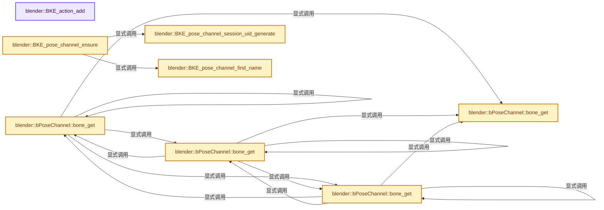
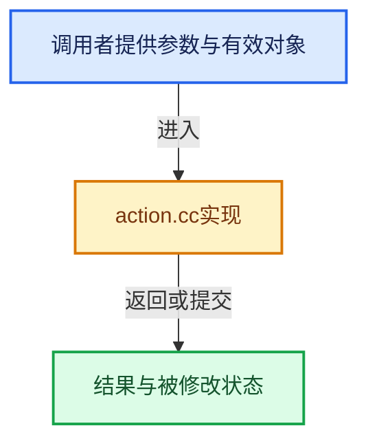

# 实现依赖专题：source/blender/blenkernel/intern/action.cc

[方向导航](README.md) · [符号索引](../%E7%AC%A6%E5%8F%B7%E4%BE%9D%E8%B5%96%E4%B8%8E%E5%AE%9E%E7%8E%B0%E7%B4%A2%E5%BC%95.md)

本专题从正文实际调用进入，集中保存共享实现。函数有稳定锚点，可从调用处直接跳到对应完整函数；递归与互相调用通过回链组织。

## 本文件的实现关系






## 完整成员与函数实现

<a id="f-fd8aa5ca3d7a4ed5"></a>

### `blender::BKE_action_add`

实现位置：[source/blender/blenkernel/intern/action.cc](../../../../../source/blender/blenkernel/intern/action.cc) · L778—L785。

接口参数：

- `Main *bmain`
- `const char name[]`

**教学注释版**

<!-- annotated:3baffe00fefd94 -->

```cpp
bAction *BKE_action_add(Main *bmain, const char name[])
{
  bAction *act;

  act = BKE_id_new<bAction>(bmain, name);

  return act;
}
```

<details>
<summary>核对原始源码：source/blender/blenkernel/intern/action.cc · L778—L785</summary>

<!-- original:3baffe00fefd94:source/blender/blenkernel/intern/action.cc:778:785 -->

```cpp
bAction *BKE_action_add(Main *bmain, const char name[])
{
  bAction *act;

  act = BKE_id_new<bAction>(bmain, name);

  return act;
}
```

</details>

**沿实际写入检查状态**

- `act = BKE_id_new<bAction>(bmain, name);`

**结果出口**

- `return act;`

**继续追踪实现**

- `BKE_id_new<bAction>` → [blender::BKE_id_new · L1612](%E4%BE%9D%E8%B5%96-lib_id-d4e6bd.md#f-5335c97ce0a8fbc8)。

<a id="f-0eb8bfcf060715cf"></a>

### `blender::bPoseChannel::bone_get`

实现位置：[source/blender/blenkernel/intern/action.cc](../../../../../source/blender/blenkernel/intern/action.cc) · L847—L860。

接口参数：

- `const bArmature &armature`

**教学注释版**

<!-- annotated:affeb305499936 -->

```cpp
const Bone *bPoseChannel::bone_get(const bArmature &armature) const
{
  if (this->runtime.bone_index == BONE_INDEX_UNKNOWN) {
    /* This is a valid use case, as the nullptr is used to determine whether the bone exists. See
     * BKE_pose_channels_clear_with_null_bone().
     *
     * In the future, this could be handled by another function (like `bool bone_exists(...)`)
     * while this one can then return a reference instead of a pointer. Currently that is not yet
     * done, to keep the introduction of this function semantically close to the bPoseChannel::bone
     * pointer it replaces. */
    return nullptr;
  }
  return armature.bone_get_indexed(this->runtime.bone_index);
}
```

<details>
<summary>核对原始源码：source/blender/blenkernel/intern/action.cc · L847—L860</summary>

<!-- original:affeb305499936:source/blender/blenkernel/intern/action.cc:847:860 -->

```cpp
const Bone *bPoseChannel::bone_get(const bArmature &armature) const
{
  if (this->runtime.bone_index == BONE_INDEX_UNKNOWN) {
    /* This is a valid use case, as the nullptr is used to determine whether the bone exists. See
     * BKE_pose_channels_clear_with_null_bone().
     *
     * In the future, this could be handled by another function (like `bool bone_exists(...)`)
     * while this one can then return a reference instead of a pointer. Currently that is not yet
     * done, to keep the introduction of this function semantically close to the bPoseChannel::bone
     * pointer it replaces. */
    return nullptr;
  }
  return armature.bone_get_indexed(this->runtime.bone_index);
}
```

</details>

**结果出口**

- `return nullptr;`
- `return armature.bone_get_indexed(this->runtime.bone_index);`

**继续追踪实现**

- `armature.bone_get_indexed` → [blender::bArmature::bone_get_indexed · L3554](%E4%BE%9D%E8%B5%96-armature-cc8366.md#f-9e543c0fc8e5cfd3)；[blender::bArmature::bone_get_indexed · L3573](%E4%BE%9D%E8%B5%96-armature-cc8366.md#f-cf9568254dc401a6)。同名重载需按实参类型选择。

<a id="f-ccec81f60dc65040"></a>

### `blender::bPoseChannel::bone_get`

实现位置：[source/blender/blenkernel/intern/action.cc](../../../../../source/blender/blenkernel/intern/action.cc) · L862—L873。

接口参数：

- `const Object &owner`

**教学注释版**

<!-- annotated:efa19ede82b272 -->

```cpp
const Bone *bPoseChannel::bone_get(const Object &owner) const
{
  BLI_assert(owner.type == OB_ARMATURE);
  BLI_assert(GS(owner.data->name) == ID_AR);
  bArmature *armature = id_cast<bArmature *>(owner.data);

  /* Check that the Object's pose bone index generation counter is the same as the Armature's, and
   * rebuild when necessary. */
  BKE_pose_ensure_bone_indices(owner);

  return this->bone_get(*armature);
}
```

<details>
<summary>核对原始源码：source/blender/blenkernel/intern/action.cc · L862—L873</summary>

<!-- original:efa19ede82b272:source/blender/blenkernel/intern/action.cc:862:873 -->

```cpp
const Bone *bPoseChannel::bone_get(const Object &owner) const
{
  BLI_assert(owner.type == OB_ARMATURE);
  BLI_assert(GS(owner.data->name) == ID_AR);
  bArmature *armature = id_cast<bArmature *>(owner.data);

  /* Check that the Object's pose bone index generation counter is the same as the Armature's, and
   * rebuild when necessary. */
  BKE_pose_ensure_bone_indices(owner);

  return this->bone_get(*armature);
}
```

</details>

**结果出口**

- `return this->bone_get(*armature);`

**继续追踪实现**

- `BLI_assert` → [BLI_assert · L48](../01-%E5%9F%BA%E7%A1%80%E5%AE%B9%E5%99%A8%E4%B8%8E%E7%8E%B0%E4%BB%A3CPP/%E4%BE%9D%E8%B5%96-BLI_assert-cc98e8.md#m-57a88495704d)；[BLI_assert · L63](../01-%E5%9F%BA%E7%A1%80%E5%AE%B9%E5%99%A8%E4%B8%8E%E7%8E%B0%E4%BB%A3CPP/%E4%BE%9D%E8%B5%96-BLI_assert-cc98e8.md#m-d07050020cb5)。宏定义由构建条件选择。
- `GS` → [blender::GS · L410](%E4%BE%9D%E8%B5%96-DNA_ID-3eb091.md#f-c3ff509f79f21b05)。
- `id_cast<bArmature *>` → [blender::id_cast · L1417](%E4%BE%9D%E8%B5%96-DNA_ID-3eb091.md#f-6c8ac6412850ac5a)。
- `BKE_pose_ensure_bone_indices` → [blender::BKE_pose_ensure_bone_indices · L3103](%E4%BE%9D%E8%B5%96-armature-cc8366.md#f-642aaede7e1310c6)。
- `this->bone_get` → [blender::bPoseChannel::bone_get · L847](%E4%BE%9D%E8%B5%96-action-b3a47a.md#f-0eb8bfcf060715cf)；[blender::bPoseChannel::bone_get · L862](%E4%BE%9D%E8%B5%96-action-b3a47a.md#f-ccec81f60dc65040)；[blender::bPoseChannel::bone_get · L875](%E4%BE%9D%E8%B5%96-action-b3a47a.md#f-b7d34ff46210a1f3)；[blender::bPoseChannel::bone_get · L881](%E4%BE%9D%E8%B5%96-action-b3a47a.md#f-0bf83e1e4d68c624)。同名重载需按实参类型选择。

<a id="f-b7d34ff46210a1f3"></a>

### `blender::bPoseChannel::bone_get`

实现位置：[source/blender/blenkernel/intern/action.cc](../../../../../source/blender/blenkernel/intern/action.cc) · L875—L880。

接口参数：

- `bArmature &armature`

**教学注释版**

<!-- annotated:24e0f2bbf88b15 -->

```cpp
Bone *bPoseChannel::bone_get(bArmature &armature)
{
  const bPoseChannel *const_this = this;
  const Bone *const_bone = const_this->bone_get(armature);
  return const_cast<Bone *>(const_bone);
}
```

<details>
<summary>核对原始源码：source/blender/blenkernel/intern/action.cc · L875—L880</summary>

<!-- original:24e0f2bbf88b15:source/blender/blenkernel/intern/action.cc:875:880 -->

```cpp
Bone *bPoseChannel::bone_get(bArmature &armature)
{
  const bPoseChannel *const_this = this;
  const Bone *const_bone = const_this->bone_get(armature);
  return const_cast<Bone *>(const_bone);
}
```

</details>

**结果出口**

- `return const_cast<Bone *>(const_bone);`

**继续追踪实现**

- `const_this->bone_get` → [blender::bPoseChannel::bone_get · L847](%E4%BE%9D%E8%B5%96-action-b3a47a.md#f-0eb8bfcf060715cf)；[blender::bPoseChannel::bone_get · L862](%E4%BE%9D%E8%B5%96-action-b3a47a.md#f-ccec81f60dc65040)；[blender::bPoseChannel::bone_get · L875](%E4%BE%9D%E8%B5%96-action-b3a47a.md#f-b7d34ff46210a1f3)；[blender::bPoseChannel::bone_get · L881](%E4%BE%9D%E8%B5%96-action-b3a47a.md#f-0bf83e1e4d68c624)。同名重载需按实参类型选择。

<a id="f-0bf83e1e4d68c624"></a>

### `blender::bPoseChannel::bone_get`

实现位置：[source/blender/blenkernel/intern/action.cc](../../../../../source/blender/blenkernel/intern/action.cc) · L881—L886。

接口参数：

- `Object &owner`

**教学注释版**

<!-- annotated:e62593ce0ba250 -->

```cpp
Bone *bPoseChannel::bone_get(Object &owner)
{
  const bPoseChannel *const_this = this;
  const Bone *const_bone = const_this->bone_get(owner);
  return const_cast<Bone *>(const_bone);
}
```

<details>
<summary>核对原始源码：source/blender/blenkernel/intern/action.cc · L881—L886</summary>

<!-- original:e62593ce0ba250:source/blender/blenkernel/intern/action.cc:881:886 -->

```cpp
Bone *bPoseChannel::bone_get(Object &owner)
{
  const bPoseChannel *const_this = this;
  const Bone *const_bone = const_this->bone_get(owner);
  return const_cast<Bone *>(const_bone);
}
```

</details>

**结果出口**

- `return const_cast<Bone *>(const_bone);`

**继续追踪实现**

- `const_this->bone_get` → [blender::bPoseChannel::bone_get · L847](%E4%BE%9D%E8%B5%96-action-b3a47a.md#f-0eb8bfcf060715cf)；[blender::bPoseChannel::bone_get · L862](%E4%BE%9D%E8%B5%96-action-b3a47a.md#f-ccec81f60dc65040)；[blender::bPoseChannel::bone_get · L875](%E4%BE%9D%E8%B5%96-action-b3a47a.md#f-b7d34ff46210a1f3)；[blender::bPoseChannel::bone_get · L881](%E4%BE%9D%E8%B5%96-action-b3a47a.md#f-0bf83e1e4d68c624)。同名重载需按实参类型选择。

<a id="f-7d35388a01245b89"></a>

### `blender::BKE_pose_channel_session_uid_generate`

实现位置：[source/blender/blenkernel/intern/action.cc](../../../../../source/blender/blenkernel/intern/action.cc) · L890—L893。

接口参数：

- `bPoseChannel *pchan`

**教学注释版**

<!-- annotated:af7594542961e8 -->

```cpp
void BKE_pose_channel_session_uid_generate(bPoseChannel *pchan)
{
  pchan->runtime.session_uid = BLI_session_uid_generate();
}
```

<details>
<summary>核对原始源码：source/blender/blenkernel/intern/action.cc · L890—L893</summary>

<!-- original:af7594542961e8:source/blender/blenkernel/intern/action.cc:890:893 -->

```cpp
void BKE_pose_channel_session_uid_generate(bPoseChannel *pchan)
{
  pchan->runtime.session_uid = BLI_session_uid_generate();
}
```

</details>

**沿实际写入检查状态**

- `pchan->runtime.session_uid = BLI_session_uid_generate();`

**继续追踪实现**

- `BLI_session_uid_generate` → [blender::BLI_session_uid_generate · L19](../01-%E5%9F%BA%E7%A1%80%E5%AE%B9%E5%99%A8%E4%B8%8E%E7%8E%B0%E4%BB%A3CPP/%E4%BE%9D%E8%B5%96-session_uid-995b7c.md#f-7385fbe8b65b714c)。

<a id="f-5997206551bfc9f9"></a>

### `blender::BKE_pose_channel_find_name`

实现位置：[source/blender/blenkernel/intern/action.cc](../../../../../source/blender/blenkernel/intern/action.cc) · L895—L908。

接口参数：

- `const bPose *pose`
- `const char *name`

**教学注释版**

<!-- annotated:0af6a2530baf05 -->

```cpp
bPoseChannel *BKE_pose_channel_find_name(const bPose *pose, const char *name)
{
  if (ELEM(nullptr, pose, name) || (name[0] == '\0')) {
    return nullptr;
  }

  if (!pose->runtime->chanhash.is_empty()) {
    bPoseChannel *const *found = pose->runtime->chanhash.lookup_ptr(name);
    return found ? *found : nullptr;
  }

  return static_cast<bPoseChannel *>(
      BLI_findstring(&pose->chanbase, name, offsetof(bPoseChannel, name)));
}
```

<details>
<summary>核对原始源码：source/blender/blenkernel/intern/action.cc · L895—L908</summary>

<!-- original:0af6a2530baf05:source/blender/blenkernel/intern/action.cc:895:908 -->

```cpp
bPoseChannel *BKE_pose_channel_find_name(const bPose *pose, const char *name)
{
  if (ELEM(nullptr, pose, name) || (name[0] == '\0')) {
    return nullptr;
  }

  if (!pose->runtime->chanhash.is_empty()) {
    bPoseChannel *const *found = pose->runtime->chanhash.lookup_ptr(name);
    return found ? *found : nullptr;
  }

  return static_cast<bPoseChannel *>(
      BLI_findstring(&pose->chanbase, name, offsetof(bPoseChannel, name)));
}
```

</details>

**结果出口**

- `return nullptr;`
- `return found ? *found : nullptr;`
- `return static_cast<bPoseChannel *>(`

**继续追踪实现**

- `ELEM` → [ELEM · L88](%E4%BE%9D%E8%B5%96-GHOST_utildefines-34b996.md#m-d28724a15928)；[ELEM · L135](../01-%E5%9F%BA%E7%A1%80%E5%AE%B9%E5%99%A8%E4%B8%8E%E7%8E%B0%E4%BB%A3CPP/%E4%BE%9D%E8%B5%96-BLI_utildefines-293a0a.md#m-d6572de7cae0)。宏定义由构建条件选择。
- `pose->runtime->chanhash.is_empty` → [调用协议](../%E6%A8%A1%E6%9D%BF%E5%AE%8F%E4%B8%8E%E5%8A%A8%E6%80%81%E5%88%86%E6%B4%BE%E5%8D%8F%E8%AE%AE.md)：接收对象类型依赖auto、返回值或模板实例；不按同名猜测目标。调用位置L901。
- `pose->runtime->chanhash.lookup_ptr` → [调用协议](../%E6%A8%A1%E6%9D%BF%E5%AE%8F%E4%B8%8E%E5%8A%A8%E6%80%81%E5%88%86%E6%B4%BE%E5%8D%8F%E8%AE%AE.md)：接收对象类型依赖auto、返回值或模板实例；不按同名猜测目标。调用位置L902。
- `BLI_findstring` → [blender::BLI_findstring · L615](../01-%E5%9F%BA%E7%A1%80%E5%AE%B9%E5%99%A8%E4%B8%8E%E7%8E%B0%E4%BB%A3CPP/%E4%BE%9D%E8%B5%96-listbase-2816d9.md#f-d913b13b2651348e)。

<a id="f-9416d5cbf0eccf74"></a>

### `blender::BKE_pose_channel_ensure`

实现位置：[source/blender/blenkernel/intern/action.cc](../../../../../source/blender/blenkernel/intern/action.cc) · L910—L961。

接口参数：

- `bPose *pose`
- `const char *name`

**教学注释版**

<!-- annotated:9d285a7ebc5b15 -->

```cpp
bPoseChannel *BKE_pose_channel_ensure(bPose *pose, const char *name)
{
  bPoseChannel *chan;

  if (pose == nullptr) {
    return nullptr;
  }

  BLI_assert_msg(
      name[0] != '\0',
      "Bones have to have a name, otherwise the function below will always return a nullptr");
  /* See if this channel exists */
  chan = BKE_pose_channel_find_name(pose, name);
  if (chan) {
    return chan;
  }

  /* If not, create it and add it */
  chan = MEM_new<bPoseChannel>("verifyPoseChannel");

  BKE_pose_channel_session_uid_generate(chan);

  STRNCPY_UTF8(chan->name, name);

  copy_v3_fl(chan->custom_scale_xyz, 1.0f);
  zero_v3(chan->custom_translation);
  zero_v3(chan->custom_rotation_euler);
  chan->custom_shape_wire_width = 1.0f;

  /* init vars to prevent math errors */
  unit_qt(chan->quat);
  unit_axis_angle(chan->rotAxis, &chan->rotAngle);
  chan->scale[0] = chan->scale[1] = chan->scale[2] = 1.0f;

  copy_v3_fl(chan->scale_in, 1.0f);
  copy_v3_fl(chan->scale_out, 1.0f);

  chan->limitmin[0] = chan->limitmin[1] = chan->limitmin[2] = -M_PI;
  chan->limitmax[0] = chan->limitmax[1] = chan->limitmax[2] = M_PI;
  chan->stiffness[0] = chan->stiffness[1] = chan->stiffness[2] = 0.0f;
  chan->ikrotweight = chan->iklinweight = 0.0f;
  unit_m4(chan->constinv);

  chan->protectflag = OB_LOCK_ROT4D; /* lock by components by default */

  BLI_addtail(&pose->chanbase, chan);
  if (!pose->runtime->chanhash.is_empty()) {
    pose->runtime->chanhash.add_overwrite(chan->name, chan);
  }

  return chan;
}
```

<details>
<summary>核对原始源码：source/blender/blenkernel/intern/action.cc · L910—L961</summary>

<!-- original:9d285a7ebc5b15:source/blender/blenkernel/intern/action.cc:910:961 -->

```cpp
bPoseChannel *BKE_pose_channel_ensure(bPose *pose, const char *name)
{
  bPoseChannel *chan;

  if (pose == nullptr) {
    return nullptr;
  }

  BLI_assert_msg(
      name[0] != '\0',
      "Bones have to have a name, otherwise the function below will always return a nullptr");
  /* See if this channel exists */
  chan = BKE_pose_channel_find_name(pose, name);
  if (chan) {
    return chan;
  }

  /* If not, create it and add it */
  chan = MEM_new<bPoseChannel>("verifyPoseChannel");

  BKE_pose_channel_session_uid_generate(chan);

  STRNCPY_UTF8(chan->name, name);

  copy_v3_fl(chan->custom_scale_xyz, 1.0f);
  zero_v3(chan->custom_translation);
  zero_v3(chan->custom_rotation_euler);
  chan->custom_shape_wire_width = 1.0f;

  /* init vars to prevent math errors */
  unit_qt(chan->quat);
  unit_axis_angle(chan->rotAxis, &chan->rotAngle);
  chan->scale[0] = chan->scale[1] = chan->scale[2] = 1.0f;

  copy_v3_fl(chan->scale_in, 1.0f);
  copy_v3_fl(chan->scale_out, 1.0f);

  chan->limitmin[0] = chan->limitmin[1] = chan->limitmin[2] = -M_PI;
  chan->limitmax[0] = chan->limitmax[1] = chan->limitmax[2] = M_PI;
  chan->stiffness[0] = chan->stiffness[1] = chan->stiffness[2] = 0.0f;
  chan->ikrotweight = chan->iklinweight = 0.0f;
  unit_m4(chan->constinv);

  chan->protectflag = OB_LOCK_ROT4D; /* lock by components by default */

  BLI_addtail(&pose->chanbase, chan);
  if (!pose->runtime->chanhash.is_empty()) {
    pose->runtime->chanhash.add_overwrite(chan->name, chan);
  }

  return chan;
}
```

</details>

**沿实际写入检查状态**

- `chan = BKE_pose_channel_find_name(pose, name);`
- `chan = MEM_new<bPoseChannel>("verifyPoseChannel");`
- `chan->custom_shape_wire_width = 1.0f;`
- `chan->scale[0] = chan->scale[1] = chan->scale[2] = 1.0f;`
- `chan->limitmin[0] = chan->limitmin[1] = chan->limitmin[2] = -M_PI;`
- `chan->limitmax[0] = chan->limitmax[1] = chan->limitmax[2] = M_PI;`
- `chan->stiffness[0] = chan->stiffness[1] = chan->stiffness[2] = 0.0f;`
- `chan->ikrotweight = chan->iklinweight = 0.0f;`
- `chan->protectflag = OB_LOCK_ROT4D; /* lock by components by default */`

**结果出口**

- `return nullptr;`
- `return chan;`

**继续追踪实现**

- `BLI_assert_msg` → [BLI_assert_msg · L55](../01-%E5%9F%BA%E7%A1%80%E5%AE%B9%E5%99%A8%E4%B8%8E%E7%8E%B0%E4%BB%A3CPP/%E4%BE%9D%E8%B5%96-BLI_assert-cc98e8.md#m-695eed20dceb)；[BLI_assert_msg · L64](../01-%E5%9F%BA%E7%A1%80%E5%AE%B9%E5%99%A8%E4%B8%8E%E7%8E%B0%E4%BB%A3CPP/%E4%BE%9D%E8%B5%96-BLI_assert-cc98e8.md#m-7de5563de4db)。宏定义由构建条件选择。
- `BKE_pose_channel_find_name` → [blender::BKE_pose_channel_find_name · L895](%E4%BE%9D%E8%B5%96-action-b3a47a.md#f-5997206551bfc9f9)。
- `MEM_new<bPoseChannel>` → [MEM_new · L351](../03-%E5%86%85%E5%AD%98%E5%88%86%E9%85%8D%E4%B8%8E%E8%BF%90%E8%A1%8C%E6%97%B6%E7%B1%BB%E5%9E%8B/%E4%BE%9D%E8%B5%96-MEM_guardedalloc-b54eca.md#f-115f9b6784f89912)。
- `BKE_pose_channel_session_uid_generate` → [blender::BKE_pose_channel_session_uid_generate · L890](%E4%BE%9D%E8%B5%96-action-b3a47a.md#f-7d35388a01245b89)。
- `STRNCPY_UTF8` → [STRNCPY_UTF8 · L335](../01-%E5%9F%BA%E7%A1%80%E5%AE%B9%E5%99%A8%E4%B8%8E%E7%8E%B0%E4%BB%A3CPP/%E4%BE%9D%E8%B5%96-BLI_string_utf8-bcc961.md#m-222967f0ab6a)。宏定义由构建条件选择。
- `copy_v3_fl` → [blender::copy_v3_fl · L68](../12-%E7%A9%BA%E9%97%B4%E6%95%B0%E6%8D%AE%E7%BB%93%E6%9E%84%E4%B8%8E%E5%87%A0%E4%BD%95%E7%AE%97%E6%B3%95/%E4%BE%9D%E8%B5%96-math_vector_inline-0c8541.md#f-18676f3d43803485)。
- `zero_v3` → [blender::zero_v3 · L26](../12-%E7%A9%BA%E9%97%B4%E6%95%B0%E6%8D%AE%E7%BB%93%E6%9E%84%E4%B8%8E%E5%87%A0%E4%BD%95%E7%AE%97%E6%B3%95/%E4%BE%9D%E8%B5%96-math_vector_inline-0c8541.md#f-13235b08fdecb098)。
- `unit_qt` → [blender::unit_qt · L45](../12-%E7%A9%BA%E9%97%B4%E6%95%B0%E6%8D%AE%E7%BB%93%E6%9E%84%E4%B8%8E%E5%87%A0%E4%BD%95%E7%AE%97%E6%B3%95/%E4%BE%9D%E8%B5%96-math_rotation_c-8e57f4.md#f-6323eadd66d3989a)。
- `unit_axis_angle` → [blender::unit_axis_angle · L37](../12-%E7%A9%BA%E9%97%B4%E6%95%B0%E6%8D%AE%E7%BB%93%E6%9E%84%E4%B8%8E%E5%87%A0%E4%BD%95%E7%AE%97%E6%B3%95/%E4%BE%9D%E8%B5%96-math_rotation_c-8e57f4.md#f-cd4add707042a7a3)。
- `unit_m4` → [blender::unit_m4 · L55](../12-%E7%A9%BA%E9%97%B4%E6%95%B0%E6%8D%AE%E7%BB%93%E6%9E%84%E4%B8%8E%E5%87%A0%E4%BD%95%E7%AE%97%E6%B3%95/%E4%BE%9D%E8%B5%96-math_matrix_c-004123.md#f-e6cd812aae119176)。
- `BLI_addtail` → [blender::BLI_addtail · L118](../01-%E5%9F%BA%E7%A1%80%E5%AE%B9%E5%99%A8%E4%B8%8E%E7%8E%B0%E4%BB%A3CPP/%E4%BE%9D%E8%B5%96-listbase-2816d9.md#f-4fb027713fa3115b)。
- `pose->runtime->chanhash.is_empty` → [调用协议](../%E6%A8%A1%E6%9D%BF%E5%AE%8F%E4%B8%8E%E5%8A%A8%E6%80%81%E5%88%86%E6%B4%BE%E5%8D%8F%E8%AE%AE.md)：接收对象类型依赖auto、返回值或模板实例；不按同名猜测目标。调用位置L956。
- `pose->runtime->chanhash.add_overwrite` → [调用协议](../%E6%A8%A1%E6%9D%BF%E5%AE%8F%E4%B8%8E%E5%8A%A8%E6%80%81%E5%88%86%E6%B4%BE%E5%8D%8F%E8%AE%AE.md)：接收对象类型依赖auto、返回值或模板实例；不按同名猜测目标。调用位置L957。

<a id="f-8e96971f63db2ead"></a>

### `blender::BKE_pose_is_bonecoll_visible`

实现位置：[source/blender/blenkernel/intern/action.cc](../../../../../source/blender/blenkernel/intern/action.cc) · L981—L985。

接口参数：

- `const bArmature *arm`
- `const bPoseChannel *pchan`

**教学注释版**

<!-- annotated:de51cab3ffcee0 -->

```cpp
bool BKE_pose_is_bonecoll_visible(const bArmature *arm, const bPoseChannel *pchan)
{
  const Bone *bone = pchan->bone_get(*arm);
  return bone && ANIM_bone_in_visible_collection(arm, bone);
}
```

<details>
<summary>核对原始源码：source/blender/blenkernel/intern/action.cc · L981—L985</summary>

<!-- original:de51cab3ffcee0:source/blender/blenkernel/intern/action.cc:981:985 -->

```cpp
bool BKE_pose_is_bonecoll_visible(const bArmature *arm, const bPoseChannel *pchan)
{
  const Bone *bone = pchan->bone_get(*arm);
  return bone && ANIM_bone_in_visible_collection(arm, bone);
}
```

</details>

**结果出口**

- `return bone && ANIM_bone_in_visible_collection(arm, bone);`

**继续追踪实现**

- `pchan->bone_get` → [blender::bPoseChannel::bone_get · L847](%E4%BE%9D%E8%B5%96-action-b3a47a.md#f-0eb8bfcf060715cf)；[blender::bPoseChannel::bone_get · L862](%E4%BE%9D%E8%B5%96-action-b3a47a.md#f-ccec81f60dc65040)；[blender::bPoseChannel::bone_get · L875](%E4%BE%9D%E8%B5%96-action-b3a47a.md#f-b7d34ff46210a1f3)；[blender::bPoseChannel::bone_get · L881](%E4%BE%9D%E8%B5%96-action-b3a47a.md#f-0bf83e1e4d68c624)。同名重载需按实参类型选择。
- `ANIM_bone_in_visible_collection` → [blender::ANIM_bone_in_visible_collection · L1047](%E4%BE%9D%E8%B5%96-bone_collections-88bf14.md#f-a89f8336d38ceade)。

<a id="f-130a100a8cddedd0"></a>

### `blender::BKE_pose_channels_hash_ensure`

实现位置：[source/blender/blenkernel/intern/action.cc](../../../../../source/blender/blenkernel/intern/action.cc) · L1248—L1255。

接口参数：

- `bPose *pose`

**教学注释版**

<!-- annotated:45f02438eed066 -->

```cpp
void BKE_pose_channels_hash_ensure(bPose *pose)
{
  if (pose->runtime->chanhash.is_empty()) {
    for (bPoseChannel &pchan : pose->chanbase) {
      pose->runtime->chanhash.add_overwrite(pchan.name, &pchan);
    }
  }
}
```

<details>
<summary>核对原始源码：source/blender/blenkernel/intern/action.cc · L1248—L1255</summary>

<!-- original:45f02438eed066:source/blender/blenkernel/intern/action.cc:1248:1255 -->

```cpp
void BKE_pose_channels_hash_ensure(bPose *pose)
{
  if (pose->runtime->chanhash.is_empty()) {
    for (bPoseChannel &pchan : pose->chanbase) {
      pose->runtime->chanhash.add_overwrite(pchan.name, &pchan);
    }
  }
}
```

</details>

**继续追踪实现**

- `pose->runtime->chanhash.is_empty` → [调用协议](../%E6%A8%A1%E6%9D%BF%E5%AE%8F%E4%B8%8E%E5%8A%A8%E6%80%81%E5%88%86%E6%B4%BE%E5%8D%8F%E8%AE%AE.md)：接收对象类型依赖auto、返回值或模板实例；不按同名猜测目标。调用位置L1250。
- `pose->runtime->chanhash.add_overwrite` → [调用协议](../%E6%A8%A1%E6%9D%BF%E5%AE%8F%E4%B8%8E%E5%8A%A8%E6%80%81%E5%88%86%E6%B4%BE%E5%8D%8F%E8%AE%AE.md)：接收对象类型依赖auto、返回值或模板实例；不按同名猜测目标。调用位置L1252。

<a id="f-6d672701b571d323"></a>

### `blender::BKE_pose_channels_hash_free`

实现位置：[source/blender/blenkernel/intern/action.cc](../../../../../source/blender/blenkernel/intern/action.cc) · L1257—L1260。

接口参数：

- `bPose *pose`

**教学注释版**

<!-- annotated:f7c0def79e4314 -->

```cpp
void BKE_pose_channels_hash_free(bPose *pose)
{
  pose->runtime->chanhash.clear();
}
```

<details>
<summary>核对原始源码：source/blender/blenkernel/intern/action.cc · L1257—L1260</summary>

<!-- original:f7c0def79e4314:source/blender/blenkernel/intern/action.cc:1257:1260 -->

```cpp
void BKE_pose_channels_hash_free(bPose *pose)
{
  pose->runtime->chanhash.clear();
}
```

</details>

**继续追踪实现**

- `pose->runtime->chanhash.clear` → [调用协议](../%E6%A8%A1%E6%9D%BF%E5%AE%8F%E4%B8%8E%E5%8A%A8%E6%80%81%E5%88%86%E6%B4%BE%E5%8D%8F%E8%AE%AE.md)：接收对象类型依赖auto、返回值或模板实例；不按同名猜测目标。调用位置L1259。

<a id="f-6faddd64a4f5a9a3"></a>

### `blender::BKE_pose_channel_free_ex`

实现位置：[source/blender/blenkernel/intern/action.cc](../../../../../source/blender/blenkernel/intern/action.cc) · L1338—L1368。

接口参数：

- `bPoseChannel *pchan`
- `bool do_id_user`

**教学注释版**

<!-- annotated:c5fe68dd03f782 -->

```cpp
void BKE_pose_channel_free_ex(bPoseChannel *pchan, bool do_id_user)
{
  if (pchan->custom) {
    if (do_id_user) {
      id_us_min(&pchan->custom->id);
    }
    pchan->custom = nullptr;
  }

  if (pchan->mpath) {
    // [讲解] bke::motionpath::free：归还相匹配的C分配存储，不自动执行C++析构；不可用于Windows的_aligned_malloc结果。
    bke::motionpath::free(pchan->mpath);
    pchan->mpath = nullptr;
  }

  BKE_constraints_free_ex(&pchan->constraints, do_id_user);

  if (pchan->prop) {
    IDP_FreeProperty_ex(pchan->prop, do_id_user);
    pchan->prop = nullptr;
  }
  if (pchan->system_properties) {
    IDP_FreeProperty_ex(pchan->system_properties, do_id_user);
    pchan->system_properties = nullptr;
  }

  /* Cached data, for new draw manager rendering code. */
  MEM_SAFE_DELETE(pchan->draw_data);

  /* Cached B-Bone shape and other data. */
  BKE_pose_channel_runtime_free(&pchan->runtime);
}
```

<details>
<summary>核对原始源码：source/blender/blenkernel/intern/action.cc · L1338—L1368</summary>

<!-- original:c5fe68dd03f782:source/blender/blenkernel/intern/action.cc:1338:1368 -->

```cpp
void BKE_pose_channel_free_ex(bPoseChannel *pchan, bool do_id_user)
{
  if (pchan->custom) {
    if (do_id_user) {
      id_us_min(&pchan->custom->id);
    }
    pchan->custom = nullptr;
  }

  if (pchan->mpath) {
    bke::motionpath::free(pchan->mpath);
    pchan->mpath = nullptr;
  }

  BKE_constraints_free_ex(&pchan->constraints, do_id_user);

  if (pchan->prop) {
    IDP_FreeProperty_ex(pchan->prop, do_id_user);
    pchan->prop = nullptr;
  }
  if (pchan->system_properties) {
    IDP_FreeProperty_ex(pchan->system_properties, do_id_user);
    pchan->system_properties = nullptr;
  }

  /* Cached data, for new draw manager rendering code. */
  MEM_SAFE_DELETE(pchan->draw_data);

  /* Cached B-Bone shape and other data. */
  BKE_pose_channel_runtime_free(&pchan->runtime);
}
```

</details>

**沿实际写入检查状态**

- `pchan->custom = nullptr;`
- `pchan->mpath = nullptr;`
- `pchan->prop = nullptr;`
- `pchan->system_properties = nullptr;`

**继续追踪实现**

- `id_us_min` → [blender::id_us_min · L441](%E4%BE%9D%E8%B5%96-lib_id-d4e6bd.md#f-c5e5246a79962257)。
- `bke::motionpath::free` → [外部契约](https://eel.is/c++draft/c.malloc)：归还相匹配的C分配存储，不自动执行C++析构；不可用于Windows的_aligned_malloc结果。
- `BKE_constraints_free_ex` → [blender::BKE_constraints_free_ex · L5962](%E4%BE%9D%E8%B5%96-constraint-42d573.md#f-060f5d610e531b88)。
- `IDP_FreeProperty_ex` → [blender::IDP_FreeProperty_ex · L1398](%E4%BE%9D%E8%B5%96-idprop-006c65.md#f-4b1dc3efcf18b18c)。
- `MEM_SAFE_DELETE` → [MEM_SAFE_DELETE · L436](../03-%E5%86%85%E5%AD%98%E5%88%86%E9%85%8D%E4%B8%8E%E8%BF%90%E8%A1%8C%E6%97%B6%E7%B1%BB%E5%9E%8B/%E4%BE%9D%E8%B5%96-MEM_guardedalloc-b54eca.md#m-eadb3bc5b902)。宏定义由构建条件选择。
- `BKE_pose_channel_runtime_free` → [blender::BKE_pose_channel_runtime_free · L1382](%E4%BE%9D%E8%B5%96-action-b3a47a.md#f-6dad3697cf0ecd1e)。

<a id="f-6dad3697cf0ecd1e"></a>

### `blender::BKE_pose_channel_runtime_free`

实现位置：[source/blender/blenkernel/intern/action.cc](../../../../../source/blender/blenkernel/intern/action.cc) · L1382—L1385。

接口参数：

- `bPoseChannel_Runtime *runtime`

**教学注释版**

<!-- annotated:f809fba99e46c6 -->

```cpp
void BKE_pose_channel_runtime_free(bPoseChannel_Runtime *runtime)
{
  BKE_pose_channel_free_bbone_cache(runtime);
}
```

<details>
<summary>核对原始源码：source/blender/blenkernel/intern/action.cc · L1382—L1385</summary>

<!-- original:f809fba99e46c6:source/blender/blenkernel/intern/action.cc:1382:1385 -->

```cpp
void BKE_pose_channel_runtime_free(bPoseChannel_Runtime *runtime)
{
  BKE_pose_channel_free_bbone_cache(runtime);
}
```

</details>

**继续追踪实现**

- `BKE_pose_channel_free_bbone_cache` → [blender::BKE_pose_channel_free_bbone_cache · L1387](%E4%BE%9D%E8%B5%96-action-b3a47a.md#f-3524fb399a0b5f48)。

<a id="f-3524fb399a0b5f48"></a>

### `blender::BKE_pose_channel_free_bbone_cache`

实现位置：[source/blender/blenkernel/intern/action.cc](../../../../../source/blender/blenkernel/intern/action.cc) · L1387—L1395。

接口参数：

- `bPoseChannel_Runtime *runtime`

**教学注释版**

<!-- annotated:a8b5cf42ecaef3 -->

```cpp
void BKE_pose_channel_free_bbone_cache(bPoseChannel_Runtime *runtime)
{
  runtime->bbone_segments = 0;
  MEM_SAFE_DELETE(runtime->bbone_rest_mats);
  MEM_SAFE_DELETE(runtime->bbone_pose_mats);
  MEM_SAFE_DELETE(runtime->bbone_deform_mats);
  MEM_SAFE_DELETE(runtime->bbone_dual_quats);
  MEM_SAFE_DELETE(runtime->bbone_segment_boundaries);
}
```

<details>
<summary>核对原始源码：source/blender/blenkernel/intern/action.cc · L1387—L1395</summary>

<!-- original:a8b5cf42ecaef3:source/blender/blenkernel/intern/action.cc:1387:1395 -->

```cpp
void BKE_pose_channel_free_bbone_cache(bPoseChannel_Runtime *runtime)
{
  runtime->bbone_segments = 0;
  MEM_SAFE_DELETE(runtime->bbone_rest_mats);
  MEM_SAFE_DELETE(runtime->bbone_pose_mats);
  MEM_SAFE_DELETE(runtime->bbone_deform_mats);
  MEM_SAFE_DELETE(runtime->bbone_dual_quats);
  MEM_SAFE_DELETE(runtime->bbone_segment_boundaries);
}
```

</details>

**沿实际写入检查状态**

- `runtime->bbone_segments = 0;`

**继续追踪实现**

- `MEM_SAFE_DELETE` → [MEM_SAFE_DELETE · L436](../03-%E5%86%85%E5%AD%98%E5%88%86%E9%85%8D%E4%B8%8E%E8%BF%90%E8%A1%8C%E6%97%B6%E7%B1%BB%E5%9E%8B/%E4%BE%9D%E8%B5%96-MEM_guardedalloc-b54eca.md#m-eadb3bc5b902)。宏定义由构建条件选择。

<a id="f-9badb2235a873e05"></a>

### `blender::BKE_pose_update_constraint_flags`

实现位置：[source/blender/blenkernel/intern/action.cc](../../../../../source/blender/blenkernel/intern/action.cc) · L1527—L1605。

接口参数：

- `Object &pose_ob`

**教学注释版**

<!-- annotated:e7103c7f174178 -->

```cpp
void BKE_pose_update_constraint_flags(Object &pose_ob)
{
  bPose *pose = pose_ob.pose;
  pose->flag &= ~POSE_CONSTRAINTS_TIMEDEPEND;

  for (bPoseChannel &pchan : pose_ob.pose->chanbase) {
    pchan.constflag = ePchan_ConstFlag{};

    for (bConstraint &con : pchan.constraints) {
      pchan.constflag |= PCHAN_HAS_CONST;

      switch (con.type) {
        case CONSTRAINT_TYPE_KINEMATIC: {
          bKinematicConstraint *data = static_cast<bKinematicConstraint *>(con.data);

          pchan.constflag |= PCHAN_HAS_IK;

          if (data->tar == nullptr || (data->tar->type == OB_ARMATURE && data->subtarget[0] == 0))
          {
            pchan.constflag |= PCHAN_HAS_NO_TARGET;
          }

          bPoseChannel *chain_tip = (data->flag & CONSTRAINT_IK_TIP) ? &pchan : pchan.parent;

          /* negative rootbone = recalc rootbone index. used in do_versions */
          if (data->rootbone < 0) {
            data->rootbone = 0;

            /* TODO(Sybren): call the yet-to-be-written 'assert the bone indices are up to date'
             * function. This walk uses the armature bone hierarchy (via parbone->parent) rather
             * than the pose channel hierarchy, which is only safe when the pose is consistent
             * with the armature. The assert function will make that precondition explicit. */
            Bone *parbone = chain_tip->bone_get(pose_ob);
            while (parbone) {
              data->rootbone++;
              if ((parbone->flag & BONE_CONNECTED) == 0) {
                break;
              }
              parbone = parbone->parent;
            }
          }

          /* Mark the pose bones in the IK chain as influenced by it. */
          {
            bPoseChannel *chain_bone = chain_tip;
            for (short index = 0; chain_bone && (data->rootbone == 0 || index < data->rootbone);
                 index++)
            {
              chain_bone->constflag |= PCHAN_INFLUENCED_BY_IK;
              chain_bone = chain_bone->parent;
            }
          }
          break;
        }

        case CONSTRAINT_TYPE_FOLLOWPATH: {
          bFollowPathConstraint *data = static_cast<bFollowPathConstraint *>(con.data);

          /* if we have a valid target, make sure that this will get updated on frame-change
           * (needed for when there is no anim-data for this pose)
           */
          if ((data->tar) && (data->tar->type == OB_CURVES_LEGACY)) {
            pose->flag |= POSE_CONSTRAINTS_TIMEDEPEND;
          }
          break;
        }

        case CONSTRAINT_TYPE_SPLINEIK:
          pchan.constflag |= PCHAN_HAS_SPLINEIK;
          break;

        default:
          break;
      }
    }
  }

  pose->flag &= ~POSE_CONSTRAINTS_NEED_UPDATE_FLAGS;
}
```

<details>
<summary>核对原始源码：source/blender/blenkernel/intern/action.cc · L1527—L1605</summary>

<!-- original:e7103c7f174178:source/blender/blenkernel/intern/action.cc:1527:1605 -->

```cpp
void BKE_pose_update_constraint_flags(Object &pose_ob)
{
  bPose *pose = pose_ob.pose;
  pose->flag &= ~POSE_CONSTRAINTS_TIMEDEPEND;

  for (bPoseChannel &pchan : pose_ob.pose->chanbase) {
    pchan.constflag = ePchan_ConstFlag{};

    for (bConstraint &con : pchan.constraints) {
      pchan.constflag |= PCHAN_HAS_CONST;

      switch (con.type) {
        case CONSTRAINT_TYPE_KINEMATIC: {
          bKinematicConstraint *data = static_cast<bKinematicConstraint *>(con.data);

          pchan.constflag |= PCHAN_HAS_IK;

          if (data->tar == nullptr || (data->tar->type == OB_ARMATURE && data->subtarget[0] == 0))
          {
            pchan.constflag |= PCHAN_HAS_NO_TARGET;
          }

          bPoseChannel *chain_tip = (data->flag & CONSTRAINT_IK_TIP) ? &pchan : pchan.parent;

          /* negative rootbone = recalc rootbone index. used in do_versions */
          if (data->rootbone < 0) {
            data->rootbone = 0;

            /* TODO(Sybren): call the yet-to-be-written 'assert the bone indices are up to date'
             * function. This walk uses the armature bone hierarchy (via parbone->parent) rather
             * than the pose channel hierarchy, which is only safe when the pose is consistent
             * with the armature. The assert function will make that precondition explicit. */
            Bone *parbone = chain_tip->bone_get(pose_ob);
            while (parbone) {
              data->rootbone++;
              if ((parbone->flag & BONE_CONNECTED) == 0) {
                break;
              }
              parbone = parbone->parent;
            }
          }

          /* Mark the pose bones in the IK chain as influenced by it. */
          {
            bPoseChannel *chain_bone = chain_tip;
            for (short index = 0; chain_bone && (data->rootbone == 0 || index < data->rootbone);
                 index++)
            {
              chain_bone->constflag |= PCHAN_INFLUENCED_BY_IK;
              chain_bone = chain_bone->parent;
            }
          }
          break;
        }

        case CONSTRAINT_TYPE_FOLLOWPATH: {
          bFollowPathConstraint *data = static_cast<bFollowPathConstraint *>(con.data);

          /* if we have a valid target, make sure that this will get updated on frame-change
           * (needed for when there is no anim-data for this pose)
           */
          if ((data->tar) && (data->tar->type == OB_CURVES_LEGACY)) {
            pose->flag |= POSE_CONSTRAINTS_TIMEDEPEND;
          }
          break;
        }

        case CONSTRAINT_TYPE_SPLINEIK:
          pchan.constflag |= PCHAN_HAS_SPLINEIK;
          break;

        default:
          break;
      }
    }
  }

  pose->flag &= ~POSE_CONSTRAINTS_NEED_UPDATE_FLAGS;
}
```

</details>

**沿实际写入检查状态**

- `pose->flag &= ~POSE_CONSTRAINTS_TIMEDEPEND;`
- `pchan.constflag = ePchan_ConstFlag{};`
- `pchan.constflag |= PCHAN_HAS_CONST;`
- `pchan.constflag |= PCHAN_HAS_IK;`
- `pchan.constflag |= PCHAN_HAS_NO_TARGET;`
- `data->rootbone = 0;`
- `parbone = parbone->parent;`
- `chain_bone->constflag |= PCHAN_INFLUENCED_BY_IK;`
- `chain_bone = chain_bone->parent;`
- `pose->flag |= POSE_CONSTRAINTS_TIMEDEPEND;`
- `pchan.constflag |= PCHAN_HAS_SPLINEIK;`
- `pose->flag &= ~POSE_CONSTRAINTS_NEED_UPDATE_FLAGS;`

**继续追踪实现**

- `chain_tip->bone_get` → [blender::bPoseChannel::bone_get · L847](%E4%BE%9D%E8%B5%96-action-b3a47a.md#f-0eb8bfcf060715cf)；[blender::bPoseChannel::bone_get · L862](%E4%BE%9D%E8%B5%96-action-b3a47a.md#f-ccec81f60dc65040)；[blender::bPoseChannel::bone_get · L875](%E4%BE%9D%E8%B5%96-action-b3a47a.md#f-b7d34ff46210a1f3)；[blender::bPoseChannel::bone_get · L881](%E4%BE%9D%E8%B5%96-action-b3a47a.md#f-0bf83e1e4d68c624)。同名重载需按实参类型选择。

<a id="f-20f0f98c3077a464"></a>

### `blender::BKE_pose_tag_recalc`

实现位置：[source/blender/blenkernel/intern/action.cc](../../../../../source/blender/blenkernel/intern/action.cc) · L1767—L1774。

接口参数：

- `Main *bmain`
- `bPose *pose`

**教学注释版**

<!-- annotated:0f161ecbc4afdb -->

```cpp
void BKE_pose_tag_recalc(Main *bmain, bPose *pose)
{
  pose->flag |= POSE_RECALC;
  /* Depsgraph components depends on actual pose state,
   * if pose was changed depsgraph is to be updated as well.
   */
  DEG_relations_tag_update(bmain);
}
```

<details>
<summary>核对原始源码：source/blender/blenkernel/intern/action.cc · L1767—L1774</summary>

<!-- original:0f161ecbc4afdb:source/blender/blenkernel/intern/action.cc:1767:1774 -->

```cpp
void BKE_pose_tag_recalc(Main *bmain, bPose *pose)
{
  pose->flag |= POSE_RECALC;
  /* Depsgraph components depends on actual pose state,
   * if pose was changed depsgraph is to be updated as well.
   */
  DEG_relations_tag_update(bmain);
}
```

</details>

**沿实际写入检查状态**

- `pose->flag |= POSE_RECALC;`

**继续追踪实现**

- `DEG_relations_tag_update` → [blender::DEG_relations_tag_update · L350](../11-Depsgraph%E4%B8%8E%E5%B9%B6%E8%A1%8C%E4%BB%BB%E5%8A%A1%E7%B3%BB%E7%BB%9F/%E4%BE%9D%E8%B5%96-depsgraph_build-ea2fc8.md#f-2910c78540652980)。

<a id="f-a73f53f01c3dafac"></a>

### `blender::BKE_pose_check_uids_unique_and_report`

实现位置：[source/blender/blenkernel/intern/action.cc](../../../../../source/blender/blenkernel/intern/action.cc) · L1869—L1889。

接口参数：

- `const bPose *pose`

**教学注释版**

<!-- annotated:b4e1c237513738 -->

```cpp
void BKE_pose_check_uids_unique_and_report(const bPose *pose)
{
  if (pose == nullptr) {
    return;
  }

  Set<SessionUID> used_uids;

  for (bPoseChannel &pchan : pose->chanbase) {
    const SessionUID *session_uid = &pchan.runtime.session_uid;
    if (!session_uid->is_generated()) {
      printf("Pose channel %s does not have UID generated.\n", pchan.name);
      continue;
    }

    // [讲解] used_uids.add：按哈希与相等关系加入键或键值。
    if (!used_uids.add(*session_uid)) {
      printf("Pose channel %s has duplicate UID generated.\n", pchan.name);
      continue;
    }
  }
}
```

<details>
<summary>核对原始源码：source/blender/blenkernel/intern/action.cc · L1869—L1889</summary>

<!-- original:b4e1c237513738:source/blender/blenkernel/intern/action.cc:1869:1889 -->

```cpp
void BKE_pose_check_uids_unique_and_report(const bPose *pose)
{
  if (pose == nullptr) {
    return;
  }

  Set<SessionUID> used_uids;

  for (bPoseChannel &pchan : pose->chanbase) {
    const SessionUID *session_uid = &pchan.runtime.session_uid;
    if (!session_uid->is_generated()) {
      printf("Pose channel %s does not have UID generated.\n", pchan.name);
      continue;
    }

    if (!used_uids.add(*session_uid)) {
      printf("Pose channel %s has duplicate UID generated.\n", pchan.name);
      continue;
    }
  }
}
```

</details>

**继续追踪实现**

- `session_uid->is_generated` → [blender::SessionUID::is_generated · L50](%E4%BE%9D%E8%B5%96-DNA_session_uid_types-309a7e.md#f-3b9ea9edaf7a2745)。
- `printf` → [外部契约](https://eel.is/c++draft/)：这个边界按实际表达式及所属类型核对参数、返回值、寿命与失败行为。这里提供接口入口，不声称已解释该第三方版本的内部实现。
- `used_uids.add` → [blender::Set::add · L248](../02-%E5%93%88%E5%B8%8C%E8%A1%A8%E4%B8%8E%E5%85%B3%E8%81%94%E6%95%B0%E6%8D%AE%E7%BB%93%E6%9E%84/08-Set%E4%B8%8E%E9%9B%86%E5%90%88%E8%AF%AD%E4%B9%89.md#f-c7498809c2327fba)；[blender::Set::add · L252](../02-%E5%93%88%E5%B8%8C%E8%A1%A8%E4%B8%8E%E5%85%B3%E8%81%94%E6%95%B0%E6%8D%AE%E7%BB%93%E6%9E%84/08-Set%E4%B8%8E%E9%9B%86%E5%90%88%E8%AF%AD%E4%B9%89.md#f-e3ac8d1c52c03c2b)。同名重载需按实参类型选择。
