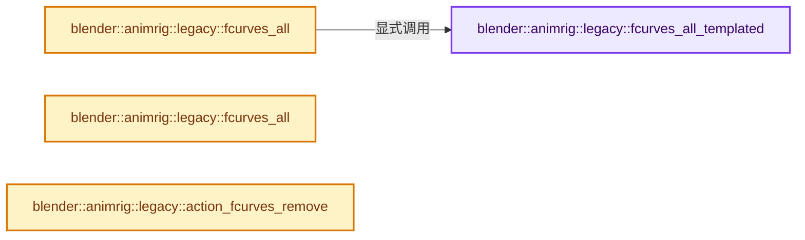
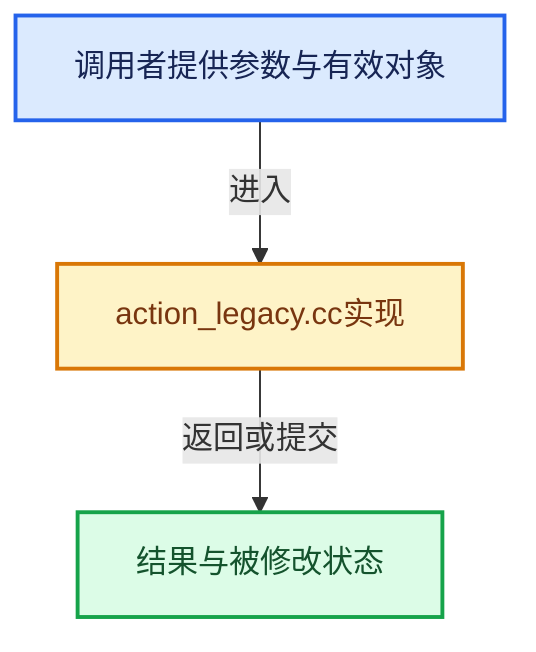

# 实现依赖专题：source/blender/animrig/intern/action_legacy.cc

[方向导航](README.md) · [符号索引](../%E7%AC%A6%E5%8F%B7%E4%BE%9D%E8%B5%96%E4%B8%8E%E5%AE%9E%E7%8E%B0%E7%B4%A2%E5%BC%95.md)

本专题从正文实际调用进入，集中保存共享实现。函数有稳定锚点，可从调用处直接跳到对应完整函数；递归与互相调用通过回链组织。

## 本文件的实现关系






## 完整成员与函数实现

<a id="f-5f02939362a13b90"></a>

### `blender::animrig::legacy::fcurves_all_templated`

实现位置：[source/blender/animrig/intern/action_legacy.cc](../../../../../source/blender/animrig/intern/action_legacy.cc) · L21—L45。

接口参数：

- `ActionType &action`

**教学注释版**

<!-- annotated:0d2b99b4029b56 -->

```cpp
template<typename ActionType,
         typename FCurveType,
         typename LayerType,
         typename StripType,
         typename StripKeyframeDataType,
         typename ChannelbagType>
static Vector<FCurveType *> fcurves_all_templated(ActionType &action)
{
  Vector<FCurveType *> all_fcurves;
  for (LayerType *layer : action.layers()) {
    for (StripType *strip : layer->strips()) {
      switch (strip->type()) {
        case Strip::Type::Keyframe: {
          StripKeyframeDataType &strip_data = strip->template data<StripKeyframeData>(action);
          for (ChannelbagType *bag : strip_data.channelbags()) {
            for (FCurveType *fcurve : bag->fcurves()) {
              // [讲解] all_fcurves.append：在尾部建立新元素，必要时先扩大存储。
              all_fcurves.append(fcurve);
            }
          }
        }
      }
    }
  }
  return all_fcurves;
}
```

<details>
<summary>核对原始源码：source/blender/animrig/intern/action_legacy.cc · L21—L45</summary>

<!-- original:0d2b99b4029b56:source/blender/animrig/intern/action_legacy.cc:21:45 -->

```cpp
template<typename ActionType,
         typename FCurveType,
         typename LayerType,
         typename StripType,
         typename StripKeyframeDataType,
         typename ChannelbagType>
static Vector<FCurveType *> fcurves_all_templated(ActionType &action)
{
  Vector<FCurveType *> all_fcurves;
  for (LayerType *layer : action.layers()) {
    for (StripType *strip : layer->strips()) {
      switch (strip->type()) {
        case Strip::Type::Keyframe: {
          StripKeyframeDataType &strip_data = strip->template data<StripKeyframeData>(action);
          for (ChannelbagType *bag : strip_data.channelbags()) {
            for (FCurveType *fcurve : bag->fcurves()) {
              all_fcurves.append(fcurve);
            }
          }
        }
      }
    }
  }
  return all_fcurves;
}
```

</details>

**结果出口**

- `return all_fcurves;`

**继续追踪实现**

- `action.layers` → [调用协议](../%E6%A8%A1%E6%9D%BF%E5%AE%8F%E4%B8%8E%E5%8A%A8%E6%80%81%E5%88%86%E6%B4%BE%E5%8D%8F%E8%AE%AE.md)：由接收对象具体类型或运行时策略提供实现。调用位置L30。
- `layer->strips` → [调用协议](../%E6%A8%A1%E6%9D%BF%E5%AE%8F%E4%B8%8E%E5%8A%A8%E6%80%81%E5%88%86%E6%B4%BE%E5%8D%8F%E8%AE%AE.md)：接收对象类型依赖auto、返回值或模板实例；不按同名猜测目标。调用位置L31。
- `strip->type` → [调用协议](../%E6%A8%A1%E6%9D%BF%E5%AE%8F%E4%B8%8E%E5%8A%A8%E6%80%81%E5%88%86%E6%B4%BE%E5%8D%8F%E8%AE%AE.md)：接收对象类型依赖auto、返回值或模板实例；不按同名猜测目标。调用位置L32。
- `strip->template data<StripKeyframeData>` → [调用协议](../%E6%A8%A1%E6%9D%BF%E5%AE%8F%E4%B8%8E%E5%8A%A8%E6%80%81%E5%88%86%E6%B4%BE%E5%8D%8F%E8%AE%AE.md)：接收对象类型依赖auto、返回值或模板实例；不按同名猜测目标。调用位置L34。
- `strip_data.channelbags` → [blender::animrig::StripKeyframeData::channelbags · L1646](%E4%BE%9D%E8%B5%96-action-a70714.md#f-132633036de44563)；[blender::animrig::StripKeyframeData::channelbags · L1651](%E4%BE%9D%E8%B5%96-action-a70714.md#f-4e27ea4ad885d4cf)。同名重载需按实参类型选择。
- `bag->fcurves` → [调用协议](../%E6%A8%A1%E6%9D%BF%E5%AE%8F%E4%B8%8E%E5%8A%A8%E6%80%81%E5%88%86%E6%B4%BE%E5%8D%8F%E8%AE%AE.md)：接收对象类型依赖auto、返回值或模板实例；不按同名猜测目标。调用位置L36。
- `all_fcurves.append` → [blender::Vector::append · L498](../01-%E5%9F%BA%E7%A1%80%E5%AE%B9%E5%99%A8%E4%B8%8E%E7%8E%B0%E4%BB%A3CPP/11-Vector%E6%8F%92%E5%85%A5%E5%88%A0%E9%99%A4%E4%B8%8E%E9%87%8D%E6%8E%92.md#f-5bde268a69e443ec)；[blender::Vector::append · L502](../01-%E5%9F%BA%E7%A1%80%E5%AE%B9%E5%99%A8%E4%B8%8E%E7%8E%B0%E4%BB%A3CPP/11-Vector%E6%8F%92%E5%85%A5%E5%88%A0%E9%99%A4%E4%B8%8E%E9%87%8D%E6%8E%92.md#f-591e0b15e6308532)。同名重载需按实参类型选择。

<a id="f-e942e013a955863c"></a>

### `blender::animrig::legacy::fcurves_all`

实现位置：[source/blender/animrig/intern/action_legacy.cc](../../../../../source/blender/animrig/intern/action_legacy.cc) · L47—L54。

接口参数：

- `bAction *action`

**教学注释版**

<!-- annotated:a3556f3d2803db -->

```cpp
Vector<FCurve *> fcurves_all(bAction *action)
{
  if (!action) {
    return {};
  }
  return fcurves_all_templated<Action, FCurve, Layer, Strip, StripKeyframeData, Channelbag>(
      action->wrap());
}
```

<details>
<summary>核对原始源码：source/blender/animrig/intern/action_legacy.cc · L47—L54</summary>

<!-- original:a3556f3d2803db:source/blender/animrig/intern/action_legacy.cc:47:54 -->

```cpp
Vector<FCurve *> fcurves_all(bAction *action)
{
  if (!action) {
    return {};
  }
  return fcurves_all_templated<Action, FCurve, Layer, Strip, StripKeyframeData, Channelbag>(
      action->wrap());
}
```

</details>

**结果出口**

- `return {};`
- `return fcurves_all_templated<Action, FCurve, Layer, Strip, StripKeyframeData, Channelbag>(`

**继续追踪实现**

- `fcurves_all_templated<Action, FCurve, Layer, Strip, StripKeyframeData, Channelbag>` → [blender::animrig::legacy::fcurves_all_templated · L21](%E4%BE%9D%E8%B5%96-action_legacy-97c3c1.md#f-5f02939362a13b90)。
- `action->wrap` → [blender::bAction::wrap · L1929](%E4%BE%9D%E8%B5%96-ANIM_action-8e402f.md#f-f049614274fd7a45)；[blender::bAction::wrap · L1933](%E4%BE%9D%E8%B5%96-ANIM_action-8e402f.md#f-2d697d1983fd282f)。同名重载需按实参类型选择。

<a id="f-d798b01e76e711ba"></a>

### `blender::animrig::legacy::fcurves_all`

实现位置：[source/blender/animrig/intern/action_legacy.cc](../../../../../source/blender/animrig/intern/action_legacy.cc) · L56—L67。

接口参数：

- `const bAction *action`

**教学注释版**

<!-- annotated:624551ded2d8c3 -->

```cpp
Vector<const FCurve *> fcurves_all(const bAction *action)
{
  if (!action) {
    return {};
  }
  return fcurves_all_templated<const Action,
                               const FCurve,
                               const Layer,
                               const Strip,
                               const StripKeyframeData,
                               const Channelbag>(action->wrap());
}
```

<details>
<summary>核对原始源码：source/blender/animrig/intern/action_legacy.cc · L56—L67</summary>

<!-- original:624551ded2d8c3:source/blender/animrig/intern/action_legacy.cc:56:67 -->

```cpp
Vector<const FCurve *> fcurves_all(const bAction *action)
{
  if (!action) {
    return {};
  }
  return fcurves_all_templated<const Action,
                               const FCurve,
                               const Layer,
                               const Strip,
                               const StripKeyframeData,
                               const Channelbag>(action->wrap());
}
```

</details>

**结果出口**

- `return {};`
- `return fcurves_all_templated<const Action,`

**继续追踪实现**

- `fcurves_all_templated<const Action, const FCurve, const Layer, const Strip, const StripKeyframeData, const Channelbag>` → [调用协议](../%E6%A8%A1%E6%9D%BF%E5%AE%8F%E4%B8%8E%E5%8A%A8%E6%80%81%E5%88%86%E6%B4%BE%E5%8D%8F%E8%AE%AE.md)：函数指针、局部可调用对象或未展开的宏；必须结合调用者环境。调用位置L61。
- `action->wrap` → [blender::bAction::wrap · L1929](%E4%BE%9D%E8%B5%96-ANIM_action-8e402f.md#f-f049614274fd7a45)；[blender::bAction::wrap · L1933](%E4%BE%9D%E8%B5%96-ANIM_action-8e402f.md#f-2d697d1983fd282f)。同名重载需按实参类型选择。

<a id="f-510a8ce29eb7a9c6"></a>

### `blender::animrig::legacy::action_fcurves_remove`

实现位置：[source/blender/animrig/intern/action_legacy.cc](../../../../../source/blender/animrig/intern/action_legacy.cc) · L132—L161。

接口参数：

- `bAction &action`
- `const slot_handle_t slot_handle`
- `const StringRefNull rna_path_prefix`

**教学注释版**

<!-- annotated:a05d8fab2c3da7 -->

```cpp
bool action_fcurves_remove(bAction &action,
                           const slot_handle_t slot_handle,
                           const StringRefNull rna_path_prefix)
{
  BLI_assert(!rna_path_prefix.is_empty());
  if (rna_path_prefix.is_empty()) {
    return false;
  }

  Channelbag *bag = channelbag_for_action_slot(action.wrap(), slot_handle);
  if (!bag) {
    return false;
  }

  bool any_removed = false;
  for (int64_t fcurve_index = 0; fcurve_index < bag->fcurve_array_num; fcurve_index++) {
    FCurve *fcurve = bag->fcurve(fcurve_index);
    const StringRefNull rna_path = fcurve->rna_path();
    if (rna_path.is_empty()) {
      continue;
    }

    if (rna_path.startswith(rna_path_prefix)) {
      bag->fcurve_remove_by_index(fcurve_index);
      fcurve_index--;
      any_removed = true;
    }
  }
  return any_removed;
}
```

<details>
<summary>核对原始源码：source/blender/animrig/intern/action_legacy.cc · L132—L161</summary>

<!-- original:a05d8fab2c3da7:source/blender/animrig/intern/action_legacy.cc:132:161 -->

```cpp
bool action_fcurves_remove(bAction &action,
                           const slot_handle_t slot_handle,
                           const StringRefNull rna_path_prefix)
{
  BLI_assert(!rna_path_prefix.is_empty());
  if (rna_path_prefix.is_empty()) {
    return false;
  }

  Channelbag *bag = channelbag_for_action_slot(action.wrap(), slot_handle);
  if (!bag) {
    return false;
  }

  bool any_removed = false;
  for (int64_t fcurve_index = 0; fcurve_index < bag->fcurve_array_num; fcurve_index++) {
    FCurve *fcurve = bag->fcurve(fcurve_index);
    const StringRefNull rna_path = fcurve->rna_path();
    if (rna_path.is_empty()) {
      continue;
    }

    if (rna_path.startswith(rna_path_prefix)) {
      bag->fcurve_remove_by_index(fcurve_index);
      fcurve_index--;
      any_removed = true;
    }
  }
  return any_removed;
}
```

</details>

**沿实际写入检查状态**

- `any_removed = true;`

**结果出口**

- `return false;`
- `return any_removed;`

**继续追踪实现**

- `BLI_assert` → [BLI_assert · L48](../01-%E5%9F%BA%E7%A1%80%E5%AE%B9%E5%99%A8%E4%B8%8E%E7%8E%B0%E4%BB%A3CPP/%E4%BE%9D%E8%B5%96-BLI_assert-cc98e8.md#m-57a88495704d)；[BLI_assert · L63](../01-%E5%9F%BA%E7%A1%80%E5%AE%B9%E5%99%A8%E4%B8%8E%E7%8E%B0%E4%BB%A3CPP/%E4%BE%9D%E8%B5%96-BLI_assert-cc98e8.md#m-d07050020cb5)。宏定义由构建条件选择。
- `rna_path_prefix.is_empty` → [调用协议](../%E6%A8%A1%E6%9D%BF%E5%AE%8F%E4%B8%8E%E5%8A%A8%E6%80%81%E5%88%86%E6%B4%BE%E5%8D%8F%E8%AE%AE.md)：由接收对象具体类型或运行时策略提供实现。调用位置L136。
- `channelbag_for_action_slot` → [blender::animrig::channelbag_for_action_slot · L2480](%E4%BE%9D%E8%B5%96-action-a70714.md#f-18a33399c4b501d4)；[blender::animrig::channelbag_for_action_slot · L2537](%E4%BE%9D%E8%B5%96-action-a70714.md#f-55e254f60bca7fbf)。同名重载需按实参类型选择。
- `action.wrap` → [blender::bAction::wrap · L1929](%E4%BE%9D%E8%B5%96-ANIM_action-8e402f.md#f-f049614274fd7a45)；[blender::bAction::wrap · L1933](%E4%BE%9D%E8%B5%96-ANIM_action-8e402f.md#f-2d697d1983fd282f)。同名重载需按实参类型选择。
- `bag->fcurve` → [blender::animrig::Channelbag::fcurve · L2238](%E4%BE%9D%E8%B5%96-action-a70714.md#f-3c9fc1aa676b68d6)；[blender::animrig::Channelbag::fcurve · L2242](%E4%BE%9D%E8%B5%96-action-a70714.md#f-cf79f910c4cbcd2f)。同名重载需按实参类型选择。
- `fcurve->rna_path` → [blender::FCurve::rna_path · L189](%E4%BE%9D%E8%B5%96-fcurve-593e2e.md#f-b3be61588d36ab9c)。
- `rna_path.is_empty` → [调用协议](../%E6%A8%A1%E6%9D%BF%E5%AE%8F%E4%B8%8E%E5%8A%A8%E6%80%81%E5%88%86%E6%B4%BE%E5%8D%8F%E8%AE%AE.md)：由接收对象具体类型或运行时策略提供实现。调用位置L150。
- `rna_path.startswith` → [blender::StringRefBase::startswith · L269](../01-%E5%9F%BA%E7%A1%80%E5%AE%B9%E5%99%A8%E4%B8%8E%E7%8E%B0%E4%BB%A3CPP/15-StringRef%E5%AD%97%E7%AC%A6%E4%B8%B2%E8%A7%86%E5%9B%BE.md#f-78237ccfe249bfa5)。
- `bag->fcurve_remove_by_index` → [blender::animrig::Channelbag::fcurve_remove_by_index · L1978](%E4%BE%9D%E8%B5%96-action-a70714.md#f-ffef669862ab3fc0)。
