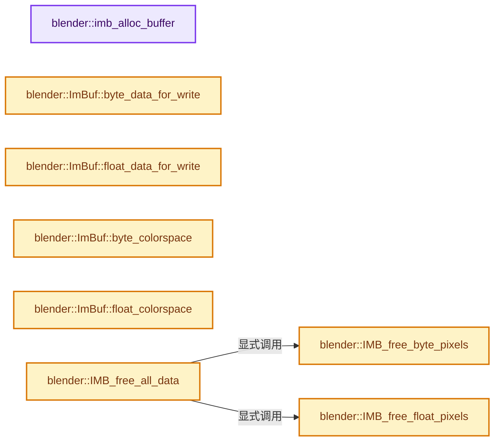

# 实现依赖专题：source/blender/imbuf/intern/allocimbuf.cc

[方向导航](README.md) · [符号索引](../%E7%AC%A6%E5%8F%B7%E4%BE%9D%E8%B5%96%E4%B8%8E%E5%AE%9E%E7%8E%B0%E7%B4%A2%E5%BC%95.md)

本专题从正文实际调用进入，集中保存共享实现。函数有稳定锚点，可从调用处直接跳到对应完整函数；递归与互相调用通过回链组织。

## 本文件的实现关系




## 完整成员与函数实现

<a id="f-3fee44a46f6414b1"></a>

### `blender::imb_alloc_buffer`

实现位置：[source/blender/imbuf/intern/allocimbuf.cc](../../../../../source/blender/imbuf/intern/allocimbuf.cc) · L43—L58。

接口参数：

- `BufferType &buffer`
- `const uint x`
- `const uint y`
- `const uint channels`
- `const size_t type_size`
- `bool initialize_pixels`

**教学注释版**

<!-- annotated:c813c0048fa8db -->

```cpp
template<class BufferType>
bool imb_alloc_buffer(BufferType &buffer,
                      const uint x,
                      const uint y,
                      const uint channels,
                      const size_t type_size,
                      bool initialize_pixels)
{
  void *data = imb_alloc_pixels(x, y, channels, type_size, initialize_pixels, __func__);
  if (!data) {
    return false;
  }
  buffer.data = static_cast<decltype(BufferType::data)>(data);
  buffer.sharing_info = ImplicitSharingPtr<>(implicit_sharing::info_for_mem_free(buffer.data));
  return true;
}
```

<details>
<summary>核对原始源码：source/blender/imbuf/intern/allocimbuf.cc · L43—L58</summary>

<!-- original:c813c0048fa8db:source/blender/imbuf/intern/allocimbuf.cc:43:58 -->

```cpp
template<class BufferType>
bool imb_alloc_buffer(BufferType &buffer,
                      const uint x,
                      const uint y,
                      const uint channels,
                      const size_t type_size,
                      bool initialize_pixels)
{
  void *data = imb_alloc_pixels(x, y, channels, type_size, initialize_pixels, __func__);
  if (!data) {
    return false;
  }
  buffer.data = static_cast<decltype(BufferType::data)>(data);
  buffer.sharing_info = ImplicitSharingPtr<>(implicit_sharing::info_for_mem_free(buffer.data));
  return true;
}
```

</details>

**沿实际写入检查状态**

- `buffer.data = static_cast<decltype(BufferType::data)>(data);`
- `buffer.sharing_info = ImplicitSharingPtr<>(implicit_sharing::info_for_mem_free(buffer.data));`

**结果出口**

- `return false;`
- `return true;`

**继续追踪实现**

- `imb_alloc_pixels` → [blender::imb_alloc_pixels · L186](%E4%BE%9D%E8%B5%96-allocimbuf-bc68dd.md#f-54b1728dd3f38fce)。
- `ImplicitSharingPtr<>` → [blender::ImplicitSharingPtr::ImplicitSharingPtr · L32](../06-%E9%9A%90%E5%BC%8F%E5%85%B1%E4%BA%AB%E4%B8%8E%E7%BC%93%E5%AD%98%E7%B3%BB%E7%BB%9F/03-Mixin%E4%B8%8E%E5%85%B1%E4%BA%AB%E6%8C%87%E9%92%88%E5%B0%81%E8%A3%85.md#f-d28a43dbb5ed8c05)；[blender::ImplicitSharingPtr::ImplicitSharingPtr · L34](../06-%E9%9A%90%E5%BC%8F%E5%85%B1%E4%BA%AB%E4%B8%8E%E7%BC%93%E5%AD%98%E7%B3%BB%E7%BB%9F/03-Mixin%E4%B8%8E%E5%85%B1%E4%BA%AB%E6%8C%87%E9%92%88%E5%B0%81%E8%A3%85.md#f-d27d5ebf676e244a)；[blender::ImplicitSharingPtr::ImplicitSharingPtr · L37](../06-%E9%9A%90%E5%BC%8F%E5%85%B1%E4%BA%AB%E4%B8%8E%E7%BC%93%E5%AD%98%E7%B3%BB%E7%BB%9F/03-Mixin%E4%B8%8E%E5%85%B1%E4%BA%AB%E6%8C%87%E9%92%88%E5%B0%81%E8%A3%85.md#f-17d0c5fe2b03a664)；[blender::ImplicitSharingPtr::ImplicitSharingPtr · L39](../06-%E9%9A%90%E5%BC%8F%E5%85%B1%E4%BA%AB%E4%B8%8E%E7%BC%93%E5%AD%98%E7%B3%BB%E7%BB%9F/03-Mixin%E4%B8%8E%E5%85%B1%E4%BA%AB%E6%8C%87%E9%92%88%E5%B0%81%E8%A3%85.md#f-1c8729ae57532370)；[blender::ImplicitSharingPtr::ImplicitSharingPtr · L44](../06-%E9%9A%90%E5%BC%8F%E5%85%B1%E4%BA%AB%E4%B8%8E%E7%BC%93%E5%AD%98%E7%B3%BB%E7%BB%9F/03-Mixin%E4%B8%8E%E5%85%B1%E4%BA%AB%E6%8C%87%E9%92%88%E5%B0%81%E8%A3%85.md#f-0b6be0142b98009e)；[blender::ImplicitSharingPtr::ImplicitSharingPtr · L49](../06-%E9%9A%90%E5%BC%8F%E5%85%B1%E4%BA%AB%E4%B8%8E%E7%BC%93%E5%AD%98%E7%B3%BB%E7%BB%9F/03-Mixin%E4%B8%8E%E5%85%B1%E4%BA%AB%E6%8C%87%E9%92%88%E5%B0%81%E8%A3%85.md#f-90c601ed9ed99045)；[blender::ImplicitSharingPtr::ImplicitSharingPtr · L57](../06-%E9%9A%90%E5%BC%8F%E5%85%B1%E4%BA%AB%E4%B8%8E%E7%BC%93%E5%AD%98%E7%B3%BB%E7%BB%9F/03-Mixin%E4%B8%8E%E5%85%B1%E4%BA%AB%E6%8C%87%E9%92%88%E5%B0%81%E8%A3%85.md#f-1625179ceae7a66d)。同名重载需按实参类型选择。
- `implicit_sharing::info_for_mem_free` → [blender::implicit_sharing::info_for_mem_free · L301](../06-%E9%9A%90%E5%BC%8F%E5%85%B1%E4%BA%AB%E4%B8%8E%E7%BC%93%E5%AD%98%E7%B3%BB%E7%BB%9F/02-ImplicitSharingInfo%E8%AE%A1%E6%95%B0.md#f-7ad95caa930eb54d)。

<a id="f-9ae201bd1c52aa87"></a>

### `blender::ImBuf::byte_data_for_write`

实现位置：[source/blender/imbuf/intern/allocimbuf.cc](../../../../../source/blender/imbuf/intern/allocimbuf.cc) · L60—L77。

**教学注释版**

<!-- annotated:8ae93770be55e0 -->

```cpp
uint8_t *ImBuf::byte_data_for_write()
{
  if (!this->byte_buffer.data) {
    return nullptr;
  }
  if (this->byte_buffer.sharing_info->is_mutable()) {
    this->byte_buffer.sharing_info->tag_ensured_mutable();
  }
  else {
    const size_t size = size_t(this->x) * size_t(this->y) * 4;
    uint8_t *new_data = MEM_new_array_uninitialized<uint8_t>(size, __func__);
    std::copy_n(this->byte_buffer.data, size, new_data);
    this->byte_buffer.data = new_data;
    this->byte_buffer.sharing_info = ImplicitSharingPtr<>(
        implicit_sharing::info_for_mem_free(new_data));
  }
  return const_cast<uint8_t *>(this->byte_buffer.data);
}
```

<details>
<summary>核对原始源码：source/blender/imbuf/intern/allocimbuf.cc · L60—L77</summary>

<!-- original:8ae93770be55e0:source/blender/imbuf/intern/allocimbuf.cc:60:77 -->

```cpp
uint8_t *ImBuf::byte_data_for_write()
{
  if (!this->byte_buffer.data) {
    return nullptr;
  }
  if (this->byte_buffer.sharing_info->is_mutable()) {
    this->byte_buffer.sharing_info->tag_ensured_mutable();
  }
  else {
    const size_t size = size_t(this->x) * size_t(this->y) * 4;
    uint8_t *new_data = MEM_new_array_uninitialized<uint8_t>(size, __func__);
    std::copy_n(this->byte_buffer.data, size, new_data);
    this->byte_buffer.data = new_data;
    this->byte_buffer.sharing_info = ImplicitSharingPtr<>(
        implicit_sharing::info_for_mem_free(new_data));
  }
  return const_cast<uint8_t *>(this->byte_buffer.data);
}
```

</details>

**沿实际写入检查状态**

- `this->byte_buffer.data = new_data;`
- `this->byte_buffer.sharing_info = ImplicitSharingPtr<>(`

**结果出口**

- `return nullptr;`
- `return const_cast<uint8_t *>(this->byte_buffer.data);`

**继续追踪实现**

- `this->byte_buffer.sharing_info->is_mutable` → [调用协议](../%E6%A8%A1%E6%9D%BF%E5%AE%8F%E4%B8%8E%E5%8A%A8%E6%80%81%E5%88%86%E6%B4%BE%E5%8D%8F%E8%AE%AE.md)：接收对象类型依赖auto、返回值或模板实例；不按同名猜测目标。调用位置L65。
- `this->byte_buffer.sharing_info->tag_ensured_mutable` → [调用协议](../%E6%A8%A1%E6%9D%BF%E5%AE%8F%E4%B8%8E%E5%8A%A8%E6%80%81%E5%88%86%E6%B4%BE%E5%8D%8F%E8%AE%AE.md)：接收对象类型依赖auto、返回值或模板实例；不按同名猜测目标。调用位置L66。
- `MEM_new_array_uninitialized<uint8_t>` → [MEM_new_array_uninitialized · L608](../03-%E5%86%85%E5%AD%98%E5%88%86%E9%85%8D%E4%B8%8E%E8%BF%90%E8%A1%8C%E6%97%B6%E7%B1%BB%E5%9E%8B/%E4%BE%9D%E8%B5%96-MEM_guardedalloc-b54eca.md#f-b7103eae8eb57b05)；[MEM_new_array_uninitialized · L129](../03-%E5%86%85%E5%AD%98%E5%88%86%E9%85%8D%E4%B8%8E%E8%BF%90%E8%A1%8C%E6%97%B6%E7%B1%BB%E5%9E%8B/%E4%BE%9D%E8%B5%96-mallocn-afdcd4.md#f-bf6ef4ddcfb6e5df)。同名重载需按实参类型选择。
- `std::copy_n` → [外部契约](https://eel.is/c++draft/)：这个边界按实际表达式及所属类型核对参数、返回值、寿命与失败行为。这里提供接口入口，不声称已解释该第三方版本的内部实现。
- `ImplicitSharingPtr<>` → [blender::ImplicitSharingPtr::ImplicitSharingPtr · L32](../06-%E9%9A%90%E5%BC%8F%E5%85%B1%E4%BA%AB%E4%B8%8E%E7%BC%93%E5%AD%98%E7%B3%BB%E7%BB%9F/03-Mixin%E4%B8%8E%E5%85%B1%E4%BA%AB%E6%8C%87%E9%92%88%E5%B0%81%E8%A3%85.md#f-d28a43dbb5ed8c05)；[blender::ImplicitSharingPtr::ImplicitSharingPtr · L34](../06-%E9%9A%90%E5%BC%8F%E5%85%B1%E4%BA%AB%E4%B8%8E%E7%BC%93%E5%AD%98%E7%B3%BB%E7%BB%9F/03-Mixin%E4%B8%8E%E5%85%B1%E4%BA%AB%E6%8C%87%E9%92%88%E5%B0%81%E8%A3%85.md#f-d27d5ebf676e244a)；[blender::ImplicitSharingPtr::ImplicitSharingPtr · L37](../06-%E9%9A%90%E5%BC%8F%E5%85%B1%E4%BA%AB%E4%B8%8E%E7%BC%93%E5%AD%98%E7%B3%BB%E7%BB%9F/03-Mixin%E4%B8%8E%E5%85%B1%E4%BA%AB%E6%8C%87%E9%92%88%E5%B0%81%E8%A3%85.md#f-17d0c5fe2b03a664)；[blender::ImplicitSharingPtr::ImplicitSharingPtr · L39](../06-%E9%9A%90%E5%BC%8F%E5%85%B1%E4%BA%AB%E4%B8%8E%E7%BC%93%E5%AD%98%E7%B3%BB%E7%BB%9F/03-Mixin%E4%B8%8E%E5%85%B1%E4%BA%AB%E6%8C%87%E9%92%88%E5%B0%81%E8%A3%85.md#f-1c8729ae57532370)；[blender::ImplicitSharingPtr::ImplicitSharingPtr · L44](../06-%E9%9A%90%E5%BC%8F%E5%85%B1%E4%BA%AB%E4%B8%8E%E7%BC%93%E5%AD%98%E7%B3%BB%E7%BB%9F/03-Mixin%E4%B8%8E%E5%85%B1%E4%BA%AB%E6%8C%87%E9%92%88%E5%B0%81%E8%A3%85.md#f-0b6be0142b98009e)；[blender::ImplicitSharingPtr::ImplicitSharingPtr · L49](../06-%E9%9A%90%E5%BC%8F%E5%85%B1%E4%BA%AB%E4%B8%8E%E7%BC%93%E5%AD%98%E7%B3%BB%E7%BB%9F/03-Mixin%E4%B8%8E%E5%85%B1%E4%BA%AB%E6%8C%87%E9%92%88%E5%B0%81%E8%A3%85.md#f-90c601ed9ed99045)；[blender::ImplicitSharingPtr::ImplicitSharingPtr · L57](../06-%E9%9A%90%E5%BC%8F%E5%85%B1%E4%BA%AB%E4%B8%8E%E7%BC%93%E5%AD%98%E7%B3%BB%E7%BB%9F/03-Mixin%E4%B8%8E%E5%85%B1%E4%BA%AB%E6%8C%87%E9%92%88%E5%B0%81%E8%A3%85.md#f-1625179ceae7a66d)。同名重载需按实参类型选择。
- `implicit_sharing::info_for_mem_free` → [blender::implicit_sharing::info_for_mem_free · L301](../06-%E9%9A%90%E5%BC%8F%E5%85%B1%E4%BA%AB%E4%B8%8E%E7%BC%93%E5%AD%98%E7%B3%BB%E7%BB%9F/02-ImplicitSharingInfo%E8%AE%A1%E6%95%B0.md#f-7ad95caa930eb54d)。

<a id="f-1956ac4db88ed3eb"></a>

### `blender::ImBuf::float_data_for_write`

实现位置：[source/blender/imbuf/intern/allocimbuf.cc](../../../../../source/blender/imbuf/intern/allocimbuf.cc) · L79—L96。

**教学注释版**

<!-- annotated:2a2800383fa858 -->

```cpp
float *ImBuf::float_data_for_write()
{
  if (!this->float_buffer.data) {
    return nullptr;
  }
  if (this->float_buffer.sharing_info->is_mutable()) {
    this->float_buffer.sharing_info->tag_ensured_mutable();
  }
  else {
    const size_t size = size_t(this->x) * size_t(this->y) * this->channels;
    float *new_data = MEM_new_array_uninitialized<float>(size, __func__);
    std::copy_n(this->float_buffer.data, size, new_data);
    this->float_buffer.data = new_data;
    this->float_buffer.sharing_info = ImplicitSharingPtr<>(
        implicit_sharing::info_for_mem_free(new_data));
  }
  return const_cast<float *>(this->float_buffer.data);
}
```

<details>
<summary>核对原始源码：source/blender/imbuf/intern/allocimbuf.cc · L79—L96</summary>

<!-- original:2a2800383fa858:source/blender/imbuf/intern/allocimbuf.cc:79:96 -->

```cpp
float *ImBuf::float_data_for_write()
{
  if (!this->float_buffer.data) {
    return nullptr;
  }
  if (this->float_buffer.sharing_info->is_mutable()) {
    this->float_buffer.sharing_info->tag_ensured_mutable();
  }
  else {
    const size_t size = size_t(this->x) * size_t(this->y) * this->channels;
    float *new_data = MEM_new_array_uninitialized<float>(size, __func__);
    std::copy_n(this->float_buffer.data, size, new_data);
    this->float_buffer.data = new_data;
    this->float_buffer.sharing_info = ImplicitSharingPtr<>(
        implicit_sharing::info_for_mem_free(new_data));
  }
  return const_cast<float *>(this->float_buffer.data);
}
```

</details>

**沿实际写入检查状态**

- `this->float_buffer.data = new_data;`
- `this->float_buffer.sharing_info = ImplicitSharingPtr<>(`

**结果出口**

- `return nullptr;`
- `return const_cast<float *>(this->float_buffer.data);`

**继续追踪实现**

- `this->float_buffer.sharing_info->is_mutable` → [调用协议](../%E6%A8%A1%E6%9D%BF%E5%AE%8F%E4%B8%8E%E5%8A%A8%E6%80%81%E5%88%86%E6%B4%BE%E5%8D%8F%E8%AE%AE.md)：接收对象类型依赖auto、返回值或模板实例；不按同名猜测目标。调用位置L84。
- `this->float_buffer.sharing_info->tag_ensured_mutable` → [调用协议](../%E6%A8%A1%E6%9D%BF%E5%AE%8F%E4%B8%8E%E5%8A%A8%E6%80%81%E5%88%86%E6%B4%BE%E5%8D%8F%E8%AE%AE.md)：接收对象类型依赖auto、返回值或模板实例；不按同名猜测目标。调用位置L85。
- `MEM_new_array_uninitialized<float>` → [MEM_new_array_uninitialized · L608](../03-%E5%86%85%E5%AD%98%E5%88%86%E9%85%8D%E4%B8%8E%E8%BF%90%E8%A1%8C%E6%97%B6%E7%B1%BB%E5%9E%8B/%E4%BE%9D%E8%B5%96-MEM_guardedalloc-b54eca.md#f-b7103eae8eb57b05)；[MEM_new_array_uninitialized · L129](../03-%E5%86%85%E5%AD%98%E5%88%86%E9%85%8D%E4%B8%8E%E8%BF%90%E8%A1%8C%E6%97%B6%E7%B1%BB%E5%9E%8B/%E4%BE%9D%E8%B5%96-mallocn-afdcd4.md#f-bf6ef4ddcfb6e5df)。同名重载需按实参类型选择。
- `std::copy_n` → [外部契约](https://eel.is/c++draft/)：这个边界按实际表达式及所属类型核对参数、返回值、寿命与失败行为。这里提供接口入口，不声称已解释该第三方版本的内部实现。
- `ImplicitSharingPtr<>` → [blender::ImplicitSharingPtr::ImplicitSharingPtr · L32](../06-%E9%9A%90%E5%BC%8F%E5%85%B1%E4%BA%AB%E4%B8%8E%E7%BC%93%E5%AD%98%E7%B3%BB%E7%BB%9F/03-Mixin%E4%B8%8E%E5%85%B1%E4%BA%AB%E6%8C%87%E9%92%88%E5%B0%81%E8%A3%85.md#f-d28a43dbb5ed8c05)；[blender::ImplicitSharingPtr::ImplicitSharingPtr · L34](../06-%E9%9A%90%E5%BC%8F%E5%85%B1%E4%BA%AB%E4%B8%8E%E7%BC%93%E5%AD%98%E7%B3%BB%E7%BB%9F/03-Mixin%E4%B8%8E%E5%85%B1%E4%BA%AB%E6%8C%87%E9%92%88%E5%B0%81%E8%A3%85.md#f-d27d5ebf676e244a)；[blender::ImplicitSharingPtr::ImplicitSharingPtr · L37](../06-%E9%9A%90%E5%BC%8F%E5%85%B1%E4%BA%AB%E4%B8%8E%E7%BC%93%E5%AD%98%E7%B3%BB%E7%BB%9F/03-Mixin%E4%B8%8E%E5%85%B1%E4%BA%AB%E6%8C%87%E9%92%88%E5%B0%81%E8%A3%85.md#f-17d0c5fe2b03a664)；[blender::ImplicitSharingPtr::ImplicitSharingPtr · L39](../06-%E9%9A%90%E5%BC%8F%E5%85%B1%E4%BA%AB%E4%B8%8E%E7%BC%93%E5%AD%98%E7%B3%BB%E7%BB%9F/03-Mixin%E4%B8%8E%E5%85%B1%E4%BA%AB%E6%8C%87%E9%92%88%E5%B0%81%E8%A3%85.md#f-1c8729ae57532370)；[blender::ImplicitSharingPtr::ImplicitSharingPtr · L44](../06-%E9%9A%90%E5%BC%8F%E5%85%B1%E4%BA%AB%E4%B8%8E%E7%BC%93%E5%AD%98%E7%B3%BB%E7%BB%9F/03-Mixin%E4%B8%8E%E5%85%B1%E4%BA%AB%E6%8C%87%E9%92%88%E5%B0%81%E8%A3%85.md#f-0b6be0142b98009e)；[blender::ImplicitSharingPtr::ImplicitSharingPtr · L49](../06-%E9%9A%90%E5%BC%8F%E5%85%B1%E4%BA%AB%E4%B8%8E%E7%BC%93%E5%AD%98%E7%B3%BB%E7%BB%9F/03-Mixin%E4%B8%8E%E5%85%B1%E4%BA%AB%E6%8C%87%E9%92%88%E5%B0%81%E8%A3%85.md#f-90c601ed9ed99045)；[blender::ImplicitSharingPtr::ImplicitSharingPtr · L57](../06-%E9%9A%90%E5%BC%8F%E5%85%B1%E4%BA%AB%E4%B8%8E%E7%BC%93%E5%AD%98%E7%B3%BB%E7%BB%9F/03-Mixin%E4%B8%8E%E5%85%B1%E4%BA%AB%E6%8C%87%E9%92%88%E5%B0%81%E8%A3%85.md#f-1625179ceae7a66d)。同名重载需按实参类型选择。
- `implicit_sharing::info_for_mem_free` → [blender::implicit_sharing::info_for_mem_free · L301](../06-%E9%9A%90%E5%BC%8F%E5%85%B1%E4%BA%AB%E4%B8%8E%E7%BC%93%E5%AD%98%E7%B3%BB%E7%BB%9F/02-ImplicitSharingInfo%E8%AE%A1%E6%95%B0.md#f-7ad95caa930eb54d)。

<a id="f-6bc1d045db6e08c0"></a>

### `blender::ImBuf::byte_colorspace`

实现位置：[source/blender/imbuf/intern/allocimbuf.cc](../../../../../source/blender/imbuf/intern/allocimbuf.cc) · L98—L106。

**教学注释版**

<!-- annotated:17e925c7569496 -->

```cpp
const ColorSpace &ImBuf::byte_colorspace() const
{
  if (this->byte_buffer.colorspace) {
    return *this->byte_buffer.colorspace;
  }

  return *IMB_colormanagement_space_get_named(
      IMB_colormanagement_role_colorspace_name_get(COLOR_ROLE_DEFAULT_BYTE));
}
```

<details>
<summary>核对原始源码：source/blender/imbuf/intern/allocimbuf.cc · L98—L106</summary>

<!-- original:17e925c7569496:source/blender/imbuf/intern/allocimbuf.cc:98:106 -->

```cpp
const ColorSpace &ImBuf::byte_colorspace() const
{
  if (this->byte_buffer.colorspace) {
    return *this->byte_buffer.colorspace;
  }

  return *IMB_colormanagement_space_get_named(
      IMB_colormanagement_role_colorspace_name_get(COLOR_ROLE_DEFAULT_BYTE));
}
```

</details>

**结果出口**

- `return *this->byte_buffer.colorspace;`
- `return *IMB_colormanagement_space_get_named(`

**继续追踪实现**

- `IMB_colormanagement_space_get_named` → [blender::IMB_colormanagement_space_get_named · L1319](%E4%BE%9D%E8%B5%96-colormanagement-d4733d.md#f-686ba14e51262834)；[blender::IMB_colormanagement_space_get_named · L1323](%E4%BE%9D%E8%B5%96-colormanagement-d4733d.md#f-8171f67dd0b37997)。同名重载需按实参类型选择。
- `IMB_colormanagement_role_colorspace_name_get` → [blender::IMB_colormanagement_role_colorspace_name_get · L1247](%E4%BE%9D%E8%B5%96-colormanagement-d4733d.md#f-f2cf0e85682f0fd8)。

<a id="f-d4dceef3bdf0dd62"></a>

### `blender::ImBuf::float_colorspace`

实现位置：[source/blender/imbuf/intern/allocimbuf.cc](../../../../../source/blender/imbuf/intern/allocimbuf.cc) · L108—L116。

**教学注释版**

<!-- annotated:88865249e550a7 -->

```cpp
const ColorSpace &ImBuf::float_colorspace() const
{
  if (this->float_buffer.colorspace) {
    return *this->float_buffer.colorspace;
  }

  return *IMB_colormanagement_space_get_named(
      IMB_colormanagement_role_colorspace_name_get(COLOR_ROLE_SCENE_LINEAR));
}
```

<details>
<summary>核对原始源码：source/blender/imbuf/intern/allocimbuf.cc · L108—L116</summary>

<!-- original:88865249e550a7:source/blender/imbuf/intern/allocimbuf.cc:108:116 -->

```cpp
const ColorSpace &ImBuf::float_colorspace() const
{
  if (this->float_buffer.colorspace) {
    return *this->float_buffer.colorspace;
  }

  return *IMB_colormanagement_space_get_named(
      IMB_colormanagement_role_colorspace_name_get(COLOR_ROLE_SCENE_LINEAR));
}
```

</details>

**结果出口**

- `return *this->float_buffer.colorspace;`
- `return *IMB_colormanagement_space_get_named(`

**继续追踪实现**

- `IMB_colormanagement_space_get_named` → [blender::IMB_colormanagement_space_get_named · L1319](%E4%BE%9D%E8%B5%96-colormanagement-d4733d.md#f-686ba14e51262834)；[blender::IMB_colormanagement_space_get_named · L1323](%E4%BE%9D%E8%B5%96-colormanagement-d4733d.md#f-8171f67dd0b37997)。同名重载需按实参类型选择。
- `IMB_colormanagement_role_colorspace_name_get` → [blender::IMB_colormanagement_role_colorspace_name_get · L1247](%E4%BE%9D%E8%B5%96-colormanagement-d4733d.md#f-f2cf0e85682f0fd8)。

<a id="f-1eb98e8195599862"></a>

### `blender::IMB_free_float_pixels`

实现位置：[source/blender/imbuf/intern/allocimbuf.cc](../../../../../source/blender/imbuf/intern/allocimbuf.cc) · L118—L126。

接口参数：

- `ImBuf *ibuf`

**教学注释版**

<!-- annotated:300bd2a6b3a9f0 -->

```cpp
void IMB_free_float_pixels(ImBuf *ibuf)
{
  if (ibuf == nullptr) {
    return;
  }
  /* Keep the colorspace, it's used when new pixels are assigned. */
  ibuf->float_buffer.data = nullptr;
  ibuf->float_buffer.sharing_info.reset();
}
```

<details>
<summary>核对原始源码：source/blender/imbuf/intern/allocimbuf.cc · L118—L126</summary>

<!-- original:300bd2a6b3a9f0:source/blender/imbuf/intern/allocimbuf.cc:118:126 -->

```cpp
void IMB_free_float_pixels(ImBuf *ibuf)
{
  if (ibuf == nullptr) {
    return;
  }
  /* Keep the colorspace, it's used when new pixels are assigned. */
  ibuf->float_buffer.data = nullptr;
  ibuf->float_buffer.sharing_info.reset();
}
```

</details>

**沿实际写入检查状态**

- `ibuf->float_buffer.data = nullptr;`

**继续追踪实现**

- `ibuf->float_buffer.sharing_info.reset` → [调用协议](../%E6%A8%A1%E6%9D%BF%E5%AE%8F%E4%B8%8E%E5%8A%A8%E6%80%81%E5%88%86%E6%B4%BE%E5%8D%8F%E8%AE%AE.md)：接收对象类型依赖auto、返回值或模板实例；不按同名猜测目标。调用位置L125。

<a id="f-4b7a8f53593680ab"></a>

### `blender::IMB_free_byte_pixels`

实现位置：[source/blender/imbuf/intern/allocimbuf.cc](../../../../../source/blender/imbuf/intern/allocimbuf.cc) · L128—L136。

接口参数：

- `ImBuf *ibuf`

**教学注释版**

<!-- annotated:353c13dfde8986 -->

```cpp
void IMB_free_byte_pixels(ImBuf *ibuf)
{
  if (ibuf == nullptr) {
    return;
  }
  /* Keep the colorspace, it's used when new pixels are assigned. */
  ibuf->byte_buffer.data = nullptr;
  ibuf->byte_buffer.sharing_info.reset();
}
```

<details>
<summary>核对原始源码：source/blender/imbuf/intern/allocimbuf.cc · L128—L136</summary>

<!-- original:353c13dfde8986:source/blender/imbuf/intern/allocimbuf.cc:128:136 -->

```cpp
void IMB_free_byte_pixels(ImBuf *ibuf)
{
  if (ibuf == nullptr) {
    return;
  }
  /* Keep the colorspace, it's used when new pixels are assigned. */
  ibuf->byte_buffer.data = nullptr;
  ibuf->byte_buffer.sharing_info.reset();
}
```

</details>

**沿实际写入检查状态**

- `ibuf->byte_buffer.data = nullptr;`

**继续追踪实现**

- `ibuf->byte_buffer.sharing_info.reset` → [调用协议](../%E6%A8%A1%E6%9D%BF%E5%AE%8F%E4%B8%8E%E5%8A%A8%E6%80%81%E5%88%86%E6%B4%BE%E5%8D%8F%E8%AE%AE.md)：接收对象类型依赖auto、返回值或模板实例；不按同名猜测目标。调用位置L135。

<a id="f-dd8270803ba33022"></a>

### `blender::IMB_free_all_data`

实现位置：[source/blender/imbuf/intern/allocimbuf.cc](../../../../../source/blender/imbuf/intern/allocimbuf.cc) · L138—L142。

接口参数：

- `ImBuf *ibuf`

**教学注释版**

<!-- annotated:265bf7048a687e -->

```cpp
void IMB_free_all_data(ImBuf *ibuf)
{
  IMB_free_byte_pixels(ibuf);
  IMB_free_float_pixels(ibuf);
}
```

<details>
<summary>核对原始源码：source/blender/imbuf/intern/allocimbuf.cc · L138—L142</summary>

<!-- original:265bf7048a687e:source/blender/imbuf/intern/allocimbuf.cc:138:142 -->

```cpp
void IMB_free_all_data(ImBuf *ibuf)
{
  IMB_free_byte_pixels(ibuf);
  IMB_free_float_pixels(ibuf);
}
```

</details>

**继续追踪实现**

- `IMB_free_byte_pixels` → [blender::IMB_free_byte_pixels · L128](%E4%BE%9D%E8%B5%96-allocimbuf-bc68dd.md#f-4b7a8f53593680ab)。
- `IMB_free_float_pixels` → [blender::IMB_free_float_pixels · L118](%E4%BE%9D%E8%B5%96-allocimbuf-bc68dd.md#f-1eb98e8195599862)。

<a id="f-c830f56ede6f345b"></a>

### `blender::IMB_freeImBuf`

实现位置：[source/blender/imbuf/intern/allocimbuf.cc](../../../../../source/blender/imbuf/intern/allocimbuf.cc) · L144—L161。

接口参数：

- `ImBuf *ibuf`

**教学注释版**

<!-- annotated:b90419a1ed2b97 -->

```cpp
void IMB_freeImBuf(ImBuf *ibuf)
{
  if (ibuf == nullptr) {
    return;
  }

  bool needs_free = atomic_sub_and_fetch_int32(&ibuf->refcounter, 1) < 0;
  if (needs_free) {
    /* Include this check here as the path may be manipulated after creation. */
    BLI_assert_msg(!(ibuf->filepath[0] == '/' && ibuf->filepath[1] == '/'),
                   "'.blend' relative \"//\" must not be used in ImBuf!");

    IMB_free_all_data(ibuf);
    IMB_free_gpu_textures(ibuf);
    IMB_partial_update_free(ibuf);
    MEM_delete(ibuf);
  }
}
```

<details>
<summary>核对原始源码：source/blender/imbuf/intern/allocimbuf.cc · L144—L161</summary>

<!-- original:b90419a1ed2b97:source/blender/imbuf/intern/allocimbuf.cc:144:161 -->

```cpp
void IMB_freeImBuf(ImBuf *ibuf)
{
  if (ibuf == nullptr) {
    return;
  }

  bool needs_free = atomic_sub_and_fetch_int32(&ibuf->refcounter, 1) < 0;
  if (needs_free) {
    /* Include this check here as the path may be manipulated after creation. */
    BLI_assert_msg(!(ibuf->filepath[0] == '/' && ibuf->filepath[1] == '/'),
                   "'.blend' relative \"//\" must not be used in ImBuf!");

    IMB_free_all_data(ibuf);
    IMB_free_gpu_textures(ibuf);
    IMB_partial_update_free(ibuf);
    MEM_delete(ibuf);
  }
}
```

</details>

**继续追踪实现**

- `atomic_sub_and_fetch_int32` → [atomic_sub_and_fetch_int32 · L436](%E4%BE%9D%E8%B5%96-atomic_ops_unix-6b7be2.md#f-0f4c4e4af2053b54)；[atomic_sub_and_fetch_int32 · L507](%E4%BE%9D%E8%B5%96-atomic_ops_unix-6b7be2.md#f-627ef70fbfffac02)；[atomic_sub_and_fetch_int32 · L183](%E4%BE%9D%E8%B5%96-atomic_ops_msvc-14f679.md#f-b5406bc92bea67f3)。同名重载需按实参类型选择。
- `BLI_assert_msg` → [BLI_assert_msg · L55](../01-%E5%9F%BA%E7%A1%80%E5%AE%B9%E5%99%A8%E4%B8%8E%E7%8E%B0%E4%BB%A3CPP/%E4%BE%9D%E8%B5%96-BLI_assert-cc98e8.md#m-695eed20dceb)；[BLI_assert_msg · L64](../01-%E5%9F%BA%E7%A1%80%E5%AE%B9%E5%99%A8%E4%B8%8E%E7%8E%B0%E4%BB%A3CPP/%E4%BE%9D%E8%B5%96-BLI_assert-cc98e8.md#m-7de5563de4db)。宏定义由构建条件选择。
- `IMB_free_all_data` → [blender::IMB_free_all_data · L138](%E4%BE%9D%E8%B5%96-allocimbuf-bc68dd.md#f-dd8270803ba33022)。
- `IMB_free_gpu_textures` → [blender::IMB_free_gpu_textures · L832](%E4%BE%9D%E8%B5%96-util_gpu-e27867.md#f-02a98a3c353d41c4)。
- `IMB_partial_update_free` → [blender::IMB_partial_update_free · L469](%E4%BE%9D%E8%B5%96-partial_update-895ded.md#f-8712bd5f6541389a)。
- `MEM_delete` → [MEM_delete · L400](../03-%E5%86%85%E5%AD%98%E5%88%86%E9%85%8D%E4%B8%8E%E8%BF%90%E8%A1%8C%E6%97%B6%E7%B1%BB%E5%9E%8B/%E4%BE%9D%E8%B5%96-MEM_guardedalloc-b54eca.md#f-9049ffdd1682887c)。

<a id="f-0992820200fb6836"></a>

### `blender::IMB_refImBuf`

实现位置：[source/blender/imbuf/intern/allocimbuf.cc](../../../../../source/blender/imbuf/intern/allocimbuf.cc) · L163—L166。

接口参数：

- `ImBuf *ibuf`

**教学注释版**

<!-- annotated:dadd4272806696 -->

```cpp
void IMB_refImBuf(ImBuf *ibuf)
{
  atomic_add_and_fetch_int32(&ibuf->refcounter, 1);
}
```

<details>
<summary>核对原始源码：source/blender/imbuf/intern/allocimbuf.cc · L163—L166</summary>

<!-- original:dadd4272806696:source/blender/imbuf/intern/allocimbuf.cc:163:166 -->

```cpp
void IMB_refImBuf(ImBuf *ibuf)
{
  atomic_add_and_fetch_int32(&ibuf->refcounter, 1);
}
```

</details>

**继续追踪实现**

- `atomic_add_and_fetch_int32` → [atomic_add_and_fetch_int32 · L431](%E4%BE%9D%E8%B5%96-atomic_ops_unix-6b7be2.md#f-98d5d8af368ec4f4)；[atomic_add_and_fetch_int32 · L497](%E4%BE%9D%E8%B5%96-atomic_ops_unix-6b7be2.md#f-7cf413299744198a)；[atomic_add_and_fetch_int32 · L178](%E4%BE%9D%E8%B5%96-atomic_ops_msvc-14f679.md#f-ad0d6431f7ff3567)。同名重载需按实参类型选择。

<a id="f-8efa257bbc833079"></a>

### `blender::IMB_makeSingleUser`

实现位置：[source/blender/imbuf/intern/allocimbuf.cc](../../../../../source/blender/imbuf/intern/allocimbuf.cc) · L168—L184。

接口参数：

- `ImBuf *ibuf`

**教学注释版**

<!-- annotated:2f3f8d7c6f513d -->

```cpp
ImBuf *IMB_makeSingleUser(ImBuf *ibuf)
{
  if (ibuf == nullptr) {
    return nullptr;
  }

  const bool is_single = (atomic_load_int32(&ibuf->refcounter) == 0);
  if (is_single) {
    return ibuf;
  }

  ImBuf *rval = IMB_dupImBuf(ibuf);

  IMB_freeImBuf(ibuf);

  return rval;
}
```

<details>
<summary>核对原始源码：source/blender/imbuf/intern/allocimbuf.cc · L168—L184</summary>

<!-- original:2f3f8d7c6f513d:source/blender/imbuf/intern/allocimbuf.cc:168:184 -->

```cpp
ImBuf *IMB_makeSingleUser(ImBuf *ibuf)
{
  if (ibuf == nullptr) {
    return nullptr;
  }

  const bool is_single = (atomic_load_int32(&ibuf->refcounter) == 0);
  if (is_single) {
    return ibuf;
  }

  ImBuf *rval = IMB_dupImBuf(ibuf);

  IMB_freeImBuf(ibuf);

  return rval;
}
```

</details>

**结果出口**

- `return nullptr;`
- `return ibuf;`
- `return rval;`

**继续追踪实现**

- `atomic_load_int32` → [atomic_load_int32 · L446](%E4%BE%9D%E8%B5%96-atomic_ops_unix-6b7be2.md#f-35b1665895926aad)；[atomic_load_int32 · L524](%E4%BE%9D%E8%B5%96-atomic_ops_unix-6b7be2.md#f-44be0e99b6d2539a)；[atomic_load_int32 · L193](%E4%BE%9D%E8%B5%96-atomic_ops_msvc-14f679.md#f-400452dd8fb4584c)。同名重载需按实参类型选择。
- `IMB_dupImBuf` → [blender::IMB_dupImBuf · L416](%E4%BE%9D%E8%B5%96-allocimbuf-bc68dd.md#f-b0336462c0f07a9e)。
- `IMB_freeImBuf` → [blender::IMB_freeImBuf · L144](%E4%BE%9D%E8%B5%96-allocimbuf-bc68dd.md#f-c830f56ede6f345b)。

<a id="f-54b1728dd3f38fce"></a>

### `blender::imb_alloc_pixels`

实现位置：[source/blender/imbuf/intern/allocimbuf.cc](../../../../../source/blender/imbuf/intern/allocimbuf.cc) · L186—L198。

接口参数：

- `uint x`
- `uint y`
- `uint channels`
- `size_t typesize`
- `bool initialize_pixels`
- `const char *alloc_name`

**教学注释版**

<!-- annotated:3028ccdf4df711 -->

```cpp
void *imb_alloc_pixels(
    uint x, uint y, uint channels, size_t typesize, bool initialize_pixels, const char *alloc_name)
{
  /* Protect against buffer overflow vulnerabilities from files specifying
   * a width and height that overflow and alloc too little memory. */
  if (!(uint64_t(x) * uint64_t(y) < (SIZE_MAX / (channels * typesize)))) {
    return nullptr;
  }

  size_t size = size_t(x) * size_t(y) * size_t(channels) * typesize;
  return initialize_pixels ? MEM_new_zeroed(size, alloc_name) :
                             MEM_new_uninitialized(size, alloc_name);
}
```

<details>
<summary>核对原始源码：source/blender/imbuf/intern/allocimbuf.cc · L186—L198</summary>

<!-- original:3028ccdf4df711:source/blender/imbuf/intern/allocimbuf.cc:186:198 -->

```cpp
void *imb_alloc_pixels(
    uint x, uint y, uint channels, size_t typesize, bool initialize_pixels, const char *alloc_name)
{
  /* Protect against buffer overflow vulnerabilities from files specifying
   * a width and height that overflow and alloc too little memory. */
  if (!(uint64_t(x) * uint64_t(y) < (SIZE_MAX / (channels * typesize)))) {
    return nullptr;
  }

  size_t size = size_t(x) * size_t(y) * size_t(channels) * typesize;
  return initialize_pixels ? MEM_new_zeroed(size, alloc_name) :
                             MEM_new_uninitialized(size, alloc_name);
}
```

</details>

**结果出口**

- `return nullptr;`
- `return initialize_pixels ? MEM_new_zeroed(size, alloc_name) :`

**继续追踪实现**

- `MEM_new_zeroed` → [MEM_new_zeroed · L550](../03-%E5%86%85%E5%AD%98%E5%88%86%E9%85%8D%E4%B8%8E%E8%BF%90%E8%A1%8C%E6%97%B6%E7%B1%BB%E5%9E%8B/%E4%BE%9D%E8%B5%96-MEM_guardedalloc-b54eca.md#f-eeb1e2a7f57dd231)；[MEM_new_zeroed · L114](../03-%E5%86%85%E5%AD%98%E5%88%86%E9%85%8D%E4%B8%8E%E8%BF%90%E8%A1%8C%E6%97%B6%E7%B1%BB%E5%9E%8B/%E4%BE%9D%E8%B5%96-mallocn-afdcd4.md#f-e04cf01c64c8b180)。同名重载需按实参类型选择。
- `MEM_new_uninitialized` → [MEM_new_uninitialized · L590](../03-%E5%86%85%E5%AD%98%E5%88%86%E9%85%8D%E4%B8%8E%E8%BF%90%E8%A1%8C%E6%97%B6%E7%B1%BB%E5%9E%8B/%E4%BE%9D%E8%B5%96-MEM_guardedalloc-b54eca.md#f-c773b2e5b8fe70e4)；[MEM_new_uninitialized · L124](../03-%E5%86%85%E5%AD%98%E5%88%86%E9%85%8D%E4%B8%8E%E8%BF%90%E8%A1%8C%E6%97%B6%E7%B1%BB%E5%9E%8B/%E4%BE%9D%E8%B5%96-mallocn-afdcd4.md#f-28a7e00a1e67f699)。同名重载需按实参类型选择。

<a id="f-ffd386ee67c57b36"></a>

### `blender::IMB_alloc_float_pixels`

实现位置：[source/blender/imbuf/intern/allocimbuf.cc](../../../../../source/blender/imbuf/intern/allocimbuf.cc) · L200—L217。

接口参数：

- `ImBuf *ibuf`
- `const uint channels`
- `bool initialize_pixels`

**教学注释版**

<!-- annotated:1f6038f17b53a0 -->

```cpp
bool IMB_alloc_float_pixels(ImBuf *ibuf, const uint channels, bool initialize_pixels)
{
  if (ibuf == nullptr) {
    return false;
  }

  IMB_free_float_pixels(ibuf);

  if (!imb_alloc_buffer(
          ibuf->float_buffer, ibuf->x, ibuf->y, channels, sizeof(float), initialize_pixels))
  {
    return false;
  }

  ibuf->channels = channels;

  return true;
}
```

<details>
<summary>核对原始源码：source/blender/imbuf/intern/allocimbuf.cc · L200—L217</summary>

<!-- original:1f6038f17b53a0:source/blender/imbuf/intern/allocimbuf.cc:200:217 -->

```cpp
bool IMB_alloc_float_pixels(ImBuf *ibuf, const uint channels, bool initialize_pixels)
{
  if (ibuf == nullptr) {
    return false;
  }

  IMB_free_float_pixels(ibuf);

  if (!imb_alloc_buffer(
          ibuf->float_buffer, ibuf->x, ibuf->y, channels, sizeof(float), initialize_pixels))
  {
    return false;
  }

  ibuf->channels = channels;

  return true;
}
```

</details>

**沿实际写入检查状态**

- `ibuf->channels = channels;`

**结果出口**

- `return false;`
- `return true;`

**继续追踪实现**

- `IMB_free_float_pixels` → [blender::IMB_free_float_pixels · L118](%E4%BE%9D%E8%B5%96-allocimbuf-bc68dd.md#f-1eb98e8195599862)。
- `imb_alloc_buffer` → [blender::imb_alloc_buffer · L43](%E4%BE%9D%E8%B5%96-allocimbuf-bc68dd.md#f-3fee44a46f6414b1)。

<a id="f-2186a459f2bdfa43"></a>

### `blender::IMB_alloc_byte_pixels`

实现位置：[source/blender/imbuf/intern/allocimbuf.cc](../../../../../source/blender/imbuf/intern/allocimbuf.cc) · L219—L236。

接口参数：

- `ImBuf *ibuf`
- `bool initialize_pixels`

**教学注释版**

<!-- annotated:982f28f6b88733 -->

```cpp
bool IMB_alloc_byte_pixels(ImBuf *ibuf, bool initialize_pixels)
{
  /* Question; why also add ZBUF (when `planes > 32`)? */

  if (ibuf == nullptr) {
    return false;
  }

  IMB_free_byte_pixels(ibuf);

  if (!imb_alloc_buffer(
          ibuf->byte_buffer, ibuf->x, ibuf->y, 4, sizeof(uint8_t), initialize_pixels))
  {
    return false;
  }

  return true;
}
```

<details>
<summary>核对原始源码：source/blender/imbuf/intern/allocimbuf.cc · L219—L236</summary>

<!-- original:982f28f6b88733:source/blender/imbuf/intern/allocimbuf.cc:219:236 -->

```cpp
bool IMB_alloc_byte_pixels(ImBuf *ibuf, bool initialize_pixels)
{
  /* Question; why also add ZBUF (when `planes > 32`)? */

  if (ibuf == nullptr) {
    return false;
  }

  IMB_free_byte_pixels(ibuf);

  if (!imb_alloc_buffer(
          ibuf->byte_buffer, ibuf->x, ibuf->y, 4, sizeof(uint8_t), initialize_pixels))
  {
    return false;
  }

  return true;
}
```

</details>

**结果出口**

- `return false;`
- `return true;`

**继续追踪实现**

- `IMB_free_byte_pixels` → [blender::IMB_free_byte_pixels · L128](%E4%BE%9D%E8%B5%96-allocimbuf-bc68dd.md#f-4b7a8f53593680ab)。
- `imb_alloc_buffer` → [blender::imb_alloc_buffer · L43](%E4%BE%9D%E8%B5%96-allocimbuf-bc68dd.md#f-3fee44a46f6414b1)。

<a id="f-a823c2f5cced8911"></a>

### `blender::ImBuf::assign_byte_data`

实现位置：[source/blender/imbuf/intern/allocimbuf.cc](../../../../../source/blender/imbuf/intern/allocimbuf.cc) · L238—L246。

接口参数：

- `uint8_t *data`

**教学注释版**

<!-- annotated:78a1cef0c479cd -->

```cpp
void ImBuf::assign_byte_data(uint8_t *data)
{
  IMB_free_byte_pixels(this);
  if (data) {
    this->byte_buffer.data = data;
    this->byte_buffer.sharing_info = ImplicitSharingPtr<>(
        implicit_sharing::info_for_mem_free(data));
  }
}
```

<details>
<summary>核对原始源码：source/blender/imbuf/intern/allocimbuf.cc · L238—L246</summary>

<!-- original:78a1cef0c479cd:source/blender/imbuf/intern/allocimbuf.cc:238:246 -->

```cpp
void ImBuf::assign_byte_data(uint8_t *data)
{
  IMB_free_byte_pixels(this);
  if (data) {
    this->byte_buffer.data = data;
    this->byte_buffer.sharing_info = ImplicitSharingPtr<>(
        implicit_sharing::info_for_mem_free(data));
  }
}
```

</details>

**沿实际写入检查状态**

- `this->byte_buffer.data = data;`
- `this->byte_buffer.sharing_info = ImplicitSharingPtr<>(`

**继续追踪实现**

- `IMB_free_byte_pixels` → [blender::IMB_free_byte_pixels · L128](%E4%BE%9D%E8%B5%96-allocimbuf-bc68dd.md#f-4b7a8f53593680ab)。
- `ImplicitSharingPtr<>` → [blender::ImplicitSharingPtr::ImplicitSharingPtr · L32](../06-%E9%9A%90%E5%BC%8F%E5%85%B1%E4%BA%AB%E4%B8%8E%E7%BC%93%E5%AD%98%E7%B3%BB%E7%BB%9F/03-Mixin%E4%B8%8E%E5%85%B1%E4%BA%AB%E6%8C%87%E9%92%88%E5%B0%81%E8%A3%85.md#f-d28a43dbb5ed8c05)；[blender::ImplicitSharingPtr::ImplicitSharingPtr · L34](../06-%E9%9A%90%E5%BC%8F%E5%85%B1%E4%BA%AB%E4%B8%8E%E7%BC%93%E5%AD%98%E7%B3%BB%E7%BB%9F/03-Mixin%E4%B8%8E%E5%85%B1%E4%BA%AB%E6%8C%87%E9%92%88%E5%B0%81%E8%A3%85.md#f-d27d5ebf676e244a)；[blender::ImplicitSharingPtr::ImplicitSharingPtr · L37](../06-%E9%9A%90%E5%BC%8F%E5%85%B1%E4%BA%AB%E4%B8%8E%E7%BC%93%E5%AD%98%E7%B3%BB%E7%BB%9F/03-Mixin%E4%B8%8E%E5%85%B1%E4%BA%AB%E6%8C%87%E9%92%88%E5%B0%81%E8%A3%85.md#f-17d0c5fe2b03a664)；[blender::ImplicitSharingPtr::ImplicitSharingPtr · L39](../06-%E9%9A%90%E5%BC%8F%E5%85%B1%E4%BA%AB%E4%B8%8E%E7%BC%93%E5%AD%98%E7%B3%BB%E7%BB%9F/03-Mixin%E4%B8%8E%E5%85%B1%E4%BA%AB%E6%8C%87%E9%92%88%E5%B0%81%E8%A3%85.md#f-1c8729ae57532370)；[blender::ImplicitSharingPtr::ImplicitSharingPtr · L44](../06-%E9%9A%90%E5%BC%8F%E5%85%B1%E4%BA%AB%E4%B8%8E%E7%BC%93%E5%AD%98%E7%B3%BB%E7%BB%9F/03-Mixin%E4%B8%8E%E5%85%B1%E4%BA%AB%E6%8C%87%E9%92%88%E5%B0%81%E8%A3%85.md#f-0b6be0142b98009e)；[blender::ImplicitSharingPtr::ImplicitSharingPtr · L49](../06-%E9%9A%90%E5%BC%8F%E5%85%B1%E4%BA%AB%E4%B8%8E%E7%BC%93%E5%AD%98%E7%B3%BB%E7%BB%9F/03-Mixin%E4%B8%8E%E5%85%B1%E4%BA%AB%E6%8C%87%E9%92%88%E5%B0%81%E8%A3%85.md#f-90c601ed9ed99045)；[blender::ImplicitSharingPtr::ImplicitSharingPtr · L57](../06-%E9%9A%90%E5%BC%8F%E5%85%B1%E4%BA%AB%E4%B8%8E%E7%BC%93%E5%AD%98%E7%B3%BB%E7%BB%9F/03-Mixin%E4%B8%8E%E5%85%B1%E4%BA%AB%E6%8C%87%E9%92%88%E5%B0%81%E8%A3%85.md#f-1625179ceae7a66d)。同名重载需按实参类型选择。
- `implicit_sharing::info_for_mem_free` → [blender::implicit_sharing::info_for_mem_free · L301](../06-%E9%9A%90%E5%BC%8F%E5%85%B1%E4%BA%AB%E4%B8%8E%E7%BC%93%E5%AD%98%E7%B3%BB%E7%BB%9F/02-ImplicitSharingInfo%E8%AE%A1%E6%95%B0.md#f-7ad95caa930eb54d)。

<a id="f-ceea48e335e6f601"></a>

### `blender::ImBuf::assign_float_data`

实现位置：[source/blender/imbuf/intern/allocimbuf.cc](../../../../../source/blender/imbuf/intern/allocimbuf.cc) · L248—L256。

接口参数：

- `float *data`

**教学注释版**

<!-- annotated:61e03e5e6087fe -->

```cpp
void ImBuf::assign_float_data(float *data)
{
  IMB_free_float_pixels(this);
  if (data) {
    this->float_buffer.data = data;
    this->float_buffer.sharing_info = ImplicitSharingPtr<>(
        implicit_sharing::info_for_mem_free(data));
  }
}
```

<details>
<summary>核对原始源码：source/blender/imbuf/intern/allocimbuf.cc · L248—L256</summary>

<!-- original:61e03e5e6087fe:source/blender/imbuf/intern/allocimbuf.cc:248:256 -->

```cpp
void ImBuf::assign_float_data(float *data)
{
  IMB_free_float_pixels(this);
  if (data) {
    this->float_buffer.data = data;
    this->float_buffer.sharing_info = ImplicitSharingPtr<>(
        implicit_sharing::info_for_mem_free(data));
  }
}
```

</details>

**沿实际写入检查状态**

- `this->float_buffer.data = data;`
- `this->float_buffer.sharing_info = ImplicitSharingPtr<>(`

**继续追踪实现**

- `IMB_free_float_pixels` → [blender::IMB_free_float_pixels · L118](%E4%BE%9D%E8%B5%96-allocimbuf-bc68dd.md#f-1eb98e8195599862)。
- `ImplicitSharingPtr<>` → [blender::ImplicitSharingPtr::ImplicitSharingPtr · L32](../06-%E9%9A%90%E5%BC%8F%E5%85%B1%E4%BA%AB%E4%B8%8E%E7%BC%93%E5%AD%98%E7%B3%BB%E7%BB%9F/03-Mixin%E4%B8%8E%E5%85%B1%E4%BA%AB%E6%8C%87%E9%92%88%E5%B0%81%E8%A3%85.md#f-d28a43dbb5ed8c05)；[blender::ImplicitSharingPtr::ImplicitSharingPtr · L34](../06-%E9%9A%90%E5%BC%8F%E5%85%B1%E4%BA%AB%E4%B8%8E%E7%BC%93%E5%AD%98%E7%B3%BB%E7%BB%9F/03-Mixin%E4%B8%8E%E5%85%B1%E4%BA%AB%E6%8C%87%E9%92%88%E5%B0%81%E8%A3%85.md#f-d27d5ebf676e244a)；[blender::ImplicitSharingPtr::ImplicitSharingPtr · L37](../06-%E9%9A%90%E5%BC%8F%E5%85%B1%E4%BA%AB%E4%B8%8E%E7%BC%93%E5%AD%98%E7%B3%BB%E7%BB%9F/03-Mixin%E4%B8%8E%E5%85%B1%E4%BA%AB%E6%8C%87%E9%92%88%E5%B0%81%E8%A3%85.md#f-17d0c5fe2b03a664)；[blender::ImplicitSharingPtr::ImplicitSharingPtr · L39](../06-%E9%9A%90%E5%BC%8F%E5%85%B1%E4%BA%AB%E4%B8%8E%E7%BC%93%E5%AD%98%E7%B3%BB%E7%BB%9F/03-Mixin%E4%B8%8E%E5%85%B1%E4%BA%AB%E6%8C%87%E9%92%88%E5%B0%81%E8%A3%85.md#f-1c8729ae57532370)；[blender::ImplicitSharingPtr::ImplicitSharingPtr · L44](../06-%E9%9A%90%E5%BC%8F%E5%85%B1%E4%BA%AB%E4%B8%8E%E7%BC%93%E5%AD%98%E7%B3%BB%E7%BB%9F/03-Mixin%E4%B8%8E%E5%85%B1%E4%BA%AB%E6%8C%87%E9%92%88%E5%B0%81%E8%A3%85.md#f-0b6be0142b98009e)；[blender::ImplicitSharingPtr::ImplicitSharingPtr · L49](../06-%E9%9A%90%E5%BC%8F%E5%85%B1%E4%BA%AB%E4%B8%8E%E7%BC%93%E5%AD%98%E7%B3%BB%E7%BB%9F/03-Mixin%E4%B8%8E%E5%85%B1%E4%BA%AB%E6%8C%87%E9%92%88%E5%B0%81%E8%A3%85.md#f-90c601ed9ed99045)；[blender::ImplicitSharingPtr::ImplicitSharingPtr · L57](../06-%E9%9A%90%E5%BC%8F%E5%85%B1%E4%BA%AB%E4%B8%8E%E7%BC%93%E5%AD%98%E7%B3%BB%E7%BB%9F/03-Mixin%E4%B8%8E%E5%85%B1%E4%BA%AB%E6%8C%87%E9%92%88%E5%B0%81%E8%A3%85.md#f-1625179ceae7a66d)。同名重载需按实参类型选择。
- `implicit_sharing::info_for_mem_free` → [blender::implicit_sharing::info_for_mem_free · L301](../06-%E9%9A%90%E5%BC%8F%E5%85%B1%E4%BA%AB%E4%B8%8E%E7%BC%93%E5%AD%98%E7%B3%BB%E7%BB%9F/02-ImplicitSharingInfo%E8%AE%A1%E6%95%B0.md#f-7ad95caa930eb54d)。

<a id="f-9c4495abf72f01a5"></a>

### `blender::ImBuf::assign_byte_data`

实现位置：[source/blender/imbuf/intern/allocimbuf.cc](../../../../../source/blender/imbuf/intern/allocimbuf.cc) · L266—L272。

接口参数：

- `const uint8_t *data`
- `ImplicitSharingPtr<> sharing_ptr`

**教学注释版**

<!-- annotated:e4c9ef215145bd -->

```cpp
void ImBuf::assign_byte_data(const uint8_t *data, ImplicitSharingPtr<> sharing_ptr)
{
  BLI_assert(data != nullptr);
  BLI_assert(sharing_ptr.get() != nullptr);
  this->byte_buffer.data = data;
  // [讲解] std::move：把表达式转换成可供移动重载选择的值类别；不保证真的移动，不结束源对象寿命，对const值可能选择复制。
  this->byte_buffer.sharing_info = std::move(sharing_ptr);
}
```

<details>
<summary>核对原始源码：source/blender/imbuf/intern/allocimbuf.cc · L266—L272</summary>

<!-- original:e4c9ef215145bd:source/blender/imbuf/intern/allocimbuf.cc:266:272 -->

```cpp
void ImBuf::assign_byte_data(const uint8_t *data, ImplicitSharingPtr<> sharing_ptr)
{
  BLI_assert(data != nullptr);
  BLI_assert(sharing_ptr.get() != nullptr);
  this->byte_buffer.data = data;
  this->byte_buffer.sharing_info = std::move(sharing_ptr);
}
```

</details>

**沿实际写入检查状态**

- `this->byte_buffer.data = data;`
- `this->byte_buffer.sharing_info = std::move(sharing_ptr);`

**继续追踪实现**

- `BLI_assert` → [BLI_assert · L48](../01-%E5%9F%BA%E7%A1%80%E5%AE%B9%E5%99%A8%E4%B8%8E%E7%8E%B0%E4%BB%A3CPP/%E4%BE%9D%E8%B5%96-BLI_assert-cc98e8.md#m-57a88495704d)；[BLI_assert · L63](../01-%E5%9F%BA%E7%A1%80%E5%AE%B9%E5%99%A8%E4%B8%8E%E7%8E%B0%E4%BB%A3CPP/%E4%BE%9D%E8%B5%96-BLI_assert-cc98e8.md#m-d07050020cb5)。宏定义由构建条件选择。
- `sharing_ptr.get` → [blender::ImplicitSharingPtr::get · L111](../06-%E9%9A%90%E5%BC%8F%E5%85%B1%E4%BA%AB%E4%B8%8E%E7%BC%93%E5%AD%98%E7%B3%BB%E7%BB%9F/03-Mixin%E4%B8%8E%E5%85%B1%E4%BA%AB%E6%8C%87%E9%92%88%E5%B0%81%E8%A3%85.md#f-71f0b315cfcf8f62)。
- `std::move` → [外部契约](https://eel.is/c++draft/utility.forward)：把表达式转换成可供移动重载选择的值类别；不保证真的移动，不结束源对象寿命，对const值可能选择复制。

<a id="f-1a9f1617976a2140"></a>

### `blender::ImBuf::assign_float_data`

实现位置：[source/blender/imbuf/intern/allocimbuf.cc](../../../../../source/blender/imbuf/intern/allocimbuf.cc) · L274—L280。

接口参数：

- `const float *data`
- `ImplicitSharingPtr<> sharing_ptr`

**教学注释版**

<!-- annotated:a73b68369e1e32 -->

```cpp
void ImBuf::assign_float_data(const float *data, ImplicitSharingPtr<> sharing_ptr)
{
  BLI_assert(data != nullptr);
  BLI_assert(sharing_ptr.get() != nullptr);
  this->float_buffer.data = data;
  // [讲解] std::move：把表达式转换成可供移动重载选择的值类别；不保证真的移动，不结束源对象寿命，对const值可能选择复制。
  this->float_buffer.sharing_info = std::move(sharing_ptr);
}
```

<details>
<summary>核对原始源码：source/blender/imbuf/intern/allocimbuf.cc · L274—L280</summary>

<!-- original:a73b68369e1e32:source/blender/imbuf/intern/allocimbuf.cc:274:280 -->

```cpp
void ImBuf::assign_float_data(const float *data, ImplicitSharingPtr<> sharing_ptr)
{
  BLI_assert(data != nullptr);
  BLI_assert(sharing_ptr.get() != nullptr);
  this->float_buffer.data = data;
  this->float_buffer.sharing_info = std::move(sharing_ptr);
}
```

</details>

**沿实际写入检查状态**

- `this->float_buffer.data = data;`
- `this->float_buffer.sharing_info = std::move(sharing_ptr);`

**继续追踪实现**

- `BLI_assert` → [BLI_assert · L48](../01-%E5%9F%BA%E7%A1%80%E5%AE%B9%E5%99%A8%E4%B8%8E%E7%8E%B0%E4%BB%A3CPP/%E4%BE%9D%E8%B5%96-BLI_assert-cc98e8.md#m-57a88495704d)；[BLI_assert · L63](../01-%E5%9F%BA%E7%A1%80%E5%AE%B9%E5%99%A8%E4%B8%8E%E7%8E%B0%E4%BB%A3CPP/%E4%BE%9D%E8%B5%96-BLI_assert-cc98e8.md#m-d07050020cb5)。宏定义由构建条件选择。
- `sharing_ptr.get` → [blender::ImplicitSharingPtr::get · L111](../06-%E9%9A%90%E5%BC%8F%E5%85%B1%E4%BA%AB%E4%B8%8E%E7%BC%93%E5%AD%98%E7%B3%BB%E7%BB%9F/03-Mixin%E4%B8%8E%E5%85%B1%E4%BA%AB%E6%8C%87%E9%92%88%E5%B0%81%E8%A3%85.md#f-71f0b315cfcf8f62)。
- `std::move` → [外部契约](https://eel.is/c++draft/utility.forward)：把表达式转换成可供移动重载选择的值类别；不保证真的移动，不结束源对象寿命，对const值可能选择复制。

<a id="f-f1359935c7fa0a7b"></a>

### `blender::IMB_ensure_host_buffer`

实现位置：[source/blender/imbuf/intern/allocimbuf.cc](../../../../../source/blender/imbuf/intern/allocimbuf.cc) · L282—L307。

接口参数：

- `ImBuf *ibuf`

**教学注释版**

<!-- annotated:8532affe46bfb5 -->

```cpp
void IMB_ensure_host_buffer(ImBuf *ibuf)
{
  if (!ibuf || !ibuf->gpu.texture) {
    return;
  }

  /* The host buffers are already up-to-date. */
  if (!(ibuf->userflags & IB_HOST_BUFFER_INVALID)) {
    return;
  }
  ibuf->userflags &= ~IB_HOST_BUFFER_INVALID;

  const bool need_secondary_context = !GPU_context_active_get();
  if (need_secondary_context) {
    IMB_activate_gpu_context();
  }

  GPU_memory_barrier(GPU_BARRIER_TEXTURE_UPDATE);
  float *output_buffer = static_cast<float *>(
      GPU_texture_read(ibuf->gpu.texture, GPU_DATA_FLOAT, 0));
  ibuf->assign_float_data(output_buffer);

  if (need_secondary_context) {
    IMB_deactivate_gpu_context();
  }
}
```

<details>
<summary>核对原始源码：source/blender/imbuf/intern/allocimbuf.cc · L282—L307</summary>

<!-- original:8532affe46bfb5:source/blender/imbuf/intern/allocimbuf.cc:282:307 -->

```cpp
void IMB_ensure_host_buffer(ImBuf *ibuf)
{
  if (!ibuf || !ibuf->gpu.texture) {
    return;
  }

  /* The host buffers are already up-to-date. */
  if (!(ibuf->userflags & IB_HOST_BUFFER_INVALID)) {
    return;
  }
  ibuf->userflags &= ~IB_HOST_BUFFER_INVALID;

  const bool need_secondary_context = !GPU_context_active_get();
  if (need_secondary_context) {
    IMB_activate_gpu_context();
  }

  GPU_memory_barrier(GPU_BARRIER_TEXTURE_UPDATE);
  float *output_buffer = static_cast<float *>(
      GPU_texture_read(ibuf->gpu.texture, GPU_DATA_FLOAT, 0));
  ibuf->assign_float_data(output_buffer);

  if (need_secondary_context) {
    IMB_deactivate_gpu_context();
  }
}
```

</details>

**沿实际写入检查状态**

- `ibuf->userflags &= ~IB_HOST_BUFFER_INVALID;`

**继续追踪实现**

- `GPU_context_active_get` → [blender::GPU_context_active_get · L267](%E4%BE%9D%E8%B5%96-gpu_context-77a234.md#f-edb6e7879ea67e3d)。
- `IMB_activate_gpu_context` → [blender::IMB_activate_gpu_context · L53](%E4%BE%9D%E8%B5%96-module-1cad47.md#f-fc08077469a8d55a)。
- `GPU_memory_barrier` → [blender::GPU_memory_barrier · L305](%E4%BE%9D%E8%B5%96-gpu_state-82c525.md#f-5a91f15b51991eb7)。
- `GPU_texture_read` → [blender::GPU_texture_read · L538](%E4%BE%9D%E8%B5%96-gpu_texture-234bda.md#f-0177a1016e0e9c44)；[blender::GPU_texture_read · L554](%E4%BE%9D%E8%B5%96-gpu_texture-234bda.md#f-ed121c82244456ef)。同名重载需按实参类型选择。
- `ibuf->assign_float_data` → [blender::ImBuf::assign_float_data · L248](%E4%BE%9D%E8%B5%96-allocimbuf-bc68dd.md#f-ceea48e335e6f601)；[blender::ImBuf::assign_float_data · L274](%E4%BE%9D%E8%B5%96-allocimbuf-bc68dd.md#f-1a9f1617976a2140)。同名重载需按实参类型选择。
- `IMB_deactivate_gpu_context` → [blender::IMB_deactivate_gpu_context · L61](%E4%BE%9D%E8%B5%96-module-1cad47.md#f-b81ab806194c6a8a)。

<a id="f-04add43a70a9c7d9"></a>

### `blender::IMB_allocFromBuffer`

实现位置：[source/blender/imbuf/intern/allocimbuf.cc](../../../../../source/blender/imbuf/intern/allocimbuf.cc) · L335—L365。

接口参数：

- `const uint8_t *byte_buffer`
- `const float *float_buffer`
- `uint w`
- `uint h`
- `uint channels`

**教学注释版**

<!-- annotated:7664aa01574d65 -->

```cpp
ImBuf *IMB_allocFromBuffer(
    const uint8_t *byte_buffer, const float *float_buffer, uint w, uint h, uint channels)
{
  ImBuf *ibuf = nullptr;

  if (!(byte_buffer || float_buffer)) {
    return nullptr;
  }

  ibuf = IMB_allocImBuf(w, h, ImBufFlags::Zero);

  ibuf->channels = channels;

  /* NOTE: Avoid #MEM_dupalloc since the buffers might not be allocated using guarded-allocation.
   */
  if (float_buffer) {
    /* TODO(sergey): The 4 channels is the historical code. Should probably be `channels`, but
     * needs a dedicated investigation. */
    imb_alloc_buffer(ibuf->float_buffer, w, h, 4, sizeof(float), false);

    // [讲解] memcpy：复制字节，源与目标不应重叠。类型生命周期、对齐和可复制表示须由调用者证明，不是任意对象的复制构造。
    memcpy(ibuf->float_data_for_write(), float_buffer, sizeof(float[4]) * w * h);
  }

  if (byte_buffer) {
    imb_alloc_buffer(ibuf->byte_buffer, w, h, 4, sizeof(uint8_t), false);

    memcpy(ibuf->byte_data_for_write(), byte_buffer, sizeof(uint8_t[4]) * w * h);
  }

  return ibuf;
}
```

<details>
<summary>核对原始源码：source/blender/imbuf/intern/allocimbuf.cc · L335—L365</summary>

<!-- original:7664aa01574d65:source/blender/imbuf/intern/allocimbuf.cc:335:365 -->

```cpp
ImBuf *IMB_allocFromBuffer(
    const uint8_t *byte_buffer, const float *float_buffer, uint w, uint h, uint channels)
{
  ImBuf *ibuf = nullptr;

  if (!(byte_buffer || float_buffer)) {
    return nullptr;
  }

  ibuf = IMB_allocImBuf(w, h, ImBufFlags::Zero);

  ibuf->channels = channels;

  /* NOTE: Avoid #MEM_dupalloc since the buffers might not be allocated using guarded-allocation.
   */
  if (float_buffer) {
    /* TODO(sergey): The 4 channels is the historical code. Should probably be `channels`, but
     * needs a dedicated investigation. */
    imb_alloc_buffer(ibuf->float_buffer, w, h, 4, sizeof(float), false);

    memcpy(ibuf->float_data_for_write(), float_buffer, sizeof(float[4]) * w * h);
  }

  if (byte_buffer) {
    imb_alloc_buffer(ibuf->byte_buffer, w, h, 4, sizeof(uint8_t), false);

    memcpy(ibuf->byte_data_for_write(), byte_buffer, sizeof(uint8_t[4]) * w * h);
  }

  return ibuf;
}
```

</details>

**沿实际写入检查状态**

- `ibuf = IMB_allocImBuf(w, h, ImBufFlags::Zero);`
- `ibuf->channels = channels;`

**结果出口**

- `return nullptr;`
- `return ibuf;`

**继续追踪实现**

- `IMB_allocImBuf` → [blender::IMB_allocImBuf · L367](%E4%BE%9D%E8%B5%96-allocimbuf-bc68dd.md#f-971d0005c46aad53)。
- `imb_alloc_buffer` → [blender::imb_alloc_buffer · L43](%E4%BE%9D%E8%B5%96-allocimbuf-bc68dd.md#f-3fee44a46f6414b1)。
- `memcpy` → [外部契约](https://eel.is/c++draft/cstring.syn)：复制字节，源与目标不应重叠。类型生命周期、对齐和可复制表示须由调用者证明，不是任意对象的复制构造。
- `ibuf->float_data_for_write` → [blender::ImBuf::float_data_for_write · L79](%E4%BE%9D%E8%B5%96-allocimbuf-bc68dd.md#f-1956ac4db88ed3eb)。
- `ibuf->byte_data_for_write` → [blender::ImBuf::byte_data_for_write · L60](%E4%BE%9D%E8%B5%96-allocimbuf-bc68dd.md#f-9ae201bd1c52aa87)。

<a id="f-971d0005c46aad53"></a>

### `blender::IMB_allocImBuf`

实现位置：[source/blender/imbuf/intern/allocimbuf.cc](../../../../../source/blender/imbuf/intern/allocimbuf.cc) · L367—L379。

接口参数：

- `uint x`
- `uint y`
- `ImBufFlags flags`

**教学注释版**

<!-- annotated:367644cd1ed187 -->

```cpp
ImBuf *IMB_allocImBuf(uint x, uint y, ImBufFlags flags)
{
  ImBuf *ibuf = MEM_new<ImBuf>("ImBuf_struct");

  if (ibuf) {
    if (!IMB_initImBuf(ibuf, x, y, flags)) {
      IMB_freeImBuf(ibuf);
      return nullptr;
    }
  }

  return ibuf;
}
```

<details>
<summary>核对原始源码：source/blender/imbuf/intern/allocimbuf.cc · L367—L379</summary>

<!-- original:367644cd1ed187:source/blender/imbuf/intern/allocimbuf.cc:367:379 -->

```cpp
ImBuf *IMB_allocImBuf(uint x, uint y, ImBufFlags flags)
{
  ImBuf *ibuf = MEM_new<ImBuf>("ImBuf_struct");

  if (ibuf) {
    if (!IMB_initImBuf(ibuf, x, y, flags)) {
      IMB_freeImBuf(ibuf);
      return nullptr;
    }
  }

  return ibuf;
}
```

</details>

**结果出口**

- `return nullptr;`
- `return ibuf;`

**继续追踪实现**

- `MEM_new<ImBuf>` → [MEM_new · L351](../03-%E5%86%85%E5%AD%98%E5%88%86%E9%85%8D%E4%B8%8E%E8%BF%90%E8%A1%8C%E6%97%B6%E7%B1%BB%E5%9E%8B/%E4%BE%9D%E8%B5%96-MEM_guardedalloc-b54eca.md#f-115f9b6784f89912)。
- `IMB_initImBuf` → [blender::IMB_initImBuf · L381](%E4%BE%9D%E8%B5%96-allocimbuf-bc68dd.md#f-e467e79bd9c41cdb)。
- `IMB_freeImBuf` → [blender::IMB_freeImBuf · L144](%E4%BE%9D%E8%B5%96-allocimbuf-bc68dd.md#f-c830f56ede6f345b)。

<a id="f-e467e79bd9c41cdb"></a>

### `blender::IMB_initImBuf`

实现位置：[source/blender/imbuf/intern/allocimbuf.cc](../../../../../source/blender/imbuf/intern/allocimbuf.cc) · L381—L414。

接口参数：

- `ImBuf *ibuf`
- `uint x`
- `uint y`
- `ImBufFlags flags`

**教学注释版**

<!-- annotated:732762ec84c704 -->

```cpp
bool IMB_initImBuf(ImBuf *ibuf, uint x, uint y, ImBufFlags flags)
{
  ibuf->~ImBuf();
  new (ibuf) ImBuf();

  ibuf->x = x;
  ibuf->y = y;
  ibuf->color_mode = ImColorMode::RGBA;
  ibuf->ftype = IMB_FTYPE_PNG;
  /* float option, is set to other values when buffers get assigned. */
  ibuf->channels = 4;
  /* IMB_DPI_DEFAULT -> pixels-per-meter. */
  ibuf->ppm[0] = ibuf->ppm[1] = IMB_DPI_DEFAULT / 0.0254;
  ibuf->full_update_changeset_id = IMB_partial_update_changeset_id_next();

  const bool init_pixels = !flag_is_set(flags, ImBufFlags::UninitializedPixels);

  if (flag_is_set(flags, ImBufFlags::ByteData)) {
    if (!IMB_alloc_byte_pixels(ibuf, init_pixels)) {
      return false;
    }
  }

  if (flag_is_set(flags, ImBufFlags::FloatData)) {
    if (!IMB_alloc_float_pixels(ibuf, ibuf->channels, init_pixels)) {
      return false;
    }
  }

  /* assign default spaces */
  colormanage_imbuf_set_default_spaces(ibuf);

  return true;
}
```

<details>
<summary>核对原始源码：source/blender/imbuf/intern/allocimbuf.cc · L381—L414</summary>

<!-- original:732762ec84c704:source/blender/imbuf/intern/allocimbuf.cc:381:414 -->

```cpp
bool IMB_initImBuf(ImBuf *ibuf, uint x, uint y, ImBufFlags flags)
{
  ibuf->~ImBuf();
  new (ibuf) ImBuf();

  ibuf->x = x;
  ibuf->y = y;
  ibuf->color_mode = ImColorMode::RGBA;
  ibuf->ftype = IMB_FTYPE_PNG;
  /* float option, is set to other values when buffers get assigned. */
  ibuf->channels = 4;
  /* IMB_DPI_DEFAULT -> pixels-per-meter. */
  ibuf->ppm[0] = ibuf->ppm[1] = IMB_DPI_DEFAULT / 0.0254;
  ibuf->full_update_changeset_id = IMB_partial_update_changeset_id_next();

  const bool init_pixels = !flag_is_set(flags, ImBufFlags::UninitializedPixels);

  if (flag_is_set(flags, ImBufFlags::ByteData)) {
    if (!IMB_alloc_byte_pixels(ibuf, init_pixels)) {
      return false;
    }
  }

  if (flag_is_set(flags, ImBufFlags::FloatData)) {
    if (!IMB_alloc_float_pixels(ibuf, ibuf->channels, init_pixels)) {
      return false;
    }
  }

  /* assign default spaces */
  colormanage_imbuf_set_default_spaces(ibuf);

  return true;
}
```

</details>

**沿实际写入检查状态**

- `ibuf->x = x;`
- `ibuf->y = y;`
- `ibuf->color_mode = ImColorMode::RGBA;`
- `ibuf->ftype = IMB_FTYPE_PNG;`
- `ibuf->channels = 4;`
- `ibuf->ppm[0] = ibuf->ppm[1] = IMB_DPI_DEFAULT / 0.0254;`
- `ibuf->full_update_changeset_id = IMB_partial_update_changeset_id_next();`

**结果出口**

- `return false;`
- `return true;`

**继续追踪实现**

- `ibuf->~ImBuf` → [调用协议](../%E6%A8%A1%E6%9D%BF%E5%AE%8F%E4%B8%8E%E5%8A%A8%E6%80%81%E5%88%86%E6%B4%BE%E5%8D%8F%E8%AE%AE.md)：由接收对象具体类型或运行时策略提供实现。调用位置L383。
- `IMB_partial_update_changeset_id_next` → [blender::IMB_partial_update_changeset_id_next · L389](%E4%BE%9D%E8%B5%96-partial_update-895ded.md#f-1f9e3a36dc181abc)。
- `flag_is_set` → [调用协议](../%E6%A8%A1%E6%9D%BF%E5%AE%8F%E4%B8%8E%E5%8A%A8%E6%80%81%E5%88%86%E6%B4%BE%E5%8D%8F%E8%AE%AE.md)：函数指针、局部可调用对象或未展开的宏；必须结合调用者环境。调用位置L396。
- `IMB_alloc_byte_pixels` → [blender::IMB_alloc_byte_pixels · L219](%E4%BE%9D%E8%B5%96-allocimbuf-bc68dd.md#f-2186a459f2bdfa43)。
- `IMB_alloc_float_pixels` → [blender::IMB_alloc_float_pixels · L200](%E4%BE%9D%E8%B5%96-allocimbuf-bc68dd.md#f-ffd386ee67c57b36)。
- `colormanage_imbuf_set_default_spaces` → [blender::colormanage_imbuf_set_default_spaces · L809](%E4%BE%9D%E8%B5%96-colormanagement-d4733d.md#f-3a08781cacea6624)。

<a id="f-b0336462c0f07a9e"></a>

### `blender::IMB_dupImBuf`

实现位置：[source/blender/imbuf/intern/allocimbuf.cc](../../../../../source/blender/imbuf/intern/allocimbuf.cc) · L416—L456。

接口参数：

- `const ImBuf *ibuf1`

**教学注释版**

<!-- annotated:fcaf0d3a506b4f -->

```cpp
ImBuf *IMB_dupImBuf(const ImBuf *ibuf1)
{
  if (ibuf1 == nullptr) {
    return nullptr;
  }

  ImBuf *ibuf2 = IMB_allocImBuf(ibuf1->x, ibuf1->y, ImBufFlags::Zero);
  if (ibuf2 == nullptr) {
    return nullptr;
  }
  ibuf2->x = ibuf1->x;
  ibuf2->y = ibuf1->y;
  ibuf2->display_size[0] = ibuf1->display_size[0];
  ibuf2->display_size[1] = ibuf1->display_size[1];
  ibuf2->data_offset[0] = ibuf1->data_offset[0];
  ibuf2->data_offset[1] = ibuf1->data_offset[1];
  ibuf2->display_offset[0] = ibuf1->display_offset[0];
  ibuf2->display_offset[1] = ibuf1->display_offset[1];
  ibuf2->color_mode = ibuf1->color_mode;
  ibuf2->channels = ibuf1->channels;
  ibuf2->flags = ibuf1->flags;
  ibuf2->byte_buffer = ibuf1->byte_buffer;
  ibuf2->float_buffer = ibuf1->float_buffer;
  /* GPU textures can not be easily copied, as it is not guaranteed that this function is called
   * from within an active GPU context. */
  ibuf2->gpu.texture = nullptr;
  ibuf2->ppm[0] = ibuf1->ppm[0];
  ibuf2->ppm[1] = ibuf1->ppm[1];
  ibuf2->dither = ibuf1->dither;
  ibuf2->userflags = ibuf1->userflags;
  ibuf2->userflags = ibuf1->userflags;
  ibuf2->metadata_ptr = ibuf1->metadata_ptr;
  ibuf2->metadata_sharing_info = ibuf1->metadata_sharing_info;
  ibuf2->ftype = ibuf1->ftype;
  ibuf2->foptions = ibuf1->foptions;
  ibuf2->filepath = ibuf1->filepath;
  ibuf2->fileframe = ibuf1->fileframe;
  ibuf2->refcounter = 0;

  return ibuf2;
}
```

<details>
<summary>核对原始源码：source/blender/imbuf/intern/allocimbuf.cc · L416—L456</summary>

<!-- original:fcaf0d3a506b4f:source/blender/imbuf/intern/allocimbuf.cc:416:456 -->

```cpp
ImBuf *IMB_dupImBuf(const ImBuf *ibuf1)
{
  if (ibuf1 == nullptr) {
    return nullptr;
  }

  ImBuf *ibuf2 = IMB_allocImBuf(ibuf1->x, ibuf1->y, ImBufFlags::Zero);
  if (ibuf2 == nullptr) {
    return nullptr;
  }
  ibuf2->x = ibuf1->x;
  ibuf2->y = ibuf1->y;
  ibuf2->display_size[0] = ibuf1->display_size[0];
  ibuf2->display_size[1] = ibuf1->display_size[1];
  ibuf2->data_offset[0] = ibuf1->data_offset[0];
  ibuf2->data_offset[1] = ibuf1->data_offset[1];
  ibuf2->display_offset[0] = ibuf1->display_offset[0];
  ibuf2->display_offset[1] = ibuf1->display_offset[1];
  ibuf2->color_mode = ibuf1->color_mode;
  ibuf2->channels = ibuf1->channels;
  ibuf2->flags = ibuf1->flags;
  ibuf2->byte_buffer = ibuf1->byte_buffer;
  ibuf2->float_buffer = ibuf1->float_buffer;
  /* GPU textures can not be easily copied, as it is not guaranteed that this function is called
   * from within an active GPU context. */
  ibuf2->gpu.texture = nullptr;
  ibuf2->ppm[0] = ibuf1->ppm[0];
  ibuf2->ppm[1] = ibuf1->ppm[1];
  ibuf2->dither = ibuf1->dither;
  ibuf2->userflags = ibuf1->userflags;
  ibuf2->userflags = ibuf1->userflags;
  ibuf2->metadata_ptr = ibuf1->metadata_ptr;
  ibuf2->metadata_sharing_info = ibuf1->metadata_sharing_info;
  ibuf2->ftype = ibuf1->ftype;
  ibuf2->foptions = ibuf1->foptions;
  ibuf2->filepath = ibuf1->filepath;
  ibuf2->fileframe = ibuf1->fileframe;
  ibuf2->refcounter = 0;

  return ibuf2;
}
```

</details>

**沿实际写入检查状态**

- `ibuf2->x = ibuf1->x;`
- `ibuf2->y = ibuf1->y;`
- `ibuf2->display_size[0] = ibuf1->display_size[0];`
- `ibuf2->display_size[1] = ibuf1->display_size[1];`
- `ibuf2->data_offset[0] = ibuf1->data_offset[0];`
- `ibuf2->data_offset[1] = ibuf1->data_offset[1];`
- `ibuf2->display_offset[0] = ibuf1->display_offset[0];`
- `ibuf2->display_offset[1] = ibuf1->display_offset[1];`
- `ibuf2->color_mode = ibuf1->color_mode;`
- `ibuf2->channels = ibuf1->channels;`
- `ibuf2->flags = ibuf1->flags;`
- `ibuf2->byte_buffer = ibuf1->byte_buffer;`
- `ibuf2->float_buffer = ibuf1->float_buffer;`
- `ibuf2->gpu.texture = nullptr;`
- `ibuf2->ppm[0] = ibuf1->ppm[0];`
- `ibuf2->ppm[1] = ibuf1->ppm[1];`
- `ibuf2->dither = ibuf1->dither;`
- `ibuf2->userflags = ibuf1->userflags;`
- `ibuf2->metadata_ptr = ibuf1->metadata_ptr;`
- `ibuf2->metadata_sharing_info = ibuf1->metadata_sharing_info;`
- `ibuf2->ftype = ibuf1->ftype;`
- `ibuf2->foptions = ibuf1->foptions;`
- `ibuf2->filepath = ibuf1->filepath;`
- `ibuf2->fileframe = ibuf1->fileframe;`
- `ibuf2->refcounter = 0;`

**结果出口**

- `return nullptr;`
- `return ibuf2;`

**继续追踪实现**

- `IMB_allocImBuf` → [blender::IMB_allocImBuf · L367](%E4%BE%9D%E8%B5%96-allocimbuf-bc68dd.md#f-971d0005c46aad53)。

<a id="f-edc523058327479e"></a>

### `blender::IMB_get_pixel_count`

实现位置：[source/blender/imbuf/intern/allocimbuf.cc](../../../../../source/blender/imbuf/intern/allocimbuf.cc) · L458—L461。

接口参数：

- `const ImBuf *ibuf`

**教学注释版**

<!-- annotated:7f7881c1e6ada1 -->

```cpp
size_t IMB_get_pixel_count(const ImBuf *ibuf)
{
  return size_t(ibuf->x) * size_t(ibuf->y);
}
```

<details>
<summary>核对原始源码：source/blender/imbuf/intern/allocimbuf.cc · L458—L461</summary>

<!-- original:7f7881c1e6ada1:source/blender/imbuf/intern/allocimbuf.cc:458:461 -->

```cpp
size_t IMB_get_pixel_count(const ImBuf *ibuf)
{
  return size_t(ibuf->x) * size_t(ibuf->y);
}
```

</details>

**结果出口**

- `return size_t(ibuf->x) * size_t(ibuf->y);`

**继续追踪实现**

本实现没有需要继续展开的显式调用；检查返回表达式、对象转换和调用者前置条件。

<a id="f-39106aa8d0bd716f"></a>

### `blender::IMB_get_size_in_memory`

实现位置：[source/blender/imbuf/intern/allocimbuf.cc](../../../../../source/blender/imbuf/intern/allocimbuf.cc) · L463—L480。

接口参数：

- `const ImBuf *ibuf`

**教学注释版**

<!-- annotated:89c3f3f5841434 -->

```cpp
size_t IMB_get_size_in_memory(const ImBuf *ibuf)
{
  size_t size = 0, channel_size = 0;

  size += sizeof(ImBuf);

  if (ibuf->byte_data()) {
    channel_size += sizeof(char);
  }

  if (ibuf->float_data()) {
    channel_size += sizeof(float);
  }

  size += channel_size * IMB_get_pixel_count(ibuf) * size_t(ibuf->channels);

  return size;
}
```

<details>
<summary>核对原始源码：source/blender/imbuf/intern/allocimbuf.cc · L463—L480</summary>

<!-- original:89c3f3f5841434:source/blender/imbuf/intern/allocimbuf.cc:463:480 -->

```cpp
size_t IMB_get_size_in_memory(const ImBuf *ibuf)
{
  size_t size = 0, channel_size = 0;

  size += sizeof(ImBuf);

  if (ibuf->byte_data()) {
    channel_size += sizeof(char);
  }

  if (ibuf->float_data()) {
    channel_size += sizeof(float);
  }

  size += channel_size * IMB_get_pixel_count(ibuf) * size_t(ibuf->channels);

  return size;
}
```

</details>

**沿实际写入检查状态**

- `size += sizeof(ImBuf);`
- `channel_size += sizeof(char);`
- `channel_size += sizeof(float);`
- `size += channel_size * IMB_get_pixel_count(ibuf) * size_t(ibuf->channels);`

**结果出口**

- `return size;`

**继续追踪实现**

- `ibuf->byte_data` → [blender::ImBuf::byte_data · L353](%E4%BE%9D%E8%B5%96-IMB_imbuf_types-f69e60.md#f-2cdfc552156643fa)。
- `ibuf->float_data` → [blender::ImBuf::float_data · L358](%E4%BE%9D%E8%B5%96-IMB_imbuf_types-f69e60.md#f-2e52aa77544ffaee)。
- `IMB_get_pixel_count` → [blender::IMB_get_pixel_count · L458](%E4%BE%9D%E8%B5%96-allocimbuf-bc68dd.md#f-edc523058327479e)。

<a id="f-5836c294813f1aa4"></a>

### `blender::IMB_color_mode_from_channels`

实现位置：[source/blender/imbuf/intern/allocimbuf.cc](../../../../../source/blender/imbuf/intern/allocimbuf.cc) · L482—L495。

接口参数：

- `const int channels`

**教学注释版**

<!-- annotated:1608dda99afa28 -->

```cpp
ImColorMode IMB_color_mode_from_channels(const int channels)
{
  switch (channels) {
    case 1:
      return ImColorMode::BW;
    case 2:
      return ImColorMode::BW_A;
    case 3:
      return ImColorMode::RGB;
    case 4:
      return ImColorMode::RGBA;
  }
  return ImColorMode::RGBA;
}
```

<details>
<summary>核对原始源码：source/blender/imbuf/intern/allocimbuf.cc · L482—L495</summary>

<!-- original:1608dda99afa28:source/blender/imbuf/intern/allocimbuf.cc:482:495 -->

```cpp
ImColorMode IMB_color_mode_from_channels(const int channels)
{
  switch (channels) {
    case 1:
      return ImColorMode::BW;
    case 2:
      return ImColorMode::BW_A;
    case 3:
      return ImColorMode::RGB;
    case 4:
      return ImColorMode::RGBA;
  }
  return ImColorMode::RGBA;
}
```

</details>

**结果出口**

- `return ImColorMode::BW;`
- `return ImColorMode::BW_A;`
- `return ImColorMode::RGB;`
- `return ImColorMode::RGBA;`

**继续追踪实现**

本实现没有需要继续展开的显式调用；检查返回表达式、对象转换和调用者前置条件。

<a id="f-8c601030e9901bfc"></a>

### `blender::IMB_chan_id_is_color`

实现位置：[source/blender/imbuf/intern/allocimbuf.cc](../../../../../source/blender/imbuf/intern/allocimbuf.cc) · L497—L501。

接口参数：

- `const StringRef chan_id`

**教学注释版**

<!-- annotated:1a20f3d00d3f9d -->

```cpp
bool IMB_chan_id_is_color(const StringRef chan_id)
{
  return chan_id == "RGB" || chan_id == "RGBA" || chan_id == "RA" || chan_id == "BA" ||
         chan_id == "GA" || chan_id == "R" || chan_id == "G" || chan_id == "B" || chan_id == "A";
}
```

<details>
<summary>核对原始源码：source/blender/imbuf/intern/allocimbuf.cc · L497—L501</summary>

<!-- original:1a20f3d00d3f9d:source/blender/imbuf/intern/allocimbuf.cc:497:501 -->

```cpp
bool IMB_chan_id_is_color(const StringRef chan_id)
{
  return chan_id == "RGB" || chan_id == "RGBA" || chan_id == "RA" || chan_id == "BA" ||
         chan_id == "GA" || chan_id == "R" || chan_id == "G" || chan_id == "B" || chan_id == "A";
}
```

</details>

**结果出口**

- `return chan_id == "RGB" || chan_id == "RGBA" || chan_id == "RA" || chan_id == "BA" ||`

**继续追踪实现**

本实现没有需要继续展开的显式调用；检查返回表达式、对象转换和调用者前置条件。
