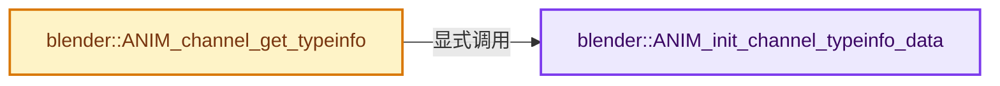
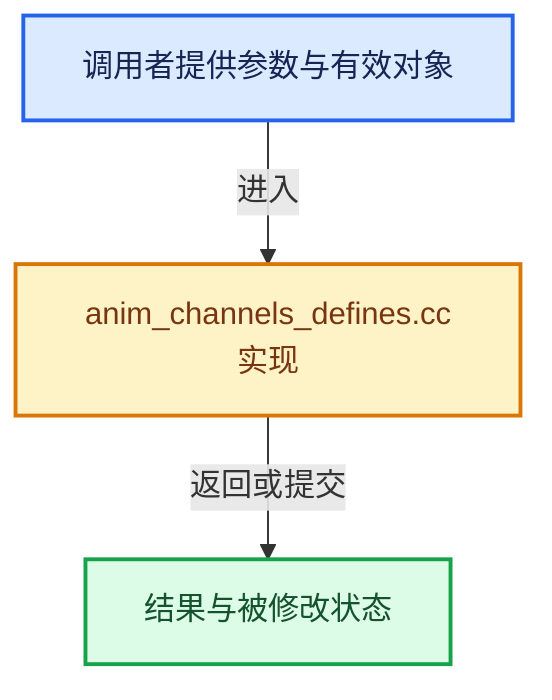

# 实现依赖专题：source/blender/editors/animation/anim_channels_defines.cc

[方向导航](README.md) · [符号索引](../%E7%AC%A6%E5%8F%B7%E4%BE%9D%E8%B5%96%E4%B8%8E%E5%AE%9E%E7%8E%B0%E7%B4%A2%E5%BC%95.md)

本专题从正文实际调用进入，集中保存共享实现。函数有稳定锚点，可从调用处直接跳到对应完整函数；递归与互相调用通过回链组织。

## 本文件的实现关系






## 完整成员与函数实现

<a id="f-6ac2b281aeea3725"></a>

### `blender::ANIM_init_channel_typeinfo_data`

实现位置：[source/blender/editors/animation/anim_channels_defines.cc](../../../../../source/blender/editors/animation/anim_channels_defines.cc) · L4694—L4766。

**教学注释版**

<!-- annotated:50ad6ab78be258 -->

```cpp
static void ANIM_init_channel_typeinfo_data()
{
  int type = 0;

  /* start initializing if necessary... */
  if (ACF_INIT) {
    ACF_INIT = 0;

    /* NOTE: need to keep the order of these synchronized with the definition of
     * channel types (eAnim_ChannelType) in ED_anim_api.hh
     */
    animchannelTypeInfo[type++] = nullptr; /* None */
    animchannelTypeInfo[type++] = nullptr; /* AnimData */
    animchannelTypeInfo[type++] = nullptr; /* Special */

    animchannelTypeInfo[type++] = &ACF_SUMMARY; /* Motion Summary */

    animchannelTypeInfo[type++] = &ACF_SCENE;  /* Scene */
    animchannelTypeInfo[type++] = &ACF_OBJECT; /* Object */
    animchannelTypeInfo[type++] = &ACF_GROUP;  /* Group */
    animchannelTypeInfo[type++] = &ACF_FCURVE; /* F-Curve */

    animchannelTypeInfo[type++] = &ACF_NLACONTROLS; /* NLA Control FCurve Expander */
    animchannelTypeInfo[type++] = &ACF_NLACURVE;    /* NLA Control FCurve Channel */

    animchannelTypeInfo[type++] = &ACF_FILLANIM;    /* Object's Layered Action Expander */
    animchannelTypeInfo[type++] = &ACF_ACTION_SLOT; /* Action Slot Expander */
    animchannelTypeInfo[type++] = &ACF_FILLACTD;    /* Object Action Expander */
    animchannelTypeInfo[type++] = &ACF_FILLDRIVERS; /* Drivers Expander */

    animchannelTypeInfo[type++] = &ACF_DSMAT;        /* Material Channel */
    animchannelTypeInfo[type++] = &ACF_DSLIGHT;      /* Light Channel */
    animchannelTypeInfo[type++] = &ACF_DSCAM;        /* Camera Channel */
    animchannelTypeInfo[type++] = &ACF_DSCACHEFILE;  /* CacheFile Channel */
    animchannelTypeInfo[type++] = &ACF_DSCUR;        /* Curve Channel */
    animchannelTypeInfo[type++] = &ACF_DSSKEY;       /* ShapeKey Channel */
    animchannelTypeInfo[type++] = &ACF_DSWOR;        /* World Channel */
    animchannelTypeInfo[type++] = &ACF_DSNTREE;      /* NodeTree Channel */
    animchannelTypeInfo[type++] = &ACF_DSPART;       /* Particle Channel */
    animchannelTypeInfo[type++] = &ACF_DSMBALL;      /* MetaBall Channel */
    animchannelTypeInfo[type++] = &ACF_DSARM;        /* Armature Channel */
    animchannelTypeInfo[type++] = &ACF_DSMESH;       /* Mesh Channel */
    animchannelTypeInfo[type++] = &ACF_DSTEX;        /* Texture Channel */
    animchannelTypeInfo[type++] = &ACF_DSLAT;        /* Lattice Channel */
    animchannelTypeInfo[type++] = &ACF_DSLINESTYLE;  /* LineStyle Channel */
    animchannelTypeInfo[type++] = &ACF_DSSPK;        /* Speaker Channel */
    animchannelTypeInfo[type++] = &ACF_DSGPENCIL;    /* GreasePencil Channel */
    animchannelTypeInfo[type++] = &ACF_DSMCLIP;      /* MovieClip Channel */
    animchannelTypeInfo[type++] = &ACF_DSCURVES;     /* Curves Channel */
    animchannelTypeInfo[type++] = &ACF_DSPOINTCLOUD; /* PointCloud Channel */
    animchannelTypeInfo[type++] = &ACF_DSVOLUME;     /* Volume Channel */
    animchannelTypeInfo[type++] = &ACF_DSLIGHTPROBE; /* Light Probe */

    animchannelTypeInfo[type++] = &ACF_SHAPEKEY; /* ShapeKey */

    animchannelTypeInfo[type++] = &ACF_GPL_LEGACY; /* Grease Pencil Layer (Legacy) */

    animchannelTypeInfo[type++] = &ACF_GPD;      /* Grease Pencil Datablock. */
    animchannelTypeInfo[type++] = &ACF_GPLGROUP; /* Grease Pencil Layer Group. */
    animchannelTypeInfo[type++] = &ACF_GPL;      /* Grease Pencil Layer. */

    animchannelTypeInfo[type++] = &ACF_MASKDATA;  /* Mask Datablock */
    animchannelTypeInfo[type++] = &ACF_MASKLAYER; /* Mask Layer */

    animchannelTypeInfo[type++] = &ACF_NLATRACK;  /* NLA Track */
    animchannelTypeInfo[type++] = &ACF_NLAACTION; /* NLA Action */

    BLI_assert_msg(animchannelTypeInfo[ANIMTYPE_FILLACT_LAYERED] == &ACF_FILLANIM,
                   "ANIMTYPE_FILLACT_LAYERED does not match ACF_FILLANIM");
    BLI_assert_msg(animchannelTypeInfo[ANIMTYPE_ACTION_SLOT] == &ACF_ACTION_SLOT,
                   "ANIMTYPE_ACTION_SLOT does not match ACF_ACTION_SLOT");
  }
}
```

<details>
<summary>核对原始源码：source/blender/editors/animation/anim_channels_defines.cc · L4694—L4766</summary>

<!-- original:50ad6ab78be258:source/blender/editors/animation/anim_channels_defines.cc:4694:4766 -->

```cpp
static void ANIM_init_channel_typeinfo_data()
{
  int type = 0;

  /* start initializing if necessary... */
  if (ACF_INIT) {
    ACF_INIT = 0;

    /* NOTE: need to keep the order of these synchronized with the definition of
     * channel types (eAnim_ChannelType) in ED_anim_api.hh
     */
    animchannelTypeInfo[type++] = nullptr; /* None */
    animchannelTypeInfo[type++] = nullptr; /* AnimData */
    animchannelTypeInfo[type++] = nullptr; /* Special */

    animchannelTypeInfo[type++] = &ACF_SUMMARY; /* Motion Summary */

    animchannelTypeInfo[type++] = &ACF_SCENE;  /* Scene */
    animchannelTypeInfo[type++] = &ACF_OBJECT; /* Object */
    animchannelTypeInfo[type++] = &ACF_GROUP;  /* Group */
    animchannelTypeInfo[type++] = &ACF_FCURVE; /* F-Curve */

    animchannelTypeInfo[type++] = &ACF_NLACONTROLS; /* NLA Control FCurve Expander */
    animchannelTypeInfo[type++] = &ACF_NLACURVE;    /* NLA Control FCurve Channel */

    animchannelTypeInfo[type++] = &ACF_FILLANIM;    /* Object's Layered Action Expander */
    animchannelTypeInfo[type++] = &ACF_ACTION_SLOT; /* Action Slot Expander */
    animchannelTypeInfo[type++] = &ACF_FILLACTD;    /* Object Action Expander */
    animchannelTypeInfo[type++] = &ACF_FILLDRIVERS; /* Drivers Expander */

    animchannelTypeInfo[type++] = &ACF_DSMAT;        /* Material Channel */
    animchannelTypeInfo[type++] = &ACF_DSLIGHT;      /* Light Channel */
    animchannelTypeInfo[type++] = &ACF_DSCAM;        /* Camera Channel */
    animchannelTypeInfo[type++] = &ACF_DSCACHEFILE;  /* CacheFile Channel */
    animchannelTypeInfo[type++] = &ACF_DSCUR;        /* Curve Channel */
    animchannelTypeInfo[type++] = &ACF_DSSKEY;       /* ShapeKey Channel */
    animchannelTypeInfo[type++] = &ACF_DSWOR;        /* World Channel */
    animchannelTypeInfo[type++] = &ACF_DSNTREE;      /* NodeTree Channel */
    animchannelTypeInfo[type++] = &ACF_DSPART;       /* Particle Channel */
    animchannelTypeInfo[type++] = &ACF_DSMBALL;      /* MetaBall Channel */
    animchannelTypeInfo[type++] = &ACF_DSARM;        /* Armature Channel */
    animchannelTypeInfo[type++] = &ACF_DSMESH;       /* Mesh Channel */
    animchannelTypeInfo[type++] = &ACF_DSTEX;        /* Texture Channel */
    animchannelTypeInfo[type++] = &ACF_DSLAT;        /* Lattice Channel */
    animchannelTypeInfo[type++] = &ACF_DSLINESTYLE;  /* LineStyle Channel */
    animchannelTypeInfo[type++] = &ACF_DSSPK;        /* Speaker Channel */
    animchannelTypeInfo[type++] = &ACF_DSGPENCIL;    /* GreasePencil Channel */
    animchannelTypeInfo[type++] = &ACF_DSMCLIP;      /* MovieClip Channel */
    animchannelTypeInfo[type++] = &ACF_DSCURVES;     /* Curves Channel */
    animchannelTypeInfo[type++] = &ACF_DSPOINTCLOUD; /* PointCloud Channel */
    animchannelTypeInfo[type++] = &ACF_DSVOLUME;     /* Volume Channel */
    animchannelTypeInfo[type++] = &ACF_DSLIGHTPROBE; /* Light Probe */

    animchannelTypeInfo[type++] = &ACF_SHAPEKEY; /* ShapeKey */

    animchannelTypeInfo[type++] = &ACF_GPL_LEGACY; /* Grease Pencil Layer (Legacy) */

    animchannelTypeInfo[type++] = &ACF_GPD;      /* Grease Pencil Datablock. */
    animchannelTypeInfo[type++] = &ACF_GPLGROUP; /* Grease Pencil Layer Group. */
    animchannelTypeInfo[type++] = &ACF_GPL;      /* Grease Pencil Layer. */

    animchannelTypeInfo[type++] = &ACF_MASKDATA;  /* Mask Datablock */
    animchannelTypeInfo[type++] = &ACF_MASKLAYER; /* Mask Layer */

    animchannelTypeInfo[type++] = &ACF_NLATRACK;  /* NLA Track */
    animchannelTypeInfo[type++] = &ACF_NLAACTION; /* NLA Action */

    BLI_assert_msg(animchannelTypeInfo[ANIMTYPE_FILLACT_LAYERED] == &ACF_FILLANIM,
                   "ANIMTYPE_FILLACT_LAYERED does not match ACF_FILLANIM");
    BLI_assert_msg(animchannelTypeInfo[ANIMTYPE_ACTION_SLOT] == &ACF_ACTION_SLOT,
                   "ANIMTYPE_ACTION_SLOT does not match ACF_ACTION_SLOT");
  }
}
```

</details>

**沿实际写入检查状态**

- `ACF_INIT = 0;`

**继续追踪实现**

- `BLI_assert_msg` → [BLI_assert_msg · L55](../01-%E5%9F%BA%E7%A1%80%E5%AE%B9%E5%99%A8%E4%B8%8E%E7%8E%B0%E4%BB%A3CPP/%E4%BE%9D%E8%B5%96-BLI_assert-cc98e8.md#m-695eed20dceb)；[BLI_assert_msg · L64](../01-%E5%9F%BA%E7%A1%80%E5%AE%B9%E5%99%A8%E4%B8%8E%E7%8E%B0%E4%BB%A3CPP/%E4%BE%9D%E8%B5%96-BLI_assert-cc98e8.md#m-7de5563de4db)。宏定义由构建条件选择。

<a id="f-cb1ba3bedf5ec2a9"></a>

### `blender::ANIM_channel_get_typeinfo`

实现位置：[source/blender/editors/animation/anim_channels_defines.cc](../../../../../source/blender/editors/animation/anim_channels_defines.cc) · L4768—L4784。

接口参数：

- `const bAnimListElem *ale`

**教学注释版**

<!-- annotated:67b55780a1b9c4 -->

```cpp
const bAnimChannelType *ANIM_channel_get_typeinfo(const bAnimListElem *ale)
{
  /* Sanity checks. */
  if (ale == nullptr) {
    return nullptr;
  }

  /* init the typeinfo if not available yet... */
  ANIM_init_channel_typeinfo_data();

  BLI_assert(ale->type < ANIMTYPE_NUM_TYPES);
  if (ale->type >= ANIMTYPE_NUM_TYPES) {
    return nullptr;
  }

  return animchannelTypeInfo[ale->type];
}
```

<details>
<summary>核对原始源码：source/blender/editors/animation/anim_channels_defines.cc · L4768—L4784</summary>

<!-- original:67b55780a1b9c4:source/blender/editors/animation/anim_channels_defines.cc:4768:4784 -->

```cpp
const bAnimChannelType *ANIM_channel_get_typeinfo(const bAnimListElem *ale)
{
  /* Sanity checks. */
  if (ale == nullptr) {
    return nullptr;
  }

  /* init the typeinfo if not available yet... */
  ANIM_init_channel_typeinfo_data();

  BLI_assert(ale->type < ANIMTYPE_NUM_TYPES);
  if (ale->type >= ANIMTYPE_NUM_TYPES) {
    return nullptr;
  }

  return animchannelTypeInfo[ale->type];
}
```

</details>

**结果出口**

- `return nullptr;`
- `return animchannelTypeInfo[ale->type];`

**继续追踪实现**

- `ANIM_init_channel_typeinfo_data` → [blender::ANIM_init_channel_typeinfo_data · L4694](%E4%BE%9D%E8%B5%96-anim_channels_defines-895bf9.md#f-6ac2b281aeea3725)。
- `BLI_assert` → [BLI_assert · L48](../01-%E5%9F%BA%E7%A1%80%E5%AE%B9%E5%99%A8%E4%B8%8E%E7%8E%B0%E4%BB%A3CPP/%E4%BE%9D%E8%B5%96-BLI_assert-cc98e8.md#m-57a88495704d)；[BLI_assert · L63](../01-%E5%9F%BA%E7%A1%80%E5%AE%B9%E5%99%A8%E4%B8%8E%E7%8E%B0%E4%BB%A3CPP/%E4%BE%9D%E8%B5%96-BLI_assert-cc98e8.md#m-d07050020cb5)。宏定义由构建条件选择。
