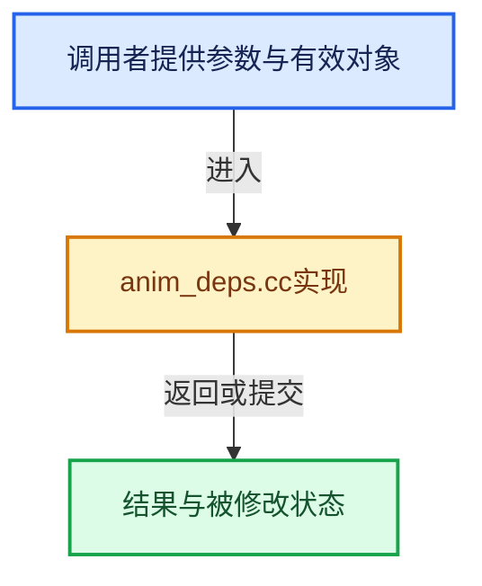

# 实现依赖专题：source/blender/editors/animation/anim_deps.cc

[方向导航](README.md) · [符号索引](../%E7%AC%A6%E5%8F%B7%E4%BE%9D%E8%B5%96%E4%B8%8E%E5%AE%9E%E7%8E%B0%E7%B4%A2%E5%BC%95.md)

本专题从正文实际调用进入，集中保存共享实现。函数有稳定锚点，可从调用处直接跳到对应完整函数；递归与互相调用通过回链组织。

## 本文件的实现关系





## 完整成员与函数实现

<a id="f-b53b43ffdc2da250"></a>

### `blender::ANIM_animdata_freelist`

实现位置：[source/blender/editors/animation/anim_deps.cc](../../../../../source/blender/editors/animation/anim_deps.cc) · L472—L485。

接口参数：

- `ListBaseT<bAnimListElem> *anim_data`

**教学注释版**

<!-- annotated:cc9014da4238ab -->

```cpp
void ANIM_animdata_freelist(ListBaseT<bAnimListElem> *anim_data)
{
#ifndef NDEBUG
  bAnimListElem *ale, *ale_next;
  for (ale = anim_data->first(); ale; ale = ale_next) {
    ale_next = ale->next;
    BLI_assert(ale->update == 0);
    MEM_delete(ale);
  }
  anim_data->clear_no_delete();
#else
  anim_data->free_no_destruct();
#endif
}
```

<details>
<summary>核对原始源码：source/blender/editors/animation/anim_deps.cc · L472—L485</summary>

<!-- original:cc9014da4238ab:source/blender/editors/animation/anim_deps.cc:472:485 -->

```cpp
void ANIM_animdata_freelist(ListBaseT<bAnimListElem> *anim_data)
{
#ifndef NDEBUG
  bAnimListElem *ale, *ale_next;
  for (ale = anim_data->first(); ale; ale = ale_next) {
    ale_next = ale->next;
    BLI_assert(ale->update == 0);
    MEM_delete(ale);
  }
  anim_data->clear_no_delete();
#else
  anim_data->free_no_destruct();
#endif
}
```

</details>

**沿实际写入检查状态**

- `ale_next = ale->next;`

**继续追踪实现**

- `anim_data->first` → [blender::ListBaseT::first · L102](%E4%BE%9D%E8%B5%96-DNA_listBase-48dbc9.md#f-3d12ff35da057c9e)；[blender::ListBaseT::first · L106](%E4%BE%9D%E8%B5%96-DNA_listBase-48dbc9.md#f-0df87c3480e059f9)。同名重载需按实参类型选择。
- `BLI_assert` → [BLI_assert · L48](../01-%E5%9F%BA%E7%A1%80%E5%AE%B9%E5%99%A8%E4%B8%8E%E7%8E%B0%E4%BB%A3CPP/%E4%BE%9D%E8%B5%96-BLI_assert-cc98e8.md#m-57a88495704d)；[BLI_assert · L63](../01-%E5%9F%BA%E7%A1%80%E5%AE%B9%E5%99%A8%E4%B8%8E%E7%8E%B0%E4%BB%A3CPP/%E4%BE%9D%E8%B5%96-BLI_assert-cc98e8.md#m-d07050020cb5)。宏定义由构建条件选择。
- `MEM_delete` → [MEM_delete · L400](../03-%E5%86%85%E5%AD%98%E5%88%86%E9%85%8D%E4%B8%8E%E8%BF%90%E8%A1%8C%E6%97%B6%E7%B1%BB%E5%9E%8B/%E4%BE%9D%E8%B5%96-MEM_guardedalloc-b54eca.md#f-9049ffdd1682887c)。
- `anim_data->clear_no_delete` → [blender::ListBaseT::clear_no_delete · L68](%E4%BE%9D%E8%B5%96-DNA_listBase-48dbc9.md#f-431defdf189ae643)。
- `anim_data->free_no_destruct` → [blender::ListBaseT::free_no_destruct · L78](%E4%BE%9D%E8%B5%96-DNA_listBase-48dbc9.md#f-8656670edd0f6b7e)。
