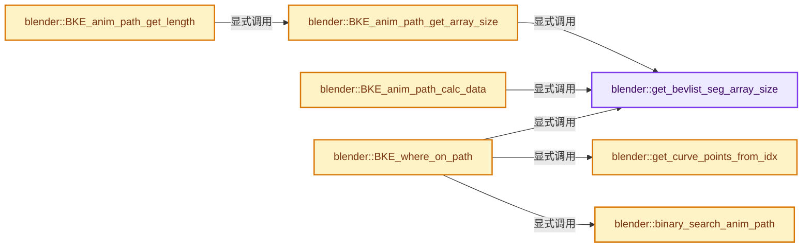
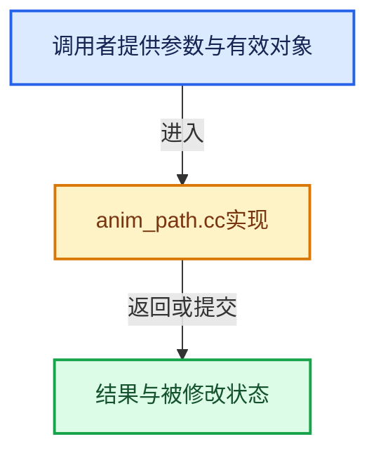

# 实现依赖专题：source/blender/blenkernel/intern/anim_path.cc

[方向导航](README.md) · [符号索引](../%E7%AC%A6%E5%8F%B7%E4%BE%9D%E8%B5%96%E4%B8%8E%E5%AE%9E%E7%8E%B0%E7%B4%A2%E5%BC%95.md)

本专题从正文实际调用进入，集中保存共享实现。函数有稳定锚点，可从调用处直接跳到对应完整函数；递归与互相调用通过回链组织。

## 本文件的实现关系






## 完整成员与函数实现

<a id="f-dfbd2cf6e577f241"></a>

### `blender::get_bevlist_seg_array_size`

实现位置：[source/blender/blenkernel/intern/anim_path.cc](../../../../../source/blender/blenkernel/intern/anim_path.cc) · L34—L42。

接口参数：

- `const BevList *bl`

**教学注释版**

<!-- annotated:6c46db46246923 -->

```cpp
static int get_bevlist_seg_array_size(const BevList *bl)
{
  if (bl->poly >= 0) {
    /* Cyclic curve. */
    return bl->nr;
  }

  return bl->nr - 1;
}
```

<details>
<summary>核对原始源码：source/blender/blenkernel/intern/anim_path.cc · L34—L42</summary>

<!-- original:6c46db46246923:source/blender/blenkernel/intern/anim_path.cc:34:42 -->

```cpp
static int get_bevlist_seg_array_size(const BevList *bl)
{
  if (bl->poly >= 0) {
    /* Cyclic curve. */
    return bl->nr;
  }

  return bl->nr - 1;
}
```

</details>

**结果出口**

- `return bl->nr;`
- `return bl->nr - 1;`

**继续追踪实现**

本实现没有需要继续展开的显式调用；检查返回表达式、对象转换和调用者前置条件。

<a id="f-2c5e5cf556f92542"></a>

### `blender::BKE_anim_path_get_array_size`

实现位置：[source/blender/blenkernel/intern/anim_path.cc](../../../../../source/blender/blenkernel/intern/anim_path.cc) · L44—L53。

接口参数：

- `const CurveCache *curve_cache`

**教学注释版**

<!-- annotated:43c202740d4b4a -->

```cpp
int BKE_anim_path_get_array_size(const CurveCache *curve_cache)
{
  BLI_assert(curve_cache != nullptr);

  BevList *bl = curve_cache->bev.first();

  BLI_assert(bl != nullptr && bl->nr > 1);

  return get_bevlist_seg_array_size(bl);
}
```

<details>
<summary>核对原始源码：source/blender/blenkernel/intern/anim_path.cc · L44—L53</summary>

<!-- original:43c202740d4b4a:source/blender/blenkernel/intern/anim_path.cc:44:53 -->

```cpp
int BKE_anim_path_get_array_size(const CurveCache *curve_cache)
{
  BLI_assert(curve_cache != nullptr);

  BevList *bl = curve_cache->bev.first();

  BLI_assert(bl != nullptr && bl->nr > 1);

  return get_bevlist_seg_array_size(bl);
}
```

</details>

**结果出口**

- `return get_bevlist_seg_array_size(bl);`

**继续追踪实现**

- `BLI_assert` → [BLI_assert · L48](../01-%E5%9F%BA%E7%A1%80%E5%AE%B9%E5%99%A8%E4%B8%8E%E7%8E%B0%E4%BB%A3CPP/%E4%BE%9D%E8%B5%96-BLI_assert-cc98e8.md#m-57a88495704d)；[BLI_assert · L63](../01-%E5%9F%BA%E7%A1%80%E5%AE%B9%E5%99%A8%E4%B8%8E%E7%8E%B0%E4%BB%A3CPP/%E4%BE%9D%E8%B5%96-BLI_assert-cc98e8.md#m-d07050020cb5)。宏定义由构建条件选择。
- `curve_cache->bev.first` → [调用协议](../%E6%A8%A1%E6%9D%BF%E5%AE%8F%E4%B8%8E%E5%8A%A8%E6%80%81%E5%88%86%E6%B4%BE%E5%8D%8F%E8%AE%AE.md)：接收对象类型依赖auto、返回值或模板实例；不按同名猜测目标。调用位置L48。
- `get_bevlist_seg_array_size` → [blender::get_bevlist_seg_array_size · L34](%E4%BE%9D%E8%B5%96-anim_path-3d7dfa.md#f-dfbd2cf6e577f241)。

<a id="f-123116e571c61db7"></a>

### `blender::BKE_anim_path_get_length`

实现位置：[source/blender/blenkernel/intern/anim_path.cc](../../../../../source/blender/blenkernel/intern/anim_path.cc) · L55—L59。

接口参数：

- `const CurveCache *curve_cache`

**教学注释版**

<!-- annotated:918c41fdb30646 -->

```cpp
float BKE_anim_path_get_length(const CurveCache *curve_cache)
{
  const int seg_size = BKE_anim_path_get_array_size(curve_cache);
  return curve_cache->anim_path_accum_length[seg_size - 1];
}
```

<details>
<summary>核对原始源码：source/blender/blenkernel/intern/anim_path.cc · L55—L59</summary>

<!-- original:918c41fdb30646:source/blender/blenkernel/intern/anim_path.cc:55:59 -->

```cpp
float BKE_anim_path_get_length(const CurveCache *curve_cache)
{
  const int seg_size = BKE_anim_path_get_array_size(curve_cache);
  return curve_cache->anim_path_accum_length[seg_size - 1];
}
```

</details>

**结果出口**

- `return curve_cache->anim_path_accum_length[seg_size - 1];`

**继续追踪实现**

- `BKE_anim_path_get_array_size` → [blender::BKE_anim_path_get_array_size · L44](%E4%BE%9D%E8%B5%96-anim_path-3d7dfa.md#f-2c5e5cf556f92542)。

<a id="f-72f786efe330d2a0"></a>

### `blender::BKE_anim_path_calc_data`

实现位置：[source/blender/blenkernel/intern/anim_path.cc](../../../../../source/blender/blenkernel/intern/anim_path.cc) · L61—L104。

接口参数：

- `Object *ob`

**教学注释版**

<!-- annotated:d07057d68bea72 -->

```cpp
void BKE_anim_path_calc_data(Object *ob)
{
  if (ob == nullptr || ob->type != OB_CURVES_LEGACY) {
    return;
  }
  if (ob->runtime->curve_cache == nullptr) {
    CLOG_WARN(&LOG, "No curve cache!");
    return;
  }

  /* Free old data. */
  MEM_SAFE_DELETE(ob->runtime->curve_cache->anim_path_accum_length);

  /* We only use the first curve. */
  BevList *bl = ob->runtime->curve_cache->bev.first();
  /* There are no points. */
  if (bl == nullptr) {
    return;
  }
  /* There is only a single point (with no segments). */
  if (bl->nr == 0) {
    return;
  }

  /* There should typically be at least two points in the curve
   * however a single point may be present here when all points are co-located.
   * In this case either calculate a single length (for a cyclic) curve or nothing.
   * While not useful, it's harmless too. */
  const int seg_size = get_bevlist_seg_array_size(bl);
  float *len_data = MEM_new_array_uninitialized<float>(size_t(seg_size), "calcpathdist");
  ob->runtime->curve_cache->anim_path_accum_length = len_data;

  BevPoint *bp_arr = bl->bevpoints;
  float prev_len = 0.0f;
  for (int i = 0; i < bl->nr - 1; i++) {
    prev_len += len_v3v3(bp_arr[i].vec, bp_arr[i + 1].vec);
    len_data[i] = prev_len;
  }

  if (bl->poly >= 0) {
    /* Cyclic curve. */
    len_data[seg_size - 1] = prev_len + len_v3v3(bp_arr[0].vec, bp_arr[bl->nr - 1].vec);
  }
}
```

<details>
<summary>核对原始源码：source/blender/blenkernel/intern/anim_path.cc · L61—L104</summary>

<!-- original:d07057d68bea72:source/blender/blenkernel/intern/anim_path.cc:61:104 -->

```cpp
void BKE_anim_path_calc_data(Object *ob)
{
  if (ob == nullptr || ob->type != OB_CURVES_LEGACY) {
    return;
  }
  if (ob->runtime->curve_cache == nullptr) {
    CLOG_WARN(&LOG, "No curve cache!");
    return;
  }

  /* Free old data. */
  MEM_SAFE_DELETE(ob->runtime->curve_cache->anim_path_accum_length);

  /* We only use the first curve. */
  BevList *bl = ob->runtime->curve_cache->bev.first();
  /* There are no points. */
  if (bl == nullptr) {
    return;
  }
  /* There is only a single point (with no segments). */
  if (bl->nr == 0) {
    return;
  }

  /* There should typically be at least two points in the curve
   * however a single point may be present here when all points are co-located.
   * In this case either calculate a single length (for a cyclic) curve or nothing.
   * While not useful, it's harmless too. */
  const int seg_size = get_bevlist_seg_array_size(bl);
  float *len_data = MEM_new_array_uninitialized<float>(size_t(seg_size), "calcpathdist");
  ob->runtime->curve_cache->anim_path_accum_length = len_data;

  BevPoint *bp_arr = bl->bevpoints;
  float prev_len = 0.0f;
  for (int i = 0; i < bl->nr - 1; i++) {
    prev_len += len_v3v3(bp_arr[i].vec, bp_arr[i + 1].vec);
    len_data[i] = prev_len;
  }

  if (bl->poly >= 0) {
    /* Cyclic curve. */
    len_data[seg_size - 1] = prev_len + len_v3v3(bp_arr[0].vec, bp_arr[bl->nr - 1].vec);
  }
}
```

</details>

**沿实际写入检查状态**

- `ob->runtime->curve_cache->anim_path_accum_length = len_data;`
- `prev_len += len_v3v3(bp_arr[i].vec, bp_arr[i + 1].vec);`
- `len_data[i] = prev_len;`

**继续追踪实现**

- `CLOG_WARN` → [CLOG_WARN · L189](%E4%BE%9D%E8%B5%96-CLG_log-e9051b.md#m-9da21a06cdbe)。宏定义由构建条件选择。
- `MEM_SAFE_DELETE` → [MEM_SAFE_DELETE · L436](../03-%E5%86%85%E5%AD%98%E5%88%86%E9%85%8D%E4%B8%8E%E8%BF%90%E8%A1%8C%E6%97%B6%E7%B1%BB%E5%9E%8B/%E4%BE%9D%E8%B5%96-MEM_guardedalloc-b54eca.md#m-eadb3bc5b902)。宏定义由构建条件选择。
- `ob->runtime->curve_cache->bev.first` → [调用协议](../%E6%A8%A1%E6%9D%BF%E5%AE%8F%E4%B8%8E%E5%8A%A8%E6%80%81%E5%88%86%E6%B4%BE%E5%8D%8F%E8%AE%AE.md)：接收对象类型依赖auto、返回值或模板实例；不按同名猜测目标。调用位置L75。
- `get_bevlist_seg_array_size` → [blender::get_bevlist_seg_array_size · L34](%E4%BE%9D%E8%B5%96-anim_path-3d7dfa.md#f-dfbd2cf6e577f241)。
- `MEM_new_array_uninitialized<float>` → [MEM_new_array_uninitialized · L608](../03-%E5%86%85%E5%AD%98%E5%88%86%E9%85%8D%E4%B8%8E%E8%BF%90%E8%A1%8C%E6%97%B6%E7%B1%BB%E5%9E%8B/%E4%BE%9D%E8%B5%96-MEM_guardedalloc-b54eca.md#f-b7103eae8eb57b05)；[MEM_new_array_uninitialized · L129](../03-%E5%86%85%E5%AD%98%E5%88%86%E9%85%8D%E4%B8%8E%E8%BF%90%E8%A1%8C%E6%97%B6%E7%B1%BB%E5%9E%8B/%E4%BE%9D%E8%B5%96-mallocn-afdcd4.md#f-bf6ef4ddcfb6e5df)。同名重载需按实参类型选择。
- `len_v3v3` → [blender::len_v3v3 · L826](../12-%E7%A9%BA%E9%97%B4%E6%95%B0%E6%8D%AE%E7%BB%93%E6%9E%84%E4%B8%8E%E5%87%A0%E4%BD%95%E7%AE%97%E6%B3%95/%E4%BE%9D%E8%B5%96-math_vector_inline-0c8541.md#f-c873370566848169)。

<a id="f-b78ca5a8f2ef0d8b"></a>

### `blender::get_curve_points_from_idx`

实现位置：[source/blender/blenkernel/intern/anim_path.cc](../../../../../source/blender/blenkernel/intern/anim_path.cc) · L106—L177。

接口参数：

- `const int idx`
- `const BevList *bl`
- `const bool is_cyclic`
- `BevPoint const **r_p0`
- `BevPoint const **r_p1`
- `BevPoint const **r_p2`
- `BevPoint const **r_p3`

**教学注释版**

<!-- annotated:5fa786b36d8d7d -->

```cpp
static void get_curve_points_from_idx(const int idx,
                                      const BevList *bl,
                                      const bool is_cyclic,
                                      BevPoint const **r_p0,
                                      BevPoint const **r_p1,
                                      BevPoint const **r_p2,
                                      BevPoint const **r_p3)
{
  BLI_assert(idx >= 0);
  BLI_assert(idx < bl->nr - 1 || (is_cyclic && idx < bl->nr));
  BLI_assert(bl->nr > 1);

  const BevPoint *bp_arr = bl->bevpoints;

  /* First segment. */
  if (idx == 0) {
    *r_p1 = &bp_arr[0];
    if (is_cyclic) {
      *r_p0 = &bp_arr[bl->nr - 1];
    }
    else {
      *r_p0 = *r_p1;
    }

    *r_p2 = &bp_arr[1];

    if (bl->nr > 2) {
      *r_p3 = &bp_arr[2];
    }
    else {
      *r_p3 = *r_p2;
    }
    return;
  }

  /* Last segment (or next to last in a cyclic curve). */
  if (idx == bl->nr - 2) {
    /* The case when the bl->nr == 2 falls in to the "first segment" check above.
     * So here we can assume that bl->nr > 2.
     */
    *r_p0 = &bp_arr[idx - 1];
    *r_p1 = &bp_arr[idx];
    *r_p2 = &bp_arr[idx + 1];

    if (is_cyclic) {
      *r_p3 = &bp_arr[0];
    }
    else {
      *r_p3 = *r_p2;
    }
    return;
  }

  if (idx == bl->nr - 1) {
    /* Last segment in a cyclic curve. This should only trigger if the curve is cyclic
     * as it gets an extra segment between the end and the start point. */
    *r_p0 = &bp_arr[idx - 1];
    *r_p1 = &bp_arr[idx];
    *r_p2 = &bp_arr[0];
    *r_p3 = &bp_arr[1];
    return;
  }

  /* To get here the curve has to have four curve points or more and idx can't
   * be the first or the last segment.
   * So we can assume that we can get four points without any special checks.
   */
  *r_p0 = &bp_arr[idx - 1];
  *r_p1 = &bp_arr[idx];
  *r_p2 = &bp_arr[idx + 1];
  *r_p3 = &bp_arr[idx + 2];
}
```

<details>
<summary>核对原始源码：source/blender/blenkernel/intern/anim_path.cc · L106—L177</summary>

<!-- original:5fa786b36d8d7d:source/blender/blenkernel/intern/anim_path.cc:106:177 -->

```cpp
static void get_curve_points_from_idx(const int idx,
                                      const BevList *bl,
                                      const bool is_cyclic,
                                      BevPoint const **r_p0,
                                      BevPoint const **r_p1,
                                      BevPoint const **r_p2,
                                      BevPoint const **r_p3)
{
  BLI_assert(idx >= 0);
  BLI_assert(idx < bl->nr - 1 || (is_cyclic && idx < bl->nr));
  BLI_assert(bl->nr > 1);

  const BevPoint *bp_arr = bl->bevpoints;

  /* First segment. */
  if (idx == 0) {
    *r_p1 = &bp_arr[0];
    if (is_cyclic) {
      *r_p0 = &bp_arr[bl->nr - 1];
    }
    else {
      *r_p0 = *r_p1;
    }

    *r_p2 = &bp_arr[1];

    if (bl->nr > 2) {
      *r_p3 = &bp_arr[2];
    }
    else {
      *r_p3 = *r_p2;
    }
    return;
  }

  /* Last segment (or next to last in a cyclic curve). */
  if (idx == bl->nr - 2) {
    /* The case when the bl->nr == 2 falls in to the "first segment" check above.
     * So here we can assume that bl->nr > 2.
     */
    *r_p0 = &bp_arr[idx - 1];
    *r_p1 = &bp_arr[idx];
    *r_p2 = &bp_arr[idx + 1];

    if (is_cyclic) {
      *r_p3 = &bp_arr[0];
    }
    else {
      *r_p3 = *r_p2;
    }
    return;
  }

  if (idx == bl->nr - 1) {
    /* Last segment in a cyclic curve. This should only trigger if the curve is cyclic
     * as it gets an extra segment between the end and the start point. */
    *r_p0 = &bp_arr[idx - 1];
    *r_p1 = &bp_arr[idx];
    *r_p2 = &bp_arr[0];
    *r_p3 = &bp_arr[1];
    return;
  }

  /* To get here the curve has to have four curve points or more and idx can't
   * be the first or the last segment.
   * So we can assume that we can get four points without any special checks.
   */
  *r_p0 = &bp_arr[idx - 1];
  *r_p1 = &bp_arr[idx];
  *r_p2 = &bp_arr[idx + 1];
  *r_p3 = &bp_arr[idx + 2];
}
```

</details>

**继续追踪实现**

- `BLI_assert` → [BLI_assert · L48](../01-%E5%9F%BA%E7%A1%80%E5%AE%B9%E5%99%A8%E4%B8%8E%E7%8E%B0%E4%BB%A3CPP/%E4%BE%9D%E8%B5%96-BLI_assert-cc98e8.md#m-57a88495704d)；[BLI_assert · L63](../01-%E5%9F%BA%E7%A1%80%E5%AE%B9%E5%99%A8%E4%B8%8E%E7%8E%B0%E4%BB%A3CPP/%E4%BE%9D%E8%B5%96-BLI_assert-cc98e8.md#m-d07050020cb5)。宏定义由构建条件选择。

<a id="f-965682c03e7d5bed"></a>

### `blender::binary_search_anim_path`

实现位置：[source/blender/blenkernel/intern/anim_path.cc](../../../../../source/blender/blenkernel/intern/anim_path.cc) · L179—L230。

接口参数：

- `const float *accum_len_arr`
- `const int seg_size`
- `const float goal_len`
- `int *r_idx`
- `float *r_frac`

**教学注释版**

<!-- annotated:ca2f30bc210b99 -->

```cpp
static bool binary_search_anim_path(const float *accum_len_arr,
                                    const int seg_size,
                                    const float goal_len,
                                    int *r_idx,
                                    float *r_frac)
{
  float left_len, right_len;
  int cur_idx = 0, cur_base = 0;
  int cur_step = seg_size - 1;

  /* Special case, for a single segment accessing the `right_len`
   * would be an invalid index, see: #132976. */
  if (seg_size == 1) [[unlikely]] {
    *r_idx = 0;
    *r_frac = goal_len / accum_len_arr[0];
    return true;
  }

  while (true) {
    BLI_assert(cur_idx + 1 < seg_size);
    cur_idx = cur_base + cur_step / 2;
    left_len = accum_len_arr[cur_idx];
    right_len = accum_len_arr[cur_idx + 1];

    if (left_len <= goal_len && right_len > goal_len) {
      *r_idx = cur_idx + 1;
      *r_frac = (goal_len - left_len) / (right_len - left_len);
      return true;
    }
    if (cur_idx == 0) {
      /* We ended up at the first segment. The point must be in here. */
      *r_idx = 0;
      *r_frac = goal_len / accum_len_arr[0];
      return true;
    }

    if (cur_step == 0) [[unlikely]] {
      /* This should never happen unless there is something horribly wrong. */
      CLOG_ERROR(&LOG, "Couldn't find any valid point on the animation path!");
      BLI_assert_msg(0, "Couldn't find any valid point on the animation path!");
      return false;
    }

    if (left_len < goal_len) {
      /* Go to the right. */
      cur_base = cur_idx + 1;
      cur_step--;
    } /* Else, go to the left. */

    cur_step /= 2;
  }
}
```

<details>
<summary>核对原始源码：source/blender/blenkernel/intern/anim_path.cc · L179—L230</summary>

<!-- original:ca2f30bc210b99:source/blender/blenkernel/intern/anim_path.cc:179:230 -->

```cpp
static bool binary_search_anim_path(const float *accum_len_arr,
                                    const int seg_size,
                                    const float goal_len,
                                    int *r_idx,
                                    float *r_frac)
{
  float left_len, right_len;
  int cur_idx = 0, cur_base = 0;
  int cur_step = seg_size - 1;

  /* Special case, for a single segment accessing the `right_len`
   * would be an invalid index, see: #132976. */
  if (seg_size == 1) [[unlikely]] {
    *r_idx = 0;
    *r_frac = goal_len / accum_len_arr[0];
    return true;
  }

  while (true) {
    BLI_assert(cur_idx + 1 < seg_size);
    cur_idx = cur_base + cur_step / 2;
    left_len = accum_len_arr[cur_idx];
    right_len = accum_len_arr[cur_idx + 1];

    if (left_len <= goal_len && right_len > goal_len) {
      *r_idx = cur_idx + 1;
      *r_frac = (goal_len - left_len) / (right_len - left_len);
      return true;
    }
    if (cur_idx == 0) {
      /* We ended up at the first segment. The point must be in here. */
      *r_idx = 0;
      *r_frac = goal_len / accum_len_arr[0];
      return true;
    }

    if (cur_step == 0) [[unlikely]] {
      /* This should never happen unless there is something horribly wrong. */
      CLOG_ERROR(&LOG, "Couldn't find any valid point on the animation path!");
      BLI_assert_msg(0, "Couldn't find any valid point on the animation path!");
      return false;
    }

    if (left_len < goal_len) {
      /* Go to the right. */
      cur_base = cur_idx + 1;
      cur_step--;
    } /* Else, go to the left. */

    cur_step /= 2;
  }
}
```

</details>

**沿实际写入检查状态**

- `cur_idx = cur_base + cur_step / 2;`
- `left_len = accum_len_arr[cur_idx];`
- `right_len = accum_len_arr[cur_idx + 1];`
- `cur_base = cur_idx + 1;`

**结果出口**

- `return true;`
- `return false;`

**继续追踪实现**

- `BLI_assert` → [BLI_assert · L48](../01-%E5%9F%BA%E7%A1%80%E5%AE%B9%E5%99%A8%E4%B8%8E%E7%8E%B0%E4%BB%A3CPP/%E4%BE%9D%E8%B5%96-BLI_assert-cc98e8.md#m-57a88495704d)；[BLI_assert · L63](../01-%E5%9F%BA%E7%A1%80%E5%AE%B9%E5%99%A8%E4%B8%8E%E7%8E%B0%E4%BB%A3CPP/%E4%BE%9D%E8%B5%96-BLI_assert-cc98e8.md#m-d07050020cb5)。宏定义由构建条件选择。
- `CLOG_ERROR` → [CLOG_ERROR · L188](%E4%BE%9D%E8%B5%96-CLG_log-e9051b.md#m-081575cdc8d0)。宏定义由构建条件选择。
- `BLI_assert_msg` → [BLI_assert_msg · L55](../01-%E5%9F%BA%E7%A1%80%E5%AE%B9%E5%99%A8%E4%B8%8E%E7%8E%B0%E4%BB%A3CPP/%E4%BE%9D%E8%B5%96-BLI_assert-cc98e8.md#m-695eed20dceb)；[BLI_assert_msg · L64](../01-%E5%9F%BA%E7%A1%80%E5%AE%B9%E5%99%A8%E4%B8%8E%E7%8E%B0%E4%BB%A3CPP/%E4%BE%9D%E8%B5%96-BLI_assert-cc98e8.md#m-7de5563de4db)。宏定义由构建条件选择。

<a id="f-d78027205b64c9ed"></a>

### `blender::BKE_where_on_path`

实现位置：[source/blender/blenkernel/intern/anim_path.cc](../../../../../source/blender/blenkernel/intern/anim_path.cc) · L232—L397。

接口参数：

- `const Object *ob`
- `float ctime`
- `float r_vec[4]`
- `float r_dir[3]`
- `float r_quat[4]`
- `float *r_radius`
- `float *r_weight`

**教学注释版**

<!-- annotated:a623f9224e44fd -->

```cpp
bool BKE_where_on_path(const Object *ob,
                       float ctime,
                       float r_vec[4],
                       float r_dir[3],
                       float r_quat[4],
                       float *r_radius,
                       float *r_weight)
{
  if (ob == nullptr || ob->type != OB_CURVES_LEGACY) {
    return false;
  }
  Curve *cu = id_cast<Curve *>(ob->data);
  if (ob->runtime->curve_cache == nullptr) {
    CLOG_WARN(&LOG, "No curve cache!");
    return false;
  }
  if (ob->runtime->curve_cache->anim_path_accum_length == nullptr) {
    CLOG_WARN(&LOG, "No anim path!");
    return false;
  }
  /* We only use the first curve. */
  BevList *bl = ob->runtime->curve_cache->bev.first();
  if (bl == nullptr || !bl->nr) {
    CLOG_WARN(&LOG, "No bev list data!");
    return false;
  }
  /* A curve with co-located vertices results in a single bevel point without a "segment".
   * While we could snap to the point, none of the derived values (direction, rotation, ...),
   * will be set usefully so following the path won't work well.
   * Further, historically this read out-of-bounds memory (evaluating to NAN for e.g.). */
  if (bl->nr < 2) {
    return false;
  }

  /* Test for cyclic curve. */
  const bool is_cyclic = bl->poly >= 0;

  if (is_cyclic) {
    /* Wrap the time into a 0.0 - 1.0 range. */
    if (ctime < 0.0f || ctime > 1.0f) {
      ctime -= floorf(ctime);
    }
  }

  /* The curve points for this ctime value. */
  const BevPoint *p0, *p1, *p2, *p3;

  float frac;
  const int seg_size = get_bevlist_seg_array_size(bl);
  const float *accum_len_arr = ob->runtime->curve_cache->anim_path_accum_length;
  const float goal_len = ctime * accum_len_arr[seg_size - 1];

  /* Are we simply trying to get the start/end point? */
  if (ctime <= 0.0f || ctime >= 1.0f) {
    const float clamp_time = clamp_f(ctime, 0.0f, 1.0f);
    const int idx = clamp_time * (seg_size - 1);
    get_curve_points_from_idx(idx, bl, is_cyclic, &p0, &p1, &p2, &p3);

    if (idx == 0) {
      frac = goal_len / accum_len_arr[0];
    }
    else {
      frac = (goal_len - accum_len_arr[idx - 1]) / (accum_len_arr[idx] - accum_len_arr[idx - 1]);
    }
  }
  else {
    /* Do binary search to get the correct segment. */
    int idx;
    const bool found_idx = binary_search_anim_path(accum_len_arr, seg_size, goal_len, &idx, &frac);

    if (!found_idx) [[unlikely]] {
      return false;
    }
    get_curve_points_from_idx(idx, bl, is_cyclic, &p0, &p1, &p2, &p3);
  }

  /* NOTE: commented out for follow constraint
   *
   *       If it's ever be uncommented watch out for BKE_curve_deform_coords()
   *       which used to temporary set CU_FOLLOW flag for the curve and no
   *       longer does it (because of threading issues of such a thing).
   */
  // if (cu->flag & CU_FOLLOW) {

  float w[4];

  key_curve_tangent_weights(frac, w, KEY_BSPLINE);

  if (r_dir) {
    interp_v3_v3v3v3v3(r_dir, p0->vec, p1->vec, p2->vec, p3->vec, w);

    /* Make compatible with #vec_to_quat. */
    negate_v3(r_dir);
  }
  //}

  const ListBaseT<Nurb> *nurbs = BKE_curve_editNurbs_get(cu);
  if (!nurbs) {
    nurbs = &cu->nurb;
  }
  const Nurb *nu = nurbs->first();

  /* Make sure that first and last frame are included in the vectors here. */
  if (ELEM(nu->type, CU_POLY, CU_BEZIER, CU_NURBS)) {
    key_curve_position_weights(frac, w, KEY_LINEAR);
  }
  else if (p2 == p3) {
    key_curve_position_weights(frac, w, KEY_CARDINAL);
  }
  else {
    key_curve_position_weights(frac, w, KEY_BSPLINE);
  }

  if (r_vec) {
    /* X, Y, Z axis. */
    r_vec[0] = w[0] * p0->vec[0] + w[1] * p1->vec[0] + w[2] * p2->vec[0] + w[3] * p3->vec[0];
    r_vec[1] = w[0] * p0->vec[1] + w[1] * p1->vec[1] + w[2] * p2->vec[1] + w[3] * p3->vec[1];
    r_vec[2] = w[0] * p0->vec[2] + w[1] * p1->vec[2] + w[2] * p2->vec[2] + w[3] * p3->vec[2];
  }

  /* Clamp weights to 0-1 as we don't want to extrapolate other values than position. */
  clamp_v4(w, 0.0f, 1.0f);

  if (r_vec) {
    /* Tilt, should not be needed since we have quat still used. */
    r_vec[3] = w[0] * p0->tilt + w[1] * p1->tilt + w[2] * p2->tilt + w[3] * p3->tilt;
  }

  if (r_quat) {
    float totfac, q1[4], q2[4];

    totfac = w[0] + w[3];
    if (totfac > FLT_EPSILON) {
      interp_qt_qtqt(q1, p0->quat, p3->quat, w[3] / totfac);
    }
    else {
      copy_qt_qt(q1, p1->quat);
    }

    totfac = w[1] + w[2];
    if (totfac > FLT_EPSILON) {
      interp_qt_qtqt(q2, p1->quat, p2->quat, w[2] / totfac);
    }
    else {
      copy_qt_qt(q2, p3->quat);
    }

    totfac = w[0] + w[1] + w[2] + w[3];
    if (totfac > FLT_EPSILON) {
      interp_qt_qtqt(r_quat, q1, q2, (w[1] + w[2]) / totfac);
    }
    else {
      copy_qt_qt(r_quat, q2);
    }
  }

  if (r_radius) {
    *r_radius = w[0] * p0->radius + w[1] * p1->radius + w[2] * p2->radius + w[3] * p3->radius;
  }

  if (r_weight) {
    *r_weight = w[0] * p0->weight + w[1] * p1->weight + w[2] * p2->weight + w[3] * p3->weight;
  }

  return true;
}
```

<details>
<summary>核对原始源码：source/blender/blenkernel/intern/anim_path.cc · L232—L397</summary>

<!-- original:a623f9224e44fd:source/blender/blenkernel/intern/anim_path.cc:232:397 -->

```cpp
bool BKE_where_on_path(const Object *ob,
                       float ctime,
                       float r_vec[4],
                       float r_dir[3],
                       float r_quat[4],
                       float *r_radius,
                       float *r_weight)
{
  if (ob == nullptr || ob->type != OB_CURVES_LEGACY) {
    return false;
  }
  Curve *cu = id_cast<Curve *>(ob->data);
  if (ob->runtime->curve_cache == nullptr) {
    CLOG_WARN(&LOG, "No curve cache!");
    return false;
  }
  if (ob->runtime->curve_cache->anim_path_accum_length == nullptr) {
    CLOG_WARN(&LOG, "No anim path!");
    return false;
  }
  /* We only use the first curve. */
  BevList *bl = ob->runtime->curve_cache->bev.first();
  if (bl == nullptr || !bl->nr) {
    CLOG_WARN(&LOG, "No bev list data!");
    return false;
  }
  /* A curve with co-located vertices results in a single bevel point without a "segment".
   * While we could snap to the point, none of the derived values (direction, rotation, ...),
   * will be set usefully so following the path won't work well.
   * Further, historically this read out-of-bounds memory (evaluating to NAN for e.g.). */
  if (bl->nr < 2) {
    return false;
  }

  /* Test for cyclic curve. */
  const bool is_cyclic = bl->poly >= 0;

  if (is_cyclic) {
    /* Wrap the time into a 0.0 - 1.0 range. */
    if (ctime < 0.0f || ctime > 1.0f) {
      ctime -= floorf(ctime);
    }
  }

  /* The curve points for this ctime value. */
  const BevPoint *p0, *p1, *p2, *p3;

  float frac;
  const int seg_size = get_bevlist_seg_array_size(bl);
  const float *accum_len_arr = ob->runtime->curve_cache->anim_path_accum_length;
  const float goal_len = ctime * accum_len_arr[seg_size - 1];

  /* Are we simply trying to get the start/end point? */
  if (ctime <= 0.0f || ctime >= 1.0f) {
    const float clamp_time = clamp_f(ctime, 0.0f, 1.0f);
    const int idx = clamp_time * (seg_size - 1);
    get_curve_points_from_idx(idx, bl, is_cyclic, &p0, &p1, &p2, &p3);

    if (idx == 0) {
      frac = goal_len / accum_len_arr[0];
    }
    else {
      frac = (goal_len - accum_len_arr[idx - 1]) / (accum_len_arr[idx] - accum_len_arr[idx - 1]);
    }
  }
  else {
    /* Do binary search to get the correct segment. */
    int idx;
    const bool found_idx = binary_search_anim_path(accum_len_arr, seg_size, goal_len, &idx, &frac);

    if (!found_idx) [[unlikely]] {
      return false;
    }
    get_curve_points_from_idx(idx, bl, is_cyclic, &p0, &p1, &p2, &p3);
  }

  /* NOTE: commented out for follow constraint
   *
   *       If it's ever be uncommented watch out for BKE_curve_deform_coords()
   *       which used to temporary set CU_FOLLOW flag for the curve and no
   *       longer does it (because of threading issues of such a thing).
   */
  // if (cu->flag & CU_FOLLOW) {

  float w[4];

  key_curve_tangent_weights(frac, w, KEY_BSPLINE);

  if (r_dir) {
    interp_v3_v3v3v3v3(r_dir, p0->vec, p1->vec, p2->vec, p3->vec, w);

    /* Make compatible with #vec_to_quat. */
    negate_v3(r_dir);
  }
  //}

  const ListBaseT<Nurb> *nurbs = BKE_curve_editNurbs_get(cu);
  if (!nurbs) {
    nurbs = &cu->nurb;
  }
  const Nurb *nu = nurbs->first();

  /* Make sure that first and last frame are included in the vectors here. */
  if (ELEM(nu->type, CU_POLY, CU_BEZIER, CU_NURBS)) {
    key_curve_position_weights(frac, w, KEY_LINEAR);
  }
  else if (p2 == p3) {
    key_curve_position_weights(frac, w, KEY_CARDINAL);
  }
  else {
    key_curve_position_weights(frac, w, KEY_BSPLINE);
  }

  if (r_vec) {
    /* X, Y, Z axis. */
    r_vec[0] = w[0] * p0->vec[0] + w[1] * p1->vec[0] + w[2] * p2->vec[0] + w[3] * p3->vec[0];
    r_vec[1] = w[0] * p0->vec[1] + w[1] * p1->vec[1] + w[2] * p2->vec[1] + w[3] * p3->vec[1];
    r_vec[2] = w[0] * p0->vec[2] + w[1] * p1->vec[2] + w[2] * p2->vec[2] + w[3] * p3->vec[2];
  }

  /* Clamp weights to 0-1 as we don't want to extrapolate other values than position. */
  clamp_v4(w, 0.0f, 1.0f);

  if (r_vec) {
    /* Tilt, should not be needed since we have quat still used. */
    r_vec[3] = w[0] * p0->tilt + w[1] * p1->tilt + w[2] * p2->tilt + w[3] * p3->tilt;
  }

  if (r_quat) {
    float totfac, q1[4], q2[4];

    totfac = w[0] + w[3];
    if (totfac > FLT_EPSILON) {
      interp_qt_qtqt(q1, p0->quat, p3->quat, w[3] / totfac);
    }
    else {
      copy_qt_qt(q1, p1->quat);
    }

    totfac = w[1] + w[2];
    if (totfac > FLT_EPSILON) {
      interp_qt_qtqt(q2, p1->quat, p2->quat, w[2] / totfac);
    }
    else {
      copy_qt_qt(q2, p3->quat);
    }

    totfac = w[0] + w[1] + w[2] + w[3];
    if (totfac > FLT_EPSILON) {
      interp_qt_qtqt(r_quat, q1, q2, (w[1] + w[2]) / totfac);
    }
    else {
      copy_qt_qt(r_quat, q2);
    }
  }

  if (r_radius) {
    *r_radius = w[0] * p0->radius + w[1] * p1->radius + w[2] * p2->radius + w[3] * p3->radius;
  }

  if (r_weight) {
    *r_weight = w[0] * p0->weight + w[1] * p1->weight + w[2] * p2->weight + w[3] * p3->weight;
  }

  return true;
}
```

</details>

**沿实际写入检查状态**

- `ctime -= floorf(ctime);`
- `frac = goal_len / accum_len_arr[0];`
- `frac = (goal_len - accum_len_arr[idx - 1]) / (accum_len_arr[idx] - accum_len_arr[idx - 1]);`
- `nurbs = &cu->nurb;`
- `r_vec[0] = w[0] * p0->vec[0] + w[1] * p1->vec[0] + w[2] * p2->vec[0] + w[3] * p3->vec[0];`
- `r_vec[1] = w[0] * p0->vec[1] + w[1] * p1->vec[1] + w[2] * p2->vec[1] + w[3] * p3->vec[1];`
- `r_vec[2] = w[0] * p0->vec[2] + w[1] * p1->vec[2] + w[2] * p2->vec[2] + w[3] * p3->vec[2];`
- `r_vec[3] = w[0] * p0->tilt + w[1] * p1->tilt + w[2] * p2->tilt + w[3] * p3->tilt;`
- `totfac = w[0] + w[3];`
- `totfac = w[1] + w[2];`
- `totfac = w[0] + w[1] + w[2] + w[3];`

**结果出口**

- `return false;`
- `return true;`

**继续追踪实现**

- `id_cast<Curve *>` → [blender::id_cast · L1417](%E4%BE%9D%E8%B5%96-DNA_ID-3eb091.md#f-6c8ac6412850ac5a)。
- `CLOG_WARN` → [CLOG_WARN · L189](%E4%BE%9D%E8%B5%96-CLG_log-e9051b.md#m-9da21a06cdbe)。宏定义由构建条件选择。
- `ob->runtime->curve_cache->bev.first` → [调用协议](../%E6%A8%A1%E6%9D%BF%E5%AE%8F%E4%B8%8E%E5%8A%A8%E6%80%81%E5%88%86%E6%B4%BE%E5%8D%8F%E8%AE%AE.md)：接收对象类型依赖auto、返回值或模板实例；不按同名猜测目标。调用位置L253。
- `floorf` → [floorf · L22](%E4%BE%9D%E8%B5%96-radial_tiling_shared-98abf9.md#m-fb64dda1b0f0)；[floorf · L44](%E4%BE%9D%E8%B5%96-radial_tiling_shared-98abf9.md#m-25e4a157b53d)；[floorf · L75](%E4%BE%9D%E8%B5%96-radial_tiling_shared-98abf9.md#m-e128f662cbe8)；[floorf · L26](../01-%E5%9F%BA%E7%A1%80%E5%AE%B9%E5%99%A8%E4%B8%8E%E7%8E%B0%E4%BB%A3CPP/%E4%BE%9D%E8%B5%96-radial_tiling_shared-7989a4.md#m-ebadf845d492)；[floorf · L48](../01-%E5%9F%BA%E7%A1%80%E5%AE%B9%E5%99%A8%E4%B8%8E%E7%8E%B0%E4%BB%A3CPP/%E4%BE%9D%E8%B5%96-radial_tiling_shared-7989a4.md#m-efe0b148573a)；[floorf · L79](../01-%E5%9F%BA%E7%A1%80%E5%AE%B9%E5%99%A8%E4%B8%8E%E7%8E%B0%E4%BB%A3CPP/%E4%BE%9D%E8%B5%96-radial_tiling_shared-7989a4.md#m-9df2f26758e8)；[floorf · L22](%E4%BE%9D%E8%B5%96-node_radial_tiling_shared-b14bc2.md#m-6b2e29ad4b19)；[floorf · L44](%E4%BE%9D%E8%B5%96-node_radial_tiling_shared-b14bc2.md#m-f90222d9b445)；[floorf · L75](%E4%BE%9D%E8%B5%96-node_radial_tiling_shared-b14bc2.md#m-938380992bb5)；[floorf · L172](%E4%BE%9D%E8%B5%96-compat-56205c.md#m-176475a253a6)；[floorf · L270](%E4%BE%9D%E8%B5%96-compat-efe0e9.md#m-fb37dbc77698)；[floorf · L49](%E4%BE%9D%E8%B5%96-GPU_shader_shared_utils-0adda3.md#m-e7115fdd7560)；[floorf · L70](%E4%BE%9D%E8%B5%96-GPU_shader_shared_utils-0adda3.md#m-aee5f6a438e4)。宏定义由构建条件选择。
- `get_bevlist_seg_array_size` → [blender::get_bevlist_seg_array_size · L34](%E4%BE%9D%E8%B5%96-anim_path-3d7dfa.md#f-dfbd2cf6e577f241)。
- `clamp_f` → [blender::clamp_f · L405](../12-%E7%A9%BA%E9%97%B4%E6%95%B0%E6%8D%AE%E7%BB%93%E6%9E%84%E4%B8%8E%E5%87%A0%E4%BD%95%E7%AE%97%E6%B3%95/%E4%BE%9D%E8%B5%96-math_base_inline-546b00.md#f-abaf19ee32d97de2)。
- `get_curve_points_from_idx` → [blender::get_curve_points_from_idx · L106](%E4%BE%9D%E8%B5%96-anim_path-3d7dfa.md#f-b78ca5a8f2ef0d8b)。
- `binary_search_anim_path` → [blender::binary_search_anim_path · L179](%E4%BE%9D%E8%B5%96-anim_path-3d7dfa.md#f-965682c03e7d5bed)。
- `key_curve_tangent_weights` → [blender::key_curve_tangent_weights · L353](%E4%BE%9D%E8%B5%96-key-2b3be3.md#f-0122f1a678ebac4e)。
- `interp_v3_v3v3v3v3` → [blender::interp_v3_v3v3v3v3 · L132](../12-%E7%A9%BA%E9%97%B4%E6%95%B0%E6%8D%AE%E7%BB%93%E6%9E%84%E4%B8%8E%E5%87%A0%E4%BD%95%E7%AE%97%E6%B3%95/%E4%BE%9D%E8%B5%96-math_vector-5f35fa.md#f-44d0171aa9d69326)。
- `negate_v3` → [blender::negate_v3 · L571](../12-%E7%A9%BA%E9%97%B4%E6%95%B0%E6%8D%AE%E7%BB%93%E6%9E%84%E4%B8%8E%E5%87%A0%E4%BD%95%E7%AE%97%E6%B3%95/%E4%BE%9D%E8%B5%96-math_vector_inline-0c8541.md#f-10baf09f690bcba8)。
- `BKE_curve_editNurbs_get` → [blender::BKE_curve_editNurbs_get · L441](%E4%BE%9D%E8%B5%96-curve-ae13d5.md#f-6e9579f439d8d1b1)。
- `nurbs->first` → [blender::ListBaseT::first · L102](%E4%BE%9D%E8%B5%96-DNA_listBase-48dbc9.md#f-3d12ff35da057c9e)；[blender::ListBaseT::first · L106](%E4%BE%9D%E8%B5%96-DNA_listBase-48dbc9.md#f-0df87c3480e059f9)。同名重载需按实参类型选择。
- `ELEM` → [ELEM · L88](%E4%BE%9D%E8%B5%96-GHOST_utildefines-34b996.md#m-d28724a15928)；[ELEM · L135](../01-%E5%9F%BA%E7%A1%80%E5%AE%B9%E5%99%A8%E4%B8%8E%E7%8E%B0%E4%BB%A3CPP/%E4%BE%9D%E8%B5%96-BLI_utildefines-293a0a.md#m-d6572de7cae0)。宏定义由构建条件选择。
- `key_curve_position_weights` → [blender::key_curve_position_weights · L310](%E4%BE%9D%E8%B5%96-key-2b3be3.md#f-afb0f795e30f80db)。
- `clamp_v4` → [blender::clamp_v4 · L1082](../12-%E7%A9%BA%E9%97%B4%E6%95%B0%E6%8D%AE%E7%BB%93%E6%9E%84%E4%B8%8E%E5%87%A0%E4%BD%95%E7%AE%97%E6%B3%95/%E4%BE%9D%E8%B5%96-math_vector_inline-0c8541.md#f-e67ed96a3feeb610)。
- `interp_qt_qtqt` → [blender::interp_qt_qtqt · L900](../12-%E7%A9%BA%E9%97%B4%E6%95%B0%E6%8D%AE%E7%BB%93%E6%9E%84%E4%B8%8E%E5%87%A0%E4%BD%95%E7%AE%97%E6%B3%95/%E4%BE%9D%E8%B5%96-math_rotation_c-8e57f4.md#f-f74c2afc010cc3f9)。
- `copy_qt_qt` → [blender::copy_qt_qt · L51](../12-%E7%A9%BA%E9%97%B4%E6%95%B0%E6%8D%AE%E7%BB%93%E6%9E%84%E4%B8%8E%E5%87%A0%E4%BD%95%E7%AE%97%E6%B3%95/%E4%BE%9D%E8%B5%96-math_rotation_c-8e57f4.md#f-503531a8e10b755b)。
