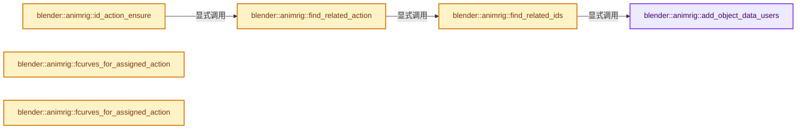
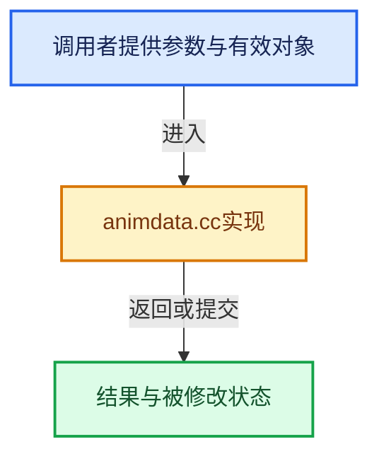

# 实现依赖专题：source/blender/animrig/intern/animdata.cc

[方向导航](README.md) · [符号索引](../%E7%AC%A6%E5%8F%B7%E4%BE%9D%E8%B5%96%E4%B8%8E%E5%AE%9E%E7%8E%B0%E7%B4%A2%E5%BC%95.md)

本专题从正文实际调用进入，集中保存共享实现。函数有稳定锚点，可从调用处直接跳到对应完整函数；递归与互相调用通过回链组织。

## 本文件的实现关系






## 完整成员与函数实现

<a id="f-e027e759a6ccf7cd"></a>

### `blender::animrig::add_object_data_users`

实现位置：[source/blender/animrig/intern/animdata.cc](../../../../../source/blender/animrig/intern/animdata.cc) · L43—L60。

接口参数：

- `const Main &bmain`
- `const ID &id`
- `Vector<ID *> &related_ids`

**教学注释版**

<!-- annotated:1e0a1bec638f6d -->

```cpp
static void add_object_data_users(const Main &bmain, const ID &id, Vector<ID *> &related_ids)
{
  if (ID_REAL_USERS(&id) != 1) {
    /* Only find objects if this ID is only used once. */
    return;
  }

  Object *ob;
  ID *object_id;
  FOREACH_MAIN_LISTBASE_ID_BEGIN (&bmain.objects, object_id) {
    ob = reinterpret_cast<Object *>(object_id);
    if (ob->data != &id) {
      continue;
    }
    related_ids.append_non_duplicates(&ob->id);
  }
  FOREACH_MAIN_LISTBASE_ID_END;
}
```

<details>
<summary>核对原始源码：source/blender/animrig/intern/animdata.cc · L43—L60</summary>

<!-- original:1e0a1bec638f6d:source/blender/animrig/intern/animdata.cc:43:60 -->

```cpp
static void add_object_data_users(const Main &bmain, const ID &id, Vector<ID *> &related_ids)
{
  if (ID_REAL_USERS(&id) != 1) {
    /* Only find objects if this ID is only used once. */
    return;
  }

  Object *ob;
  ID *object_id;
  FOREACH_MAIN_LISTBASE_ID_BEGIN (&bmain.objects, object_id) {
    ob = reinterpret_cast<Object *>(object_id);
    if (ob->data != &id) {
      continue;
    }
    related_ids.append_non_duplicates(&ob->id);
  }
  FOREACH_MAIN_LISTBASE_ID_END;
}
```

</details>

**沿实际写入检查状态**

- `ob = reinterpret_cast<Object *>(object_id);`

**继续追踪实现**

- `ID_REAL_USERS` → [ID_REAL_USERS · L679](%E4%BE%9D%E8%B5%96-DNA_ID-3eb091.md#m-269119997db1)。宏定义由构建条件选择。
- `FOREACH_MAIN_LISTBASE_ID_BEGIN` → [FOREACH_MAIN_LISTBASE_ID_BEGIN · L694](%E4%BE%9D%E8%B5%96-BKE_main-626d8f.md#m-311e8be07462)。宏定义由构建条件选择。
- `related_ids.append_non_duplicates` → [blender::Vector::append_non_duplicates · L537](../01-%E5%9F%BA%E7%A1%80%E5%AE%B9%E5%99%A8%E4%B8%8E%E7%8E%B0%E4%BB%A3CPP/11-Vector%E6%8F%92%E5%85%A5%E5%88%A0%E9%99%A4%E4%B8%8E%E9%87%8D%E6%8E%92.md#f-7741238254851c96)。

<a id="f-ca0e1bc1c8068400"></a>

### `blender::animrig::find_related_ids`

实现位置：[source/blender/animrig/intern/animdata.cc](../../../../../source/blender/animrig/intern/animdata.cc) · L62—L175。

接口参数：

- `Main &bmain`
- `ID &id`

**教学注释版**

<!-- annotated:bf67908ad9a05d -->

```cpp
Vector<ID *> find_related_ids(Main &bmain, ID &id)
{
  Vector<ID *> related_ids({&id});

  /* `related_ids` can grow during an iteration if the ID of the current iteration has associated
   * code that defines relationships. */
  // [讲解] related_ids.size：用end_减begin_得到活元素数量。
  for (int i = 0; i < related_ids.size(); i++) {
    ID *related_id = related_ids[i];

    if (related_id->flag & ID_FLAG_EMBEDDED_DATA) {
      /* No matter the type of embedded ID, their owner can always be added to the related IDs. */

      /* User counting is irrelevant for the logic here, because embedded IDs cannot be shared.
       * Embedded IDs do exist (sometimes) with a non-zero user count, hence the assertion that the
       * user count is not greater than 1. */
      BLI_assert(ID_REAL_USERS(related_id) <= 1);
      ID *owner_id = BKE_id_owner_get(related_id);
      /* Embedded IDs should always have an owner. */
      BLI_assert(owner_id != nullptr);
      related_ids.append_non_duplicates(owner_id);
    }

    /* No action found on current ID, add related IDs to the ID Vector. */
    switch (GS(related_id->name)) {
      case ID_OB: {
        Object *ob = reinterpret_cast<Object *>(related_id);
        if (!ob->data) {
          break;
        }
        ID *data = ob->data;
        if (ID_REAL_USERS(data) == 1) {
          related_ids.append_non_duplicates(data);
        }
        for (ParticleSystem &particle_system : ob->particlesystem) {
          if (!particle_system.part) {
            continue;
          }
          if (ID_REAL_USERS(&particle_system.part->id) != 1) {
            continue;
          }
          related_ids.append_non_duplicates(&particle_system.part->id);
        }
        break;
      }

      case ID_KE: {
        /* Shape-keys. */
        Key *key = reinterpret_cast<Key *>(related_id);
        /* Shape-keys are not embedded but there is currently no way to reuse them. */
        BLI_assert(ID_REAL_USERS(related_id) == 1);
        related_ids.append_non_duplicates(key->from);
        break;
      }

      case ID_MA: {
        /* Explicitly not relating materials and material users. */
        Material *mat = reinterpret_cast<Material *>(related_id);
        if (mat->nodetree && ID_REAL_USERS(&mat->nodetree->id) == 1) {
          related_ids.append_non_duplicates(&mat->nodetree->id);
        }
        break;
      }

      case ID_PA: {
        if (ID_REAL_USERS(related_id) != 1) {
          continue;
        }
        Object *ob;
        ID *object_id;
        /* Find users of this particle setting. */
        FOREACH_MAIN_LISTBASE_ID_BEGIN (&bmain.objects, object_id) {
          ob = reinterpret_cast<Object *>(object_id);
          bool object_uses_particle_settings = false;
          for (ParticleSystem &particle_system : ob->particlesystem) {
            if (!particle_system.part) {
              continue;
            }
            if (&particle_system.part->id != related_id) {
              continue;
            }
            object_uses_particle_settings = true;
            break;
          }
          if (object_uses_particle_settings) {
            related_ids.append_non_duplicates(&ob->id);
            break;
          }
        }
        FOREACH_MAIN_LISTBASE_ID_END;

        break;
      }

      default: {
        /* Just check if the ID is used as object data somewhere. */
        add_object_data_users(bmain, *related_id, related_ids);
        bNodeTree *node_tree = bke::node_tree_from_id(related_id);
        if (node_tree && ID_REAL_USERS(&node_tree->id) == 1) {
          related_ids.append_non_duplicates(&node_tree->id);
        }

        Key *key = BKE_key_from_id(related_id);
        if (key) {
          /* No check for multi user because the shape-key cannot be shared. */
          BLI_assert(ID_REAL_USERS(&key->id) == 1);
          related_ids.append_non_duplicates(&key->id);
        }
        break;
      }
    }
  }

  return related_ids;
}
```

<details>
<summary>核对原始源码：source/blender/animrig/intern/animdata.cc · L62—L175</summary>

<!-- original:bf67908ad9a05d:source/blender/animrig/intern/animdata.cc:62:175 -->

```cpp
Vector<ID *> find_related_ids(Main &bmain, ID &id)
{
  Vector<ID *> related_ids({&id});

  /* `related_ids` can grow during an iteration if the ID of the current iteration has associated
   * code that defines relationships. */
  for (int i = 0; i < related_ids.size(); i++) {
    ID *related_id = related_ids[i];

    if (related_id->flag & ID_FLAG_EMBEDDED_DATA) {
      /* No matter the type of embedded ID, their owner can always be added to the related IDs. */

      /* User counting is irrelevant for the logic here, because embedded IDs cannot be shared.
       * Embedded IDs do exist (sometimes) with a non-zero user count, hence the assertion that the
       * user count is not greater than 1. */
      BLI_assert(ID_REAL_USERS(related_id) <= 1);
      ID *owner_id = BKE_id_owner_get(related_id);
      /* Embedded IDs should always have an owner. */
      BLI_assert(owner_id != nullptr);
      related_ids.append_non_duplicates(owner_id);
    }

    /* No action found on current ID, add related IDs to the ID Vector. */
    switch (GS(related_id->name)) {
      case ID_OB: {
        Object *ob = reinterpret_cast<Object *>(related_id);
        if (!ob->data) {
          break;
        }
        ID *data = ob->data;
        if (ID_REAL_USERS(data) == 1) {
          related_ids.append_non_duplicates(data);
        }
        for (ParticleSystem &particle_system : ob->particlesystem) {
          if (!particle_system.part) {
            continue;
          }
          if (ID_REAL_USERS(&particle_system.part->id) != 1) {
            continue;
          }
          related_ids.append_non_duplicates(&particle_system.part->id);
        }
        break;
      }

      case ID_KE: {
        /* Shape-keys. */
        Key *key = reinterpret_cast<Key *>(related_id);
        /* Shape-keys are not embedded but there is currently no way to reuse them. */
        BLI_assert(ID_REAL_USERS(related_id) == 1);
        related_ids.append_non_duplicates(key->from);
        break;
      }

      case ID_MA: {
        /* Explicitly not relating materials and material users. */
        Material *mat = reinterpret_cast<Material *>(related_id);
        if (mat->nodetree && ID_REAL_USERS(&mat->nodetree->id) == 1) {
          related_ids.append_non_duplicates(&mat->nodetree->id);
        }
        break;
      }

      case ID_PA: {
        if (ID_REAL_USERS(related_id) != 1) {
          continue;
        }
        Object *ob;
        ID *object_id;
        /* Find users of this particle setting. */
        FOREACH_MAIN_LISTBASE_ID_BEGIN (&bmain.objects, object_id) {
          ob = reinterpret_cast<Object *>(object_id);
          bool object_uses_particle_settings = false;
          for (ParticleSystem &particle_system : ob->particlesystem) {
            if (!particle_system.part) {
              continue;
            }
            if (&particle_system.part->id != related_id) {
              continue;
            }
            object_uses_particle_settings = true;
            break;
          }
          if (object_uses_particle_settings) {
            related_ids.append_non_duplicates(&ob->id);
            break;
          }
        }
        FOREACH_MAIN_LISTBASE_ID_END;

        break;
      }

      default: {
        /* Just check if the ID is used as object data somewhere. */
        add_object_data_users(bmain, *related_id, related_ids);
        bNodeTree *node_tree = bke::node_tree_from_id(related_id);
        if (node_tree && ID_REAL_USERS(&node_tree->id) == 1) {
          related_ids.append_non_duplicates(&node_tree->id);
        }

        Key *key = BKE_key_from_id(related_id);
        if (key) {
          /* No check for multi user because the shape-key cannot be shared. */
          BLI_assert(ID_REAL_USERS(&key->id) == 1);
          related_ids.append_non_duplicates(&key->id);
        }
        break;
      }
    }
  }

  return related_ids;
}
```

</details>

**沿实际写入检查状态**

- `ob = reinterpret_cast<Object *>(object_id);`
- `object_uses_particle_settings = true;`

**结果出口**

- `return related_ids;`

**继续追踪实现**

- `related_ids.size` → [blender::Vector::size · L780](../01-%E5%9F%BA%E7%A1%80%E5%AE%B9%E5%99%A8%E4%B8%8E%E7%8E%B0%E4%BB%A3CPP/11-Vector%E6%8F%92%E5%85%A5%E5%88%A0%E9%99%A4%E4%B8%8E%E9%87%8D%E6%8E%92.md#f-714773731767349c)。
- `BLI_assert` → [BLI_assert · L48](../01-%E5%9F%BA%E7%A1%80%E5%AE%B9%E5%99%A8%E4%B8%8E%E7%8E%B0%E4%BB%A3CPP/%E4%BE%9D%E8%B5%96-BLI_assert-cc98e8.md#m-57a88495704d)；[BLI_assert · L63](../01-%E5%9F%BA%E7%A1%80%E5%AE%B9%E5%99%A8%E4%B8%8E%E7%8E%B0%E4%BB%A3CPP/%E4%BE%9D%E8%B5%96-BLI_assert-cc98e8.md#m-d07050020cb5)。宏定义由构建条件选择。
- `ID_REAL_USERS` → [ID_REAL_USERS · L679](%E4%BE%9D%E8%B5%96-DNA_ID-3eb091.md#m-269119997db1)。宏定义由构建条件选择。
- `BKE_id_owner_get` → [blender::BKE_id_owner_get · L2770](%E4%BE%9D%E8%B5%96-lib_id-d4e6bd.md#f-a51c741e122bfc1f)。
- `related_ids.append_non_duplicates` → [blender::Vector::append_non_duplicates · L537](../01-%E5%9F%BA%E7%A1%80%E5%AE%B9%E5%99%A8%E4%B8%8E%E7%8E%B0%E4%BB%A3CPP/11-Vector%E6%8F%92%E5%85%A5%E5%88%A0%E9%99%A4%E4%B8%8E%E9%87%8D%E6%8E%92.md#f-7741238254851c96)。
- `GS` → [blender::GS · L410](%E4%BE%9D%E8%B5%96-DNA_ID-3eb091.md#f-c3ff509f79f21b05)。
- `FOREACH_MAIN_LISTBASE_ID_BEGIN` → [FOREACH_MAIN_LISTBASE_ID_BEGIN · L694](%E4%BE%9D%E8%B5%96-BKE_main-626d8f.md#m-311e8be07462)。宏定义由构建条件选择。
- `add_object_data_users` → [blender::animrig::add_object_data_users · L43](%E4%BE%9D%E8%B5%96-animdata-f7cd6c.md#f-e027e759a6ccf7cd)。
- `bke::node_tree_from_id` → [blender::bke::node_tree_from_id · L5337](%E4%BE%9D%E8%B5%96-node-89d753.md#f-9bb7511df53d8493)。
- `BKE_key_from_id` → [blender::BKE_key_from_id · L1291](%E4%BE%9D%E8%B5%96-key-2b3be3.md#f-2050edb37f3ef7b0)。

<a id="f-993eb729bb16b01b"></a>

### `blender::animrig::find_related_action`

实现位置：[source/blender/animrig/intern/animdata.cc](../../../../../source/blender/animrig/intern/animdata.cc) · L179—L193。

接口参数：

- `Main &bmain`
- `ID &id`

**教学注释版**

<!-- annotated:38886dc82fb388 -->

```cpp
static bAction *find_related_action(Main &bmain, ID &id)
{
  Vector<ID *> related_ids = find_related_ids(bmain, id);

  for (ID *related_id : related_ids) {
    Action *action = get_action(*related_id);
    if (action && BKE_id_is_editable(&bmain, &action->id)) {
      /* Returning the first action found means highest priority has the action closest in the
       * relationship graph. */
      return action;
    }
  }

  return nullptr;
}
```

<details>
<summary>核对原始源码：source/blender/animrig/intern/animdata.cc · L179—L193</summary>

<!-- original:38886dc82fb388:source/blender/animrig/intern/animdata.cc:179:193 -->

```cpp
static bAction *find_related_action(Main &bmain, ID &id)
{
  Vector<ID *> related_ids = find_related_ids(bmain, id);

  for (ID *related_id : related_ids) {
    Action *action = get_action(*related_id);
    if (action && BKE_id_is_editable(&bmain, &action->id)) {
      /* Returning the first action found means highest priority has the action closest in the
       * relationship graph. */
      return action;
    }
  }

  return nullptr;
}
```

</details>

**结果出口**

- `return action;`
- `return nullptr;`

**继续追踪实现**

- `find_related_ids` → [blender::animrig::find_related_ids · L62](%E4%BE%9D%E8%B5%96-animdata-f7cd6c.md#f-ca0e1bc1c8068400)。
- `get_action` → [blender::animrig::get_action · L1526](%E4%BE%9D%E8%B5%96-action-a70714.md#f-4ed1c609c1ece074)。
- `BKE_id_is_editable` → [blender::BKE_id_is_editable · L2782](%E4%BE%9D%E8%B5%96-lib_id-d4e6bd.md#f-869bb38ca7053b5f)。

<a id="f-7ba333f33425f774"></a>

### `blender::animrig::id_action_ensure`

实现位置：[source/blender/animrig/intern/animdata.cc](../../../../../source/blender/animrig/intern/animdata.cc) · L195—L249。

接口参数：

- `Main *bmain`
- `ID *id`

**教学注释版**

<!-- annotated:e2f46c94230c00 -->

```cpp
bAction *id_action_ensure(Main *bmain, ID *id)
{
  AnimData *adt = BKE_animdata_ensure_id(id);
  if (adt == nullptr) {
    printf("ERROR: data-block type is not animatable (ID = %s)\n", (id) ? (id->name) : "<None>");
    return nullptr;
  }

  /* init action if none available yet */
  /* TODO: need some wizardry to handle NLA stuff correct */
  if (adt->action == nullptr) {
    bAction *action = find_related_action(*bmain, *id);

    if (action == nullptr) {
      /* init action name from name of ID block */
      char actname[sizeof(id->name) - 2];
      if (id->flag & ID_FLAG_EMBEDDED_DATA) {
        /* When the ID is embedded, use the name of the owner ID for clarity. */
        ID *owner_id = BKE_id_owner_get(id);
        /* If the ID is embedded it should have an owner. */
        BLI_assert(owner_id != nullptr);
        SNPRINTF_UTF8(actname, DATA_("%sAction"), owner_id->name + 2);
      }
      else if (GS(id->name) == ID_KE) {
        Key *key = reinterpret_cast<Key *>(id);
        SNPRINTF_UTF8(actname, DATA_("%sAction"), key->from->name + 2);
      }
      else {
        SNPRINTF_UTF8(actname, DATA_("%sAction"), id->name + 2);
      }

      /* create action */
      action = BKE_action_add(bmain, actname);

      /* Decrement the default-1 user count, as assigning it will increase it again. */
      BLI_assert(action->id.us == 1);
      id_us_min(&action->id);
    }

    /* Assigning the Action should always work here. The only reason it wouldn't, is when a legacy
     * Action of the wrong ID type is assigned, but since in this branch of the code we're only
     * dealing with either new or layered Actions, this will never fail. */
    const bool ok = animrig::assign_action(action, {*id, *adt});
    BLI_assert_msg(ok, "Expecting Action assignment to work here");
    UNUSED_VARS_NDEBUG(ok);

    /* Tag depsgraph to be rebuilt to include time dependency. */
    DEG_relations_tag_update(bmain);
  }

  DEG_id_tag_update(&adt->action->id, ID_RECALC_ANIMATION_NO_FLUSH);

  /* return the action */
  return adt->action;
}
```

<details>
<summary>核对原始源码：source/blender/animrig/intern/animdata.cc · L195—L249</summary>

<!-- original:e2f46c94230c00:source/blender/animrig/intern/animdata.cc:195:249 -->

```cpp
bAction *id_action_ensure(Main *bmain, ID *id)
{
  AnimData *adt = BKE_animdata_ensure_id(id);
  if (adt == nullptr) {
    printf("ERROR: data-block type is not animatable (ID = %s)\n", (id) ? (id->name) : "<None>");
    return nullptr;
  }

  /* init action if none available yet */
  /* TODO: need some wizardry to handle NLA stuff correct */
  if (adt->action == nullptr) {
    bAction *action = find_related_action(*bmain, *id);

    if (action == nullptr) {
      /* init action name from name of ID block */
      char actname[sizeof(id->name) - 2];
      if (id->flag & ID_FLAG_EMBEDDED_DATA) {
        /* When the ID is embedded, use the name of the owner ID for clarity. */
        ID *owner_id = BKE_id_owner_get(id);
        /* If the ID is embedded it should have an owner. */
        BLI_assert(owner_id != nullptr);
        SNPRINTF_UTF8(actname, DATA_("%sAction"), owner_id->name + 2);
      }
      else if (GS(id->name) == ID_KE) {
        Key *key = reinterpret_cast<Key *>(id);
        SNPRINTF_UTF8(actname, DATA_("%sAction"), key->from->name + 2);
      }
      else {
        SNPRINTF_UTF8(actname, DATA_("%sAction"), id->name + 2);
      }

      /* create action */
      action = BKE_action_add(bmain, actname);

      /* Decrement the default-1 user count, as assigning it will increase it again. */
      BLI_assert(action->id.us == 1);
      id_us_min(&action->id);
    }

    /* Assigning the Action should always work here. The only reason it wouldn't, is when a legacy
     * Action of the wrong ID type is assigned, but since in this branch of the code we're only
     * dealing with either new or layered Actions, this will never fail. */
    const bool ok = animrig::assign_action(action, {*id, *adt});
    BLI_assert_msg(ok, "Expecting Action assignment to work here");
    UNUSED_VARS_NDEBUG(ok);

    /* Tag depsgraph to be rebuilt to include time dependency. */
    DEG_relations_tag_update(bmain);
  }

  DEG_id_tag_update(&adt->action->id, ID_RECALC_ANIMATION_NO_FLUSH);

  /* return the action */
  return adt->action;
}
```

</details>

**沿实际写入检查状态**

- `action = BKE_action_add(bmain, actname);`

**结果出口**

- `return nullptr;`
- `return adt->action;`

**继续追踪实现**

- `BKE_animdata_ensure_id` → [blender::BKE_animdata_ensure_id · L107](%E4%BE%9D%E8%B5%96-anim_data-56c81c.md#f-03c23566cd3e0251)。
- `printf` → [外部契约](https://eel.is/c++draft/)：这个边界按实际表达式及所属类型核对参数、返回值、寿命与失败行为。这里提供接口入口，不声称已解释该第三方版本的内部实现。
- `find_related_action` → [blender::animrig::find_related_action · L179](%E4%BE%9D%E8%B5%96-animdata-f7cd6c.md#f-993eb729bb16b01b)。
- `BKE_id_owner_get` → [blender::BKE_id_owner_get · L2770](%E4%BE%9D%E8%B5%96-lib_id-d4e6bd.md#f-a51c741e122bfc1f)。
- `BLI_assert` → [BLI_assert · L48](../01-%E5%9F%BA%E7%A1%80%E5%AE%B9%E5%99%A8%E4%B8%8E%E7%8E%B0%E4%BB%A3CPP/%E4%BE%9D%E8%B5%96-BLI_assert-cc98e8.md#m-57a88495704d)；[BLI_assert · L63](../01-%E5%9F%BA%E7%A1%80%E5%AE%B9%E5%99%A8%E4%B8%8E%E7%8E%B0%E4%BB%A3CPP/%E4%BE%9D%E8%B5%96-BLI_assert-cc98e8.md#m-d07050020cb5)。宏定义由构建条件选择。
- `SNPRINTF_UTF8` → [SNPRINTF_UTF8 · L340](../01-%E5%9F%BA%E7%A1%80%E5%AE%B9%E5%99%A8%E4%B8%8E%E7%8E%B0%E4%BB%A3CPP/%E4%BE%9D%E8%B5%96-BLI_string_utf8-bcc961.md#m-5e57d7a30c64)。宏定义由构建条件选择。
- `DATA_` → [DATA_ · L52](%E4%BE%9D%E8%B5%96-BLT_translation-c89e58.md#m-178736083f83)。宏定义由构建条件选择。
- `GS` → [blender::GS · L410](%E4%BE%9D%E8%B5%96-DNA_ID-3eb091.md#f-c3ff509f79f21b05)。
- `BKE_action_add` → [blender::BKE_action_add · L778](%E4%BE%9D%E8%B5%96-action-b3a47a.md#f-fd8aa5ca3d7a4ed5)。
- `id_us_min` → [blender::id_us_min · L441](%E4%BE%9D%E8%B5%96-lib_id-d4e6bd.md#f-c5e5246a79962257)。
- `animrig::assign_action` → [blender::animrig::assign_action · L1166](%E4%BE%9D%E8%B5%96-action-a70714.md#f-55a18cb8e191d426)；[blender::animrig::assign_action · L1175](%E4%BE%9D%E8%B5%96-action-a70714.md#f-5a2c12d888fde844)。同名重载需按实参类型选择。
- `BLI_assert_msg` → [BLI_assert_msg · L55](../01-%E5%9F%BA%E7%A1%80%E5%AE%B9%E5%99%A8%E4%B8%8E%E7%8E%B0%E4%BB%A3CPP/%E4%BE%9D%E8%B5%96-BLI_assert-cc98e8.md#m-695eed20dceb)；[BLI_assert_msg · L64](../01-%E5%9F%BA%E7%A1%80%E5%AE%B9%E5%99%A8%E4%B8%8E%E7%8E%B0%E4%BB%A3CPP/%E4%BE%9D%E8%B5%96-BLI_assert-cc98e8.md#m-7de5563de4db)。宏定义由构建条件选择。
- `UNUSED_VARS_NDEBUG` → [UNUSED_VARS_NDEBUG · L526](../01-%E5%9F%BA%E7%A1%80%E5%AE%B9%E5%99%A8%E4%B8%8E%E7%8E%B0%E4%BB%A3CPP/%E4%BE%9D%E8%B5%96-BLI_utildefines-293a0a.md#m-fea439f7d366)；[UNUSED_VARS_NDEBUG · L528](../01-%E5%9F%BA%E7%A1%80%E5%AE%B9%E5%99%A8%E4%B8%8E%E7%8E%B0%E4%BB%A3CPP/%E4%BE%9D%E8%B5%96-BLI_utildefines-293a0a.md#m-a8f8cfac06c0)。宏定义由构建条件选择。
- `DEG_relations_tag_update` → [blender::DEG_relations_tag_update · L350](../11-Depsgraph%E4%B8%8E%E5%B9%B6%E8%A1%8C%E4%BB%BB%E5%8A%A1%E7%B3%BB%E7%BB%9F/%E4%BE%9D%E8%B5%96-depsgraph_build-ea2fc8.md#f-2910c78540652980)。
- `DEG_id_tag_update` → [blender::DEG_id_tag_update · L844](../11-Depsgraph%E4%B8%8E%E5%B9%B6%E8%A1%8C%E4%BB%BB%E5%8A%A1%E7%B3%BB%E7%BB%9F/%E4%BE%9D%E8%B5%96-depsgraph_tag-d8b3c7.md#f-62d2949dd168bb81)。

<a id="f-256dde45890976be"></a>

### `blender::animrig::fcurves_for_assigned_action`

实现位置：[source/blender/animrig/intern/animdata.cc](../../../../../source/blender/animrig/intern/animdata.cc) · L349—L355。

接口参数：

- `AnimData *adt`

**教学注释版**

<!-- annotated:464a218906079f -->

```cpp
Span<FCurve *> fcurves_for_assigned_action(AnimData *adt)
{
  if (!adt || !adt->action) {
    return {};
  }
  return fcurves_for_action_slot(adt->action->wrap(), adt->slot_handle);
}
```

<details>
<summary>核对原始源码：source/blender/animrig/intern/animdata.cc · L349—L355</summary>

<!-- original:464a218906079f:source/blender/animrig/intern/animdata.cc:349:355 -->

```cpp
Span<FCurve *> fcurves_for_assigned_action(AnimData *adt)
{
  if (!adt || !adt->action) {
    return {};
  }
  return fcurves_for_action_slot(adt->action->wrap(), adt->slot_handle);
}
```

</details>

**结果出口**

- `return {};`
- `return fcurves_for_action_slot(adt->action->wrap(), adt->slot_handle);`

**继续追踪实现**

- `fcurves_for_action_slot` → [blender::animrig::fcurves_for_action_slot · L2544](%E4%BE%9D%E8%B5%96-action-a70714.md#f-78c71d42065fc00f)；[blender::animrig::fcurves_for_action_slot · L2554](%E4%BE%9D%E8%B5%96-action-a70714.md#f-c1c45d131d9cf075)。同名重载需按实参类型选择。
- `adt->action->wrap` → [调用协议](../%E6%A8%A1%E6%9D%BF%E5%AE%8F%E4%B8%8E%E5%8A%A8%E6%80%81%E5%88%86%E6%B4%BE%E5%8D%8F%E8%AE%AE.md)：接收对象类型依赖auto、返回值或模板实例；不按同名猜测目标。调用位置L354。

<a id="f-b79bdf0f70d5ff6f"></a>

### `blender::animrig::fcurves_for_assigned_action`

实现位置：[source/blender/animrig/intern/animdata.cc](../../../../../source/blender/animrig/intern/animdata.cc) · L357—L364。

接口参数：

- `const AnimData *adt`

**教学注释版**

<!-- annotated:010929070db3e2 -->

```cpp
Span<const FCurve *> fcurves_for_assigned_action(const AnimData *adt)
{
  if (!adt || !adt->action) {
    return {};
  }
  return fcurves_for_action_slot(const_cast<const bAction *>(adt->action)->wrap(),
                                 adt->slot_handle);
}
```

<details>
<summary>核对原始源码：source/blender/animrig/intern/animdata.cc · L357—L364</summary>

<!-- original:010929070db3e2:source/blender/animrig/intern/animdata.cc:357:364 -->

```cpp
Span<const FCurve *> fcurves_for_assigned_action(const AnimData *adt)
{
  if (!adt || !adt->action) {
    return {};
  }
  return fcurves_for_action_slot(const_cast<const bAction *>(adt->action)->wrap(),
                                 adt->slot_handle);
}
```

</details>

**结果出口**

- `return {};`
- `return fcurves_for_action_slot(const_cast<const bAction *>(adt->action)->wrap(),`

**继续追踪实现**

- `fcurves_for_action_slot` → [blender::animrig::fcurves_for_action_slot · L2544](%E4%BE%9D%E8%B5%96-action-a70714.md#f-78c71d42065fc00f)；[blender::animrig::fcurves_for_action_slot · L2554](%E4%BE%9D%E8%B5%96-action-a70714.md#f-c1c45d131d9cf075)。同名重载需按实参类型选择。
- `const_cast<const bAction *>(adt->action)->wrap` → [调用协议](../%E6%A8%A1%E6%9D%BF%E5%AE%8F%E4%B8%8E%E5%8A%A8%E6%80%81%E5%88%86%E6%B4%BE%E5%8D%8F%E8%AE%AE.md)：接收对象类型依赖auto、返回值或模板实例；不按同名猜测目标。调用位置L362。
