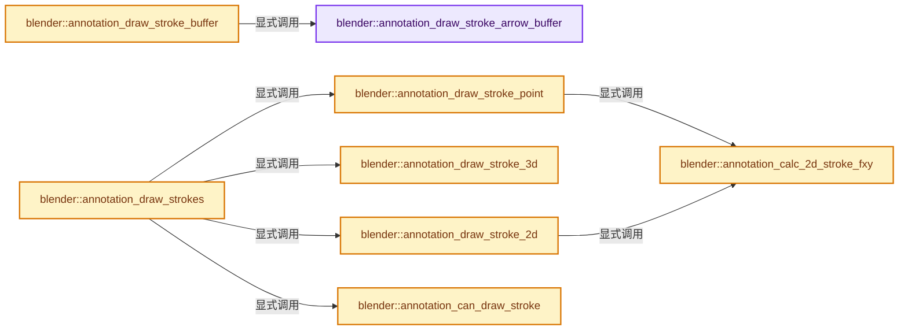

# 实现依赖专题：source/blender/editors/gpencil_legacy/annotate_draw.cc

[方向导航](README.md) · [符号索引](../%E7%AC%A6%E5%8F%B7%E4%BE%9D%E8%B5%96%E4%B8%8E%E5%AE%9E%E7%8E%B0%E7%B4%A2%E5%BC%95.md)

本专题从正文实际调用进入，集中保存共享实现。函数有稳定锚点，可从调用处直接跳到对应完整函数；递归与互相调用通过回链组织。

## 本文件的实现关系




## 完整成员与函数实现

<a id="f-f6daf59050946594"></a>

### `blender::annotation_draw_stroke_arrow_buffer`

实现位置：[source/blender/editors/gpencil_legacy/annotate_draw.cc](../../../../../source/blender/editors/gpencil_legacy/annotate_draw.cc) · L70—L105。

接口参数：

- `uint pos`
- `const float *corner_point`
- `const float *arrow_coords`
- `const int arrow_style`

**教学注释版**

<!-- annotated:43901688e98719 -->

```cpp
static void annotation_draw_stroke_arrow_buffer(uint pos,
                                                const float *corner_point,
                                                const float *arrow_coords,
                                                const int arrow_style)
{
  immBeginAtMost(GPU_PRIM_LINE_STRIP, arrow_style);

  switch (arrow_style) {
    case GP_STROKE_ARROWSTYLE_SEGMENT:
      immVertex2f(pos, arrow_coords[0], arrow_coords[1]);
      immVertex2f(pos, arrow_coords[2], arrow_coords[3]);
      break;
    case GP_STROKE_ARROWSTYLE_CLOSED:
      immVertex2f(pos, arrow_coords[0], arrow_coords[1]);
      immVertex2f(pos, arrow_coords[2], arrow_coords[3]);
      immVertex2f(pos, arrow_coords[4], arrow_coords[5]);
      immVertex2f(pos, arrow_coords[0], arrow_coords[1]);
      break;
    case GP_STROKE_ARROWSTYLE_OPEN:
      immVertex2f(pos, arrow_coords[0], arrow_coords[1]);
      immVertex2f(pos, corner_point[0], corner_point[1]);
      immVertex2f(pos, arrow_coords[2], arrow_coords[3]);
      break;
    case GP_STROKE_ARROWSTYLE_SQUARE:
      immVertex2f(pos, corner_point[0], corner_point[1]);
      immVertex2f(pos, arrow_coords[0], arrow_coords[1]);
      immVertex2f(pos, arrow_coords[4], arrow_coords[5]);
      immVertex2f(pos, arrow_coords[6], arrow_coords[7]);
      immVertex2f(pos, arrow_coords[2], arrow_coords[3]);
      immVertex2f(pos, corner_point[0], corner_point[1]);
      break;
    default:
      break;
  }
  immEnd();
}
```

<details>
<summary>核对原始源码：source/blender/editors/gpencil_legacy/annotate_draw.cc · L70—L105</summary>

<!-- original:43901688e98719:source/blender/editors/gpencil_legacy/annotate_draw.cc:70:105 -->

```cpp
static void annotation_draw_stroke_arrow_buffer(uint pos,
                                                const float *corner_point,
                                                const float *arrow_coords,
                                                const int arrow_style)
{
  immBeginAtMost(GPU_PRIM_LINE_STRIP, arrow_style);

  switch (arrow_style) {
    case GP_STROKE_ARROWSTYLE_SEGMENT:
      immVertex2f(pos, arrow_coords[0], arrow_coords[1]);
      immVertex2f(pos, arrow_coords[2], arrow_coords[3]);
      break;
    case GP_STROKE_ARROWSTYLE_CLOSED:
      immVertex2f(pos, arrow_coords[0], arrow_coords[1]);
      immVertex2f(pos, arrow_coords[2], arrow_coords[3]);
      immVertex2f(pos, arrow_coords[4], arrow_coords[5]);
      immVertex2f(pos, arrow_coords[0], arrow_coords[1]);
      break;
    case GP_STROKE_ARROWSTYLE_OPEN:
      immVertex2f(pos, arrow_coords[0], arrow_coords[1]);
      immVertex2f(pos, corner_point[0], corner_point[1]);
      immVertex2f(pos, arrow_coords[2], arrow_coords[3]);
      break;
    case GP_STROKE_ARROWSTYLE_SQUARE:
      immVertex2f(pos, corner_point[0], corner_point[1]);
      immVertex2f(pos, arrow_coords[0], arrow_coords[1]);
      immVertex2f(pos, arrow_coords[4], arrow_coords[5]);
      immVertex2f(pos, arrow_coords[6], arrow_coords[7]);
      immVertex2f(pos, arrow_coords[2], arrow_coords[3]);
      immVertex2f(pos, corner_point[0], corner_point[1]);
      break;
    default:
      break;
  }
  immEnd();
}
```

</details>

**继续追踪实现**

- `immBeginAtMost` → [blender::immBeginAtMost · L217](%E4%BE%9D%E8%B5%96-gpu_immediate-4842c0.md#f-d618cb15aaf74c49)。
- `immVertex2f` → [blender::immVertex2f · L539](%E4%BE%9D%E8%B5%96-gpu_immediate-4842c0.md#f-c5aa0ff286be3978)。
- `immEnd` → [blender::immEnd · L252](%E4%BE%9D%E8%B5%96-gpu_immediate-4842c0.md#f-ef4c47367ce69810)。

<a id="f-106b4942455da483"></a>

### `blender::annotation_draw_stroke_buffer`

实现位置：[source/blender/editors/gpencil_legacy/annotate_draw.cc](../../../../../source/blender/editors/gpencil_legacy/annotate_draw.cc) · L110—L226。

接口参数：

- `bGPdata *gps`
- `short thickness`
- `short dflag`
- `const float ink[4]`

**教学注释版**

<!-- annotated:ca36917791e4a9 -->

```cpp
static void annotation_draw_stroke_buffer(bGPdata *gps,
                                          short thickness,
                                          short dflag,
                                          const float ink[4])
{
  bGPdata_Runtime runtime = dna::shallow_copy(gps->runtime);
  const tGPspoint *points = static_cast<const tGPspoint *>(runtime.sbuffer);
  int totpoints = runtime.sbuffer_used;
  short sflag = runtime.sbuffer_sflag;

  int draw_points = 0;

  /* error checking */
  if ((points == nullptr) || (totpoints <= 0)) {
    return;
  }

  /* check if buffer can be drawn */
  if (dflag & (GP_DRAWDATA_ONLY3D | GP_DRAWDATA_ONLYV2D)) {
    return;
  }

  if (sflag & GP_STROKE_ERASER) {
    /* don't draw stroke at all! */
    return;
  }

  GPUVertFormat *format = immVertexFormat();
  uint pos = GPU_vertformat_attr_add(format, "pos", gpu::VertAttrType::SFLOAT_32_32);

  const tGPspoint *pt = points;

  if (totpoints == 1) {
    /* if drawing a single point, draw it larger */
    GPU_point_size(float(thickness + 2) * points->pressure);
    immBindBuiltinProgram(GPU_SHADER_3D_POINT_UNIFORM_SIZE_UNIFORM_COLOR_AA);
    immUniformColor3fvAlpha(ink, ink[3]);
    immBegin(GPU_PRIM_POINTS, 1);
    immVertex2fv(pos, pt->m_xy);
  }
  else {
    float oldpressure = points[0].pressure;

    /* draw stroke curve */
    immBindBuiltinProgram(GPU_SHADER_3D_POLYLINE_UNIFORM_COLOR);

    float viewport[4];
    GPU_viewport_size_get_f(viewport);
    immUniform2fv("viewportSize", &viewport[2]);

    immUniform1f("lineWidth", max_ff(oldpressure * thickness, 1.0) * U.pixelsize);

    immUniformColor3fvAlpha(ink, ink[3]);

    immBeginAtMost(GPU_PRIM_LINE_STRIP, totpoints);

    for (int i = 0; i < totpoints; i++, pt++) {
      /* If there was a significant pressure change,
       * stop the curve, change the thickness of the stroke,
       * and continue drawing again (since line-width cannot change in middle of GL_LINE_STRIP).
       */
      if (fabsf(pt->pressure - oldpressure) > 0.2f) {
        /* need to have 2 points to avoid immEnd assert error */
        if (draw_points < 2) {
          immVertex2fv(pos, (pt - 1)->m_xy);
        }

        immEnd();
        draw_points = 0;

        immUniform1f("lineWidth", max_ff(pt->pressure * thickness, 1.0) * U.pixelsize);
        immBeginAtMost(GPU_PRIM_LINE_STRIP, totpoints - i + 1);

        /* need to roll-back one point to ensure that there are no gaps in the stroke */
        if (i != 0) {
          immVertex2fv(pos, (pt - 1)->m_xy);
          draw_points++;
        }

        oldpressure = pt->pressure; /* reset our threshold */
      }

      /* now the point we want */
      immVertex2fv(pos, pt->m_xy);
      draw_points++;
    }
    /* need to have 2 points to avoid immEnd assert error */
    if (draw_points < 2) {
      immVertex2fv(pos, (pt - 1)->m_xy);
    }
  }

  immEnd();

  /* Draw arrow stroke. */
  if (totpoints > 1) {
    /* Draw ending arrow stroke. */
    if ((sflag & GP_STROKE_USE_ARROW_END) &&
        (runtime.arrow_end_style != GP_STROKE_ARROWSTYLE_NONE))
    {
      float end[2];
      copy_v2_v2(end, points[1].m_xy);
      annotation_draw_stroke_arrow_buffer(pos, end, runtime.arrow_end, runtime.arrow_end_style);
    }
    /* Draw starting arrow stroke. */
    if ((sflag & GP_STROKE_USE_ARROW_START) &&
        (runtime.arrow_start_style != GP_STROKE_ARROWSTYLE_NONE))
    {
      float start[2];
      copy_v2_v2(start, points[0].m_xy);
      annotation_draw_stroke_arrow_buffer(
          pos, start, runtime.arrow_start, runtime.arrow_start_style);
    }
  }

  immUnbindProgram();
}
```

<details>
<summary>核对原始源码：source/blender/editors/gpencil_legacy/annotate_draw.cc · L110—L226</summary>

<!-- original:ca36917791e4a9:source/blender/editors/gpencil_legacy/annotate_draw.cc:110:226 -->

```cpp
static void annotation_draw_stroke_buffer(bGPdata *gps,
                                          short thickness,
                                          short dflag,
                                          const float ink[4])
{
  bGPdata_Runtime runtime = dna::shallow_copy(gps->runtime);
  const tGPspoint *points = static_cast<const tGPspoint *>(runtime.sbuffer);
  int totpoints = runtime.sbuffer_used;
  short sflag = runtime.sbuffer_sflag;

  int draw_points = 0;

  /* error checking */
  if ((points == nullptr) || (totpoints <= 0)) {
    return;
  }

  /* check if buffer can be drawn */
  if (dflag & (GP_DRAWDATA_ONLY3D | GP_DRAWDATA_ONLYV2D)) {
    return;
  }

  if (sflag & GP_STROKE_ERASER) {
    /* don't draw stroke at all! */
    return;
  }

  GPUVertFormat *format = immVertexFormat();
  uint pos = GPU_vertformat_attr_add(format, "pos", gpu::VertAttrType::SFLOAT_32_32);

  const tGPspoint *pt = points;

  if (totpoints == 1) {
    /* if drawing a single point, draw it larger */
    GPU_point_size(float(thickness + 2) * points->pressure);
    immBindBuiltinProgram(GPU_SHADER_3D_POINT_UNIFORM_SIZE_UNIFORM_COLOR_AA);
    immUniformColor3fvAlpha(ink, ink[3]);
    immBegin(GPU_PRIM_POINTS, 1);
    immVertex2fv(pos, pt->m_xy);
  }
  else {
    float oldpressure = points[0].pressure;

    /* draw stroke curve */
    immBindBuiltinProgram(GPU_SHADER_3D_POLYLINE_UNIFORM_COLOR);

    float viewport[4];
    GPU_viewport_size_get_f(viewport);
    immUniform2fv("viewportSize", &viewport[2]);

    immUniform1f("lineWidth", max_ff(oldpressure * thickness, 1.0) * U.pixelsize);

    immUniformColor3fvAlpha(ink, ink[3]);

    immBeginAtMost(GPU_PRIM_LINE_STRIP, totpoints);

    for (int i = 0; i < totpoints; i++, pt++) {
      /* If there was a significant pressure change,
       * stop the curve, change the thickness of the stroke,
       * and continue drawing again (since line-width cannot change in middle of GL_LINE_STRIP).
       */
      if (fabsf(pt->pressure - oldpressure) > 0.2f) {
        /* need to have 2 points to avoid immEnd assert error */
        if (draw_points < 2) {
          immVertex2fv(pos, (pt - 1)->m_xy);
        }

        immEnd();
        draw_points = 0;

        immUniform1f("lineWidth", max_ff(pt->pressure * thickness, 1.0) * U.pixelsize);
        immBeginAtMost(GPU_PRIM_LINE_STRIP, totpoints - i + 1);

        /* need to roll-back one point to ensure that there are no gaps in the stroke */
        if (i != 0) {
          immVertex2fv(pos, (pt - 1)->m_xy);
          draw_points++;
        }

        oldpressure = pt->pressure; /* reset our threshold */
      }

      /* now the point we want */
      immVertex2fv(pos, pt->m_xy);
      draw_points++;
    }
    /* need to have 2 points to avoid immEnd assert error */
    if (draw_points < 2) {
      immVertex2fv(pos, (pt - 1)->m_xy);
    }
  }

  immEnd();

  /* Draw arrow stroke. */
  if (totpoints > 1) {
    /* Draw ending arrow stroke. */
    if ((sflag & GP_STROKE_USE_ARROW_END) &&
        (runtime.arrow_end_style != GP_STROKE_ARROWSTYLE_NONE))
    {
      float end[2];
      copy_v2_v2(end, points[1].m_xy);
      annotation_draw_stroke_arrow_buffer(pos, end, runtime.arrow_end, runtime.arrow_end_style);
    }
    /* Draw starting arrow stroke. */
    if ((sflag & GP_STROKE_USE_ARROW_START) &&
        (runtime.arrow_start_style != GP_STROKE_ARROWSTYLE_NONE))
    {
      float start[2];
      copy_v2_v2(start, points[0].m_xy);
      annotation_draw_stroke_arrow_buffer(
          pos, start, runtime.arrow_start, runtime.arrow_start_style);
    }
  }

  immUnbindProgram();
}
```

</details>

**沿实际写入检查状态**

- `draw_points = 0;`
- `oldpressure = pt->pressure; /* reset our threshold */`

**继续追踪实现**

- `dna::shallow_copy` → [blender::dna::shallow_copy · L146](%E4%BE%9D%E8%B5%96-DNA_defs-ed47fd.md#f-84b6eda95a1c994c)。
- `immVertexFormat` → [blender::immVertexFormat · L41](%E4%BE%9D%E8%B5%96-gpu_immediate-4842c0.md#f-cc131113ee25fc66)。
- `GPU_vertformat_attr_add` → [blender::GPU_vertformat_attr_add · L389](%E4%BE%9D%E8%B5%96-gpu_vertex_format-4f7148.md#f-a36e23f37b97fff4)。
- `GPU_point_size` → [blender::GPU_point_size · L157](%E4%BE%9D%E8%B5%96-gpu_state-82c525.md#f-3af311dd9716b12d)。
- `immBindBuiltinProgram` → [blender::immBindBuiltinProgram · L63](%E4%BE%9D%E8%B5%96-gpu_immediate-4842c0.md#f-958234d295e1ef45)。
- `immUniformColor3fvAlpha` → [blender::immUniformColor3fvAlpha · L679](%E4%BE%9D%E8%B5%96-gpu_immediate-4842c0.md#f-718571f21e9ac977)。
- `immBegin` → [blender::immBegin · L202](%E4%BE%9D%E8%B5%96-gpu_immediate-4842c0.md#f-d20e080325dd293f)。
- `immVertex2fv` → [blender::immVertex2fv · L563](%E4%BE%9D%E8%B5%96-gpu_immediate-4842c0.md#f-e97a61f12b767334)。
- `GPU_viewport_size_get_f` → [blender::GPU_viewport_size_get_f · L258](%E4%BE%9D%E8%B5%96-gpu_state-82c525.md#f-2cc9d4423985bf4f)。
- `immUniform2fv` → [blender::immUniform2fv · L593](%E4%BE%9D%E8%B5%96-gpu_immediate-4842c0.md#f-692364bd25764b0a)。
- `immUniform1f` → [blender::immUniform1f · L583](%E4%BE%9D%E8%B5%96-gpu_immediate-4842c0.md#f-294f146b86fc6b2f)。
- `max_ff` → [blender::max_ff · L325](../12-%E7%A9%BA%E9%97%B4%E6%95%B0%E6%8D%AE%E7%BB%93%E6%9E%84%E4%B8%8E%E5%87%A0%E4%BD%95%E7%AE%97%E6%B3%95/%E4%BE%9D%E8%B5%96-math_base_inline-546b00.md#f-05a351a3afd7dc2a)。
- `immBeginAtMost` → [blender::immBeginAtMost · L217](%E4%BE%9D%E8%B5%96-gpu_immediate-4842c0.md#f-d618cb15aaf74c49)。
- `fabsf` → [fabsf · L21](%E4%BE%9D%E8%B5%96-radial_tiling_shared-98abf9.md#m-02cc4c69cfb3)；[fabsf · L43](%E4%BE%9D%E8%B5%96-radial_tiling_shared-98abf9.md#m-04effe61803b)；[fabsf · L74](%E4%BE%9D%E8%B5%96-radial_tiling_shared-98abf9.md#m-927dd4eba7dc)；[fabsf · L25](../01-%E5%9F%BA%E7%A1%80%E5%AE%B9%E5%99%A8%E4%B8%8E%E7%8E%B0%E4%BB%A3CPP/%E4%BE%9D%E8%B5%96-radial_tiling_shared-7989a4.md#m-8348d6b3d08f)；[fabsf · L47](../01-%E5%9F%BA%E7%A1%80%E5%AE%B9%E5%99%A8%E4%B8%8E%E7%8E%B0%E4%BB%A3CPP/%E4%BE%9D%E8%B5%96-radial_tiling_shared-7989a4.md#m-13b7e0b6d84f)；[fabsf · L78](../01-%E5%9F%BA%E7%A1%80%E5%AE%B9%E5%99%A8%E4%B8%8E%E7%8E%B0%E4%BB%A3CPP/%E4%BE%9D%E8%B5%96-radial_tiling_shared-7989a4.md#m-326c83464a0d)；[fabsf · L21](%E4%BE%9D%E8%B5%96-node_radial_tiling_shared-b14bc2.md#m-7c3ee12fc119)；[fabsf · L43](%E4%BE%9D%E8%B5%96-node_radial_tiling_shared-b14bc2.md#m-9112db0e2dd1)；[fabsf · L74](%E4%BE%9D%E8%B5%96-node_radial_tiling_shared-b14bc2.md#m-ee4e61908a6f)；[fabsf · L167](%E4%BE%9D%E8%B5%96-compat-56205c.md#m-b039ee6c1601)；[fabsf · L265](%E4%BE%9D%E8%B5%96-compat-efe0e9.md#m-6b21869e9f3f)。宏定义由构建条件选择。
- `immEnd` → [blender::immEnd · L252](%E4%BE%9D%E8%B5%96-gpu_immediate-4842c0.md#f-ef4c47367ce69810)。
- `copy_v2_v2` → [blender::copy_v2_v2 · L41](../12-%E7%A9%BA%E9%97%B4%E6%95%B0%E6%8D%AE%E7%BB%93%E6%9E%84%E4%B8%8E%E5%87%A0%E4%BD%95%E7%AE%97%E6%B3%95/%E4%BE%9D%E8%B5%96-math_vector_inline-0c8541.md#f-e736ee2dd71cd821)。
- `annotation_draw_stroke_arrow_buffer` → [blender::annotation_draw_stroke_arrow_buffer · L70](%E4%BE%9D%E8%B5%96-annotate_draw-736a31.md#f-f6daf59050946594)。
- `immUnbindProgram` → [blender::immUnbindProgram · L70](%E4%BE%9D%E8%B5%96-gpu_immediate-4842c0.md#f-1534593ba1cbfc41)。

<a id="f-2c08a8c2abd922e9"></a>

### `blender::annotation_calc_2d_stroke_fxy`

实现位置：[source/blender/editors/gpencil_legacy/annotate_draw.cc](../../../../../source/blender/editors/gpencil_legacy/annotate_draw.cc) · L230—L251。

接口参数：

- `const float pt[3]`
- `short sflag`
- `int offsx`
- `int offsy`
- `int winx`
- `int winy`
- `float r_co[2]`

**教学注释版**

<!-- annotated:2fa9917013ebbf -->

```cpp
static void annotation_calc_2d_stroke_fxy(
    const float pt[3], short sflag, int offsx, int offsy, int winx, int winy, float r_co[2])
{
  if (sflag & GP_STROKE_2DSPACE) {
    r_co[0] = pt[0];
    r_co[1] = pt[1];
  }
  else if (sflag & GP_STROKE_2DIMAGE) {
    const float x = float((pt[0] * winx) + offsx);
    const float y = float((pt[1] * winy) + offsy);

    r_co[0] = x;
    r_co[1] = y;
  }
  else {
    const float x = float(pt[0] / 100 * winx) + offsx;
    const float y = float(pt[1] / 100 * winy) + offsy;

    r_co[0] = x;
    r_co[1] = y;
  }
}
```

<details>
<summary>核对原始源码：source/blender/editors/gpencil_legacy/annotate_draw.cc · L230—L251</summary>

<!-- original:2fa9917013ebbf:source/blender/editors/gpencil_legacy/annotate_draw.cc:230:251 -->

```cpp
static void annotation_calc_2d_stroke_fxy(
    const float pt[3], short sflag, int offsx, int offsy, int winx, int winy, float r_co[2])
{
  if (sflag & GP_STROKE_2DSPACE) {
    r_co[0] = pt[0];
    r_co[1] = pt[1];
  }
  else if (sflag & GP_STROKE_2DIMAGE) {
    const float x = float((pt[0] * winx) + offsx);
    const float y = float((pt[1] * winy) + offsy);

    r_co[0] = x;
    r_co[1] = y;
  }
  else {
    const float x = float(pt[0] / 100 * winx) + offsx;
    const float y = float(pt[1] / 100 * winy) + offsy;

    r_co[0] = x;
    r_co[1] = y;
  }
}
```

</details>

**沿实际写入检查状态**

- `r_co[0] = pt[0];`
- `r_co[1] = pt[1];`
- `r_co[0] = x;`
- `r_co[1] = y;`

**继续追踪实现**

本实现没有需要继续展开的显式调用；检查返回表达式、对象转换和调用者前置条件。

<a id="f-e452839f88e7e2b4"></a>

### `blender::annotation_draw_stroke_point`

实现位置：[source/blender/editors/gpencil_legacy/annotate_draw.cc](../../../../../source/blender/editors/gpencil_legacy/annotate_draw.cc) · L256—L297。

接口参数：

- `const bGPDspoint *points`
- `short thickness`
- `short sflag`
- `int offsx`
- `int offsy`
- `int winx`
- `int winy`
- `const float ink[4]`

**教学注释版**

<!-- annotated:f9f31e4c74ec9d -->

```cpp
static void annotation_draw_stroke_point(const bGPDspoint *points,
                                         short thickness,
                                         short sflag,
                                         int offsx,
                                         int offsy,
                                         int winx,
                                         int winy,
                                         const float ink[4])
{
  const bGPDspoint *pt = points;

  /* get final position using parent matrix */
  float fpt[3];
  copy_v3_v3(fpt, &pt->x);

  GPUVertFormat *format = immVertexFormat();
  uint pos = GPU_vertformat_attr_add(format, "pos", gpu::VertAttrType::SFLOAT_32_32_32);

  if (sflag & GP_STROKE_3DSPACE) {
    immBindBuiltinProgram(GPU_SHADER_3D_POINT_UNIFORM_SIZE_UNIFORM_COLOR_AA);
  }
  else {
    immBindBuiltinProgram(GPU_SHADER_3D_POINT_UNIFORM_SIZE_UNIFORM_COLOR_AA);

    /* get 2D coordinates of point */
    float co[3] = {0.0f};
    annotation_calc_2d_stroke_fxy(fpt, sflag, offsx, offsy, winx, winy, co);
    copy_v3_v3(fpt, co);
  }

  /* set color */
  immUniformColor3fvAlpha(ink, ink[3]);

  /* set point thickness (since there's only one of these) */
  immUniform1f("size", float(thickness + 2) * pt->pressure);

  immBegin(GPU_PRIM_POINTS, 1);
  immVertex3fv(pos, fpt);
  immEnd();

  immUnbindProgram();
}
```

<details>
<summary>核对原始源码：source/blender/editors/gpencil_legacy/annotate_draw.cc · L256—L297</summary>

<!-- original:f9f31e4c74ec9d:source/blender/editors/gpencil_legacy/annotate_draw.cc:256:297 -->

```cpp
static void annotation_draw_stroke_point(const bGPDspoint *points,
                                         short thickness,
                                         short sflag,
                                         int offsx,
                                         int offsy,
                                         int winx,
                                         int winy,
                                         const float ink[4])
{
  const bGPDspoint *pt = points;

  /* get final position using parent matrix */
  float fpt[3];
  copy_v3_v3(fpt, &pt->x);

  GPUVertFormat *format = immVertexFormat();
  uint pos = GPU_vertformat_attr_add(format, "pos", gpu::VertAttrType::SFLOAT_32_32_32);

  if (sflag & GP_STROKE_3DSPACE) {
    immBindBuiltinProgram(GPU_SHADER_3D_POINT_UNIFORM_SIZE_UNIFORM_COLOR_AA);
  }
  else {
    immBindBuiltinProgram(GPU_SHADER_3D_POINT_UNIFORM_SIZE_UNIFORM_COLOR_AA);

    /* get 2D coordinates of point */
    float co[3] = {0.0f};
    annotation_calc_2d_stroke_fxy(fpt, sflag, offsx, offsy, winx, winy, co);
    copy_v3_v3(fpt, co);
  }

  /* set color */
  immUniformColor3fvAlpha(ink, ink[3]);

  /* set point thickness (since there's only one of these) */
  immUniform1f("size", float(thickness + 2) * pt->pressure);

  immBegin(GPU_PRIM_POINTS, 1);
  immVertex3fv(pos, fpt);
  immEnd();

  immUnbindProgram();
}
```

</details>

**继续追踪实现**

- `copy_v3_v3` → [blender::copy_v3_v3 · L47](../12-%E7%A9%BA%E9%97%B4%E6%95%B0%E6%8D%AE%E7%BB%93%E6%9E%84%E4%B8%8E%E5%87%A0%E4%BD%95%E7%AE%97%E6%B3%95/%E4%BE%9D%E8%B5%96-math_vector_inline-0c8541.md#f-037a0d5fa5060bd6)。
- `immVertexFormat` → [blender::immVertexFormat · L41](%E4%BE%9D%E8%B5%96-gpu_immediate-4842c0.md#f-cc131113ee25fc66)。
- `GPU_vertformat_attr_add` → [blender::GPU_vertformat_attr_add · L389](%E4%BE%9D%E8%B5%96-gpu_vertex_format-4f7148.md#f-a36e23f37b97fff4)。
- `immBindBuiltinProgram` → [blender::immBindBuiltinProgram · L63](%E4%BE%9D%E8%B5%96-gpu_immediate-4842c0.md#f-958234d295e1ef45)。
- `annotation_calc_2d_stroke_fxy` → [blender::annotation_calc_2d_stroke_fxy · L230](%E4%BE%9D%E8%B5%96-annotate_draw-736a31.md#f-2c08a8c2abd922e9)。
- `immUniformColor3fvAlpha` → [blender::immUniformColor3fvAlpha · L679](%E4%BE%9D%E8%B5%96-gpu_immediate-4842c0.md#f-718571f21e9ac977)。
- `immUniform1f` → [blender::immUniform1f · L583](%E4%BE%9D%E8%B5%96-gpu_immediate-4842c0.md#f-294f146b86fc6b2f)。
- `immBegin` → [blender::immBegin · L202](%E4%BE%9D%E8%B5%96-gpu_immediate-4842c0.md#f-d20e080325dd293f)。
- `immVertex3fv` → [blender::immVertex3fv · L569](%E4%BE%9D%E8%B5%96-gpu_immediate-4842c0.md#f-6eeac22418e729da)。
- `immEnd` → [blender::immEnd · L252](%E4%BE%9D%E8%B5%96-gpu_immediate-4842c0.md#f-ef4c47367ce69810)。
- `immUnbindProgram` → [blender::immUnbindProgram · L70](%E4%BE%9D%E8%B5%96-gpu_immediate-4842c0.md#f-1534593ba1cbfc41)。

<a id="f-46d0c1af5df4a331"></a>

### `blender::annotation_draw_stroke_3d`

实现位置：[source/blender/editors/gpencil_legacy/annotate_draw.cc](../../../../../source/blender/editors/gpencil_legacy/annotate_draw.cc) · L302—L383。

接口参数：

- `const bGPDspoint *points`
- `int totpoints`
- `short thickness`
- `const float ink[4]`
- `bool cyclic`

**教学注释版**

<!-- annotated:ca066f40a50c8d -->

```cpp
static void annotation_draw_stroke_3d(
    const bGPDspoint *points, int totpoints, short thickness, const float ink[4], bool cyclic)
{
  float curpressure = points[0].pressure;
  float cyclic_fpt[3];
  int draw_points = 0;

  /* if cyclic needs one vertex more */
  int cyclic_add = 0;
  if (cyclic) {
    cyclic_add++;
  }

  GPUVertFormat *format = immVertexFormat();
  uint pos = GPU_vertformat_attr_add(format, "pos", gpu::VertAttrType::SFLOAT_32_32_32);

  immBindBuiltinProgram(GPU_SHADER_3D_POLYLINE_UNIFORM_COLOR);

  float viewport[4];
  GPU_viewport_size_get_f(viewport);
  immUniform2fv("viewportSize", &viewport[2]);

  immUniform1f("lineWidth", max_ff(curpressure * thickness, 1.0) * U.pixelsize);

  immUniformColor3fvAlpha(ink, ink[3]);

  /* draw stroke curve */
  immBeginAtMost(GPU_PRIM_LINE_STRIP, totpoints + cyclic_add);
  const bGPDspoint *pt = points;
  for (int i = 0; i < totpoints; i++, pt++) {
    /* If there was a significant pressure change, stop the curve,
     * change the thickness of the stroke, and continue drawing again
     * (since line-width cannot change in middle of GL_LINE_STRIP)
     * NOTE: we want more visible levels of pressures when thickness is bigger.
     */
    if (fabsf(pt->pressure - curpressure) > 0.2f / float(thickness)) {
      /* if the pressure changes before get at least 2 vertices,
       * need to repeat last point to avoid assert in immEnd() */
      if (draw_points < 2) {
        const bGPDspoint *pt2 = pt - 1;
        immVertex3fv(pos, &pt2->x);
      }
      immEnd();
      draw_points = 0;

      curpressure = pt->pressure;
      immUniform1f("lineWidth", max_ff(curpressure * thickness, 1.0) * U.pixelsize);
      immBeginAtMost(GPU_PRIM_LINE_STRIP, totpoints - i + 1 + cyclic_add);

      /* need to roll-back one point to ensure that there are no gaps in the stroke */
      if (i != 0) {
        const bGPDspoint *pt2 = pt - 1;
        immVertex3fv(pos, &pt2->x);
        draw_points++;
      }
    }

    /* now the point we want */
    immVertex3fv(pos, &pt->x);
    draw_points++;

    if (cyclic && i == 0) {
      /* save first point to use in cyclic */
      copy_v3_v3(cyclic_fpt, &pt->x);
    }
  }

  if (cyclic) {
    /* draw line to first point to complete the cycle */
    immVertex3fv(pos, cyclic_fpt);
    draw_points++;
  }

  /* if less of two points, need to repeat last point to avoid assert in immEnd() */
  if (draw_points < 2) {
    const bGPDspoint *pt2 = pt - 1;
    immVertex3fv(pos, &pt2->x);
  }

  immEnd();
  immUnbindProgram();
}
```

<details>
<summary>核对原始源码：source/blender/editors/gpencil_legacy/annotate_draw.cc · L302—L383</summary>

<!-- original:ca066f40a50c8d:source/blender/editors/gpencil_legacy/annotate_draw.cc:302:383 -->

```cpp
static void annotation_draw_stroke_3d(
    const bGPDspoint *points, int totpoints, short thickness, const float ink[4], bool cyclic)
{
  float curpressure = points[0].pressure;
  float cyclic_fpt[3];
  int draw_points = 0;

  /* if cyclic needs one vertex more */
  int cyclic_add = 0;
  if (cyclic) {
    cyclic_add++;
  }

  GPUVertFormat *format = immVertexFormat();
  uint pos = GPU_vertformat_attr_add(format, "pos", gpu::VertAttrType::SFLOAT_32_32_32);

  immBindBuiltinProgram(GPU_SHADER_3D_POLYLINE_UNIFORM_COLOR);

  float viewport[4];
  GPU_viewport_size_get_f(viewport);
  immUniform2fv("viewportSize", &viewport[2]);

  immUniform1f("lineWidth", max_ff(curpressure * thickness, 1.0) * U.pixelsize);

  immUniformColor3fvAlpha(ink, ink[3]);

  /* draw stroke curve */
  immBeginAtMost(GPU_PRIM_LINE_STRIP, totpoints + cyclic_add);
  const bGPDspoint *pt = points;
  for (int i = 0; i < totpoints; i++, pt++) {
    /* If there was a significant pressure change, stop the curve,
     * change the thickness of the stroke, and continue drawing again
     * (since line-width cannot change in middle of GL_LINE_STRIP)
     * NOTE: we want more visible levels of pressures when thickness is bigger.
     */
    if (fabsf(pt->pressure - curpressure) > 0.2f / float(thickness)) {
      /* if the pressure changes before get at least 2 vertices,
       * need to repeat last point to avoid assert in immEnd() */
      if (draw_points < 2) {
        const bGPDspoint *pt2 = pt - 1;
        immVertex3fv(pos, &pt2->x);
      }
      immEnd();
      draw_points = 0;

      curpressure = pt->pressure;
      immUniform1f("lineWidth", max_ff(curpressure * thickness, 1.0) * U.pixelsize);
      immBeginAtMost(GPU_PRIM_LINE_STRIP, totpoints - i + 1 + cyclic_add);

      /* need to roll-back one point to ensure that there are no gaps in the stroke */
      if (i != 0) {
        const bGPDspoint *pt2 = pt - 1;
        immVertex3fv(pos, &pt2->x);
        draw_points++;
      }
    }

    /* now the point we want */
    immVertex3fv(pos, &pt->x);
    draw_points++;

    if (cyclic && i == 0) {
      /* save first point to use in cyclic */
      copy_v3_v3(cyclic_fpt, &pt->x);
    }
  }

  if (cyclic) {
    /* draw line to first point to complete the cycle */
    immVertex3fv(pos, cyclic_fpt);
    draw_points++;
  }

  /* if less of two points, need to repeat last point to avoid assert in immEnd() */
  if (draw_points < 2) {
    const bGPDspoint *pt2 = pt - 1;
    immVertex3fv(pos, &pt2->x);
  }

  immEnd();
  immUnbindProgram();
}
```

</details>

**沿实际写入检查状态**

- `draw_points = 0;`
- `curpressure = pt->pressure;`

**继续追踪实现**

- `immVertexFormat` → [blender::immVertexFormat · L41](%E4%BE%9D%E8%B5%96-gpu_immediate-4842c0.md#f-cc131113ee25fc66)。
- `GPU_vertformat_attr_add` → [blender::GPU_vertformat_attr_add · L389](%E4%BE%9D%E8%B5%96-gpu_vertex_format-4f7148.md#f-a36e23f37b97fff4)。
- `immBindBuiltinProgram` → [blender::immBindBuiltinProgram · L63](%E4%BE%9D%E8%B5%96-gpu_immediate-4842c0.md#f-958234d295e1ef45)。
- `GPU_viewport_size_get_f` → [blender::GPU_viewport_size_get_f · L258](%E4%BE%9D%E8%B5%96-gpu_state-82c525.md#f-2cc9d4423985bf4f)。
- `immUniform2fv` → [blender::immUniform2fv · L593](%E4%BE%9D%E8%B5%96-gpu_immediate-4842c0.md#f-692364bd25764b0a)。
- `immUniform1f` → [blender::immUniform1f · L583](%E4%BE%9D%E8%B5%96-gpu_immediate-4842c0.md#f-294f146b86fc6b2f)。
- `max_ff` → [blender::max_ff · L325](../12-%E7%A9%BA%E9%97%B4%E6%95%B0%E6%8D%AE%E7%BB%93%E6%9E%84%E4%B8%8E%E5%87%A0%E4%BD%95%E7%AE%97%E6%B3%95/%E4%BE%9D%E8%B5%96-math_base_inline-546b00.md#f-05a351a3afd7dc2a)。
- `immUniformColor3fvAlpha` → [blender::immUniformColor3fvAlpha · L679](%E4%BE%9D%E8%B5%96-gpu_immediate-4842c0.md#f-718571f21e9ac977)。
- `immBeginAtMost` → [blender::immBeginAtMost · L217](%E4%BE%9D%E8%B5%96-gpu_immediate-4842c0.md#f-d618cb15aaf74c49)。
- `fabsf` → [fabsf · L21](%E4%BE%9D%E8%B5%96-radial_tiling_shared-98abf9.md#m-02cc4c69cfb3)；[fabsf · L43](%E4%BE%9D%E8%B5%96-radial_tiling_shared-98abf9.md#m-04effe61803b)；[fabsf · L74](%E4%BE%9D%E8%B5%96-radial_tiling_shared-98abf9.md#m-927dd4eba7dc)；[fabsf · L25](../01-%E5%9F%BA%E7%A1%80%E5%AE%B9%E5%99%A8%E4%B8%8E%E7%8E%B0%E4%BB%A3CPP/%E4%BE%9D%E8%B5%96-radial_tiling_shared-7989a4.md#m-8348d6b3d08f)；[fabsf · L47](../01-%E5%9F%BA%E7%A1%80%E5%AE%B9%E5%99%A8%E4%B8%8E%E7%8E%B0%E4%BB%A3CPP/%E4%BE%9D%E8%B5%96-radial_tiling_shared-7989a4.md#m-13b7e0b6d84f)；[fabsf · L78](../01-%E5%9F%BA%E7%A1%80%E5%AE%B9%E5%99%A8%E4%B8%8E%E7%8E%B0%E4%BB%A3CPP/%E4%BE%9D%E8%B5%96-radial_tiling_shared-7989a4.md#m-326c83464a0d)；[fabsf · L21](%E4%BE%9D%E8%B5%96-node_radial_tiling_shared-b14bc2.md#m-7c3ee12fc119)；[fabsf · L43](%E4%BE%9D%E8%B5%96-node_radial_tiling_shared-b14bc2.md#m-9112db0e2dd1)；[fabsf · L74](%E4%BE%9D%E8%B5%96-node_radial_tiling_shared-b14bc2.md#m-ee4e61908a6f)；[fabsf · L167](%E4%BE%9D%E8%B5%96-compat-56205c.md#m-b039ee6c1601)；[fabsf · L265](%E4%BE%9D%E8%B5%96-compat-efe0e9.md#m-6b21869e9f3f)。宏定义由构建条件选择。
- `immVertex3fv` → [blender::immVertex3fv · L569](%E4%BE%9D%E8%B5%96-gpu_immediate-4842c0.md#f-6eeac22418e729da)。
- `immEnd` → [blender::immEnd · L252](%E4%BE%9D%E8%B5%96-gpu_immediate-4842c0.md#f-ef4c47367ce69810)。
- `copy_v3_v3` → [blender::copy_v3_v3 · L47](../12-%E7%A9%BA%E9%97%B4%E6%95%B0%E6%8D%AE%E7%BB%93%E6%9E%84%E4%B8%8E%E5%87%A0%E4%BD%95%E7%AE%97%E6%B3%95/%E4%BE%9D%E8%B5%96-math_vector_inline-0c8541.md#f-037a0d5fa5060bd6)。
- `immUnbindProgram` → [blender::immUnbindProgram · L70](%E4%BE%9D%E8%B5%96-gpu_immediate-4842c0.md#f-1534593ba1cbfc41)。

<a id="f-212e2016d566325d"></a>

### `blender::annotation_draw_stroke_2d`

实现位置：[source/blender/editors/gpencil_legacy/annotate_draw.cc](../../../../../source/blender/editors/gpencil_legacy/annotate_draw.cc) · L386—L479。

接口参数：

- `const bGPDspoint *points`
- `int totpoints`
- `short thickness_s`
- `short sflag`
- `int offsx`
- `int offsy`
- `int winx`
- `int winy`
- `const float ink[4]`

**教学注释版**

<!-- annotated:7dde78db3af53d -->

```cpp
static void annotation_draw_stroke_2d(const bGPDspoint *points,
                                      int totpoints,
                                      short thickness_s,
                                      short sflag,
                                      int offsx,
                                      int offsy,
                                      int winx,
                                      int winy,
                                      const float ink[4])
{
  if (totpoints == 0) {
    return;
  }
  float thickness = float(thickness_s);

  GPUVertFormat *format = immVertexFormat();
  uint pos = GPU_vertformat_attr_add(format, "pos", gpu::VertAttrType::SFLOAT_32_32);

  const bGPDspoint *pt;
  const bGPDspoint *pt_prev;
  int draw_points = 0;
  float co[2];
  float oldpressure = points[0].pressure;
  if (totpoints == 1) {
    /* if drawing a single point, draw it larger */
    GPU_point_size(float(thickness + 2) * points->pressure);
    immBindBuiltinProgram(GPU_SHADER_3D_POINT_UNIFORM_SIZE_UNIFORM_COLOR_AA);
    immUniformColor3fvAlpha(ink, ink[3]);
    immBegin(GPU_PRIM_POINTS, 1);

    annotation_calc_2d_stroke_fxy(&points->x, sflag, offsx, offsy, winx, winy, co);
    immVertex2fv(pos, co);
  }
  else {
    /* draw stroke curve */
    immBindBuiltinProgram(GPU_SHADER_3D_POLYLINE_UNIFORM_COLOR);
    immUniformColor3fvAlpha(ink, ink[3]);

    float viewport[4];
    GPU_viewport_size_get_f(viewport);
    immUniform2fv("viewportSize", &viewport[2]);

    immUniform1f("lineWidth", max_ff(oldpressure * thickness, 1.0) * U.pixelsize);

    immBeginAtMost(GPU_PRIM_LINE_STRIP, totpoints);

    for (int i = 0; i < totpoints; i++) {
      pt = &points[i];
      /* If there was a significant pressure change,
       * stop the curve, change the thickness of the stroke,
       * and continue drawing again (since line-width cannot change in middle of GL_LINE_STRIP).
       */
      if (fabsf(pt->pressure - oldpressure) > 0.2f) {
        /* need to have 2 points to avoid immEnd assert error */
        if (draw_points < 2) {
          pt_prev = &points[i - 1];
          annotation_calc_2d_stroke_fxy(&pt_prev->x, sflag, offsx, offsy, winx, winy, co);
          immVertex2fv(pos, co);
        }

        immEnd();
        draw_points = 0;

        immUniform1f("lineWidth", max_ff(pt->pressure * thickness, 1.0) * U.pixelsize);

        immBeginAtMost(GPU_PRIM_LINE_STRIP, totpoints - i + 1);

        /* need to roll-back one point to ensure that there are no gaps in the stroke */
        if (i != 0) {
          pt_prev = &points[i - 1];
          annotation_calc_2d_stroke_fxy(&pt_prev->x, sflag, offsx, offsy, winx, winy, co);
          immVertex2fv(pos, co);
          draw_points++;
        }

        oldpressure = pt->pressure; /* reset our threshold */
      }

      /* now the point we want */
      annotation_calc_2d_stroke_fxy(&pt->x, sflag, offsx, offsy, winx, winy, co);
      immVertex2fv(pos, co);
      draw_points++;
    }
    /* need to have 2 points to avoid immEnd assert error */
    if (draw_points < 2) {
      pt_prev = &points[0];
      annotation_calc_2d_stroke_fxy(&pt_prev->x, sflag, offsx, offsy, winx, winy, co);
      immVertex2fv(pos, co);
    }
  }

  immEnd();
  immUnbindProgram();
}
```

<details>
<summary>核对原始源码：source/blender/editors/gpencil_legacy/annotate_draw.cc · L386—L479</summary>

<!-- original:7dde78db3af53d:source/blender/editors/gpencil_legacy/annotate_draw.cc:386:479 -->

```cpp
static void annotation_draw_stroke_2d(const bGPDspoint *points,
                                      int totpoints,
                                      short thickness_s,
                                      short sflag,
                                      int offsx,
                                      int offsy,
                                      int winx,
                                      int winy,
                                      const float ink[4])
{
  if (totpoints == 0) {
    return;
  }
  float thickness = float(thickness_s);

  GPUVertFormat *format = immVertexFormat();
  uint pos = GPU_vertformat_attr_add(format, "pos", gpu::VertAttrType::SFLOAT_32_32);

  const bGPDspoint *pt;
  const bGPDspoint *pt_prev;
  int draw_points = 0;
  float co[2];
  float oldpressure = points[0].pressure;
  if (totpoints == 1) {
    /* if drawing a single point, draw it larger */
    GPU_point_size(float(thickness + 2) * points->pressure);
    immBindBuiltinProgram(GPU_SHADER_3D_POINT_UNIFORM_SIZE_UNIFORM_COLOR_AA);
    immUniformColor3fvAlpha(ink, ink[3]);
    immBegin(GPU_PRIM_POINTS, 1);

    annotation_calc_2d_stroke_fxy(&points->x, sflag, offsx, offsy, winx, winy, co);
    immVertex2fv(pos, co);
  }
  else {
    /* draw stroke curve */
    immBindBuiltinProgram(GPU_SHADER_3D_POLYLINE_UNIFORM_COLOR);
    immUniformColor3fvAlpha(ink, ink[3]);

    float viewport[4];
    GPU_viewport_size_get_f(viewport);
    immUniform2fv("viewportSize", &viewport[2]);

    immUniform1f("lineWidth", max_ff(oldpressure * thickness, 1.0) * U.pixelsize);

    immBeginAtMost(GPU_PRIM_LINE_STRIP, totpoints);

    for (int i = 0; i < totpoints; i++) {
      pt = &points[i];
      /* If there was a significant pressure change,
       * stop the curve, change the thickness of the stroke,
       * and continue drawing again (since line-width cannot change in middle of GL_LINE_STRIP).
       */
      if (fabsf(pt->pressure - oldpressure) > 0.2f) {
        /* need to have 2 points to avoid immEnd assert error */
        if (draw_points < 2) {
          pt_prev = &points[i - 1];
          annotation_calc_2d_stroke_fxy(&pt_prev->x, sflag, offsx, offsy, winx, winy, co);
          immVertex2fv(pos, co);
        }

        immEnd();
        draw_points = 0;

        immUniform1f("lineWidth", max_ff(pt->pressure * thickness, 1.0) * U.pixelsize);

        immBeginAtMost(GPU_PRIM_LINE_STRIP, totpoints - i + 1);

        /* need to roll-back one point to ensure that there are no gaps in the stroke */
        if (i != 0) {
          pt_prev = &points[i - 1];
          annotation_calc_2d_stroke_fxy(&pt_prev->x, sflag, offsx, offsy, winx, winy, co);
          immVertex2fv(pos, co);
          draw_points++;
        }

        oldpressure = pt->pressure; /* reset our threshold */
      }

      /* now the point we want */
      annotation_calc_2d_stroke_fxy(&pt->x, sflag, offsx, offsy, winx, winy, co);
      immVertex2fv(pos, co);
      draw_points++;
    }
    /* need to have 2 points to avoid immEnd assert error */
    if (draw_points < 2) {
      pt_prev = &points[0];
      annotation_calc_2d_stroke_fxy(&pt_prev->x, sflag, offsx, offsy, winx, winy, co);
      immVertex2fv(pos, co);
    }
  }

  immEnd();
  immUnbindProgram();
}
```

</details>

**沿实际写入检查状态**

- `pt = &points[i];`
- `pt_prev = &points[i - 1];`
- `draw_points = 0;`
- `oldpressure = pt->pressure; /* reset our threshold */`
- `pt_prev = &points[0];`

**继续追踪实现**

- `immVertexFormat` → [blender::immVertexFormat · L41](%E4%BE%9D%E8%B5%96-gpu_immediate-4842c0.md#f-cc131113ee25fc66)。
- `GPU_vertformat_attr_add` → [blender::GPU_vertformat_attr_add · L389](%E4%BE%9D%E8%B5%96-gpu_vertex_format-4f7148.md#f-a36e23f37b97fff4)。
- `GPU_point_size` → [blender::GPU_point_size · L157](%E4%BE%9D%E8%B5%96-gpu_state-82c525.md#f-3af311dd9716b12d)。
- `immBindBuiltinProgram` → [blender::immBindBuiltinProgram · L63](%E4%BE%9D%E8%B5%96-gpu_immediate-4842c0.md#f-958234d295e1ef45)。
- `immUniformColor3fvAlpha` → [blender::immUniformColor3fvAlpha · L679](%E4%BE%9D%E8%B5%96-gpu_immediate-4842c0.md#f-718571f21e9ac977)。
- `immBegin` → [blender::immBegin · L202](%E4%BE%9D%E8%B5%96-gpu_immediate-4842c0.md#f-d20e080325dd293f)。
- `annotation_calc_2d_stroke_fxy` → [blender::annotation_calc_2d_stroke_fxy · L230](%E4%BE%9D%E8%B5%96-annotate_draw-736a31.md#f-2c08a8c2abd922e9)。
- `immVertex2fv` → [blender::immVertex2fv · L563](%E4%BE%9D%E8%B5%96-gpu_immediate-4842c0.md#f-e97a61f12b767334)。
- `GPU_viewport_size_get_f` → [blender::GPU_viewport_size_get_f · L258](%E4%BE%9D%E8%B5%96-gpu_state-82c525.md#f-2cc9d4423985bf4f)。
- `immUniform2fv` → [blender::immUniform2fv · L593](%E4%BE%9D%E8%B5%96-gpu_immediate-4842c0.md#f-692364bd25764b0a)。
- `immUniform1f` → [blender::immUniform1f · L583](%E4%BE%9D%E8%B5%96-gpu_immediate-4842c0.md#f-294f146b86fc6b2f)。
- `max_ff` → [blender::max_ff · L325](../12-%E7%A9%BA%E9%97%B4%E6%95%B0%E6%8D%AE%E7%BB%93%E6%9E%84%E4%B8%8E%E5%87%A0%E4%BD%95%E7%AE%97%E6%B3%95/%E4%BE%9D%E8%B5%96-math_base_inline-546b00.md#f-05a351a3afd7dc2a)。
- `immBeginAtMost` → [blender::immBeginAtMost · L217](%E4%BE%9D%E8%B5%96-gpu_immediate-4842c0.md#f-d618cb15aaf74c49)。
- `fabsf` → [fabsf · L21](%E4%BE%9D%E8%B5%96-radial_tiling_shared-98abf9.md#m-02cc4c69cfb3)；[fabsf · L43](%E4%BE%9D%E8%B5%96-radial_tiling_shared-98abf9.md#m-04effe61803b)；[fabsf · L74](%E4%BE%9D%E8%B5%96-radial_tiling_shared-98abf9.md#m-927dd4eba7dc)；[fabsf · L25](../01-%E5%9F%BA%E7%A1%80%E5%AE%B9%E5%99%A8%E4%B8%8E%E7%8E%B0%E4%BB%A3CPP/%E4%BE%9D%E8%B5%96-radial_tiling_shared-7989a4.md#m-8348d6b3d08f)；[fabsf · L47](../01-%E5%9F%BA%E7%A1%80%E5%AE%B9%E5%99%A8%E4%B8%8E%E7%8E%B0%E4%BB%A3CPP/%E4%BE%9D%E8%B5%96-radial_tiling_shared-7989a4.md#m-13b7e0b6d84f)；[fabsf · L78](../01-%E5%9F%BA%E7%A1%80%E5%AE%B9%E5%99%A8%E4%B8%8E%E7%8E%B0%E4%BB%A3CPP/%E4%BE%9D%E8%B5%96-radial_tiling_shared-7989a4.md#m-326c83464a0d)；[fabsf · L21](%E4%BE%9D%E8%B5%96-node_radial_tiling_shared-b14bc2.md#m-7c3ee12fc119)；[fabsf · L43](%E4%BE%9D%E8%B5%96-node_radial_tiling_shared-b14bc2.md#m-9112db0e2dd1)；[fabsf · L74](%E4%BE%9D%E8%B5%96-node_radial_tiling_shared-b14bc2.md#m-ee4e61908a6f)；[fabsf · L167](%E4%BE%9D%E8%B5%96-compat-56205c.md#m-b039ee6c1601)；[fabsf · L265](%E4%BE%9D%E8%B5%96-compat-efe0e9.md#m-6b21869e9f3f)。宏定义由构建条件选择。
- `immEnd` → [blender::immEnd · L252](%E4%BE%9D%E8%B5%96-gpu_immediate-4842c0.md#f-ef4c47367ce69810)。
- `immUnbindProgram` → [blender::immUnbindProgram · L70](%E4%BE%9D%E8%B5%96-gpu_immediate-4842c0.md#f-1534593ba1cbfc41)。

<a id="f-f0bcf2d3ea5e0e9d"></a>

### `blender::annotation_can_draw_stroke`

实现位置：[source/blender/editors/gpencil_legacy/annotate_draw.cc](../../../../../source/blender/editors/gpencil_legacy/annotate_draw.cc) · L484—L518。

接口参数：

- `const bGPDstroke *gps`
- `const int dflag`

**教学注释版**

<!-- annotated:a27fd99163d6d8 -->

```cpp
static bool annotation_can_draw_stroke(const bGPDstroke *gps, const int dflag)
{
  /* skip stroke if it isn't in the right display space for this drawing context */
  /* 1) 3D Strokes */
  if ((dflag & GP_DRAWDATA_ONLY3D) && !(gps->flag & GP_STROKE_3DSPACE)) {
    return false;
  }
  if (!(dflag & GP_DRAWDATA_ONLY3D) && (gps->flag & GP_STROKE_3DSPACE)) {
    return false;
  }

  /* 2) Screen Space 2D Strokes */
  if ((dflag & GP_DRAWDATA_ONLYV2D) && !(gps->flag & GP_STROKE_2DSPACE)) {
    return false;
  }
  if (!(dflag & GP_DRAWDATA_ONLYV2D) && (gps->flag & GP_STROKE_2DSPACE)) {
    return false;
  }

  /* 3) Image Space (2D) */
  if ((dflag & GP_DRAWDATA_ONLYI2D) && !(gps->flag & GP_STROKE_2DIMAGE)) {
    return false;
  }
  if (!(dflag & GP_DRAWDATA_ONLYI2D) && (gps->flag & GP_STROKE_2DIMAGE)) {
    return false;
  }

  /* skip stroke if it doesn't have any valid data */
  if ((gps->points == nullptr) || (gps->totpoints < 1)) {
    return false;
  }

  /* stroke can be drawn */
  return true;
}
```

<details>
<summary>核对原始源码：source/blender/editors/gpencil_legacy/annotate_draw.cc · L484—L518</summary>

<!-- original:a27fd99163d6d8:source/blender/editors/gpencil_legacy/annotate_draw.cc:484:518 -->

```cpp
static bool annotation_can_draw_stroke(const bGPDstroke *gps, const int dflag)
{
  /* skip stroke if it isn't in the right display space for this drawing context */
  /* 1) 3D Strokes */
  if ((dflag & GP_DRAWDATA_ONLY3D) && !(gps->flag & GP_STROKE_3DSPACE)) {
    return false;
  }
  if (!(dflag & GP_DRAWDATA_ONLY3D) && (gps->flag & GP_STROKE_3DSPACE)) {
    return false;
  }

  /* 2) Screen Space 2D Strokes */
  if ((dflag & GP_DRAWDATA_ONLYV2D) && !(gps->flag & GP_STROKE_2DSPACE)) {
    return false;
  }
  if (!(dflag & GP_DRAWDATA_ONLYV2D) && (gps->flag & GP_STROKE_2DSPACE)) {
    return false;
  }

  /* 3) Image Space (2D) */
  if ((dflag & GP_DRAWDATA_ONLYI2D) && !(gps->flag & GP_STROKE_2DIMAGE)) {
    return false;
  }
  if (!(dflag & GP_DRAWDATA_ONLYI2D) && (gps->flag & GP_STROKE_2DIMAGE)) {
    return false;
  }

  /* skip stroke if it doesn't have any valid data */
  if ((gps->points == nullptr) || (gps->totpoints < 1)) {
    return false;
  }

  /* stroke can be drawn */
  return true;
}
```

</details>

**结果出口**

- `return false;`
- `return true;`

**继续追踪实现**

本实现没有需要继续展开的显式调用；检查返回表达式、对象转换和调用者前置条件。

<a id="f-f84c967e8df70a52"></a>

### `blender::annotation_draw_strokes`

实现位置：[source/blender/editors/gpencil_legacy/annotate_draw.cc](../../../../../source/blender/editors/gpencil_legacy/annotate_draw.cc) · L521—L580。

接口参数：

- `const bGPDframe *gpf`
- `int offsx`
- `int offsy`
- `int winx`
- `int winy`
- `int dflag`
- `short lthick`
- `const float color[4]`

**教学注释版**

<!-- annotated:8514f7fee0eede -->

```cpp
static void annotation_draw_strokes(const bGPDframe *gpf,
                                    int offsx,
                                    int offsy,
                                    int winx,
                                    int winy,
                                    int dflag,
                                    short lthick,
                                    const float color[4])
{
  GPU_program_point_size(true);

  for (bGPDstroke &gps : gpf->strokes) {
    /* check if stroke can be drawn */
    if (annotation_can_draw_stroke(&gps, dflag) == false) {
      continue;
    }

    /* check which stroke-drawer to use */
    if (dflag & GP_DRAWDATA_ONLY3D) {
      const int no_xray = (dflag & GP_DRAWDATA_NO_XRAY);

      if (no_xray) {
        GPU_depth_test(GPU_DEPTH_LESS_EQUAL);

        /* first arg is normally rv3d->dist, but this isn't
         * available here and seems to work quite well without */
        GPU_polygon_offset(1.0f, 1.0f);
      }

      /* 3D Lines - OpenGL primitives-based */
      if (gps.totpoints == 1) {
        annotation_draw_stroke_point(
            gps.points, lthick, gps.flag, offsx, offsy, winx, winy, color);
      }
      else {
        annotation_draw_stroke_3d(
            gps.points, gps.totpoints, lthick, color, gps.flag & GP_STROKE_CYCLIC);
      }

      if (no_xray) {
        GPU_depth_test(GPU_DEPTH_NONE);

        GPU_polygon_offset(0.0f, 0.0f);
      }
    }
    else {
      /* 2D Strokes... */
      if (gps.totpoints == 1) {
        annotation_draw_stroke_point(
            gps.points, lthick, gps.flag, offsx, offsy, winx, winy, color);
      }
      else {
        annotation_draw_stroke_2d(
            gps.points, gps.totpoints, lthick, gps.flag, offsx, offsy, winx, winy, color);
      }
    }
  }

  GPU_program_point_size(false);
}
```

<details>
<summary>核对原始源码：source/blender/editors/gpencil_legacy/annotate_draw.cc · L521—L580</summary>

<!-- original:8514f7fee0eede:source/blender/editors/gpencil_legacy/annotate_draw.cc:521:580 -->

```cpp
static void annotation_draw_strokes(const bGPDframe *gpf,
                                    int offsx,
                                    int offsy,
                                    int winx,
                                    int winy,
                                    int dflag,
                                    short lthick,
                                    const float color[4])
{
  GPU_program_point_size(true);

  for (bGPDstroke &gps : gpf->strokes) {
    /* check if stroke can be drawn */
    if (annotation_can_draw_stroke(&gps, dflag) == false) {
      continue;
    }

    /* check which stroke-drawer to use */
    if (dflag & GP_DRAWDATA_ONLY3D) {
      const int no_xray = (dflag & GP_DRAWDATA_NO_XRAY);

      if (no_xray) {
        GPU_depth_test(GPU_DEPTH_LESS_EQUAL);

        /* first arg is normally rv3d->dist, but this isn't
         * available here and seems to work quite well without */
        GPU_polygon_offset(1.0f, 1.0f);
      }

      /* 3D Lines - OpenGL primitives-based */
      if (gps.totpoints == 1) {
        annotation_draw_stroke_point(
            gps.points, lthick, gps.flag, offsx, offsy, winx, winy, color);
      }
      else {
        annotation_draw_stroke_3d(
            gps.points, gps.totpoints, lthick, color, gps.flag & GP_STROKE_CYCLIC);
      }

      if (no_xray) {
        GPU_depth_test(GPU_DEPTH_NONE);

        GPU_polygon_offset(0.0f, 0.0f);
      }
    }
    else {
      /* 2D Strokes... */
      if (gps.totpoints == 1) {
        annotation_draw_stroke_point(
            gps.points, lthick, gps.flag, offsx, offsy, winx, winy, color);
      }
      else {
        annotation_draw_stroke_2d(
            gps.points, gps.totpoints, lthick, gps.flag, offsx, offsy, winx, winy, color);
      }
    }
  }

  GPU_program_point_size(false);
}
```

</details>

**继续追踪实现**

- `GPU_program_point_size` → [blender::GPU_program_point_size · L165](%E4%BE%9D%E8%B5%96-gpu_state-82c525.md#f-f3f7bc1c5e622437)。
- `annotation_can_draw_stroke` → [blender::annotation_can_draw_stroke · L484](%E4%BE%9D%E8%B5%96-annotate_draw-736a31.md#f-f0bcf2d3ea5e0e9d)。
- `GPU_depth_test` → [blender::GPU_depth_test · L70](%E4%BE%9D%E8%B5%96-gpu_state-82c525.md#f-b3b9ee4be7572808)。
- `GPU_polygon_offset` → [blender::GPU_polygon_offset · L728](%E4%BE%9D%E8%B5%96-gpu_matrix-f7dc40.md#f-d67796a5887f2946)。
- `annotation_draw_stroke_point` → [blender::annotation_draw_stroke_point · L256](%E4%BE%9D%E8%B5%96-annotate_draw-736a31.md#f-e452839f88e7e2b4)。
- `annotation_draw_stroke_3d` → [blender::annotation_draw_stroke_3d · L302](%E4%BE%9D%E8%B5%96-annotate_draw-736a31.md#f-46d0c1af5df4a331)。
- `annotation_draw_stroke_2d` → [blender::annotation_draw_stroke_2d · L386](%E4%BE%9D%E8%B5%96-annotate_draw-736a31.md#f-212e2016d566325d)。

<a id="f-cc57359ac82bac0f"></a>

### `blender::annotation_draw_onionskins`

实现位置：[source/blender/editors/gpencil_legacy/annotate_draw.cc](../../../../../source/blender/editors/gpencil_legacy/annotate_draw.cc) · L584—L663。

接口参数：

- `bGPDlayer *gpl`
- `bGPDframe *gpf`
- `int offsx`
- `int offsy`
- `int winx`
- `int winy`
- `int dflag`

**教学注释版**

<!-- annotated:72fa5375529097 -->

```cpp
static void annotation_draw_onionskins(
    bGPDlayer *gpl, bGPDframe *gpf, int offsx, int offsy, int winx, int winy, int dflag)
{
  const float alpha = 1.0f;
  float color[4];

  /* 1) Draw Previous Frames First */
  if (gpl->onion_flag & GP_LAYER_ONIONSKIN_CUSTOM_COLOR) {
    copy_v3_v3(color, gpl->gcolor_prev);
  }
  else {
    ui::theme::get_color_3fv(TH_FRAME_BEFORE, color);
  }

  if (gpl->gstep > 0) {
    bGPDframe *gf;
    float fac;

    /* draw previous frames first */
    for (gf = gpf->prev; gf; gf = gf->prev) {
      /* check if frame is drawable */
      if ((gpf->framenum - gf->framenum) <= gpl->gstep) {
        /* Alpha decreases with distance from current-frame index. */
        fac = 1.0f - (float(gpf->framenum - gf->framenum) / float(gpl->gstep + 1));
        color[3] = alpha * fac * 0.66f;
        annotation_draw_strokes(gf, offsx, offsy, winx, winy, dflag, gpl->thickness, color);
      }
      else {
        break;
      }
    }
  }
  else if (gpl->gstep == 0) {
    /* draw the strokes for the ghost frames (at half of the alpha set by user) */
    if (gpf->prev) {
      color[3] = (alpha / 7);
      annotation_draw_strokes(gpf->prev, offsx, offsy, winx, winy, dflag, gpl->thickness, color);
    }
  }
  else {
    /* don't draw - disabled */
  }

  /* 2) Now draw next frames */
  if (gpl->onion_flag & GP_LAYER_ONIONSKIN_CUSTOM_COLOR) {
    copy_v3_v3(color, gpl->gcolor_next);
  }
  else {
    ui::theme::get_color_3fv(TH_FRAME_AFTER, color);
  }

  if (gpl->gstep_next > 0) {
    bGPDframe *gf;
    float fac;

    /* now draw next frames */
    for (gf = gpf->next; gf; gf = gf->next) {
      /* check if frame is drawable */
      if ((gf->framenum - gpf->framenum) <= gpl->gstep_next) {
        /* Alpha decreases with distance from current-frame index. */
        fac = 1.0f - (float(gf->framenum - gpf->framenum) / float(gpl->gstep_next + 1));
        color[3] = alpha * fac * 0.66f;
        annotation_draw_strokes(gf, offsx, offsy, winx, winy, dflag, gpl->thickness, color);
      }
      else {
        break;
      }
    }
  }
  else if (gpl->gstep_next == 0) {
    /* draw the strokes for the ghost frames (at half of the alpha set by user) */
    if (gpf->next) {
      color[3] = (alpha / 4);
      annotation_draw_strokes(gpf->next, offsx, offsy, winx, winy, dflag, gpl->thickness, color);
    }
  }
  else {
    /* don't draw - disabled */
  }
}
```

<details>
<summary>核对原始源码：source/blender/editors/gpencil_legacy/annotate_draw.cc · L584—L663</summary>

<!-- original:72fa5375529097:source/blender/editors/gpencil_legacy/annotate_draw.cc:584:663 -->

```cpp
static void annotation_draw_onionskins(
    bGPDlayer *gpl, bGPDframe *gpf, int offsx, int offsy, int winx, int winy, int dflag)
{
  const float alpha = 1.0f;
  float color[4];

  /* 1) Draw Previous Frames First */
  if (gpl->onion_flag & GP_LAYER_ONIONSKIN_CUSTOM_COLOR) {
    copy_v3_v3(color, gpl->gcolor_prev);
  }
  else {
    ui::theme::get_color_3fv(TH_FRAME_BEFORE, color);
  }

  if (gpl->gstep > 0) {
    bGPDframe *gf;
    float fac;

    /* draw previous frames first */
    for (gf = gpf->prev; gf; gf = gf->prev) {
      /* check if frame is drawable */
      if ((gpf->framenum - gf->framenum) <= gpl->gstep) {
        /* Alpha decreases with distance from current-frame index. */
        fac = 1.0f - (float(gpf->framenum - gf->framenum) / float(gpl->gstep + 1));
        color[3] = alpha * fac * 0.66f;
        annotation_draw_strokes(gf, offsx, offsy, winx, winy, dflag, gpl->thickness, color);
      }
      else {
        break;
      }
    }
  }
  else if (gpl->gstep == 0) {
    /* draw the strokes for the ghost frames (at half of the alpha set by user) */
    if (gpf->prev) {
      color[3] = (alpha / 7);
      annotation_draw_strokes(gpf->prev, offsx, offsy, winx, winy, dflag, gpl->thickness, color);
    }
  }
  else {
    /* don't draw - disabled */
  }

  /* 2) Now draw next frames */
  if (gpl->onion_flag & GP_LAYER_ONIONSKIN_CUSTOM_COLOR) {
    copy_v3_v3(color, gpl->gcolor_next);
  }
  else {
    ui::theme::get_color_3fv(TH_FRAME_AFTER, color);
  }

  if (gpl->gstep_next > 0) {
    bGPDframe *gf;
    float fac;

    /* now draw next frames */
    for (gf = gpf->next; gf; gf = gf->next) {
      /* check if frame is drawable */
      if ((gf->framenum - gpf->framenum) <= gpl->gstep_next) {
        /* Alpha decreases with distance from current-frame index. */
        fac = 1.0f - (float(gf->framenum - gpf->framenum) / float(gpl->gstep_next + 1));
        color[3] = alpha * fac * 0.66f;
        annotation_draw_strokes(gf, offsx, offsy, winx, winy, dflag, gpl->thickness, color);
      }
      else {
        break;
      }
    }
  }
  else if (gpl->gstep_next == 0) {
    /* draw the strokes for the ghost frames (at half of the alpha set by user) */
    if (gpf->next) {
      color[3] = (alpha / 4);
      annotation_draw_strokes(gpf->next, offsx, offsy, winx, winy, dflag, gpl->thickness, color);
    }
  }
  else {
    /* don't draw - disabled */
  }
}
```

</details>

**沿实际写入检查状态**

- `fac = 1.0f - (float(gpf->framenum - gf->framenum) / float(gpl->gstep + 1));`
- `color[3] = alpha * fac * 0.66f;`
- `color[3] = (alpha / 7);`
- `fac = 1.0f - (float(gf->framenum - gpf->framenum) / float(gpl->gstep_next + 1));`
- `color[3] = (alpha / 4);`

**继续追踪实现**

- `copy_v3_v3` → [blender::copy_v3_v3 · L47](../12-%E7%A9%BA%E9%97%B4%E6%95%B0%E6%8D%AE%E7%BB%93%E6%9E%84%E4%B8%8E%E5%87%A0%E4%BD%95%E7%AE%97%E6%B3%95/%E4%BE%9D%E8%B5%96-math_vector_inline-0c8541.md#f-037a0d5fa5060bd6)。
- `ui::theme::get_color_3fv` → [blender::ui::theme::get_color_3fv · L1241](%E4%BE%9D%E8%B5%96-resources-ffea13.md#f-6ac6719124c421f4)。
- `annotation_draw_strokes` → [blender::annotation_draw_strokes · L521](%E4%BE%9D%E8%B5%96-annotate_draw-736a31.md#f-f84c967e8df70a52)。

<a id="f-3c4088278bbfb5b1"></a>

### `blender::annotation_draw_data_layers`

实现位置：[source/blender/editors/gpencil_legacy/annotate_draw.cc](../../../../../source/blender/editors/gpencil_legacy/annotate_draw.cc) · L666—L719。

接口参数：

- `bGPdata *gpd`
- `int offsx`
- `int offsy`
- `int winx`
- `int winy`
- `int cfra`
- `int dflag`

**教学注释版**

<!-- annotated:dedd467b1de59e -->

```cpp
static void annotation_draw_data_layers(
    bGPdata *gpd, int offsx, int offsy, int winx, int winy, int cfra, int dflag)
{
  float ink[4];

  for (bGPDlayer &gpl : gpd->layers) {
    /* verify never thickness is less than 1 */
    CLAMP_MIN(gpl.thickness, 1.0f);
    short lthick = gpl.thickness;

    /* apply layer opacity */
    copy_v3_v3(ink, gpl.color);
    ink[3] = gpl.opacity;

    /* don't draw layer if hidden */
    if (gpl.flag & GP_LAYER_HIDE) {
      continue;
    }

    /* get frame to draw */
    bGPDframe *gpf = BKE_annotations_layer_frame_get(&gpl, cfra, GP_GETFRAME_USE_PREV);
    if (gpf == nullptr) {
      continue;
    }

    /* Add layer drawing settings to the set of "draw flags"
     * NOTE: If the setting doesn't apply, it *must* be cleared,
     *       as dflag's carry over from the previous layer
     */

    /* xray... */
    SET_FLAG_FROM_TEST(dflag, gpl.flag & GP_LAYER_NO_XRAY, GP_DRAWDATA_NO_XRAY);

    /* Draw 'onionskins' (frame left + right) */
    if (gpl.onion_flag & GP_LAYER_ONIONSKIN) {
      annotation_draw_onionskins(&gpl, gpf, offsx, offsy, winx, winy, dflag);
    }

    /* draw the strokes already in active frame */
    annotation_draw_strokes(gpf, offsx, offsy, winx, winy, dflag, lthick, ink);

    /* Check if may need to draw the active stroke cache, only if this layer is the active layer
     * that is being edited. (Stroke buffer is currently stored in gp-data)
     */
    if ((gpl.flag & GP_LAYER_ACTIVE) && (gpf->flag & GP_FRAME_PAINT)) {
      /* Buffer stroke needs to be drawn with a different line-style
       * to help differentiate them from normal strokes.
       *
       * It should also be noted that #bGPdata_Runtime::sbuffer contains temporary point types
       * i.e. #tGPspoints NOT #bGPDspoints. */
      annotation_draw_stroke_buffer(gpd, lthick, dflag, ink);
    }
  }
}
```

<details>
<summary>核对原始源码：source/blender/editors/gpencil_legacy/annotate_draw.cc · L666—L719</summary>

<!-- original:dedd467b1de59e:source/blender/editors/gpencil_legacy/annotate_draw.cc:666:719 -->

```cpp
static void annotation_draw_data_layers(
    bGPdata *gpd, int offsx, int offsy, int winx, int winy, int cfra, int dflag)
{
  float ink[4];

  for (bGPDlayer &gpl : gpd->layers) {
    /* verify never thickness is less than 1 */
    CLAMP_MIN(gpl.thickness, 1.0f);
    short lthick = gpl.thickness;

    /* apply layer opacity */
    copy_v3_v3(ink, gpl.color);
    ink[3] = gpl.opacity;

    /* don't draw layer if hidden */
    if (gpl.flag & GP_LAYER_HIDE) {
      continue;
    }

    /* get frame to draw */
    bGPDframe *gpf = BKE_annotations_layer_frame_get(&gpl, cfra, GP_GETFRAME_USE_PREV);
    if (gpf == nullptr) {
      continue;
    }

    /* Add layer drawing settings to the set of "draw flags"
     * NOTE: If the setting doesn't apply, it *must* be cleared,
     *       as dflag's carry over from the previous layer
     */

    /* xray... */
    SET_FLAG_FROM_TEST(dflag, gpl.flag & GP_LAYER_NO_XRAY, GP_DRAWDATA_NO_XRAY);

    /* Draw 'onionskins' (frame left + right) */
    if (gpl.onion_flag & GP_LAYER_ONIONSKIN) {
      annotation_draw_onionskins(&gpl, gpf, offsx, offsy, winx, winy, dflag);
    }

    /* draw the strokes already in active frame */
    annotation_draw_strokes(gpf, offsx, offsy, winx, winy, dflag, lthick, ink);

    /* Check if may need to draw the active stroke cache, only if this layer is the active layer
     * that is being edited. (Stroke buffer is currently stored in gp-data)
     */
    if ((gpl.flag & GP_LAYER_ACTIVE) && (gpf->flag & GP_FRAME_PAINT)) {
      /* Buffer stroke needs to be drawn with a different line-style
       * to help differentiate them from normal strokes.
       *
       * It should also be noted that #bGPdata_Runtime::sbuffer contains temporary point types
       * i.e. #tGPspoints NOT #bGPDspoints. */
      annotation_draw_stroke_buffer(gpd, lthick, dflag, ink);
    }
  }
}
```

</details>

**沿实际写入检查状态**

- `ink[3] = gpl.opacity;`

**继续追踪实现**

- `CLAMP_MIN` → [CLAMP_MIN · L219](../01-%E5%9F%BA%E7%A1%80%E5%AE%B9%E5%99%A8%E4%B8%8E%E7%8E%B0%E4%BB%A3CPP/%E4%BE%9D%E8%B5%96-BLI_utildefines-293a0a.md#m-fd63318fbafb)。宏定义由构建条件选择。
- `copy_v3_v3` → [blender::copy_v3_v3 · L47](../12-%E7%A9%BA%E9%97%B4%E6%95%B0%E6%8D%AE%E7%BB%93%E6%9E%84%E4%B8%8E%E5%87%A0%E4%BD%95%E7%AE%97%E6%B3%95/%E4%BE%9D%E8%B5%96-math_vector_inline-0c8541.md#f-037a0d5fa5060bd6)。
- `BKE_annotations_layer_frame_get` → [blender::BKE_annotations_layer_frame_get · L869](%E4%BE%9D%E8%B5%96-annotations-5a70d3.md#f-d79c75b1b608bad5)。
- `SET_FLAG_FROM_TEST` → [SET_FLAG_FROM_TEST · L557](../01-%E5%9F%BA%E7%A1%80%E5%AE%B9%E5%99%A8%E4%B8%8E%E7%8E%B0%E4%BB%A3CPP/%E4%BE%9D%E8%B5%96-BLI_utildefines-293a0a.md#m-8e0dc83e01a8)。宏定义由构建条件选择。
- `annotation_draw_onionskins` → [blender::annotation_draw_onionskins · L584](%E4%BE%9D%E8%B5%96-annotate_draw-736a31.md#f-cc57359ac82bac0f)。
- `annotation_draw_strokes` → [blender::annotation_draw_strokes · L521](%E4%BE%9D%E8%B5%96-annotate_draw-736a31.md#f-f84c967e8df70a52)。
- `annotation_draw_stroke_buffer` → [blender::annotation_draw_stroke_buffer · L110](%E4%BE%9D%E8%B5%96-annotate_draw-736a31.md#f-106b4942455da483)。

<a id="f-db0d05610fc8a372"></a>

### `blender::annotation_draw_data`

实现位置：[source/blender/editors/gpencil_legacy/annotate_draw.cc](../../../../../source/blender/editors/gpencil_legacy/annotate_draw.cc) · L722—L743。

接口参数：

- `bGPdata *gpd`
- `int offsx`
- `int offsy`
- `int winx`
- `int winy`
- `int cfra`
- `int dflag`

**教学注释版**

<!-- annotated:b215daa11cd493 -->

```cpp
static void annotation_draw_data(
    bGPdata *gpd, int offsx, int offsy, int winx, int winy, int cfra, int dflag)
{
  /* turn on smooth lines (i.e. anti-aliasing) */
  GPU_line_smooth(true);

  /* turn on alpha-blending */
  GPU_blend(GPU_BLEND_ALPHA);

  /* Do not write to depth (avoid self-occlusion). */
  bool prev_depth_mask = GPU_depth_mask_get();
  GPU_depth_mask(false);

  /* draw! */
  annotation_draw_data_layers(gpd, offsx, offsy, winx, winy, cfra, dflag);

  /* turn off alpha blending, then smooth lines */
  GPU_blend(GPU_BLEND_NONE); /* alpha blending */
  GPU_line_smooth(false);    /* smooth lines */

  GPU_depth_mask(prev_depth_mask);
}
```

<details>
<summary>核对原始源码：source/blender/editors/gpencil_legacy/annotate_draw.cc · L722—L743</summary>

<!-- original:b215daa11cd493:source/blender/editors/gpencil_legacy/annotate_draw.cc:722:743 -->

```cpp
static void annotation_draw_data(
    bGPdata *gpd, int offsx, int offsy, int winx, int winy, int cfra, int dflag)
{
  /* turn on smooth lines (i.e. anti-aliasing) */
  GPU_line_smooth(true);

  /* turn on alpha-blending */
  GPU_blend(GPU_BLEND_ALPHA);

  /* Do not write to depth (avoid self-occlusion). */
  bool prev_depth_mask = GPU_depth_mask_get();
  GPU_depth_mask(false);

  /* draw! */
  annotation_draw_data_layers(gpd, offsx, offsy, winx, winy, cfra, dflag);

  /* turn off alpha blending, then smooth lines */
  GPU_blend(GPU_BLEND_NONE); /* alpha blending */
  GPU_line_smooth(false);    /* smooth lines */

  GPU_depth_mask(prev_depth_mask);
}
```

</details>

**继续追踪实现**

- `GPU_line_smooth` → [blender::GPU_line_smooth · L80](%E4%BE%9D%E8%B5%96-gpu_state-82c525.md#f-8b145981bbc8915e)。
- `GPU_blend` → [blender::GPU_blend · L44](%E4%BE%9D%E8%B5%96-gpu_state-82c525.md#f-aa74e4560c194f83)。
- `GPU_depth_mask_get` → [blender::GPU_depth_mask_get · L272](%E4%BE%9D%E8%B5%96-gpu_state-82c525.md#f-f98cd533380f7e14)。
- `GPU_depth_mask` → [blender::GPU_depth_mask · L107](%E4%BE%9D%E8%B5%96-gpu_state-82c525.md#f-960a0181687885c0)。
- `annotation_draw_data_layers` → [blender::annotation_draw_data_layers · L666](%E4%BE%9D%E8%B5%96-annotate_draw-736a31.md#f-3c4088278bbfb5b1)。

<a id="f-4454c163d635ce25"></a>

### `blender::annotation_draw_data_all`

实现位置：[source/blender/editors/gpencil_legacy/annotate_draw.cc](../../../../../source/blender/editors/gpencil_legacy/annotate_draw.cc) · L747—L779。

接口参数：

- `Scene *scene`
- `bGPdata *gpd`
- `int offsx`
- `int offsy`
- `int winx`
- `int winy`
- `int cfra`
- `int dflag`
- `const eSpace_Type space_type`

**教学注释版**

<!-- annotated:68da7d5bc713b2 -->

```cpp
static void annotation_draw_data_all(Scene *scene,
                                     bGPdata *gpd,
                                     int offsx,
                                     int offsy,
                                     int winx,
                                     int winy,
                                     int cfra,
                                     int dflag,
                                     const eSpace_Type space_type)
{
  bGPdata *gpd_source = nullptr;

  if (scene) {
    if (space_type == SPACE_VIEW3D) {
      gpd_source = (scene->gpd ? scene->gpd : nullptr);
    }
    else if (space_type == SPACE_CLIP && scene->clip) {
      /* currently drawing only gpencil data from either clip or track,
       * but not both - XXX fix logic behind */
      gpd_source = (scene->clip->gpd ? scene->clip->gpd : nullptr);
    }

    if (gpd_source) {
      annotation_draw_data(gpd_source, offsx, offsy, winx, winy, cfra, dflag);
    }
  }

  /* scene/clip data has already been drawn, only object/track data is drawn here
   * if gpd_source == gpd, we don't have any object/track data and we can skip */
  if (gpd_source == nullptr || (gpd_source && gpd_source != gpd)) {
    annotation_draw_data(gpd, offsx, offsy, winx, winy, cfra, dflag);
  }
}
```

<details>
<summary>核对原始源码：source/blender/editors/gpencil_legacy/annotate_draw.cc · L747—L779</summary>

<!-- original:68da7d5bc713b2:source/blender/editors/gpencil_legacy/annotate_draw.cc:747:779 -->

```cpp
static void annotation_draw_data_all(Scene *scene,
                                     bGPdata *gpd,
                                     int offsx,
                                     int offsy,
                                     int winx,
                                     int winy,
                                     int cfra,
                                     int dflag,
                                     const eSpace_Type space_type)
{
  bGPdata *gpd_source = nullptr;

  if (scene) {
    if (space_type == SPACE_VIEW3D) {
      gpd_source = (scene->gpd ? scene->gpd : nullptr);
    }
    else if (space_type == SPACE_CLIP && scene->clip) {
      /* currently drawing only gpencil data from either clip or track,
       * but not both - XXX fix logic behind */
      gpd_source = (scene->clip->gpd ? scene->clip->gpd : nullptr);
    }

    if (gpd_source) {
      annotation_draw_data(gpd_source, offsx, offsy, winx, winy, cfra, dflag);
    }
  }

  /* scene/clip data has already been drawn, only object/track data is drawn here
   * if gpd_source == gpd, we don't have any object/track data and we can skip */
  if (gpd_source == nullptr || (gpd_source && gpd_source != gpd)) {
    annotation_draw_data(gpd, offsx, offsy, winx, winy, cfra, dflag);
  }
}
```

</details>

**沿实际写入检查状态**

- `gpd_source = (scene->gpd ? scene->gpd : nullptr);`
- `gpd_source = (scene->clip->gpd ? scene->clip->gpd : nullptr);`

**继续追踪实现**

- `annotation_draw_data` → [blender::annotation_draw_data · L722](%E4%BE%9D%E8%B5%96-annotate_draw-736a31.md#f-db0d05610fc8a372)。

<a id="f-ef7032ad327cbdee"></a>

### `blender::ED_annotation_draw_view3d`

实现位置：[source/blender/editors/gpencil_legacy/annotate_draw.cc](../../../../../source/blender/editors/gpencil_legacy/annotate_draw.cc) · L895—L946。

接口参数：

- `Scene *scene`
- `Depsgraph *depsgraph`
- `View3D *v3d`
- `ARegion *region`
- `bool only3d`

**教学注释版**

<!-- annotated:41be16f009d457 -->

```cpp
void ED_annotation_draw_view3d(
    Scene *scene, Depsgraph *depsgraph, View3D *v3d, ARegion *region, bool only3d)
{
  int dflag = 0;
  RegionView3D *rv3d = static_cast<RegionView3D *>(region->regiondata);
  int offsx, offsy, winx, winy;

  /* check that we have grease-pencil stuff to draw */
  /* XXX: Hardcoded reference here may get out of sync if we change how we fetch annotation data
   */
  bGPdata *gpd = scene->gpd;
  if (gpd == nullptr) {
    return;
  }

  /* When rendering to the off-screen buffer we don't want to
   * deal with the camera border, otherwise map the coords to the camera border. */
  if ((rv3d->persp == RV3D_CAMOB) && !(G.f & G_FLAG_RENDER_VIEWPORT)) {
    rctf rectf;
    rectf = BKE_camera_view_border(
        scene, depsgraph, v3d, rv3d, region->winx, region->winy, true, false, true);

    offsx = round_fl_to_int(rectf.xmin);
    offsy = round_fl_to_int(rectf.ymin);
    winx = round_fl_to_int(rectf.xmax - rectf.xmin);
    winy = round_fl_to_int(rectf.ymax - rectf.ymin);
  }
  else {
    offsx = 0;
    offsy = 0;
    winx = region->winx;
    winy = region->winy;
  }

  /* set flags */
  if (only3d) {
    /* 3D strokes/3D space:
     * - only 3D space points
     * - don't status text either (as it's the wrong space)
     */
    dflag |= (GP_DRAWDATA_ONLY3D | GP_DRAWDATA_NOSTATUS);
  }

  if (v3d->flag2 & V3D_HIDE_OVERLAYS) {
    /* don't draw status text when "only render" flag is set */
    dflag |= GP_DRAWDATA_NOSTATUS;
  }

  /* draw it! */
  annotation_draw_data_all(
      scene, gpd, offsx, offsy, winx, winy, scene->r.cfra, dflag, eSpace_Type(v3d->spacetype));
}
```

<details>
<summary>核对原始源码：source/blender/editors/gpencil_legacy/annotate_draw.cc · L895—L946</summary>

<!-- original:41be16f009d457:source/blender/editors/gpencil_legacy/annotate_draw.cc:895:946 -->

```cpp
void ED_annotation_draw_view3d(
    Scene *scene, Depsgraph *depsgraph, View3D *v3d, ARegion *region, bool only3d)
{
  int dflag = 0;
  RegionView3D *rv3d = static_cast<RegionView3D *>(region->regiondata);
  int offsx, offsy, winx, winy;

  /* check that we have grease-pencil stuff to draw */
  /* XXX: Hardcoded reference here may get out of sync if we change how we fetch annotation data
   */
  bGPdata *gpd = scene->gpd;
  if (gpd == nullptr) {
    return;
  }

  /* When rendering to the off-screen buffer we don't want to
   * deal with the camera border, otherwise map the coords to the camera border. */
  if ((rv3d->persp == RV3D_CAMOB) && !(G.f & G_FLAG_RENDER_VIEWPORT)) {
    rctf rectf;
    rectf = BKE_camera_view_border(
        scene, depsgraph, v3d, rv3d, region->winx, region->winy, true, false, true);

    offsx = round_fl_to_int(rectf.xmin);
    offsy = round_fl_to_int(rectf.ymin);
    winx = round_fl_to_int(rectf.xmax - rectf.xmin);
    winy = round_fl_to_int(rectf.ymax - rectf.ymin);
  }
  else {
    offsx = 0;
    offsy = 0;
    winx = region->winx;
    winy = region->winy;
  }

  /* set flags */
  if (only3d) {
    /* 3D strokes/3D space:
     * - only 3D space points
     * - don't status text either (as it's the wrong space)
     */
    dflag |= (GP_DRAWDATA_ONLY3D | GP_DRAWDATA_NOSTATUS);
  }

  if (v3d->flag2 & V3D_HIDE_OVERLAYS) {
    /* don't draw status text when "only render" flag is set */
    dflag |= GP_DRAWDATA_NOSTATUS;
  }

  /* draw it! */
  annotation_draw_data_all(
      scene, gpd, offsx, offsy, winx, winy, scene->r.cfra, dflag, eSpace_Type(v3d->spacetype));
}
```

</details>

**沿实际写入检查状态**

- `rectf = BKE_camera_view_border(`
- `offsx = round_fl_to_int(rectf.xmin);`
- `offsy = round_fl_to_int(rectf.ymin);`
- `winx = round_fl_to_int(rectf.xmax - rectf.xmin);`
- `winy = round_fl_to_int(rectf.ymax - rectf.ymin);`
- `offsx = 0;`
- `offsy = 0;`
- `winx = region->winx;`
- `winy = region->winy;`
- `dflag |= (GP_DRAWDATA_ONLY3D | GP_DRAWDATA_NOSTATUS);`
- `dflag |= GP_DRAWDATA_NOSTATUS;`

**继续追踪实现**

- `BKE_camera_view_border` → [blender::BKE_camera_view_border · L598](%E4%BE%9D%E8%B5%96-camera-dbe667.md#f-69b39f6e817ab77e)。
- `round_fl_to_int` → [blender::round_fl_to_int · L193](../12-%E7%A9%BA%E9%97%B4%E6%95%B0%E6%8D%AE%E7%BB%93%E6%9E%84%E4%B8%8E%E5%87%A0%E4%BD%95%E7%AE%97%E6%B3%95/%E4%BE%9D%E8%B5%96-math_base_inline-546b00.md#f-ce88de51b67ea3e6)。
- `annotation_draw_data_all` → [blender::annotation_draw_data_all · L747](%E4%BE%9D%E8%B5%96-annotate_draw-736a31.md#f-4454c163d635ce25)。
- `eSpace_Type` → [blender::eSpace_Type](%E4%BE%9D%E8%B5%96-DNA_space_enums-4e70fa.md#t-5ea20cb9d0ce)。
