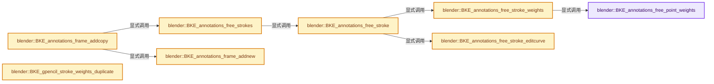
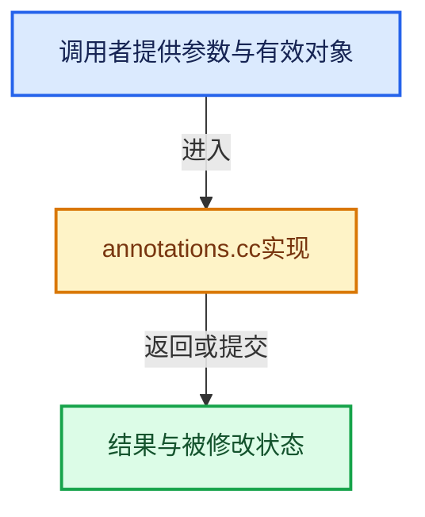

# 实现依赖专题：source/blender/blenkernel/intern/annotations.cc

[方向导航](README.md) · [符号索引](../%E7%AC%A6%E5%8F%B7%E4%BE%9D%E8%B5%96%E4%B8%8E%E5%AE%9E%E7%8E%B0%E7%B4%A2%E5%BC%95.md)

本专题从正文实际调用进入，集中保存共享实现。函数有稳定锚点，可从调用处直接跳到对应完整函数；递归与互相调用通过回链组织。

## 本文件的实现关系






## 完整成员与函数实现

<a id="f-73718a2c61c2b97a"></a>

### `blender::BKE_annotations_free_point_weights`

实现位置：[source/blender/blenkernel/intern/annotations.cc](../../../../../source/blender/blenkernel/intern/annotations.cc) · L304—L310。

接口参数：

- `MDeformVert *dvert`

**教学注释版**

<!-- annotated:2a705f7d516f51 -->

```cpp
void BKE_annotations_free_point_weights(MDeformVert *dvert)
{
  if (dvert == nullptr) {
    return;
  }
  MEM_SAFE_DELETE(dvert->dw);
}
```

<details>
<summary>核对原始源码：source/blender/blenkernel/intern/annotations.cc · L304—L310</summary>

<!-- original:2a705f7d516f51:source/blender/blenkernel/intern/annotations.cc:304:310 -->

```cpp
void BKE_annotations_free_point_weights(MDeformVert *dvert)
{
  if (dvert == nullptr) {
    return;
  }
  MEM_SAFE_DELETE(dvert->dw);
}
```

</details>

**继续追踪实现**

- `MEM_SAFE_DELETE` → [MEM_SAFE_DELETE · L436](../03-%E5%86%85%E5%AD%98%E5%88%86%E9%85%8D%E4%B8%8E%E8%BF%90%E8%A1%8C%E6%97%B6%E7%B1%BB%E5%9E%8B/%E4%BE%9D%E8%B5%96-MEM_guardedalloc-b54eca.md#m-eadb3bc5b902)。宏定义由构建条件选择。

<a id="f-8159bbecc26c511b"></a>

### `blender::BKE_annotations_free_stroke_weights`

实现位置：[source/blender/blenkernel/intern/annotations.cc](../../../../../source/blender/blenkernel/intern/annotations.cc) · L312—L326。

接口参数：

- `bGPDstroke *gps`

**教学注释版**

<!-- annotated:e1f4c5cae346cd -->

```cpp
void BKE_annotations_free_stroke_weights(bGPDstroke *gps)
{
  if (gps == nullptr) {
    return;
  }

  if (gps->dvert == nullptr) {
    return;
  }

  for (int i = 0; i < gps->totpoints; i++) {
    MDeformVert *dvert = &gps->dvert[i];
    BKE_annotations_free_point_weights(dvert);
  }
}
```

<details>
<summary>核对原始源码：source/blender/blenkernel/intern/annotations.cc · L312—L326</summary>

<!-- original:e1f4c5cae346cd:source/blender/blenkernel/intern/annotations.cc:312:326 -->

```cpp
void BKE_annotations_free_stroke_weights(bGPDstroke *gps)
{
  if (gps == nullptr) {
    return;
  }

  if (gps->dvert == nullptr) {
    return;
  }

  for (int i = 0; i < gps->totpoints; i++) {
    MDeformVert *dvert = &gps->dvert[i];
    BKE_annotations_free_point_weights(dvert);
  }
}
```

</details>

**继续追踪实现**

- `BKE_annotations_free_point_weights` → [blender::BKE_annotations_free_point_weights · L304](%E4%BE%9D%E8%B5%96-annotations-5a70d3.md#f-73718a2c61c2b97a)。

<a id="f-98a759cc906158d2"></a>

### `blender::BKE_annotations_free_stroke_editcurve`

实现位置：[source/blender/blenkernel/intern/annotations.cc](../../../../../source/blender/blenkernel/intern/annotations.cc) · L328—L340。

接口参数：

- `bGPDstroke *gps`

**教学注释版**

<!-- annotated:3b933dfcf50c20 -->

```cpp
void BKE_annotations_free_stroke_editcurve(bGPDstroke *gps)
{
  if (gps == nullptr) {
    return;
  }
  bGPDcurve *editcurve = gps->editcurve;
  if (editcurve == nullptr) {
    return;
  }
  MEM_delete(editcurve->curve_points);
  MEM_delete(editcurve);
  gps->editcurve = nullptr;
}
```

<details>
<summary>核对原始源码：source/blender/blenkernel/intern/annotations.cc · L328—L340</summary>

<!-- original:3b933dfcf50c20:source/blender/blenkernel/intern/annotations.cc:328:340 -->

```cpp
void BKE_annotations_free_stroke_editcurve(bGPDstroke *gps)
{
  if (gps == nullptr) {
    return;
  }
  bGPDcurve *editcurve = gps->editcurve;
  if (editcurve == nullptr) {
    return;
  }
  MEM_delete(editcurve->curve_points);
  MEM_delete(editcurve);
  gps->editcurve = nullptr;
}
```

</details>

**沿实际写入检查状态**

- `gps->editcurve = nullptr;`

**继续追踪实现**

- `MEM_delete` → [MEM_delete · L400](../03-%E5%86%85%E5%AD%98%E5%88%86%E9%85%8D%E4%B8%8E%E8%BF%90%E8%A1%8C%E6%97%B6%E7%B1%BB%E5%9E%8B/%E4%BE%9D%E8%B5%96-MEM_guardedalloc-b54eca.md#f-9049ffdd1682887c)。

<a id="f-917724f5d3d719ac"></a>

### `blender::BKE_annotations_free_stroke`

实现位置：[source/blender/blenkernel/intern/annotations.cc](../../../../../source/blender/blenkernel/intern/annotations.cc) · L342—L363。

接口参数：

- `bGPDstroke *gps`

**教学注释版**

<!-- annotated:40dc1408509dd8 -->

```cpp
void BKE_annotations_free_stroke(bGPDstroke *gps)
{
  if (gps == nullptr) {
    return;
  }
  /* free stroke memory arrays, then stroke itself */
  if (gps->points) {
    MEM_delete(gps->points);
  }
  if (gps->dvert) {
    BKE_annotations_free_stroke_weights(gps);
    MEM_delete(gps->dvert);
  }
  if (gps->triangles) {
    MEM_delete(gps->triangles);
  }
  if (gps->editcurve != nullptr) {
    BKE_annotations_free_stroke_editcurve(gps);
  }

  MEM_delete(gps);
}
```

<details>
<summary>核对原始源码：source/blender/blenkernel/intern/annotations.cc · L342—L363</summary>

<!-- original:40dc1408509dd8:source/blender/blenkernel/intern/annotations.cc:342:363 -->

```cpp
void BKE_annotations_free_stroke(bGPDstroke *gps)
{
  if (gps == nullptr) {
    return;
  }
  /* free stroke memory arrays, then stroke itself */
  if (gps->points) {
    MEM_delete(gps->points);
  }
  if (gps->dvert) {
    BKE_annotations_free_stroke_weights(gps);
    MEM_delete(gps->dvert);
  }
  if (gps->triangles) {
    MEM_delete(gps->triangles);
  }
  if (gps->editcurve != nullptr) {
    BKE_annotations_free_stroke_editcurve(gps);
  }

  MEM_delete(gps);
}
```

</details>

**继续追踪实现**

- `MEM_delete` → [MEM_delete · L400](../03-%E5%86%85%E5%AD%98%E5%88%86%E9%85%8D%E4%B8%8E%E8%BF%90%E8%A1%8C%E6%97%B6%E7%B1%BB%E5%9E%8B/%E4%BE%9D%E8%B5%96-MEM_guardedalloc-b54eca.md#f-9049ffdd1682887c)。
- `BKE_annotations_free_stroke_weights` → [blender::BKE_annotations_free_stroke_weights · L312](%E4%BE%9D%E8%B5%96-annotations-5a70d3.md#f-8159bbecc26c511b)。
- `BKE_annotations_free_stroke_editcurve` → [blender::BKE_annotations_free_stroke_editcurve · L328](%E4%BE%9D%E8%B5%96-annotations-5a70d3.md#f-98a759cc906158d2)。

<a id="f-61c8151d0608f5ef"></a>

### `blender::BKE_annotations_free_strokes`

实现位置：[source/blender/blenkernel/intern/annotations.cc](../../../../../source/blender/blenkernel/intern/annotations.cc) · L365—L376。

接口参数：

- `bGPDframe *gpf`

**教学注释版**

<!-- annotated:80d96499617e5a -->

```cpp
bool BKE_annotations_free_strokes(bGPDframe *gpf)
{
  bool changed = (gpf->strokes.is_empty() == false);

  /* free strokes */
  for (bGPDstroke &gps : gpf->strokes.items_mutable()) {
    BKE_annotations_free_stroke(&gps);
  }
  gpf->strokes.clear_no_delete();

  return changed;
}
```

<details>
<summary>核对原始源码：source/blender/blenkernel/intern/annotations.cc · L365—L376</summary>

<!-- original:80d96499617e5a:source/blender/blenkernel/intern/annotations.cc:365:376 -->

```cpp
bool BKE_annotations_free_strokes(bGPDframe *gpf)
{
  bool changed = (gpf->strokes.is_empty() == false);

  /* free strokes */
  for (bGPDstroke &gps : gpf->strokes.items_mutable()) {
    BKE_annotations_free_stroke(&gps);
  }
  gpf->strokes.clear_no_delete();

  return changed;
}
```

</details>

**结果出口**

- `return changed;`

**继续追踪实现**

- `gpf->strokes.is_empty` → [调用协议](../%E6%A8%A1%E6%9D%BF%E5%AE%8F%E4%B8%8E%E5%8A%A8%E6%80%81%E5%88%86%E6%B4%BE%E5%8D%8F%E8%AE%AE.md)：接收对象类型依赖auto、返回值或模板实例；不按同名猜测目标。调用位置L367。
- `gpf->strokes.items_mutable` → [调用协议](../%E6%A8%A1%E6%9D%BF%E5%AE%8F%E4%B8%8E%E5%8A%A8%E6%80%81%E5%88%86%E6%B4%BE%E5%8D%8F%E8%AE%AE.md)：接收对象类型依赖auto、返回值或模板实例；不按同名猜测目标。调用位置L370。
- `BKE_annotations_free_stroke` → [blender::BKE_annotations_free_stroke · L342](%E4%BE%9D%E8%B5%96-annotations-5a70d3.md#f-917724f5d3d719ac)。
- `gpf->strokes.clear_no_delete` → [调用协议](../%E6%A8%A1%E6%9D%BF%E5%AE%8F%E4%B8%8E%E5%8A%A8%E6%80%81%E5%88%86%E6%B4%BE%E5%8D%8F%E8%AE%AE.md)：接收对象类型依赖auto、返回值或模板实例；不按同名猜测目标。调用位置L373。

<a id="f-c12eaae58c981360"></a>

### `blender::BKE_annotations_frame_addnew`

实现位置：[source/blender/blenkernel/intern/annotations.cc](../../../../../source/blender/blenkernel/intern/annotations.cc) · L459—L510。

接口参数：

- `bGPDlayer *gpl`
- `int cframe`

**教学注释版**

<!-- annotated:91c2852b6b8d31 -->

```cpp
bGPDframe *BKE_annotations_frame_addnew(bGPDlayer *gpl, int cframe)
{
  bGPDframe *gpf = nullptr, *gf = nullptr;
  short state = 0;

  /* error checking */
  if (gpl == nullptr) {
    return nullptr;
  }

  /* allocate memory for this frame */
  gpf = MEM_new<bGPDframe>("bGPDframe");
  gpf->framenum = cframe;

  /* find appropriate place to add frame */
  if (gpl->frames.first()) {
    for (gf = gpl->frames.first(); gf; gf = gf->next) {
      /* check if frame matches one that is supposed to be added */
      if (gf->framenum == cframe) {
        state = -1;
        break;
      }

      /* if current frame has already exceeded the frame to add, add before */
      if (gf->framenum > cframe) {
        BLI_insertlinkbefore(&gpl->frames, gf, gpf);
        state = 1;
        break;
      }
    }
  }

  /* check whether frame was added successfully */
  if (state == -1) {
    CLOG_ERROR(
        &LOG, "Frame (%d) existed already for this layer_active. Using existing frame", cframe);

    /* free the newly created one, and use the old one instead */
    MEM_delete(gpf);

    /* return existing frame instead... */
    BLI_assert(gf != nullptr);
    gpf = gf;
  }
  else if (state == 0) {
    /* add to end then! */
    BLI_addtail(&gpl->frames, gpf);
  }

  /* return frame */
  return gpf;
}
```

<details>
<summary>核对原始源码：source/blender/blenkernel/intern/annotations.cc · L459—L510</summary>

<!-- original:91c2852b6b8d31:source/blender/blenkernel/intern/annotations.cc:459:510 -->

```cpp
bGPDframe *BKE_annotations_frame_addnew(bGPDlayer *gpl, int cframe)
{
  bGPDframe *gpf = nullptr, *gf = nullptr;
  short state = 0;

  /* error checking */
  if (gpl == nullptr) {
    return nullptr;
  }

  /* allocate memory for this frame */
  gpf = MEM_new<bGPDframe>("bGPDframe");
  gpf->framenum = cframe;

  /* find appropriate place to add frame */
  if (gpl->frames.first()) {
    for (gf = gpl->frames.first(); gf; gf = gf->next) {
      /* check if frame matches one that is supposed to be added */
      if (gf->framenum == cframe) {
        state = -1;
        break;
      }

      /* if current frame has already exceeded the frame to add, add before */
      if (gf->framenum > cframe) {
        BLI_insertlinkbefore(&gpl->frames, gf, gpf);
        state = 1;
        break;
      }
    }
  }

  /* check whether frame was added successfully */
  if (state == -1) {
    CLOG_ERROR(
        &LOG, "Frame (%d) existed already for this layer_active. Using existing frame", cframe);

    /* free the newly created one, and use the old one instead */
    MEM_delete(gpf);

    /* return existing frame instead... */
    BLI_assert(gf != nullptr);
    gpf = gf;
  }
  else if (state == 0) {
    /* add to end then! */
    BLI_addtail(&gpl->frames, gpf);
  }

  /* return frame */
  return gpf;
}
```

</details>

**沿实际写入检查状态**

- `gpf = MEM_new<bGPDframe>("bGPDframe");`
- `gpf->framenum = cframe;`
- `state = -1;`
- `state = 1;`
- `gpf = gf;`

**结果出口**

- `return nullptr;`
- `return gpf;`

**继续追踪实现**

- `MEM_new<bGPDframe>` → [MEM_new · L351](../03-%E5%86%85%E5%AD%98%E5%88%86%E9%85%8D%E4%B8%8E%E8%BF%90%E8%A1%8C%E6%97%B6%E7%B1%BB%E5%9E%8B/%E4%BE%9D%E8%B5%96-MEM_guardedalloc-b54eca.md#f-115f9b6784f89912)。
- `gpl->frames.first` → [调用协议](../%E6%A8%A1%E6%9D%BF%E5%AE%8F%E4%B8%8E%E5%8A%A8%E6%80%81%E5%88%86%E6%B4%BE%E5%8D%8F%E8%AE%AE.md)：接收对象类型依赖auto、返回值或模板实例；不按同名猜测目标。调用位置L474。
- `BLI_insertlinkbefore` → [blender::BLI_insertlinkbefore · L378](../01-%E5%9F%BA%E7%A1%80%E5%AE%B9%E5%99%A8%E4%B8%8E%E7%8E%B0%E4%BB%A3CPP/%E4%BE%9D%E8%B5%96-listbase-2816d9.md#f-b9a49151feaf9c08)。
- `CLOG_ERROR` → [CLOG_ERROR · L188](%E4%BE%9D%E8%B5%96-CLG_log-e9051b.md#m-081575cdc8d0)。宏定义由构建条件选择。
- `MEM_delete` → [MEM_delete · L400](../03-%E5%86%85%E5%AD%98%E5%88%86%E9%85%8D%E4%B8%8E%E8%BF%90%E8%A1%8C%E6%97%B6%E7%B1%BB%E5%9E%8B/%E4%BE%9D%E8%B5%96-MEM_guardedalloc-b54eca.md#f-9049ffdd1682887c)。
- `BLI_assert` → [BLI_assert · L48](../01-%E5%9F%BA%E7%A1%80%E5%AE%B9%E5%99%A8%E4%B8%8E%E7%8E%B0%E4%BB%A3CPP/%E4%BE%9D%E8%B5%96-BLI_assert-cc98e8.md#m-57a88495704d)；[BLI_assert · L63](../01-%E5%9F%BA%E7%A1%80%E5%AE%B9%E5%99%A8%E4%B8%8E%E7%8E%B0%E4%BB%A3CPP/%E4%BE%9D%E8%B5%96-BLI_assert-cc98e8.md#m-d07050020cb5)。宏定义由构建条件选择。
- `BLI_addtail` → [blender::BLI_addtail · L118](../01-%E5%9F%BA%E7%A1%80%E5%AE%B9%E5%99%A8%E4%B8%8E%E7%8E%B0%E4%BB%A3CPP/%E4%BE%9D%E8%B5%96-listbase-2816d9.md#f-4fb027713fa3115b)。

<a id="f-9d398a101ff33ade"></a>

### `blender::BKE_annotations_frame_addcopy`

实现位置：[source/blender/blenkernel/intern/annotations.cc](../../../../../source/blender/blenkernel/intern/annotations.cc) · L512—L564。

接口参数：

- `bGPDlayer *gpl`
- `int cframe`

**教学注释版**

<!-- annotated:0b68da744dea0b -->

```cpp
bGPDframe *BKE_annotations_frame_addcopy(bGPDlayer *gpl, int cframe)
{
  bGPDframe *new_frame;
  bool found = false;

  /* Error checking/handling */
  if (gpl == nullptr) {
    /* no layer */
    return nullptr;
  }
  if (gpl->actframe == nullptr) {
    /* no active frame, so just create a new one from scratch */
    return BKE_annotations_frame_addnew(gpl, cframe);
  }

  /* Create a copy of the frame */
  new_frame = BKE_annotations_frame_duplicate(gpl->actframe, true);

  /* Find frame to insert it before */
  for (bGPDframe &gpf : gpl->frames) {
    if (gpf.framenum > cframe) {
      /* Add it here */
      BLI_insertlinkbefore(&gpl->frames, &gpf, new_frame);

      found = true;
      break;
    }
    if (gpf.framenum == cframe) {
      /* This only happens when we're editing with frame-lock on.
       * - Delete the new frame and don't do anything else here.
       */
      BKE_annotations_free_strokes(new_frame);
      MEM_delete(new_frame);
      new_frame = nullptr;

      found = true;
      break;
    }
  }

  if (found == false) {
    /* Add new frame to the end */
    BLI_addtail(&gpl->frames, new_frame);
  }

  /* Ensure that frame is set up correctly, and return it */
  if (new_frame) {
    new_frame->framenum = cframe;
    gpl->actframe = new_frame;
  }

  return new_frame;
}
```

<details>
<summary>核对原始源码：source/blender/blenkernel/intern/annotations.cc · L512—L564</summary>

<!-- original:0b68da744dea0b:source/blender/blenkernel/intern/annotations.cc:512:564 -->

```cpp
bGPDframe *BKE_annotations_frame_addcopy(bGPDlayer *gpl, int cframe)
{
  bGPDframe *new_frame;
  bool found = false;

  /* Error checking/handling */
  if (gpl == nullptr) {
    /* no layer */
    return nullptr;
  }
  if (gpl->actframe == nullptr) {
    /* no active frame, so just create a new one from scratch */
    return BKE_annotations_frame_addnew(gpl, cframe);
  }

  /* Create a copy of the frame */
  new_frame = BKE_annotations_frame_duplicate(gpl->actframe, true);

  /* Find frame to insert it before */
  for (bGPDframe &gpf : gpl->frames) {
    if (gpf.framenum > cframe) {
      /* Add it here */
      BLI_insertlinkbefore(&gpl->frames, &gpf, new_frame);

      found = true;
      break;
    }
    if (gpf.framenum == cframe) {
      /* This only happens when we're editing with frame-lock on.
       * - Delete the new frame and don't do anything else here.
       */
      BKE_annotations_free_strokes(new_frame);
      MEM_delete(new_frame);
      new_frame = nullptr;

      found = true;
      break;
    }
  }

  if (found == false) {
    /* Add new frame to the end */
    BLI_addtail(&gpl->frames, new_frame);
  }

  /* Ensure that frame is set up correctly, and return it */
  if (new_frame) {
    new_frame->framenum = cframe;
    gpl->actframe = new_frame;
  }

  return new_frame;
}
```

</details>

**沿实际写入检查状态**

- `new_frame = BKE_annotations_frame_duplicate(gpl->actframe, true);`
- `found = true;`
- `new_frame = nullptr;`
- `new_frame->framenum = cframe;`
- `gpl->actframe = new_frame;`

**结果出口**

- `return nullptr;`
- `return BKE_annotations_frame_addnew(gpl, cframe);`
- `return new_frame;`

**继续追踪实现**

- `BKE_annotations_frame_addnew` → [blender::BKE_annotations_frame_addnew · L459](%E4%BE%9D%E8%B5%96-annotations-5a70d3.md#f-c12eaae58c981360)。
- `BKE_annotations_frame_duplicate` → [blender::BKE_annotations_frame_duplicate · L744](%E4%BE%9D%E8%B5%96-annotations-5a70d3.md#f-0edae75cd3c07c19)。
- `BLI_insertlinkbefore` → [blender::BLI_insertlinkbefore · L378](../01-%E5%9F%BA%E7%A1%80%E5%AE%B9%E5%99%A8%E4%B8%8E%E7%8E%B0%E4%BB%A3CPP/%E4%BE%9D%E8%B5%96-listbase-2816d9.md#f-b9a49151feaf9c08)。
- `BKE_annotations_free_strokes` → [blender::BKE_annotations_free_strokes · L365](%E4%BE%9D%E8%B5%96-annotations-5a70d3.md#f-61c8151d0608f5ef)。
- `MEM_delete` → [MEM_delete · L400](../03-%E5%86%85%E5%AD%98%E5%88%86%E9%85%8D%E4%B8%8E%E8%BF%90%E8%A1%8C%E6%97%B6%E7%B1%BB%E5%9E%8B/%E4%BE%9D%E8%B5%96-MEM_guardedalloc-b54eca.md#f-9049ffdd1682887c)。
- `BLI_addtail` → [blender::BLI_addtail · L118](../01-%E5%9F%BA%E7%A1%80%E5%AE%B9%E5%99%A8%E4%B8%8E%E7%8E%B0%E4%BB%A3CPP/%E4%BE%9D%E8%B5%96-listbase-2816d9.md#f-4fb027713fa3115b)。

<a id="f-987e57f2a8f349f0"></a>

### `blender::BKE_gpencil_stroke_weights_duplicate`

实现位置：[source/blender/blenkernel/intern/annotations.cc](../../../../../source/blender/blenkernel/intern/annotations.cc) · L702—L710。

接口参数：

- `bGPDstroke *gps_src`
- `bGPDstroke *gps_dst`

**教学注释版**

<!-- annotated:f74b1644fe040b -->

```cpp
void BKE_gpencil_stroke_weights_duplicate(bGPDstroke *gps_src, bGPDstroke *gps_dst)
{
  if (gps_src == nullptr) {
    return;
  }
  BLI_assert(gps_src->totpoints == gps_dst->totpoints);

  BKE_defvert_array_copy(gps_dst->dvert, gps_src->dvert, gps_src->totpoints);
}
```

<details>
<summary>核对原始源码：source/blender/blenkernel/intern/annotations.cc · L702—L710</summary>

<!-- original:f74b1644fe040b:source/blender/blenkernel/intern/annotations.cc:702:710 -->

```cpp
void BKE_gpencil_stroke_weights_duplicate(bGPDstroke *gps_src, bGPDstroke *gps_dst)
{
  if (gps_src == nullptr) {
    return;
  }
  BLI_assert(gps_src->totpoints == gps_dst->totpoints);

  BKE_defvert_array_copy(gps_dst->dvert, gps_src->dvert, gps_src->totpoints);
}
```

</details>

**继续追踪实现**

- `BLI_assert` → [BLI_assert · L48](../01-%E5%9F%BA%E7%A1%80%E5%AE%B9%E5%99%A8%E4%B8%8E%E7%8E%B0%E4%BB%A3CPP/%E4%BE%9D%E8%B5%96-BLI_assert-cc98e8.md#m-57a88495704d)；[BLI_assert · L63](../01-%E5%9F%BA%E7%A1%80%E5%AE%B9%E5%99%A8%E4%B8%8E%E7%8E%B0%E4%BB%A3CPP/%E4%BE%9D%E8%B5%96-BLI_assert-cc98e8.md#m-d07050020cb5)。宏定义由构建条件选择。
- `BKE_defvert_array_copy` → [blender::BKE_defvert_array_copy · L1043](%E4%BE%9D%E8%B5%96-deform-6949f4.md#f-ade1444147c424d8)。

<a id="f-63da62e4e82aad9e"></a>

### `blender::BKE_gpencil_stroke_duplicate`

实现位置：[source/blender/blenkernel/intern/annotations.cc](../../../../../source/blender/blenkernel/intern/annotations.cc) · L712—L742。

接口参数：

- `bGPDstroke *gps_src`
- `const bool dup_points`
- `const bool`

**教学注释版**

<!-- annotated:0db84d3b781926 -->

```cpp
bGPDstroke *BKE_gpencil_stroke_duplicate(bGPDstroke *gps_src,
                                         const bool dup_points,
                                         const bool /*dup_curve*/)
{
  bGPDstroke *gps_dst = nullptr;

  gps_dst = MEM_dupalloc(gps_src);
  gps_dst->prev = gps_dst->next = nullptr;
  gps_dst->triangles = MEM_dupalloc(gps_src->triangles);

  if (dup_points) {
    gps_dst->points = MEM_dupalloc(gps_src->points);

    if (gps_src->dvert != nullptr) {
      gps_dst->dvert = MEM_dupalloc(gps_src->dvert);
      BKE_gpencil_stroke_weights_duplicate(gps_src, gps_dst);
    }
    else {
      gps_dst->dvert = nullptr;
    }
  }
  else {
    gps_dst->points = nullptr;
    gps_dst->dvert = nullptr;
  }

  gps_dst->editcurve = nullptr;

  /* return new stroke */
  return gps_dst;
}
```

<details>
<summary>核对原始源码：source/blender/blenkernel/intern/annotations.cc · L712—L742</summary>

<!-- original:0db84d3b781926:source/blender/blenkernel/intern/annotations.cc:712:742 -->

```cpp
bGPDstroke *BKE_gpencil_stroke_duplicate(bGPDstroke *gps_src,
                                         const bool dup_points,
                                         const bool /*dup_curve*/)
{
  bGPDstroke *gps_dst = nullptr;

  gps_dst = MEM_dupalloc(gps_src);
  gps_dst->prev = gps_dst->next = nullptr;
  gps_dst->triangles = MEM_dupalloc(gps_src->triangles);

  if (dup_points) {
    gps_dst->points = MEM_dupalloc(gps_src->points);

    if (gps_src->dvert != nullptr) {
      gps_dst->dvert = MEM_dupalloc(gps_src->dvert);
      BKE_gpencil_stroke_weights_duplicate(gps_src, gps_dst);
    }
    else {
      gps_dst->dvert = nullptr;
    }
  }
  else {
    gps_dst->points = nullptr;
    gps_dst->dvert = nullptr;
  }

  gps_dst->editcurve = nullptr;

  /* return new stroke */
  return gps_dst;
}
```

</details>

**沿实际写入检查状态**

- `gps_dst = MEM_dupalloc(gps_src);`
- `gps_dst->prev = gps_dst->next = nullptr;`
- `gps_dst->triangles = MEM_dupalloc(gps_src->triangles);`
- `gps_dst->points = MEM_dupalloc(gps_src->points);`
- `gps_dst->dvert = MEM_dupalloc(gps_src->dvert);`
- `gps_dst->dvert = nullptr;`
- `gps_dst->points = nullptr;`
- `gps_dst->editcurve = nullptr;`

**结果出口**

- `return gps_dst;`

**继续追踪实现**

- `MEM_dupalloc` → [MEM_dupalloc · L627](../03-%E5%86%85%E5%AD%98%E5%88%86%E9%85%8D%E4%B8%8E%E8%BF%90%E8%A1%8C%E6%97%B6%E7%B1%BB%E5%9E%8B/%E4%BE%9D%E8%B5%96-MEM_guardedalloc-b54eca.md#f-78a72b71e3c57010)。
- `BKE_gpencil_stroke_weights_duplicate` → [blender::BKE_gpencil_stroke_weights_duplicate · L702](%E4%BE%9D%E8%B5%96-annotations-5a70d3.md#f-987e57f2a8f349f0)。

<a id="f-0edae75cd3c07c19"></a>

### `blender::BKE_annotations_frame_duplicate`

实现位置：[source/blender/blenkernel/intern/annotations.cc](../../../../../source/blender/blenkernel/intern/annotations.cc) · L744—L770。

接口参数：

- `const bGPDframe *gpf_src`
- `const bool dup_strokes`

**教学注释版**

<!-- annotated:0de1d5e39adceb -->

```cpp
bGPDframe *BKE_annotations_frame_duplicate(const bGPDframe *gpf_src, const bool dup_strokes)
{
  bGPDstroke *gps_dst = nullptr;
  bGPDframe *gpf_dst;

  /* error checking */
  if (gpf_src == nullptr) {
    return nullptr;
  }

  /* make a copy of the source frame */
  gpf_dst = MEM_dupalloc(gpf_src);
  gpf_dst->prev = gpf_dst->next = nullptr;

  /* Copy strokes. */
  gpf_dst->strokes.clear_no_delete();
  if (dup_strokes) {
    for (bGPDstroke &gps_src : gpf_src->strokes) {
      /* make copy of source stroke */
      gps_dst = BKE_gpencil_stroke_duplicate(&gps_src, true, true);
      BLI_addtail(&gpf_dst->strokes, gps_dst);
    }
  }

  /* return new frame */
  return gpf_dst;
}
```

<details>
<summary>核对原始源码：source/blender/blenkernel/intern/annotations.cc · L744—L770</summary>

<!-- original:0de1d5e39adceb:source/blender/blenkernel/intern/annotations.cc:744:770 -->

```cpp
bGPDframe *BKE_annotations_frame_duplicate(const bGPDframe *gpf_src, const bool dup_strokes)
{
  bGPDstroke *gps_dst = nullptr;
  bGPDframe *gpf_dst;

  /* error checking */
  if (gpf_src == nullptr) {
    return nullptr;
  }

  /* make a copy of the source frame */
  gpf_dst = MEM_dupalloc(gpf_src);
  gpf_dst->prev = gpf_dst->next = nullptr;

  /* Copy strokes. */
  gpf_dst->strokes.clear_no_delete();
  if (dup_strokes) {
    for (bGPDstroke &gps_src : gpf_src->strokes) {
      /* make copy of source stroke */
      gps_dst = BKE_gpencil_stroke_duplicate(&gps_src, true, true);
      BLI_addtail(&gpf_dst->strokes, gps_dst);
    }
  }

  /* return new frame */
  return gpf_dst;
}
```

</details>

**沿实际写入检查状态**

- `gpf_dst = MEM_dupalloc(gpf_src);`
- `gpf_dst->prev = gpf_dst->next = nullptr;`
- `gps_dst = BKE_gpencil_stroke_duplicate(&gps_src, true, true);`

**结果出口**

- `return nullptr;`
- `return gpf_dst;`

**继续追踪实现**

- `MEM_dupalloc` → [MEM_dupalloc · L627](../03-%E5%86%85%E5%AD%98%E5%88%86%E9%85%8D%E4%B8%8E%E8%BF%90%E8%A1%8C%E6%97%B6%E7%B1%BB%E5%9E%8B/%E4%BE%9D%E8%B5%96-MEM_guardedalloc-b54eca.md#f-78a72b71e3c57010)。
- `gpf_dst->strokes.clear_no_delete` → [调用协议](../%E6%A8%A1%E6%9D%BF%E5%AE%8F%E4%B8%8E%E5%8A%A8%E6%80%81%E5%88%86%E6%B4%BE%E5%8D%8F%E8%AE%AE.md)：接收对象类型依赖auto、返回值或模板实例；不按同名猜测目标。调用位置L759。
- `BKE_gpencil_stroke_duplicate` → [blender::BKE_gpencil_stroke_duplicate · L712](%E4%BE%9D%E8%B5%96-annotations-5a70d3.md#f-63da62e4e82aad9e)。
- `BLI_addtail` → [blender::BLI_addtail · L118](../01-%E5%9F%BA%E7%A1%80%E5%AE%B9%E5%99%A8%E4%B8%8E%E7%8E%B0%E4%BB%A3CPP/%E4%BE%9D%E8%B5%96-listbase-2816d9.md#f-4fb027713fa3115b)。

<a id="f-d79c75b1b608bad5"></a>

### `blender::BKE_annotations_layer_frame_get`

实现位置：[source/blender/blenkernel/intern/annotations.cc](../../../../../source/blender/blenkernel/intern/annotations.cc) · L869—L1030。

接口参数：

- `bGPDlayer *gpl`
- `int cframe`
- `eGP_GetFrame_Mode addnew`

**教学注释版**

<!-- annotated:1e849c314520ad -->

```cpp
bGPDframe *BKE_annotations_layer_frame_get(bGPDlayer *gpl, int cframe, eGP_GetFrame_Mode addnew)
{
  bGPDframe *gpf = nullptr;
  bool found = false;

  /* error checking */
  if (gpl == nullptr) {
    return nullptr;
  }

  /* check if there is already an active frame */
  if (gpl->actframe) {
    gpf = gpl->actframe;

    /* do not allow any changes to layer's active frame if layer is locked from changes
     * or if the layer has been set to stay on the current frame
     */
    if (gpl->flag & GP_LAYER_FRAMELOCK) {
      return gpf;
    }
    /* do not allow any changes to actframe if frame has painting tag attached to it */
    if (gpf->flag & GP_FRAME_PAINT) {
      return gpf;
    }

    /* try to find matching frame */
    if (gpf->framenum < cframe) {
      for (; gpf; gpf = gpf->next) {
        if (gpf->framenum == cframe) {
          found = true;
          break;
        }
        /* If this is the last frame or the next frame is at a later time, we found the right
         * frame. */
        if (!(gpf->next) || (gpf->next->framenum > cframe)) {
          found = true;
          break;
        }
      }

      /* set the appropriate frame */
      if (addnew) {
        if ((found) && (gpf->framenum == cframe)) {
          gpl->actframe = gpf;
        }
        else if (addnew == GP_GETFRAME_ADD_COPY) {
          /* The #BKE_annotations_frame_addcopy function copies the active frame of gpl,
           * so we need to set the active frame before copying. */
          gpl->actframe = gpf;
          gpl->actframe = BKE_annotations_frame_addcopy(gpl, cframe);
        }
        else {
          gpl->actframe = BKE_annotations_frame_addnew(gpl, cframe);
        }
      }
      else if (found) {
        gpl->actframe = gpf;
      }
      else {
        gpl->actframe = gpl->frames.last();
      }
    }
    else {
      for (; gpf; gpf = gpf->prev) {
        if (gpf->framenum <= cframe) {
          found = true;
          break;
        }
      }

      /* set the appropriate frame */
      if (addnew) {
        if ((found) && (gpf->framenum == cframe)) {
          gpl->actframe = gpf;
        }
        else if (addnew == GP_GETFRAME_ADD_COPY) {
          /* The #BKE_annotations_frame_addcopy function copies the active frame of gpl;
           * so we need to set the active frame before copying. */
          gpl->actframe = gpf;
          gpl->actframe = BKE_annotations_frame_addcopy(gpl, cframe);
        }
        else {
          gpl->actframe = BKE_annotations_frame_addnew(gpl, cframe);
        }
      }
      else if (found) {
        gpl->actframe = gpf;
      }
      else {
        gpl->actframe = gpl->frames.first();
      }
    }
  }
  else if (gpl->frames.first()) {
    /* check which of the ends to start checking from */
    const int first = (gpl->frames.first())->framenum;
    const int last = (gpl->frames.last())->framenum;

    if (abs(cframe - first) > abs(cframe - last)) {
      /* find gp-frame which is less than or equal to cframe */
      for (gpf = gpl->frames.last(); gpf; gpf = gpf->prev) {
        if (gpf->framenum <= cframe) {
          found = true;
          break;
        }
      }
    }
    else {
      /* find gp-frame which is less than or equal to cframe */
      for (gpf = gpl->frames.first(); gpf; gpf = gpf->next) {
        if (gpf->framenum <= cframe) {
          found = true;
          break;
        }
      }
    }

    /* set the appropriate frame */
    if (addnew) {
      if ((found) && (gpf->framenum == cframe)) {
        gpl->actframe = gpf;
      }
      else {
        gpl->actframe = BKE_annotations_frame_addnew(gpl, cframe);
      }
    }
    else if (found) {
      gpl->actframe = gpf;
    }
    else {
      /* If delete first frame, need to find one. */
      if (gpl->frames.first() != nullptr) {
        gpl->actframe = gpl->frames.first();
      }
      else {
        /* Unresolved erogenous situation! */
        CLOG_STR_ERROR(&LOG, "cannot find appropriate gp-frame");
        /* `gpl->actframe` should still be nullptr. */
      }
    }
  }
  else {
    /* currently no frames (add if allowed to) */
    if (addnew) {
      gpl->actframe = BKE_annotations_frame_addnew(gpl, cframe);
    }
    else {
      /* don't do anything... this may be when no frames yet! */
      /* gpl->actframe should still be nullptr */
    }
  }

  /* Don't select first frame if greater than current frame. */
  if ((gpl->actframe != nullptr) && (gpl->actframe == gpl->frames.first()) &&
      (gpl->actframe->framenum > cframe))
  {
    gpl->actframe = nullptr;
  }

  /* return */
  return gpl->actframe;
}
```

<details>
<summary>核对原始源码：source/blender/blenkernel/intern/annotations.cc · L869—L1030</summary>

<!-- original:1e849c314520ad:source/blender/blenkernel/intern/annotations.cc:869:1030 -->

```cpp
bGPDframe *BKE_annotations_layer_frame_get(bGPDlayer *gpl, int cframe, eGP_GetFrame_Mode addnew)
{
  bGPDframe *gpf = nullptr;
  bool found = false;

  /* error checking */
  if (gpl == nullptr) {
    return nullptr;
  }

  /* check if there is already an active frame */
  if (gpl->actframe) {
    gpf = gpl->actframe;

    /* do not allow any changes to layer's active frame if layer is locked from changes
     * or if the layer has been set to stay on the current frame
     */
    if (gpl->flag & GP_LAYER_FRAMELOCK) {
      return gpf;
    }
    /* do not allow any changes to actframe if frame has painting tag attached to it */
    if (gpf->flag & GP_FRAME_PAINT) {
      return gpf;
    }

    /* try to find matching frame */
    if (gpf->framenum < cframe) {
      for (; gpf; gpf = gpf->next) {
        if (gpf->framenum == cframe) {
          found = true;
          break;
        }
        /* If this is the last frame or the next frame is at a later time, we found the right
         * frame. */
        if (!(gpf->next) || (gpf->next->framenum > cframe)) {
          found = true;
          break;
        }
      }

      /* set the appropriate frame */
      if (addnew) {
        if ((found) && (gpf->framenum == cframe)) {
          gpl->actframe = gpf;
        }
        else if (addnew == GP_GETFRAME_ADD_COPY) {
          /* The #BKE_annotations_frame_addcopy function copies the active frame of gpl,
           * so we need to set the active frame before copying. */
          gpl->actframe = gpf;
          gpl->actframe = BKE_annotations_frame_addcopy(gpl, cframe);
        }
        else {
          gpl->actframe = BKE_annotations_frame_addnew(gpl, cframe);
        }
      }
      else if (found) {
        gpl->actframe = gpf;
      }
      else {
        gpl->actframe = gpl->frames.last();
      }
    }
    else {
      for (; gpf; gpf = gpf->prev) {
        if (gpf->framenum <= cframe) {
          found = true;
          break;
        }
      }

      /* set the appropriate frame */
      if (addnew) {
        if ((found) && (gpf->framenum == cframe)) {
          gpl->actframe = gpf;
        }
        else if (addnew == GP_GETFRAME_ADD_COPY) {
          /* The #BKE_annotations_frame_addcopy function copies the active frame of gpl;
           * so we need to set the active frame before copying. */
          gpl->actframe = gpf;
          gpl->actframe = BKE_annotations_frame_addcopy(gpl, cframe);
        }
        else {
          gpl->actframe = BKE_annotations_frame_addnew(gpl, cframe);
        }
      }
      else if (found) {
        gpl->actframe = gpf;
      }
      else {
        gpl->actframe = gpl->frames.first();
      }
    }
  }
  else if (gpl->frames.first()) {
    /* check which of the ends to start checking from */
    const int first = (gpl->frames.first())->framenum;
    const int last = (gpl->frames.last())->framenum;

    if (abs(cframe - first) > abs(cframe - last)) {
      /* find gp-frame which is less than or equal to cframe */
      for (gpf = gpl->frames.last(); gpf; gpf = gpf->prev) {
        if (gpf->framenum <= cframe) {
          found = true;
          break;
        }
      }
    }
    else {
      /* find gp-frame which is less than or equal to cframe */
      for (gpf = gpl->frames.first(); gpf; gpf = gpf->next) {
        if (gpf->framenum <= cframe) {
          found = true;
          break;
        }
      }
    }

    /* set the appropriate frame */
    if (addnew) {
      if ((found) && (gpf->framenum == cframe)) {
        gpl->actframe = gpf;
      }
      else {
        gpl->actframe = BKE_annotations_frame_addnew(gpl, cframe);
      }
    }
    else if (found) {
      gpl->actframe = gpf;
    }
    else {
      /* If delete first frame, need to find one. */
      if (gpl->frames.first() != nullptr) {
        gpl->actframe = gpl->frames.first();
      }
      else {
        /* Unresolved erogenous situation! */
        CLOG_STR_ERROR(&LOG, "cannot find appropriate gp-frame");
        /* `gpl->actframe` should still be nullptr. */
      }
    }
  }
  else {
    /* currently no frames (add if allowed to) */
    if (addnew) {
      gpl->actframe = BKE_annotations_frame_addnew(gpl, cframe);
    }
    else {
      /* don't do anything... this may be when no frames yet! */
      /* gpl->actframe should still be nullptr */
    }
  }

  /* Don't select first frame if greater than current frame. */
  if ((gpl->actframe != nullptr) && (gpl->actframe == gpl->frames.first()) &&
      (gpl->actframe->framenum > cframe))
  {
    gpl->actframe = nullptr;
  }

  /* return */
  return gpl->actframe;
}
```

</details>

**沿实际写入检查状态**

- `gpf = gpl->actframe;`
- `found = true;`
- `gpl->actframe = gpf;`
- `gpl->actframe = BKE_annotations_frame_addcopy(gpl, cframe);`
- `gpl->actframe = BKE_annotations_frame_addnew(gpl, cframe);`
- `gpl->actframe = gpl->frames.last();`
- `gpl->actframe = gpl->frames.first();`
- `gpl->actframe = nullptr;`

**结果出口**

- `return nullptr;`
- `return gpf;`
- `return gpl->actframe;`

**继续追踪实现**

- `BKE_annotations_frame_addcopy` → [blender::BKE_annotations_frame_addcopy · L512](%E4%BE%9D%E8%B5%96-annotations-5a70d3.md#f-9d398a101ff33ade)。
- `BKE_annotations_frame_addnew` → [blender::BKE_annotations_frame_addnew · L459](%E4%BE%9D%E8%B5%96-annotations-5a70d3.md#f-c12eaae58c981360)。
- `gpl->frames.last` → [调用协议](../%E6%A8%A1%E6%9D%BF%E5%AE%8F%E4%B8%8E%E5%8A%A8%E6%80%81%E5%88%86%E6%B4%BE%E5%8D%8F%E8%AE%AE.md)：接收对象类型依赖auto、返回值或模板实例；不按同名猜测目标。调用位置L928。
- `gpl->frames.first` → [调用协议](../%E6%A8%A1%E6%9D%BF%E5%AE%8F%E4%B8%8E%E5%8A%A8%E6%80%81%E5%88%86%E6%B4%BE%E5%8D%8F%E8%AE%AE.md)：接收对象类型依赖auto、返回值或模板实例；不按同名猜测目标。调用位置L958。
- `abs` → [abs · L104](%E4%BE%9D%E8%B5%96-gpu_shader_cxx_builtin-8ae191.md#m-14b5712612c4)。宏定义由构建条件选择。
- `CLOG_STR_ERROR` → [CLOG_STR_ERROR · L196](%E4%BE%9D%E8%B5%96-CLG_log-e9051b.md#m-dcd74e148724)。宏定义由构建条件选择。
