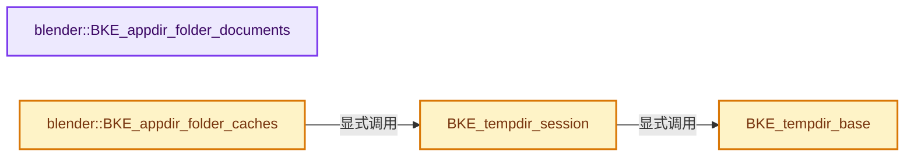
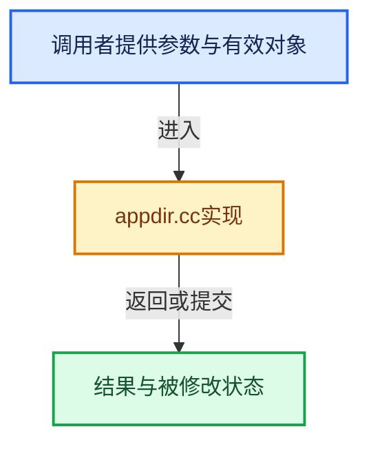

# 实现依赖专题：source/blender/blenkernel/intern/appdir.cc

[方向导航](README.md) · [符号索引](../%E7%AC%A6%E5%8F%B7%E4%BE%9D%E8%B5%96%E4%B8%8E%E5%AE%9E%E7%8E%B0%E7%B4%A2%E5%BC%95.md)

本专题从正文实际调用进入，集中保存共享实现。函数有稳定锚点，可从调用处直接跳到对应完整函数；递归与互相调用通过回链组织。

## 本文件的实现关系






## 完整成员与函数实现

<a id="f-0ff1928608dc7586"></a>

### `blender::BKE_appdir_folder_documents`

实现位置：[source/blender/blenkernel/intern/appdir.cc](../../../../../source/blender/blenkernel/intern/appdir.cc) · L174—L204。

接口参数：

- `char *dir`

**教学注释版**

<!-- annotated:ca4ebe485fa407 -->

```cpp
bool BKE_appdir_folder_documents(char *dir)
{
  dir[0] = '\0';

  const GHOST_ISystemPaths *ghost_system_paths = GHOST_ISystemPaths::get();
  const std::optional<std::string> documents_path = ghost_system_paths->getUserSpecialDir(
      GHOST_kUserSpecialDirDocuments);

  /* Usual case: Ghost gave us the documents path. We're done here. */
  if (documents_path && BLI_is_dir(documents_path->c_str())) {
    BLI_strncpy(dir, documents_path->c_str(), FILE_MAXDIR);
    return true;
  }

  /* Ghost couldn't give us a documents path, let's try if we can find it ourselves. */

  const char *home_path = BLI_dir_home();
  if (!home_path || !BLI_is_dir(home_path)) {
    return false;
  }

  char try_documents_path[FILE_MAXDIR];
  /* Own attempt at getting a valid Documents path. */
  BLI_path_join(try_documents_path, sizeof(try_documents_path), home_path, N_("Documents"));
  if (!BLI_is_dir(try_documents_path)) {
    return false;
  }

  BLI_strncpy(dir, try_documents_path, FILE_MAXDIR);
  return true;
}
```

<details>
<summary>核对原始源码：source/blender/blenkernel/intern/appdir.cc · L174—L204</summary>

<!-- original:ca4ebe485fa407:source/blender/blenkernel/intern/appdir.cc:174:204 -->

```cpp
bool BKE_appdir_folder_documents(char *dir)
{
  dir[0] = '\0';

  const GHOST_ISystemPaths *ghost_system_paths = GHOST_ISystemPaths::get();
  const std::optional<std::string> documents_path = ghost_system_paths->getUserSpecialDir(
      GHOST_kUserSpecialDirDocuments);

  /* Usual case: Ghost gave us the documents path. We're done here. */
  if (documents_path && BLI_is_dir(documents_path->c_str())) {
    BLI_strncpy(dir, documents_path->c_str(), FILE_MAXDIR);
    return true;
  }

  /* Ghost couldn't give us a documents path, let's try if we can find it ourselves. */

  const char *home_path = BLI_dir_home();
  if (!home_path || !BLI_is_dir(home_path)) {
    return false;
  }

  char try_documents_path[FILE_MAXDIR];
  /* Own attempt at getting a valid Documents path. */
  BLI_path_join(try_documents_path, sizeof(try_documents_path), home_path, N_("Documents"));
  if (!BLI_is_dir(try_documents_path)) {
    return false;
  }

  BLI_strncpy(dir, try_documents_path, FILE_MAXDIR);
  return true;
}
```

</details>

**沿实际写入检查状态**

- `dir[0] = '\0';`

**结果出口**

- `return true;`
- `return false;`

**继续追踪实现**

- `GHOST_ISystemPaths::get` → [GHOST_ISystemPaths::get · L61](%E4%BE%9D%E8%B5%96-GHOST_ISystemPaths-b4bf3d.md#f-4673f48779fff2ef)。
- `ghost_system_paths->getUserSpecialDir` → [调用协议](../%E6%A8%A1%E6%9D%BF%E5%AE%8F%E4%B8%8E%E5%8A%A8%E6%80%81%E5%88%86%E6%B4%BE%E5%8D%8F%E8%AE%AE.md)：由接收对象具体类型或运行时策略提供实现。调用位置L179。
- `BLI_is_dir` → [blender::BLI_is_dir · L457](../01-%E5%9F%BA%E7%A1%80%E5%AE%B9%E5%99%A8%E4%B8%8E%E7%8E%B0%E4%BB%A3CPP/%E4%BE%9D%E8%B5%96-storage-bda15e.md#f-eedeb1fd6a515977)。
- `documents_path->c_str` → [外部契约](https://eel.is/c++draft/)：这个边界按实际表达式及所属类型核对参数、返回值、寿命与失败行为。这里提供接口入口，不声称已解释该第三方版本的内部实现。
- `BLI_strncpy` → [blender::BLI_strncpy · L70](../01-%E5%9F%BA%E7%A1%80%E5%AE%B9%E5%99%A8%E4%B8%8E%E7%8E%B0%E4%BB%A3CPP/%E4%BE%9D%E8%B5%96-string-1d986f.md#f-6324147b0d116da1)。
- `BLI_dir_home` → [blender::BLI_dir_home · L99](../01-%E5%9F%BA%E7%A1%80%E5%AE%B9%E5%99%A8%E4%B8%8E%E7%8E%B0%E4%BB%A3CPP/%E4%BE%9D%E8%B5%96-storage-bda15e.md#f-ecbf67fd9338348e)。
- `BLI_path_join` → [BLI_path_join · L386](../01-%E5%9F%BA%E7%A1%80%E5%AE%B9%E5%99%A8%E4%B8%8E%E7%8E%B0%E4%BB%A3CPP/%E4%BE%9D%E8%B5%96-BLI_path_utils-130405.md#m-f3b1183fb80c)。宏定义由构建条件选择。
- `N_` → [N_ · L65](%E4%BE%9D%E8%B5%96-versioning_userdef-fdee9b.md#m-7c11c8200907)；[N_ · L44](%E4%BE%9D%E8%B5%96-BLT_translation-c89e58.md#m-e686781e2b24)。宏定义由构建条件选择。

<a id="f-f9cfc53e0be76de3"></a>

### `blender::BKE_appdir_folder_caches`

实现位置：[source/blender/blenkernel/intern/appdir.cc](../../../../../source/blender/blenkernel/intern/appdir.cc) · L206—L232。

接口参数：

- `char *path`
- `const size_t path_maxncpy`

**教学注释版**

<!-- annotated:144130eb57da42 -->

```cpp
void BKE_appdir_folder_caches(char *path, const size_t path_maxncpy)
{
  path[0] = '\0';

  const GHOST_ISystemPaths *ghost_system_paths = GHOST_ISystemPaths::get();
  std::optional<std::string> caches_root_path = ghost_system_paths->getUserSpecialDir(
      GHOST_kUserSpecialDirCaches);
  if (!caches_root_path || caches_root_path->empty()) [[unlikely]] {
    const char *tempdir = BKE_tempdir_session();
    BLI_path_join(path, path_maxncpy, tempdir, ".cache", SEP_STR);
    return;
  }

#ifdef WIN32
  BLI_path_join(path,
                path_maxncpy,
                caches_root_path->c_str(),
                "Blender Foundation",
                "Blender",
                "Cache",
                SEP_STR);
#elif defined(__APPLE__)
  BLI_path_join(path, path_maxncpy, caches_root_path->c_str(), "Blender", SEP_STR);
#else /* __linux__ */
  BLI_path_join(path, path_maxncpy, caches_root_path->c_str(), "blender", SEP_STR);
#endif
}
```

<details>
<summary>核对原始源码：source/blender/blenkernel/intern/appdir.cc · L206—L232</summary>

<!-- original:144130eb57da42:source/blender/blenkernel/intern/appdir.cc:206:232 -->

```cpp
void BKE_appdir_folder_caches(char *path, const size_t path_maxncpy)
{
  path[0] = '\0';

  const GHOST_ISystemPaths *ghost_system_paths = GHOST_ISystemPaths::get();
  std::optional<std::string> caches_root_path = ghost_system_paths->getUserSpecialDir(
      GHOST_kUserSpecialDirCaches);
  if (!caches_root_path || caches_root_path->empty()) [[unlikely]] {
    const char *tempdir = BKE_tempdir_session();
    BLI_path_join(path, path_maxncpy, tempdir, ".cache", SEP_STR);
    return;
  }

#ifdef WIN32
  BLI_path_join(path,
                path_maxncpy,
                caches_root_path->c_str(),
                "Blender Foundation",
                "Blender",
                "Cache",
                SEP_STR);
#elif defined(__APPLE__)
  BLI_path_join(path, path_maxncpy, caches_root_path->c_str(), "Blender", SEP_STR);
#else /* __linux__ */
  BLI_path_join(path, path_maxncpy, caches_root_path->c_str(), "blender", SEP_STR);
#endif
}
```

</details>

**沿实际写入检查状态**

- `path[0] = '\0';`

**继续追踪实现**

- `GHOST_ISystemPaths::get` → [GHOST_ISystemPaths::get · L61](%E4%BE%9D%E8%B5%96-GHOST_ISystemPaths-b4bf3d.md#f-4673f48779fff2ef)。
- `ghost_system_paths->getUserSpecialDir` → [调用协议](../%E6%A8%A1%E6%9D%BF%E5%AE%8F%E4%B8%8E%E5%8A%A8%E6%80%81%E5%88%86%E6%B4%BE%E5%8D%8F%E8%AE%AE.md)：由接收对象具体类型或运行时策略提供实现。调用位置L211。
- `caches_root_path->empty` → [外部契约](https://eel.is/c++draft/)：这个边界按实际表达式及所属类型核对参数、返回值、寿命与失败行为。这里提供接口入口，不声称已解释该第三方版本的内部实现。
- `BKE_tempdir_session` → [BKE_tempdir_session · L1283](%E4%BE%9D%E8%B5%96-appdir-5d7b58.md#f-0d5ef7d3f0038dc1)。
- `BLI_path_join` → [BLI_path_join · L386](../01-%E5%9F%BA%E7%A1%80%E5%AE%B9%E5%99%A8%E4%B8%8E%E7%8E%B0%E4%BB%A3CPP/%E4%BE%9D%E8%B5%96-BLI_path_utils-130405.md#m-f3b1183fb80c)。宏定义由构建条件选择。
- `caches_root_path->c_str` → [外部契约](https://eel.is/c++draft/)：这个边界按实际表达式及所属类型核对参数、返回值、寿命与失败行为。这里提供接口入口，不声称已解释该第三方版本的内部实现。

<a id="f-0d5ef7d3f0038dc1"></a>

### `BKE_tempdir_session`

实现位置：[source/blender/blenkernel/intern/appdir.cc](../../../../../source/blender/blenkernel/intern/appdir.cc) · L1283—L1286。

**教学注释版**

<!-- annotated:f95ce7c84e2d08 -->

```cpp
const char *BKE_tempdir_session()
{
  return g_app.temp_dirname_session[0] ? g_app.temp_dirname_session : BKE_tempdir_base();
}
```

<details>
<summary>核对原始源码：source/blender/blenkernel/intern/appdir.cc · L1283—L1286</summary>

<!-- original:f95ce7c84e2d08:source/blender/blenkernel/intern/appdir.cc:1283:1286 -->

```cpp
const char *BKE_tempdir_session()
{
  return g_app.temp_dirname_session[0] ? g_app.temp_dirname_session : BKE_tempdir_base();
}
```

</details>

**结果出口**

- `return g_app.temp_dirname_session[0] ? g_app.temp_dirname_session : BKE_tempdir_base();`

**继续追踪实现**

- `BKE_tempdir_base` → [BKE_tempdir_base · L1288](%E4%BE%9D%E8%B5%96-appdir-5d7b58.md#f-3f74cc45a9a1fa67)。

<a id="f-3f74cc45a9a1fa67"></a>

### `BKE_tempdir_base`

实现位置：[source/blender/blenkernel/intern/appdir.cc](../../../../../source/blender/blenkernel/intern/appdir.cc) · L1288—L1291。

**教学注释版**

<!-- annotated:8abd74f2ed5773 -->

```cpp
const char *BKE_tempdir_base()
{
  return g_app.temp_dirname_base;
}
```

<details>
<summary>核对原始源码：source/blender/blenkernel/intern/appdir.cc · L1288—L1291</summary>

<!-- original:8abd74f2ed5773:source/blender/blenkernel/intern/appdir.cc:1288:1291 -->

```cpp
const char *BKE_tempdir_base()
{
  return g_app.temp_dirname_base;
}
```

</details>

**结果出口**

- `return g_app.temp_dirname_base;`

**继续追踪实现**

本实现没有需要继续展开的显式调用；检查返回表达式、对象转换和调用者前置条件。
