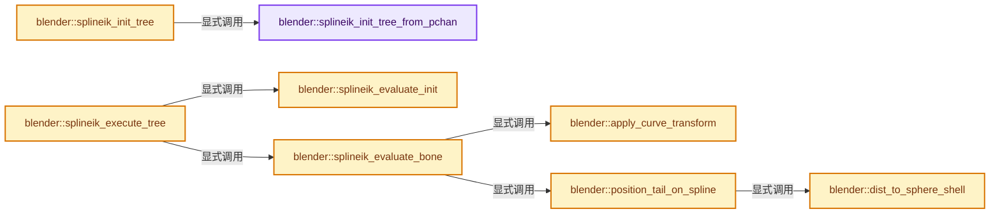

# 实现依赖专题：source/blender/blenkernel/intern/armature_update.cc

[方向导航](README.md) · [符号索引](../%E7%AC%A6%E5%8F%B7%E4%BE%9D%E8%B5%96%E4%B8%8E%E5%AE%9E%E7%8E%B0%E7%B4%A2%E5%BC%95.md)

本专题从正文实际调用进入，集中保存共享实现。函数有稳定锚点，可从调用处直接跳到对应完整函数；递归与互相调用通过回链组织。

## 本文件的实现关系




## 完整成员与函数实现

<a id="f-0a4c4fb696334349"></a>

### `blender::splineik_init_tree_from_pchan`

实现位置：[source/blender/blenkernel/intern/armature_update.cc](../../../../../source/blender/blenkernel/intern/armature_update.cc) · L63—L184。

接口参数：

- `Scene *`
- `Object *ob`
- `bPoseChannel *pchan_tip`

**教学注释版**

<!-- annotated:16504be6856ff2 -->

```cpp
static void splineik_init_tree_from_pchan(Scene * /*scene*/, Object *ob, bPoseChannel *pchan_tip)
{
  bPoseChannel *pchan, *pchan_root = nullptr;
  bConstraint *con = nullptr;
  bSplineIKConstraint *ik_data = nullptr;
  float totlength = 0.0f;
  int segcount = 0;

  /* Find the SplineIK constraint. */
  for (con = pchan_tip->constraints.first(); con; con = con->next) {
    if (con->type == CONSTRAINT_TYPE_SPLINEIK) {
      ik_data = static_cast<bSplineIKConstraint *>(con->data);

      /* Target can only be a curve. */
      if ((ik_data->tar == nullptr) || (ik_data->tar->type != OB_CURVES_LEGACY)) {
        continue;
      }
      /* Skip if disabled. */
      if (!BKE_constraint_has_influence(con)) {
        continue;
      }

      /* Otherwise, constraint is ok... */
      break;
    }
  }
  if (con == nullptr) {
    return;
  }

  /* Find the root bone and the chain of bones from the root to the tip.
   * NOTE: this assumes that the bones are connected, but that may not be true... */
  Bone *pchan_bone = pchan_tip->bone_get(*ob);
  Array<bPoseChannel *> pchan_chain(ik_data->chainlen);
  Array<float> bone_lengths(ik_data->chainlen);
  for (pchan = pchan_tip; pchan && (segcount < ik_data->chainlen);
       pchan = pchan->parent, pchan_bone = pchan_bone->parent, segcount++)
  {
    /* Store this segment in the chain. */
    pchan_chain[segcount] = pchan;

    /* If performing rebinding, calculate the length of the bone. */
    bone_lengths[segcount] = pchan_bone->length;
    totlength += bone_lengths[segcount];
  }

  if (segcount == 0) {
    return;
  }

  pchan_root = pchan_chain[segcount - 1];

  /* Perform binding step if required. */
  if ((ik_data->flag & CONSTRAINT_SPLINEIK_BOUND) == 0) {
    float segmentLen = (1.0f / float(segcount));

    /* Setup new empty array for the points list. */
    if (ik_data->points) {
      MEM_delete(ik_data->points);
    }
    ik_data->numpoints = ik_data->chainlen + 1;
    ik_data->points = MEM_new_array_uninitialized<float>(size_t(ik_data->numpoints),
                                                         "Spline IK Binding");

    /* Bind 'tip' of chain (i.e. first joint = tip of bone with the Spline IK Constraint). */
    ik_data->points[0] = 1.0f;

    /* Perform binding of the joints to parametric positions along the curve based
     * proportion of the total length that each bone occupies.
     */
    for (int i = 0; i < segcount; i++) {
      /* 'head' joints, traveling towards the root of the chain.
       * - 2 methods; the one chosen depends on whether we've got usable lengths.
       */
      if ((ik_data->flag & CONSTRAINT_SPLINEIK_EVENSPLITS) || (totlength == 0.0f)) {
        /* 1) Equi-spaced joints. */
        ik_data->points[i + 1] = ik_data->points[i] - segmentLen;
      }
      else {
        /* 2) To find this point on the curve, we take a step from the previous joint
         *    a distance given by the proportion that this bone takes.
         */
        ik_data->points[i + 1] = ik_data->points[i] - (bone_lengths[i] / totlength);
      }
    }

    /* Spline has now been bound. */
    ik_data->flag |= CONSTRAINT_SPLINEIK_BOUND;
  }

  /* Disallow negative values (happens with float precision). */
  CLAMP_MIN(ik_data->points[segcount], 0.0f);

  /* Make a new Spline-IK chain, and store it in the IK chains. */
  /* TODO: we should check if there is already an IK chain on this,
   * since that would take precedence... */
  {
    /* Make a new tree. */
    tSplineIK_Tree *tree = MEM_new<tSplineIK_Tree>("SplineIK Tree");
    tree->type = CONSTRAINT_TYPE_SPLINEIK;

    tree->chainlen = segcount;
    tree->totlength = totlength;

    /* Move the array of links to bones in the chain (from tip to root) to the tree. */
    // [讲解] std::move：把表达式转换成可供移动重载选择的值类别；不保证真的移动，不结束源对象寿命，对const值可能选择复制。
    tree->chain = std::move(pchan_chain);

    /* Store reference to joint position array. */
    tree->points = ik_data->points;

    /* Store references to different parts of the chain. */
    tree->root = pchan_root;
    tree->con = con;
    tree->ik_data = ik_data;

    /* AND! Link the tree to the root. */
    BLI_addtail(&pchan_root->siktree, tree);
  }

  /* Mark root channel having an IK tree. */
  pchan_root->flag |= POSE_IKSPLINE;
}
```

<details>
<summary>核对原始源码：source/blender/blenkernel/intern/armature_update.cc · L63—L184</summary>

<!-- original:16504be6856ff2:source/blender/blenkernel/intern/armature_update.cc:63:184 -->

```cpp
static void splineik_init_tree_from_pchan(Scene * /*scene*/, Object *ob, bPoseChannel *pchan_tip)
{
  bPoseChannel *pchan, *pchan_root = nullptr;
  bConstraint *con = nullptr;
  bSplineIKConstraint *ik_data = nullptr;
  float totlength = 0.0f;
  int segcount = 0;

  /* Find the SplineIK constraint. */
  for (con = pchan_tip->constraints.first(); con; con = con->next) {
    if (con->type == CONSTRAINT_TYPE_SPLINEIK) {
      ik_data = static_cast<bSplineIKConstraint *>(con->data);

      /* Target can only be a curve. */
      if ((ik_data->tar == nullptr) || (ik_data->tar->type != OB_CURVES_LEGACY)) {
        continue;
      }
      /* Skip if disabled. */
      if (!BKE_constraint_has_influence(con)) {
        continue;
      }

      /* Otherwise, constraint is ok... */
      break;
    }
  }
  if (con == nullptr) {
    return;
  }

  /* Find the root bone and the chain of bones from the root to the tip.
   * NOTE: this assumes that the bones are connected, but that may not be true... */
  Bone *pchan_bone = pchan_tip->bone_get(*ob);
  Array<bPoseChannel *> pchan_chain(ik_data->chainlen);
  Array<float> bone_lengths(ik_data->chainlen);
  for (pchan = pchan_tip; pchan && (segcount < ik_data->chainlen);
       pchan = pchan->parent, pchan_bone = pchan_bone->parent, segcount++)
  {
    /* Store this segment in the chain. */
    pchan_chain[segcount] = pchan;

    /* If performing rebinding, calculate the length of the bone. */
    bone_lengths[segcount] = pchan_bone->length;
    totlength += bone_lengths[segcount];
  }

  if (segcount == 0) {
    return;
  }

  pchan_root = pchan_chain[segcount - 1];

  /* Perform binding step if required. */
  if ((ik_data->flag & CONSTRAINT_SPLINEIK_BOUND) == 0) {
    float segmentLen = (1.0f / float(segcount));

    /* Setup new empty array for the points list. */
    if (ik_data->points) {
      MEM_delete(ik_data->points);
    }
    ik_data->numpoints = ik_data->chainlen + 1;
    ik_data->points = MEM_new_array_uninitialized<float>(size_t(ik_data->numpoints),
                                                         "Spline IK Binding");

    /* Bind 'tip' of chain (i.e. first joint = tip of bone with the Spline IK Constraint). */
    ik_data->points[0] = 1.0f;

    /* Perform binding of the joints to parametric positions along the curve based
     * proportion of the total length that each bone occupies.
     */
    for (int i = 0; i < segcount; i++) {
      /* 'head' joints, traveling towards the root of the chain.
       * - 2 methods; the one chosen depends on whether we've got usable lengths.
       */
      if ((ik_data->flag & CONSTRAINT_SPLINEIK_EVENSPLITS) || (totlength == 0.0f)) {
        /* 1) Equi-spaced joints. */
        ik_data->points[i + 1] = ik_data->points[i] - segmentLen;
      }
      else {
        /* 2) To find this point on the curve, we take a step from the previous joint
         *    a distance given by the proportion that this bone takes.
         */
        ik_data->points[i + 1] = ik_data->points[i] - (bone_lengths[i] / totlength);
      }
    }

    /* Spline has now been bound. */
    ik_data->flag |= CONSTRAINT_SPLINEIK_BOUND;
  }

  /* Disallow negative values (happens with float precision). */
  CLAMP_MIN(ik_data->points[segcount], 0.0f);

  /* Make a new Spline-IK chain, and store it in the IK chains. */
  /* TODO: we should check if there is already an IK chain on this,
   * since that would take precedence... */
  {
    /* Make a new tree. */
    tSplineIK_Tree *tree = MEM_new<tSplineIK_Tree>("SplineIK Tree");
    tree->type = CONSTRAINT_TYPE_SPLINEIK;

    tree->chainlen = segcount;
    tree->totlength = totlength;

    /* Move the array of links to bones in the chain (from tip to root) to the tree. */
    tree->chain = std::move(pchan_chain);

    /* Store reference to joint position array. */
    tree->points = ik_data->points;

    /* Store references to different parts of the chain. */
    tree->root = pchan_root;
    tree->con = con;
    tree->ik_data = ik_data;

    /* AND! Link the tree to the root. */
    BLI_addtail(&pchan_root->siktree, tree);
  }

  /* Mark root channel having an IK tree. */
  pchan_root->flag |= POSE_IKSPLINE;
}
```

</details>

**沿实际写入检查状态**

- `ik_data = static_cast<bSplineIKConstraint *>(con->data);`
- `pchan = pchan->parent, pchan_bone = pchan_bone->parent, segcount++)`
- `pchan_chain[segcount] = pchan;`
- `bone_lengths[segcount] = pchan_bone->length;`
- `totlength += bone_lengths[segcount];`
- `pchan_root = pchan_chain[segcount - 1];`
- `ik_data->numpoints = ik_data->chainlen + 1;`
- `ik_data->points = MEM_new_array_uninitialized<float>(size_t(ik_data->numpoints),`
- `ik_data->points[0] = 1.0f;`
- `ik_data->flag |= CONSTRAINT_SPLINEIK_BOUND;`
- `tree->type = CONSTRAINT_TYPE_SPLINEIK;`
- `tree->chainlen = segcount;`
- `tree->totlength = totlength;`
- `tree->chain = std::move(pchan_chain);`
- `tree->points = ik_data->points;`
- `tree->root = pchan_root;`
- `tree->con = con;`
- `tree->ik_data = ik_data;`
- `pchan_root->flag |= POSE_IKSPLINE;`

**继续追踪实现**

- `pchan_tip->constraints.first` → [调用协议](../%E6%A8%A1%E6%9D%BF%E5%AE%8F%E4%B8%8E%E5%8A%A8%E6%80%81%E5%88%86%E6%B4%BE%E5%8D%8F%E8%AE%AE.md)：接收对象类型依赖auto、返回值或模板实例；不按同名猜测目标。调用位置L72。
- `BKE_constraint_has_influence` → [blender::BKE_constraint_has_influence · L6431](%E4%BE%9D%E8%B5%96-constraint-42d573.md#f-272ede7c7fd70653)。
- `pchan_tip->bone_get` → [blender::bPoseChannel::bone_get · L847](%E4%BE%9D%E8%B5%96-action-b3a47a.md#f-0eb8bfcf060715cf)；[blender::bPoseChannel::bone_get · L862](%E4%BE%9D%E8%B5%96-action-b3a47a.md#f-ccec81f60dc65040)；[blender::bPoseChannel::bone_get · L875](%E4%BE%9D%E8%B5%96-action-b3a47a.md#f-b7d34ff46210a1f3)；[blender::bPoseChannel::bone_get · L881](%E4%BE%9D%E8%B5%96-action-b3a47a.md#f-0bf83e1e4d68c624)。同名重载需按实参类型选择。
- `MEM_delete` → [MEM_delete · L400](../03-%E5%86%85%E5%AD%98%E5%88%86%E9%85%8D%E4%B8%8E%E8%BF%90%E8%A1%8C%E6%97%B6%E7%B1%BB%E5%9E%8B/%E4%BE%9D%E8%B5%96-MEM_guardedalloc-b54eca.md#f-9049ffdd1682887c)。
- `MEM_new_array_uninitialized<float>` → [MEM_new_array_uninitialized · L608](../03-%E5%86%85%E5%AD%98%E5%88%86%E9%85%8D%E4%B8%8E%E8%BF%90%E8%A1%8C%E6%97%B6%E7%B1%BB%E5%9E%8B/%E4%BE%9D%E8%B5%96-MEM_guardedalloc-b54eca.md#f-b7103eae8eb57b05)；[MEM_new_array_uninitialized · L129](../03-%E5%86%85%E5%AD%98%E5%88%86%E9%85%8D%E4%B8%8E%E8%BF%90%E8%A1%8C%E6%97%B6%E7%B1%BB%E5%9E%8B/%E4%BE%9D%E8%B5%96-mallocn-afdcd4.md#f-bf6ef4ddcfb6e5df)。同名重载需按实参类型选择。
- `CLAMP_MIN` → [CLAMP_MIN · L219](../01-%E5%9F%BA%E7%A1%80%E5%AE%B9%E5%99%A8%E4%B8%8E%E7%8E%B0%E4%BB%A3CPP/%E4%BE%9D%E8%B5%96-BLI_utildefines-293a0a.md#m-fd63318fbafb)。宏定义由构建条件选择。
- `MEM_new<tSplineIK_Tree>` → [MEM_new · L351](../03-%E5%86%85%E5%AD%98%E5%88%86%E9%85%8D%E4%B8%8E%E8%BF%90%E8%A1%8C%E6%97%B6%E7%B1%BB%E5%9E%8B/%E4%BE%9D%E8%B5%96-MEM_guardedalloc-b54eca.md#f-115f9b6784f89912)。
- `std::move` → [外部契约](https://eel.is/c++draft/utility.forward)：把表达式转换成可供移动重载选择的值类别；不保证真的移动，不结束源对象寿命，对const值可能选择复制。
- `BLI_addtail` → [blender::BLI_addtail · L118](../01-%E5%9F%BA%E7%A1%80%E5%AE%B9%E5%99%A8%E4%B8%8E%E7%8E%B0%E4%BB%A3CPP/%E4%BE%9D%E8%B5%96-listbase-2816d9.md#f-4fb027713fa3115b)。

<a id="f-1c41060e11f8b233"></a>

### `blender::splineik_init_tree`

实现位置：[source/blender/blenkernel/intern/armature_update.cc](../../../../../source/blender/blenkernel/intern/armature_update.cc) · L187—L196。

接口参数：

- `Scene *scene`
- `Object *ob`
- `float`

**教学注释版**

<!-- annotated:c143445fd5687e -->

```cpp
static void splineik_init_tree(Scene *scene, Object *ob, float /*ctime*/)
{
  /* Find the tips of Spline IK chains,
   * which are simply the bones which have been tagged as such. */
  for (bPoseChannel &pchan : ob->pose->chanbase) {
    if (pchan.constflag & PCHAN_HAS_SPLINEIK) {
      splineik_init_tree_from_pchan(scene, ob, &pchan);
    }
  }
}
```

<details>
<summary>核对原始源码：source/blender/blenkernel/intern/armature_update.cc · L187—L196</summary>

<!-- original:c143445fd5687e:source/blender/blenkernel/intern/armature_update.cc:187:196 -->

```cpp
static void splineik_init_tree(Scene *scene, Object *ob, float /*ctime*/)
{
  /* Find the tips of Spline IK chains,
   * which are simply the bones which have been tagged as such. */
  for (bPoseChannel &pchan : ob->pose->chanbase) {
    if (pchan.constflag & PCHAN_HAS_SPLINEIK) {
      splineik_init_tree_from_pchan(scene, ob, &pchan);
    }
  }
}
```

</details>

**继续追踪实现**

- `splineik_init_tree_from_pchan` → [blender::splineik_init_tree_from_pchan · L63](%E4%BE%9D%E8%B5%96-armature_update-3ccb02.md#f-0a4c4fb696334349)。

<a id="f-c86d6d4068e56046"></a>

### `blender::splineik_evaluate_init`

实现位置：[source/blender/blenkernel/intern/armature_update.cc](../../../../../source/blender/blenkernel/intern/armature_update.cc) · L210—L249。

接口参数：

- `tSplineIK_Tree *tree`
- `tSplineIk_EvalState *state`

**教学注释版**

<!-- annotated:803c843c55949e -->

```cpp
static bool splineik_evaluate_init(tSplineIK_Tree *tree, tSplineIk_EvalState *state)
{
  bSplineIKConstraint *ik_data = tree->ik_data;

  /* Make sure that the constraint targets are ok, to avoid crashes
   * in case of a depsgraph bug or dependency cycle.
   */
  if (ik_data->tar == nullptr) {
    return false;
  }

  CurveCache *cache = ik_data->tar->runtime->curve_cache;

  if (ELEM(nullptr, cache, cache->anim_path_accum_length)) {
    return false;
  }

  /* Initialize the evaluation state. */
  state->curve_position = 0.0f;
  state->curve_scale = 1.0f;
  unit_m4(state->locrot_offset);
  zero_v3(state->prev_tail_loc);
  state->prev_tail_radius = 1.0f;
  state->prev_tail_seg_idx = 0;

  /* Apply corrections for sensitivity to scaling. */
  if ((ik_data->yScaleMode != CONSTRAINT_SPLINEIK_YS_FIT_CURVE) && (tree->totlength != 0.0f)) {
    /* Get the current length of the curve. */
    /* NOTE: This is assumed to be correct even after the curve was resized. */
    const float spline_len = BKE_anim_path_get_length(cache);

    /* Calculate the scale factor to multiply all the path values by so that the
     * bone chain retains its current length, such that:
     *     maxScale * splineLen = totLength
     */
    state->curve_scale = tree->totlength / spline_len;
  }

  return true;
}
```

<details>
<summary>核对原始源码：source/blender/blenkernel/intern/armature_update.cc · L210—L249</summary>

<!-- original:803c843c55949e:source/blender/blenkernel/intern/armature_update.cc:210:249 -->

```cpp
static bool splineik_evaluate_init(tSplineIK_Tree *tree, tSplineIk_EvalState *state)
{
  bSplineIKConstraint *ik_data = tree->ik_data;

  /* Make sure that the constraint targets are ok, to avoid crashes
   * in case of a depsgraph bug or dependency cycle.
   */
  if (ik_data->tar == nullptr) {
    return false;
  }

  CurveCache *cache = ik_data->tar->runtime->curve_cache;

  if (ELEM(nullptr, cache, cache->anim_path_accum_length)) {
    return false;
  }

  /* Initialize the evaluation state. */
  state->curve_position = 0.0f;
  state->curve_scale = 1.0f;
  unit_m4(state->locrot_offset);
  zero_v3(state->prev_tail_loc);
  state->prev_tail_radius = 1.0f;
  state->prev_tail_seg_idx = 0;

  /* Apply corrections for sensitivity to scaling. */
  if ((ik_data->yScaleMode != CONSTRAINT_SPLINEIK_YS_FIT_CURVE) && (tree->totlength != 0.0f)) {
    /* Get the current length of the curve. */
    /* NOTE: This is assumed to be correct even after the curve was resized. */
    const float spline_len = BKE_anim_path_get_length(cache);

    /* Calculate the scale factor to multiply all the path values by so that the
     * bone chain retains its current length, such that:
     *     maxScale * splineLen = totLength
     */
    state->curve_scale = tree->totlength / spline_len;
  }

  return true;
}
```

</details>

**沿实际写入检查状态**

- `state->curve_position = 0.0f;`
- `state->curve_scale = 1.0f;`
- `state->prev_tail_radius = 1.0f;`
- `state->prev_tail_seg_idx = 0;`
- `state->curve_scale = tree->totlength / spline_len;`

**结果出口**

- `return false;`
- `return true;`

**继续追踪实现**

- `ELEM` → [ELEM · L88](%E4%BE%9D%E8%B5%96-GHOST_utildefines-34b996.md#m-d28724a15928)；[ELEM · L135](../01-%E5%9F%BA%E7%A1%80%E5%AE%B9%E5%99%A8%E4%B8%8E%E7%8E%B0%E4%BB%A3CPP/%E4%BE%9D%E8%B5%96-BLI_utildefines-293a0a.md#m-d6572de7cae0)。宏定义由构建条件选择。
- `unit_m4` → [blender::unit_m4 · L55](../12-%E7%A9%BA%E9%97%B4%E6%95%B0%E6%8D%AE%E7%BB%93%E6%9E%84%E4%B8%8E%E5%87%A0%E4%BD%95%E7%AE%97%E6%B3%95/%E4%BE%9D%E8%B5%96-math_matrix_c-004123.md#f-e6cd812aae119176)。
- `zero_v3` → [blender::zero_v3 · L26](../12-%E7%A9%BA%E9%97%B4%E6%95%B0%E6%8D%AE%E7%BB%93%E6%9E%84%E4%B8%8E%E5%87%A0%E4%BD%95%E7%AE%97%E6%B3%95/%E4%BE%9D%E8%B5%96-math_vector_inline-0c8541.md#f-13235b08fdecb098)。
- `BKE_anim_path_get_length` → [blender::BKE_anim_path_get_length · L55](%E4%BE%9D%E8%B5%96-anim_path-3d7dfa.md#f-123116e571c61db7)。

<a id="f-a27408a2ee8eae5e"></a>

### `blender::apply_curve_transform`

实现位置：[source/blender/blenkernel/intern/armature_update.cc](../../../../../source/blender/blenkernel/intern/armature_update.cc) · L251—L266。

接口参数：

- `bSplineIKConstraint *ik_data`
- `Object *ob`
- `float radius`
- `float r_vec[3]`
- `float *r_radius`

**教学注释版**

<!-- annotated:93b6ebfe423d51 -->

```cpp
static void apply_curve_transform(
    bSplineIKConstraint *ik_data, Object *ob, float radius, float r_vec[3], float *r_radius)
{
  /* Apply the curve's object-mode transforms to the position
   * unless the option to allow curve to be positioned elsewhere is activated (i.e. no root).
   */
  if ((ik_data->flag & CONSTRAINT_SPLINEIK_NO_ROOT) == 0) {
    mul_m4_v3(ik_data->tar->object_to_world().ptr(), r_vec);
  }

  /* Convert the position to pose-space. */
  mul_m4_v3(ob->world_to_object().ptr(), r_vec);

  /* Set the new radius (it should be the average value). */
  *r_radius = (radius + *r_radius) / 2;
}
```

<details>
<summary>核对原始源码：source/blender/blenkernel/intern/armature_update.cc · L251—L266</summary>

<!-- original:93b6ebfe423d51:source/blender/blenkernel/intern/armature_update.cc:251:266 -->

```cpp
static void apply_curve_transform(
    bSplineIKConstraint *ik_data, Object *ob, float radius, float r_vec[3], float *r_radius)
{
  /* Apply the curve's object-mode transforms to the position
   * unless the option to allow curve to be positioned elsewhere is activated (i.e. no root).
   */
  if ((ik_data->flag & CONSTRAINT_SPLINEIK_NO_ROOT) == 0) {
    mul_m4_v3(ik_data->tar->object_to_world().ptr(), r_vec);
  }

  /* Convert the position to pose-space. */
  mul_m4_v3(ob->world_to_object().ptr(), r_vec);

  /* Set the new radius (it should be the average value). */
  *r_radius = (radius + *r_radius) / 2;
}
```

</details>

**继续追踪实现**

- `mul_m4_v3` → [blender::mul_m4_v3 · L677](../12-%E7%A9%BA%E9%97%B4%E6%95%B0%E6%8D%AE%E7%BB%93%E6%9E%84%E4%B8%8E%E5%87%A0%E4%BD%95%E7%AE%97%E6%B3%95/%E4%BE%9D%E8%B5%96-math_matrix_c-004123.md#f-14a8c267710d47a3)。
- `ik_data->tar->object_to_world().ptr` → [调用协议](../%E6%A8%A1%E6%9D%BF%E5%AE%8F%E4%B8%8E%E5%8A%A8%E6%80%81%E5%88%86%E6%B4%BE%E5%8D%8F%E8%AE%AE.md)：接收对象类型依赖auto、返回值或模板实例；不按同名猜测目标。调用位置L258。
- `ik_data->tar->object_to_world` → [调用协议](../%E6%A8%A1%E6%9D%BF%E5%AE%8F%E4%B8%8E%E5%8A%A8%E6%80%81%E5%88%86%E6%B4%BE%E5%8D%8F%E8%AE%AE.md)：接收对象类型依赖auto、返回值或模板实例；不按同名猜测目标。调用位置L258。
- `ob->world_to_object().ptr` → [调用协议](../%E6%A8%A1%E6%9D%BF%E5%AE%8F%E4%B8%8E%E5%8A%A8%E6%80%81%E5%88%86%E6%B4%BE%E5%8D%8F%E8%AE%AE.md)：接收对象类型依赖auto、返回值或模板实例；不按同名猜测目标。调用位置L262。
- `ob->world_to_object` → [blender::Object::world_to_object · L5766](%E4%BE%9D%E8%B5%96-object-843689.md#f-dd4d8d55d6195233)。

<a id="f-48f9e2b527ebbe21"></a>

### `blender::dist_to_sphere_shell`

实现位置：[source/blender/blenkernel/intern/armature_update.cc](../../../../../source/blender/blenkernel/intern/armature_update.cc) · L268—L275。

接口参数：

- `const float sphere_origin[3]`
- `const float sphere_radius`
- `const float point[3]`

**教学注释版**

<!-- annotated:b6ddf4b26ad876 -->

```cpp
static float dist_to_sphere_shell(const float sphere_origin[3],
                                  const float sphere_radius,
                                  const float point[3])
{
  float vec[3];
  sub_v3_v3v3(vec, sphere_origin, point);
  return sphere_radius - len_v3(vec);
}
```

<details>
<summary>核对原始源码：source/blender/blenkernel/intern/armature_update.cc · L268—L275</summary>

<!-- original:b6ddf4b26ad876:source/blender/blenkernel/intern/armature_update.cc:268:275 -->

```cpp
static float dist_to_sphere_shell(const float sphere_origin[3],
                                  const float sphere_radius,
                                  const float point[3])
{
  float vec[3];
  sub_v3_v3v3(vec, sphere_origin, point);
  return sphere_radius - len_v3(vec);
}
```

</details>

**结果出口**

- `return sphere_radius - len_v3(vec);`

**继续追踪实现**

- `sub_v3_v3v3` → [blender::sub_v3_v3v3 · L360](../12-%E7%A9%BA%E9%97%B4%E6%95%B0%E6%8D%AE%E7%BB%93%E6%9E%84%E4%B8%8E%E5%87%A0%E4%BD%95%E7%AE%97%E6%B3%95/%E4%BE%9D%E8%B5%96-math_vector_inline-0c8541.md#f-23781c252db8b30c)。
- `len_v3` → [blender::len_v3 · L781](../12-%E7%A9%BA%E9%97%B4%E6%95%B0%E6%8D%AE%E7%BB%93%E6%9E%84%E4%B8%8E%E5%87%A0%E4%BD%95%E7%AE%97%E6%B3%95/%E4%BE%9D%E8%B5%96-math_vector_inline-0c8541.md#f-4ad88eb0aa8d70ab)。

<a id="f-4983c0cb0bde4897"></a>

### `blender::position_tail_on_spline`

实现位置：[source/blender/blenkernel/intern/armature_update.cc](../../../../../source/blender/blenkernel/intern/armature_update.cc) · L280—L404。

接口参数：

- `bSplineIKConstraint *ik_data`
- `const float head_pos[3]`
- `const float sphere_radius`
- `int prev_seg_idx`
- `float r_tail_pos[3]`
- `float *r_new_curve_pos`
- `float *r_radius`

**教学注释版**

<!-- annotated:24d82c780053c9 -->

```cpp
static int position_tail_on_spline(bSplineIKConstraint *ik_data,
                                   const float head_pos[3],
                                   const float sphere_radius,
                                   int prev_seg_idx,
                                   float r_tail_pos[3],
                                   float *r_new_curve_pos,
                                   float *r_radius)
{
  /* This is using the tessellated curve data.
   * So we are working with piece-wise linear curve segments.
   * The same method is used in #BKE_where_on_path to get curve location data. */
  const CurveCache *cache = ik_data->tar->runtime->curve_cache;
  const float *seg_accum_len = cache->anim_path_accum_length;

  int max_seg_idx = BKE_anim_path_get_array_size(cache) - 1;

  /* Make an initial guess of where our intersection point will be.
   * If the curve was a straight line, then the fraction passed in r_new_curve_pos
   * would be the correct location.
   * So make it our first initial guess.
   */
  const float spline_len = BKE_anim_path_get_length(cache);
  const float guessed_len = *r_new_curve_pos * spline_len;

  BLI_assert(prev_seg_idx >= 0);
  int cur_seg_idx = prev_seg_idx;
  while (cur_seg_idx < max_seg_idx && guessed_len > seg_accum_len[cur_seg_idx]) {
    cur_seg_idx++;
  }

  /* Convert the segment to bev points.
   * For example, the segment with index 0 will have bev points 0 and 1.
   */
  int bp_idx = cur_seg_idx + 1;

  const BevList *bl = cache->bev.first();
  bool is_cyclic = bl->poly >= 0;
  BevPoint *bp = bl->bevpoints;
  BevPoint *prev_bp;
  bp = bp + bp_idx;
  prev_bp = bp - 1;

  /* Go to the next tessellated curve point until we cross to outside of the sphere. */
  while (len_v3v3(head_pos, bp->vec) < sphere_radius) {
    if (bp_idx > max_seg_idx) {
      /* We are outside the defined curve. We will now extrapolate the intersection point. */
      break;
    }
    prev_bp = bp;
    if (is_cyclic && bp_idx == max_seg_idx) {
      /* Wrap around to the start point.
       * Don't set the bp_idx to zero here as we use it to get the segment index later.
       */
      bp = bl->bevpoints;
    }
    else {
      bp++;
    }
    bp_idx++;
  }

  /* Calculate the intersection point using the secant root finding method */
  float x0 = 0.0f, x1 = 1.0f;
  float x0_point[3], x1_point[3], start_p[3];
  // [讲解] std::max：按比较关系选取较大值。本讲解中的增长公式同时满足最低请求和几何增长；若保存返回引用，还需注意实参寿命。
  float epsilon = std::max({1.0f, len_v3(head_pos), len_v3(bp->vec)}) * FLT_EPSILON;

  if (prev_seg_idx == bp_idx - 1) {
    /* The intersection lies inside the same segment as the last point.
     * Set the last point to be the start search point so we minimize the risks of going backwards
     * on the curve.
     */
    copy_v3_v3(start_p, head_pos);
  }
  else {
    copy_v3_v3(start_p, prev_bp->vec);
  }

  for (int i = 0; i < 10; i++) {
    interp_v3_v3v3(x0_point, start_p, bp->vec, x0);
    interp_v3_v3v3(x1_point, start_p, bp->vec, x1);

    float f_x0 = dist_to_sphere_shell(head_pos, sphere_radius, x0_point);
    float f_x1 = dist_to_sphere_shell(head_pos, sphere_radius, x1_point);

    if (fabsf(f_x1) <= epsilon || f_x0 == f_x1) {
      break;
    }

    const float x2 = x1 - f_x1 * (x1 - x0) / (f_x1 - f_x0);
    x0 = x1;
    x1 = x2;
  }
  /* Found the bone tail position! */
  copy_v3_v3(r_tail_pos, x1_point);

  /* Because our intersection point lies inside the current segment,
   * Convert our bevpoint index back to the previous segment index (-2 instead of -1).
   * This is because our actual location is prev_seg_len + isect_seg_len.
   */
  prev_seg_idx = bp_idx - 2;
  float prev_seg_len = 0;

  if (prev_seg_idx < 0) {
    prev_seg_idx = 0;
    prev_seg_len = 0;
  }
  else {
    prev_seg_len = seg_accum_len[prev_seg_idx];
  }

  /* Convert the point back into the 0-1 interpolation range. */
  const float isect_seg_len = len_v3v3(prev_bp->vec, r_tail_pos);
  const float frac = isect_seg_len / len_v3v3(prev_bp->vec, bp->vec);
  *r_new_curve_pos = (prev_seg_len + isect_seg_len) / spline_len;

  if (*r_new_curve_pos > 1.0f) {
    *r_radius = bp->radius;
  }
  else {
    *r_radius = (1.0f - frac) * prev_bp->radius + frac * bp->radius;
  }

  /* Return the current segment. */
  return bp_idx - 1;
}
```

<details>
<summary>核对原始源码：source/blender/blenkernel/intern/armature_update.cc · L280—L404</summary>

<!-- original:24d82c780053c9:source/blender/blenkernel/intern/armature_update.cc:280:404 -->

```cpp
static int position_tail_on_spline(bSplineIKConstraint *ik_data,
                                   const float head_pos[3],
                                   const float sphere_radius,
                                   int prev_seg_idx,
                                   float r_tail_pos[3],
                                   float *r_new_curve_pos,
                                   float *r_radius)
{
  /* This is using the tessellated curve data.
   * So we are working with piece-wise linear curve segments.
   * The same method is used in #BKE_where_on_path to get curve location data. */
  const CurveCache *cache = ik_data->tar->runtime->curve_cache;
  const float *seg_accum_len = cache->anim_path_accum_length;

  int max_seg_idx = BKE_anim_path_get_array_size(cache) - 1;

  /* Make an initial guess of where our intersection point will be.
   * If the curve was a straight line, then the fraction passed in r_new_curve_pos
   * would be the correct location.
   * So make it our first initial guess.
   */
  const float spline_len = BKE_anim_path_get_length(cache);
  const float guessed_len = *r_new_curve_pos * spline_len;

  BLI_assert(prev_seg_idx >= 0);
  int cur_seg_idx = prev_seg_idx;
  while (cur_seg_idx < max_seg_idx && guessed_len > seg_accum_len[cur_seg_idx]) {
    cur_seg_idx++;
  }

  /* Convert the segment to bev points.
   * For example, the segment with index 0 will have bev points 0 and 1.
   */
  int bp_idx = cur_seg_idx + 1;

  const BevList *bl = cache->bev.first();
  bool is_cyclic = bl->poly >= 0;
  BevPoint *bp = bl->bevpoints;
  BevPoint *prev_bp;
  bp = bp + bp_idx;
  prev_bp = bp - 1;

  /* Go to the next tessellated curve point until we cross to outside of the sphere. */
  while (len_v3v3(head_pos, bp->vec) < sphere_radius) {
    if (bp_idx > max_seg_idx) {
      /* We are outside the defined curve. We will now extrapolate the intersection point. */
      break;
    }
    prev_bp = bp;
    if (is_cyclic && bp_idx == max_seg_idx) {
      /* Wrap around to the start point.
       * Don't set the bp_idx to zero here as we use it to get the segment index later.
       */
      bp = bl->bevpoints;
    }
    else {
      bp++;
    }
    bp_idx++;
  }

  /* Calculate the intersection point using the secant root finding method */
  float x0 = 0.0f, x1 = 1.0f;
  float x0_point[3], x1_point[3], start_p[3];
  float epsilon = std::max({1.0f, len_v3(head_pos), len_v3(bp->vec)}) * FLT_EPSILON;

  if (prev_seg_idx == bp_idx - 1) {
    /* The intersection lies inside the same segment as the last point.
     * Set the last point to be the start search point so we minimize the risks of going backwards
     * on the curve.
     */
    copy_v3_v3(start_p, head_pos);
  }
  else {
    copy_v3_v3(start_p, prev_bp->vec);
  }

  for (int i = 0; i < 10; i++) {
    interp_v3_v3v3(x0_point, start_p, bp->vec, x0);
    interp_v3_v3v3(x1_point, start_p, bp->vec, x1);

    float f_x0 = dist_to_sphere_shell(head_pos, sphere_radius, x0_point);
    float f_x1 = dist_to_sphere_shell(head_pos, sphere_radius, x1_point);

    if (fabsf(f_x1) <= epsilon || f_x0 == f_x1) {
      break;
    }

    const float x2 = x1 - f_x1 * (x1 - x0) / (f_x1 - f_x0);
    x0 = x1;
    x1 = x2;
  }
  /* Found the bone tail position! */
  copy_v3_v3(r_tail_pos, x1_point);

  /* Because our intersection point lies inside the current segment,
   * Convert our bevpoint index back to the previous segment index (-2 instead of -1).
   * This is because our actual location is prev_seg_len + isect_seg_len.
   */
  prev_seg_idx = bp_idx - 2;
  float prev_seg_len = 0;

  if (prev_seg_idx < 0) {
    prev_seg_idx = 0;
    prev_seg_len = 0;
  }
  else {
    prev_seg_len = seg_accum_len[prev_seg_idx];
  }

  /* Convert the point back into the 0-1 interpolation range. */
  const float isect_seg_len = len_v3v3(prev_bp->vec, r_tail_pos);
  const float frac = isect_seg_len / len_v3v3(prev_bp->vec, bp->vec);
  *r_new_curve_pos = (prev_seg_len + isect_seg_len) / spline_len;

  if (*r_new_curve_pos > 1.0f) {
    *r_radius = bp->radius;
  }
  else {
    *r_radius = (1.0f - frac) * prev_bp->radius + frac * bp->radius;
  }

  /* Return the current segment. */
  return bp_idx - 1;
}
```

</details>

**沿实际写入检查状态**

- `bp = bp + bp_idx;`
- `prev_bp = bp - 1;`
- `prev_bp = bp;`
- `bp = bl->bevpoints;`
- `x0 = x1;`
- `x1 = x2;`
- `prev_seg_idx = bp_idx - 2;`
- `prev_seg_idx = 0;`
- `prev_seg_len = 0;`
- `prev_seg_len = seg_accum_len[prev_seg_idx];`

**结果出口**

- `return bp_idx - 1;`

**继续追踪实现**

- `BKE_anim_path_get_array_size` → [blender::BKE_anim_path_get_array_size · L44](%E4%BE%9D%E8%B5%96-anim_path-3d7dfa.md#f-2c5e5cf556f92542)。
- `BKE_anim_path_get_length` → [blender::BKE_anim_path_get_length · L55](%E4%BE%9D%E8%B5%96-anim_path-3d7dfa.md#f-123116e571c61db7)。
- `BLI_assert` → [BLI_assert · L48](../01-%E5%9F%BA%E7%A1%80%E5%AE%B9%E5%99%A8%E4%B8%8E%E7%8E%B0%E4%BB%A3CPP/%E4%BE%9D%E8%B5%96-BLI_assert-cc98e8.md#m-57a88495704d)；[BLI_assert · L63](../01-%E5%9F%BA%E7%A1%80%E5%AE%B9%E5%99%A8%E4%B8%8E%E7%8E%B0%E4%BB%A3CPP/%E4%BE%9D%E8%B5%96-BLI_assert-cc98e8.md#m-d07050020cb5)。宏定义由构建条件选择。
- `cache->bev.first` → [调用协议](../%E6%A8%A1%E6%9D%BF%E5%AE%8F%E4%B8%8E%E5%8A%A8%E6%80%81%E5%88%86%E6%B4%BE%E5%8D%8F%E8%AE%AE.md)：接收对象类型依赖auto、返回值或模板实例；不按同名猜测目标。调用位置L315。
- `len_v3v3` → [blender::len_v3v3 · L826](../12-%E7%A9%BA%E9%97%B4%E6%95%B0%E6%8D%AE%E7%BB%93%E6%9E%84%E4%B8%8E%E5%87%A0%E4%BD%95%E7%AE%97%E6%B3%95/%E4%BE%9D%E8%B5%96-math_vector_inline-0c8541.md#f-c873370566848169)。
- `std::max` → [外部契约](https://eel.is/c++draft/alg.min.max)：按比较关系选取较大值。本讲解中的增长公式同时满足最低请求和几何增长；若保存返回引用，还需注意实参寿命。
- `len_v3` → [blender::len_v3 · L781](../12-%E7%A9%BA%E9%97%B4%E6%95%B0%E6%8D%AE%E7%BB%93%E6%9E%84%E4%B8%8E%E5%87%A0%E4%BD%95%E7%AE%97%E6%B3%95/%E4%BE%9D%E8%B5%96-math_vector_inline-0c8541.md#f-4ad88eb0aa8d70ab)。
- `copy_v3_v3` → [blender::copy_v3_v3 · L47](../12-%E7%A9%BA%E9%97%B4%E6%95%B0%E6%8D%AE%E7%BB%93%E6%9E%84%E4%B8%8E%E5%87%A0%E4%BD%95%E7%AE%97%E6%B3%95/%E4%BE%9D%E8%B5%96-math_vector_inline-0c8541.md#f-037a0d5fa5060bd6)。
- `interp_v3_v3v3` → [blender::interp_v3_v3v3 · L41](../12-%E7%A9%BA%E9%97%B4%E6%95%B0%E6%8D%AE%E7%BB%93%E6%9E%84%E4%B8%8E%E5%87%A0%E4%BD%95%E7%AE%97%E6%B3%95/%E4%BE%9D%E8%B5%96-math_vector-5f35fa.md#f-18251c70c00824d7)。
- `dist_to_sphere_shell` → [blender::dist_to_sphere_shell · L268](%E4%BE%9D%E8%B5%96-armature_update-3ccb02.md#f-48f9e2b527ebbe21)。
- `fabsf` → [fabsf · L21](%E4%BE%9D%E8%B5%96-radial_tiling_shared-98abf9.md#m-02cc4c69cfb3)；[fabsf · L43](%E4%BE%9D%E8%B5%96-radial_tiling_shared-98abf9.md#m-04effe61803b)；[fabsf · L74](%E4%BE%9D%E8%B5%96-radial_tiling_shared-98abf9.md#m-927dd4eba7dc)；[fabsf · L25](../01-%E5%9F%BA%E7%A1%80%E5%AE%B9%E5%99%A8%E4%B8%8E%E7%8E%B0%E4%BB%A3CPP/%E4%BE%9D%E8%B5%96-radial_tiling_shared-7989a4.md#m-8348d6b3d08f)；[fabsf · L47](../01-%E5%9F%BA%E7%A1%80%E5%AE%B9%E5%99%A8%E4%B8%8E%E7%8E%B0%E4%BB%A3CPP/%E4%BE%9D%E8%B5%96-radial_tiling_shared-7989a4.md#m-13b7e0b6d84f)；[fabsf · L78](../01-%E5%9F%BA%E7%A1%80%E5%AE%B9%E5%99%A8%E4%B8%8E%E7%8E%B0%E4%BB%A3CPP/%E4%BE%9D%E8%B5%96-radial_tiling_shared-7989a4.md#m-326c83464a0d)；[fabsf · L21](%E4%BE%9D%E8%B5%96-node_radial_tiling_shared-b14bc2.md#m-7c3ee12fc119)；[fabsf · L43](%E4%BE%9D%E8%B5%96-node_radial_tiling_shared-b14bc2.md#m-9112db0e2dd1)；[fabsf · L74](%E4%BE%9D%E8%B5%96-node_radial_tiling_shared-b14bc2.md#m-ee4e61908a6f)；[fabsf · L167](%E4%BE%9D%E8%B5%96-compat-56205c.md#m-b039ee6c1601)；[fabsf · L265](%E4%BE%9D%E8%B5%96-compat-efe0e9.md#m-6b21869e9f3f)。宏定义由构建条件选择。

<a id="f-3c957daf47a9324f"></a>

### `blender::splineik_evaluate_bone`

实现位置：[source/blender/blenkernel/intern/armature_update.cc](../../../../../source/blender/blenkernel/intern/armature_update.cc) · L407—L746。

接口参数：

- `tSplineIK_Tree *tree`
- `Object *ob`
- `bPoseChannel *pchan`
- `int index`
- `tSplineIk_EvalState *state`

**教学注释版**

<!-- annotated:29755cd65ebac7 -->

```cpp
static void splineik_evaluate_bone(
    tSplineIK_Tree *tree, Object *ob, bPoseChannel *pchan, int index, tSplineIk_EvalState *state)
{
  bSplineIKConstraint *ik_data = tree->ik_data;
  Bone *pchan_bone = pchan->bone_get(*ob);

  if (pchan_bone->length < FLT_EPSILON) {
    /* Only move the bone position with zero length bones. */
    float bone_pos[4], rad;
    BKE_where_on_path(
        ik_data->tar, state->curve_position, bone_pos, nullptr, nullptr, &rad, nullptr);

    apply_curve_transform(ik_data, ob, rad, bone_pos, &rad);

    copy_v3_v3(pchan->pose_mat[3], bone_pos);
    copy_v3_v3(pchan->pose_head, bone_pos);
    copy_v3_v3(pchan->pose_tail, bone_pos);
    pchan->flag |= POSE_DONE;
    return;
  }

  float orig_head[3], orig_tail[3], pose_head[3], pose_tail[3];
  float base_pose_mat[3][3], pose_mat[3][3];
  float spline_vec[3], scale_fac, radius = 1.0f;
  float tail_blend_fac = 0.0f;

  mul_v3_m4v3(pose_head, state->locrot_offset, pchan->pose_head);
  mul_v3_m4v3(pose_tail, state->locrot_offset, pchan->pose_tail);

  copy_v3_v3(orig_head, pose_head);

  /* First, adjust the point positions on the curve. */
  float curveLen = tree->points[index] - tree->points[index + 1];
  float bone_len = len_v3v3(pose_head, pose_tail);
  float point_start = state->curve_position;
  float pose_scale = bone_len / pchan_bone->length;
  float base_scale = 1.0f;

  if (ik_data->yScaleMode == CONSTRAINT_SPLINEIK_YS_ORIGINAL) {
    /* Carry over the bone Y scale to the curve range. */
    base_scale = pose_scale;
  }

  float point_end = point_start + curveLen * base_scale * state->curve_scale;

  state->curve_position = point_end;

  /* Step 1: determine the positions for the endpoints of the bone. */
  if (point_start < 1.0f) {
    float vec[4], rad;
    radius = 0.0f;

    /* Calculate head position. */
    if (point_start == 0.0f) {
      /* Start of the path. We have no previous tail position to copy. */
      BKE_where_on_path(ik_data->tar, point_start, vec, nullptr, nullptr, &rad, nullptr);
    }
    else {
      copy_v3_v3(vec, state->prev_tail_loc);
      rad = state->prev_tail_radius;
    }

    radius = rad;
    copy_v3_v3(pose_head, vec);
    apply_curve_transform(ik_data, ob, rad, pose_head, &radius);

    /* Calculate tail position. */
    if (ik_data->yScaleMode != CONSTRAINT_SPLINEIK_YS_FIT_CURVE) {
      float sphere_radius;

      if (ik_data->yScaleMode == CONSTRAINT_SPLINEIK_YS_ORIGINAL) {
        sphere_radius = bone_len;
      }
      else {
        /* Don't take bone scale into account. */
        sphere_radius = pchan_bone->length;
      }

      /* Calculate the tail position with sphere curve intersection. */
      state->prev_tail_seg_idx = position_tail_on_spline(
          ik_data, vec, sphere_radius, state->prev_tail_seg_idx, pose_tail, &point_end, &rad);

      state->prev_tail_radius = rad;
      copy_v3_v3(state->prev_tail_loc, pose_tail);

      apply_curve_transform(ik_data, ob, rad, pose_tail, &radius);
      state->curve_position = point_end;
    }
    else {
      /* Scale to fit curve end position. */
      if (BKE_where_on_path(ik_data->tar, point_end, vec, nullptr, nullptr, &rad, nullptr)) {
        state->prev_tail_radius = rad;
        copy_v3_v3(state->prev_tail_loc, vec);
        copy_v3_v3(pose_tail, vec);
        apply_curve_transform(ik_data, ob, rad, pose_tail, &radius);
      }
    }

    /* Determine if the bone should still be affected by SplineIK.
     * This makes it so that the bone slowly becomes poseable again the further it rolls off the
     * curve. When the whole bone has rolled off the curve, the IK constraint will not influence it
     * anymore.
     */
    if (point_end >= 1.0f) {
      /* Blending factor depends on the amount of the bone still left on the chain. */
      tail_blend_fac = (1.0f - point_start) / (point_end - point_start);
    }
    else {
      tail_blend_fac = 1.0f;
    }
  }

  /* Step 2: determine the implied transform from these endpoints.
   * - splineVec: the vector direction that the spline applies on the bone.
   * - scaleFac: the factor that the bone length is scaled by to get the desired amount.
   */
  sub_v3_v3v3(spline_vec, pose_tail, pose_head);
  scale_fac = len_v3(spline_vec) / pchan_bone->length;

  /* Step 3: compute the shortest rotation needed
   * to map from the bone rotation to the current axis.
   * - this uses the same method as is used for the Damped Track Constraint
   *   (see the code there for details).
   */
  {
    float dmat[3][3], rmat[3][3];
    float raxis[3], rangle;

    /* Compute the raw rotation matrix from the bone's current matrix by extracting only the
     * orientation-relevant axes, and normalizing them.
     */
    mul_m3_m4m4(base_pose_mat, state->locrot_offset, pchan->pose_mat);
    normalize_m3_m3(rmat, base_pose_mat);

    /* Also, normalize the orientation imposed by the bone,
     * now that we've extracted the scale factor. */
    normalize_v3(spline_vec);

    /* Calculate smallest axis-angle rotation necessary for getting from the
     * current orientation of the bone, to the spline-imposed direction.
     */
    cross_v3_v3v3(raxis, rmat[1], spline_vec);

    /* Check if the old and new bone direction is parallel to each other.
     * If they are, then 'raxis' should be near zero and we will have to get the rotation axis in
     * some other way.
     */
    float norm = normalize_v3(raxis);

    if (norm < FLT_EPSILON) {
      /* Can't use cross product! */
      int order[3] = {0, 1, 2};
      float tmp_axis[3];
      zero_v3(tmp_axis);

      axis_sort_v3(spline_vec, order);

      /* Use the second largest axis as the basis for the rotation axis. */
      tmp_axis[order[1]] = 1.0f;
      cross_v3_v3v3(raxis, tmp_axis, spline_vec);
    }

    rangle = dot_v3v3(rmat[1], spline_vec);
    CLAMP(rangle, -1.0f, 1.0f);
    rangle = acosf(rangle);

    /* Multiply the magnitude of the angle by the influence of the constraint to
     * control the influence of the SplineIK effect.
     */
    rangle *= tree->con->enforce * tail_blend_fac;

    /* Construct rotation matrix from the axis-angle rotation found above.
     * - This call takes care to make sure that the axis provided is a unit vector first.
     */
    axis_angle_to_mat3(dmat, raxis, rangle);

    /* Combine these rotations so that the y-axis of the bone is now aligned as the
     * spline dictates, while still maintaining roll control from the existing bone animation. */
    mul_m3_m3m3(pose_mat, dmat, rmat);

    /* Attempt to reduce shearing, though I doubt this will really help too much now. */
    normalize_m3(pose_mat);

    mul_m3_m3m3(base_pose_mat, dmat, base_pose_mat);

    /* Apply rotation to the accumulated parent transform. */
    mul_m4_m3m4(state->locrot_offset, dmat, state->locrot_offset);
  }

  /* Step 4: Set the scaling factors for the axes. */

  /* Always multiply the y-axis by the scaling factor to get the correct length. */
  mul_v3_fl(pose_mat[1], scale_fac);

  /* After that, apply x/z scaling modes. */
  if (ik_data->xzScaleMode != CONSTRAINT_SPLINEIK_XZS_NONE) {
    /* First, apply the original scale if enabled. */
    if (ik_data->xzScaleMode == CONSTRAINT_SPLINEIK_XZS_ORIGINAL ||
        (ik_data->flag & CONSTRAINT_SPLINEIK_USE_ORIGINAL_SCALE) != 0)
    {
      float scale;

      /* X-axis scale. */
      scale = len_v3(pchan->pose_mat[0]);
      mul_v3_fl(pose_mat[0], scale);
      /* Z-axis scale. */
      scale = len_v3(pchan->pose_mat[2]);
      mul_v3_fl(pose_mat[2], scale);

      /* Adjust the scale factor used for volume preservation
       * to consider the pre-IK scaling as the initial volume. */
      scale_fac /= pose_scale;
    }

    /* Apply volume preservation. */
    switch (ik_data->xzScaleMode) {
      case CONSTRAINT_SPLINEIK_XZS_NONE:
      case CONSTRAINT_SPLINEIK_XZS_ORIGINAL:
        break;
      case CONSTRAINT_SPLINEIK_XZS_INVERSE: {
        /* Old 'volume preservation' method using the inverse scale. */
        float scale;

        /* Calculate volume preservation factor which is
         * basically the inverse of the y-scaling factor.
         */
        if (fabsf(scale_fac) != 0.0f) {
          scale = 1.0f / fabsf(scale_fac);

          /* We need to clamp this within sensible values. */
          /* NOTE: these should be fine for now, but should get sanitized in future. */
          CLAMP(scale, 0.0001f, 100000.0f);
        }
        else {
          scale = 1.0f;
        }

        /* Apply the scaling. */
        mul_v3_fl(pose_mat[0], scale);
        mul_v3_fl(pose_mat[2], scale);
        break;
      }
      case CONSTRAINT_SPLINEIK_XZS_VOLUMETRIC: {
        /* Improved volume preservation based on the Stretch To constraint. */
        float final_scale;

        /* As the basis for volume preservation, we use the inverse scale factor... */
        if (fabsf(scale_fac) != 0.0f) {
          /* NOTE: The method here is taken wholesale from the Stretch To constraint. */
          float bulge = powf(1.0f / fabsf(scale_fac), ik_data->bulge);

          if (bulge > 1.0f) {
            if (ik_data->flag & CONSTRAINT_SPLINEIK_USE_BULGE_MAX) {
              float bulge_max = max_ff(ik_data->bulge_max, 1.0f);
              float hard = min_ff(bulge, bulge_max);

              float range = bulge_max - 1.0f;
              float scale = (range > 0.0f) ? 1.0f / range : 0.0f;
              float soft = 1.0f + range * atanf((bulge - 1.0f) * scale) / float(M_PI_2);

              bulge = interpf(soft, hard, ik_data->bulge_smooth);
            }
          }
          if (bulge < 1.0f) {
            if (ik_data->flag & CONSTRAINT_SPLINEIK_USE_BULGE_MIN) {
              float bulge_min = std::clamp(ik_data->bulge_min, 0.0f, 1.0f);
              float hard = max_ff(bulge, bulge_min);

              float range = 1.0f - bulge_min;
              float scale = (range > 0.0f) ? 1.0f / range : 0.0f;
              float soft = 1.0f - range * atanf((1.0f - bulge) * scale) / float(M_PI_2);

              bulge = interpf(soft, hard, ik_data->bulge_smooth);
            }
          }

          /* Compute scale factor for XZ axes from this value. */
          final_scale = sqrtf(bulge);
        }
        else {
          /* No scaling, so scale factor is simple. */
          final_scale = 1.0f;
        }

        /* Apply the scaling (assuming normalized scale). */
        mul_v3_fl(pose_mat[0], final_scale);
        mul_v3_fl(pose_mat[2], final_scale);
        break;
      }
    }
  }

  /* Finally, multiply the x and z scaling by the radius of the curve too,
   * to allow automatic scales to get tweaked still.
   */
  if ((ik_data->flag & CONSTRAINT_SPLINEIK_NO_CURVERAD) == 0) {
    mul_v3_fl(pose_mat[0], radius);
    mul_v3_fl(pose_mat[2], radius);
  }

  /* Blend the scaling of the matrix according to the influence. */
  sub_m3_m3m3(pose_mat, pose_mat, base_pose_mat);
  madd_m3_m3m3fl(pose_mat, base_pose_mat, pose_mat, tree->con->enforce * tail_blend_fac);

  /* Step 5: Set the location of the bone in the matrix. */
  if (ik_data->flag & CONSTRAINT_SPLINEIK_NO_ROOT) {
    /* When the 'no-root' option is affected, the chain can retain
     * the shape but be moved elsewhere.
     */
    copy_v3_v3(pose_head, orig_head);
  }
  else if (tree->con->enforce < 1.0f) {
    /* When the influence is too low:
     * - Blend the positions for the 'root' bone.
     * - Stick to the parent for any other.
     */
    if (index < tree->chainlen - 1) {
      copy_v3_v3(pose_head, orig_head);
    }
    else {
      interp_v3_v3v3(pose_head, orig_head, pose_head, tree->con->enforce);
    }
  }

  /* Finally, store the new transform. */
  copy_m4_m3(pchan->pose_mat, pose_mat);
  copy_v3_v3(pchan->pose_mat[3], pose_head);
  copy_v3_v3(pchan->pose_head, pose_head);

  mul_v3_mat3_m4v3(orig_tail, state->locrot_offset, pchan->pose_tail);

  /* Recalculate tail, as it's now outdated after the head gets adjusted above! */
  BKE_pose_where_is_bone_tail({pchan, pchan_bone});

  /* Update the offset in the accumulated parent transform. */
  sub_v3_v3v3(state->locrot_offset[3], pchan->pose_tail, orig_tail);

  /* Done! */
  pchan->flag |= POSE_DONE;
}
```

<details>
<summary>核对原始源码：source/blender/blenkernel/intern/armature_update.cc · L407—L746</summary>

<!-- original:29755cd65ebac7:source/blender/blenkernel/intern/armature_update.cc:407:746 -->

```cpp
static void splineik_evaluate_bone(
    tSplineIK_Tree *tree, Object *ob, bPoseChannel *pchan, int index, tSplineIk_EvalState *state)
{
  bSplineIKConstraint *ik_data = tree->ik_data;
  Bone *pchan_bone = pchan->bone_get(*ob);

  if (pchan_bone->length < FLT_EPSILON) {
    /* Only move the bone position with zero length bones. */
    float bone_pos[4], rad;
    BKE_where_on_path(
        ik_data->tar, state->curve_position, bone_pos, nullptr, nullptr, &rad, nullptr);

    apply_curve_transform(ik_data, ob, rad, bone_pos, &rad);

    copy_v3_v3(pchan->pose_mat[3], bone_pos);
    copy_v3_v3(pchan->pose_head, bone_pos);
    copy_v3_v3(pchan->pose_tail, bone_pos);
    pchan->flag |= POSE_DONE;
    return;
  }

  float orig_head[3], orig_tail[3], pose_head[3], pose_tail[3];
  float base_pose_mat[3][3], pose_mat[3][3];
  float spline_vec[3], scale_fac, radius = 1.0f;
  float tail_blend_fac = 0.0f;

  mul_v3_m4v3(pose_head, state->locrot_offset, pchan->pose_head);
  mul_v3_m4v3(pose_tail, state->locrot_offset, pchan->pose_tail);

  copy_v3_v3(orig_head, pose_head);

  /* First, adjust the point positions on the curve. */
  float curveLen = tree->points[index] - tree->points[index + 1];
  float bone_len = len_v3v3(pose_head, pose_tail);
  float point_start = state->curve_position;
  float pose_scale = bone_len / pchan_bone->length;
  float base_scale = 1.0f;

  if (ik_data->yScaleMode == CONSTRAINT_SPLINEIK_YS_ORIGINAL) {
    /* Carry over the bone Y scale to the curve range. */
    base_scale = pose_scale;
  }

  float point_end = point_start + curveLen * base_scale * state->curve_scale;

  state->curve_position = point_end;

  /* Step 1: determine the positions for the endpoints of the bone. */
  if (point_start < 1.0f) {
    float vec[4], rad;
    radius = 0.0f;

    /* Calculate head position. */
    if (point_start == 0.0f) {
      /* Start of the path. We have no previous tail position to copy. */
      BKE_where_on_path(ik_data->tar, point_start, vec, nullptr, nullptr, &rad, nullptr);
    }
    else {
      copy_v3_v3(vec, state->prev_tail_loc);
      rad = state->prev_tail_radius;
    }

    radius = rad;
    copy_v3_v3(pose_head, vec);
    apply_curve_transform(ik_data, ob, rad, pose_head, &radius);

    /* Calculate tail position. */
    if (ik_data->yScaleMode != CONSTRAINT_SPLINEIK_YS_FIT_CURVE) {
      float sphere_radius;

      if (ik_data->yScaleMode == CONSTRAINT_SPLINEIK_YS_ORIGINAL) {
        sphere_radius = bone_len;
      }
      else {
        /* Don't take bone scale into account. */
        sphere_radius = pchan_bone->length;
      }

      /* Calculate the tail position with sphere curve intersection. */
      state->prev_tail_seg_idx = position_tail_on_spline(
          ik_data, vec, sphere_radius, state->prev_tail_seg_idx, pose_tail, &point_end, &rad);

      state->prev_tail_radius = rad;
      copy_v3_v3(state->prev_tail_loc, pose_tail);

      apply_curve_transform(ik_data, ob, rad, pose_tail, &radius);
      state->curve_position = point_end;
    }
    else {
      /* Scale to fit curve end position. */
      if (BKE_where_on_path(ik_data->tar, point_end, vec, nullptr, nullptr, &rad, nullptr)) {
        state->prev_tail_radius = rad;
        copy_v3_v3(state->prev_tail_loc, vec);
        copy_v3_v3(pose_tail, vec);
        apply_curve_transform(ik_data, ob, rad, pose_tail, &radius);
      }
    }

    /* Determine if the bone should still be affected by SplineIK.
     * This makes it so that the bone slowly becomes poseable again the further it rolls off the
     * curve. When the whole bone has rolled off the curve, the IK constraint will not influence it
     * anymore.
     */
    if (point_end >= 1.0f) {
      /* Blending factor depends on the amount of the bone still left on the chain. */
      tail_blend_fac = (1.0f - point_start) / (point_end - point_start);
    }
    else {
      tail_blend_fac = 1.0f;
    }
  }

  /* Step 2: determine the implied transform from these endpoints.
   * - splineVec: the vector direction that the spline applies on the bone.
   * - scaleFac: the factor that the bone length is scaled by to get the desired amount.
   */
  sub_v3_v3v3(spline_vec, pose_tail, pose_head);
  scale_fac = len_v3(spline_vec) / pchan_bone->length;

  /* Step 3: compute the shortest rotation needed
   * to map from the bone rotation to the current axis.
   * - this uses the same method as is used for the Damped Track Constraint
   *   (see the code there for details).
   */
  {
    float dmat[3][3], rmat[3][3];
    float raxis[3], rangle;

    /* Compute the raw rotation matrix from the bone's current matrix by extracting only the
     * orientation-relevant axes, and normalizing them.
     */
    mul_m3_m4m4(base_pose_mat, state->locrot_offset, pchan->pose_mat);
    normalize_m3_m3(rmat, base_pose_mat);

    /* Also, normalize the orientation imposed by the bone,
     * now that we've extracted the scale factor. */
    normalize_v3(spline_vec);

    /* Calculate smallest axis-angle rotation necessary for getting from the
     * current orientation of the bone, to the spline-imposed direction.
     */
    cross_v3_v3v3(raxis, rmat[1], spline_vec);

    /* Check if the old and new bone direction is parallel to each other.
     * If they are, then 'raxis' should be near zero and we will have to get the rotation axis in
     * some other way.
     */
    float norm = normalize_v3(raxis);

    if (norm < FLT_EPSILON) {
      /* Can't use cross product! */
      int order[3] = {0, 1, 2};
      float tmp_axis[3];
      zero_v3(tmp_axis);

      axis_sort_v3(spline_vec, order);

      /* Use the second largest axis as the basis for the rotation axis. */
      tmp_axis[order[1]] = 1.0f;
      cross_v3_v3v3(raxis, tmp_axis, spline_vec);
    }

    rangle = dot_v3v3(rmat[1], spline_vec);
    CLAMP(rangle, -1.0f, 1.0f);
    rangle = acosf(rangle);

    /* Multiply the magnitude of the angle by the influence of the constraint to
     * control the influence of the SplineIK effect.
     */
    rangle *= tree->con->enforce * tail_blend_fac;

    /* Construct rotation matrix from the axis-angle rotation found above.
     * - This call takes care to make sure that the axis provided is a unit vector first.
     */
    axis_angle_to_mat3(dmat, raxis, rangle);

    /* Combine these rotations so that the y-axis of the bone is now aligned as the
     * spline dictates, while still maintaining roll control from the existing bone animation. */
    mul_m3_m3m3(pose_mat, dmat, rmat);

    /* Attempt to reduce shearing, though I doubt this will really help too much now. */
    normalize_m3(pose_mat);

    mul_m3_m3m3(base_pose_mat, dmat, base_pose_mat);

    /* Apply rotation to the accumulated parent transform. */
    mul_m4_m3m4(state->locrot_offset, dmat, state->locrot_offset);
  }

  /* Step 4: Set the scaling factors for the axes. */

  /* Always multiply the y-axis by the scaling factor to get the correct length. */
  mul_v3_fl(pose_mat[1], scale_fac);

  /* After that, apply x/z scaling modes. */
  if (ik_data->xzScaleMode != CONSTRAINT_SPLINEIK_XZS_NONE) {
    /* First, apply the original scale if enabled. */
    if (ik_data->xzScaleMode == CONSTRAINT_SPLINEIK_XZS_ORIGINAL ||
        (ik_data->flag & CONSTRAINT_SPLINEIK_USE_ORIGINAL_SCALE) != 0)
    {
      float scale;

      /* X-axis scale. */
      scale = len_v3(pchan->pose_mat[0]);
      mul_v3_fl(pose_mat[0], scale);
      /* Z-axis scale. */
      scale = len_v3(pchan->pose_mat[2]);
      mul_v3_fl(pose_mat[2], scale);

      /* Adjust the scale factor used for volume preservation
       * to consider the pre-IK scaling as the initial volume. */
      scale_fac /= pose_scale;
    }

    /* Apply volume preservation. */
    switch (ik_data->xzScaleMode) {
      case CONSTRAINT_SPLINEIK_XZS_NONE:
      case CONSTRAINT_SPLINEIK_XZS_ORIGINAL:
        break;
      case CONSTRAINT_SPLINEIK_XZS_INVERSE: {
        /* Old 'volume preservation' method using the inverse scale. */
        float scale;

        /* Calculate volume preservation factor which is
         * basically the inverse of the y-scaling factor.
         */
        if (fabsf(scale_fac) != 0.0f) {
          scale = 1.0f / fabsf(scale_fac);

          /* We need to clamp this within sensible values. */
          /* NOTE: these should be fine for now, but should get sanitized in future. */
          CLAMP(scale, 0.0001f, 100000.0f);
        }
        else {
          scale = 1.0f;
        }

        /* Apply the scaling. */
        mul_v3_fl(pose_mat[0], scale);
        mul_v3_fl(pose_mat[2], scale);
        break;
      }
      case CONSTRAINT_SPLINEIK_XZS_VOLUMETRIC: {
        /* Improved volume preservation based on the Stretch To constraint. */
        float final_scale;

        /* As the basis for volume preservation, we use the inverse scale factor... */
        if (fabsf(scale_fac) != 0.0f) {
          /* NOTE: The method here is taken wholesale from the Stretch To constraint. */
          float bulge = powf(1.0f / fabsf(scale_fac), ik_data->bulge);

          if (bulge > 1.0f) {
            if (ik_data->flag & CONSTRAINT_SPLINEIK_USE_BULGE_MAX) {
              float bulge_max = max_ff(ik_data->bulge_max, 1.0f);
              float hard = min_ff(bulge, bulge_max);

              float range = bulge_max - 1.0f;
              float scale = (range > 0.0f) ? 1.0f / range : 0.0f;
              float soft = 1.0f + range * atanf((bulge - 1.0f) * scale) / float(M_PI_2);

              bulge = interpf(soft, hard, ik_data->bulge_smooth);
            }
          }
          if (bulge < 1.0f) {
            if (ik_data->flag & CONSTRAINT_SPLINEIK_USE_BULGE_MIN) {
              float bulge_min = std::clamp(ik_data->bulge_min, 0.0f, 1.0f);
              float hard = max_ff(bulge, bulge_min);

              float range = 1.0f - bulge_min;
              float scale = (range > 0.0f) ? 1.0f / range : 0.0f;
              float soft = 1.0f - range * atanf((1.0f - bulge) * scale) / float(M_PI_2);

              bulge = interpf(soft, hard, ik_data->bulge_smooth);
            }
          }

          /* Compute scale factor for XZ axes from this value. */
          final_scale = sqrtf(bulge);
        }
        else {
          /* No scaling, so scale factor is simple. */
          final_scale = 1.0f;
        }

        /* Apply the scaling (assuming normalized scale). */
        mul_v3_fl(pose_mat[0], final_scale);
        mul_v3_fl(pose_mat[2], final_scale);
        break;
      }
    }
  }

  /* Finally, multiply the x and z scaling by the radius of the curve too,
   * to allow automatic scales to get tweaked still.
   */
  if ((ik_data->flag & CONSTRAINT_SPLINEIK_NO_CURVERAD) == 0) {
    mul_v3_fl(pose_mat[0], radius);
    mul_v3_fl(pose_mat[2], radius);
  }

  /* Blend the scaling of the matrix according to the influence. */
  sub_m3_m3m3(pose_mat, pose_mat, base_pose_mat);
  madd_m3_m3m3fl(pose_mat, base_pose_mat, pose_mat, tree->con->enforce * tail_blend_fac);

  /* Step 5: Set the location of the bone in the matrix. */
  if (ik_data->flag & CONSTRAINT_SPLINEIK_NO_ROOT) {
    /* When the 'no-root' option is affected, the chain can retain
     * the shape but be moved elsewhere.
     */
    copy_v3_v3(pose_head, orig_head);
  }
  else if (tree->con->enforce < 1.0f) {
    /* When the influence is too low:
     * - Blend the positions for the 'root' bone.
     * - Stick to the parent for any other.
     */
    if (index < tree->chainlen - 1) {
      copy_v3_v3(pose_head, orig_head);
    }
    else {
      interp_v3_v3v3(pose_head, orig_head, pose_head, tree->con->enforce);
    }
  }

  /* Finally, store the new transform. */
  copy_m4_m3(pchan->pose_mat, pose_mat);
  copy_v3_v3(pchan->pose_mat[3], pose_head);
  copy_v3_v3(pchan->pose_head, pose_head);

  mul_v3_mat3_m4v3(orig_tail, state->locrot_offset, pchan->pose_tail);

  /* Recalculate tail, as it's now outdated after the head gets adjusted above! */
  BKE_pose_where_is_bone_tail({pchan, pchan_bone});

  /* Update the offset in the accumulated parent transform. */
  sub_v3_v3v3(state->locrot_offset[3], pchan->pose_tail, orig_tail);

  /* Done! */
  pchan->flag |= POSE_DONE;
}
```

</details>

**沿实际写入检查状态**

- `pchan->flag |= POSE_DONE;`
- `base_scale = pose_scale;`
- `state->curve_position = point_end;`
- `radius = 0.0f;`
- `rad = state->prev_tail_radius;`
- `radius = rad;`
- `sphere_radius = bone_len;`
- `sphere_radius = pchan_bone->length;`
- `state->prev_tail_seg_idx = position_tail_on_spline(`
- `state->prev_tail_radius = rad;`
- `tail_blend_fac = (1.0f - point_start) / (point_end - point_start);`
- `tail_blend_fac = 1.0f;`
- `scale_fac = len_v3(spline_vec) / pchan_bone->length;`
- `tmp_axis[order[1]] = 1.0f;`
- `rangle = dot_v3v3(rmat[1], spline_vec);`
- `rangle = acosf(rangle);`
- `rangle *= tree->con->enforce * tail_blend_fac;`
- `scale = len_v3(pchan->pose_mat[0]);`
- `scale = len_v3(pchan->pose_mat[2]);`
- `scale = 1.0f / fabsf(scale_fac);`
- `scale = 1.0f;`
- `bulge = interpf(soft, hard, ik_data->bulge_smooth);`
- `final_scale = sqrtf(bulge);`
- `final_scale = 1.0f;`

**继续追踪实现**

- `pchan->bone_get` → [blender::bPoseChannel::bone_get · L847](%E4%BE%9D%E8%B5%96-action-b3a47a.md#f-0eb8bfcf060715cf)；[blender::bPoseChannel::bone_get · L862](%E4%BE%9D%E8%B5%96-action-b3a47a.md#f-ccec81f60dc65040)；[blender::bPoseChannel::bone_get · L875](%E4%BE%9D%E8%B5%96-action-b3a47a.md#f-b7d34ff46210a1f3)；[blender::bPoseChannel::bone_get · L881](%E4%BE%9D%E8%B5%96-action-b3a47a.md#f-0bf83e1e4d68c624)。同名重载需按实参类型选择。
- `BKE_where_on_path` → [blender::BKE_where_on_path · L232](%E4%BE%9D%E8%B5%96-anim_path-3d7dfa.md#f-d78027205b64c9ed)。
- `apply_curve_transform` → [blender::apply_curve_transform · L251](%E4%BE%9D%E8%B5%96-armature_update-3ccb02.md#f-a27408a2ee8eae5e)。
- `copy_v3_v3` → [blender::copy_v3_v3 · L47](../12-%E7%A9%BA%E9%97%B4%E6%95%B0%E6%8D%AE%E7%BB%93%E6%9E%84%E4%B8%8E%E5%87%A0%E4%BD%95%E7%AE%97%E6%B3%95/%E4%BE%9D%E8%B5%96-math_vector_inline-0c8541.md#f-037a0d5fa5060bd6)。
- `mul_v3_m4v3` → [blender::mul_v3_m4v3 · L687](../12-%E7%A9%BA%E9%97%B4%E6%95%B0%E6%8D%AE%E7%BB%93%E6%9E%84%E4%B8%8E%E5%87%A0%E4%BD%95%E7%AE%97%E6%B3%95/%E4%BE%9D%E8%B5%96-math_matrix_c-004123.md#f-31076c71c40783a8)。
- `len_v3v3` → [blender::len_v3v3 · L826](../12-%E7%A9%BA%E9%97%B4%E6%95%B0%E6%8D%AE%E7%BB%93%E6%9E%84%E4%B8%8E%E5%87%A0%E4%BD%95%E7%AE%97%E6%B3%95/%E4%BE%9D%E8%B5%96-math_vector_inline-0c8541.md#f-c873370566848169)。
- `position_tail_on_spline` → [blender::position_tail_on_spline · L280](%E4%BE%9D%E8%B5%96-armature_update-3ccb02.md#f-4983c0cb0bde4897)。
- `sub_v3_v3v3` → [blender::sub_v3_v3v3 · L360](../12-%E7%A9%BA%E9%97%B4%E6%95%B0%E6%8D%AE%E7%BB%93%E6%9E%84%E4%B8%8E%E5%87%A0%E4%BD%95%E7%AE%97%E6%B3%95/%E4%BE%9D%E8%B5%96-math_vector_inline-0c8541.md#f-23781c252db8b30c)。
- `len_v3` → [blender::len_v3 · L781](../12-%E7%A9%BA%E9%97%B4%E6%95%B0%E6%8D%AE%E7%BB%93%E6%9E%84%E4%B8%8E%E5%87%A0%E4%BD%95%E7%AE%97%E6%B3%95/%E4%BE%9D%E8%B5%96-math_vector_inline-0c8541.md#f-4ad88eb0aa8d70ab)。
- `mul_m3_m4m4` → [blender::mul_m3_m4m4 · L440](../12-%E7%A9%BA%E9%97%B4%E6%95%B0%E6%8D%AE%E7%BB%93%E6%9E%84%E4%B8%8E%E5%87%A0%E4%BD%95%E7%AE%97%E6%B3%95/%E4%BE%9D%E8%B5%96-math_matrix_c-004123.md#f-b83f98878bed58a2)。
- `normalize_m3_m3` → [blender::normalize_m3_m3 · L1761](../12-%E7%A9%BA%E9%97%B4%E6%95%B0%E6%8D%AE%E7%BB%93%E6%9E%84%E4%B8%8E%E5%87%A0%E4%BD%95%E7%AE%97%E6%B3%95/%E4%BE%9D%E8%B5%96-math_matrix_c-004123.md#f-88fc8cd1125a898a)。
- `normalize_v3` → [blender::normalize_v3 · L933](../12-%E7%A9%BA%E9%97%B4%E6%95%B0%E6%8D%AE%E7%BB%93%E6%9E%84%E4%B8%8E%E5%87%A0%E4%BD%95%E7%AE%97%E6%B3%95/%E4%BE%9D%E8%B5%96-math_vector_inline-0c8541.md#f-5f3257e657ef732c)。
- `cross_v3_v3v3` → [blender::cross_v3_v3v3 · L690](../12-%E7%A9%BA%E9%97%B4%E6%95%B0%E6%8D%AE%E7%BB%93%E6%9E%84%E4%B8%8E%E5%87%A0%E4%BD%95%E7%AE%97%E6%B3%95/%E4%BE%9D%E8%B5%96-math_vector_inline-0c8541.md#f-ac8d04405fb5dad4)。
- `zero_v3` → [blender::zero_v3 · L26](../12-%E7%A9%BA%E9%97%B4%E6%95%B0%E6%8D%AE%E7%BB%93%E6%9E%84%E4%B8%8E%E5%87%A0%E4%BD%95%E7%AE%97%E6%B3%95/%E4%BE%9D%E8%B5%96-math_vector_inline-0c8541.md#f-13235b08fdecb098)。
- `axis_sort_v3` → [blender::axis_sort_v3 · L758](../12-%E7%A9%BA%E9%97%B4%E6%95%B0%E6%8D%AE%E7%BB%93%E6%9E%84%E4%B8%8E%E5%87%A0%E4%BD%95%E7%AE%97%E6%B3%95/%E4%BE%9D%E8%B5%96-math_vector-5f35fa.md#f-8a362c52804222be)。
- `dot_v3v3` → [blender::dot_v3v3 · L646](../12-%E7%A9%BA%E9%97%B4%E6%95%B0%E6%8D%AE%E7%BB%93%E6%9E%84%E4%B8%8E%E5%87%A0%E4%BD%95%E7%AE%97%E6%B3%95/%E4%BE%9D%E8%B5%96-math_vector_inline-0c8541.md#f-c88befa67d07591a)。
- `CLAMP` → [CLAMP · L200](../01-%E5%9F%BA%E7%A1%80%E5%AE%B9%E5%99%A8%E4%B8%8E%E7%8E%B0%E4%BB%A3CPP/%E4%BE%9D%E8%B5%96-BLI_utildefines-293a0a.md#m-69703e497120)。宏定义由构建条件选择。
- `acosf` → [acosf · L170](%E4%BE%9D%E8%B5%96-compat-56205c.md#m-68452ab01424)；[acosf · L268](%E4%BE%9D%E8%B5%96-compat-efe0e9.md#m-a0383e8919c5)；[acosf · L46](%E4%BE%9D%E8%B5%96-GPU_shader_shared_utils-0adda3.md#m-68745dafe7bd)；[acosf · L67](%E4%BE%9D%E8%B5%96-GPU_shader_shared_utils-0adda3.md#m-a19449c3be49)。宏定义由构建条件选择。
- `axis_angle_to_mat3` → [blender::axis_angle_to_mat3 · L1178](../12-%E7%A9%BA%E9%97%B4%E6%95%B0%E6%8D%AE%E7%BB%93%E6%9E%84%E4%B8%8E%E5%87%A0%E4%BD%95%E7%AE%97%E6%B3%95/%E4%BE%9D%E8%B5%96-math_rotation_c-8e57f4.md#f-eaceb2d9d875fb83)。
- `mul_m3_m3m3` → [blender::mul_m3_m3m3 · L319](../12-%E7%A9%BA%E9%97%B4%E6%95%B0%E6%8D%AE%E7%BB%93%E6%9E%84%E4%B8%8E%E5%87%A0%E4%BD%95%E7%AE%97%E6%B3%95/%E4%BE%9D%E8%B5%96-math_matrix_c-004123.md#f-a94832ebc0ebc84d)。
- `normalize_m3` → [blender::normalize_m3 · L1753](../12-%E7%A9%BA%E9%97%B4%E6%95%B0%E6%8D%AE%E7%BB%93%E6%9E%84%E4%B8%8E%E5%87%A0%E4%BD%95%E7%AE%97%E6%B3%95/%E4%BE%9D%E8%B5%96-math_matrix_c-004123.md#f-4e593667eb71952f)。
- `mul_m4_m3m4` → [blender::mul_m4_m3m4 · L414](../12-%E7%A9%BA%E9%97%B4%E6%95%B0%E6%8D%AE%E7%BB%93%E6%9E%84%E4%B8%8E%E5%87%A0%E4%BD%95%E7%AE%97%E6%B3%95/%E4%BE%9D%E8%B5%96-math_matrix_c-004123.md#f-32ff65cac828e7a7)。
- `mul_v3_fl` → [blender::mul_v3_fl · L414](../12-%E7%A9%BA%E9%97%B4%E6%95%B0%E6%8D%AE%E7%BB%93%E6%9E%84%E4%B8%8E%E5%87%A0%E4%BD%95%E7%AE%97%E6%B3%95/%E4%BE%9D%E8%B5%96-math_vector_inline-0c8541.md#f-00165156a06d1224)。
- `fabsf` → [fabsf · L21](%E4%BE%9D%E8%B5%96-radial_tiling_shared-98abf9.md#m-02cc4c69cfb3)；[fabsf · L43](%E4%BE%9D%E8%B5%96-radial_tiling_shared-98abf9.md#m-04effe61803b)；[fabsf · L74](%E4%BE%9D%E8%B5%96-radial_tiling_shared-98abf9.md#m-927dd4eba7dc)；[fabsf · L25](../01-%E5%9F%BA%E7%A1%80%E5%AE%B9%E5%99%A8%E4%B8%8E%E7%8E%B0%E4%BB%A3CPP/%E4%BE%9D%E8%B5%96-radial_tiling_shared-7989a4.md#m-8348d6b3d08f)；[fabsf · L47](../01-%E5%9F%BA%E7%A1%80%E5%AE%B9%E5%99%A8%E4%B8%8E%E7%8E%B0%E4%BB%A3CPP/%E4%BE%9D%E8%B5%96-radial_tiling_shared-7989a4.md#m-13b7e0b6d84f)；[fabsf · L78](../01-%E5%9F%BA%E7%A1%80%E5%AE%B9%E5%99%A8%E4%B8%8E%E7%8E%B0%E4%BB%A3CPP/%E4%BE%9D%E8%B5%96-radial_tiling_shared-7989a4.md#m-326c83464a0d)；[fabsf · L21](%E4%BE%9D%E8%B5%96-node_radial_tiling_shared-b14bc2.md#m-7c3ee12fc119)；[fabsf · L43](%E4%BE%9D%E8%B5%96-node_radial_tiling_shared-b14bc2.md#m-9112db0e2dd1)；[fabsf · L74](%E4%BE%9D%E8%B5%96-node_radial_tiling_shared-b14bc2.md#m-ee4e61908a6f)；[fabsf · L167](%E4%BE%9D%E8%B5%96-compat-56205c.md#m-b039ee6c1601)；[fabsf · L265](%E4%BE%9D%E8%B5%96-compat-efe0e9.md#m-6b21869e9f3f)。宏定义由构建条件选择。
- `powf` → [powf · L188](%E4%BE%9D%E8%B5%96-compat-56205c.md#m-d8a2a165b5d3)；[powf · L264](%E4%BE%9D%E8%B5%96-compat-efe0e9.md#m-3de6a9230b53)；[powf · L95](%E4%BE%9D%E8%B5%96-compat-9e0a25.md#m-22a964b66221)；[powf · L93](%E4%BE%9D%E8%B5%96-compat-e9eab7.md#m-64340c9f6eb3)。宏定义由构建条件选择。
- `max_ff` → [blender::max_ff · L325](../12-%E7%A9%BA%E9%97%B4%E6%95%B0%E6%8D%AE%E7%BB%93%E6%9E%84%E4%B8%8E%E5%87%A0%E4%BD%95%E7%AE%97%E6%B3%95/%E4%BE%9D%E8%B5%96-math_base_inline-546b00.md#f-05a351a3afd7dc2a)。
- `min_ff` → [blender::min_ff · L321](../12-%E7%A9%BA%E9%97%B4%E6%95%B0%E6%8D%AE%E7%BB%93%E6%9E%84%E4%B8%8E%E5%87%A0%E4%BD%95%E7%AE%97%E6%B3%95/%E4%BE%9D%E8%B5%96-math_base_inline-546b00.md#f-5b8d83d6f191be1a)。
- `atanf` → [atanf · L17](%E4%BE%9D%E8%B5%96-radial_tiling_shared-98abf9.md#m-b0b88656637a)；[atanf · L39](%E4%BE%9D%E8%B5%96-radial_tiling_shared-98abf9.md#m-506bd97c52ec)；[atanf · L70](%E4%BE%9D%E8%B5%96-radial_tiling_shared-98abf9.md#m-f423567b08e4)；[atanf · L21](../01-%E5%9F%BA%E7%A1%80%E5%AE%B9%E5%99%A8%E4%B8%8E%E7%8E%B0%E4%BB%A3CPP/%E4%BE%9D%E8%B5%96-radial_tiling_shared-7989a4.md#m-4dfefa39d9e9)；[atanf · L43](../01-%E5%9F%BA%E7%A1%80%E5%AE%B9%E5%99%A8%E4%B8%8E%E7%8E%B0%E4%BB%A3CPP/%E4%BE%9D%E8%B5%96-radial_tiling_shared-7989a4.md#m-4271cb81cd13)；[atanf · L74](../01-%E5%9F%BA%E7%A1%80%E5%AE%B9%E5%99%A8%E4%B8%8E%E7%8E%B0%E4%BB%A3CPP/%E4%BE%9D%E8%B5%96-radial_tiling_shared-7989a4.md#m-f82cd410ea0a)；[atanf · L17](%E4%BE%9D%E8%B5%96-node_radial_tiling_shared-b14bc2.md#m-f6de2a0fc473)；[atanf · L39](%E4%BE%9D%E8%B5%96-node_radial_tiling_shared-b14bc2.md#m-b7ee5082bb01)；[atanf · L70](%E4%BE%9D%E8%B5%96-node_radial_tiling_shared-b14bc2.md#m-ec33435831ce)；[atanf · L171](%E4%BE%9D%E8%B5%96-compat-56205c.md#m-caeefe73fc01)；[atanf · L269](%E4%BE%9D%E8%B5%96-compat-efe0e9.md#m-da3e3271f62f)；[atanf · L48](%E4%BE%9D%E8%B5%96-GPU_shader_shared_utils-0adda3.md#m-1866f68d50ab)；[atanf · L69](%E4%BE%9D%E8%B5%96-GPU_shader_shared_utils-0adda3.md#m-37b533001f22)。宏定义由构建条件选择。
- `interpf` → [blender::interpf · L78](../12-%E7%A9%BA%E9%97%B4%E6%95%B0%E6%8D%AE%E7%BB%93%E6%9E%84%E4%B8%8E%E5%87%A0%E4%BD%95%E7%AE%97%E6%B3%95/%E4%BE%9D%E8%B5%96-math_base_inline-546b00.md#f-b3f626d354a18194)。
- `std::clamp` → [外部契约](https://eel.is/c++draft/)：这个边界按实际表达式及所属类型核对参数、返回值、寿命与失败行为。这里提供接口入口，不声称已解释该第三方版本的内部实现。
- `sqrtf` → [外部契约](https://eel.is/c++draft/)：这个边界按实际表达式及所属类型核对参数、返回值、寿命与失败行为。这里提供接口入口，不声称已解释该第三方版本的内部实现。
- `sub_m3_m3m3` → [blender::sub_m3_m3m3 · L993](../12-%E7%A9%BA%E9%97%B4%E6%95%B0%E6%8D%AE%E7%BB%93%E6%9E%84%E4%B8%8E%E5%87%A0%E4%BD%95%E7%AE%97%E6%B3%95/%E4%BE%9D%E8%B5%96-math_matrix_c-004123.md#f-52c1f0de2ec3c0ec)。
- `madd_m3_m3m3fl` → [blender::madd_m3_m3m3fl · L971](../12-%E7%A9%BA%E9%97%B4%E6%95%B0%E6%8D%AE%E7%BB%93%E6%9E%84%E4%B8%8E%E5%87%A0%E4%BD%95%E7%AE%97%E6%B3%95/%E4%BE%9D%E8%B5%96-math_matrix_c-004123.md#f-53299fff64818ef5)。
- `interp_v3_v3v3` → [blender::interp_v3_v3v3 · L41](../12-%E7%A9%BA%E9%97%B4%E6%95%B0%E6%8D%AE%E7%BB%93%E6%9E%84%E4%B8%8E%E5%87%A0%E4%BD%95%E7%AE%97%E6%B3%95/%E4%BE%9D%E8%B5%96-math_vector-5f35fa.md#f-18251c70c00824d7)。
- `copy_m4_m3` → [blender::copy_m4_m3 · L109](../12-%E7%A9%BA%E9%97%B4%E6%95%B0%E6%8D%AE%E7%BB%93%E6%9E%84%E4%B8%8E%E5%87%A0%E4%BD%95%E7%AE%97%E6%B3%95/%E4%BE%9D%E8%B5%96-math_matrix_c-004123.md#f-6915e4040afabeb8)。
- `mul_v3_mat3_m4v3` → [blender::mul_v3_mat3_m4v3 · L748](../12-%E7%A9%BA%E9%97%B4%E6%95%B0%E6%8D%AE%E7%BB%93%E6%9E%84%E4%B8%8E%E5%87%A0%E4%BD%95%E7%AE%97%E6%B3%95/%E4%BE%9D%E8%B5%96-math_matrix_c-004123.md#f-cffd3b331d2122f7)。
- `BKE_pose_where_is_bone_tail` → [blender::BKE_pose_where_is_bone_tail · L3158](%E4%BE%9D%E8%B5%96-armature-cc8366.md#f-7c50a111a14416c8)。

<a id="f-314be633fd530f2e"></a>

### `blender::splineik_execute_tree`

实现位置：[source/blender/blenkernel/intern/armature_update.cc](../../../../../source/blender/blenkernel/intern/armature_update.cc) · L749—L782。

接口参数：

- `Depsgraph *depsgraph`
- `Scene *scene`
- `Object *ob`
- `bPoseChannel *pchan_root`
- `float ctime`

**教学注释版**

<!-- annotated:951466ed1df63d -->

```cpp
static void splineik_execute_tree(
    Depsgraph *depsgraph, Scene *scene, Object *ob, bPoseChannel *pchan_root, float ctime)
{
  tSplineIK_Tree *tree;

  /* for each pose-tree, execute it if it is spline, otherwise just free it */
  while ((tree = pchan_root->siktree.first()) != nullptr) {
    /* Firstly, calculate the bone matrix the standard way,
     * since this is needed for roll control. */
    for (int i = tree->chainlen - 1; i >= 0; i--) {
      BKE_pose_where_is_bone(depsgraph, scene, ob, tree->chain[i], ctime, true);
    }

    /* After that, evaluate the actual Spline IK, unless there are missing dependencies. */
    tSplineIk_EvalState state;

    if (splineik_evaluate_init(tree, &state)) {
      /* Walk over each bone in the chain, calculating the effects of spline IK
       * - the chain is traversed in the opposite order to storage order
       *   (i.e. parent to children) so that dependencies are correct
       */
      for (int i = tree->chainlen - 1; i >= 0; i--) {
        bPoseChannel *pchan = tree->chain[i];
        splineik_evaluate_bone(tree, ob, pchan, i, &state);
      }
    }

    /* Free the tree info specific to SplineIK trees by removing the original array from scope. */
    tree->chain = Array<bPoseChannel *>();

    /* free this tree */
    BLI_freelinkN(&pchan_root->siktree, tree);
  }
}
```

<details>
<summary>核对原始源码：source/blender/blenkernel/intern/armature_update.cc · L749—L782</summary>

<!-- original:951466ed1df63d:source/blender/blenkernel/intern/armature_update.cc:749:782 -->

```cpp
static void splineik_execute_tree(
    Depsgraph *depsgraph, Scene *scene, Object *ob, bPoseChannel *pchan_root, float ctime)
{
  tSplineIK_Tree *tree;

  /* for each pose-tree, execute it if it is spline, otherwise just free it */
  while ((tree = pchan_root->siktree.first()) != nullptr) {
    /* Firstly, calculate the bone matrix the standard way,
     * since this is needed for roll control. */
    for (int i = tree->chainlen - 1; i >= 0; i--) {
      BKE_pose_where_is_bone(depsgraph, scene, ob, tree->chain[i], ctime, true);
    }

    /* After that, evaluate the actual Spline IK, unless there are missing dependencies. */
    tSplineIk_EvalState state;

    if (splineik_evaluate_init(tree, &state)) {
      /* Walk over each bone in the chain, calculating the effects of spline IK
       * - the chain is traversed in the opposite order to storage order
       *   (i.e. parent to children) so that dependencies are correct
       */
      for (int i = tree->chainlen - 1; i >= 0; i--) {
        bPoseChannel *pchan = tree->chain[i];
        splineik_evaluate_bone(tree, ob, pchan, i, &state);
      }
    }

    /* Free the tree info specific to SplineIK trees by removing the original array from scope. */
    tree->chain = Array<bPoseChannel *>();

    /* free this tree */
    BLI_freelinkN(&pchan_root->siktree, tree);
  }
}
```

</details>

**沿实际写入检查状态**

- `tree->chain = Array<bPoseChannel *>();`

**继续追踪实现**

- `pchan_root->siktree.first` → [调用协议](../%E6%A8%A1%E6%9D%BF%E5%AE%8F%E4%B8%8E%E5%8A%A8%E6%80%81%E5%88%86%E6%B4%BE%E5%8D%8F%E8%AE%AE.md)：接收对象类型依赖auto、返回值或模板实例；不按同名猜测目标。调用位置L755。
- `BKE_pose_where_is_bone` → [blender::BKE_pose_where_is_bone · L3167](%E4%BE%9D%E8%B5%96-armature-cc8366.md#f-6bee73ba1461b81d)。
- `splineik_evaluate_init` → [blender::splineik_evaluate_init · L210](%E4%BE%9D%E8%B5%96-armature_update-3ccb02.md#f-c86d6d4068e56046)。
- `splineik_evaluate_bone` → [blender::splineik_evaluate_bone · L407](%E4%BE%9D%E8%B5%96-armature_update-3ccb02.md#f-3c957daf47a9324f)。
- `Array<bPoseChannel *>` → [blender::Array::Array · L78](../01-%E5%9F%BA%E7%A1%80%E5%AE%B9%E5%99%A8%E4%B8%8E%E7%8E%B0%E4%BB%A3CPP/07-Array%E6%9E%84%E9%80%A0%E4%B8%8E%E5%AD%98%E5%82%A8.md#f-001fd5eb3c658238)；[blender::Array::Array · L84](../01-%E5%9F%BA%E7%A1%80%E5%AE%B9%E5%99%A8%E4%B8%8E%E7%8E%B0%E4%BB%A3CPP/07-Array%E6%9E%84%E9%80%A0%E4%B8%8E%E5%AD%98%E5%82%A8.md#f-674e2f10361a462b)；[blender::Array::Array · L89](../01-%E5%9F%BA%E7%A1%80%E5%AE%B9%E5%99%A8%E4%B8%8E%E7%8E%B0%E4%BB%A3CPP/07-Array%E6%9E%84%E9%80%A0%E4%B8%8E%E5%AD%98%E5%82%A8.md#f-aa1e5908a9b67557)；[blender::Array::Array · L103](../01-%E5%9F%BA%E7%A1%80%E5%AE%B9%E5%99%A8%E4%B8%8E%E7%8E%B0%E4%BB%A3CPP/07-Array%E6%9E%84%E9%80%A0%E4%B8%8E%E5%AD%98%E5%82%A8.md#f-b141be39084346f3)；[blender::Array::Array · L110](../01-%E5%9F%BA%E7%A1%80%E5%AE%B9%E5%99%A8%E4%B8%8E%E7%8E%B0%E4%BB%A3CPP/07-Array%E6%9E%84%E9%80%A0%E4%B8%8E%E5%AD%98%E5%82%A8.md#f-452e276f39e81a2a)；[blender::Array::Array · L123](../01-%E5%9F%BA%E7%A1%80%E5%AE%B9%E5%99%A8%E4%B8%8E%E7%8E%B0%E4%BB%A3CPP/07-Array%E6%9E%84%E9%80%A0%E4%B8%8E%E5%AD%98%E5%82%A8.md#f-646aa58152ec44f6)；[blender::Array::Array · L135](../01-%E5%9F%BA%E7%A1%80%E5%AE%B9%E5%99%A8%E4%B8%8E%E7%8E%B0%E4%BB%A3CPP/07-Array%E6%9E%84%E9%80%A0%E4%B8%8E%E5%AD%98%E5%82%A8.md#f-0a9de4a549125f99)；[blender::Array::Array · L168](../01-%E5%9F%BA%E7%A1%80%E5%AE%B9%E5%99%A8%E4%B8%8E%E7%8E%B0%E4%BB%A3CPP/07-Array%E6%9E%84%E9%80%A0%E4%B8%8E%E5%AD%98%E5%82%A8.md#f-31f001eb92069e9d)；[blender::Array::Array · L176](../01-%E5%9F%BA%E7%A1%80%E5%AE%B9%E5%99%A8%E4%B8%8E%E7%8E%B0%E4%BB%A3CPP/07-Array%E6%9E%84%E9%80%A0%E4%B8%8E%E5%AD%98%E5%82%A8.md#f-cf8148f06fc6747a)；[blender::Array::Array · L178](../01-%E5%9F%BA%E7%A1%80%E5%AE%B9%E5%99%A8%E4%B8%8E%E7%8E%B0%E4%BB%A3CPP/07-Array%E6%9E%84%E9%80%A0%E4%B8%8E%E5%AD%98%E5%82%A8.md#f-2ddca2fb9dd964b3)。同名重载需按实参类型选择。
- `BLI_freelinkN` → [blender::BLI_freelinkN · L277](../01-%E5%9F%BA%E7%A1%80%E5%AE%B9%E5%99%A8%E4%B8%8E%E7%8E%B0%E4%BB%A3CPP/%E4%BE%9D%E8%B5%96-listbase-2816d9.md#f-c7719591852af7da)。

<a id="f-202015e9693dd65d"></a>

### `blender::BKE_pose_splineik_init_tree`

实现位置：[source/blender/blenkernel/intern/armature_update.cc](../../../../../source/blender/blenkernel/intern/armature_update.cc) · L784—L787。

接口参数：

- `Scene *scene`
- `Object *ob`
- `float ctime`

**教学注释版**

<!-- annotated:f1bfe4bd606e39 -->

```cpp
void BKE_pose_splineik_init_tree(Scene *scene, Object *ob, float ctime)
{
  splineik_init_tree(scene, ob, ctime);
}
```

<details>
<summary>核对原始源码：source/blender/blenkernel/intern/armature_update.cc · L784—L787</summary>

<!-- original:f1bfe4bd606e39:source/blender/blenkernel/intern/armature_update.cc:784:787 -->

```cpp
void BKE_pose_splineik_init_tree(Scene *scene, Object *ob, float ctime)
{
  splineik_init_tree(scene, ob, ctime);
}
```

</details>

**继续追踪实现**

- `splineik_init_tree` → [blender::splineik_init_tree · L187](%E4%BE%9D%E8%B5%96-armature_update-3ccb02.md#f-1c41060e11f8b233)。

<a id="f-6fd5148483c2df28"></a>

### `blender::BKE_splineik_execute_tree`

实现位置：[source/blender/blenkernel/intern/armature_update.cc](../../../../../source/blender/blenkernel/intern/armature_update.cc) · L789—L793。

接口参数：

- `Depsgraph *depsgraph`
- `Scene *scene`
- `Object *ob`
- `bPoseChannel *pchan_root`
- `float ctime`

**教学注释版**

<!-- annotated:5a34ae8e7adba1 -->

```cpp
void BKE_splineik_execute_tree(
    Depsgraph *depsgraph, Scene *scene, Object *ob, bPoseChannel *pchan_root, float ctime)
{
  splineik_execute_tree(depsgraph, scene, ob, pchan_root, ctime);
}
```

<details>
<summary>核对原始源码：source/blender/blenkernel/intern/armature_update.cc · L789—L793</summary>

<!-- original:5a34ae8e7adba1:source/blender/blenkernel/intern/armature_update.cc:789:793 -->

```cpp
void BKE_splineik_execute_tree(
    Depsgraph *depsgraph, Scene *scene, Object *ob, bPoseChannel *pchan_root, float ctime)
{
  splineik_execute_tree(depsgraph, scene, ob, pchan_root, ctime);
}
```

</details>

**继续追踪实现**

- `splineik_execute_tree` → [blender::splineik_execute_tree · L749](%E4%BE%9D%E8%B5%96-armature_update-3ccb02.md#f-314be633fd530f2e)。

<a id="f-60710b362beb1e27"></a>

### `blender::BKE_pose_pchan_index_rebuild`

实现位置：[source/blender/blenkernel/intern/armature_update.cc](../../../../../source/blender/blenkernel/intern/armature_update.cc) · L797—L805。

接口参数：

- `bPose *pose`

**教学注释版**

<!-- annotated:ff2d829aa38ca2 -->

```cpp
void BKE_pose_pchan_index_rebuild(bPose *pose)
{
  const int num_channels = pose->chanbase.count();
  pose->runtime->chan_array.reinitialize(num_channels);
  int pchan_index = 0;
  for (bPoseChannel *pchan = pose->chanbase.first(); pchan != nullptr; pchan = pchan->next) {
    pose->runtime->chan_array[pchan_index++] = pchan;
  }
}
```

<details>
<summary>核对原始源码：source/blender/blenkernel/intern/armature_update.cc · L797—L805</summary>

<!-- original:ff2d829aa38ca2:source/blender/blenkernel/intern/armature_update.cc:797:805 -->

```cpp
void BKE_pose_pchan_index_rebuild(bPose *pose)
{
  const int num_channels = pose->chanbase.count();
  pose->runtime->chan_array.reinitialize(num_channels);
  int pchan_index = 0;
  for (bPoseChannel *pchan = pose->chanbase.first(); pchan != nullptr; pchan = pchan->next) {
    pose->runtime->chan_array[pchan_index++] = pchan;
  }
}
```

</details>

**继续追踪实现**

- `pose->chanbase.count` → [调用协议](../%E6%A8%A1%E6%9D%BF%E5%AE%8F%E4%B8%8E%E5%8A%A8%E6%80%81%E5%88%86%E6%B4%BE%E5%8D%8F%E8%AE%AE.md)：接收对象类型依赖auto、返回值或模板实例；不按同名猜测目标。调用位置L799。
- `pose->runtime->chan_array.reinitialize` → [调用协议](../%E6%A8%A1%E6%9D%BF%E5%AE%8F%E4%B8%8E%E5%8A%A8%E6%80%81%E5%88%86%E6%B4%BE%E5%8D%8F%E8%AE%AE.md)：接收对象类型依赖auto、返回值或模板实例；不按同名猜测目标。调用位置L800。
- `pose->chanbase.first` → [调用协议](../%E6%A8%A1%E6%9D%BF%E5%AE%8F%E4%B8%8E%E5%8A%A8%E6%80%81%E5%88%86%E6%B4%BE%E5%8D%8F%E8%AE%AE.md)：接收对象类型依赖auto、返回值或模板实例；不按同名猜测目标。调用位置L802。

<a id="f-16cfc42d835f08ed"></a>

### `blender::pose_pchan_get_indexed`

实现位置：[source/blender/blenkernel/intern/armature_update.cc](../../../../../source/blender/blenkernel/intern/armature_update.cc) · L807—L815。

接口参数：

- `Object *ob`
- `int pchan_index`

**教学注释版**

<!-- annotated:cfb43a6de0d7a9 -->

```cpp
BLI_INLINE bPoseChannel *pose_pchan_get_indexed(Object *ob, int pchan_index)
{
  bPose *pose = ob->pose;
  BLI_assert(pose != nullptr);
  BLI_assert(!pose->runtime->chan_array.is_empty());
  BLI_assert(pchan_index >= 0);
  BLI_assert(pchan_index < pose->runtime->chan_array.size());
  return pose->runtime->chan_array[pchan_index];
}
```

<details>
<summary>核对原始源码：source/blender/blenkernel/intern/armature_update.cc · L807—L815</summary>

<!-- original:cfb43a6de0d7a9:source/blender/blenkernel/intern/armature_update.cc:807:815 -->

```cpp
BLI_INLINE bPoseChannel *pose_pchan_get_indexed(Object *ob, int pchan_index)
{
  bPose *pose = ob->pose;
  BLI_assert(pose != nullptr);
  BLI_assert(!pose->runtime->chan_array.is_empty());
  BLI_assert(pchan_index >= 0);
  BLI_assert(pchan_index < pose->runtime->chan_array.size());
  return pose->runtime->chan_array[pchan_index];
}
```

</details>

**结果出口**

- `return pose->runtime->chan_array[pchan_index];`

**继续追踪实现**

- `BLI_assert` → [BLI_assert · L48](../01-%E5%9F%BA%E7%A1%80%E5%AE%B9%E5%99%A8%E4%B8%8E%E7%8E%B0%E4%BB%A3CPP/%E4%BE%9D%E8%B5%96-BLI_assert-cc98e8.md#m-57a88495704d)；[BLI_assert · L63](../01-%E5%9F%BA%E7%A1%80%E5%AE%B9%E5%99%A8%E4%B8%8E%E7%8E%B0%E4%BB%A3CPP/%E4%BE%9D%E8%B5%96-BLI_assert-cc98e8.md#m-d07050020cb5)。宏定义由构建条件选择。
- `pose->runtime->chan_array.is_empty` → [调用协议](../%E6%A8%A1%E6%9D%BF%E5%AE%8F%E4%B8%8E%E5%8A%A8%E6%80%81%E5%88%86%E6%B4%BE%E5%8D%8F%E8%AE%AE.md)：接收对象类型依赖auto、返回值或模板实例；不按同名猜测目标。调用位置L811。
- `pose->runtime->chan_array.size` → [调用协议](../%E6%A8%A1%E6%9D%BF%E5%AE%8F%E4%B8%8E%E5%8A%A8%E6%80%81%E5%88%86%E6%B4%BE%E5%8D%8F%E8%AE%AE.md)：接收对象类型依赖auto、返回值或模板实例；不按同名猜测目标。调用位置L813。

<a id="f-6788e4e85cc80ace"></a>

### `blender::BKE_pose_eval_init`

实现位置：[source/blender/blenkernel/intern/armature_update.cc](../../../../../source/blender/blenkernel/intern/armature_update.cc) · L817—L845。

接口参数：

- `Depsgraph *depsgraph`
- `Scene *`
- `Object *object`

**教学注释版**

<!-- annotated:330ee8082dd9b5 -->

```cpp
void BKE_pose_eval_init(Depsgraph *depsgraph, Scene * /*scene*/, Object *object)
{
  bPose *pose = object->pose;
  BLI_assert(pose != nullptr);

  DEG_debug_print_eval(depsgraph, __func__, object->id.name, object);

  BLI_assert(object->type == OB_ARMATURE);

  /* We demand having proper pose. */
  BLI_assert(object->pose != nullptr);
  BLI_assert((object->pose->flag & POSE_RECALC) == 0);

  /* world_to_object is needed for solvers. */
  invert_m4_m4(object->runtime->world_to_object.ptr(), object->object_to_world().ptr());

  /* clear flags */
  for (bPoseChannel *pchan = pose->chanbase.first(); pchan != nullptr; pchan = pchan->next) {
    pchan->flag &= ~(POSE_DONE | POSE_CHAIN | POSE_IKTREE | POSE_IKSPLINE);

    /* Free B-Bone shape data cache if it's not a B-Bone. */
    const Bone *bone = pchan->bone_get(*object);
    if (bone == nullptr || bone->segments <= 1) {
      BKE_pose_channel_free_bbone_cache(&pchan->runtime);
    }
  }

  BLI_assert(!pose->runtime->chan_array.is_empty() || pose->chanbase.is_empty());
}
```

<details>
<summary>核对原始源码：source/blender/blenkernel/intern/armature_update.cc · L817—L845</summary>

<!-- original:330ee8082dd9b5:source/blender/blenkernel/intern/armature_update.cc:817:845 -->

```cpp
void BKE_pose_eval_init(Depsgraph *depsgraph, Scene * /*scene*/, Object *object)
{
  bPose *pose = object->pose;
  BLI_assert(pose != nullptr);

  DEG_debug_print_eval(depsgraph, __func__, object->id.name, object);

  BLI_assert(object->type == OB_ARMATURE);

  /* We demand having proper pose. */
  BLI_assert(object->pose != nullptr);
  BLI_assert((object->pose->flag & POSE_RECALC) == 0);

  /* world_to_object is needed for solvers. */
  invert_m4_m4(object->runtime->world_to_object.ptr(), object->object_to_world().ptr());

  /* clear flags */
  for (bPoseChannel *pchan = pose->chanbase.first(); pchan != nullptr; pchan = pchan->next) {
    pchan->flag &= ~(POSE_DONE | POSE_CHAIN | POSE_IKTREE | POSE_IKSPLINE);

    /* Free B-Bone shape data cache if it's not a B-Bone. */
    const Bone *bone = pchan->bone_get(*object);
    if (bone == nullptr || bone->segments <= 1) {
      BKE_pose_channel_free_bbone_cache(&pchan->runtime);
    }
  }

  BLI_assert(!pose->runtime->chan_array.is_empty() || pose->chanbase.is_empty());
}
```

</details>

**沿实际写入检查状态**

- `pchan->flag &= ~(POSE_DONE | POSE_CHAIN | POSE_IKTREE | POSE_IKSPLINE);`

**继续追踪实现**

- `BLI_assert` → [BLI_assert · L48](../01-%E5%9F%BA%E7%A1%80%E5%AE%B9%E5%99%A8%E4%B8%8E%E7%8E%B0%E4%BB%A3CPP/%E4%BE%9D%E8%B5%96-BLI_assert-cc98e8.md#m-57a88495704d)；[BLI_assert · L63](../01-%E5%9F%BA%E7%A1%80%E5%AE%B9%E5%99%A8%E4%B8%8E%E7%8E%B0%E4%BB%A3CPP/%E4%BE%9D%E8%B5%96-BLI_assert-cc98e8.md#m-d07050020cb5)。宏定义由构建条件选择。
- `DEG_debug_print_eval` → [blender::DEG_debug_print_eval · L240](../11-Depsgraph%E4%B8%8E%E5%B9%B6%E8%A1%8C%E4%BB%BB%E5%8A%A1%E7%B3%BB%E7%BB%9F/%E4%BE%9D%E8%B5%96-depsgraph_debug-f95ade.md#f-f2c4ea506dd14a2f)。
- `invert_m4_m4` → [blender::invert_m4_m4 · L1150](../12-%E7%A9%BA%E9%97%B4%E6%95%B0%E6%8D%AE%E7%BB%93%E6%9E%84%E4%B8%8E%E5%87%A0%E4%BD%95%E7%AE%97%E6%B3%95/%E4%BE%9D%E8%B5%96-math_matrix_c-004123.md#f-c75789f10cdd5b92)。
- `object->runtime->world_to_object.ptr` → [调用协议](../%E6%A8%A1%E6%9D%BF%E5%AE%8F%E4%B8%8E%E5%8A%A8%E6%80%81%E5%88%86%E6%B4%BE%E5%8D%8F%E8%AE%AE.md)：接收对象类型依赖auto、返回值或模板实例；不按同名猜测目标。调用位置L831。
- `object->object_to_world().ptr` → [调用协议](../%E6%A8%A1%E6%9D%BF%E5%AE%8F%E4%B8%8E%E5%8A%A8%E6%80%81%E5%88%86%E6%B4%BE%E5%8D%8F%E8%AE%AE.md)：接收对象类型依赖auto、返回值或模板实例；不按同名猜测目标。调用位置L831。
- `object->object_to_world` → [blender::Object::object_to_world · L5761](%E4%BE%9D%E8%B5%96-object-843689.md#f-12fc20026327d50c)。
- `pose->chanbase.first` → [调用协议](../%E6%A8%A1%E6%9D%BF%E5%AE%8F%E4%B8%8E%E5%8A%A8%E6%80%81%E5%88%86%E6%B4%BE%E5%8D%8F%E8%AE%AE.md)：接收对象类型依赖auto、返回值或模板实例；不按同名猜测目标。调用位置L834。
- `pchan->bone_get` → [blender::bPoseChannel::bone_get · L847](%E4%BE%9D%E8%B5%96-action-b3a47a.md#f-0eb8bfcf060715cf)；[blender::bPoseChannel::bone_get · L862](%E4%BE%9D%E8%B5%96-action-b3a47a.md#f-ccec81f60dc65040)；[blender::bPoseChannel::bone_get · L875](%E4%BE%9D%E8%B5%96-action-b3a47a.md#f-b7d34ff46210a1f3)；[blender::bPoseChannel::bone_get · L881](%E4%BE%9D%E8%B5%96-action-b3a47a.md#f-0bf83e1e4d68c624)。同名重载需按实参类型选择。
- `BKE_pose_channel_free_bbone_cache` → [blender::BKE_pose_channel_free_bbone_cache · L1387](%E4%BE%9D%E8%B5%96-action-b3a47a.md#f-3524fb399a0b5f48)。
- `pose->runtime->chan_array.is_empty` → [调用协议](../%E6%A8%A1%E6%9D%BF%E5%AE%8F%E4%B8%8E%E5%8A%A8%E6%80%81%E5%88%86%E6%B4%BE%E5%8D%8F%E8%AE%AE.md)：接收对象类型依赖auto、返回值或模板实例；不按同名猜测目标。调用位置L844。
- `pose->chanbase.is_empty` → [调用协议](../%E6%A8%A1%E6%9D%BF%E5%AE%8F%E4%B8%8E%E5%8A%A8%E6%80%81%E5%88%86%E6%B4%BE%E5%8D%8F%E8%AE%AE.md)：接收对象类型依赖auto、返回值或模板实例；不按同名猜测目标。调用位置L844。

<a id="f-90dd2bd9e4d3c3fe"></a>

### `blender::BKE_pose_eval_init_ik`

实现位置：[source/blender/blenkernel/intern/armature_update.cc](../../../../../source/blender/blenkernel/intern/armature_update.cc) · L847—L862。

接口参数：

- `Depsgraph *depsgraph`
- `Scene *scene`
- `Object *object`

**教学注释版**

<!-- annotated:5ef608572c7ac4 -->

```cpp
void BKE_pose_eval_init_ik(Depsgraph *depsgraph, Scene *scene, Object *object)
{
  DEG_debug_print_eval(depsgraph, __func__, object->id.name, object);
  BLI_assert(object->type == OB_ARMATURE);
  const float ctime = BKE_scene_ctime_get(scene); /* not accurate... */
  bArmature *armature = id_cast<bArmature *>(object->data);
  if (armature->flag & ARM_RESTPOS) {
    return;
  }
  /* construct the IK tree (standard IK) */
  BIK_init_tree(depsgraph, scene, object, ctime);
  /* construct the Spline IK trees
   * - this is not integrated as an IK plugin, since it should be able
   *   to function in conjunction with standard IK. */
  BKE_pose_splineik_init_tree(scene, object, ctime);
}
```

<details>
<summary>核对原始源码：source/blender/blenkernel/intern/armature_update.cc · L847—L862</summary>

<!-- original:5ef608572c7ac4:source/blender/blenkernel/intern/armature_update.cc:847:862 -->

```cpp
void BKE_pose_eval_init_ik(Depsgraph *depsgraph, Scene *scene, Object *object)
{
  DEG_debug_print_eval(depsgraph, __func__, object->id.name, object);
  BLI_assert(object->type == OB_ARMATURE);
  const float ctime = BKE_scene_ctime_get(scene); /* not accurate... */
  bArmature *armature = id_cast<bArmature *>(object->data);
  if (armature->flag & ARM_RESTPOS) {
    return;
  }
  /* construct the IK tree (standard IK) */
  BIK_init_tree(depsgraph, scene, object, ctime);
  /* construct the Spline IK trees
   * - this is not integrated as an IK plugin, since it should be able
   *   to function in conjunction with standard IK. */
  BKE_pose_splineik_init_tree(scene, object, ctime);
}
```

</details>

**继续追踪实现**

- `DEG_debug_print_eval` → [blender::DEG_debug_print_eval · L240](../11-Depsgraph%E4%B8%8E%E5%B9%B6%E8%A1%8C%E4%BB%BB%E5%8A%A1%E7%B3%BB%E7%BB%9F/%E4%BE%9D%E8%B5%96-depsgraph_debug-f95ade.md#f-f2c4ea506dd14a2f)。
- `BLI_assert` → [BLI_assert · L48](../01-%E5%9F%BA%E7%A1%80%E5%AE%B9%E5%99%A8%E4%B8%8E%E7%8E%B0%E4%BB%A3CPP/%E4%BE%9D%E8%B5%96-BLI_assert-cc98e8.md#m-57a88495704d)；[BLI_assert · L63](../01-%E5%9F%BA%E7%A1%80%E5%AE%B9%E5%99%A8%E4%B8%8E%E7%8E%B0%E4%BB%A3CPP/%E4%BE%9D%E8%B5%96-BLI_assert-cc98e8.md#m-d07050020cb5)。宏定义由构建条件选择。
- `BKE_scene_ctime_get` → [blender::BKE_scene_ctime_get · L2591](%E4%BE%9D%E8%B5%96-scene-94f43c.md#f-5e28483f19a62bf5)。
- `id_cast<bArmature *>` → [blender::id_cast · L1417](%E4%BE%9D%E8%B5%96-DNA_ID-3eb091.md#f-6c8ac6412850ac5a)。
- `BIK_init_tree` → [blender::BIK_init_tree · L68](%E4%BE%9D%E8%B5%96-ikplugin_api-741851.md#f-7b9a6fd9b1765701)。
- `BKE_pose_splineik_init_tree` → [blender::BKE_pose_splineik_init_tree · L784](%E4%BE%9D%E8%B5%96-armature_update-3ccb02.md#f-202015e9693dd65d)。

<a id="f-6c71bb8e9318bb40"></a>

### `blender::BKE_pose_eval_bone`

实现位置：[source/blender/blenkernel/intern/armature_update.cc](../../../../../source/blender/blenkernel/intern/armature_update.cc) · L864—L898。

接口参数：

- `Depsgraph *depsgraph`
- `Scene *scene`
- `Object *object`
- `int pchan_index`

**教学注释版**

<!-- annotated:65e4c6c3d4666e -->

```cpp
void BKE_pose_eval_bone(Depsgraph *depsgraph, Scene *scene, Object *object, int pchan_index)
{
  const bArmature *armature = id_cast<bArmature *>(object->data);
  if (armature->edbo != nullptr) {
    return;
  }
  bPoseChannel *pchan = pose_pchan_get_indexed(object, pchan_index);
  DEG_debug_print_eval_subdata(
      depsgraph, __func__, object->id.name, object, "pchan", pchan->name, pchan);
  BLI_assert(object->type == OB_ARMATURE);
  if (armature->flag & ARM_RESTPOS) {
    Bone *bone = pchan->bone_get(*object);
    if (bone) {
      copy_m4_m4(pchan->pose_mat, bone->arm_mat);
      copy_v3_v3(pchan->pose_head, bone->arm_head);
      copy_v3_v3(pchan->pose_tail, bone->arm_tail);
    }
  }
  else {
    /* TODO(sergey): Currently if there are constraints full transform is
     * being evaluated in BKE_pose_constraints_evaluate. */
    if (pchan->constraints.first() == nullptr) {
      if (pchan->flag & POSE_IKTREE || pchan->flag & POSE_IKSPLINE) {
        /* pass */
      }
      else {
        if ((pchan->flag & POSE_DONE) == 0) {
          /* TODO(sergey): Use time source node for time. */
          float ctime = BKE_scene_ctime_get(scene); /* not accurate... */
          BKE_pose_where_is_bone(depsgraph, scene, object, pchan, ctime, true);
        }
      }
    }
  }
}
```

<details>
<summary>核对原始源码：source/blender/blenkernel/intern/armature_update.cc · L864—L898</summary>

<!-- original:65e4c6c3d4666e:source/blender/blenkernel/intern/armature_update.cc:864:898 -->

```cpp
void BKE_pose_eval_bone(Depsgraph *depsgraph, Scene *scene, Object *object, int pchan_index)
{
  const bArmature *armature = id_cast<bArmature *>(object->data);
  if (armature->edbo != nullptr) {
    return;
  }
  bPoseChannel *pchan = pose_pchan_get_indexed(object, pchan_index);
  DEG_debug_print_eval_subdata(
      depsgraph, __func__, object->id.name, object, "pchan", pchan->name, pchan);
  BLI_assert(object->type == OB_ARMATURE);
  if (armature->flag & ARM_RESTPOS) {
    Bone *bone = pchan->bone_get(*object);
    if (bone) {
      copy_m4_m4(pchan->pose_mat, bone->arm_mat);
      copy_v3_v3(pchan->pose_head, bone->arm_head);
      copy_v3_v3(pchan->pose_tail, bone->arm_tail);
    }
  }
  else {
    /* TODO(sergey): Currently if there are constraints full transform is
     * being evaluated in BKE_pose_constraints_evaluate. */
    if (pchan->constraints.first() == nullptr) {
      if (pchan->flag & POSE_IKTREE || pchan->flag & POSE_IKSPLINE) {
        /* pass */
      }
      else {
        if ((pchan->flag & POSE_DONE) == 0) {
          /* TODO(sergey): Use time source node for time. */
          float ctime = BKE_scene_ctime_get(scene); /* not accurate... */
          BKE_pose_where_is_bone(depsgraph, scene, object, pchan, ctime, true);
        }
      }
    }
  }
}
```

</details>

**继续追踪实现**

- `id_cast<bArmature *>` → [blender::id_cast · L1417](%E4%BE%9D%E8%B5%96-DNA_ID-3eb091.md#f-6c8ac6412850ac5a)。
- `pose_pchan_get_indexed` → [blender::pose_pchan_get_indexed · L807](%E4%BE%9D%E8%B5%96-armature_update-3ccb02.md#f-16cfc42d835f08ed)。
- `DEG_debug_print_eval_subdata` → [blender::DEG_debug_print_eval_subdata · L259](../11-Depsgraph%E4%B8%8E%E5%B9%B6%E8%A1%8C%E4%BB%BB%E5%8A%A1%E7%B3%BB%E7%BB%9F/%E4%BE%9D%E8%B5%96-depsgraph_debug-f95ade.md#f-3ce05a49d4f88798)。
- `BLI_assert` → [BLI_assert · L48](../01-%E5%9F%BA%E7%A1%80%E5%AE%B9%E5%99%A8%E4%B8%8E%E7%8E%B0%E4%BB%A3CPP/%E4%BE%9D%E8%B5%96-BLI_assert-cc98e8.md#m-57a88495704d)；[BLI_assert · L63](../01-%E5%9F%BA%E7%A1%80%E5%AE%B9%E5%99%A8%E4%B8%8E%E7%8E%B0%E4%BB%A3CPP/%E4%BE%9D%E8%B5%96-BLI_assert-cc98e8.md#m-d07050020cb5)。宏定义由构建条件选择。
- `pchan->bone_get` → [blender::bPoseChannel::bone_get · L847](%E4%BE%9D%E8%B5%96-action-b3a47a.md#f-0eb8bfcf060715cf)；[blender::bPoseChannel::bone_get · L862](%E4%BE%9D%E8%B5%96-action-b3a47a.md#f-ccec81f60dc65040)；[blender::bPoseChannel::bone_get · L875](%E4%BE%9D%E8%B5%96-action-b3a47a.md#f-b7d34ff46210a1f3)；[blender::bPoseChannel::bone_get · L881](%E4%BE%9D%E8%B5%96-action-b3a47a.md#f-0bf83e1e4d68c624)。同名重载需按实参类型选择。
- `copy_m4_m4` → [blender::copy_m4_m4 · L84](../12-%E7%A9%BA%E9%97%B4%E6%95%B0%E6%8D%AE%E7%BB%93%E6%9E%84%E4%B8%8E%E5%87%A0%E4%BD%95%E7%AE%97%E6%B3%95/%E4%BE%9D%E8%B5%96-math_matrix_c-004123.md#f-b4390cf8c94710f5)。
- `copy_v3_v3` → [blender::copy_v3_v3 · L47](../12-%E7%A9%BA%E9%97%B4%E6%95%B0%E6%8D%AE%E7%BB%93%E6%9E%84%E4%B8%8E%E5%87%A0%E4%BD%95%E7%AE%97%E6%B3%95/%E4%BE%9D%E8%B5%96-math_vector_inline-0c8541.md#f-037a0d5fa5060bd6)。
- `pchan->constraints.first` → [调用协议](../%E6%A8%A1%E6%9D%BF%E5%AE%8F%E4%B8%8E%E5%8A%A8%E6%80%81%E5%88%86%E6%B4%BE%E5%8D%8F%E8%AE%AE.md)：接收对象类型依赖auto、返回值或模板实例；不按同名猜测目标。调用位置L885。
- `BKE_scene_ctime_get` → [blender::BKE_scene_ctime_get · L2591](%E4%BE%9D%E8%B5%96-scene-94f43c.md#f-5e28483f19a62bf5)。
- `BKE_pose_where_is_bone` → [blender::BKE_pose_where_is_bone · L3167](%E4%BE%9D%E8%B5%96-armature-cc8366.md#f-6bee73ba1461b81d)。

<a id="f-b6be0e3b2ce69fa7"></a>

### `blender::BKE_pose_constraints_evaluate`

实现位置：[source/blender/blenkernel/intern/armature_update.cc](../../../../../source/blender/blenkernel/intern/armature_update.cc) · L900—L924。

接口参数：

- `Depsgraph *depsgraph`
- `Scene *scene`
- `Object *object`
- `int pchan_index`

**教学注释版**

<!-- annotated:fd912ea4367f3e -->

```cpp
void BKE_pose_constraints_evaluate(Depsgraph *depsgraph,
                                   Scene *scene,
                                   Object *object,
                                   int pchan_index)
{
  const bArmature *armature = id_cast<bArmature *>(object->data);
  if (armature->edbo != nullptr) {
    return;
  }
  bPoseChannel *pchan = pose_pchan_get_indexed(object, pchan_index);
  DEG_debug_print_eval_subdata(
      depsgraph, __func__, object->id.name, object, "pchan", pchan->name, pchan);
  if (armature->flag & ARM_RESTPOS) {
    return;
  }
  if (pchan->flag & POSE_IKTREE || pchan->flag & POSE_IKSPLINE) {
    /* IK are being solved separately/ */
  }
  else {
    if ((pchan->flag & POSE_DONE) == 0) {
      float ctime = BKE_scene_ctime_get(scene); /* not accurate... */
      BKE_pose_where_is_bone(depsgraph, scene, object, pchan, ctime, true);
    }
  }
}
```

<details>
<summary>核对原始源码：source/blender/blenkernel/intern/armature_update.cc · L900—L924</summary>

<!-- original:fd912ea4367f3e:source/blender/blenkernel/intern/armature_update.cc:900:924 -->

```cpp
void BKE_pose_constraints_evaluate(Depsgraph *depsgraph,
                                   Scene *scene,
                                   Object *object,
                                   int pchan_index)
{
  const bArmature *armature = id_cast<bArmature *>(object->data);
  if (armature->edbo != nullptr) {
    return;
  }
  bPoseChannel *pchan = pose_pchan_get_indexed(object, pchan_index);
  DEG_debug_print_eval_subdata(
      depsgraph, __func__, object->id.name, object, "pchan", pchan->name, pchan);
  if (armature->flag & ARM_RESTPOS) {
    return;
  }
  if (pchan->flag & POSE_IKTREE || pchan->flag & POSE_IKSPLINE) {
    /* IK are being solved separately/ */
  }
  else {
    if ((pchan->flag & POSE_DONE) == 0) {
      float ctime = BKE_scene_ctime_get(scene); /* not accurate... */
      BKE_pose_where_is_bone(depsgraph, scene, object, pchan, ctime, true);
    }
  }
}
```

</details>

**继续追踪实现**

- `id_cast<bArmature *>` → [blender::id_cast · L1417](%E4%BE%9D%E8%B5%96-DNA_ID-3eb091.md#f-6c8ac6412850ac5a)。
- `pose_pchan_get_indexed` → [blender::pose_pchan_get_indexed · L807](%E4%BE%9D%E8%B5%96-armature_update-3ccb02.md#f-16cfc42d835f08ed)。
- `DEG_debug_print_eval_subdata` → [blender::DEG_debug_print_eval_subdata · L259](../11-Depsgraph%E4%B8%8E%E5%B9%B6%E8%A1%8C%E4%BB%BB%E5%8A%A1%E7%B3%BB%E7%BB%9F/%E4%BE%9D%E8%B5%96-depsgraph_debug-f95ade.md#f-3ce05a49d4f88798)。
- `BKE_scene_ctime_get` → [blender::BKE_scene_ctime_get · L2591](%E4%BE%9D%E8%B5%96-scene-94f43c.md#f-5e28483f19a62bf5)。
- `BKE_pose_where_is_bone` → [blender::BKE_pose_where_is_bone · L3167](%E4%BE%9D%E8%B5%96-armature-cc8366.md#f-6bee73ba1461b81d)。

<a id="f-b3856ae027320aa7"></a>

### `blender::pose_channel_flush_to_orig_if_needed`

实现位置：[source/blender/blenkernel/intern/armature_update.cc](../../../../../source/blender/blenkernel/intern/armature_update.cc) · L926—L945。

接口参数：

- `Depsgraph *depsgraph`
- `Object *object`
- `bPoseChannel *pchan`

**教学注释版**

<!-- annotated:86e9519e7c44ea -->

```cpp
static void pose_channel_flush_to_orig_if_needed(Depsgraph *depsgraph,
                                                 Object *object,
                                                 bPoseChannel *pchan)
{
  if (!DEG_is_active(depsgraph)) {
    return;
  }
  const bArmature *armature = id_cast<bArmature *>(object->data);
  if (armature->edbo != nullptr) {
    return;
  }
  bPoseChannel *pchan_orig = pchan->orig_pchan;
  /* TODO(sergey): Using BKE_pose_copy_pchan_result() introduces #70901, but why? */
  copy_m4_m4(pchan_orig->pose_mat, pchan->pose_mat);
  copy_m4_m4(pchan_orig->chan_mat, pchan->chan_mat);
  copy_v3_v3(pchan_orig->pose_head, pchan->pose_mat[3]);
  copy_m4_m4(pchan_orig->constinv, pchan->constinv);
  copy_v3_v3(pchan_orig->pose_tail, pchan->pose_tail);
  pchan_orig->constflag = pchan->constflag;
}
```

<details>
<summary>核对原始源码：source/blender/blenkernel/intern/armature_update.cc · L926—L945</summary>

<!-- original:86e9519e7c44ea:source/blender/blenkernel/intern/armature_update.cc:926:945 -->

```cpp
static void pose_channel_flush_to_orig_if_needed(Depsgraph *depsgraph,
                                                 Object *object,
                                                 bPoseChannel *pchan)
{
  if (!DEG_is_active(depsgraph)) {
    return;
  }
  const bArmature *armature = id_cast<bArmature *>(object->data);
  if (armature->edbo != nullptr) {
    return;
  }
  bPoseChannel *pchan_orig = pchan->orig_pchan;
  /* TODO(sergey): Using BKE_pose_copy_pchan_result() introduces #70901, but why? */
  copy_m4_m4(pchan_orig->pose_mat, pchan->pose_mat);
  copy_m4_m4(pchan_orig->chan_mat, pchan->chan_mat);
  copy_v3_v3(pchan_orig->pose_head, pchan->pose_mat[3]);
  copy_m4_m4(pchan_orig->constinv, pchan->constinv);
  copy_v3_v3(pchan_orig->pose_tail, pchan->pose_tail);
  pchan_orig->constflag = pchan->constflag;
}
```

</details>

**沿实际写入检查状态**

- `pchan_orig->constflag = pchan->constflag;`

**继续追踪实现**

- `DEG_is_active` → [blender::DEG_is_active · L324](../11-Depsgraph%E4%B8%8E%E5%B9%B6%E8%A1%8C%E4%BB%BB%E5%8A%A1%E7%B3%BB%E7%BB%9F/%E4%BE%9D%E8%B5%96-depsgraph-177fcb.md#f-d561ff15ce03c64a)。
- `id_cast<bArmature *>` → [blender::id_cast · L1417](%E4%BE%9D%E8%B5%96-DNA_ID-3eb091.md#f-6c8ac6412850ac5a)。
- `copy_m4_m4` → [blender::copy_m4_m4 · L84](../12-%E7%A9%BA%E9%97%B4%E6%95%B0%E6%8D%AE%E7%BB%93%E6%9E%84%E4%B8%8E%E5%87%A0%E4%BD%95%E7%AE%97%E6%B3%95/%E4%BE%9D%E8%B5%96-math_matrix_c-004123.md#f-b4390cf8c94710f5)。
- `copy_v3_v3` → [blender::copy_v3_v3 · L47](../12-%E7%A9%BA%E9%97%B4%E6%95%B0%E6%8D%AE%E7%BB%93%E6%9E%84%E4%B8%8E%E5%87%A0%E4%BD%95%E7%AE%97%E6%B3%95/%E4%BE%9D%E8%B5%96-math_vector_inline-0c8541.md#f-037a0d5fa5060bd6)。

<a id="f-458ab275385232fe"></a>

### `blender::BKE_pose_bone_done`

实现位置：[source/blender/blenkernel/intern/armature_update.cc](../../../../../source/blender/blenkernel/intern/armature_update.cc) · L947—L975。

接口参数：

- `Depsgraph *depsgraph`
- `Object *object`
- `int pchan_index`

**教学注释版**

<!-- annotated:a8db2e11ed64a7 -->

```cpp
void BKE_pose_bone_done(Depsgraph *depsgraph, Object *object, int pchan_index)
{
  /* Note: tests in `armature_deform_test.cc` update pose matrices locally to avoid creating a full
   * depsgraph. Keep these in sync if this function is changed! */

  const bArmature *armature = id_cast<bArmature *>(object->data);
  if (armature->edbo != nullptr) {
    return;
  }
  bPoseChannel *pchan = pose_pchan_get_indexed(object, pchan_index);
  float imat[4][4];
  DEG_debug_print_eval_subdata(
      depsgraph, __func__, object->id.name, object, "pchan", pchan->name, pchan);
  const Bone *bone = pchan->bone_get(*armature);
  if (bone) {
    invert_m4_m4(imat, bone->arm_mat);
    mul_m4_m4m4(pchan->chan_mat, pchan->pose_mat, imat);
    if (!(bone->flag & BONE_NO_DEFORM)) {
      mat4_to_dquat(&pchan->runtime.deform_dual_quat, bone->arm_mat, pchan->chan_mat);
    }
  }
  pose_channel_flush_to_orig_if_needed(depsgraph, object, pchan);
  if (DEG_is_active(depsgraph)) {
    bPoseChannel *pchan_orig = pchan->orig_pchan;
    if (bone == nullptr || bone->segments <= 1) {
      BKE_pose_channel_free_bbone_cache(&pchan_orig->runtime);
    }
  }
}
```

<details>
<summary>核对原始源码：source/blender/blenkernel/intern/armature_update.cc · L947—L975</summary>

<!-- original:a8db2e11ed64a7:source/blender/blenkernel/intern/armature_update.cc:947:975 -->

```cpp
void BKE_pose_bone_done(Depsgraph *depsgraph, Object *object, int pchan_index)
{
  /* Note: tests in `armature_deform_test.cc` update pose matrices locally to avoid creating a full
   * depsgraph. Keep these in sync if this function is changed! */

  const bArmature *armature = id_cast<bArmature *>(object->data);
  if (armature->edbo != nullptr) {
    return;
  }
  bPoseChannel *pchan = pose_pchan_get_indexed(object, pchan_index);
  float imat[4][4];
  DEG_debug_print_eval_subdata(
      depsgraph, __func__, object->id.name, object, "pchan", pchan->name, pchan);
  const Bone *bone = pchan->bone_get(*armature);
  if (bone) {
    invert_m4_m4(imat, bone->arm_mat);
    mul_m4_m4m4(pchan->chan_mat, pchan->pose_mat, imat);
    if (!(bone->flag & BONE_NO_DEFORM)) {
      mat4_to_dquat(&pchan->runtime.deform_dual_quat, bone->arm_mat, pchan->chan_mat);
    }
  }
  pose_channel_flush_to_orig_if_needed(depsgraph, object, pchan);
  if (DEG_is_active(depsgraph)) {
    bPoseChannel *pchan_orig = pchan->orig_pchan;
    if (bone == nullptr || bone->segments <= 1) {
      BKE_pose_channel_free_bbone_cache(&pchan_orig->runtime);
    }
  }
}
```

</details>

**继续追踪实现**

- `id_cast<bArmature *>` → [blender::id_cast · L1417](%E4%BE%9D%E8%B5%96-DNA_ID-3eb091.md#f-6c8ac6412850ac5a)。
- `pose_pchan_get_indexed` → [blender::pose_pchan_get_indexed · L807](%E4%BE%9D%E8%B5%96-armature_update-3ccb02.md#f-16cfc42d835f08ed)。
- `DEG_debug_print_eval_subdata` → [blender::DEG_debug_print_eval_subdata · L259](../11-Depsgraph%E4%B8%8E%E5%B9%B6%E8%A1%8C%E4%BB%BB%E5%8A%A1%E7%B3%BB%E7%BB%9F/%E4%BE%9D%E8%B5%96-depsgraph_debug-f95ade.md#f-3ce05a49d4f88798)。
- `pchan->bone_get` → [blender::bPoseChannel::bone_get · L847](%E4%BE%9D%E8%B5%96-action-b3a47a.md#f-0eb8bfcf060715cf)；[blender::bPoseChannel::bone_get · L862](%E4%BE%9D%E8%B5%96-action-b3a47a.md#f-ccec81f60dc65040)；[blender::bPoseChannel::bone_get · L875](%E4%BE%9D%E8%B5%96-action-b3a47a.md#f-b7d34ff46210a1f3)；[blender::bPoseChannel::bone_get · L881](%E4%BE%9D%E8%B5%96-action-b3a47a.md#f-0bf83e1e4d68c624)。同名重载需按实参类型选择。
- `invert_m4_m4` → [blender::invert_m4_m4 · L1150](../12-%E7%A9%BA%E9%97%B4%E6%95%B0%E6%8D%AE%E7%BB%93%E6%9E%84%E4%B8%8E%E5%87%A0%E4%BD%95%E7%AE%97%E6%B3%95/%E4%BE%9D%E8%B5%96-math_matrix_c-004123.md#f-c75789f10cdd5b92)。
- `mul_m4_m4m4` → [blender::mul_m4_m4m4 · L217](../12-%E7%A9%BA%E9%97%B4%E6%95%B0%E6%8D%AE%E7%BB%93%E6%9E%84%E4%B8%8E%E5%87%A0%E4%BD%95%E7%AE%97%E6%B3%95/%E4%BE%9D%E8%B5%96-math_matrix_c-004123.md#f-b5272136b543b73b)。
- `mat4_to_dquat` → [blender::mat4_to_dquat · L2002](../12-%E7%A9%BA%E9%97%B4%E6%95%B0%E6%8D%AE%E7%BB%93%E6%9E%84%E4%B8%8E%E5%87%A0%E4%BD%95%E7%AE%97%E6%B3%95/%E4%BE%9D%E8%B5%96-math_rotation_c-8e57f4.md#f-2dc7f8ff98134f2b)。
- `pose_channel_flush_to_orig_if_needed` → [blender::pose_channel_flush_to_orig_if_needed · L926](%E4%BE%9D%E8%B5%96-armature_update-3ccb02.md#f-b3856ae027320aa7)。
- `DEG_is_active` → [blender::DEG_is_active · L324](../11-Depsgraph%E4%B8%8E%E5%B9%B6%E8%A1%8C%E4%BB%BB%E5%8A%A1%E7%B3%BB%E7%BB%9F/%E4%BE%9D%E8%B5%96-depsgraph-177fcb.md#f-d561ff15ce03c64a)。
- `BKE_pose_channel_free_bbone_cache` → [blender::BKE_pose_channel_free_bbone_cache · L1387](%E4%BE%9D%E8%B5%96-action-b3a47a.md#f-3524fb399a0b5f48)。

<a id="f-3f2aa9c62a2829c0"></a>

### `blender::BKE_pose_eval_bbone_segments`

实现位置：[source/blender/blenkernel/intern/armature_update.cc](../../../../../source/blender/blenkernel/intern/armature_update.cc) · L977—L993。

接口参数：

- `Depsgraph *depsgraph`
- `Object *object`
- `int pchan_index`

**教学注释版**

<!-- annotated:1cadcc3ddd1b26 -->

```cpp
void BKE_pose_eval_bbone_segments(Depsgraph *depsgraph, Object *object, int pchan_index)
{
  const bArmature *armature = id_cast<bArmature *>(object->data);
  if (armature->edbo != nullptr) {
    return;
  }
  bPoseChannel *pchan = pose_pchan_get_indexed(object, pchan_index);
  DEG_debug_print_eval_subdata(
      depsgraph, __func__, object->id.name, object, "pchan", pchan->name, pchan);
  Bone *bone = pchan->bone_get(*object);
  if (bone != nullptr && bone->segments > 1) {
    BKE_pchan_bbone_segments_cache_compute({pchan, bone}, *armature);
    if (DEG_is_active(depsgraph)) {
      BKE_pchan_bbone_segments_cache_copy(pchan->orig_pchan, pchan);
    }
  }
}
```

<details>
<summary>核对原始源码：source/blender/blenkernel/intern/armature_update.cc · L977—L993</summary>

<!-- original:1cadcc3ddd1b26:source/blender/blenkernel/intern/armature_update.cc:977:993 -->

```cpp
void BKE_pose_eval_bbone_segments(Depsgraph *depsgraph, Object *object, int pchan_index)
{
  const bArmature *armature = id_cast<bArmature *>(object->data);
  if (armature->edbo != nullptr) {
    return;
  }
  bPoseChannel *pchan = pose_pchan_get_indexed(object, pchan_index);
  DEG_debug_print_eval_subdata(
      depsgraph, __func__, object->id.name, object, "pchan", pchan->name, pchan);
  Bone *bone = pchan->bone_get(*object);
  if (bone != nullptr && bone->segments > 1) {
    BKE_pchan_bbone_segments_cache_compute({pchan, bone}, *armature);
    if (DEG_is_active(depsgraph)) {
      BKE_pchan_bbone_segments_cache_copy(pchan->orig_pchan, pchan);
    }
  }
}
```

</details>

**继续追踪实现**

- `id_cast<bArmature *>` → [blender::id_cast · L1417](%E4%BE%9D%E8%B5%96-DNA_ID-3eb091.md#f-6c8ac6412850ac5a)。
- `pose_pchan_get_indexed` → [blender::pose_pchan_get_indexed · L807](%E4%BE%9D%E8%B5%96-armature_update-3ccb02.md#f-16cfc42d835f08ed)。
- `DEG_debug_print_eval_subdata` → [blender::DEG_debug_print_eval_subdata · L259](../11-Depsgraph%E4%B8%8E%E5%B9%B6%E8%A1%8C%E4%BB%BB%E5%8A%A1%E7%B3%BB%E7%BB%9F/%E4%BE%9D%E8%B5%96-depsgraph_debug-f95ade.md#f-3ce05a49d4f88798)。
- `pchan->bone_get` → [blender::bPoseChannel::bone_get · L847](%E4%BE%9D%E8%B5%96-action-b3a47a.md#f-0eb8bfcf060715cf)；[blender::bPoseChannel::bone_get · L862](%E4%BE%9D%E8%B5%96-action-b3a47a.md#f-ccec81f60dc65040)；[blender::bPoseChannel::bone_get · L875](%E4%BE%9D%E8%B5%96-action-b3a47a.md#f-b7d34ff46210a1f3)；[blender::bPoseChannel::bone_get · L881](%E4%BE%9D%E8%B5%96-action-b3a47a.md#f-0bf83e1e4d68c624)。同名重载需按实参类型选择。
- `BKE_pchan_bbone_segments_cache_compute` → [blender::BKE_pchan_bbone_segments_cache_compute · L1825](%E4%BE%9D%E8%B5%96-armature-cc8366.md#f-56b10ea05fe1b01c)。
- `DEG_is_active` → [blender::DEG_is_active · L324](../11-Depsgraph%E4%B8%8E%E5%B9%B6%E8%A1%8C%E4%BB%BB%E5%8A%A1%E7%B3%BB%E7%BB%9F/%E4%BE%9D%E8%B5%96-depsgraph-177fcb.md#f-d561ff15ce03c64a)。
- `BKE_pchan_bbone_segments_cache_copy` → [blender::BKE_pchan_bbone_segments_cache_copy · L1886](%E4%BE%9D%E8%B5%96-armature-cc8366.md#f-3059cf1a84aefd8b)。

<a id="f-ba6690804b74434e"></a>

### `blender::BKE_pose_iktree_evaluate`

实现位置：[source/blender/blenkernel/intern/armature_update.cc](../../../../../source/blender/blenkernel/intern/armature_update.cc) · L995—L1013。

接口参数：

- `Depsgraph *depsgraph`
- `Scene *scene`
- `Object *object`
- `int rootchan_index`

**教学注释版**

<!-- annotated:49b4d59991194a -->

```cpp
void BKE_pose_iktree_evaluate(Depsgraph *depsgraph,
                              Scene *scene,
                              Object *object,
                              int rootchan_index)
{
  const bArmature *armature = id_cast<bArmature *>(object->data);
  if (armature->edbo != nullptr) {
    return;
  }
  bPoseChannel *rootchan = pose_pchan_get_indexed(object, rootchan_index);
  DEG_debug_print_eval_subdata(
      depsgraph, __func__, object->id.name, object, "rootchan", rootchan->name, rootchan);
  BLI_assert(object->type == OB_ARMATURE);
  const float ctime = BKE_scene_ctime_get(scene); /* not accurate... */
  if (armature->flag & ARM_RESTPOS) {
    return;
  }
  BIK_execute_tree(depsgraph, scene, object, rootchan, ctime);
}
```

<details>
<summary>核对原始源码：source/blender/blenkernel/intern/armature_update.cc · L995—L1013</summary>

<!-- original:49b4d59991194a:source/blender/blenkernel/intern/armature_update.cc:995:1013 -->

```cpp
void BKE_pose_iktree_evaluate(Depsgraph *depsgraph,
                              Scene *scene,
                              Object *object,
                              int rootchan_index)
{
  const bArmature *armature = id_cast<bArmature *>(object->data);
  if (armature->edbo != nullptr) {
    return;
  }
  bPoseChannel *rootchan = pose_pchan_get_indexed(object, rootchan_index);
  DEG_debug_print_eval_subdata(
      depsgraph, __func__, object->id.name, object, "rootchan", rootchan->name, rootchan);
  BLI_assert(object->type == OB_ARMATURE);
  const float ctime = BKE_scene_ctime_get(scene); /* not accurate... */
  if (armature->flag & ARM_RESTPOS) {
    return;
  }
  BIK_execute_tree(depsgraph, scene, object, rootchan, ctime);
}
```

</details>

**继续追踪实现**

- `id_cast<bArmature *>` → [blender::id_cast · L1417](%E4%BE%9D%E8%B5%96-DNA_ID-3eb091.md#f-6c8ac6412850ac5a)。
- `pose_pchan_get_indexed` → [blender::pose_pchan_get_indexed · L807](%E4%BE%9D%E8%B5%96-armature_update-3ccb02.md#f-16cfc42d835f08ed)。
- `DEG_debug_print_eval_subdata` → [blender::DEG_debug_print_eval_subdata · L259](../11-Depsgraph%E4%B8%8E%E5%B9%B6%E8%A1%8C%E4%BB%BB%E5%8A%A1%E7%B3%BB%E7%BB%9F/%E4%BE%9D%E8%B5%96-depsgraph_debug-f95ade.md#f-3ce05a49d4f88798)。
- `BLI_assert` → [BLI_assert · L48](../01-%E5%9F%BA%E7%A1%80%E5%AE%B9%E5%99%A8%E4%B8%8E%E7%8E%B0%E4%BB%A3CPP/%E4%BE%9D%E8%B5%96-BLI_assert-cc98e8.md#m-57a88495704d)；[BLI_assert · L63](../01-%E5%9F%BA%E7%A1%80%E5%AE%B9%E5%99%A8%E4%B8%8E%E7%8E%B0%E4%BB%A3CPP/%E4%BE%9D%E8%B5%96-BLI_assert-cc98e8.md#m-d07050020cb5)。宏定义由构建条件选择。
- `BKE_scene_ctime_get` → [blender::BKE_scene_ctime_get · L2591](%E4%BE%9D%E8%B5%96-scene-94f43c.md#f-5e28483f19a62bf5)。
- `BIK_execute_tree` → [blender::BIK_execute_tree · L77](%E4%BE%9D%E8%B5%96-ikplugin_api-741851.md#f-67bbaae87b3a2f4f)。

<a id="f-a51e90ca1997f8a3"></a>

### `blender::BKE_pose_splineik_evaluate`

实现位置：[source/blender/blenkernel/intern/armature_update.cc](../../../../../source/blender/blenkernel/intern/armature_update.cc) · L1015—L1034。

接口参数：

- `Depsgraph *depsgraph`
- `Scene *scene`
- `Object *object`
- `int rootchan_index`

**教学注释版**

<!-- annotated:a37389c8b9ee1d -->

```cpp
void BKE_pose_splineik_evaluate(Depsgraph *depsgraph,
                                Scene *scene,
                                Object *object,
                                int rootchan_index)

{
  const bArmature *armature = id_cast<bArmature *>(object->data);
  if (armature->edbo != nullptr) {
    return;
  }
  bPoseChannel *rootchan = pose_pchan_get_indexed(object, rootchan_index);
  DEG_debug_print_eval_subdata(
      depsgraph, __func__, object->id.name, object, "rootchan", rootchan->name, rootchan);
  BLI_assert(object->type == OB_ARMATURE);
  const float ctime = BKE_scene_ctime_get(scene); /* not accurate... */
  if (armature->flag & ARM_RESTPOS) {
    return;
  }
  BKE_splineik_execute_tree(depsgraph, scene, object, rootchan, ctime);
}
```

<details>
<summary>核对原始源码：source/blender/blenkernel/intern/armature_update.cc · L1015—L1034</summary>

<!-- original:a37389c8b9ee1d:source/blender/blenkernel/intern/armature_update.cc:1015:1034 -->

```cpp
void BKE_pose_splineik_evaluate(Depsgraph *depsgraph,
                                Scene *scene,
                                Object *object,
                                int rootchan_index)

{
  const bArmature *armature = id_cast<bArmature *>(object->data);
  if (armature->edbo != nullptr) {
    return;
  }
  bPoseChannel *rootchan = pose_pchan_get_indexed(object, rootchan_index);
  DEG_debug_print_eval_subdata(
      depsgraph, __func__, object->id.name, object, "rootchan", rootchan->name, rootchan);
  BLI_assert(object->type == OB_ARMATURE);
  const float ctime = BKE_scene_ctime_get(scene); /* not accurate... */
  if (armature->flag & ARM_RESTPOS) {
    return;
  }
  BKE_splineik_execute_tree(depsgraph, scene, object, rootchan, ctime);
}
```

</details>

**继续追踪实现**

- `id_cast<bArmature *>` → [blender::id_cast · L1417](%E4%BE%9D%E8%B5%96-DNA_ID-3eb091.md#f-6c8ac6412850ac5a)。
- `pose_pchan_get_indexed` → [blender::pose_pchan_get_indexed · L807](%E4%BE%9D%E8%B5%96-armature_update-3ccb02.md#f-16cfc42d835f08ed)。
- `DEG_debug_print_eval_subdata` → [blender::DEG_debug_print_eval_subdata · L259](../11-Depsgraph%E4%B8%8E%E5%B9%B6%E8%A1%8C%E4%BB%BB%E5%8A%A1%E7%B3%BB%E7%BB%9F/%E4%BE%9D%E8%B5%96-depsgraph_debug-f95ade.md#f-3ce05a49d4f88798)。
- `BLI_assert` → [BLI_assert · L48](../01-%E5%9F%BA%E7%A1%80%E5%AE%B9%E5%99%A8%E4%B8%8E%E7%8E%B0%E4%BB%A3CPP/%E4%BE%9D%E8%B5%96-BLI_assert-cc98e8.md#m-57a88495704d)；[BLI_assert · L63](../01-%E5%9F%BA%E7%A1%80%E5%AE%B9%E5%99%A8%E4%B8%8E%E7%8E%B0%E4%BB%A3CPP/%E4%BE%9D%E8%B5%96-BLI_assert-cc98e8.md#m-d07050020cb5)。宏定义由构建条件选择。
- `BKE_scene_ctime_get` → [blender::BKE_scene_ctime_get · L2591](%E4%BE%9D%E8%B5%96-scene-94f43c.md#f-5e28483f19a62bf5)。
- `BKE_splineik_execute_tree` → [blender::BKE_splineik_execute_tree · L789](%E4%BE%9D%E8%B5%96-armature_update-3ccb02.md#f-6fd5148483c2df28)。

<a id="f-170707afed9d005b"></a>

### `blender::pose_eval_cleanup_common`

实现位置：[source/blender/blenkernel/intern/armature_update.cc](../../../../../source/blender/blenkernel/intern/armature_update.cc) · L1036—L1042。

接口参数：

- `Object *object`

**教学注释版**

<!-- annotated:31ba34ef2358ab -->

```cpp
static void pose_eval_cleanup_common(Object *object)
{
  bPose *pose = object->pose;
  BLI_assert(pose != nullptr);
  BLI_assert(!pose->runtime->chan_array.is_empty() || pose->chanbase.is_empty());
  UNUSED_VARS_NDEBUG(pose);
}
```

<details>
<summary>核对原始源码：source/blender/blenkernel/intern/armature_update.cc · L1036—L1042</summary>

<!-- original:31ba34ef2358ab:source/blender/blenkernel/intern/armature_update.cc:1036:1042 -->

```cpp
static void pose_eval_cleanup_common(Object *object)
{
  bPose *pose = object->pose;
  BLI_assert(pose != nullptr);
  BLI_assert(!pose->runtime->chan_array.is_empty() || pose->chanbase.is_empty());
  UNUSED_VARS_NDEBUG(pose);
}
```

</details>

**继续追踪实现**

- `BLI_assert` → [BLI_assert · L48](../01-%E5%9F%BA%E7%A1%80%E5%AE%B9%E5%99%A8%E4%B8%8E%E7%8E%B0%E4%BB%A3CPP/%E4%BE%9D%E8%B5%96-BLI_assert-cc98e8.md#m-57a88495704d)；[BLI_assert · L63](../01-%E5%9F%BA%E7%A1%80%E5%AE%B9%E5%99%A8%E4%B8%8E%E7%8E%B0%E4%BB%A3CPP/%E4%BE%9D%E8%B5%96-BLI_assert-cc98e8.md#m-d07050020cb5)。宏定义由构建条件选择。
- `pose->runtime->chan_array.is_empty` → [调用协议](../%E6%A8%A1%E6%9D%BF%E5%AE%8F%E4%B8%8E%E5%8A%A8%E6%80%81%E5%88%86%E6%B4%BE%E5%8D%8F%E8%AE%AE.md)：接收对象类型依赖auto、返回值或模板实例；不按同名猜测目标。调用位置L1040。
- `pose->chanbase.is_empty` → [调用协议](../%E6%A8%A1%E6%9D%BF%E5%AE%8F%E4%B8%8E%E5%8A%A8%E6%80%81%E5%88%86%E6%B4%BE%E5%8D%8F%E8%AE%AE.md)：接收对象类型依赖auto、返回值或模板实例；不按同名猜测目标。调用位置L1040。
- `UNUSED_VARS_NDEBUG` → [UNUSED_VARS_NDEBUG · L526](../01-%E5%9F%BA%E7%A1%80%E5%AE%B9%E5%99%A8%E4%B8%8E%E7%8E%B0%E4%BB%A3CPP/%E4%BE%9D%E8%B5%96-BLI_utildefines-293a0a.md#m-fea439f7d366)；[UNUSED_VARS_NDEBUG · L528](../01-%E5%9F%BA%E7%A1%80%E5%AE%B9%E5%99%A8%E4%B8%8E%E7%8E%B0%E4%BB%A3CPP/%E4%BE%9D%E8%B5%96-BLI_utildefines-293a0a.md#m-a8f8cfac06c0)。宏定义由构建条件选择。

<a id="f-b68268c2d2da860f"></a>

### `blender::BKE_pose_eval_done`

实现位置：[source/blender/blenkernel/intern/armature_update.cc](../../../../../source/blender/blenkernel/intern/armature_update.cc) · L1044—L1051。

接口参数：

- `Depsgraph *depsgraph`
- `Object *object`

**教学注释版**

<!-- annotated:cf72f3557ad3fb -->

```cpp
void BKE_pose_eval_done(Depsgraph *depsgraph, Object *object)
{
  bPose *pose = object->pose;
  BLI_assert(pose != nullptr);
  UNUSED_VARS_NDEBUG(pose);
  DEG_debug_print_eval(depsgraph, __func__, object->id.name, object);
  BLI_assert(object->type == OB_ARMATURE);
}
```

<details>
<summary>核对原始源码：source/blender/blenkernel/intern/armature_update.cc · L1044—L1051</summary>

<!-- original:cf72f3557ad3fb:source/blender/blenkernel/intern/armature_update.cc:1044:1051 -->

```cpp
void BKE_pose_eval_done(Depsgraph *depsgraph, Object *object)
{
  bPose *pose = object->pose;
  BLI_assert(pose != nullptr);
  UNUSED_VARS_NDEBUG(pose);
  DEG_debug_print_eval(depsgraph, __func__, object->id.name, object);
  BLI_assert(object->type == OB_ARMATURE);
}
```

</details>

**继续追踪实现**

- `BLI_assert` → [BLI_assert · L48](../01-%E5%9F%BA%E7%A1%80%E5%AE%B9%E5%99%A8%E4%B8%8E%E7%8E%B0%E4%BB%A3CPP/%E4%BE%9D%E8%B5%96-BLI_assert-cc98e8.md#m-57a88495704d)；[BLI_assert · L63](../01-%E5%9F%BA%E7%A1%80%E5%AE%B9%E5%99%A8%E4%B8%8E%E7%8E%B0%E4%BB%A3CPP/%E4%BE%9D%E8%B5%96-BLI_assert-cc98e8.md#m-d07050020cb5)。宏定义由构建条件选择。
- `UNUSED_VARS_NDEBUG` → [UNUSED_VARS_NDEBUG · L526](../01-%E5%9F%BA%E7%A1%80%E5%AE%B9%E5%99%A8%E4%B8%8E%E7%8E%B0%E4%BB%A3CPP/%E4%BE%9D%E8%B5%96-BLI_utildefines-293a0a.md#m-fea439f7d366)；[UNUSED_VARS_NDEBUG · L528](../01-%E5%9F%BA%E7%A1%80%E5%AE%B9%E5%99%A8%E4%B8%8E%E7%8E%B0%E4%BB%A3CPP/%E4%BE%9D%E8%B5%96-BLI_utildefines-293a0a.md#m-a8f8cfac06c0)。宏定义由构建条件选择。
- `DEG_debug_print_eval` → [blender::DEG_debug_print_eval · L240](../11-Depsgraph%E4%B8%8E%E5%B9%B6%E8%A1%8C%E4%BB%BB%E5%8A%A1%E7%B3%BB%E7%BB%9F/%E4%BE%9D%E8%B5%96-depsgraph_debug-f95ade.md#f-f2c4ea506dd14a2f)。

<a id="f-7e8e147cc1715dcf"></a>

### `blender::BKE_pose_eval_cleanup`

实现位置：[source/blender/blenkernel/intern/armature_update.cc](../../../../../source/blender/blenkernel/intern/armature_update.cc) · L1053—L1064。

接口参数：

- `Depsgraph *depsgraph`
- `Scene *scene`
- `Object *object`

**教学注释版**

<!-- annotated:fffe4ffcc7e54a -->

```cpp
void BKE_pose_eval_cleanup(Depsgraph *depsgraph, Scene *scene, Object *object)
{
  bPose *pose = object->pose;
  BLI_assert(pose != nullptr);
  UNUSED_VARS_NDEBUG(pose);
  const float ctime = BKE_scene_ctime_get(scene); /* not accurate... */
  DEG_debug_print_eval(depsgraph, __func__, object->id.name, object);
  BLI_assert(object->type == OB_ARMATURE);
  /* Release the IK tree. */
  BIK_release_tree(scene, object, ctime);
  pose_eval_cleanup_common(object);
}
```

<details>
<summary>核对原始源码：source/blender/blenkernel/intern/armature_update.cc · L1053—L1064</summary>

<!-- original:fffe4ffcc7e54a:source/blender/blenkernel/intern/armature_update.cc:1053:1064 -->

```cpp
void BKE_pose_eval_cleanup(Depsgraph *depsgraph, Scene *scene, Object *object)
{
  bPose *pose = object->pose;
  BLI_assert(pose != nullptr);
  UNUSED_VARS_NDEBUG(pose);
  const float ctime = BKE_scene_ctime_get(scene); /* not accurate... */
  DEG_debug_print_eval(depsgraph, __func__, object->id.name, object);
  BLI_assert(object->type == OB_ARMATURE);
  /* Release the IK tree. */
  BIK_release_tree(scene, object, ctime);
  pose_eval_cleanup_common(object);
}
```

</details>

**继续追踪实现**

- `BLI_assert` → [BLI_assert · L48](../01-%E5%9F%BA%E7%A1%80%E5%AE%B9%E5%99%A8%E4%B8%8E%E7%8E%B0%E4%BB%A3CPP/%E4%BE%9D%E8%B5%96-BLI_assert-cc98e8.md#m-57a88495704d)；[BLI_assert · L63](../01-%E5%9F%BA%E7%A1%80%E5%AE%B9%E5%99%A8%E4%B8%8E%E7%8E%B0%E4%BB%A3CPP/%E4%BE%9D%E8%B5%96-BLI_assert-cc98e8.md#m-d07050020cb5)。宏定义由构建条件选择。
- `UNUSED_VARS_NDEBUG` → [UNUSED_VARS_NDEBUG · L526](../01-%E5%9F%BA%E7%A1%80%E5%AE%B9%E5%99%A8%E4%B8%8E%E7%8E%B0%E4%BB%A3CPP/%E4%BE%9D%E8%B5%96-BLI_utildefines-293a0a.md#m-fea439f7d366)；[UNUSED_VARS_NDEBUG · L528](../01-%E5%9F%BA%E7%A1%80%E5%AE%B9%E5%99%A8%E4%B8%8E%E7%8E%B0%E4%BB%A3CPP/%E4%BE%9D%E8%B5%96-BLI_utildefines-293a0a.md#m-a8f8cfac06c0)。宏定义由构建条件选择。
- `BKE_scene_ctime_get` → [blender::BKE_scene_ctime_get · L2591](%E4%BE%9D%E8%B5%96-scene-94f43c.md#f-5e28483f19a62bf5)。
- `DEG_debug_print_eval` → [blender::DEG_debug_print_eval · L240](../11-Depsgraph%E4%B8%8E%E5%B9%B6%E8%A1%8C%E4%BB%BB%E5%8A%A1%E7%B3%BB%E7%BB%9F/%E4%BE%9D%E8%B5%96-depsgraph_debug-f95ade.md#f-f2c4ea506dd14a2f)。
- `BIK_release_tree` → [blender::BIK_release_tree · L87](%E4%BE%9D%E8%B5%96-ikplugin_api-741851.md#f-9f2da2ea83278fe3)。
- `pose_eval_cleanup_common` → [blender::pose_eval_cleanup_common · L1036](%E4%BE%9D%E8%B5%96-armature_update-3ccb02.md#f-170707afed9d005b)。
