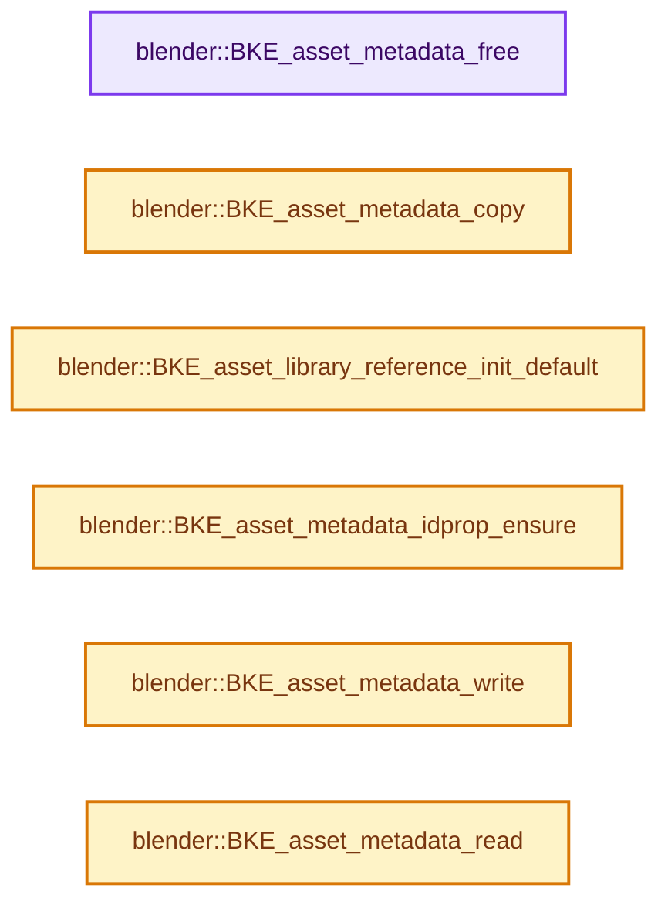
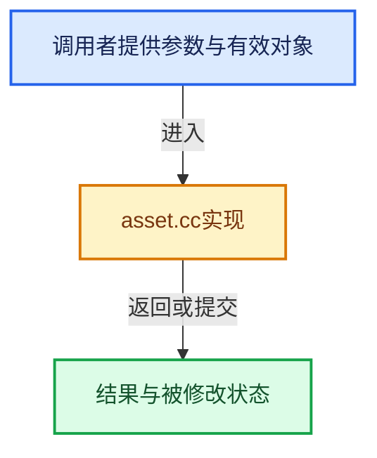

# 实现依赖专题：source/blender/blenkernel/intern/asset.cc

[方向导航](README.md) · [符号索引](../%E7%AC%A6%E5%8F%B7%E4%BE%9D%E8%B5%96%E4%B8%8E%E5%AE%9E%E7%8E%B0%E7%B4%A2%E5%BC%95.md)

本专题从正文实际调用进入，集中保存共享实现。函数有稳定锚点，可从调用处直接跳到对应完整函数；递归与互相调用通过回链组织。

## 本文件的实现关系






## 完整成员与函数实现

<a id="f-b0d251c4a1af437d"></a>

### `blender::BKE_asset_metadata_free`

实现位置：[source/blender/blenkernel/intern/asset.cc](../../../../../source/blender/blenkernel/intern/asset.cc) · L36—L40。

接口参数：

- `AssetMetaData **asset_data`

**教学注释版**

<!-- annotated:9aec23c977dc06 -->

```cpp
void BKE_asset_metadata_free(AssetMetaData **asset_data)
{
  MEM_delete(*asset_data);
  *asset_data = nullptr;
}
```

<details>
<summary>核对原始源码：source/blender/blenkernel/intern/asset.cc · L36—L40</summary>

<!-- original:9aec23c977dc06:source/blender/blenkernel/intern/asset.cc:36:40 -->

```cpp
void BKE_asset_metadata_free(AssetMetaData **asset_data)
{
  MEM_delete(*asset_data);
  *asset_data = nullptr;
}
```

</details>

**继续追踪实现**

- `MEM_delete` → [MEM_delete · L400](../03-%E5%86%85%E5%AD%98%E5%88%86%E9%85%8D%E4%B8%8E%E8%BF%90%E8%A1%8C%E6%97%B6%E7%B1%BB%E5%9E%8B/%E4%BE%9D%E8%B5%96-MEM_guardedalloc-b54eca.md#f-9049ffdd1682887c)。

<a id="f-cd15b4fc549aa6ab"></a>

### `blender::BKE_asset_metadata_copy`

实现位置：[source/blender/blenkernel/intern/asset.cc](../../../../../source/blender/blenkernel/intern/asset.cc) · L42—L45。

接口参数：

- `const AssetMetaData *source`

**教学注释版**

<!-- annotated:9f5984a1846b11 -->

```cpp
AssetMetaData *BKE_asset_metadata_copy(const AssetMetaData *source)
{
  return MEM_new<AssetMetaData>(__func__, *source);
}
```

<details>
<summary>核对原始源码：source/blender/blenkernel/intern/asset.cc · L42—L45</summary>

<!-- original:9f5984a1846b11:source/blender/blenkernel/intern/asset.cc:42:45 -->

```cpp
AssetMetaData *BKE_asset_metadata_copy(const AssetMetaData *source)
{
  return MEM_new<AssetMetaData>(__func__, *source);
}
```

</details>

**结果出口**

- `return MEM_new<AssetMetaData>(__func__, *source);`

**继续追踪实现**

- `MEM_new<AssetMetaData>` → [MEM_new · L351](../03-%E5%86%85%E5%AD%98%E5%88%86%E9%85%8D%E4%B8%8E%E8%BF%90%E8%A1%8C%E6%97%B6%E7%B1%BB%E5%9E%8B/%E4%BE%9D%E8%B5%96-MEM_guardedalloc-b54eca.md#f-115f9b6784f89912)。

<a id="f-84006e69bba75007"></a>

### `blender::BKE_asset_library_reference_init_default`

实现位置：[source/blender/blenkernel/intern/asset.cc](../../../../../source/blender/blenkernel/intern/asset.cc) · L153—L156。

接口参数：

- `AssetLibraryReference *library_ref`

**教学注释版**

<!-- annotated:5f2fccea06fec9 -->

```cpp
void BKE_asset_library_reference_init_default(AssetLibraryReference *library_ref)
{
  *library_ref = AssetLibraryReference();
}
```

<details>
<summary>核对原始源码：source/blender/blenkernel/intern/asset.cc · L153—L156</summary>

<!-- original:5f2fccea06fec9:source/blender/blenkernel/intern/asset.cc:153:156 -->

```cpp
void BKE_asset_library_reference_init_default(AssetLibraryReference *library_ref)
{
  *library_ref = AssetLibraryReference();
}
```

</details>

**继续追踪实现**

- `AssetLibraryReference` → [blender::AssetLibraryReference](%E4%BE%9D%E8%B5%96-asset_library_service-d7b8df.md#t-201d2642f928)；[blender::AssetLibraryReference](%E4%BE%9D%E8%B5%96-asset_shelf-eea663.md#t-2872210f9423)；[blender::AssetLibraryReference](%E4%BE%9D%E8%B5%96-ED_asset_list-403447.md#t-f0b83b5a1058)；[blender::AssetLibraryReference](%E4%BE%9D%E8%B5%96-ED_asset_library-708c2f.md#t-d8ffccdad3ab)；[blender::AssetLibraryReference](%E4%BE%9D%E8%B5%96-ED_asset_filter-b027c1.md#t-b18e779cd722)；[blender::AssetLibraryReference](%E4%BE%9D%E8%B5%96-BKE_context-fe0648.md#t-a4300af79d7c)；[blender::AssetLibraryReference](%E4%BE%9D%E8%B5%96-BKE_asset-d39881.md#t-9be0464dc691)；[blender::AssetLibraryReference](%E4%BE%9D%E8%B5%96-filelist-d6fe6f.md#t-ff4f61024a48)；[blender::AssetLibraryReference](%E4%BE%9D%E8%B5%96-filelist_intern-ae60d6.md#t-598f8e52ad50)；[blender::AssetLibraryReference](%E4%BE%9D%E8%B5%96-DNA_asset_types-824017.md#t-fa9b43bee74d)。

<a id="f-c66be3245706717c"></a>

### `blender::BKE_asset_metadata_idprop_ensure`

实现位置：[source/blender/blenkernel/intern/asset.cc](../../../../../source/blender/blenkernel/intern/asset.cc) · L172—L181。

接口参数：

- `AssetMetaData *asset_data`
- `IDProperty *prop`

**教学注释版**

<!-- annotated:2ba679f83d696b -->

```cpp
void BKE_asset_metadata_idprop_ensure(AssetMetaData *asset_data, IDProperty *prop)
{
  using namespace blender::bke;
  if (!asset_data->properties) {
    asset_data->properties = idprop::create_group("AssetMetaData.properties").release();
  }
  /* Important: The property may already exist. For now just allow always allow a newly allocated
   * property, and replace the existing one as a way of updating. */
  IDP_ReplaceInGroup(asset_data->properties, prop);
}
```

<details>
<summary>核对原始源码：source/blender/blenkernel/intern/asset.cc · L172—L181</summary>

<!-- original:2ba679f83d696b:source/blender/blenkernel/intern/asset.cc:172:181 -->

```cpp
void BKE_asset_metadata_idprop_ensure(AssetMetaData *asset_data, IDProperty *prop)
{
  using namespace blender::bke;
  if (!asset_data->properties) {
    asset_data->properties = idprop::create_group("AssetMetaData.properties").release();
  }
  /* Important: The property may already exist. For now just allow always allow a newly allocated
   * property, and replace the existing one as a way of updating. */
  IDP_ReplaceInGroup(asset_data->properties, prop);
}
```

</details>

**沿实际写入检查状态**

- `asset_data->properties = idprop::create_group("AssetMetaData.properties").release();`

**继续追踪实现**

- `idprop::create_group("AssetMetaData.properties").release` → [调用协议](../%E6%A8%A1%E6%9D%BF%E5%AE%8F%E4%B8%8E%E5%8A%A8%E6%80%81%E5%88%86%E6%B4%BE%E5%8D%8F%E8%AE%AE.md)：接收对象类型依赖auto、返回值或模板实例；不按同名猜测目标。调用位置L176。
- `idprop::create_group` → [blender::bke::idprop::create_group · L155](%E4%BE%9D%E8%B5%96-idprop_create-f89f51.md#f-b1e2d8bfd5654bc2)。
- `IDP_ReplaceInGroup` → [blender::IDP_ReplaceInGroup · L737](%E4%BE%9D%E8%B5%96-idprop-006c65.md#f-0dc3c0fc939608e0)。

<a id="f-cbfdb11b5f3c0659"></a>

### `blender::BKE_asset_metadata_write`

实现位置：[source/blender/blenkernel/intern/asset.cc](../../../../../source/blender/blenkernel/intern/asset.cc) · L201—L217。

接口参数：

- `BlendWriter *writer`
- `AssetMetaData *asset_data`

**教学注释版**

<!-- annotated:36c4014db8de46 -->

```cpp
void BKE_asset_metadata_write(BlendWriter *writer, AssetMetaData *asset_data)
{
  writer->write_struct(asset_data);

  if (asset_data->properties) {
    IDP_BlendWrite(writer, asset_data->properties);
  }

  writer->write_string(asset_data->author);
  writer->write_string(asset_data->description);
  writer->write_string(asset_data->copyright);
  writer->write_string(asset_data->license);

  for (AssetTag &tag : asset_data->tags) {
    writer->write_struct(&tag);
  }
}
```

<details>
<summary>核对原始源码：source/blender/blenkernel/intern/asset.cc · L201—L217</summary>

<!-- original:36c4014db8de46:source/blender/blenkernel/intern/asset.cc:201:217 -->

```cpp
void BKE_asset_metadata_write(BlendWriter *writer, AssetMetaData *asset_data)
{
  writer->write_struct(asset_data);

  if (asset_data->properties) {
    IDP_BlendWrite(writer, asset_data->properties);
  }

  writer->write_string(asset_data->author);
  writer->write_string(asset_data->description);
  writer->write_string(asset_data->copyright);
  writer->write_string(asset_data->license);

  for (AssetTag &tag : asset_data->tags) {
    writer->write_struct(&tag);
  }
}
```

</details>

**继续追踪实现**

- `writer->write_struct` → [blender::BlendWriter::write_struct · L236](%E4%BE%9D%E8%B5%96-BLO_read_write-a54308.md#f-65ffd01269f4b779)。
- `IDP_BlendWrite` → [blender::IDP_BlendWrite · L1696](%E4%BE%9D%E8%B5%96-idprop-006c65.md#f-6fff3964b602094e)。
- `writer->write_string` → [blender::BlendWriter::write_string · L2357](%E4%BE%9D%E8%B5%96-writefile-3eb36f.md#f-3fd83db72afbdcbe)。

<a id="f-326b1169a2257789"></a>

### `blender::BKE_asset_metadata_read`

实现位置：[source/blender/blenkernel/intern/asset.cc](../../../../../source/blender/blenkernel/intern/asset.cc) · L219—L236。

接口参数：

- `BlendDataReader *reader`
- `AssetMetaData *asset_data`

**教学注释版**

<!-- annotated:89d8e8833a3ddd -->

```cpp
void BKE_asset_metadata_read(BlendDataReader *reader, AssetMetaData *asset_data)
{
  /* asset_data itself has been read already. */
  asset_data->local_type_info = nullptr;

  if (asset_data->properties) {
    BLO_read_struct(reader, IDProperty, &asset_data->properties);
    IDP_BlendDataRead(reader, &asset_data->properties);
  }

  BLO_read_string(reader, &asset_data->author);
  BLO_read_string(reader, &asset_data->description);
  BLO_read_string(reader, &asset_data->copyright);
  BLO_read_string(reader, &asset_data->license);

  BLO_read_struct_list(reader, AssetTag, &asset_data->tags);
  BLI_assert(asset_data->tags.count() == asset_data->tot_tags);
}
```

<details>
<summary>核对原始源码：source/blender/blenkernel/intern/asset.cc · L219—L236</summary>

<!-- original:89d8e8833a3ddd:source/blender/blenkernel/intern/asset.cc:219:236 -->

```cpp
void BKE_asset_metadata_read(BlendDataReader *reader, AssetMetaData *asset_data)
{
  /* asset_data itself has been read already. */
  asset_data->local_type_info = nullptr;

  if (asset_data->properties) {
    BLO_read_struct(reader, IDProperty, &asset_data->properties);
    IDP_BlendDataRead(reader, &asset_data->properties);
  }

  BLO_read_string(reader, &asset_data->author);
  BLO_read_string(reader, &asset_data->description);
  BLO_read_string(reader, &asset_data->copyright);
  BLO_read_string(reader, &asset_data->license);

  BLO_read_struct_list(reader, AssetTag, &asset_data->tags);
  BLI_assert(asset_data->tags.count() == asset_data->tot_tags);
}
```

</details>

**沿实际写入检查状态**

- `asset_data->local_type_info = nullptr;`

**继续追踪实现**

- `BLO_read_struct` → [BLO_read_struct · L477](%E4%BE%9D%E8%B5%96-BLO_read_write-a54308.md#m-d307fd6f7c0e)。宏定义由构建条件选择。
- `IDP_BlendDataRead` → [IDP_BlendDataRead · L430](%E4%BE%9D%E8%B5%96-BKE_idprop-fe422c.md#m-8b058cdaeb74)。宏定义由构建条件选择。
- `BLO_read_string` → [BLO_read_string · L6348](%E4%BE%9D%E8%B5%96-readfile-05cc37.md#f-b9cb42e390941235)；[BLO_read_string · L6370](%E4%BE%9D%E8%B5%96-readfile-05cc37.md#f-1bb75b8661d718d2)；[BLO_read_string · L6375](%E4%BE%9D%E8%B5%96-readfile-05cc37.md#f-5714da923b3ad83d)。同名重载需按实参类型选择。
- `BLO_read_struct_list` → [BLO_read_struct_list · L542](%E4%BE%9D%E8%B5%96-BLO_read_write-a54308.md#m-7f0b2171679f)。宏定义由构建条件选择。
- `BLI_assert` → [BLI_assert · L48](../01-%E5%9F%BA%E7%A1%80%E5%AE%B9%E5%99%A8%E4%B8%8E%E7%8E%B0%E4%BB%A3CPP/%E4%BE%9D%E8%B5%96-BLI_assert-cc98e8.md#m-57a88495704d)；[BLI_assert · L63](../01-%E5%9F%BA%E7%A1%80%E5%AE%B9%E5%99%A8%E4%B8%8E%E7%8E%B0%E4%BB%A3CPP/%E4%BE%9D%E8%B5%96-BLI_assert-cc98e8.md#m-d07050020cb5)。宏定义由构建条件选择。
- `asset_data->tags.count` → [调用协议](../%E6%A8%A1%E6%9D%BF%E5%AE%8F%E4%B8%8E%E5%8A%A8%E6%80%81%E5%88%86%E6%B4%BE%E5%8D%8F%E8%AE%AE.md)：接收对象类型依赖auto、返回值或模板实例；不按同名猜测目标。调用位置L235。
