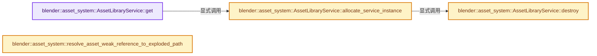
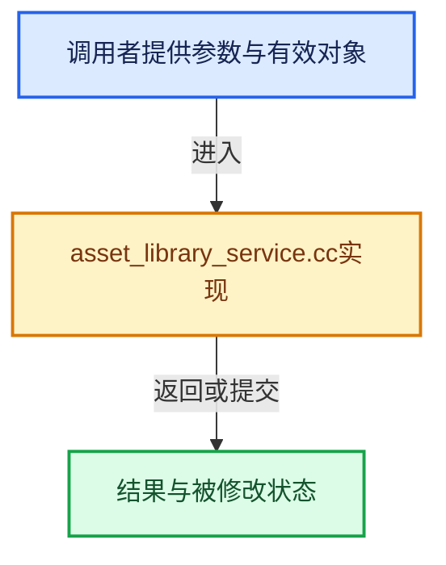

# 实现依赖专题：source/blender/asset_system/intern/asset_library_service.cc

[方向导航](README.md) · [符号索引](../%E7%AC%A6%E5%8F%B7%E4%BE%9D%E8%B5%96%E4%B8%8E%E5%AE%9E%E7%8E%B0%E7%B4%A2%E5%BC%95.md)

本专题从正文实际调用进入，集中保存共享实现。函数有稳定锚点，可从调用处直接跳到对应完整函数；递归与互相调用通过回链组织。

## 本文件的实现关系






## 完整成员与函数实现

<a id="f-9474b80fa7698d68"></a>

### `blender::asset_system::AssetLibraryService::get`

实现位置：[source/blender/asset_system/intern/asset_library_service.cc](../../../../../source/blender/asset_system/intern/asset_library_service.cc) · L57—L63。

**教学注释版**

<!-- annotated:158805053fcbfd -->

```cpp
AssetLibraryService *AssetLibraryService::get()
{
  if (!instance_) {
    allocate_service_instance();
  }
  return instance_.get();
}
```

<details>
<summary>核对原始源码：source/blender/asset_system/intern/asset_library_service.cc · L57—L63</summary>

<!-- original:158805053fcbfd:source/blender/asset_system/intern/asset_library_service.cc:57:63 -->

```cpp
AssetLibraryService *AssetLibraryService::get()
{
  if (!instance_) {
    allocate_service_instance();
  }
  return instance_.get();
}
```

</details>

**结果出口**

- `return instance_.get();`

**继续追踪实现**

- `allocate_service_instance` → [blender::asset_system::AssetLibraryService::allocate_service_instance · L635](%E4%BE%9D%E8%B5%96-asset_library_service-73631e.md#f-5d63587aeb8d4fd5)。
- `instance_.get` → [调用协议](../%E6%A8%A1%E6%9D%BF%E5%AE%8F%E4%B8%8E%E5%8A%A8%E6%80%81%E5%88%86%E6%B4%BE%E5%8D%8F%E8%AE%AE.md)：接收对象类型依赖auto、返回值或模板实例；不按同名猜测目标。调用位置L62。

<a id="f-c3ea4a880314fa08"></a>

### `blender::asset_system::AssetLibraryService::destroy`

实现位置：[source/blender/asset_system/intern/asset_library_service.cc](../../../../../source/blender/asset_system/intern/asset_library_service.cc) · L65—L72。

**教学注释版**

<!-- annotated:49a648e20e697b -->

```cpp
void AssetLibraryService::destroy()
{
  if (!instance_) {
    return;
  }
  instance_->app_handler_unregister();
  instance_.reset();
}
```

<details>
<summary>核对原始源码：source/blender/asset_system/intern/asset_library_service.cc · L65—L72</summary>

<!-- original:49a648e20e697b:source/blender/asset_system/intern/asset_library_service.cc:65:72 -->

```cpp
void AssetLibraryService::destroy()
{
  if (!instance_) {
    return;
  }
  instance_->app_handler_unregister();
  instance_.reset();
}
```

</details>

**继续追踪实现**

- `instance_->app_handler_unregister` → [调用协议](../%E6%A8%A1%E6%9D%BF%E5%AE%8F%E4%B8%8E%E5%8A%A8%E6%80%81%E5%88%86%E6%B4%BE%E5%8D%8F%E8%AE%AE.md)：接收对象类型依赖auto、返回值或模板实例；不按同名猜测目标。调用位置L70。
- `instance_.reset` → [调用协议](../%E6%A8%A1%E6%9D%BF%E5%AE%8F%E4%B8%8E%E5%8A%A8%E6%80%81%E5%88%86%E6%B4%BE%E5%8D%8F%E8%AE%AE.md)：接收对象类型依赖auto、返回值或模板实例；不按同名猜测目标。调用位置L71。

<a id="f-614d4548bbf3e211"></a>

### `blender::asset_system::resolve_asset_weak_reference_to_exploded_path`

实现位置：[source/blender/asset_system/intern/asset_library_service.cc](../../../../../source/blender/asset_system/intern/asset_library_service.cc) · L546—L602。

接口参数：

- `const AssetWeakReference &asset_reference`

**教学注释版**

<!-- annotated:06e51e5bee1d53 -->

```cpp
std::optional<AssetLibraryService::ExplodedPath> AssetLibraryService::
    resolve_asset_weak_reference_to_exploded_path(const AssetWeakReference &asset_reference)
{
  if (asset_reference.relative_asset_identifier[0] == '\0') {
    return std::nullopt;
  }

  switch (eAssetLibraryType(asset_reference.asset_library_type)) {
    case ASSET_LIBRARY_LOCAL: {
      std::string path_in_file = this->normalize_asset_weak_reference_relative_asset_identifier(
          asset_reference);
      const int64_t group_len = int64_t(path_in_file.find(SEP));

      ExplodedPath exploded;
      // [讲解] std::make_unique<std::string>：创建独占拥有的对象，拥有关系可移动，get返回的借用指针不自动延长寿命。
      exploded.full_path = std::make_unique<std::string>(path_in_file);
      exploded.group_component = StringRef(*exploded.full_path).substr(0, group_len);
      exploded.name_component = StringRef(*exploded.full_path).substr(group_len + 1);

      return exploded;
    }
    case ASSET_LIBRARY_CUSTOM:
    case ASSET_LIBRARY_ESSENTIALS:
    case ASSET_LIBRARY_ONLINE_ESSENTIALS: {
      std::string full_path = this->resolve_asset_weak_reference_to_full_path(asset_reference);
      /* #full_path uses native slashes, so others don't need to be considered in the following. */

      if (full_path.empty()) {
        return std::nullopt;
      }

      int64_t blendfile_extension_pos = this->rfind_blendfile_extension(full_path);
      BLI_assert(blendfile_extension_pos != StringRef::not_found);

      size_t group_pos = full_path.find(SEP, blendfile_extension_pos);
      BLI_assert(group_pos != std::string::npos);

      size_t name_pos = full_path.find(SEP, group_pos + 1);
      BLI_assert(group_pos != std::string::npos);

      const int64_t dir_len = int64_t(group_pos);
      const int64_t group_len = int64_t(name_pos - group_pos - 1);

      ExplodedPath exploded;
      exploded.full_path = std::make_unique<std::string>(full_path);
      StringRef full_path_ref = *exploded.full_path;
      exploded.dir_component = full_path_ref.substr(0, dir_len);
      exploded.group_component = full_path_ref.substr(dir_len + 1, group_len);
      exploded.name_component = full_path_ref.substr(dir_len + 1 + group_len + 1);

      return exploded;
    }
    case ASSET_LIBRARY_ALL:
      return std::nullopt;
  }

  return std::nullopt;
}
```

<details>
<summary>核对原始源码：source/blender/asset_system/intern/asset_library_service.cc · L546—L602</summary>

<!-- original:06e51e5bee1d53:source/blender/asset_system/intern/asset_library_service.cc:546:602 -->

```cpp
std::optional<AssetLibraryService::ExplodedPath> AssetLibraryService::
    resolve_asset_weak_reference_to_exploded_path(const AssetWeakReference &asset_reference)
{
  if (asset_reference.relative_asset_identifier[0] == '\0') {
    return std::nullopt;
  }

  switch (eAssetLibraryType(asset_reference.asset_library_type)) {
    case ASSET_LIBRARY_LOCAL: {
      std::string path_in_file = this->normalize_asset_weak_reference_relative_asset_identifier(
          asset_reference);
      const int64_t group_len = int64_t(path_in_file.find(SEP));

      ExplodedPath exploded;
      exploded.full_path = std::make_unique<std::string>(path_in_file);
      exploded.group_component = StringRef(*exploded.full_path).substr(0, group_len);
      exploded.name_component = StringRef(*exploded.full_path).substr(group_len + 1);

      return exploded;
    }
    case ASSET_LIBRARY_CUSTOM:
    case ASSET_LIBRARY_ESSENTIALS:
    case ASSET_LIBRARY_ONLINE_ESSENTIALS: {
      std::string full_path = this->resolve_asset_weak_reference_to_full_path(asset_reference);
      /* #full_path uses native slashes, so others don't need to be considered in the following. */

      if (full_path.empty()) {
        return std::nullopt;
      }

      int64_t blendfile_extension_pos = this->rfind_blendfile_extension(full_path);
      BLI_assert(blendfile_extension_pos != StringRef::not_found);

      size_t group_pos = full_path.find(SEP, blendfile_extension_pos);
      BLI_assert(group_pos != std::string::npos);

      size_t name_pos = full_path.find(SEP, group_pos + 1);
      BLI_assert(group_pos != std::string::npos);

      const int64_t dir_len = int64_t(group_pos);
      const int64_t group_len = int64_t(name_pos - group_pos - 1);

      ExplodedPath exploded;
      exploded.full_path = std::make_unique<std::string>(full_path);
      StringRef full_path_ref = *exploded.full_path;
      exploded.dir_component = full_path_ref.substr(0, dir_len);
      exploded.group_component = full_path_ref.substr(dir_len + 1, group_len);
      exploded.name_component = full_path_ref.substr(dir_len + 1 + group_len + 1);

      return exploded;
    }
    case ASSET_LIBRARY_ALL:
      return std::nullopt;
  }

  return std::nullopt;
}
```

</details>

**沿实际写入检查状态**

- `exploded.full_path = std::make_unique<std::string>(path_in_file);`
- `exploded.group_component = StringRef(*exploded.full_path).substr(0, group_len);`
- `exploded.name_component = StringRef(*exploded.full_path).substr(group_len + 1);`
- `exploded.full_path = std::make_unique<std::string>(full_path);`
- `exploded.dir_component = full_path_ref.substr(0, dir_len);`
- `exploded.group_component = full_path_ref.substr(dir_len + 1, group_len);`
- `exploded.name_component = full_path_ref.substr(dir_len + 1 + group_len + 1);`

**结果出口**

- `return std::nullopt;`
- `return exploded;`

**继续追踪实现**

- `eAssetLibraryType` → [blender::eAssetLibraryType](%E4%BE%9D%E8%B5%96-DNA_asset_types-824017.md#t-7571bb5757c1)。
- `this->normalize_asset_weak_reference_relative_asset_identifier` → [调用协议](../%E6%A8%A1%E6%9D%BF%E5%AE%8F%E4%B8%8E%E5%8A%A8%E6%80%81%E5%88%86%E6%B4%BE%E5%8D%8F%E8%AE%AE.md)：接收对象类型依赖auto、返回值或模板实例；不按同名猜测目标。调用位置L555。
- `path_in_file.find` → [外部契约](https://eel.is/c++draft/)：这个边界按实际表达式及所属类型核对参数、返回值、寿命与失败行为。这里提供接口入口，不声称已解释该第三方版本的内部实现。
- `std::make_unique<std::string>` → [外部契约](https://eel.is/c++draft/unique.ptr.create)：创建独占拥有的对象，拥有关系可移动，get返回的借用指针不自动延长寿命。
- `StringRef(*exploded.full_path).substr` → [调用协议](../%E6%A8%A1%E6%9D%BF%E5%AE%8F%E4%B8%8E%E5%8A%A8%E6%80%81%E5%88%86%E6%B4%BE%E5%8D%8F%E8%AE%AE.md)：接收对象类型依赖auto、返回值或模板实例；不按同名猜测目标。调用位置L561。
- `StringRef` → [blender::StringRef::StringRef · L555](../01-%E5%9F%BA%E7%A1%80%E5%AE%B9%E5%99%A8%E4%B8%8E%E7%8E%B0%E4%BB%A3CPP/15-StringRef%E5%AD%97%E7%AC%A6%E4%B8%B2%E8%A7%86%E5%9B%BE.md#f-f6aca324a36faa7e)；[blender::StringRef::StringRef · L560](../01-%E5%9F%BA%E7%A1%80%E5%AE%B9%E5%99%A8%E4%B8%8E%E7%8E%B0%E4%BB%A3CPP/15-StringRef%E5%AD%97%E7%AC%A6%E4%B8%B2%E8%A7%86%E5%9B%BE.md#f-ab9714781ca51bac)；[blender::StringRef::StringRef · L565](../01-%E5%9F%BA%E7%A1%80%E5%AE%B9%E5%99%A8%E4%B8%8E%E7%8E%B0%E4%BB%A3CPP/15-StringRef%E5%AD%97%E7%AC%A6%E4%B8%B2%E8%A7%86%E5%9B%BE.md#f-95f0b483bbdd7739)；[blender::StringRef::StringRef · L570](../01-%E5%9F%BA%E7%A1%80%E5%AE%B9%E5%99%A8%E4%B8%8E%E7%8E%B0%E4%BB%A3CPP/15-StringRef%E5%AD%97%E7%AC%A6%E4%B8%B2%E8%A7%86%E5%9B%BE.md#f-808d05699cb33334)；[blender::StringRef::StringRef · L631](../01-%E5%9F%BA%E7%A1%80%E5%AE%B9%E5%99%A8%E4%B8%8E%E7%8E%B0%E4%BB%A3CPP/15-StringRef%E5%AD%97%E7%AC%A6%E4%B8%B2%E8%A7%86%E5%9B%BE.md#f-37788e5f3fa3b736)；[blender::StringRef::StringRef · L641](../01-%E5%9F%BA%E7%A1%80%E5%AE%B9%E5%99%A8%E4%B8%8E%E7%8E%B0%E4%BB%A3CPP/15-StringRef%E5%AD%97%E7%AC%A6%E4%B8%B2%E8%A7%86%E5%9B%BE.md#f-11abd0510fb6b926)；[blender::StringRef::StringRef · L646](../01-%E5%9F%BA%E7%A1%80%E5%AE%B9%E5%99%A8%E4%B8%8E%E7%8E%B0%E4%BB%A3CPP/15-StringRef%E5%AD%97%E7%AC%A6%E4%B8%B2%E8%A7%86%E5%9B%BE.md#f-8437dbd8a582eefd)；[blender::StringRef::StringRef · L651](../01-%E5%9F%BA%E7%A1%80%E5%AE%B9%E5%99%A8%E4%B8%8E%E7%8E%B0%E4%BB%A3CPP/15-StringRef%E5%AD%97%E7%AC%A6%E4%B8%B2%E8%A7%86%E5%9B%BE.md#f-70bcb338de0db978)。同名重载需按实参类型选择。
- `this->resolve_asset_weak_reference_to_full_path` → [调用协议](../%E6%A8%A1%E6%9D%BF%E5%AE%8F%E4%B8%8E%E5%8A%A8%E6%80%81%E5%88%86%E6%B4%BE%E5%8D%8F%E8%AE%AE.md)：接收对象类型依赖auto、返回值或模板实例；不按同名猜测目标。调用位置L569。
- `full_path.empty` → [外部契约](https://eel.is/c++draft/)：这个边界按实际表达式及所属类型核对参数、返回值、寿命与失败行为。这里提供接口入口，不声称已解释该第三方版本的内部实现。
- `this->rfind_blendfile_extension` → [调用协议](../%E6%A8%A1%E6%9D%BF%E5%AE%8F%E4%B8%8E%E5%8A%A8%E6%80%81%E5%88%86%E6%B4%BE%E5%8D%8F%E8%AE%AE.md)：接收对象类型依赖auto、返回值或模板实例；不按同名猜测目标。调用位置L576。
- `BLI_assert` → [BLI_assert · L48](../01-%E5%9F%BA%E7%A1%80%E5%AE%B9%E5%99%A8%E4%B8%8E%E7%8E%B0%E4%BB%A3CPP/%E4%BE%9D%E8%B5%96-BLI_assert-cc98e8.md#m-57a88495704d)；[BLI_assert · L63](../01-%E5%9F%BA%E7%A1%80%E5%AE%B9%E5%99%A8%E4%B8%8E%E7%8E%B0%E4%BB%A3CPP/%E4%BE%9D%E8%B5%96-BLI_assert-cc98e8.md#m-d07050020cb5)。宏定义由构建条件选择。
- `full_path.find` → [外部契约](https://eel.is/c++draft/)：这个边界按实际表达式及所属类型核对参数、返回值、寿命与失败行为。这里提供接口入口，不声称已解释该第三方版本的内部实现。
- `full_path_ref.substr` → [调用协议](../%E6%A8%A1%E6%9D%BF%E5%AE%8F%E4%B8%8E%E5%8A%A8%E6%80%81%E5%88%86%E6%B4%BE%E5%8D%8F%E8%AE%AE.md)：由接收对象具体类型或运行时策略提供实现。调用位置L591。

<a id="f-5d63587aeb8d4fd5"></a>

### `blender::asset_system::AssetLibraryService::allocate_service_instance`

实现位置：[source/blender/asset_system/intern/asset_library_service.cc](../../../../../source/blender/asset_system/intern/asset_library_service.cc) · L635—L646。

**教学注释版**

<!-- annotated:6fe8a1155d2ee1 -->

```cpp
void AssetLibraryService::allocate_service_instance()
{
  // [讲解] std::make_unique<AssetLibraryService>：创建独占拥有的对象，拥有关系可移动，get返回的借用指针不自动延长寿命。
  instance_ = std::make_unique<AssetLibraryService>();
  instance_->app_handler_register();

  if (!atexit_handler_registered_) {
    /* Ensure the instance gets freed before Blender's memory leak detector runs. */
    BKE_blender_atexit_register([](void * /*user_data*/) { AssetLibraryService::destroy(); },
                                nullptr);
    atexit_handler_registered_ = true;
  }
}
```

<details>
<summary>核对原始源码：source/blender/asset_system/intern/asset_library_service.cc · L635—L646</summary>

<!-- original:6fe8a1155d2ee1:source/blender/asset_system/intern/asset_library_service.cc:635:646 -->

```cpp
void AssetLibraryService::allocate_service_instance()
{
  instance_ = std::make_unique<AssetLibraryService>();
  instance_->app_handler_register();

  if (!atexit_handler_registered_) {
    /* Ensure the instance gets freed before Blender's memory leak detector runs. */
    BKE_blender_atexit_register([](void * /*user_data*/) { AssetLibraryService::destroy(); },
                                nullptr);
    atexit_handler_registered_ = true;
  }
}
```

</details>

**沿实际写入检查状态**

- `instance_ = std::make_unique<AssetLibraryService>();`
- `atexit_handler_registered_ = true;`

**继续追踪实现**

- `std::make_unique<AssetLibraryService>` → [外部契约](https://eel.is/c++draft/unique.ptr.create)：创建独占拥有的对象，拥有关系可移动，get返回的借用指针不自动延长寿命。
- `instance_->app_handler_register` → [调用协议](../%E6%A8%A1%E6%9D%BF%E5%AE%8F%E4%B8%8E%E5%8A%A8%E6%80%81%E5%88%86%E6%B4%BE%E5%8D%8F%E8%AE%AE.md)：接收对象类型依赖auto、返回值或模板实例；不按同名猜测目标。调用位置L638。
- `BKE_blender_atexit_register` → [blender::BKE_blender_atexit_register · L484](%E4%BE%9D%E8%B5%96-blender-0166ac.md#f-1ba3799872943434)。
- `AssetLibraryService::destroy` → [blender::asset_system::AssetLibraryService::destroy · L65](%E4%BE%9D%E8%B5%96-asset_library_service-73631e.md#f-c3ea4a880314fa08)。
