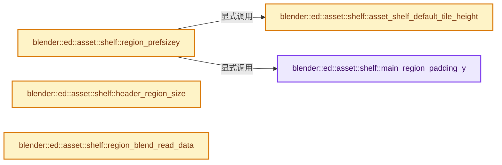
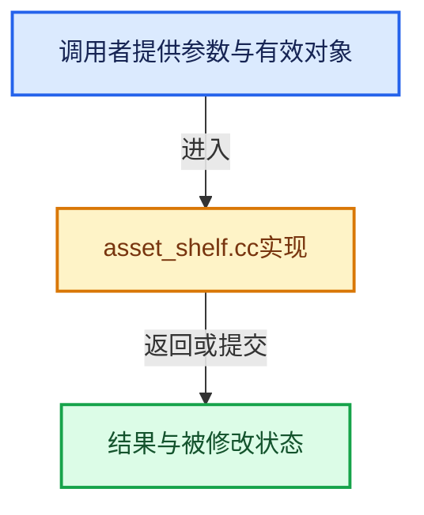

# 实现依赖专题：source/blender/editors/asset/intern/asset_shelf.cc

[方向导航](README.md) · [符号索引](../%E7%AC%A6%E5%8F%B7%E4%BE%9D%E8%B5%96%E4%B8%8E%E5%AE%9E%E7%8E%B0%E7%B4%A2%E5%BC%95.md)

本专题从正文实际调用进入，集中保存共享实现。函数有稳定锚点，可从调用处直接跳到对应完整函数；递归与互相调用通过回链组织。

## 本文件的实现关系






## 完整成员与函数实现

<a id="f-8d8c9814031223a1"></a>

### `blender::ed::asset::shelf::main_region_padding_y`

实现位置：[source/blender/editors/asset/intern/asset_shelf.cc](../../../../../source/blender/editors/asset/intern/asset_shelf.cc) · L434—L438。

**教学注释版**

<!-- annotated:636ef3c045cff7 -->

```cpp
static int main_region_padding_y()
{
  const uiStyle *style = ui::style_get_dpi();
  return style->buttonspacey / 2;
}
```

<details>
<summary>核对原始源码：source/blender/editors/asset/intern/asset_shelf.cc · L434—L438</summary>

<!-- original:636ef3c045cff7:source/blender/editors/asset/intern/asset_shelf.cc:434:438 -->

```cpp
static int main_region_padding_y()
{
  const uiStyle *style = ui::style_get_dpi();
  return style->buttonspacey / 2;
}
```

</details>

**结果出口**

- `return style->buttonspacey / 2;`

**继续追踪实现**

- `ui::style_get_dpi` → [blender::ui::style_get_dpi · L424](%E4%BE%9D%E8%B5%96-interface_style-ef9218.md#f-37e0cedd2705020a)。

<a id="f-8d50662184ece905"></a>

### `blender::ed::asset::shelf::asset_shelf_default_tile_height`

实现位置：[source/blender/editors/asset/intern/asset_shelf.cc](../../../../../source/blender/editors/asset/intern/asset_shelf.cc) · L551—L554。

**教学注释版**

<!-- annotated:394cd7eacf2248 -->

```cpp
static int asset_shelf_default_tile_height()
{
  return ui::preview_tile_size_x(ASSET_SHELF_PREVIEW_SIZE_DEFAULT);
}
```

<details>
<summary>核对原始源码：source/blender/editors/asset/intern/asset_shelf.cc · L551—L554</summary>

<!-- original:394cd7eacf2248:source/blender/editors/asset/intern/asset_shelf.cc:551:554 -->

```cpp
static int asset_shelf_default_tile_height()
{
  return ui::preview_tile_size_x(ASSET_SHELF_PREVIEW_SIZE_DEFAULT);
}
```

</details>

**结果出口**

- `return ui::preview_tile_size_x(ASSET_SHELF_PREVIEW_SIZE_DEFAULT);`

**继续追踪实现**

- `ui::preview_tile_size_x` → [blender::ui::preview_tile_size_x · L5435](%E4%BE%9D%E8%B5%96-interface-11578b.md#f-34cc9bd42e53f7b3)。

<a id="f-bff020309ea7775e"></a>

### `blender::ed::asset::shelf::region_prefsizey`

实现位置：[source/blender/editors/asset/intern/asset_shelf.cc](../../../../../source/blender/editors/asset/intern/asset_shelf.cc) · L556—L560。

**教学注释版**

<!-- annotated:f0160994549f49 -->

```cpp
int region_prefsizey()
{
  /* One row by default (plus padding). */
  return asset_shelf_default_tile_height() + 2 * main_region_padding_y();
}
```

<details>
<summary>核对原始源码：source/blender/editors/asset/intern/asset_shelf.cc · L556—L560</summary>

<!-- original:f0160994549f49:source/blender/editors/asset/intern/asset_shelf.cc:556:560 -->

```cpp
int region_prefsizey()
{
  /* One row by default (plus padding). */
  return asset_shelf_default_tile_height() + 2 * main_region_padding_y();
}
```

</details>

**结果出口**

- `return asset_shelf_default_tile_height() + 2 * main_region_padding_y();`

**继续追踪实现**

- `asset_shelf_default_tile_height` → [blender::ed::asset::shelf::asset_shelf_default_tile_height · L551](%E4%BE%9D%E8%B5%96-asset_shelf-fce9d5.md#f-8d50662184ece905)。
- `main_region_padding_y` → [blender::ed::asset::shelf::main_region_padding_y · L434](%E4%BE%9D%E8%B5%96-asset_shelf-fce9d5.md#f-8d8c9814031223a1)。

<a id="f-eb3f5c4d8b572a65"></a>

### `blender::ed::asset::shelf::header_region_size`

实现位置：[source/blender/editors/asset/intern/asset_shelf.cc](../../../../../source/blender/editors/asset/intern/asset_shelf.cc) · L688—L696。

**教学注释版**

<!-- annotated:751981325babca -->

```cpp
int header_region_size()
{
  /* Use a height that lets widgets sit just on top of the separator line drawn at the lower edge
   * of the region (widgets will be centered).
   *
   * Note that this is usually a bit less than the header size. The asset shelf tends to look like
   * a separate area, so making the shelf header smaller than a header helps. */
  return UI_UNIT_Y + (UI_BUTTON_SECTION_SEPERATOR_LINE_WITH * 2);
}
```

<details>
<summary>核对原始源码：source/blender/editors/asset/intern/asset_shelf.cc · L688—L696</summary>

<!-- original:751981325babca:source/blender/editors/asset/intern/asset_shelf.cc:688:696 -->

```cpp
int header_region_size()
{
  /* Use a height that lets widgets sit just on top of the separator line drawn at the lower edge
   * of the region (widgets will be centered).
   *
   * Note that this is usually a bit less than the header size. The asset shelf tends to look like
   * a separate area, so making the shelf header smaller than a header helps. */
  return UI_UNIT_Y + (UI_BUTTON_SECTION_SEPERATOR_LINE_WITH * 2);
}
```

</details>

**结果出口**

- `return UI_UNIT_Y + (UI_BUTTON_SECTION_SEPERATOR_LINE_WITH * 2);`

**继续追踪实现**

本实现没有需要继续展开的显式调用；检查返回表达式、对象转换和调用者前置条件。

<a id="f-080764f03dfb0338"></a>

### `blender::ed::asset::shelf::region_blend_read_data`

实现位置：[source/blender/editors/asset/intern/asset_shelf.cc](../../../../../source/blender/editors/asset/intern/asset_shelf.cc) · L698—L706。

接口参数：

- `BlendDataReader *reader`
- `ARegion *region`

**教学注释版**

<!-- annotated:713e085dedbb5a -->

```cpp
void region_blend_read_data(BlendDataReader *reader, ARegion *region)
{
  RegionAssetShelf *shelf_regiondata = RegionAssetShelf::get_from_asset_shelf_region(*region);
  if (!shelf_regiondata) {
    return;
  }
  regiondata_blend_read_data(reader, &shelf_regiondata);
  region->regiondata = shelf_regiondata;
}
```

<details>
<summary>核对原始源码：source/blender/editors/asset/intern/asset_shelf.cc · L698—L706</summary>

<!-- original:713e085dedbb5a:source/blender/editors/asset/intern/asset_shelf.cc:698:706 -->

```cpp
void region_blend_read_data(BlendDataReader *reader, ARegion *region)
{
  RegionAssetShelf *shelf_regiondata = RegionAssetShelf::get_from_asset_shelf_region(*region);
  if (!shelf_regiondata) {
    return;
  }
  regiondata_blend_read_data(reader, &shelf_regiondata);
  region->regiondata = shelf_regiondata;
}
```

</details>

**沿实际写入检查状态**

- `region->regiondata = shelf_regiondata;`

**继续追踪实现**

- `RegionAssetShelf::get_from_asset_shelf_region` → [blender::RegionAssetShelf::get_from_asset_shelf_region · L20](%E4%BE%9D%E8%B5%96-asset_shelf_regiondata-733996.md#f-5da569b85db6ebab)。
- `regiondata_blend_read_data` → [blender::ed::asset::shelf::regiondata_blend_read_data · L83](%E4%BE%9D%E8%B5%96-asset_shelf_regiondata-733996.md#f-928fe7944c25cfc1)。
