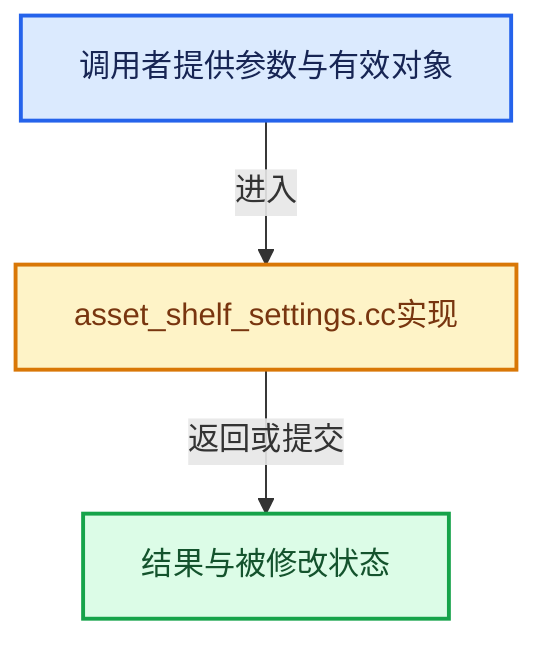

# 实现依赖专题：source/blender/editors/asset/intern/asset_shelf_settings.cc

[方向导航](README.md) · [符号索引](../%E7%AC%A6%E5%8F%B7%E4%BE%9D%E8%B5%96%E4%B8%8E%E5%AE%9E%E7%8E%B0%E7%B4%A2%E5%BC%95.md)

本专题从正文实际调用进入，集中保存共享实现。函数有稳定锚点，可从调用处直接跳到对应完整函数；递归与互相调用通过回链组织。

## 本文件的实现关系





## 完整成员与函数实现

<a id="f-f22c2600ee1dcc5d"></a>

### `blender::ed::asset::shelf::settings_blend_read_data`

实现位置：[source/blender/editors/asset/intern/asset_shelf_settings.cc](../../../../../source/blender/editors/asset/intern/asset_shelf_settings.cc) · L86—L90。

接口参数：

- `BlendDataReader *reader`
- `AssetShelfSettings &settings`

**教学注释版**

<!-- annotated:9157c8ca99db98 -->

```cpp
void settings_blend_read_data(BlendDataReader *reader, AssetShelfSettings &settings)
{
  BKE_asset_catalog_path_list_blend_read_data(reader, settings.enabled_catalog_paths);
  BLO_read_string(reader, &settings.active_catalog_path);
}
```

<details>
<summary>核对原始源码：source/blender/editors/asset/intern/asset_shelf_settings.cc · L86—L90</summary>

<!-- original:9157c8ca99db98:source/blender/editors/asset/intern/asset_shelf_settings.cc:86:90 -->

```cpp
void settings_blend_read_data(BlendDataReader *reader, AssetShelfSettings &settings)
{
  BKE_asset_catalog_path_list_blend_read_data(reader, settings.enabled_catalog_paths);
  BLO_read_string(reader, &settings.active_catalog_path);
}
```

</details>

**继续追踪实现**

- `BKE_asset_catalog_path_list_blend_read_data` → [blender::BKE_asset_catalog_path_list_blend_read_data · L177](../10-%E5%BC%95%E7%94%A8%E7%94%9F%E5%91%BD%E5%91%A8%E6%9C%9F%E4%B8%8EClosure/%E4%BE%9D%E8%B5%96-asset_weak_reference-948455.md#f-3065ac6524bd4461)。
- `BLO_read_string` → [BLO_read_string · L6348](%E4%BE%9D%E8%B5%96-readfile-05cc37.md#f-b9cb42e390941235)；[BLO_read_string · L6370](%E4%BE%9D%E8%B5%96-readfile-05cc37.md#f-1bb75b8661d718d2)；[BLO_read_string · L6375](%E4%BE%9D%E8%B5%96-readfile-05cc37.md#f-5714da923b3ad83d)。同名重载需按实参类型选择。
