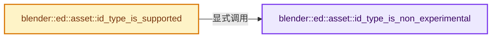
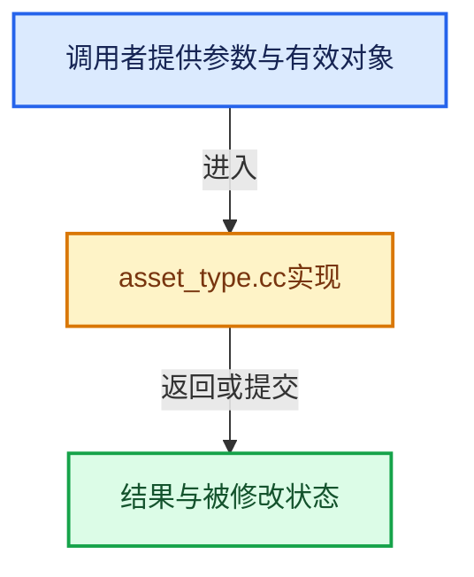

# 实现依赖专题：source/blender/editors/asset/intern/asset_type.cc

[方向导航](README.md) · [符号索引](../%E7%AC%A6%E5%8F%B7%E4%BE%9D%E8%B5%96%E4%B8%8E%E5%AE%9E%E7%8E%B0%E7%B4%A2%E5%BC%95.md)

本专题从正文实际调用进入，集中保存共享实现。函数有稳定锚点，可从调用处直接跳到对应完整函数；递归与互相调用通过回链组织。

## 本文件的实现关系






## 完整成员与函数实现

<a id="f-c33f0423bb7bcff1"></a>

### `blender::ed::asset::id_type_is_non_experimental`

实现位置：[source/blender/editors/asset/intern/asset_type.cc](../../../../../source/blender/editors/asset/intern/asset_type.cc) · L19—L24。

接口参数：

- `const ID *id`

**教学注释版**

<!-- annotated:de77fc5a96d814 -->

```cpp
bool id_type_is_non_experimental(const ID *id)
{
  /* Remember to update #ED_ASSET_TYPE_IDS_NON_EXPERIMENTAL_FLAGS() and the messages in
   * asset_operation_unsupported_type_msg with this! */
  return ELEM(GS(id->name), ID_BR, ID_MA, ID_GR, ID_OB, ID_AC, ID_WO, ID_NT, ID_SCE);
}
```

<details>
<summary>核对原始源码：source/blender/editors/asset/intern/asset_type.cc · L19—L24</summary>

<!-- original:de77fc5a96d814:source/blender/editors/asset/intern/asset_type.cc:19:24 -->

```cpp
bool id_type_is_non_experimental(const ID *id)
{
  /* Remember to update #ED_ASSET_TYPE_IDS_NON_EXPERIMENTAL_FLAGS() and the messages in
   * asset_operation_unsupported_type_msg with this! */
  return ELEM(GS(id->name), ID_BR, ID_MA, ID_GR, ID_OB, ID_AC, ID_WO, ID_NT, ID_SCE);
}
```

</details>

**结果出口**

- `return ELEM(GS(id->name), ID_BR, ID_MA, ID_GR, ID_OB, ID_AC, ID_WO, ID_NT, ID_SCE);`

**继续追踪实现**

- `ELEM` → [ELEM · L88](%E4%BE%9D%E8%B5%96-GHOST_utildefines-34b996.md#m-d28724a15928)；[ELEM · L135](../01-%E5%9F%BA%E7%A1%80%E5%AE%B9%E5%99%A8%E4%B8%8E%E7%8E%B0%E4%BB%A3CPP/%E4%BE%9D%E8%B5%96-BLI_utildefines-293a0a.md#m-d6572de7cae0)。宏定义由构建条件选择。
- `GS` → [blender::GS · L410](%E4%BE%9D%E8%B5%96-DNA_ID-3eb091.md#f-c3ff509f79f21b05)。

<a id="f-d0e3b4d35746f0be"></a>

### `blender::ed::asset::id_type_is_supported`

实现位置：[source/blender/editors/asset/intern/asset_type.cc](../../../../../source/blender/editors/asset/intern/asset_type.cc) · L26—L39。

接口参数：

- `const ID *id`

**教学注释版**

<!-- annotated:692c24fdd37188 -->

```cpp
bool id_type_is_supported(const ID *id)
{
  if (!BKE_id_can_be_asset(id)) {
    return false;
  }

  if (USER_EXPERIMENTAL_TEST(&U, use_extended_asset_browser)) {
    /* The "Extended Asset Browser" experimental feature flag enables all asset types that can
     * technically be assets. */
    return true;
  }

  return id_type_is_non_experimental(id);
}
```

<details>
<summary>核对原始源码：source/blender/editors/asset/intern/asset_type.cc · L26—L39</summary>

<!-- original:692c24fdd37188:source/blender/editors/asset/intern/asset_type.cc:26:39 -->

```cpp
bool id_type_is_supported(const ID *id)
{
  if (!BKE_id_can_be_asset(id)) {
    return false;
  }

  if (USER_EXPERIMENTAL_TEST(&U, use_extended_asset_browser)) {
    /* The "Extended Asset Browser" experimental feature flag enables all asset types that can
     * technically be assets. */
    return true;
  }

  return id_type_is_non_experimental(id);
}
```

</details>

**结果出口**

- `return false;`
- `return true;`
- `return id_type_is_non_experimental(id);`

**继续追踪实现**

- `BKE_id_can_be_asset` → [blender::BKE_id_can_be_asset · L2764](%E4%BE%9D%E8%B5%96-lib_id-d4e6bd.md#f-7e127299ae0040e7)。
- `USER_EXPERIMENTAL_TEST` → [USER_EXPERIMENTAL_TEST · L924](%E4%BE%9D%E8%B5%96-DNA_userdef_types-b9b528.md#m-ecbd9ffdd68a)。宏定义由构建条件选择。
- `id_type_is_non_experimental` → [blender::ed::asset::id_type_is_non_experimental · L19](%E4%BE%9D%E8%B5%96-asset_type-fdc986.md#f-c33f0423bb7bcff1)。
