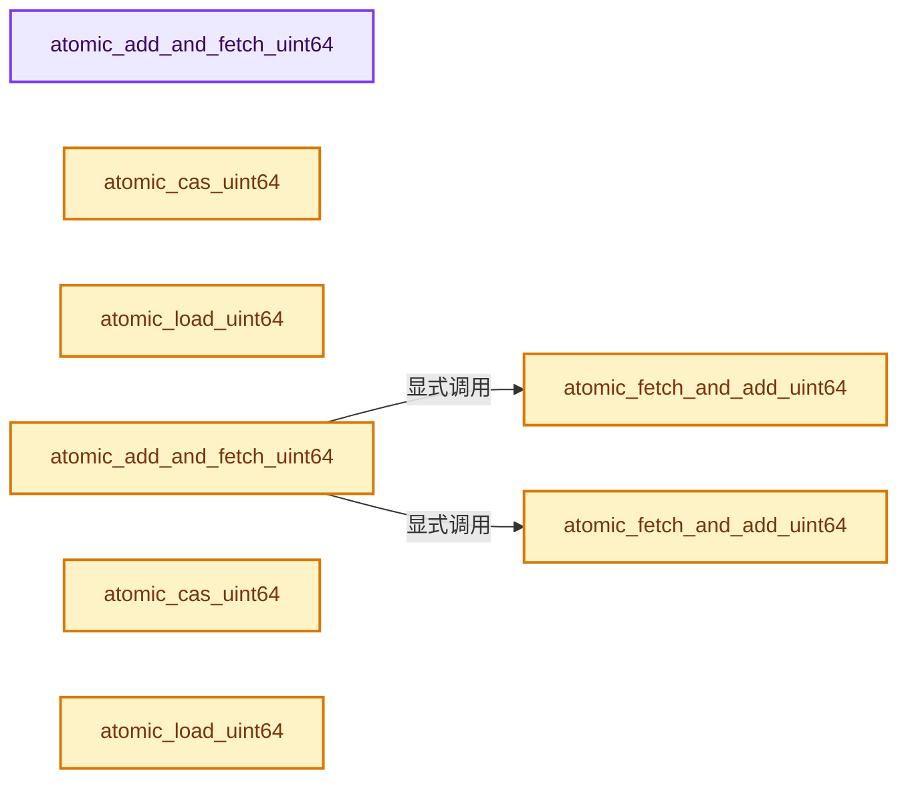

# 实现依赖专题：intern/atomic/intern/atomic_ops_unix.h

[方向导航](README.md) · [符号索引](../%E7%AC%A6%E5%8F%B7%E4%BE%9D%E8%B5%96%E4%B8%8E%E5%AE%9E%E7%8E%B0%E7%B4%A2%E5%BC%95.md)

本专题从正文实际调用进入，集中保存共享实现。函数有稳定锚点，可从调用处直接跳到对应完整函数；递归与互相调用通过回链组织。

## 本文件的实现关系




<a id="m-b2636bf855c3"></a>

## 宏 `__atomic_impl_load_generic`

<!-- annotated:776c476f9a7a33 -->

```cpp
#define __atomic_impl_load_generic(v) (__sync_synchronize(), *(v))
#define __atomic_impl_store_generic(p, v) \
```

<details>
<summary>核对原始源码：intern/atomic/intern/atomic_ops_unix.h · L106—L107</summary>

<!-- original:776c476f9a7a33:intern/atomic/intern/atomic_ops_unix.h:106:107 -->

```cpp
#define __atomic_impl_load_generic(v) (__sync_synchronize(), *(v))
#define __atomic_impl_store_generic(p, v) \
```

</details>

宏在预处理阶段展开，参数替换、重复求值和条件编译应直接从该定义检查。与普通函数不同，宏不会自动提供参数类型检查；构建配置选择哪个定义需结合外围条件。

## 完整成员与函数实现

<a id="f-0e7c802ba1d56748"></a>

### `atomic_add_and_fetch_uint64`

实现位置：[intern/atomic/intern/atomic_ops_unix.h](../../../../../intern/atomic/intern/atomic_ops_unix.h) · L201—L204。

接口参数：

- `uint64_t *p`
- `uint64_t x`

**教学注释版**

<!-- annotated:c52e3e55ae5844 -->

```cpp
ATOMIC_INLINE uint64_t atomic_add_and_fetch_uint64(uint64_t *p, uint64_t x)
{
  return __sync_add_and_fetch(p, x);
}
```

<details>
<summary>核对原始源码：intern/atomic/intern/atomic_ops_unix.h · L201—L204</summary>

<!-- original:c52e3e55ae5844:intern/atomic/intern/atomic_ops_unix.h:201:204 -->

```cpp
ATOMIC_INLINE uint64_t atomic_add_and_fetch_uint64(uint64_t *p, uint64_t x)
{
  return __sync_add_and_fetch(p, x);
}
```

</details>

**结果出口**

- `return __sync_add_and_fetch(p, x);`

**继续追踪实现**

- `__sync_add_and_fetch` → [调用协议](../%E6%A8%A1%E6%9D%BF%E5%AE%8F%E4%B8%8E%E5%8A%A8%E6%80%81%E5%88%86%E6%B4%BE%E5%8D%8F%E8%AE%AE.md)：函数指针、局部可调用对象或未展开的宏；必须结合调用者环境。调用位置L203。

<a id="f-16832c42d56d141c"></a>

### `atomic_fetch_and_add_uint64`

实现位置：[intern/atomic/intern/atomic_ops_unix.h](../../../../../intern/atomic/intern/atomic_ops_unix.h) · L211—L214。

接口参数：

- `uint64_t *p`
- `uint64_t x`

**教学注释版**

<!-- annotated:703731c6801a88 -->

```cpp
ATOMIC_INLINE uint64_t atomic_fetch_and_add_uint64(uint64_t *p, uint64_t x)
{
  return __sync_fetch_and_add(p, x);
}
```

<details>
<summary>核对原始源码：intern/atomic/intern/atomic_ops_unix.h · L211—L214</summary>

<!-- original:703731c6801a88:intern/atomic/intern/atomic_ops_unix.h:211:214 -->

```cpp
ATOMIC_INLINE uint64_t atomic_fetch_and_add_uint64(uint64_t *p, uint64_t x)
{
  return __sync_fetch_and_add(p, x);
}
```

</details>

**结果出口**

- `return __sync_fetch_and_add(p, x);`

**继续追踪实现**

- `__sync_fetch_and_add` → [调用协议](../%E6%A8%A1%E6%9D%BF%E5%AE%8F%E4%B8%8E%E5%8A%A8%E6%80%81%E5%88%86%E6%B4%BE%E5%8D%8F%E8%AE%AE.md)：函数指针、局部可调用对象或未展开的宏；必须结合调用者环境。调用位置L213。

<a id="f-5055945524b7f9e8"></a>

### `atomic_cas_uint64`

实现位置：[intern/atomic/intern/atomic_ops_unix.h](../../../../../intern/atomic/intern/atomic_ops_unix.h) · L221—L224。

接口参数：

- `uint64_t *v`
- `uint64_t old`
- `uint64_t _new`

**教学注释版**

<!-- annotated:b735ea34f134f8 -->

```cpp
ATOMIC_INLINE uint64_t atomic_cas_uint64(uint64_t *v, uint64_t old, uint64_t _new)
{
  return __sync_val_compare_and_swap(v, old, _new);
}
```

<details>
<summary>核对原始源码：intern/atomic/intern/atomic_ops_unix.h · L221—L224</summary>

<!-- original:b735ea34f134f8:intern/atomic/intern/atomic_ops_unix.h:221:224 -->

```cpp
ATOMIC_INLINE uint64_t atomic_cas_uint64(uint64_t *v, uint64_t old, uint64_t _new)
{
  return __sync_val_compare_and_swap(v, old, _new);
}
```

</details>

**结果出口**

- `return __sync_val_compare_and_swap(v, old, _new);`

**继续追踪实现**

- `__sync_val_compare_and_swap` → [调用协议](../%E6%A8%A1%E6%9D%BF%E5%AE%8F%E4%B8%8E%E5%8A%A8%E6%80%81%E5%88%86%E6%B4%BE%E5%8D%8F%E8%AE%AE.md)：函数指针、局部可调用对象或未展开的宏；必须结合调用者环境。调用位置L223。

<a id="f-818cc9a31a1d79dd"></a>

### `atomic_load_uint64`

实现位置：[intern/atomic/intern/atomic_ops_unix.h](../../../../../intern/atomic/intern/atomic_ops_unix.h) · L226—L229。

接口参数：

- `const uint64_t *v`

**教学注释版**

<!-- annotated:152acf0c2f1213 -->

```cpp
ATOMIC_INLINE uint64_t atomic_load_uint64(const uint64_t *v)
{
  return __atomic_load_n(v, __ATOMIC_SEQ_CST);
}
```

<details>
<summary>核对原始源码：intern/atomic/intern/atomic_ops_unix.h · L226—L229</summary>

<!-- original:152acf0c2f1213:intern/atomic/intern/atomic_ops_unix.h:226:229 -->

```cpp
ATOMIC_INLINE uint64_t atomic_load_uint64(const uint64_t *v)
{
  return __atomic_load_n(v, __ATOMIC_SEQ_CST);
}
```

</details>

**结果出口**

- `return __atomic_load_n(v, __ATOMIC_SEQ_CST);`

**继续追踪实现**

- `__atomic_load_n` → [调用协议](../%E6%A8%A1%E6%9D%BF%E5%AE%8F%E4%B8%8E%E5%8A%A8%E6%80%81%E5%88%86%E6%B4%BE%E5%8D%8F%E8%AE%AE.md)：函数指针、局部可调用对象或未展开的宏；必须结合调用者环境。调用位置L228。

<a id="f-fd4cb2ba2297a3de"></a>

### `atomic_fetch_and_add_uint64`

实现位置：[intern/atomic/intern/atomic_ops_unix.h](../../../../../intern/atomic/intern/atomic_ops_unix.h) · L274—L281。

接口参数：

- `uint64_t *p`
- `uint64_t x`

**教学注释版**

<!-- annotated:ae7b5e8ab7f35a -->

```cpp
ATOMIC_INLINE uint64_t atomic_fetch_and_add_uint64(uint64_t *p, uint64_t x)
{
  asm volatile("lock; xaddq %0, %1;"
               : "+r"(x), "=m"(*p) /* Outputs. */
               : "m"(*p)           /* Inputs. */
  );
  return x;
}
```

<details>
<summary>核对原始源码：intern/atomic/intern/atomic_ops_unix.h · L274—L281</summary>

<!-- original:ae7b5e8ab7f35a:intern/atomic/intern/atomic_ops_unix.h:274:281 -->

```cpp
ATOMIC_INLINE uint64_t atomic_fetch_and_add_uint64(uint64_t *p, uint64_t x)
{
  asm volatile("lock; xaddq %0, %1;"
               : "+r"(x), "=m"(*p) /* Outputs. */
               : "m"(*p)           /* Inputs. */
  );
  return x;
}
```

</details>

**结果出口**

- `return x;`

**继续追踪实现**

本实现没有需要继续展开的显式调用；检查返回表达式、对象转换和调用者前置条件。

<a id="f-0ebba2fb24e8e989"></a>

### `atomic_add_and_fetch_uint64`

实现位置：[intern/atomic/intern/atomic_ops_unix.h](../../../../../intern/atomic/intern/atomic_ops_unix.h) · L293—L296。

接口参数：

- `uint64_t *p`
- `uint64_t x`

**教学注释版**

<!-- annotated:c6f7abc21268d7 -->

```cpp
ATOMIC_INLINE uint64_t atomic_add_and_fetch_uint64(uint64_t *p, uint64_t x)
{
  return atomic_fetch_and_add_uint64(p, x) + x;
}
```

<details>
<summary>核对原始源码：intern/atomic/intern/atomic_ops_unix.h · L293—L296</summary>

<!-- original:c6f7abc21268d7:intern/atomic/intern/atomic_ops_unix.h:293:296 -->

```cpp
ATOMIC_INLINE uint64_t atomic_add_and_fetch_uint64(uint64_t *p, uint64_t x)
{
  return atomic_fetch_and_add_uint64(p, x) + x;
}
```

</details>

**结果出口**

- `return atomic_fetch_and_add_uint64(p, x) + x;`

**继续追踪实现**

- `atomic_fetch_and_add_uint64` → [atomic_fetch_and_add_uint64 · L211](%E4%BE%9D%E8%B5%96-atomic_ops_unix-6b7be2.md#f-16832c42d56d141c)；[atomic_fetch_and_add_uint64 · L274](%E4%BE%9D%E8%B5%96-atomic_ops_unix-6b7be2.md#f-fd4cb2ba2297a3de)。同名重载需按实参类型选择。

<a id="f-9e680e75b617d344"></a>

### `atomic_cas_uint64`

实现位置：[intern/atomic/intern/atomic_ops_unix.h](../../../../../intern/atomic/intern/atomic_ops_unix.h) · L303—L308。

接口参数：

- `uint64_t *v`
- `uint64_t old`
- `uint64_t _new`

**教学注释版**

<!-- annotated:a8a47ca11341b0 -->

```cpp
ATOMIC_INLINE uint64_t atomic_cas_uint64(uint64_t *v, uint64_t old, uint64_t _new)
{
  uint64_t ret;
  asm volatile("lock; cmpxchgq %2,%1" : "=a"(ret), "+m"(*v) : "r"(_new), "0"(old) : "memory");
  return ret;
}
```

<details>
<summary>核对原始源码：intern/atomic/intern/atomic_ops_unix.h · L303—L308</summary>

<!-- original:a8a47ca11341b0:intern/atomic/intern/atomic_ops_unix.h:303:308 -->

```cpp
ATOMIC_INLINE uint64_t atomic_cas_uint64(uint64_t *v, uint64_t old, uint64_t _new)
{
  uint64_t ret;
  asm volatile("lock; cmpxchgq %2,%1" : "=a"(ret), "+m"(*v) : "r"(_new), "0"(old) : "memory");
  return ret;
}
```

</details>

**结果出口**

- `return ret;`

**继续追踪实现**

本实现没有需要继续展开的显式调用；检查返回表达式、对象转换和调用者前置条件。

<a id="f-660b0179a93afb17"></a>

### `atomic_load_uint64`

实现位置：[intern/atomic/intern/atomic_ops_unix.h](../../../../../intern/atomic/intern/atomic_ops_unix.h) · L310—L313。

接口参数：

- `const uint64_t *v`

**教学注释版**

<!-- annotated:145edda4df5725 -->

```cpp
ATOMIC_INLINE uint64_t atomic_load_uint64(const uint64_t *v)
{
  return __atomic_impl_load_generic(v);
}
```

<details>
<summary>核对原始源码：intern/atomic/intern/atomic_ops_unix.h · L310—L313</summary>

<!-- original:145edda4df5725:intern/atomic/intern/atomic_ops_unix.h:310:313 -->

```cpp
ATOMIC_INLINE uint64_t atomic_load_uint64(const uint64_t *v)
{
  return __atomic_impl_load_generic(v);
}
```

</details>

**结果出口**

- `return __atomic_impl_load_generic(v);`

**继续追踪实现**

- `__atomic_impl_load_generic` → [__atomic_impl_load_generic · L106](%E4%BE%9D%E8%B5%96-atomic_ops_unix-6b7be2.md#m-b2636bf855c3)。宏定义由构建条件选择。

<a id="f-ccc6c873ba01b33f"></a>

### `atomic_add_and_fetch_uint32`

实现位置：[intern/atomic/intern/atomic_ops_unix.h](../../../../../intern/atomic/intern/atomic_ops_unix.h) · L405—L408。

接口参数：

- `uint32_t *p`
- `uint32_t x`

**教学注释版**

<!-- annotated:1ddaca055f188f -->

```cpp
ATOMIC_INLINE uint32_t atomic_add_and_fetch_uint32(uint32_t *p, uint32_t x)
{
  return __sync_add_and_fetch(p, x);
}
```

<details>
<summary>核对原始源码：intern/atomic/intern/atomic_ops_unix.h · L405—L408</summary>

<!-- original:1ddaca055f188f:intern/atomic/intern/atomic_ops_unix.h:405:408 -->

```cpp
ATOMIC_INLINE uint32_t atomic_add_and_fetch_uint32(uint32_t *p, uint32_t x)
{
  return __sync_add_and_fetch(p, x);
}
```

</details>

**结果出口**

- `return __sync_add_and_fetch(p, x);`

**继续追踪实现**

- `__sync_add_and_fetch` → [调用协议](../%E6%A8%A1%E6%9D%BF%E5%AE%8F%E4%B8%8E%E5%8A%A8%E6%80%81%E5%88%86%E6%B4%BE%E5%8D%8F%E8%AE%AE.md)：函数指针、局部可调用对象或未展开的宏；必须结合调用者环境。调用位置L407。

<a id="f-c400b1566e8f4953"></a>

### `atomic_sub_and_fetch_uint32`

实现位置：[intern/atomic/intern/atomic_ops_unix.h](../../../../../intern/atomic/intern/atomic_ops_unix.h) · L410—L413。

接口参数：

- `uint32_t *p`
- `uint32_t x`

**教学注释版**

<!-- annotated:5efbcecabe336c -->

```cpp
ATOMIC_INLINE uint32_t atomic_sub_and_fetch_uint32(uint32_t *p, uint32_t x)
{
  return __sync_sub_and_fetch(p, x);
}
```

<details>
<summary>核对原始源码：intern/atomic/intern/atomic_ops_unix.h · L410—L413</summary>

<!-- original:5efbcecabe336c:intern/atomic/intern/atomic_ops_unix.h:410:413 -->

```cpp
ATOMIC_INLINE uint32_t atomic_sub_and_fetch_uint32(uint32_t *p, uint32_t x)
{
  return __sync_sub_and_fetch(p, x);
}
```

</details>

**结果出口**

- `return __sync_sub_and_fetch(p, x);`

**继续追踪实现**

- `__sync_sub_and_fetch` → [调用协议](../%E6%A8%A1%E6%9D%BF%E5%AE%8F%E4%B8%8E%E5%8A%A8%E6%80%81%E5%88%86%E6%B4%BE%E5%8D%8F%E8%AE%AE.md)：函数指针、局部可调用对象或未展开的宏；必须结合调用者环境。调用位置L412。

<a id="f-2d4a8cf29e810e05"></a>

### `atomic_cas_uint32`

实现位置：[intern/atomic/intern/atomic_ops_unix.h](../../../../../intern/atomic/intern/atomic_ops_unix.h) · L415—L418。

接口参数：

- `uint32_t *v`
- `uint32_t old`
- `uint32_t _new`

**教学注释版**

<!-- annotated:6771b35fc820a2 -->

```cpp
ATOMIC_INLINE uint32_t atomic_cas_uint32(uint32_t *v, uint32_t old, uint32_t _new)
{
  return __sync_val_compare_and_swap(v, old, _new);
}
```

<details>
<summary>核对原始源码：intern/atomic/intern/atomic_ops_unix.h · L415—L418</summary>

<!-- original:6771b35fc820a2:intern/atomic/intern/atomic_ops_unix.h:415:418 -->

```cpp
ATOMIC_INLINE uint32_t atomic_cas_uint32(uint32_t *v, uint32_t old, uint32_t _new)
{
  return __sync_val_compare_and_swap(v, old, _new);
}
```

</details>

**结果出口**

- `return __sync_val_compare_and_swap(v, old, _new);`

**继续追踪实现**

- `__sync_val_compare_and_swap` → [调用协议](../%E6%A8%A1%E6%9D%BF%E5%AE%8F%E4%B8%8E%E5%8A%A8%E6%80%81%E5%88%86%E6%B4%BE%E5%8D%8F%E8%AE%AE.md)：函数指针、局部可调用对象或未展开的宏；必须结合调用者环境。调用位置L417。

<a id="f-98d5d8af368ec4f4"></a>

### `atomic_add_and_fetch_int32`

实现位置：[intern/atomic/intern/atomic_ops_unix.h](../../../../../intern/atomic/intern/atomic_ops_unix.h) · L431—L434。

接口参数：

- `int32_t *p`
- `int32_t x`

**教学注释版**

<!-- annotated:420961a338d69b -->

```cpp
ATOMIC_INLINE int32_t atomic_add_and_fetch_int32(int32_t *p, int32_t x)
{
  return __sync_add_and_fetch(p, x);
}
```

<details>
<summary>核对原始源码：intern/atomic/intern/atomic_ops_unix.h · L431—L434</summary>

<!-- original:420961a338d69b:intern/atomic/intern/atomic_ops_unix.h:431:434 -->

```cpp
ATOMIC_INLINE int32_t atomic_add_and_fetch_int32(int32_t *p, int32_t x)
{
  return __sync_add_and_fetch(p, x);
}
```

</details>

**结果出口**

- `return __sync_add_and_fetch(p, x);`

**继续追踪实现**

- `__sync_add_and_fetch` → [调用协议](../%E6%A8%A1%E6%9D%BF%E5%AE%8F%E4%B8%8E%E5%8A%A8%E6%80%81%E5%88%86%E6%B4%BE%E5%8D%8F%E8%AE%AE.md)：函数指针、局部可调用对象或未展开的宏；必须结合调用者环境。调用位置L433。

<a id="f-0f4c4e4af2053b54"></a>

### `atomic_sub_and_fetch_int32`

实现位置：[intern/atomic/intern/atomic_ops_unix.h](../../../../../intern/atomic/intern/atomic_ops_unix.h) · L436—L439。

接口参数：

- `int32_t *p`
- `int32_t x`

**教学注释版**

<!-- annotated:140f9d0a058eca -->

```cpp
ATOMIC_INLINE int32_t atomic_sub_and_fetch_int32(int32_t *p, int32_t x)
{
  return __sync_sub_and_fetch(p, x);
}
```

<details>
<summary>核对原始源码：intern/atomic/intern/atomic_ops_unix.h · L436—L439</summary>

<!-- original:140f9d0a058eca:intern/atomic/intern/atomic_ops_unix.h:436:439 -->

```cpp
ATOMIC_INLINE int32_t atomic_sub_and_fetch_int32(int32_t *p, int32_t x)
{
  return __sync_sub_and_fetch(p, x);
}
```

</details>

**结果出口**

- `return __sync_sub_and_fetch(p, x);`

**继续追踪实现**

- `__sync_sub_and_fetch` → [调用协议](../%E6%A8%A1%E6%9D%BF%E5%AE%8F%E4%B8%8E%E5%8A%A8%E6%80%81%E5%88%86%E6%B4%BE%E5%8D%8F%E8%AE%AE.md)：函数指针、局部可调用对象或未展开的宏；必须结合调用者环境。调用位置L438。

<a id="f-35b1665895926aad"></a>

### `atomic_load_int32`

实现位置：[intern/atomic/intern/atomic_ops_unix.h](../../../../../intern/atomic/intern/atomic_ops_unix.h) · L446—L449。

接口参数：

- `const int32_t *v`

**教学注释版**

<!-- annotated:3a837ff3a1b7c7 -->

```cpp
ATOMIC_INLINE int32_t atomic_load_int32(const int32_t *v)
{
  return __atomic_load_n(v, __ATOMIC_SEQ_CST);
}
```

<details>
<summary>核对原始源码：intern/atomic/intern/atomic_ops_unix.h · L446—L449</summary>

<!-- original:3a837ff3a1b7c7:intern/atomic/intern/atomic_ops_unix.h:446:449 -->

```cpp
ATOMIC_INLINE int32_t atomic_load_int32(const int32_t *v)
{
  return __atomic_load_n(v, __ATOMIC_SEQ_CST);
}
```

</details>

**结果出口**

- `return __atomic_load_n(v, __ATOMIC_SEQ_CST);`

**继续追踪实现**

- `__atomic_load_n` → [调用协议](../%E6%A8%A1%E6%9D%BF%E5%AE%8F%E4%B8%8E%E5%8A%A8%E6%80%81%E5%88%86%E6%B4%BE%E5%8D%8F%E8%AE%AE.md)：函数指针、局部可调用对象或未展开的宏；必须结合调用者环境。调用位置L448。

<a id="f-d0997e43fa9ccc74"></a>

### `atomic_add_and_fetch_uint32`

实现位置：[intern/atomic/intern/atomic_ops_unix.h](../../../../../intern/atomic/intern/atomic_ops_unix.h) · L459—L467。

接口参数：

- `uint32_t *p`
- `uint32_t x`

**教学注释版**

<!-- annotated:3042194e6790c6 -->

```cpp
ATOMIC_INLINE uint32_t atomic_add_and_fetch_uint32(uint32_t *p, uint32_t x)
{
  uint32_t ret = x;
  asm volatile("lock; xaddl %0, %1;"
               : "+r"(ret), "=m"(*p) /* Outputs. */
               : "m"(*p)             /* Inputs. */
  );
  return ret + x;
}
```

<details>
<summary>核对原始源码：intern/atomic/intern/atomic_ops_unix.h · L459—L467</summary>

<!-- original:3042194e6790c6:intern/atomic/intern/atomic_ops_unix.h:459:467 -->

```cpp
ATOMIC_INLINE uint32_t atomic_add_and_fetch_uint32(uint32_t *p, uint32_t x)
{
  uint32_t ret = x;
  asm volatile("lock; xaddl %0, %1;"
               : "+r"(ret), "=m"(*p) /* Outputs. */
               : "m"(*p)             /* Inputs. */
  );
  return ret + x;
}
```

</details>

**结果出口**

- `return ret + x;`

**继续追踪实现**

本实现没有需要继续展开的显式调用；检查返回表达式、对象转换和调用者前置条件。

<a id="f-01b2d8596dfdfe65"></a>

### `atomic_sub_and_fetch_uint32`

实现位置：[intern/atomic/intern/atomic_ops_unix.h](../../../../../intern/atomic/intern/atomic_ops_unix.h) · L469—L477。

接口参数：

- `uint32_t *p`
- `uint32_t x`

**教学注释版**

<!-- annotated:f4aed1c5294617 -->

```cpp
ATOMIC_INLINE uint32_t atomic_sub_and_fetch_uint32(uint32_t *p, uint32_t x)
{
  uint32_t ret = (uint32_t)(-(int32_t)x);
  asm volatile("lock; xaddl %0, %1;"
               : "+r"(ret), "=m"(*p) /* Outputs. */
               : "m"(*p)             /* Inputs. */
  );
  return ret - x;
}
```

<details>
<summary>核对原始源码：intern/atomic/intern/atomic_ops_unix.h · L469—L477</summary>

<!-- original:f4aed1c5294617:intern/atomic/intern/atomic_ops_unix.h:469:477 -->

```cpp
ATOMIC_INLINE uint32_t atomic_sub_and_fetch_uint32(uint32_t *p, uint32_t x)
{
  uint32_t ret = (uint32_t)(-(int32_t)x);
  asm volatile("lock; xaddl %0, %1;"
               : "+r"(ret), "=m"(*p) /* Outputs. */
               : "m"(*p)             /* Inputs. */
  );
  return ret - x;
}
```

</details>

**结果出口**

- `return ret - x;`

**继续追踪实现**

本实现没有需要继续展开的显式调用；检查返回表达式、对象转换和调用者前置条件。

<a id="f-0eed41bd101d8ade"></a>

### `atomic_cas_uint32`

实现位置：[intern/atomic/intern/atomic_ops_unix.h](../../../../../intern/atomic/intern/atomic_ops_unix.h) · L479—L484。

接口参数：

- `uint32_t *v`
- `uint32_t old`
- `uint32_t _new`

**教学注释版**

<!-- annotated:28fe7389af0404 -->

```cpp
ATOMIC_INLINE uint32_t atomic_cas_uint32(uint32_t *v, uint32_t old, uint32_t _new)
{
  uint32_t ret;
  asm volatile("lock; cmpxchgl %2,%1" : "=a"(ret), "+m"(*v) : "r"(_new), "0"(old) : "memory");
  return ret;
}
```

<details>
<summary>核对原始源码：intern/atomic/intern/atomic_ops_unix.h · L479—L484</summary>

<!-- original:28fe7389af0404:intern/atomic/intern/atomic_ops_unix.h:479:484 -->

```cpp
ATOMIC_INLINE uint32_t atomic_cas_uint32(uint32_t *v, uint32_t old, uint32_t _new)
{
  uint32_t ret;
  asm volatile("lock; cmpxchgl %2,%1" : "=a"(ret), "+m"(*v) : "r"(_new), "0"(old) : "memory");
  return ret;
}
```

</details>

**结果出口**

- `return ret;`

**继续追踪实现**

本实现没有需要继续展开的显式调用；检查返回表达式、对象转换和调用者前置条件。

<a id="f-7cf413299744198a"></a>

### `atomic_add_and_fetch_int32`

实现位置：[intern/atomic/intern/atomic_ops_unix.h](../../../../../intern/atomic/intern/atomic_ops_unix.h) · L497—L505。

接口参数：

- `int32_t *p`
- `int32_t x`

**教学注释版**

<!-- annotated:6e9baa9bbc48cf -->

```cpp
ATOMIC_INLINE int32_t atomic_add_and_fetch_int32(int32_t *p, int32_t x)
{
  int32_t ret = x;
  asm volatile("lock; xaddl %0, %1;"
               : "+r"(ret), "=m"(*p) /* Outputs. */
               : "m"(*p)             /* Inputs. */
  );
  return ret + x;
}
```

<details>
<summary>核对原始源码：intern/atomic/intern/atomic_ops_unix.h · L497—L505</summary>

<!-- original:6e9baa9bbc48cf:intern/atomic/intern/atomic_ops_unix.h:497:505 -->

```cpp
ATOMIC_INLINE int32_t atomic_add_and_fetch_int32(int32_t *p, int32_t x)
{
  int32_t ret = x;
  asm volatile("lock; xaddl %0, %1;"
               : "+r"(ret), "=m"(*p) /* Outputs. */
               : "m"(*p)             /* Inputs. */
  );
  return ret + x;
}
```

</details>

**结果出口**

- `return ret + x;`

**继续追踪实现**

本实现没有需要继续展开的显式调用；检查返回表达式、对象转换和调用者前置条件。

<a id="f-627ef70fbfffac02"></a>

### `atomic_sub_and_fetch_int32`

实现位置：[intern/atomic/intern/atomic_ops_unix.h](../../../../../intern/atomic/intern/atomic_ops_unix.h) · L507—L515。

接口参数：

- `int32_t *p`
- `int32_t x`

**教学注释版**

<!-- annotated:e5fc82d4f06193 -->

```cpp
ATOMIC_INLINE int32_t atomic_sub_and_fetch_int32(int32_t *p, int32_t x)
{
  int32_t ret = -x;
  asm volatile("lock; xaddl %0, %1;"
               : "+r"(ret), "=m"(*p) /* Outputs. */
               : "m"(*p)             /* Inputs. */
  );
  return ret - x;
}
```

<details>
<summary>核对原始源码：intern/atomic/intern/atomic_ops_unix.h · L507—L515</summary>

<!-- original:e5fc82d4f06193:intern/atomic/intern/atomic_ops_unix.h:507:515 -->

```cpp
ATOMIC_INLINE int32_t atomic_sub_and_fetch_int32(int32_t *p, int32_t x)
{
  int32_t ret = -x;
  asm volatile("lock; xaddl %0, %1;"
               : "+r"(ret), "=m"(*p) /* Outputs. */
               : "m"(*p)             /* Inputs. */
  );
  return ret - x;
}
```

</details>

**结果出口**

- `return ret - x;`

**继续追踪实现**

本实现没有需要继续展开的显式调用；检查返回表达式、对象转换和调用者前置条件。

<a id="f-44be0e99b6d2539a"></a>

### `atomic_load_int32`

实现位置：[intern/atomic/intern/atomic_ops_unix.h](../../../../../intern/atomic/intern/atomic_ops_unix.h) · L524—L527。

接口参数：

- `const int32_t *v`

**教学注释版**

<!-- annotated:b4f3f0ec1fb1f6 -->

```cpp
ATOMIC_INLINE int32_t atomic_load_int32(const int32_t *v)
{
  return __atomic_load_n(v, __ATOMIC_SEQ_CST);
}
```

<details>
<summary>核对原始源码：intern/atomic/intern/atomic_ops_unix.h · L524—L527</summary>

<!-- original:b4f3f0ec1fb1f6:intern/atomic/intern/atomic_ops_unix.h:524:527 -->

```cpp
ATOMIC_INLINE int32_t atomic_load_int32(const int32_t *v)
{
  return __atomic_load_n(v, __ATOMIC_SEQ_CST);
}
```

</details>

**结果出口**

- `return __atomic_load_n(v, __ATOMIC_SEQ_CST);`

**继续追踪实现**

- `__atomic_load_n` → [调用协议](../%E6%A8%A1%E6%9D%BF%E5%AE%8F%E4%B8%8E%E5%8A%A8%E6%80%81%E5%88%86%E6%B4%BE%E5%8D%8F%E8%AE%AE.md)：函数指针、局部可调用对象或未展开的宏；必须结合调用者环境。调用位置L526。

<a id="f-c6b141643197ec85"></a>

### `atomic_fetch_and_add_uint32`

实现位置：[intern/atomic/intern/atomic_ops_unix.h](../../../../../intern/atomic/intern/atomic_ops_unix.h) · L561—L564。

接口参数：

- `uint32_t *p`
- `uint32_t x`

**教学注释版**

<!-- annotated:b779243476d6c1 -->

```cpp
ATOMIC_INLINE uint32_t atomic_fetch_and_add_uint32(uint32_t *p, uint32_t x)
{
  return __sync_fetch_and_add(p, x);
}
```

<details>
<summary>核对原始源码：intern/atomic/intern/atomic_ops_unix.h · L561—L564</summary>

<!-- original:b779243476d6c1:intern/atomic/intern/atomic_ops_unix.h:561:564 -->

```cpp
ATOMIC_INLINE uint32_t atomic_fetch_and_add_uint32(uint32_t *p, uint32_t x)
{
  return __sync_fetch_and_add(p, x);
}
```

</details>

**结果出口**

- `return __sync_fetch_and_add(p, x);`

**继续追踪实现**

- `__sync_fetch_and_add` → [调用协议](../%E6%A8%A1%E6%9D%BF%E5%AE%8F%E4%B8%8E%E5%8A%A8%E6%80%81%E5%88%86%E6%B4%BE%E5%8D%8F%E8%AE%AE.md)：函数指针、局部可调用对象或未展开的宏；必须结合调用者环境。调用位置L563。

<a id="f-69ff836ea2a982eb"></a>

### `atomic_fetch_and_add_int32`

实现位置：[intern/atomic/intern/atomic_ops_unix.h](../../../../../intern/atomic/intern/atomic_ops_unix.h) · L577—L580。

接口参数：

- `int32_t *p`
- `int32_t x`

**教学注释版**

<!-- annotated:6f2b207aeed322 -->

```cpp
ATOMIC_INLINE int32_t atomic_fetch_and_add_int32(int32_t *p, int32_t x)
{
  return __sync_fetch_and_add(p, x);
}
```

<details>
<summary>核对原始源码：intern/atomic/intern/atomic_ops_unix.h · L577—L580</summary>

<!-- original:6f2b207aeed322:intern/atomic/intern/atomic_ops_unix.h:577:580 -->

```cpp
ATOMIC_INLINE int32_t atomic_fetch_and_add_int32(int32_t *p, int32_t x)
{
  return __sync_fetch_and_add(p, x);
}
```

</details>

**结果出口**

- `return __sync_fetch_and_add(p, x);`

**继续追踪实现**

- `__sync_fetch_and_add` → [调用协议](../%E6%A8%A1%E6%9D%BF%E5%AE%8F%E4%B8%8E%E5%8A%A8%E6%80%81%E5%88%86%E6%B4%BE%E5%8D%8F%E8%AE%AE.md)：函数指针、局部可调用对象或未展开的宏；必须结合调用者环境。调用位置L579。

<a id="f-af6f4e014fe22ba9"></a>

### `atomic_fetch_and_or_uint8`

实现位置：[intern/atomic/intern/atomic_ops_unix.h](../../../../../intern/atomic/intern/atomic_ops_unix.h) · L646—L649。

接口参数：

- `uint8_t *p`
- `uint8_t b`

**教学注释版**

<!-- annotated:e90ae88196b862 -->

```cpp
ATOMIC_INLINE uint8_t atomic_fetch_and_or_uint8(uint8_t *p, uint8_t b)
{
  return __sync_fetch_and_or(p, b);
}
```

<details>
<summary>核对原始源码：intern/atomic/intern/atomic_ops_unix.h · L646—L649</summary>

<!-- original:e90ae88196b862:intern/atomic/intern/atomic_ops_unix.h:646:649 -->

```cpp
ATOMIC_INLINE uint8_t atomic_fetch_and_or_uint8(uint8_t *p, uint8_t b)
{
  return __sync_fetch_and_or(p, b);
}
```

</details>

**结果出口**

- `return __sync_fetch_and_or(p, b);`

**继续追踪实现**

- `__sync_fetch_and_or` → [调用协议](../%E6%A8%A1%E6%9D%BF%E5%AE%8F%E4%B8%8E%E5%8A%A8%E6%80%81%E5%88%86%E6%B4%BE%E5%8D%8F%E8%AE%AE.md)：函数指针、局部可调用对象或未展开的宏；必须结合调用者环境。调用位置L648。
