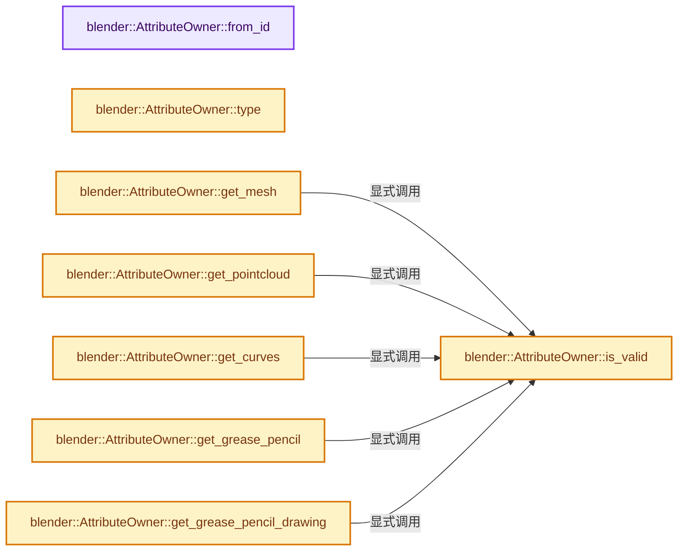
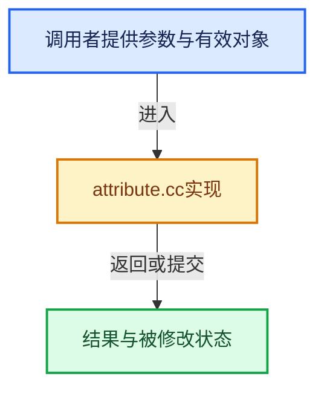

# 实现依赖专题：source/blender/blenkernel/intern/attribute.cc

[方向导航](README.md) · [符号索引](../%E7%AC%A6%E5%8F%B7%E4%BE%9D%E8%B5%96%E4%B8%8E%E5%AE%9E%E7%8E%B0%E7%B4%A2%E5%BC%95.md)

本专题从正文实际调用进入，集中保存共享实现。函数有稳定锚点，可从调用处直接跳到对应完整函数；递归与互相调用通过回链组织。

## 本文件的实现关系






## 完整成员与函数实现

<a id="f-866554bb7829a861"></a>

### `blender::AttributeOwner::from_id`

实现位置：[source/blender/blenkernel/intern/attribute.cc](../../../../../source/blender/blenkernel/intern/attribute.cc) · L46—L63。

接口参数：

- `ID *id`

**教学注释版**

<!-- annotated:627c5e62bf667e -->

```cpp
AttributeOwner AttributeOwner::from_id(ID *id)
{
  if (id == nullptr) {
    return {};
  }
  switch (GS(id->name)) {
    case ID_ME:
      return AttributeOwner(AttributeOwnerType::Mesh, id);
    case ID_PT:
      return AttributeOwner(AttributeOwnerType::PointCloud, id);
    case ID_CV:
      return AttributeOwner(AttributeOwnerType::Curves, id);
    case ID_GP:
      return AttributeOwner(AttributeOwnerType::GreasePencil, id);
    default:
      return {};
  }
}
```

<details>
<summary>核对原始源码：source/blender/blenkernel/intern/attribute.cc · L46—L63</summary>

<!-- original:627c5e62bf667e:source/blender/blenkernel/intern/attribute.cc:46:63 -->

```cpp
AttributeOwner AttributeOwner::from_id(ID *id)
{
  if (id == nullptr) {
    return {};
  }
  switch (GS(id->name)) {
    case ID_ME:
      return AttributeOwner(AttributeOwnerType::Mesh, id);
    case ID_PT:
      return AttributeOwner(AttributeOwnerType::PointCloud, id);
    case ID_CV:
      return AttributeOwner(AttributeOwnerType::Curves, id);
    case ID_GP:
      return AttributeOwner(AttributeOwnerType::GreasePencil, id);
    default:
      return {};
  }
}
```

</details>

**结果出口**

- `return {};`
- `return AttributeOwner(AttributeOwnerType::Mesh, id);`
- `return AttributeOwner(AttributeOwnerType::PointCloud, id);`
- `return AttributeOwner(AttributeOwnerType::Curves, id);`
- `return AttributeOwner(AttributeOwnerType::GreasePencil, id);`

**继续追踪实现**

- `GS` → [blender::GS · L410](%E4%BE%9D%E8%B5%96-DNA_ID-3eb091.md#f-c3ff509f79f21b05)。
- `AttributeOwner` → [blender::AttributeOwner::AttributeOwner · L64](%E4%BE%9D%E8%B5%96-BKE_attribute-613f58.md#f-1612ba938072c7f3)；[blender::AttributeOwner::AttributeOwner · L65](%E4%BE%9D%E8%B5%96-BKE_attribute-613f58.md#f-7bb9bf91d83175cf)。同名重载需按实参类型选择。

<a id="f-bb6f5c58325d639c"></a>

### `blender::AttributeOwner::type`

实现位置：[source/blender/blenkernel/intern/attribute.cc](../../../../../source/blender/blenkernel/intern/attribute.cc) · L65—L68。

**教学注释版**

<!-- annotated:ff46c30093905f -->

```cpp
AttributeOwnerType AttributeOwner::type() const
{
  return type_;
}
```

<details>
<summary>核对原始源码：source/blender/blenkernel/intern/attribute.cc · L65—L68</summary>

<!-- original:ff46c30093905f:source/blender/blenkernel/intern/attribute.cc:65:68 -->

```cpp
AttributeOwnerType AttributeOwner::type() const
{
  return type_;
}
```

</details>

**结果出口**

- `return type_;`

**继续追踪实现**

本实现没有需要继续展开的显式调用；检查返回表达式、对象转换和调用者前置条件。

<a id="f-22ba1ed6efe68668"></a>

### `blender::AttributeOwner::is_valid`

实现位置：[source/blender/blenkernel/intern/attribute.cc](../../../../../source/blender/blenkernel/intern/attribute.cc) · L70—L73。

**教学注释版**

<!-- annotated:0ec1643c95224b -->

```cpp
bool AttributeOwner::is_valid() const
{
  return ptr_ != nullptr;
}
```

<details>
<summary>核对原始源码：source/blender/blenkernel/intern/attribute.cc · L70—L73</summary>

<!-- original:0ec1643c95224b:source/blender/blenkernel/intern/attribute.cc:70:73 -->

```cpp
bool AttributeOwner::is_valid() const
{
  return ptr_ != nullptr;
}
```

</details>

**结果出口**

- `return ptr_ != nullptr;`

**继续追踪实现**

本实现没有需要继续展开的显式调用；检查返回表达式、对象转换和调用者前置条件。

<a id="f-7dc20147c61e6a24"></a>

### `blender::AttributeOwner::get_mesh`

实现位置：[source/blender/blenkernel/intern/attribute.cc](../../../../../source/blender/blenkernel/intern/attribute.cc) · L75—L80。

**教学注释版**

<!-- annotated:ccc977b64678eb -->

```cpp
Mesh *AttributeOwner::get_mesh() const
{
  BLI_assert(this->is_valid());
  BLI_assert(type_ == AttributeOwnerType::Mesh);
  return reinterpret_cast<Mesh *>(ptr_);
}
```

<details>
<summary>核对原始源码：source/blender/blenkernel/intern/attribute.cc · L75—L80</summary>

<!-- original:ccc977b64678eb:source/blender/blenkernel/intern/attribute.cc:75:80 -->

```cpp
Mesh *AttributeOwner::get_mesh() const
{
  BLI_assert(this->is_valid());
  BLI_assert(type_ == AttributeOwnerType::Mesh);
  return reinterpret_cast<Mesh *>(ptr_);
}
```

</details>

**结果出口**

- `return reinterpret_cast<Mesh *>(ptr_);`

**继续追踪实现**

- `BLI_assert` → [BLI_assert · L48](../01-%E5%9F%BA%E7%A1%80%E5%AE%B9%E5%99%A8%E4%B8%8E%E7%8E%B0%E4%BB%A3CPP/%E4%BE%9D%E8%B5%96-BLI_assert-cc98e8.md#m-57a88495704d)；[BLI_assert · L63](../01-%E5%9F%BA%E7%A1%80%E5%AE%B9%E5%99%A8%E4%B8%8E%E7%8E%B0%E4%BB%A3CPP/%E4%BE%9D%E8%B5%96-BLI_assert-cc98e8.md#m-d07050020cb5)。宏定义由构建条件选择。
- `this->is_valid` → [blender::AttributeOwner::is_valid · L70](%E4%BE%9D%E8%B5%96-attribute-2d9c29.md#f-22ba1ed6efe68668)。

<a id="f-3a5e19b21d0ec5aa"></a>

### `blender::AttributeOwner::get_pointcloud`

实现位置：[source/blender/blenkernel/intern/attribute.cc](../../../../../source/blender/blenkernel/intern/attribute.cc) · L82—L87。

**教学注释版**

<!-- annotated:9e8d8035a1bda8 -->

```cpp
PointCloud *AttributeOwner::get_pointcloud() const
{
  BLI_assert(this->is_valid());
  BLI_assert(type_ == AttributeOwnerType::PointCloud);
  return reinterpret_cast<PointCloud *>(ptr_);
}
```

<details>
<summary>核对原始源码：source/blender/blenkernel/intern/attribute.cc · L82—L87</summary>

<!-- original:9e8d8035a1bda8:source/blender/blenkernel/intern/attribute.cc:82:87 -->

```cpp
PointCloud *AttributeOwner::get_pointcloud() const
{
  BLI_assert(this->is_valid());
  BLI_assert(type_ == AttributeOwnerType::PointCloud);
  return reinterpret_cast<PointCloud *>(ptr_);
}
```

</details>

**结果出口**

- `return reinterpret_cast<PointCloud *>(ptr_);`

**继续追踪实现**

- `BLI_assert` → [BLI_assert · L48](../01-%E5%9F%BA%E7%A1%80%E5%AE%B9%E5%99%A8%E4%B8%8E%E7%8E%B0%E4%BB%A3CPP/%E4%BE%9D%E8%B5%96-BLI_assert-cc98e8.md#m-57a88495704d)；[BLI_assert · L63](../01-%E5%9F%BA%E7%A1%80%E5%AE%B9%E5%99%A8%E4%B8%8E%E7%8E%B0%E4%BB%A3CPP/%E4%BE%9D%E8%B5%96-BLI_assert-cc98e8.md#m-d07050020cb5)。宏定义由构建条件选择。
- `this->is_valid` → [blender::AttributeOwner::is_valid · L70](%E4%BE%9D%E8%B5%96-attribute-2d9c29.md#f-22ba1ed6efe68668)。

<a id="f-963ca16b024327b4"></a>

### `blender::AttributeOwner::get_curves`

实现位置：[source/blender/blenkernel/intern/attribute.cc](../../../../../source/blender/blenkernel/intern/attribute.cc) · L89—L94。

**教学注释版**

<!-- annotated:a28b36d146b484 -->

```cpp
Curves *AttributeOwner::get_curves() const
{
  BLI_assert(this->is_valid());
  BLI_assert(type_ == AttributeOwnerType::Curves);
  return reinterpret_cast<Curves *>(ptr_);
}
```

<details>
<summary>核对原始源码：source/blender/blenkernel/intern/attribute.cc · L89—L94</summary>

<!-- original:a28b36d146b484:source/blender/blenkernel/intern/attribute.cc:89:94 -->

```cpp
Curves *AttributeOwner::get_curves() const
{
  BLI_assert(this->is_valid());
  BLI_assert(type_ == AttributeOwnerType::Curves);
  return reinterpret_cast<Curves *>(ptr_);
}
```

</details>

**结果出口**

- `return reinterpret_cast<Curves *>(ptr_);`

**继续追踪实现**

- `BLI_assert` → [BLI_assert · L48](../01-%E5%9F%BA%E7%A1%80%E5%AE%B9%E5%99%A8%E4%B8%8E%E7%8E%B0%E4%BB%A3CPP/%E4%BE%9D%E8%B5%96-BLI_assert-cc98e8.md#m-57a88495704d)；[BLI_assert · L63](../01-%E5%9F%BA%E7%A1%80%E5%AE%B9%E5%99%A8%E4%B8%8E%E7%8E%B0%E4%BB%A3CPP/%E4%BE%9D%E8%B5%96-BLI_assert-cc98e8.md#m-d07050020cb5)。宏定义由构建条件选择。
- `this->is_valid` → [blender::AttributeOwner::is_valid · L70](%E4%BE%9D%E8%B5%96-attribute-2d9c29.md#f-22ba1ed6efe68668)。

<a id="f-045ba2942ace7c60"></a>

### `blender::AttributeOwner::get_grease_pencil`

实现位置：[source/blender/blenkernel/intern/attribute.cc](../../../../../source/blender/blenkernel/intern/attribute.cc) · L96—L101。

**教学注释版**

<!-- annotated:e88d2f22f6ce25 -->

```cpp
GreasePencil *AttributeOwner::get_grease_pencil() const
{
  BLI_assert(this->is_valid());
  BLI_assert(type_ == AttributeOwnerType::GreasePencil);
  return reinterpret_cast<GreasePencil *>(ptr_);
}
```

<details>
<summary>核对原始源码：source/blender/blenkernel/intern/attribute.cc · L96—L101</summary>

<!-- original:e88d2f22f6ce25:source/blender/blenkernel/intern/attribute.cc:96:101 -->

```cpp
GreasePencil *AttributeOwner::get_grease_pencil() const
{
  BLI_assert(this->is_valid());
  BLI_assert(type_ == AttributeOwnerType::GreasePencil);
  return reinterpret_cast<GreasePencil *>(ptr_);
}
```

</details>

**结果出口**

- `return reinterpret_cast<GreasePencil *>(ptr_);`

**继续追踪实现**

- `BLI_assert` → [BLI_assert · L48](../01-%E5%9F%BA%E7%A1%80%E5%AE%B9%E5%99%A8%E4%B8%8E%E7%8E%B0%E4%BB%A3CPP/%E4%BE%9D%E8%B5%96-BLI_assert-cc98e8.md#m-57a88495704d)；[BLI_assert · L63](../01-%E5%9F%BA%E7%A1%80%E5%AE%B9%E5%99%A8%E4%B8%8E%E7%8E%B0%E4%BB%A3CPP/%E4%BE%9D%E8%B5%96-BLI_assert-cc98e8.md#m-d07050020cb5)。宏定义由构建条件选择。
- `this->is_valid` → [blender::AttributeOwner::is_valid · L70](%E4%BE%9D%E8%B5%96-attribute-2d9c29.md#f-22ba1ed6efe68668)。

<a id="f-d584e325869f48ba"></a>

### `blender::AttributeOwner::get_grease_pencil_drawing`

实现位置：[source/blender/blenkernel/intern/attribute.cc](../../../../../source/blender/blenkernel/intern/attribute.cc) · L103—L108。

**教学注释版**

<!-- annotated:bbf47ba86699cd -->

```cpp
GreasePencilDrawing *AttributeOwner::get_grease_pencil_drawing() const
{
  BLI_assert(this->is_valid());
  BLI_assert(type_ == AttributeOwnerType::GreasePencilDrawing);
  return reinterpret_cast<GreasePencilDrawing *>(ptr_);
}
```

<details>
<summary>核对原始源码：source/blender/blenkernel/intern/attribute.cc · L103—L108</summary>

<!-- original:bbf47ba86699cd:source/blender/blenkernel/intern/attribute.cc:103:108 -->

```cpp
GreasePencilDrawing *AttributeOwner::get_grease_pencil_drawing() const
{
  BLI_assert(this->is_valid());
  BLI_assert(type_ == AttributeOwnerType::GreasePencilDrawing);
  return reinterpret_cast<GreasePencilDrawing *>(ptr_);
}
```

</details>

**结果出口**

- `return reinterpret_cast<GreasePencilDrawing *>(ptr_);`

**继续追踪实现**

- `BLI_assert` → [BLI_assert · L48](../01-%E5%9F%BA%E7%A1%80%E5%AE%B9%E5%99%A8%E4%B8%8E%E7%8E%B0%E4%BB%A3CPP/%E4%BE%9D%E8%B5%96-BLI_assert-cc98e8.md#m-57a88495704d)；[BLI_assert · L63](../01-%E5%9F%BA%E7%A1%80%E5%AE%B9%E5%99%A8%E4%B8%8E%E7%8E%B0%E4%BB%A3CPP/%E4%BE%9D%E8%B5%96-BLI_assert-cc98e8.md#m-d07050020cb5)。宏定义由构建条件选择。
- `this->is_valid` → [blender::AttributeOwner::is_valid · L70](%E4%BE%9D%E8%B5%96-attribute-2d9c29.md#f-22ba1ed6efe68668)。

<a id="f-d1d60d364a548a27"></a>

### `blender::AttributeOwner::get_storage`

实现位置：[source/blender/blenkernel/intern/attribute.cc](../../../../../source/blender/blenkernel/intern/attribute.cc) · L110—L126。

**教学注释版**

<!-- annotated:515e6ac87483e4 -->

```cpp
bke::AttributeStorage *AttributeOwner::get_storage() const
{
  switch (type_) {
    case AttributeOwnerType::Mesh:
      return &this->get_mesh()->attribute_storage.wrap();
    case AttributeOwnerType::PointCloud:
      return &this->get_pointcloud()->attribute_storage.wrap();
    case AttributeOwnerType::Curves:
      return &this->get_curves()->geometry.attribute_storage.wrap();
    case AttributeOwnerType::GreasePencil:
      return &this->get_grease_pencil()->attribute_storage.wrap();
    case AttributeOwnerType::GreasePencilDrawing:
      return &this->get_grease_pencil_drawing()->geometry.attribute_storage.wrap();
  }
  BLI_assert(false);
  return nullptr;
}
```

<details>
<summary>核对原始源码：source/blender/blenkernel/intern/attribute.cc · L110—L126</summary>

<!-- original:515e6ac87483e4:source/blender/blenkernel/intern/attribute.cc:110:126 -->

```cpp
bke::AttributeStorage *AttributeOwner::get_storage() const
{
  switch (type_) {
    case AttributeOwnerType::Mesh:
      return &this->get_mesh()->attribute_storage.wrap();
    case AttributeOwnerType::PointCloud:
      return &this->get_pointcloud()->attribute_storage.wrap();
    case AttributeOwnerType::Curves:
      return &this->get_curves()->geometry.attribute_storage.wrap();
    case AttributeOwnerType::GreasePencil:
      return &this->get_grease_pencil()->attribute_storage.wrap();
    case AttributeOwnerType::GreasePencilDrawing:
      return &this->get_grease_pencil_drawing()->geometry.attribute_storage.wrap();
  }
  BLI_assert(false);
  return nullptr;
}
```

</details>

**结果出口**

- `return &this->get_mesh()->attribute_storage.wrap();`
- `return &this->get_pointcloud()->attribute_storage.wrap();`
- `return &this->get_curves()->geometry.attribute_storage.wrap();`
- `return &this->get_grease_pencil()->attribute_storage.wrap();`
- `return &this->get_grease_pencil_drawing()->geometry.attribute_storage.wrap();`
- `return nullptr;`

**继续追踪实现**

- `this->get_mesh()->attribute_storage.wrap` → [调用协议](../%E6%A8%A1%E6%9D%BF%E5%AE%8F%E4%B8%8E%E5%8A%A8%E6%80%81%E5%88%86%E6%B4%BE%E5%8D%8F%E8%AE%AE.md)：接收对象类型依赖auto、返回值或模板实例；不按同名猜测目标。调用位置L114。
- `this->get_mesh` → [blender::AttributeOwner::get_mesh · L75](%E4%BE%9D%E8%B5%96-attribute-2d9c29.md#f-7dc20147c61e6a24)。
- `this->get_pointcloud()->attribute_storage.wrap` → [调用协议](../%E6%A8%A1%E6%9D%BF%E5%AE%8F%E4%B8%8E%E5%8A%A8%E6%80%81%E5%88%86%E6%B4%BE%E5%8D%8F%E8%AE%AE.md)：接收对象类型依赖auto、返回值或模板实例；不按同名猜测目标。调用位置L116。
- `this->get_pointcloud` → [blender::AttributeOwner::get_pointcloud · L82](%E4%BE%9D%E8%B5%96-attribute-2d9c29.md#f-3a5e19b21d0ec5aa)。
- `this->get_curves()->geometry.attribute_storage.wrap` → [调用协议](../%E6%A8%A1%E6%9D%BF%E5%AE%8F%E4%B8%8E%E5%8A%A8%E6%80%81%E5%88%86%E6%B4%BE%E5%8D%8F%E8%AE%AE.md)：接收对象类型依赖auto、返回值或模板实例；不按同名猜测目标。调用位置L118。
- `this->get_curves` → [blender::AttributeOwner::get_curves · L89](%E4%BE%9D%E8%B5%96-attribute-2d9c29.md#f-963ca16b024327b4)。
- `this->get_grease_pencil()->attribute_storage.wrap` → [调用协议](../%E6%A8%A1%E6%9D%BF%E5%AE%8F%E4%B8%8E%E5%8A%A8%E6%80%81%E5%88%86%E6%B4%BE%E5%8D%8F%E8%AE%AE.md)：接收对象类型依赖auto、返回值或模板实例；不按同名猜测目标。调用位置L120。
- `this->get_grease_pencil` → [blender::AttributeOwner::get_grease_pencil · L96](%E4%BE%9D%E8%B5%96-attribute-2d9c29.md#f-045ba2942ace7c60)。
- `this->get_grease_pencil_drawing()->geometry.attribute_storage.wrap` → [调用协议](../%E6%A8%A1%E6%9D%BF%E5%AE%8F%E4%B8%8E%E5%8A%A8%E6%80%81%E5%88%86%E6%B4%BE%E5%8D%8F%E8%AE%AE.md)：接收对象类型依赖auto、返回值或模板实例；不按同名猜测目标。调用位置L122。
- `this->get_grease_pencil_drawing` → [blender::AttributeOwner::get_grease_pencil_drawing · L103](%E4%BE%9D%E8%B5%96-attribute-2d9c29.md#f-d584e325869f48ba)。
- `BLI_assert` → [BLI_assert · L48](../01-%E5%9F%BA%E7%A1%80%E5%AE%B9%E5%99%A8%E4%B8%8E%E7%8E%B0%E4%BB%A3CPP/%E4%BE%9D%E8%B5%96-BLI_assert-cc98e8.md#m-57a88495704d)；[BLI_assert · L63](../01-%E5%9F%BA%E7%A1%80%E5%AE%B9%E5%99%A8%E4%B8%8E%E7%8E%B0%E4%BB%A3CPP/%E4%BE%9D%E8%B5%96-BLI_assert-cc98e8.md#m-d07050020cb5)。宏定义由构建条件选择。

<a id="f-66c23f1400f21d98"></a>

### `blender::get_domains`

实现位置：[source/blender/blenkernel/intern/attribute.cc](../../../../../source/blender/blenkernel/intern/attribute.cc) · L153—L165。

接口参数：

- `BMesh *bm`

**教学注释版**

<!-- annotated:5320a1abd2ba79 -->

```cpp
static std::array<DomainInfo, ATTR_DOMAIN_NUM> get_domains(BMesh *bm)
{
  std::array<DomainInfo, ATTR_DOMAIN_NUM> info;
  info[int(AttrDomain::Point)].customdata = &bm->vdata;
  info[int(AttrDomain::Point)].length = bm->totvert;
  info[int(AttrDomain::Edge)].customdata = &bm->edata;
  info[int(AttrDomain::Edge)].length = bm->totedge;
  info[int(AttrDomain::Corner)].customdata = &bm->ldata;
  info[int(AttrDomain::Corner)].length = bm->totloop;
  info[int(AttrDomain::Face)].customdata = &bm->pdata;
  info[int(AttrDomain::Face)].length = bm->totface;
  return info;
}
```

<details>
<summary>核对原始源码：source/blender/blenkernel/intern/attribute.cc · L153—L165</summary>

<!-- original:5320a1abd2ba79:source/blender/blenkernel/intern/attribute.cc:153:165 -->

```cpp
static std::array<DomainInfo, ATTR_DOMAIN_NUM> get_domains(BMesh *bm)
{
  std::array<DomainInfo, ATTR_DOMAIN_NUM> info;
  info[int(AttrDomain::Point)].customdata = &bm->vdata;
  info[int(AttrDomain::Point)].length = bm->totvert;
  info[int(AttrDomain::Edge)].customdata = &bm->edata;
  info[int(AttrDomain::Edge)].length = bm->totedge;
  info[int(AttrDomain::Corner)].customdata = &bm->ldata;
  info[int(AttrDomain::Corner)].length = bm->totloop;
  info[int(AttrDomain::Face)].customdata = &bm->pdata;
  info[int(AttrDomain::Face)].length = bm->totface;
  return info;
}
```

</details>

**结果出口**

- `return info;`

**继续追踪实现**

本实现没有需要继续展开的显式调用；检查返回表达式、对象转换和调用者前置条件。

<a id="f-b092acbc8ce120f3"></a>

### `blender::bke_attribute_rename_if_exists`

实现位置：[source/blender/blenkernel/intern/attribute.cc](../../../../../source/blender/blenkernel/intern/attribute.cc) · L167—L177。

接口参数：

- `AttributeOwner &owner`
- `const StringRef old_name`
- `const StringRef new_name`
- `ReportList *reports`

**教学注释版**

<!-- annotated:0ae4b2b1355fec -->

```cpp
static bool bke_attribute_rename_if_exists(AttributeOwner &owner,
                                           const StringRef old_name,
                                           const StringRef new_name,
                                           ReportList *reports)
{
  const bke::AttributeStorage &storage = *owner.get_storage();
  if (!storage.lookup(old_name)) {
    return false;
  }
  return BKE_attribute_rename(owner, old_name, new_name, reports);
}
```

<details>
<summary>核对原始源码：source/blender/blenkernel/intern/attribute.cc · L167—L177</summary>

<!-- original:0ae4b2b1355fec:source/blender/blenkernel/intern/attribute.cc:167:177 -->

```cpp
static bool bke_attribute_rename_if_exists(AttributeOwner &owner,
                                           const StringRef old_name,
                                           const StringRef new_name,
                                           ReportList *reports)
{
  const bke::AttributeStorage &storage = *owner.get_storage();
  if (!storage.lookup(old_name)) {
    return false;
  }
  return BKE_attribute_rename(owner, old_name, new_name, reports);
}
```

</details>

**结果出口**

- `return false;`
- `return BKE_attribute_rename(owner, old_name, new_name, reports);`

**继续追踪实现**

- `owner.get_storage` → [blender::AttributeOwner::get_storage · L110](%E4%BE%9D%E8%B5%96-attribute-2d9c29.md#f-d1d60d364a548a27)。
- `storage.lookup` → [blender::bke::AttributeStorage::lookup · L218](%E4%BE%9D%E8%B5%96-attribute_storage-1cb73b.md#f-7fdc83fb77004833)；[blender::bke::AttributeStorage::lookup · L228](%E4%BE%9D%E8%B5%96-attribute_storage-1cb73b.md#f-4c9ec35a31afcd06)。同名重载需按实参类型选择。
- `BKE_attribute_rename` → [blender::BKE_attribute_rename · L234](%E4%BE%9D%E8%B5%96-attribute-2d9c29.md#f-67e3b04ce2cdfb26)。

<a id="f-36c3cd3db70847e9"></a>

### `blender::bke_attribute_rename_if_exists`

实现位置：[source/blender/blenkernel/intern/attribute.cc](../../../../../source/blender/blenkernel/intern/attribute.cc) · L179—L190。

接口参数：

- `AttributeOwner &owner`
- `BMesh &bm`
- `const StringRef old_name`
- `const StringRef new_name`
- `ReportList *reports`

**教学注释版**

<!-- annotated:ee002b350af3d1 -->

```cpp
static bool bke_attribute_rename_if_exists(AttributeOwner &owner,
                                           BMesh &bm,
                                           const StringRef old_name,
                                           const StringRef new_name,
                                           ReportList *reports)
{
  BMDataLayerLookup attr = BM_data_layer_lookup(bm, old_name);
  if (!attr) {
    return false;
  }
  return BKE_attribute_rename(owner, old_name, new_name, reports);
}
```

<details>
<summary>核对原始源码：source/blender/blenkernel/intern/attribute.cc · L179—L190</summary>

<!-- original:ee002b350af3d1:source/blender/blenkernel/intern/attribute.cc:179:190 -->

```cpp
static bool bke_attribute_rename_if_exists(AttributeOwner &owner,
                                           BMesh &bm,
                                           const StringRef old_name,
                                           const StringRef new_name,
                                           ReportList *reports)
{
  BMDataLayerLookup attr = BM_data_layer_lookup(bm, old_name);
  if (!attr) {
    return false;
  }
  return BKE_attribute_rename(owner, old_name, new_name, reports);
}
```

</details>

**结果出口**

- `return false;`
- `return BKE_attribute_rename(owner, old_name, new_name, reports);`

**继续追踪实现**

- `BM_data_layer_lookup` → [blender::BM_data_layer_lookup · L1040](%E4%BE%9D%E8%B5%96-bmesh_interp-cac3db.md#f-93b89f2eabbb100b)。
- `BKE_attribute_rename` → [blender::BKE_attribute_rename · L234](%E4%BE%9D%E8%B5%96-attribute-2d9c29.md#f-67e3b04ce2cdfb26)。

<a id="f-25b33fe2ec9d04d2"></a>

### `blender::name_valid_for_builtin_domain_and_type`

实现位置：[source/blender/blenkernel/intern/attribute.cc](../../../../../source/blender/blenkernel/intern/attribute.cc) · L192—L213。

接口参数：

- `const bke::AttributeAccessor attributes`
- `const StringRef name`
- `const AttrDomain domain`
- `const bke::AttrType data_type`
- `ReportList *reports`

**教学注释版**

<!-- annotated:6b608450ad533c -->

```cpp
static bool name_valid_for_builtin_domain_and_type(const bke::AttributeAccessor attributes,
                                                   const StringRef name,
                                                   const AttrDomain domain,
                                                   const bke::AttrType data_type,
                                                   ReportList *reports)
{
  if (const std::optional metadata = attributes.get_builtin_domain_and_type(name)) {
    if (domain != metadata->domain) {
      BKE_reportf(reports,
                  RPT_ERROR,
                  "Domain unsupported for \"%s\" attribute",
                  std::string(name).c_str());
      return false;
    }
    if (data_type != metadata->data_type) {
      BKE_reportf(
          reports, RPT_ERROR, "Type unsupported for \"%s\" attribute", std::string(name).c_str());
      return false;
    }
  }
  return true;
}
```

<details>
<summary>核对原始源码：source/blender/blenkernel/intern/attribute.cc · L192—L213</summary>

<!-- original:6b608450ad533c:source/blender/blenkernel/intern/attribute.cc:192:213 -->

```cpp
static bool name_valid_for_builtin_domain_and_type(const bke::AttributeAccessor attributes,
                                                   const StringRef name,
                                                   const AttrDomain domain,
                                                   const bke::AttrType data_type,
                                                   ReportList *reports)
{
  if (const std::optional metadata = attributes.get_builtin_domain_and_type(name)) {
    if (domain != metadata->domain) {
      BKE_reportf(reports,
                  RPT_ERROR,
                  "Domain unsupported for \"%s\" attribute",
                  std::string(name).c_str());
      return false;
    }
    if (data_type != metadata->data_type) {
      BKE_reportf(
          reports, RPT_ERROR, "Type unsupported for \"%s\" attribute", std::string(name).c_str());
      return false;
    }
  }
  return true;
}
```

</details>

**结果出口**

- `return false;`
- `return true;`

**继续追踪实现**

- `attributes.get_builtin_domain_and_type` → [blender::bke::AttributeAccessor::get_builtin_domain_and_type · L566](08-AttributeAccessor%E6%8E%A5%E5%8F%A3.md#f-a96d2a8736a8e586)。
- `BKE_reportf` → [blender::BKE_reportf · L191](%E4%BE%9D%E8%B5%96-report-f916fd.md#f-e776fc632ffb42b3)。
- `std::string(name).c_str` → [外部契约](https://eel.is/c++draft/)：这个边界按实际表达式及所属类型核对参数、返回值、寿命与失败行为。这里提供接口入口，不声称已解释该第三方版本的内部实现。
- `std::string` → [外部契约](https://eel.is/c++draft/)：这个边界按实际表达式及所属类型核对参数、返回值、寿命与失败行为。这里提供接口入口，不声称已解释该第三方版本的内部实现。

<a id="f-7b459d89cae2407a"></a>

### `blender::mesh_attribute_valid`

实现位置：[source/blender/blenkernel/intern/attribute.cc](../../../../../source/blender/blenkernel/intern/attribute.cc) · L215—L232。

接口参数：

- `const Mesh &mesh`
- `const StringRef name`
- `const AttrDomain domain`
- `const bke::AttrType data_type`
- `ReportList *reports`

**教学注释版**

<!-- annotated:c8be357b2d0cde -->

```cpp
static bool mesh_attribute_valid(const Mesh &mesh,
                                 const StringRef name,
                                 const AttrDomain domain,
                                 const bke::AttrType data_type,
                                 ReportList *reports)
{
  if (mesh.runtime->edit_mesh) {
    if (BM_attribute_stored_in_bmesh_builtin(name)) {
      BKE_report(reports, RPT_ERROR, "Unable to create attribute in edit mode");
      return false;
    }
  }
  if (!name_valid_for_builtin_domain_and_type(mesh.attributes(), name, domain, data_type, reports))
  {
    return false;
  }
  return true;
}
```

<details>
<summary>核对原始源码：source/blender/blenkernel/intern/attribute.cc · L215—L232</summary>

<!-- original:c8be357b2d0cde:source/blender/blenkernel/intern/attribute.cc:215:232 -->

```cpp
static bool mesh_attribute_valid(const Mesh &mesh,
                                 const StringRef name,
                                 const AttrDomain domain,
                                 const bke::AttrType data_type,
                                 ReportList *reports)
{
  if (mesh.runtime->edit_mesh) {
    if (BM_attribute_stored_in_bmesh_builtin(name)) {
      BKE_report(reports, RPT_ERROR, "Unable to create attribute in edit mode");
      return false;
    }
  }
  if (!name_valid_for_builtin_domain_and_type(mesh.attributes(), name, domain, data_type, reports))
  {
    return false;
  }
  return true;
}
```

</details>

**结果出口**

- `return false;`
- `return true;`

**继续追踪实现**

- `BM_attribute_stored_in_bmesh_builtin` → [blender::BM_attribute_stored_in_bmesh_builtin · L118](%E4%BE%9D%E8%B5%96-bmesh_mesh_convert-19b1b9.md#f-c524291093f702fd)。
- `BKE_report` → [blender::BKE_report · L162](%E4%BE%9D%E8%B5%96-report-f916fd.md#f-56816f68adfe537b)。
- `name_valid_for_builtin_domain_and_type` → [blender::name_valid_for_builtin_domain_and_type · L192](%E4%BE%9D%E8%B5%96-attribute-2d9c29.md#f-25b33fe2ec9d04d2)。
- `mesh.attributes` → [Mesh::attributes · L1298](03-MPoly%E8%BF%81%E7%A7%BB%E4%B8%8E%E5%85%BC%E5%AE%B9.md#f-607bbfe3e57cfc7f)。

<a id="f-67e3b04ce2cdfb26"></a>

### `blender::BKE_attribute_rename`

实现位置：[source/blender/blenkernel/intern/attribute.cc](../../../../../source/blender/blenkernel/intern/attribute.cc) · L234—L349。

接口参数：

- `AttributeOwner &owner`
- `const StringRef old_name`
- `const StringRef new_name`
- `ReportList *reports`

**教学注释版**

<!-- annotated:0977227d09a36e -->

```cpp
bool BKE_attribute_rename(AttributeOwner &owner,
                          const StringRef old_name,
                          const StringRef new_name,
                          ReportList *reports)
{
  if (BKE_attribute_required(owner, old_name)) {
    BLI_assert_msg(0, "Required attribute name is not editable");
    return false;
  }
  if (new_name.is_empty()) {
    BKE_report(reports, RPT_ERROR, "Attribute name cannot be empty");
    return false;
  }

  if (owner.type() == AttributeOwnerType::Mesh) {
    Mesh *mesh = owner.get_mesh();
    if (BMesh *bm = BKE_editmesh_bmesh_get_for_write(mesh)) {
      /* NOTE: Checking if the new name matches the old name only makes sense when the name
       * is clamped to its maximum length, otherwise assigning an over-long name multiple times
       * will add `.001` suffix unnecessarily. */
      {
        const int new_name_maxncpy = CustomData_name_maxncpy_calc(new_name);
        /* NOTE: A function that performs a clamped comparison without copying would be handy. */
        char new_name_clamped[MAX_CUSTOMDATA_LAYER_NAME];
        new_name.copy_utf8_truncated(new_name_clamped, new_name_maxncpy);
        if (old_name == new_name_clamped) {
          return false;
        }
      }

      BMDataLayerLookup attr = BM_data_layer_lookup(*bm, old_name);
      if (!attr) {
        BKE_report(reports, RPT_ERROR, "Attribute is not part of this geometry");
        return false;
      }

      if (!mesh_attribute_valid(*mesh, new_name, attr.domain, attr.type, reports)) {
        return false;
      }

      std::string result_name = BKE_attribute_calc_unique_name(owner, new_name);

      if (attr.type == bke::AttrType::Float2) {
        /* Rename UV sub-attributes. */
        char buffer_src[MAX_CUSTOMDATA_LAYER_NAME];
        char buffer_dst[MAX_CUSTOMDATA_LAYER_NAME];
        bke_attribute_rename_if_exists(owner,
                                       *bm,
                                       BKE_uv_map_pin_name_get(old_name, buffer_src),
                                       BKE_uv_map_pin_name_get(result_name, buffer_dst),
                                       reports);
      }

      if (old_name == BKE_id_attributes_active_color_name(&mesh->id)) {
        BKE_id_attributes_active_color_set(&mesh->id, result_name);
      }
      if (old_name == BKE_id_attributes_default_color_name(&mesh->id)) {
        BKE_id_attributes_default_color_set(&mesh->id, result_name);
      }

      StringRef(result_name).copy_utf8_truncated(const_cast<CustomDataLayer *>(attr.layer)->name);

      return true;
    }
  }

  bke::AttributeStorage &attributes = *owner.get_storage();
  bke::Attribute *attr = attributes.lookup(old_name);
  if (!attr) {
    BKE_report(reports, RPT_ERROR, "Attribute is not part of this geometry");
    return false;
  }

  if (owner.type() == AttributeOwnerType::Curves) {
    Curves *curves = owner.get_curves();
    if (!name_valid_for_builtin_domain_and_type(curves->geometry.wrap().attributes(),
                                                new_name,
                                                attr->domain(),
                                                attr->data_type(),
                                                reports))
    {
      return false;
    }
  }
  else if (owner.type() == AttributeOwnerType::Mesh) {
    Mesh *mesh = owner.get_mesh();
    if (!mesh_attribute_valid(*mesh, new_name, attr->domain(), attr->data_type(), reports)) {
      return false;
    }
    if (attr->data_type() == bke::AttrType::Float2) {
      /* Rename UV sub-attributes. */
      char buffer_src[MAX_CUSTOMDATA_LAYER_NAME];
      char buffer_dst[MAX_CUSTOMDATA_LAYER_NAME];
      bke_attribute_rename_if_exists(owner,
                                     BKE_uv_map_pin_name_get(attr->name(), buffer_src),
                                     BKE_uv_map_pin_name_get(new_name, buffer_dst),
                                     reports);
    }

    if (old_name == BKE_id_attributes_active_color_name(&mesh->id)) {
      BKE_id_attributes_active_color_set(&mesh->id, new_name);
    }
    if (old_name == BKE_id_attributes_default_color_name(&mesh->id)) {
      BKE_id_attributes_default_color_set(&mesh->id, new_name);
    }
    if (old_name == mesh->active_uv_map_name()) {
      mesh->uv_maps_active_set(new_name);
    }
    if (old_name == mesh->default_uv_map_name()) {
      mesh->uv_maps_default_set(new_name);
    }
  }

  attributes.rename(old_name, new_name);
  return true;
}
```

<details>
<summary>核对原始源码：source/blender/blenkernel/intern/attribute.cc · L234—L349</summary>

<!-- original:0977227d09a36e:source/blender/blenkernel/intern/attribute.cc:234:349 -->

```cpp
bool BKE_attribute_rename(AttributeOwner &owner,
                          const StringRef old_name,
                          const StringRef new_name,
                          ReportList *reports)
{
  if (BKE_attribute_required(owner, old_name)) {
    BLI_assert_msg(0, "Required attribute name is not editable");
    return false;
  }
  if (new_name.is_empty()) {
    BKE_report(reports, RPT_ERROR, "Attribute name cannot be empty");
    return false;
  }

  if (owner.type() == AttributeOwnerType::Mesh) {
    Mesh *mesh = owner.get_mesh();
    if (BMesh *bm = BKE_editmesh_bmesh_get_for_write(mesh)) {
      /* NOTE: Checking if the new name matches the old name only makes sense when the name
       * is clamped to its maximum length, otherwise assigning an over-long name multiple times
       * will add `.001` suffix unnecessarily. */
      {
        const int new_name_maxncpy = CustomData_name_maxncpy_calc(new_name);
        /* NOTE: A function that performs a clamped comparison without copying would be handy. */
        char new_name_clamped[MAX_CUSTOMDATA_LAYER_NAME];
        new_name.copy_utf8_truncated(new_name_clamped, new_name_maxncpy);
        if (old_name == new_name_clamped) {
          return false;
        }
      }

      BMDataLayerLookup attr = BM_data_layer_lookup(*bm, old_name);
      if (!attr) {
        BKE_report(reports, RPT_ERROR, "Attribute is not part of this geometry");
        return false;
      }

      if (!mesh_attribute_valid(*mesh, new_name, attr.domain, attr.type, reports)) {
        return false;
      }

      std::string result_name = BKE_attribute_calc_unique_name(owner, new_name);

      if (attr.type == bke::AttrType::Float2) {
        /* Rename UV sub-attributes. */
        char buffer_src[MAX_CUSTOMDATA_LAYER_NAME];
        char buffer_dst[MAX_CUSTOMDATA_LAYER_NAME];
        bke_attribute_rename_if_exists(owner,
                                       *bm,
                                       BKE_uv_map_pin_name_get(old_name, buffer_src),
                                       BKE_uv_map_pin_name_get(result_name, buffer_dst),
                                       reports);
      }

      if (old_name == BKE_id_attributes_active_color_name(&mesh->id)) {
        BKE_id_attributes_active_color_set(&mesh->id, result_name);
      }
      if (old_name == BKE_id_attributes_default_color_name(&mesh->id)) {
        BKE_id_attributes_default_color_set(&mesh->id, result_name);
      }

      StringRef(result_name).copy_utf8_truncated(const_cast<CustomDataLayer *>(attr.layer)->name);

      return true;
    }
  }

  bke::AttributeStorage &attributes = *owner.get_storage();
  bke::Attribute *attr = attributes.lookup(old_name);
  if (!attr) {
    BKE_report(reports, RPT_ERROR, "Attribute is not part of this geometry");
    return false;
  }

  if (owner.type() == AttributeOwnerType::Curves) {
    Curves *curves = owner.get_curves();
    if (!name_valid_for_builtin_domain_and_type(curves->geometry.wrap().attributes(),
                                                new_name,
                                                attr->domain(),
                                                attr->data_type(),
                                                reports))
    {
      return false;
    }
  }
  else if (owner.type() == AttributeOwnerType::Mesh) {
    Mesh *mesh = owner.get_mesh();
    if (!mesh_attribute_valid(*mesh, new_name, attr->domain(), attr->data_type(), reports)) {
      return false;
    }
    if (attr->data_type() == bke::AttrType::Float2) {
      /* Rename UV sub-attributes. */
      char buffer_src[MAX_CUSTOMDATA_LAYER_NAME];
      char buffer_dst[MAX_CUSTOMDATA_LAYER_NAME];
      bke_attribute_rename_if_exists(owner,
                                     BKE_uv_map_pin_name_get(attr->name(), buffer_src),
                                     BKE_uv_map_pin_name_get(new_name, buffer_dst),
                                     reports);
    }

    if (old_name == BKE_id_attributes_active_color_name(&mesh->id)) {
      BKE_id_attributes_active_color_set(&mesh->id, new_name);
    }
    if (old_name == BKE_id_attributes_default_color_name(&mesh->id)) {
      BKE_id_attributes_default_color_set(&mesh->id, new_name);
    }
    if (old_name == mesh->active_uv_map_name()) {
      mesh->uv_maps_active_set(new_name);
    }
    if (old_name == mesh->default_uv_map_name()) {
      mesh->uv_maps_default_set(new_name);
    }
  }

  attributes.rename(old_name, new_name);
  return true;
}
```

</details>

**结果出口**

- `return false;`
- `return true;`

**继续追踪实现**

- `BKE_attribute_required` → [blender::BKE_attribute_required · L666](%E4%BE%9D%E8%B5%96-attribute-2d9c29.md#f-9c758dad99f7b52a)。
- `BLI_assert_msg` → [BLI_assert_msg · L55](../01-%E5%9F%BA%E7%A1%80%E5%AE%B9%E5%99%A8%E4%B8%8E%E7%8E%B0%E4%BB%A3CPP/%E4%BE%9D%E8%B5%96-BLI_assert-cc98e8.md#m-695eed20dceb)；[BLI_assert_msg · L64](../01-%E5%9F%BA%E7%A1%80%E5%AE%B9%E5%99%A8%E4%B8%8E%E7%8E%B0%E4%BB%A3CPP/%E4%BE%9D%E8%B5%96-BLI_assert-cc98e8.md#m-7de5563de4db)。宏定义由构建条件选择。
- `new_name.is_empty` → [blender::Bounds<T>::is_empty · L533](../12-%E7%A9%BA%E9%97%B4%E6%95%B0%E6%8D%AE%E7%BB%93%E6%9E%84%E4%B8%8E%E5%87%A0%E4%BD%95%E7%AE%97%E6%B3%95/07-Bounds%E4%B8%8EBVH%E5%AF%B9%E6%AF%94.md#f-55ac376b3d0a0944)；[blender::GVArrayCommon::is_empty · L767](../04-%E8%99%9A%E6%8B%9F%E6%95%B0%E7%BB%84%E4%B8%8E%E7%B4%A2%E5%BC%95%E9%80%89%E6%8B%A9/05-GVArray%E8%BF%90%E8%A1%8C%E6%97%B6%E7%B1%BB%E5%9E%8B.md#f-c1da602ffc5555f9)；[blender::StringRefBase::is_empty · L201](../01-%E5%9F%BA%E7%A1%80%E5%AE%B9%E5%99%A8%E4%B8%8E%E7%8E%B0%E4%BB%A3CPP/15-StringRef%E5%AD%97%E7%AC%A6%E4%B8%B2%E8%A7%86%E5%9B%BE.md#f-9f6c3d2da1cb1796)；[blender::KDTreeNew<T>::is_empty · L498](../12-%E7%A9%BA%E9%97%B4%E6%95%B0%E6%8D%AE%E7%BB%93%E6%9E%84%E4%B8%8E%E5%87%A0%E4%BD%95%E7%AE%97%E6%B3%95/05-K%E8%BF%91%E9%82%BB%E4%B8%8E%E8%8C%83%E5%9B%B4%E6%9F%A5%E8%AF%A2.md#f-67f0ff91cf00b00b)。同名重载需按实参类型选择。
- `BKE_report` → [blender::BKE_report · L162](%E4%BE%9D%E8%B5%96-report-f916fd.md#f-56816f68adfe537b)。
- `owner.type` → [blender::AttributeOwner::type · L65](%E4%BE%9D%E8%B5%96-attribute-2d9c29.md#f-bb6f5c58325d639c)。
- `owner.get_mesh` → [blender::AttributeOwner::get_mesh · L75](%E4%BE%9D%E8%B5%96-attribute-2d9c29.md#f-7dc20147c61e6a24)。
- `BKE_editmesh_bmesh_get_for_write` → [blender::BKE_editmesh_bmesh_get_for_write · L79](%E4%BE%9D%E8%B5%96-editmesh-1ee56f.md#f-fa556ba8fafc4b41)；[blender::BKE_editmesh_bmesh_get_for_write · L87](%E4%BE%9D%E8%B5%96-editmesh-1ee56f.md#f-6137590869c86e48)。同名重载需按实参类型选择。
- `CustomData_name_maxncpy_calc` → [blender::CustomData_name_maxncpy_calc · L4069](%E4%BE%9D%E8%B5%96-customdata-2eef81.md#f-865252b72096f4de)。
- `new_name.copy_utf8_truncated` → [blender::StringRefBase::copy_utf8_truncated · L28](../01-%E5%9F%BA%E7%A1%80%E5%AE%B9%E5%99%A8%E4%B8%8E%E7%8E%B0%E4%BB%A3CPP/%E4%BE%9D%E8%B5%96-string_ref-ed6905.md#f-5d01486bac37768d)；[blender::StringRefBase::copy_utf8_truncated · L256](../01-%E5%9F%BA%E7%A1%80%E5%AE%B9%E5%99%A8%E4%B8%8E%E7%8E%B0%E4%BB%A3CPP/15-StringRef%E5%AD%97%E7%AC%A6%E4%B8%B2%E8%A7%86%E5%9B%BE.md#f-b2a0157cbe286321)。同名重载需按实参类型选择。
- `BM_data_layer_lookup` → [blender::BM_data_layer_lookup · L1040](%E4%BE%9D%E8%B5%96-bmesh_interp-cac3db.md#f-93b89f2eabbb100b)。
- `mesh_attribute_valid` → [blender::mesh_attribute_valid · L215](%E4%BE%9D%E8%B5%96-attribute-2d9c29.md#f-7b459d89cae2407a)。
- `BKE_attribute_calc_unique_name` → [blender::BKE_attribute_calc_unique_name · L351](%E4%BE%9D%E8%B5%96-attribute-2d9c29.md#f-c4ca40dc5668ffb2)。
- `bke_attribute_rename_if_exists` → [blender::bke_attribute_rename_if_exists · L167](%E4%BE%9D%E8%B5%96-attribute-2d9c29.md#f-b092acbc8ce120f3)；[blender::bke_attribute_rename_if_exists · L179](%E4%BE%9D%E8%B5%96-attribute-2d9c29.md#f-36c3cd3db70847e9)。同名重载需按实参类型选择。
- `BKE_uv_map_pin_name_get` → [blender::BKE_uv_map_pin_name_get · L1001](%E4%BE%9D%E8%B5%96-attribute-2d9c29.md#f-d992dfa0848838f1)。
- `BKE_id_attributes_active_color_name` → [blender::BKE_id_attributes_active_color_name · L934](%E4%BE%9D%E8%B5%96-attribute-2d9c29.md#f-1797ea751a5d1efa)。
- `BKE_id_attributes_active_color_set` → [blender::BKE_id_attributes_active_color_set · L950](%E4%BE%9D%E8%B5%96-attribute-2d9c29.md#f-bbcdbe451f12ced6)。
- `BKE_id_attributes_default_color_name` → [blender::BKE_id_attributes_default_color_name · L942](%E4%BE%9D%E8%B5%96-attribute-2d9c29.md#f-361454e21d1b3ba7)。
- `BKE_id_attributes_default_color_set` → [blender::BKE_id_attributes_default_color_set · L979](%E4%BE%9D%E8%B5%96-attribute-2d9c29.md#f-99ea706f48f96326)。
- `StringRef(result_name).copy_utf8_truncated` → [调用协议](../%E6%A8%A1%E6%9D%BF%E5%AE%8F%E4%B8%8E%E5%8A%A8%E6%80%81%E5%88%86%E6%B4%BE%E5%8D%8F%E8%AE%AE.md)：接收对象类型依赖auto、返回值或模板实例；不按同名猜测目标。调用位置L294。
- `StringRef` → [blender::StringRef::StringRef · L555](../01-%E5%9F%BA%E7%A1%80%E5%AE%B9%E5%99%A8%E4%B8%8E%E7%8E%B0%E4%BB%A3CPP/15-StringRef%E5%AD%97%E7%AC%A6%E4%B8%B2%E8%A7%86%E5%9B%BE.md#f-f6aca324a36faa7e)；[blender::StringRef::StringRef · L560](../01-%E5%9F%BA%E7%A1%80%E5%AE%B9%E5%99%A8%E4%B8%8E%E7%8E%B0%E4%BB%A3CPP/15-StringRef%E5%AD%97%E7%AC%A6%E4%B8%B2%E8%A7%86%E5%9B%BE.md#f-ab9714781ca51bac)；[blender::StringRef::StringRef · L565](../01-%E5%9F%BA%E7%A1%80%E5%AE%B9%E5%99%A8%E4%B8%8E%E7%8E%B0%E4%BB%A3CPP/15-StringRef%E5%AD%97%E7%AC%A6%E4%B8%B2%E8%A7%86%E5%9B%BE.md#f-95f0b483bbdd7739)；[blender::StringRef::StringRef · L570](../01-%E5%9F%BA%E7%A1%80%E5%AE%B9%E5%99%A8%E4%B8%8E%E7%8E%B0%E4%BB%A3CPP/15-StringRef%E5%AD%97%E7%AC%A6%E4%B8%B2%E8%A7%86%E5%9B%BE.md#f-808d05699cb33334)；[blender::StringRef::StringRef · L631](../01-%E5%9F%BA%E7%A1%80%E5%AE%B9%E5%99%A8%E4%B8%8E%E7%8E%B0%E4%BB%A3CPP/15-StringRef%E5%AD%97%E7%AC%A6%E4%B8%B2%E8%A7%86%E5%9B%BE.md#f-37788e5f3fa3b736)；[blender::StringRef::StringRef · L641](../01-%E5%9F%BA%E7%A1%80%E5%AE%B9%E5%99%A8%E4%B8%8E%E7%8E%B0%E4%BB%A3CPP/15-StringRef%E5%AD%97%E7%AC%A6%E4%B8%B2%E8%A7%86%E5%9B%BE.md#f-11abd0510fb6b926)；[blender::StringRef::StringRef · L646](../01-%E5%9F%BA%E7%A1%80%E5%AE%B9%E5%99%A8%E4%B8%8E%E7%8E%B0%E4%BB%A3CPP/15-StringRef%E5%AD%97%E7%AC%A6%E4%B8%B2%E8%A7%86%E5%9B%BE.md#f-8437dbd8a582eefd)；[blender::StringRef::StringRef · L651](../01-%E5%9F%BA%E7%A1%80%E5%AE%B9%E5%99%A8%E4%B8%8E%E7%8E%B0%E4%BB%A3CPP/15-StringRef%E5%AD%97%E7%AC%A6%E4%B8%B2%E8%A7%86%E5%9B%BE.md#f-70bcb338de0db978)。同名重载需按实参类型选择。
- `owner.get_storage` → [blender::AttributeOwner::get_storage · L110](%E4%BE%9D%E8%B5%96-attribute-2d9c29.md#f-d1d60d364a548a27)。
- `attributes.lookup` → [blender::bke::AttributeStorage::lookup · L218](%E4%BE%9D%E8%B5%96-attribute_storage-1cb73b.md#f-7fdc83fb77004833)；[blender::bke::AttributeStorage::lookup · L228](%E4%BE%9D%E8%B5%96-attribute_storage-1cb73b.md#f-4c9ec35a31afcd06)。同名重载需按实参类型选择。
- `owner.get_curves` → [blender::AttributeOwner::get_curves · L89](%E4%BE%9D%E8%B5%96-attribute-2d9c29.md#f-963ca16b024327b4)。
- `name_valid_for_builtin_domain_and_type` → [blender::name_valid_for_builtin_domain_and_type · L192](%E4%BE%9D%E8%B5%96-attribute-2d9c29.md#f-25b33fe2ec9d04d2)。
- `curves->geometry.wrap().attributes` → [调用协议](../%E6%A8%A1%E6%9D%BF%E5%AE%8F%E4%B8%8E%E5%8A%A8%E6%80%81%E5%88%86%E6%B4%BE%E5%8D%8F%E8%AE%AE.md)：接收对象类型依赖auto、返回值或模板实例；不按同名猜测目标。调用位置L309。
- `curves->geometry.wrap` → [调用协议](../%E6%A8%A1%E6%9D%BF%E5%AE%8F%E4%B8%8E%E5%8A%A8%E6%80%81%E5%88%86%E6%B4%BE%E5%8D%8F%E8%AE%AE.md)：接收对象类型依赖auto、返回值或模板实例；不按同名猜测目标。调用位置L309。
- `attr->domain` → [blender::bke::Attribute::domain · L286](10-%E5%B8%83%E5%B1%80%E5%85%BC%E5%AE%B9%E4%B8%8E%E5%87%A0%E4%BD%95%E5%AE%9E%E6%88%98.md#f-03667cd47954e9ff)。
- `attr->data_type` → [blender::bke::Attribute::data_type · L291](10-%E5%B8%83%E5%B1%80%E5%85%BC%E5%AE%B9%E4%B8%8E%E5%87%A0%E4%BD%95%E5%AE%9E%E6%88%98.md#f-d86548da166fa237)。
- `attr->name` → [blender::bke::Attribute::name · L281](10-%E5%B8%83%E5%B1%80%E5%85%BC%E5%AE%B9%E4%B8%8E%E5%87%A0%E4%BD%95%E5%AE%9E%E6%88%98.md#f-673c10c3082f9df5)。
- `mesh->active_uv_map_name` → [Mesh::active_uv_map_name · L1319](03-MPoly%E8%BF%81%E7%A7%BB%E4%B8%8E%E5%85%BC%E5%AE%B9.md#f-9b4762e851836e79)。
- `mesh->uv_maps_active_set` → [Mesh::uv_maps_active_set · L1346](03-MPoly%E8%BF%81%E7%A7%BB%E4%B8%8E%E5%85%BC%E5%AE%B9.md#f-bcaa0129e8e6bbb3)。
- `mesh->default_uv_map_name` → [Mesh::default_uv_map_name · L1328](03-MPoly%E8%BF%81%E7%A7%BB%E4%B8%8E%E5%85%BC%E5%AE%B9.md#f-69e95ac159da434a)。
- `mesh->uv_maps_default_set` → [Mesh::uv_maps_default_set · L1361](03-MPoly%E8%BF%81%E7%A7%BB%E4%B8%8E%E5%85%BC%E5%AE%B9.md#f-d754397489bfa6aa)。
- `attributes.rename` → [blender::bke::AttributeStorage::rename · L301](%E4%BE%9D%E8%B5%96-attribute_storage-1cb73b.md#f-ac71d0d2dcdbc522)；[blender::bke::AttributeStorage::rename · L317](%E4%BE%9D%E8%B5%96-attribute_storage-1cb73b.md#f-637d8ab5acac09ae)；[blender::bke::AttributeStorage::rename · L323](%E4%BE%9D%E8%B5%96-attribute_storage-1cb73b.md#f-987fabbecd92e15f)。同名重载需按实参类型选择。

<a id="f-c4ca40dc5668ffb2"></a>

### `blender::BKE_attribute_calc_unique_name`

实现位置：[source/blender/blenkernel/intern/attribute.cc](../../../../../source/blender/blenkernel/intern/attribute.cc) · L351—L395。

接口参数：

- `const AttributeOwner &owner`
- `const StringRef name`

**教学注释版**

<!-- annotated:30a762aa11ae55 -->

```cpp
std::string BKE_attribute_calc_unique_name(const AttributeOwner &owner, const StringRef name)
{
  const StringRef name_final = name.is_empty() ? DATA_("Attribute") : name;
  if (owner.type() == AttributeOwnerType::Mesh) {
    const Mesh &mesh = *owner.get_mesh();
    /* While attribute names may collide with vertex group names,
     * it's important not to allow this when requesting a unique name
     * because #MutableAttributeAccessor::add will consider the layer as "existing",
     * and not add the new attribute as expected. See: #160029. */
    const auto is_used_vertex_group = [&](const StringRef check_name) {
      return BKE_defgroup_name_index(&mesh.vertex_group_names, check_name) != -1;
    };
    if (const BMesh *bm = BKE_editmesh_bmesh_get(&mesh)) {
      Set<StringRef, 8> names;
      const auto add_names = [&](const CustomData &data) {
        for (const CustomDataLayer &layer : Span(data.layers, data.totlayer)) {
          if (CD_TYPE_AS_MASK(eCustomDataType(layer.type)) & CD_MASK_PROP_ALL) {
            // [讲解] names.add：按哈希与相等关系加入键或键值。
            names.add(layer.name);
          }
        }
      };
      add_names(bm->vdata);
      add_names(bm->edata);
      add_names(bm->pdata);
      add_names(bm->ldata);
      return BLI_uniquename_cb(
          [&](const StringRef new_name) {
            // [讲解] names.contains：查询活项数量或键是否存在。
            return names.contains(new_name) || BM_attribute_stored_in_bmesh_builtin(new_name) ||
                   is_used_vertex_group(new_name);
          },
          '.',
          name_final);
    }
    const bke::AttributeStorage &storage = *owner.get_storage();
    return BLI_uniquename_cb(
        [&](const StringRef check_name) {
          return storage.lookup(check_name) != nullptr || is_used_vertex_group(check_name);
        },
        '.',
        name_final);
  }

  bke::AttributeStorage &storage = *owner.get_storage();
  return storage.unique_name_calc(name_final);
}
```

<details>
<summary>核对原始源码：source/blender/blenkernel/intern/attribute.cc · L351—L395</summary>

<!-- original:30a762aa11ae55:source/blender/blenkernel/intern/attribute.cc:351:395 -->

```cpp
std::string BKE_attribute_calc_unique_name(const AttributeOwner &owner, const StringRef name)
{
  const StringRef name_final = name.is_empty() ? DATA_("Attribute") : name;
  if (owner.type() == AttributeOwnerType::Mesh) {
    const Mesh &mesh = *owner.get_mesh();
    /* While attribute names may collide with vertex group names,
     * it's important not to allow this when requesting a unique name
     * because #MutableAttributeAccessor::add will consider the layer as "existing",
     * and not add the new attribute as expected. See: #160029. */
    const auto is_used_vertex_group = [&](const StringRef check_name) {
      return BKE_defgroup_name_index(&mesh.vertex_group_names, check_name) != -1;
    };
    if (const BMesh *bm = BKE_editmesh_bmesh_get(&mesh)) {
      Set<StringRef, 8> names;
      const auto add_names = [&](const CustomData &data) {
        for (const CustomDataLayer &layer : Span(data.layers, data.totlayer)) {
          if (CD_TYPE_AS_MASK(eCustomDataType(layer.type)) & CD_MASK_PROP_ALL) {
            names.add(layer.name);
          }
        }
      };
      add_names(bm->vdata);
      add_names(bm->edata);
      add_names(bm->pdata);
      add_names(bm->ldata);
      return BLI_uniquename_cb(
          [&](const StringRef new_name) {
            return names.contains(new_name) || BM_attribute_stored_in_bmesh_builtin(new_name) ||
                   is_used_vertex_group(new_name);
          },
          '.',
          name_final);
    }
    const bke::AttributeStorage &storage = *owner.get_storage();
    return BLI_uniquename_cb(
        [&](const StringRef check_name) {
          return storage.lookup(check_name) != nullptr || is_used_vertex_group(check_name);
        },
        '.',
        name_final);
  }

  bke::AttributeStorage &storage = *owner.get_storage();
  return storage.unique_name_calc(name_final);
}
```

</details>

**结果出口**

- `return BKE_defgroup_name_index(&mesh.vertex_group_names, check_name) != -1;`
- `return BLI_uniquename_cb(`
- `return names.contains(new_name) || BM_attribute_stored_in_bmesh_builtin(new_name) ||`
- `return storage.lookup(check_name) != nullptr || is_used_vertex_group(check_name);`
- `return storage.unique_name_calc(name_final);`

**继续追踪实现**

- `name.is_empty` → [blender::Bounds<T>::is_empty · L533](../12-%E7%A9%BA%E9%97%B4%E6%95%B0%E6%8D%AE%E7%BB%93%E6%9E%84%E4%B8%8E%E5%87%A0%E4%BD%95%E7%AE%97%E6%B3%95/07-Bounds%E4%B8%8EBVH%E5%AF%B9%E6%AF%94.md#f-55ac376b3d0a0944)；[blender::GVArrayCommon::is_empty · L767](../04-%E8%99%9A%E6%8B%9F%E6%95%B0%E7%BB%84%E4%B8%8E%E7%B4%A2%E5%BC%95%E9%80%89%E6%8B%A9/05-GVArray%E8%BF%90%E8%A1%8C%E6%97%B6%E7%B1%BB%E5%9E%8B.md#f-c1da602ffc5555f9)；[blender::StringRefBase::is_empty · L201](../01-%E5%9F%BA%E7%A1%80%E5%AE%B9%E5%99%A8%E4%B8%8E%E7%8E%B0%E4%BB%A3CPP/15-StringRef%E5%AD%97%E7%AC%A6%E4%B8%B2%E8%A7%86%E5%9B%BE.md#f-9f6c3d2da1cb1796)；[blender::KDTreeNew<T>::is_empty · L498](../12-%E7%A9%BA%E9%97%B4%E6%95%B0%E6%8D%AE%E7%BB%93%E6%9E%84%E4%B8%8E%E5%87%A0%E4%BD%95%E7%AE%97%E6%B3%95/05-K%E8%BF%91%E9%82%BB%E4%B8%8E%E8%8C%83%E5%9B%B4%E6%9F%A5%E8%AF%A2.md#f-67f0ff91cf00b00b)。同名重载需按实参类型选择。
- `DATA_` → [DATA_ · L52](%E4%BE%9D%E8%B5%96-BLT_translation-c89e58.md#m-178736083f83)。宏定义由构建条件选择。
- `owner.type` → [blender::AttributeOwner::type · L65](%E4%BE%9D%E8%B5%96-attribute-2d9c29.md#f-bb6f5c58325d639c)。
- `owner.get_mesh` → [blender::AttributeOwner::get_mesh · L75](%E4%BE%9D%E8%B5%96-attribute-2d9c29.md#f-7dc20147c61e6a24)。
- `BKE_defgroup_name_index` → [blender::BKE_defgroup_name_index · L544](%E4%BE%9D%E8%B5%96-deform-6949f4.md#f-41ba0c2309b689c8)。
- `BKE_editmesh_bmesh_get` → [blender::BKE_editmesh_bmesh_get · L65](%E4%BE%9D%E8%B5%96-editmesh-1ee56f.md#f-2afdd2773d3f0d88)；[blender::BKE_editmesh_bmesh_get · L71](%E4%BE%9D%E8%B5%96-editmesh-1ee56f.md#f-80631d704a7e9947)。同名重载需按实参类型选择。
- `Span` → [blender::Span · L214](../01-%E5%9F%BA%E7%A1%80%E5%AE%B9%E5%99%A8%E4%B8%8E%E7%8E%B0%E4%BB%A3CPP/15-StringRef%E5%AD%97%E7%AC%A6%E4%B8%B2%E8%A7%86%E5%9B%BE.md#f-eea723436ab634ed)。
- `CD_TYPE_AS_MASK` → [blender::CD_TYPE_AS_MASK · L94](%E4%BE%9D%E8%B5%96-BKE_customdata-f70cc3.md#f-f2cef00614e98db3)。
- `eCustomDataType` → [blender::eCustomDataType](%E4%BE%9D%E8%B5%96-DNA_customdata_types-f584e8.md#t-dfbf4a4ce0e1)。
- `names.add` → [blender::Set::add · L248](../02-%E5%93%88%E5%B8%8C%E8%A1%A8%E4%B8%8E%E5%85%B3%E8%81%94%E6%95%B0%E6%8D%AE%E7%BB%93%E6%9E%84/08-Set%E4%B8%8E%E9%9B%86%E5%90%88%E8%AF%AD%E4%B9%89.md#f-c7498809c2327fba)；[blender::Set::add · L252](../02-%E5%93%88%E5%B8%8C%E8%A1%A8%E4%B8%8E%E5%85%B3%E8%81%94%E6%95%B0%E6%8D%AE%E7%BB%93%E6%9E%84/08-Set%E4%B8%8E%E9%9B%86%E5%90%88%E8%AF%AD%E4%B9%89.md#f-e3ac8d1c52c03c2b)。同名重载需按实参类型选择。
- `add_names` → [调用协议](../%E6%A8%A1%E6%9D%BF%E5%AE%8F%E4%B8%8E%E5%8A%A8%E6%80%81%E5%88%86%E6%B4%BE%E5%8D%8F%E8%AE%AE.md)：局部可调用对象，须结合其初始化与捕获环境。调用位置L372。
- `BLI_uniquename_cb` → [blender::BLI_uniquename_cb · L421](../01-%E5%9F%BA%E7%A1%80%E5%AE%B9%E5%99%A8%E4%B8%8E%E7%8E%B0%E4%BB%A3CPP/%E4%BE%9D%E8%B5%96-string_utils-bbfe0c.md#f-651b82b9010ddef4)；[blender::BLI_uniquename_cb · L459](../01-%E5%9F%BA%E7%A1%80%E5%AE%B9%E5%99%A8%E4%B8%8E%E7%8E%B0%E4%BB%A3CPP/%E4%BE%9D%E8%B5%96-string_utils-bbfe0c.md#f-0e0b6725b5b90a92)。同名重载需按实参类型选择。
- `names.contains` → [blender::Set::contains · L310](../02-%E5%93%88%E5%B8%8C%E8%A1%A8%E4%B8%8E%E5%85%B3%E8%81%94%E6%95%B0%E6%8D%AE%E7%BB%93%E6%9E%84/08-Set%E4%B8%8E%E9%9B%86%E5%90%88%E8%AF%AD%E4%B9%89.md#f-af7099799494350e)。
- `BM_attribute_stored_in_bmesh_builtin` → [blender::BM_attribute_stored_in_bmesh_builtin · L118](%E4%BE%9D%E8%B5%96-bmesh_mesh_convert-19b1b9.md#f-c524291093f702fd)。
- `is_used_vertex_group` → [调用协议](../%E6%A8%A1%E6%9D%BF%E5%AE%8F%E4%B8%8E%E5%8A%A8%E6%80%81%E5%88%86%E6%B4%BE%E5%8D%8F%E8%AE%AE.md)：局部可调用对象，须结合其初始化与捕获环境。调用位置L379。
- `owner.get_storage` → [blender::AttributeOwner::get_storage · L110](%E4%BE%9D%E8%B5%96-attribute-2d9c29.md#f-d1d60d364a548a27)。
- `storage.lookup` → [blender::bke::AttributeStorage::lookup · L218](%E4%BE%9D%E8%B5%96-attribute_storage-1cb73b.md#f-7fdc83fb77004833)；[blender::bke::AttributeStorage::lookup · L228](%E4%BE%9D%E8%B5%96-attribute_storage-1cb73b.md#f-4c9ec35a31afcd06)。同名重载需按实参类型选择。
- `storage.unique_name_calc` → [blender::bke::AttributeStorage::unique_name_calc · L292](%E4%BE%9D%E8%B5%96-attribute_storage-1cb73b.md#f-629d4fb141fc76c1)。

<a id="f-6c92e9aafab25e04"></a>

### `blender::BKE_attributes_length`

实现位置：[source/blender/blenkernel/intern/attribute.cc](../../../../../source/blender/blenkernel/intern/attribute.cc) · L584—L631。

接口参数：

- `const AttributeOwner &owner`
- `const AttrDomainMask domain_mask`
- `const eCustomDataMask mask`
- `const bool include_anonymous`

**教学注释版**

<!-- annotated:eb9e11bd79f65f -->

```cpp
int BKE_attributes_length(const AttributeOwner &owner,
                          const AttrDomainMask domain_mask,
                          const eCustomDataMask mask,
                          const bool include_anonymous)
{
  if (owner.type() == AttributeOwnerType::Mesh) {
    const Mesh &mesh = *owner.get_mesh();
    if (const BMesh *bm = BKE_editmesh_bmesh_get(&mesh)) {
      const std::array<DomainInfo, ATTR_DOMAIN_NUM> info = get_domains(const_cast<BMesh *>(bm));
      int length = 0;
      for (const int domain : IndexRange(ATTR_DOMAIN_NUM)) {
        const CustomData *customdata = info[domain].customdata;
        if (customdata == nullptr) {
          continue;
        }
        if (!customdata || !((1 << int(domain)) & domain_mask)) {
          continue;
        }
        for (const CustomDataLayer &layer : Span(customdata->layers, customdata->totlayer)) {
          if (!(mask & CD_TYPE_AS_MASK(eCustomDataType(layer.type)))) {
            continue;
          }
          if (!include_anonymous && bke::attribute_name_is_anonymous(layer.name)) {
            continue;
          }
          length++;
        }
      }
      return length;
    }
  }
  const bke::AttributeStorage &storage = *owner.get_storage();
  if (include_anonymous && domain_mask == ATTR_DOMAIN_MASK_ALL && mask == CD_MASK_PROP_ALL) {
    return storage.count();
  }
  return std::count_if(storage.begin(), storage.end(), [&](const bke::Attribute &attr) {
    if (!(ATTR_DOMAIN_AS_MASK(attr.domain()) & domain_mask)) {
      return false;
    }
    if (!(CD_TYPE_AS_MASK(*bke::attr_type_to_custom_data_type(attr.data_type())) & mask)) {
      return false;
    }
    if (!include_anonymous && bke::attribute_name_is_anonymous(attr.name())) {
      return false;
    }
    return true;
  });
}
```

<details>
<summary>核对原始源码：source/blender/blenkernel/intern/attribute.cc · L584—L631</summary>

<!-- original:eb9e11bd79f65f:source/blender/blenkernel/intern/attribute.cc:584:631 -->

```cpp
int BKE_attributes_length(const AttributeOwner &owner,
                          const AttrDomainMask domain_mask,
                          const eCustomDataMask mask,
                          const bool include_anonymous)
{
  if (owner.type() == AttributeOwnerType::Mesh) {
    const Mesh &mesh = *owner.get_mesh();
    if (const BMesh *bm = BKE_editmesh_bmesh_get(&mesh)) {
      const std::array<DomainInfo, ATTR_DOMAIN_NUM> info = get_domains(const_cast<BMesh *>(bm));
      int length = 0;
      for (const int domain : IndexRange(ATTR_DOMAIN_NUM)) {
        const CustomData *customdata = info[domain].customdata;
        if (customdata == nullptr) {
          continue;
        }
        if (!customdata || !((1 << int(domain)) & domain_mask)) {
          continue;
        }
        for (const CustomDataLayer &layer : Span(customdata->layers, customdata->totlayer)) {
          if (!(mask & CD_TYPE_AS_MASK(eCustomDataType(layer.type)))) {
            continue;
          }
          if (!include_anonymous && bke::attribute_name_is_anonymous(layer.name)) {
            continue;
          }
          length++;
        }
      }
      return length;
    }
  }
  const bke::AttributeStorage &storage = *owner.get_storage();
  if (include_anonymous && domain_mask == ATTR_DOMAIN_MASK_ALL && mask == CD_MASK_PROP_ALL) {
    return storage.count();
  }
  return std::count_if(storage.begin(), storage.end(), [&](const bke::Attribute &attr) {
    if (!(ATTR_DOMAIN_AS_MASK(attr.domain()) & domain_mask)) {
      return false;
    }
    if (!(CD_TYPE_AS_MASK(*bke::attr_type_to_custom_data_type(attr.data_type())) & mask)) {
      return false;
    }
    if (!include_anonymous && bke::attribute_name_is_anonymous(attr.name())) {
      return false;
    }
    return true;
  });
}
```

</details>

**结果出口**

- `return length;`
- `return storage.count();`
- `return std::count_if(storage.begin(), storage.end(), [&](const bke::Attribute &attr) {`
- `return false;`
- `return true;`

**继续追踪实现**

- `owner.type` → [blender::AttributeOwner::type · L65](%E4%BE%9D%E8%B5%96-attribute-2d9c29.md#f-bb6f5c58325d639c)。
- `owner.get_mesh` → [blender::AttributeOwner::get_mesh · L75](%E4%BE%9D%E8%B5%96-attribute-2d9c29.md#f-7dc20147c61e6a24)。
- `BKE_editmesh_bmesh_get` → [blender::BKE_editmesh_bmesh_get · L65](%E4%BE%9D%E8%B5%96-editmesh-1ee56f.md#f-2afdd2773d3f0d88)；[blender::BKE_editmesh_bmesh_get · L71](%E4%BE%9D%E8%B5%96-editmesh-1ee56f.md#f-80631d704a7e9947)。同名重载需按实参类型选择。
- `get_domains` → [blender::get_domains · L153](%E4%BE%9D%E8%B5%96-attribute-2d9c29.md#f-66c23f1400f21d98)。
- `IndexRange` → [blender::IndexRange](../01-%E5%9F%BA%E7%A1%80%E5%AE%B9%E5%99%A8%E4%B8%8E%E7%8E%B0%E4%BB%A3CPP/%E4%BE%9D%E8%B5%96-BLI_index_range-7d7cc5.md#t-caa3466d6776)；[blender::gpu::shader::parser::IndexRange](%E4%BE%9D%E8%B5%96-utils-06433d.md#t-82d2bd4ea71c)；[blender::IndexRange](%E4%BE%9D%E8%B5%96-DNA_node_types-6708b9.md#t-0448cc889d39)。
- `Span` → [blender::Span · L214](../01-%E5%9F%BA%E7%A1%80%E5%AE%B9%E5%99%A8%E4%B8%8E%E7%8E%B0%E4%BB%A3CPP/15-StringRef%E5%AD%97%E7%AC%A6%E4%B8%B2%E8%A7%86%E5%9B%BE.md#f-eea723436ab634ed)。
- `CD_TYPE_AS_MASK` → [blender::CD_TYPE_AS_MASK · L94](%E4%BE%9D%E8%B5%96-BKE_customdata-f70cc3.md#f-f2cef00614e98db3)。
- `eCustomDataType` → [blender::eCustomDataType](%E4%BE%9D%E8%B5%96-DNA_customdata_types-f584e8.md#t-dfbf4a4ce0e1)。
- `bke::attribute_name_is_anonymous` → [blender::bke::attribute_name_is_anonymous · L24](../10-%E5%BC%95%E7%94%A8%E7%94%9F%E5%91%BD%E5%91%A8%E6%9C%9F%E4%B8%8EClosure/01-%E5%8C%BF%E5%90%8D%E5%B1%9E%E6%80%A7%E4%B8%8E%E5%BC%95%E7%94%A8%E9%97%AE%E9%A2%98.md#f-ce0c92720483f1bc)。
- `owner.get_storage` → [blender::AttributeOwner::get_storage · L110](%E4%BE%9D%E8%B5%96-attribute-2d9c29.md#f-d1d60d364a548a27)。
- `storage.count` → [blender::bke::AttributeStorage::count · L199](%E4%BE%9D%E8%B5%96-attribute_storage-1cb73b.md#f-8dbc7ddfc61d3be8)。
- `std::count_if` → [外部契约](https://eel.is/c++draft/)：这个边界按实际表达式及所属类型核对参数、返回值、寿命与失败行为。这里提供接口入口，不声称已解释该第三方版本的内部实现。
- `storage.begin` → [blender::bke::AttributeStorage::begin · L317](10-%E5%B8%83%E5%B1%80%E5%85%BC%E5%AE%B9%E4%B8%8E%E5%87%A0%E4%BD%95%E5%AE%9E%E6%88%98.md#f-70f7155955ff8b3f)；[blender::bke::AttributeStorage::begin · L327](10-%E5%B8%83%E5%B1%80%E5%85%BC%E5%AE%B9%E4%B8%8E%E5%87%A0%E4%BD%95%E5%AE%9E%E6%88%98.md#f-a8a145499157c9cc)。同名重载需按实参类型选择。
- `storage.end` → [blender::bke::AttributeStorage::end · L322](10-%E5%B8%83%E5%B1%80%E5%85%BC%E5%AE%B9%E4%B8%8E%E5%87%A0%E4%BD%95%E5%AE%9E%E6%88%98.md#f-5d715f2bee737620)；[blender::bke::AttributeStorage::end · L335](10-%E5%B8%83%E5%B1%80%E5%85%BC%E5%AE%B9%E4%B8%8E%E5%87%A0%E4%BD%95%E5%AE%9E%E6%88%98.md#f-77457cb350c01404)。同名重载需按实参类型选择。
- `ATTR_DOMAIN_AS_MASK` → [ATTR_DOMAIN_AS_MASK · L82](%E4%BE%9D%E8%B5%96-BKE_attribute-613f58.md#m-9babc63a90ec)。宏定义由构建条件选择。
- `attr.domain` → [blender::bke::Attribute::domain · L286](10-%E5%B8%83%E5%B1%80%E5%85%BC%E5%AE%B9%E4%B8%8E%E5%87%A0%E4%BD%95%E5%AE%9E%E6%88%98.md#f-03667cd47954e9ff)。
- `bke::attr_type_to_custom_data_type` → [blender::bke::attr_type_to_custom_data_type · L193](%E4%BE%9D%E8%B5%96-attribute_legacy_convert-5c03a1.md#f-bb0105aef27ae3a3)。
- `attr.data_type` → [blender::bke::Attribute::data_type · L291](10-%E5%B8%83%E5%B1%80%E5%85%BC%E5%AE%B9%E4%B8%8E%E5%87%A0%E4%BD%95%E5%AE%9E%E6%88%98.md#f-d86548da166fa237)。
- `attr.name` → [blender::bke::Attribute::name · L281](10-%E5%B8%83%E5%B1%80%E5%85%BC%E5%AE%B9%E4%B8%8E%E5%87%A0%E4%BD%95%E5%AE%9E%E6%88%98.md#f-673c10c3082f9df5)。

<a id="f-9c758dad99f7b52a"></a>

### `blender::BKE_attribute_required`

实现位置：[source/blender/blenkernel/intern/attribute.cc](../../../../../source/blender/blenkernel/intern/attribute.cc) · L666—L681。

接口参数：

- `const AttributeOwner &owner`
- `const StringRef name`

**教学注释版**

<!-- annotated:5d8db3b757d5b3 -->

```cpp
bool BKE_attribute_required(const AttributeOwner &owner, const StringRef name)
{
  switch (owner.type()) {
    case AttributeOwnerType::PointCloud:
      return BKE_pointcloud_attribute_required(owner.get_pointcloud(), name);
    case AttributeOwnerType::Curves:
      return BKE_curves_attribute_required(owner.get_curves(), name);
    case AttributeOwnerType::Mesh:
      return BKE_mesh_attribute_required(name);
    case AttributeOwnerType::GreasePencil:
      return false;
    case AttributeOwnerType::GreasePencilDrawing:
      return BKE_grease_pencil_drawing_attribute_required(owner.get_grease_pencil_drawing(), name);
  }
  return false;
}
```

<details>
<summary>核对原始源码：source/blender/blenkernel/intern/attribute.cc · L666—L681</summary>

<!-- original:5d8db3b757d5b3:source/blender/blenkernel/intern/attribute.cc:666:681 -->

```cpp
bool BKE_attribute_required(const AttributeOwner &owner, const StringRef name)
{
  switch (owner.type()) {
    case AttributeOwnerType::PointCloud:
      return BKE_pointcloud_attribute_required(owner.get_pointcloud(), name);
    case AttributeOwnerType::Curves:
      return BKE_curves_attribute_required(owner.get_curves(), name);
    case AttributeOwnerType::Mesh:
      return BKE_mesh_attribute_required(name);
    case AttributeOwnerType::GreasePencil:
      return false;
    case AttributeOwnerType::GreasePencilDrawing:
      return BKE_grease_pencil_drawing_attribute_required(owner.get_grease_pencil_drawing(), name);
  }
  return false;
}
```

</details>

**结果出口**

- `return BKE_pointcloud_attribute_required(owner.get_pointcloud(), name);`
- `return BKE_curves_attribute_required(owner.get_curves(), name);`
- `return BKE_mesh_attribute_required(name);`
- `return false;`
- `return BKE_grease_pencil_drawing_attribute_required(owner.get_grease_pencil_drawing(), name);`

**继续追踪实现**

- `owner.type` → [blender::AttributeOwner::type · L65](%E4%BE%9D%E8%B5%96-attribute-2d9c29.md#f-bb6f5c58325d639c)。
- `BKE_pointcloud_attribute_required` → [blender::BKE_pointcloud_attribute_required · L317](%E4%BE%9D%E8%B5%96-pointcloud-49a366.md#f-d3259b0ed225d89c)。
- `owner.get_pointcloud` → [blender::AttributeOwner::get_pointcloud · L82](%E4%BE%9D%E8%B5%96-attribute-2d9c29.md#f-3a5e19b21d0ec5aa)。
- `BKE_curves_attribute_required` → [blender::BKE_curves_attribute_required · L186](%E4%BE%9D%E8%B5%96-curves-fcb14d.md#f-0370c77049fe2ab8)。
- `owner.get_curves` → [blender::AttributeOwner::get_curves · L89](%E4%BE%9D%E8%B5%96-attribute-2d9c29.md#f-963ca16b024327b4)。
- `BKE_mesh_attribute_required` → [blender::BKE_mesh_attribute_required · L540](03-MPoly%E8%BF%81%E7%A7%BB%E4%B8%8E%E5%85%BC%E5%AE%B9.md#f-0ba7a34fa5134ce0)。
- `BKE_grease_pencil_drawing_attribute_required` → [blender::BKE_grease_pencil_drawing_attribute_required · L2419](%E4%BE%9D%E8%B5%96-grease_pencil-f750d6.md#f-9edc87075a13d3ce)。
- `owner.get_grease_pencil_drawing` → [blender::AttributeOwner::get_grease_pencil_drawing · L103](%E4%BE%9D%E8%B5%96-attribute-2d9c29.md#f-d584e325869f48ba)。

<a id="f-074ee98cb578ffb5"></a>

### `blender::BKE_attributes_active_name_get`

实现位置：[source/blender/blenkernel/intern/attribute.cc](../../../../../source/blender/blenkernel/intern/attribute.cc) · L683—L725。

接口参数：

- `AttributeOwner &owner`

**教学注释版**

<!-- annotated:b51fd4cbaa3338 -->

```cpp
std::optional<StringRefNull> BKE_attributes_active_name_get(AttributeOwner &owner)
{
  using namespace blender::bke;
  int active_index = *BKE_attributes_active_index_p(owner);
  if (active_index == -1) {
    return std::nullopt;
  }
  if (owner.type() == AttributeOwnerType::Mesh) {
    const Mesh *mesh = owner.get_mesh();
    if (const BMesh *bm = BKE_editmesh_bmesh_get(mesh)) {
      if (active_index > BKE_attributes_length(owner, ATTR_DOMAIN_MASK_ALL, CD_MASK_PROP_ALL)) {
        active_index = 0;
      }
      const std::array<DomainInfo, ATTR_DOMAIN_NUM> info = get_domains(const_cast<BMesh *>(bm));
      int index = 0;
      for (const int domain : IndexRange(ATTR_DOMAIN_NUM)) {
        CustomData *customdata = info[domain].customdata;
        if (customdata == nullptr) {
          continue;
        }
        for (int i = 0; i < customdata->totlayer; i++) {
          CustomDataLayer *layer = &customdata->layers[i];
          if (CD_MASK_PROP_ALL & CD_TYPE_AS_MASK(eCustomDataType(layer->type))) {
            if (index == active_index) {
              if (bke::allow_procedural_attribute_access(layer->name)) {
                return layer->name;
              }
              return std::nullopt;
            }
            index++;
          }
        }
      }
      return std::nullopt;
    }
  }

  bke::AttributeStorage &storage = *owner.get_storage();
  if (!IndexRange(storage.count()).contains(active_index)) {
    return std::nullopt;
  }
  return storage.at_index(active_index).name();
}
```

<details>
<summary>核对原始源码：source/blender/blenkernel/intern/attribute.cc · L683—L725</summary>

<!-- original:b51fd4cbaa3338:source/blender/blenkernel/intern/attribute.cc:683:725 -->

```cpp
std::optional<StringRefNull> BKE_attributes_active_name_get(AttributeOwner &owner)
{
  using namespace blender::bke;
  int active_index = *BKE_attributes_active_index_p(owner);
  if (active_index == -1) {
    return std::nullopt;
  }
  if (owner.type() == AttributeOwnerType::Mesh) {
    const Mesh *mesh = owner.get_mesh();
    if (const BMesh *bm = BKE_editmesh_bmesh_get(mesh)) {
      if (active_index > BKE_attributes_length(owner, ATTR_DOMAIN_MASK_ALL, CD_MASK_PROP_ALL)) {
        active_index = 0;
      }
      const std::array<DomainInfo, ATTR_DOMAIN_NUM> info = get_domains(const_cast<BMesh *>(bm));
      int index = 0;
      for (const int domain : IndexRange(ATTR_DOMAIN_NUM)) {
        CustomData *customdata = info[domain].customdata;
        if (customdata == nullptr) {
          continue;
        }
        for (int i = 0; i < customdata->totlayer; i++) {
          CustomDataLayer *layer = &customdata->layers[i];
          if (CD_MASK_PROP_ALL & CD_TYPE_AS_MASK(eCustomDataType(layer->type))) {
            if (index == active_index) {
              if (bke::allow_procedural_attribute_access(layer->name)) {
                return layer->name;
              }
              return std::nullopt;
            }
            index++;
          }
        }
      }
      return std::nullopt;
    }
  }

  bke::AttributeStorage &storage = *owner.get_storage();
  if (!IndexRange(storage.count()).contains(active_index)) {
    return std::nullopt;
  }
  return storage.at_index(active_index).name();
}
```

</details>

**沿实际写入检查状态**

- `active_index = 0;`

**结果出口**

- `return std::nullopt;`
- `return layer->name;`
- `return storage.at_index(active_index).name();`

**继续追踪实现**

- `BKE_attributes_active_index_p` → [blender::BKE_attributes_active_index_p · L749](%E4%BE%9D%E8%B5%96-attribute-2d9c29.md#f-e918c464d55b97c4)。
- `owner.type` → [blender::AttributeOwner::type · L65](%E4%BE%9D%E8%B5%96-attribute-2d9c29.md#f-bb6f5c58325d639c)。
- `owner.get_mesh` → [blender::AttributeOwner::get_mesh · L75](%E4%BE%9D%E8%B5%96-attribute-2d9c29.md#f-7dc20147c61e6a24)。
- `BKE_editmesh_bmesh_get` → [blender::BKE_editmesh_bmesh_get · L65](%E4%BE%9D%E8%B5%96-editmesh-1ee56f.md#f-2afdd2773d3f0d88)；[blender::BKE_editmesh_bmesh_get · L71](%E4%BE%9D%E8%B5%96-editmesh-1ee56f.md#f-80631d704a7e9947)。同名重载需按实参类型选择。
- `BKE_attributes_length` → [blender::BKE_attributes_length · L584](%E4%BE%9D%E8%B5%96-attribute-2d9c29.md#f-6c92e9aafab25e04)。
- `get_domains` → [blender::get_domains · L153](%E4%BE%9D%E8%B5%96-attribute-2d9c29.md#f-66c23f1400f21d98)。
- `IndexRange` → [blender::IndexRange](../01-%E5%9F%BA%E7%A1%80%E5%AE%B9%E5%99%A8%E4%B8%8E%E7%8E%B0%E4%BB%A3CPP/%E4%BE%9D%E8%B5%96-BLI_index_range-7d7cc5.md#t-caa3466d6776)；[blender::gpu::shader::parser::IndexRange](%E4%BE%9D%E8%B5%96-utils-06433d.md#t-82d2bd4ea71c)；[blender::IndexRange](%E4%BE%9D%E8%B5%96-DNA_node_types-6708b9.md#t-0448cc889d39)。
- `CD_TYPE_AS_MASK` → [blender::CD_TYPE_AS_MASK · L94](%E4%BE%9D%E8%B5%96-BKE_customdata-f70cc3.md#f-f2cef00614e98db3)。
- `eCustomDataType` → [blender::eCustomDataType](%E4%BE%9D%E8%B5%96-DNA_customdata_types-f584e8.md#t-dfbf4a4ce0e1)。
- `bke::allow_procedural_attribute_access` → [blender::bke::allow_procedural_attribute_access · L214](%E4%BE%9D%E8%B5%96-attribute_access-bceef3.md#f-ad250cc5467d3ea3)。
- `owner.get_storage` → [blender::AttributeOwner::get_storage · L110](%E4%BE%9D%E8%B5%96-attribute-2d9c29.md#f-d1d60d364a548a27)。
- `IndexRange(storage.count()).contains` → [调用协议](../%E6%A8%A1%E6%9D%BF%E5%AE%8F%E4%B8%8E%E5%8A%A8%E6%80%81%E5%88%86%E6%B4%BE%E5%8D%8F%E8%AE%AE.md)：接收对象类型依赖auto、返回值或模板实例；不按同名猜测目标。调用位置L721。
- `storage.count` → [blender::bke::AttributeStorage::count · L199](%E4%BE%9D%E8%B5%96-attribute_storage-1cb73b.md#f-8dbc7ddfc61d3be8)。
- `storage.at_index(active_index).name` → [调用协议](../%E6%A8%A1%E6%9D%BF%E5%AE%8F%E4%B8%8E%E5%8A%A8%E6%80%81%E5%88%86%E6%B4%BE%E5%8D%8F%E8%AE%AE.md)：接收对象类型依赖auto、返回值或模板实例；不按同名猜测目标。调用位置L724。
- `storage.at_index` → [blender::bke::AttributeStorage::at_index · L204](%E4%BE%9D%E8%B5%96-attribute_storage-1cb73b.md#f-0f9935746248e24f)；[blender::bke::AttributeStorage::at_index · L208](%E4%BE%9D%E8%B5%96-attribute_storage-1cb73b.md#f-e93bf2ca146aec6b)。同名重载需按实参类型选择。

<a id="f-64679bd8ab36e6db"></a>

### `blender::BKE_attributes_active_set`

实现位置：[source/blender/blenkernel/intern/attribute.cc](../../../../../source/blender/blenkernel/intern/attribute.cc) · L727—L742。

接口参数：

- `AttributeOwner &owner`
- `const StringRef name`

**教学注释版**

<!-- annotated:bad5a1faa2daf8 -->

```cpp
void BKE_attributes_active_set(AttributeOwner &owner, const StringRef name)
{
  BLI_assert(bke::allow_procedural_attribute_access(name));
  if (owner.type() == AttributeOwnerType::Mesh) {
    const Mesh *mesh = owner.get_mesh();
    if (mesh->runtime->edit_mesh) {
      const int index = BKE_attribute_to_index(
          owner, name, ATTR_DOMAIN_MASK_ALL, CD_MASK_PROP_ALL);
      *BKE_attributes_active_index_p(owner) = index;
      return;
    }
  }

  bke::AttributeStorage &attributes = *owner.get_storage();
  *BKE_attributes_active_index_p(owner) = attributes.index_of(name);
}
```

<details>
<summary>核对原始源码：source/blender/blenkernel/intern/attribute.cc · L727—L742</summary>

<!-- original:bad5a1faa2daf8:source/blender/blenkernel/intern/attribute.cc:727:742 -->

```cpp
void BKE_attributes_active_set(AttributeOwner &owner, const StringRef name)
{
  BLI_assert(bke::allow_procedural_attribute_access(name));
  if (owner.type() == AttributeOwnerType::Mesh) {
    const Mesh *mesh = owner.get_mesh();
    if (mesh->runtime->edit_mesh) {
      const int index = BKE_attribute_to_index(
          owner, name, ATTR_DOMAIN_MASK_ALL, CD_MASK_PROP_ALL);
      *BKE_attributes_active_index_p(owner) = index;
      return;
    }
  }

  bke::AttributeStorage &attributes = *owner.get_storage();
  *BKE_attributes_active_index_p(owner) = attributes.index_of(name);
}
```

</details>

**继续追踪实现**

- `BLI_assert` → [BLI_assert · L48](../01-%E5%9F%BA%E7%A1%80%E5%AE%B9%E5%99%A8%E4%B8%8E%E7%8E%B0%E4%BB%A3CPP/%E4%BE%9D%E8%B5%96-BLI_assert-cc98e8.md#m-57a88495704d)；[BLI_assert · L63](../01-%E5%9F%BA%E7%A1%80%E5%AE%B9%E5%99%A8%E4%B8%8E%E7%8E%B0%E4%BB%A3CPP/%E4%BE%9D%E8%B5%96-BLI_assert-cc98e8.md#m-d07050020cb5)。宏定义由构建条件选择。
- `bke::allow_procedural_attribute_access` → [blender::bke::allow_procedural_attribute_access · L214](%E4%BE%9D%E8%B5%96-attribute_access-bceef3.md#f-ad250cc5467d3ea3)。
- `owner.type` → [blender::AttributeOwner::type · L65](%E4%BE%9D%E8%B5%96-attribute-2d9c29.md#f-bb6f5c58325d639c)。
- `owner.get_mesh` → [blender::AttributeOwner::get_mesh · L75](%E4%BE%9D%E8%B5%96-attribute-2d9c29.md#f-7dc20147c61e6a24)。
- `BKE_attribute_to_index` → [blender::BKE_attribute_to_index · L878](%E4%BE%9D%E8%B5%96-attribute-2d9c29.md#f-e6209d83f91c86f5)。
- `BKE_attributes_active_index_p` → [blender::BKE_attributes_active_index_p · L749](%E4%BE%9D%E8%B5%96-attribute-2d9c29.md#f-e918c464d55b97c4)。
- `owner.get_storage` → [blender::AttributeOwner::get_storage · L110](%E4%BE%9D%E8%B5%96-attribute-2d9c29.md#f-d1d60d364a548a27)。
- `attributes.index_of` → [blender::bke::AttributeStorage::index_of · L213](%E4%BE%9D%E8%B5%96-attribute_storage-1cb73b.md#f-fa3e64941d37bbe2)。

<a id="f-e918c464d55b97c4"></a>

### `blender::BKE_attributes_active_index_p`

实现位置：[source/blender/blenkernel/intern/attribute.cc](../../../../../source/blender/blenkernel/intern/attribute.cc) · L749—L769。

接口参数：

- `AttributeOwner &owner`

**教学注释版**

<!-- annotated:a8500dbd925ec7 -->

```cpp
int *BKE_attributes_active_index_p(AttributeOwner &owner)
{
  switch (owner.type()) {
    case AttributeOwnerType::PointCloud: {
      return &owner.get_pointcloud()->attributes_active_index;
    }
    case AttributeOwnerType::Mesh: {
      return &owner.get_mesh()->attributes_active_index;
    }
    case AttributeOwnerType::Curves: {
      return &owner.get_curves()->geometry.attributes_active_index;
    }
    case AttributeOwnerType::GreasePencil: {
      return &owner.get_grease_pencil()->attributes_active_index;
    }
    case AttributeOwnerType::GreasePencilDrawing: {
      return &owner.get_grease_pencil_drawing()->geometry.attributes_active_index;
    }
  }
  return nullptr;
}
```

<details>
<summary>核对原始源码：source/blender/blenkernel/intern/attribute.cc · L749—L769</summary>

<!-- original:a8500dbd925ec7:source/blender/blenkernel/intern/attribute.cc:749:769 -->

```cpp
int *BKE_attributes_active_index_p(AttributeOwner &owner)
{
  switch (owner.type()) {
    case AttributeOwnerType::PointCloud: {
      return &owner.get_pointcloud()->attributes_active_index;
    }
    case AttributeOwnerType::Mesh: {
      return &owner.get_mesh()->attributes_active_index;
    }
    case AttributeOwnerType::Curves: {
      return &owner.get_curves()->geometry.attributes_active_index;
    }
    case AttributeOwnerType::GreasePencil: {
      return &owner.get_grease_pencil()->attributes_active_index;
    }
    case AttributeOwnerType::GreasePencilDrawing: {
      return &owner.get_grease_pencil_drawing()->geometry.attributes_active_index;
    }
  }
  return nullptr;
}
```

</details>

**结果出口**

- `return &owner.get_pointcloud()->attributes_active_index;`
- `return &owner.get_mesh()->attributes_active_index;`
- `return &owner.get_curves()->geometry.attributes_active_index;`
- `return &owner.get_grease_pencil()->attributes_active_index;`
- `return &owner.get_grease_pencil_drawing()->geometry.attributes_active_index;`
- `return nullptr;`

**继续追踪实现**

- `owner.type` → [blender::AttributeOwner::type · L65](%E4%BE%9D%E8%B5%96-attribute-2d9c29.md#f-bb6f5c58325d639c)。
- `owner.get_pointcloud` → [blender::AttributeOwner::get_pointcloud · L82](%E4%BE%9D%E8%B5%96-attribute-2d9c29.md#f-3a5e19b21d0ec5aa)。
- `owner.get_mesh` → [blender::AttributeOwner::get_mesh · L75](%E4%BE%9D%E8%B5%96-attribute-2d9c29.md#f-7dc20147c61e6a24)。
- `owner.get_curves` → [blender::AttributeOwner::get_curves · L89](%E4%BE%9D%E8%B5%96-attribute-2d9c29.md#f-963ca16b024327b4)。
- `owner.get_grease_pencil` → [blender::AttributeOwner::get_grease_pencil · L96](%E4%BE%9D%E8%B5%96-attribute-2d9c29.md#f-045ba2942ace7c60)。
- `owner.get_grease_pencil_drawing` → [blender::AttributeOwner::get_grease_pencil_drawing · L103](%E4%BE%9D%E8%B5%96-attribute-2d9c29.md#f-d584e325869f48ba)。

<a id="f-e6209d83f91c86f5"></a>

### `blender::BKE_attribute_to_index`

实现位置：[source/blender/blenkernel/intern/attribute.cc](../../../../../source/blender/blenkernel/intern/attribute.cc) · L878—L932。

接口参数：

- `const AttributeOwner &owner`
- `const StringRef name`
- `AttrDomainMask domain_mask`
- `eCustomDataMask layer_mask`
- `const bool include_anonymous`

**教学注释版**

<!-- annotated:bc685961001db9 -->

```cpp
int BKE_attribute_to_index(const AttributeOwner &owner,
                           const StringRef name,
                           AttrDomainMask domain_mask,
                           eCustomDataMask layer_mask,
                           const bool include_anonymous)
{
  if (owner.type() == AttributeOwnerType::Mesh) {
    const Mesh &mesh = *owner.get_mesh();
    if (const BMesh *bm = BKE_editmesh_bmesh_get(&mesh)) {
      const std::array<DomainInfo, ATTR_DOMAIN_NUM> info = get_domains(const_cast<BMesh *>(bm));
      int index = 0;
      for (const int domain : IndexRange(ATTR_DOMAIN_NUM)) {
        const CustomData *customdata = info[domain].customdata;
        if (!customdata || !((1 << int(domain)) & domain_mask)) {
          continue;
        }
        for (const CustomDataLayer &layer : Span(customdata->layers, customdata->totlayer)) {
          if (!(layer_mask & CD_TYPE_AS_MASK(eCustomDataType(layer.type)))) {
            continue;
          }
          if (!include_anonymous && bke::attribute_name_is_anonymous(layer.name)) {
            continue;
          }
          if (layer.name == name) {
            return index;
          }
          index++;
        }
      }
      return -1;
    }
  }

  const bke::AttributeStorage &storage = *owner.get_storage();
  if (domain_mask == ATTR_DOMAIN_MASK_ALL && layer_mask == CD_MASK_PROP_ALL) {
    return storage.index_of(name);
  }
  int index = 0;
  for (const bke::Attribute &attr : storage) {
    if (!(ATTR_DOMAIN_AS_MASK(attr.domain()) & domain_mask)) {
      continue;
    }
    if (!(CD_TYPE_AS_MASK(*bke::attr_type_to_custom_data_type(attr.data_type())) & layer_mask)) {
      continue;
    }
    if (!include_anonymous && bke::attribute_name_is_anonymous(attr.name())) {
      continue;
    }
    if (attr.name() == name) {
      return index;
    }
    index++;
  }
  return -1;
}
```

<details>
<summary>核对原始源码：source/blender/blenkernel/intern/attribute.cc · L878—L932</summary>

<!-- original:bc685961001db9:source/blender/blenkernel/intern/attribute.cc:878:932 -->

```cpp
int BKE_attribute_to_index(const AttributeOwner &owner,
                           const StringRef name,
                           AttrDomainMask domain_mask,
                           eCustomDataMask layer_mask,
                           const bool include_anonymous)
{
  if (owner.type() == AttributeOwnerType::Mesh) {
    const Mesh &mesh = *owner.get_mesh();
    if (const BMesh *bm = BKE_editmesh_bmesh_get(&mesh)) {
      const std::array<DomainInfo, ATTR_DOMAIN_NUM> info = get_domains(const_cast<BMesh *>(bm));
      int index = 0;
      for (const int domain : IndexRange(ATTR_DOMAIN_NUM)) {
        const CustomData *customdata = info[domain].customdata;
        if (!customdata || !((1 << int(domain)) & domain_mask)) {
          continue;
        }
        for (const CustomDataLayer &layer : Span(customdata->layers, customdata->totlayer)) {
          if (!(layer_mask & CD_TYPE_AS_MASK(eCustomDataType(layer.type)))) {
            continue;
          }
          if (!include_anonymous && bke::attribute_name_is_anonymous(layer.name)) {
            continue;
          }
          if (layer.name == name) {
            return index;
          }
          index++;
        }
      }
      return -1;
    }
  }

  const bke::AttributeStorage &storage = *owner.get_storage();
  if (domain_mask == ATTR_DOMAIN_MASK_ALL && layer_mask == CD_MASK_PROP_ALL) {
    return storage.index_of(name);
  }
  int index = 0;
  for (const bke::Attribute &attr : storage) {
    if (!(ATTR_DOMAIN_AS_MASK(attr.domain()) & domain_mask)) {
      continue;
    }
    if (!(CD_TYPE_AS_MASK(*bke::attr_type_to_custom_data_type(attr.data_type())) & layer_mask)) {
      continue;
    }
    if (!include_anonymous && bke::attribute_name_is_anonymous(attr.name())) {
      continue;
    }
    if (attr.name() == name) {
      return index;
    }
    index++;
  }
  return -1;
}
```

</details>

**结果出口**

- `return index;`
- `return -1;`
- `return storage.index_of(name);`

**继续追踪实现**

- `owner.type` → [blender::AttributeOwner::type · L65](%E4%BE%9D%E8%B5%96-attribute-2d9c29.md#f-bb6f5c58325d639c)。
- `owner.get_mesh` → [blender::AttributeOwner::get_mesh · L75](%E4%BE%9D%E8%B5%96-attribute-2d9c29.md#f-7dc20147c61e6a24)。
- `BKE_editmesh_bmesh_get` → [blender::BKE_editmesh_bmesh_get · L65](%E4%BE%9D%E8%B5%96-editmesh-1ee56f.md#f-2afdd2773d3f0d88)；[blender::BKE_editmesh_bmesh_get · L71](%E4%BE%9D%E8%B5%96-editmesh-1ee56f.md#f-80631d704a7e9947)。同名重载需按实参类型选择。
- `get_domains` → [blender::get_domains · L153](%E4%BE%9D%E8%B5%96-attribute-2d9c29.md#f-66c23f1400f21d98)。
- `IndexRange` → [blender::IndexRange](../01-%E5%9F%BA%E7%A1%80%E5%AE%B9%E5%99%A8%E4%B8%8E%E7%8E%B0%E4%BB%A3CPP/%E4%BE%9D%E8%B5%96-BLI_index_range-7d7cc5.md#t-caa3466d6776)；[blender::gpu::shader::parser::IndexRange](%E4%BE%9D%E8%B5%96-utils-06433d.md#t-82d2bd4ea71c)；[blender::IndexRange](%E4%BE%9D%E8%B5%96-DNA_node_types-6708b9.md#t-0448cc889d39)。
- `Span` → [blender::Span · L214](../01-%E5%9F%BA%E7%A1%80%E5%AE%B9%E5%99%A8%E4%B8%8E%E7%8E%B0%E4%BB%A3CPP/15-StringRef%E5%AD%97%E7%AC%A6%E4%B8%B2%E8%A7%86%E5%9B%BE.md#f-eea723436ab634ed)。
- `CD_TYPE_AS_MASK` → [blender::CD_TYPE_AS_MASK · L94](%E4%BE%9D%E8%B5%96-BKE_customdata-f70cc3.md#f-f2cef00614e98db3)。
- `eCustomDataType` → [blender::eCustomDataType](%E4%BE%9D%E8%B5%96-DNA_customdata_types-f584e8.md#t-dfbf4a4ce0e1)。
- `bke::attribute_name_is_anonymous` → [blender::bke::attribute_name_is_anonymous · L24](../10-%E5%BC%95%E7%94%A8%E7%94%9F%E5%91%BD%E5%91%A8%E6%9C%9F%E4%B8%8EClosure/01-%E5%8C%BF%E5%90%8D%E5%B1%9E%E6%80%A7%E4%B8%8E%E5%BC%95%E7%94%A8%E9%97%AE%E9%A2%98.md#f-ce0c92720483f1bc)。
- `owner.get_storage` → [blender::AttributeOwner::get_storage · L110](%E4%BE%9D%E8%B5%96-attribute-2d9c29.md#f-d1d60d364a548a27)。
- `storage.index_of` → [blender::bke::AttributeStorage::index_of · L213](%E4%BE%9D%E8%B5%96-attribute_storage-1cb73b.md#f-fa3e64941d37bbe2)。
- `ATTR_DOMAIN_AS_MASK` → [ATTR_DOMAIN_AS_MASK · L82](%E4%BE%9D%E8%B5%96-BKE_attribute-613f58.md#m-9babc63a90ec)。宏定义由构建条件选择。
- `attr.domain` → [调用协议](../%E6%A8%A1%E6%9D%BF%E5%AE%8F%E4%B8%8E%E5%8A%A8%E6%80%81%E5%88%86%E6%B4%BE%E5%8D%8F%E8%AE%AE.md)：接收对象类型依赖auto、返回值或模板实例；不按同名猜测目标。调用位置L917。
- `bke::attr_type_to_custom_data_type` → [blender::bke::attr_type_to_custom_data_type · L193](%E4%BE%9D%E8%B5%96-attribute_legacy_convert-5c03a1.md#f-bb0105aef27ae3a3)。
- `attr.data_type` → [调用协议](../%E6%A8%A1%E6%9D%BF%E5%AE%8F%E4%B8%8E%E5%8A%A8%E6%80%81%E5%88%86%E6%B4%BE%E5%8D%8F%E8%AE%AE.md)：接收对象类型依赖auto、返回值或模板实例；不按同名猜测目标。调用位置L920。
- `attr.name` → [调用协议](../%E6%A8%A1%E6%9D%BF%E5%AE%8F%E4%B8%8E%E5%8A%A8%E6%80%81%E5%88%86%E6%B4%BE%E5%8D%8F%E8%AE%AE.md)：接收对象类型依赖auto、返回值或模板实例；不按同名猜测目标。调用位置L923。

<a id="f-1797ea751a5d1efa"></a>

### `blender::BKE_id_attributes_active_color_name`

实现位置：[source/blender/blenkernel/intern/attribute.cc](../../../../../source/blender/blenkernel/intern/attribute.cc) · L934—L940。

接口参数：

- `const ID *id`

**教学注释版**

<!-- annotated:384d5d0ba63c45 -->

```cpp
std::optional<StringRef> BKE_id_attributes_active_color_name(const ID *id)
{
  if (GS(id->name) == ID_ME) {
    return reinterpret_cast<const Mesh *>(id)->active_color_attribute;
  }
  return std::nullopt;
}
```

<details>
<summary>核对原始源码：source/blender/blenkernel/intern/attribute.cc · L934—L940</summary>

<!-- original:384d5d0ba63c45:source/blender/blenkernel/intern/attribute.cc:934:940 -->

```cpp
std::optional<StringRef> BKE_id_attributes_active_color_name(const ID *id)
{
  if (GS(id->name) == ID_ME) {
    return reinterpret_cast<const Mesh *>(id)->active_color_attribute;
  }
  return std::nullopt;
}
```

</details>

**结果出口**

- `return reinterpret_cast<const Mesh *>(id)->active_color_attribute;`
- `return std::nullopt;`

**继续追踪实现**

- `GS` → [blender::GS · L410](%E4%BE%9D%E8%B5%96-DNA_ID-3eb091.md#f-c3ff509f79f21b05)。

<a id="f-361454e21d1b3ba7"></a>

### `blender::BKE_id_attributes_default_color_name`

实现位置：[source/blender/blenkernel/intern/attribute.cc](../../../../../source/blender/blenkernel/intern/attribute.cc) · L942—L948。

接口参数：

- `const ID *id`

**教学注释版**

<!-- annotated:1cd454ed95fc23 -->

```cpp
std::optional<StringRef> BKE_id_attributes_default_color_name(const ID *id)
{
  if (GS(id->name) == ID_ME) {
    return reinterpret_cast<const Mesh *>(id)->default_color_attribute;
  }
  return std::nullopt;
}
```

<details>
<summary>核对原始源码：source/blender/blenkernel/intern/attribute.cc · L942—L948</summary>

<!-- original:1cd454ed95fc23:source/blender/blenkernel/intern/attribute.cc:942:948 -->

```cpp
std::optional<StringRef> BKE_id_attributes_default_color_name(const ID *id)
{
  if (GS(id->name) == ID_ME) {
    return reinterpret_cast<const Mesh *>(id)->default_color_attribute;
  }
  return std::nullopt;
}
```

</details>

**结果出口**

- `return reinterpret_cast<const Mesh *>(id)->default_color_attribute;`
- `return std::nullopt;`

**继续追踪实现**

- `GS` → [blender::GS · L410](%E4%BE%9D%E8%B5%96-DNA_ID-3eb091.md#f-c3ff509f79f21b05)。

<a id="f-bbcdbe451f12ced6"></a>

### `blender::BKE_id_attributes_active_color_set`

实现位置：[source/blender/blenkernel/intern/attribute.cc](../../../../../source/blender/blenkernel/intern/attribute.cc) · L950—L964。

接口参数：

- `ID *id`
- `const std::optional<StringRef> name`

**教学注释版**

<!-- annotated:da6748673ccc04 -->

```cpp
void BKE_id_attributes_active_color_set(ID *id, const std::optional<StringRef> name)
{
  switch (GS(id->name)) {
    case ID_ME: {
      Mesh *mesh = reinterpret_cast<Mesh *>(id);
      MEM_SAFE_DELETE(mesh->active_color_attribute);
      if (name) {
        mesh->active_color_attribute = BLI_strdupn(name->data(), name->size());
      }
      break;
    }
    default:
      break;
  }
}
```

<details>
<summary>核对原始源码：source/blender/blenkernel/intern/attribute.cc · L950—L964</summary>

<!-- original:da6748673ccc04:source/blender/blenkernel/intern/attribute.cc:950:964 -->

```cpp
void BKE_id_attributes_active_color_set(ID *id, const std::optional<StringRef> name)
{
  switch (GS(id->name)) {
    case ID_ME: {
      Mesh *mesh = reinterpret_cast<Mesh *>(id);
      MEM_SAFE_DELETE(mesh->active_color_attribute);
      if (name) {
        mesh->active_color_attribute = BLI_strdupn(name->data(), name->size());
      }
      break;
    }
    default:
      break;
  }
}
```

</details>

**沿实际写入检查状态**

- `mesh->active_color_attribute = BLI_strdupn(name->data(), name->size());`

**继续追踪实现**

- `GS` → [blender::GS · L410](%E4%BE%9D%E8%B5%96-DNA_ID-3eb091.md#f-c3ff509f79f21b05)。
- `MEM_SAFE_DELETE` → [MEM_SAFE_DELETE · L436](../03-%E5%86%85%E5%AD%98%E5%88%86%E9%85%8D%E4%B8%8E%E8%BF%90%E8%A1%8C%E6%97%B6%E7%B1%BB%E5%9E%8B/%E4%BE%9D%E8%B5%96-MEM_guardedalloc-b54eca.md#m-eadb3bc5b902)。宏定义由构建条件选择。
- `BLI_strdupn` → [blender::BLI_strdupn · L32](../01-%E5%9F%BA%E7%A1%80%E5%AE%B9%E5%99%A8%E4%B8%8E%E7%8E%B0%E4%BB%A3CPP/%E4%BE%9D%E8%B5%96-string-1d986f.md#f-65dc033cf6e67cff)。
- `name->data` → [外部契约](https://eel.is/c++draft/)：这个边界按实际表达式及所属类型核对参数、返回值、寿命与失败行为。这里提供接口入口，不声称已解释该第三方版本的内部实现。
- `name->size` → [外部契约](https://eel.is/c++draft/)：这个边界按实际表达式及所属类型核对参数、返回值、寿命与失败行为。这里提供接口入口，不声称已解释该第三方版本的内部实现。

<a id="f-99ea706f48f96326"></a>

### `blender::BKE_id_attributes_default_color_set`

实现位置：[source/blender/blenkernel/intern/attribute.cc](../../../../../source/blender/blenkernel/intern/attribute.cc) · L979—L993。

接口参数：

- `ID *id`
- `const std::optional<StringRef> name`

**教学注释版**

<!-- annotated:d10682b134909c -->

```cpp
void BKE_id_attributes_default_color_set(ID *id, const std::optional<StringRef> name)
{
  switch (GS(id->name)) {
    case ID_ME: {
      Mesh *mesh = reinterpret_cast<Mesh *>(id);
      MEM_SAFE_DELETE(mesh->default_color_attribute);
      if (name) {
        mesh->default_color_attribute = BLI_strdupn(name->data(), name->size());
      }
      break;
    }
    default:
      break;
  }
}
```

<details>
<summary>核对原始源码：source/blender/blenkernel/intern/attribute.cc · L979—L993</summary>

<!-- original:d10682b134909c:source/blender/blenkernel/intern/attribute.cc:979:993 -->

```cpp
void BKE_id_attributes_default_color_set(ID *id, const std::optional<StringRef> name)
{
  switch (GS(id->name)) {
    case ID_ME: {
      Mesh *mesh = reinterpret_cast<Mesh *>(id);
      MEM_SAFE_DELETE(mesh->default_color_attribute);
      if (name) {
        mesh->default_color_attribute = BLI_strdupn(name->data(), name->size());
      }
      break;
    }
    default:
      break;
  }
}
```

</details>

**沿实际写入检查状态**

- `mesh->default_color_attribute = BLI_strdupn(name->data(), name->size());`

**继续追踪实现**

- `GS` → [blender::GS · L410](%E4%BE%9D%E8%B5%96-DNA_ID-3eb091.md#f-c3ff509f79f21b05)。
- `MEM_SAFE_DELETE` → [MEM_SAFE_DELETE · L436](../03-%E5%86%85%E5%AD%98%E5%88%86%E9%85%8D%E4%B8%8E%E8%BF%90%E8%A1%8C%E6%97%B6%E7%B1%BB%E5%9E%8B/%E4%BE%9D%E8%B5%96-MEM_guardedalloc-b54eca.md#m-eadb3bc5b902)。宏定义由构建条件选择。
- `BLI_strdupn` → [blender::BLI_strdupn · L32](../01-%E5%9F%BA%E7%A1%80%E5%AE%B9%E5%99%A8%E4%B8%8E%E7%8E%B0%E4%BB%A3CPP/%E4%BE%9D%E8%B5%96-string-1d986f.md#f-65dc033cf6e67cff)。
- `name->data` → [外部契约](https://eel.is/c++draft/)：这个边界按实际表达式及所属类型核对参数、返回值、寿命与失败行为。这里提供接口入口，不声称已解释该第三方版本的内部实现。
- `name->size` → [外部契约](https://eel.is/c++draft/)：这个边界按实际表达式及所属类型核对参数、返回值、寿命与失败行为。这里提供接口入口，不声称已解释该第三方版本的内部实现。

<a id="f-d992dfa0848838f1"></a>

### `blender::BKE_uv_map_pin_name_get`

实现位置：[source/blender/blenkernel/intern/attribute.cc](../../../../../source/blender/blenkernel/intern/attribute.cc) · L1001—L1008。

接口参数：

- `const StringRef uv_map_name`
- `char *buffer`

**教学注释版**

<!-- annotated:ccb6a8fd2a3c30 -->

```cpp
StringRef BKE_uv_map_pin_name_get(const StringRef uv_map_name, char *buffer)
{
  BLI_assert(strlen(UV_PINNED_NAME) == 2);
  BLI_assert(uv_map_name.size() < MAX_CUSTOMDATA_LAYER_NAME - 4);
  const auto result = fmt::format_to_n(
      buffer, MAX_CUSTOMDATA_LAYER_NAME, ".{}.{}", UV_PINNED_NAME, uv_map_name);
  return StringRef(buffer, result.size);
}
```

<details>
<summary>核对原始源码：source/blender/blenkernel/intern/attribute.cc · L1001—L1008</summary>

<!-- original:ccb6a8fd2a3c30:source/blender/blenkernel/intern/attribute.cc:1001:1008 -->

```cpp
StringRef BKE_uv_map_pin_name_get(const StringRef uv_map_name, char *buffer)
{
  BLI_assert(strlen(UV_PINNED_NAME) == 2);
  BLI_assert(uv_map_name.size() < MAX_CUSTOMDATA_LAYER_NAME - 4);
  const auto result = fmt::format_to_n(
      buffer, MAX_CUSTOMDATA_LAYER_NAME, ".{}.{}", UV_PINNED_NAME, uv_map_name);
  return StringRef(buffer, result.size);
}
```

</details>

**结果出口**

- `return StringRef(buffer, result.size);`

**继续追踪实现**

- `BLI_assert` → [BLI_assert · L48](../01-%E5%9F%BA%E7%A1%80%E5%AE%B9%E5%99%A8%E4%B8%8E%E7%8E%B0%E4%BB%A3CPP/%E4%BE%9D%E8%B5%96-BLI_assert-cc98e8.md#m-57a88495704d)；[BLI_assert · L63](../01-%E5%9F%BA%E7%A1%80%E5%AE%B9%E5%99%A8%E4%B8%8E%E7%8E%B0%E4%BB%A3CPP/%E4%BE%9D%E8%B5%96-BLI_assert-cc98e8.md#m-d07050020cb5)。宏定义由构建条件选择。
- `strlen` → [外部契约](https://eel.is/c++draft/)：这个边界按实际表达式及所属类型核对参数、返回值、寿命与失败行为。这里提供接口入口，不声称已解释该第三方版本的内部实现。
- `uv_map_name.size` → [blender::MainAllIDsIterator::size · L1291](%E4%BE%9D%E8%B5%96-main-ffa8b3.md#f-520d1311c646452f)。
- `fmt::format_to_n` → [外部契约](https://fmt.dev/latest/api/)：按fmt接口的格式字符串与参数类型契约使用，格式化不改变被格式化对象的拥有关系。
- `StringRef` → [blender::StringRef::StringRef · L555](../01-%E5%9F%BA%E7%A1%80%E5%AE%B9%E5%99%A8%E4%B8%8E%E7%8E%B0%E4%BB%A3CPP/15-StringRef%E5%AD%97%E7%AC%A6%E4%B8%B2%E8%A7%86%E5%9B%BE.md#f-f6aca324a36faa7e)；[blender::StringRef::StringRef · L560](../01-%E5%9F%BA%E7%A1%80%E5%AE%B9%E5%99%A8%E4%B8%8E%E7%8E%B0%E4%BB%A3CPP/15-StringRef%E5%AD%97%E7%AC%A6%E4%B8%B2%E8%A7%86%E5%9B%BE.md#f-ab9714781ca51bac)；[blender::StringRef::StringRef · L565](../01-%E5%9F%BA%E7%A1%80%E5%AE%B9%E5%99%A8%E4%B8%8E%E7%8E%B0%E4%BB%A3CPP/15-StringRef%E5%AD%97%E7%AC%A6%E4%B8%B2%E8%A7%86%E5%9B%BE.md#f-95f0b483bbdd7739)；[blender::StringRef::StringRef · L570](../01-%E5%9F%BA%E7%A1%80%E5%AE%B9%E5%99%A8%E4%B8%8E%E7%8E%B0%E4%BB%A3CPP/15-StringRef%E5%AD%97%E7%AC%A6%E4%B8%B2%E8%A7%86%E5%9B%BE.md#f-808d05699cb33334)；[blender::StringRef::StringRef · L631](../01-%E5%9F%BA%E7%A1%80%E5%AE%B9%E5%99%A8%E4%B8%8E%E7%8E%B0%E4%BB%A3CPP/15-StringRef%E5%AD%97%E7%AC%A6%E4%B8%B2%E8%A7%86%E5%9B%BE.md#f-37788e5f3fa3b736)；[blender::StringRef::StringRef · L641](../01-%E5%9F%BA%E7%A1%80%E5%AE%B9%E5%99%A8%E4%B8%8E%E7%8E%B0%E4%BB%A3CPP/15-StringRef%E5%AD%97%E7%AC%A6%E4%B8%B2%E8%A7%86%E5%9B%BE.md#f-11abd0510fb6b926)；[blender::StringRef::StringRef · L646](../01-%E5%9F%BA%E7%A1%80%E5%AE%B9%E5%99%A8%E4%B8%8E%E7%8E%B0%E4%BB%A3CPP/15-StringRef%E5%AD%97%E7%AC%A6%E4%B8%B2%E8%A7%86%E5%9B%BE.md#f-8437dbd8a582eefd)；[blender::StringRef::StringRef · L651](../01-%E5%9F%BA%E7%A1%80%E5%AE%B9%E5%99%A8%E4%B8%8E%E7%8E%B0%E4%BB%A3CPP/15-StringRef%E5%AD%97%E7%AC%A6%E4%B8%B2%E8%A7%86%E5%9B%BE.md#f-70bcb338de0db978)。同名重载需按实参类型选择。
