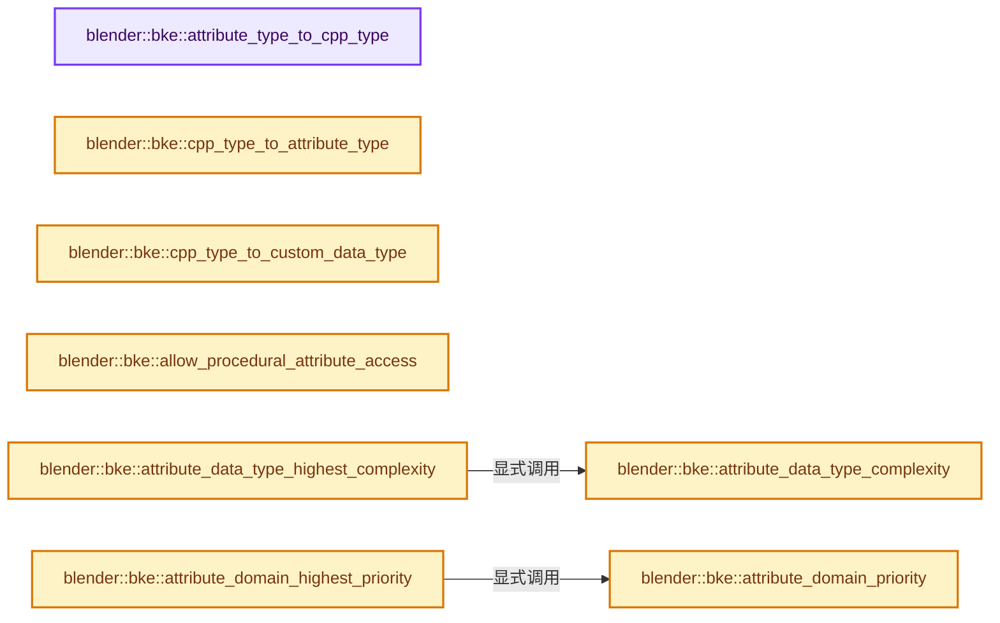

# 实现依赖专题：source/blender/blenkernel/intern/attribute_access.cc

[方向导航](README.md) · [符号索引](../%E7%AC%A6%E5%8F%B7%E4%BE%9D%E8%B5%96%E4%B8%8E%E5%AE%9E%E7%8E%B0%E7%B4%A2%E5%BC%95.md)

本专题从正文实际调用进入，集中保存共享实现。函数有稳定锚点，可从调用处直接跳到对应完整函数；递归与互相调用通过回链组织。

## 本文件的实现关系




## 完整成员与函数实现

<a id="f-69deacfd0fca6244"></a>

### `blender::bke::attribute_type_to_cpp_type`

实现位置：[source/blender/blenkernel/intern/attribute_access.cc](../../../../../source/blender/blenkernel/intern/attribute_access.cc) · L44—L78。

接口参数：

- `const AttrType type`

**教学注释版**

<!-- annotated:0efdbce280d24b -->

```cpp
const CPPType &attribute_type_to_cpp_type(const AttrType type)
{
  switch (type) {
    case AttrType::Bool:
      return CPPType::get<bool>();
    case AttrType::Int8:
      return CPPType::get<int8_t>();
    case AttrType::Int16_2D:
      return CPPType::get<short2>();
    case AttrType::Int32:
      return CPPType::get<int>();
    case AttrType::Int32_2D:
      return CPPType::get<int2>();
    case AttrType::Float:
      return CPPType::get<float>();
    case AttrType::Float2:
      return CPPType::get<float2>();
    case AttrType::Float3:
      return CPPType::get<float3>();
    case AttrType::Float4x4:
      return CPPType::get<float4x4>();
    case AttrType::ColorByte:
      return CPPType::get<ColorGeometry4b>();
    case AttrType::ColorFloat:
      return CPPType::get<ColorGeometry4f>();
    case AttrType::Quaternion:
      return CPPType::get<math::Quaternion>();
    case AttrType::String:
      return CPPType::get<MStringProperty>();
    case AttrType::Float4:
      return CPPType::get<float4>();
  }
  BLI_assert_unreachable();
  return CPPType::get<bool>();
}
```

<details>
<summary>核对原始源码：source/blender/blenkernel/intern/attribute_access.cc · L44—L78</summary>

<!-- original:0efdbce280d24b:source/blender/blenkernel/intern/attribute_access.cc:44:78 -->

```cpp
const CPPType &attribute_type_to_cpp_type(const AttrType type)
{
  switch (type) {
    case AttrType::Bool:
      return CPPType::get<bool>();
    case AttrType::Int8:
      return CPPType::get<int8_t>();
    case AttrType::Int16_2D:
      return CPPType::get<short2>();
    case AttrType::Int32:
      return CPPType::get<int>();
    case AttrType::Int32_2D:
      return CPPType::get<int2>();
    case AttrType::Float:
      return CPPType::get<float>();
    case AttrType::Float2:
      return CPPType::get<float2>();
    case AttrType::Float3:
      return CPPType::get<float3>();
    case AttrType::Float4x4:
      return CPPType::get<float4x4>();
    case AttrType::ColorByte:
      return CPPType::get<ColorGeometry4b>();
    case AttrType::ColorFloat:
      return CPPType::get<ColorGeometry4f>();
    case AttrType::Quaternion:
      return CPPType::get<math::Quaternion>();
    case AttrType::String:
      return CPPType::get<MStringProperty>();
    case AttrType::Float4:
      return CPPType::get<float4>();
  }
  BLI_assert_unreachable();
  return CPPType::get<bool>();
}
```

</details>

**结果出口**

- `return CPPType::get<bool>();`
- `return CPPType::get<int8_t>();`
- `return CPPType::get<short2>();`
- `return CPPType::get<int>();`
- `return CPPType::get<int2>();`
- `return CPPType::get<float>();`
- `return CPPType::get<float2>();`
- `return CPPType::get<float3>();`
- `return CPPType::get<float4x4>();`
- `return CPPType::get<ColorGeometry4b>();`
- `return CPPType::get<ColorGeometry4f>();`
- `return CPPType::get<math::Quaternion>();`
- `return CPPType::get<MStringProperty>();`
- `return CPPType::get<float4>();`

**继续追踪实现**

- `CPPType::get<bool>` → [blender::bke::AttributeIter::get · L408](%E4%BE%9D%E8%B5%96-attribute_access-bceef3.md#f-2c1e25e65fcbed9b)。
- `CPPType::get<int8_t>` → [blender::bke::AttributeIter::get · L408](%E4%BE%9D%E8%B5%96-attribute_access-bceef3.md#f-2c1e25e65fcbed9b)。
- `CPPType::get<short2>` → [blender::bke::AttributeIter::get · L408](%E4%BE%9D%E8%B5%96-attribute_access-bceef3.md#f-2c1e25e65fcbed9b)。
- `CPPType::get<int>` → [blender::bke::AttributeIter::get · L408](%E4%BE%9D%E8%B5%96-attribute_access-bceef3.md#f-2c1e25e65fcbed9b)。
- `CPPType::get<int2>` → [blender::bke::AttributeIter::get · L408](%E4%BE%9D%E8%B5%96-attribute_access-bceef3.md#f-2c1e25e65fcbed9b)。
- `CPPType::get<float>` → [blender::bke::AttributeIter::get · L408](%E4%BE%9D%E8%B5%96-attribute_access-bceef3.md#f-2c1e25e65fcbed9b)。
- `CPPType::get<float2>` → [blender::bke::AttributeIter::get · L408](%E4%BE%9D%E8%B5%96-attribute_access-bceef3.md#f-2c1e25e65fcbed9b)。
- `CPPType::get<float3>` → [blender::bke::AttributeIter::get · L408](%E4%BE%9D%E8%B5%96-attribute_access-bceef3.md#f-2c1e25e65fcbed9b)。
- `CPPType::get<float4x4>` → [blender::bke::AttributeIter::get · L408](%E4%BE%9D%E8%B5%96-attribute_access-bceef3.md#f-2c1e25e65fcbed9b)。
- `CPPType::get<ColorGeometry4b>` → [blender::bke::AttributeIter::get · L408](%E4%BE%9D%E8%B5%96-attribute_access-bceef3.md#f-2c1e25e65fcbed9b)。
- `CPPType::get<ColorGeometry4f>` → [blender::bke::AttributeIter::get · L408](%E4%BE%9D%E8%B5%96-attribute_access-bceef3.md#f-2c1e25e65fcbed9b)。
- `CPPType::get<math::Quaternion>` → [blender::bke::AttributeIter::get · L408](%E4%BE%9D%E8%B5%96-attribute_access-bceef3.md#f-2c1e25e65fcbed9b)。
- `CPPType::get<MStringProperty>` → [blender::bke::AttributeIter::get · L408](%E4%BE%9D%E8%B5%96-attribute_access-bceef3.md#f-2c1e25e65fcbed9b)。
- `CPPType::get<float4>` → [blender::bke::AttributeIter::get · L408](%E4%BE%9D%E8%B5%96-attribute_access-bceef3.md#f-2c1e25e65fcbed9b)。
- `BLI_assert_unreachable` → [BLI_assert_unreachable · L77](../01-%E5%9F%BA%E7%A1%80%E5%AE%B9%E5%99%A8%E4%B8%8E%E7%8E%B0%E4%BB%A3CPP/%E4%BE%9D%E8%B5%96-BLI_assert-cc98e8.md#m-7a2d91a67d8e)。宏定义由构建条件选择。

<a id="f-6ce44c9d2f385cb5"></a>

### `blender::bke::cpp_type_to_attribute_type`

实现位置：[source/blender/blenkernel/intern/attribute_access.cc](../../../../../source/blender/blenkernel/intern/attribute_access.cc) · L80—L126。

接口参数：

- `const CPPType &type`

**教学注释版**

<!-- annotated:47f074045cab5b -->

```cpp
AttrType cpp_type_to_attribute_type(const CPPType &type)
{
  if (type.is<float>()) {
    return AttrType::Float;
  }
  if (type.is<float2>()) {
    return AttrType::Float2;
  }
  if (type.is<float3>()) {
    return AttrType::Float3;
  }
  if (type.is<float4>()) {
    return AttrType::Float4;
  }
  if (type.is<int>()) {
    return AttrType::Int32;
  }
  if (type.is<int2>()) {
    return AttrType::Int32_2D;
  }
  if (type.is<ColorGeometry4f>()) {
    return AttrType::ColorFloat;
  }
  if (type.is<bool>()) {
    return AttrType::Bool;
  }
  if (type.is<int8_t>()) {
    return AttrType::Int8;
  }
  if (type.is<ColorGeometry4b>()) {
    return AttrType::ColorByte;
  }
  if (type.is<math::Quaternion>()) {
    return AttrType::Quaternion;
  }
  if (type.is<float4x4>()) {
    return AttrType::Float4x4;
  }
  if (type.is<short2>()) {
    return AttrType::Int16_2D;
  }
  if (type.is<MStringProperty>()) {
    return AttrType::String;
  }
  BLI_assert_unreachable();
  return AttrType::Bool;
}
```

<details>
<summary>核对原始源码：source/blender/blenkernel/intern/attribute_access.cc · L80—L126</summary>

<!-- original:47f074045cab5b:source/blender/blenkernel/intern/attribute_access.cc:80:126 -->

```cpp
AttrType cpp_type_to_attribute_type(const CPPType &type)
{
  if (type.is<float>()) {
    return AttrType::Float;
  }
  if (type.is<float2>()) {
    return AttrType::Float2;
  }
  if (type.is<float3>()) {
    return AttrType::Float3;
  }
  if (type.is<float4>()) {
    return AttrType::Float4;
  }
  if (type.is<int>()) {
    return AttrType::Int32;
  }
  if (type.is<int2>()) {
    return AttrType::Int32_2D;
  }
  if (type.is<ColorGeometry4f>()) {
    return AttrType::ColorFloat;
  }
  if (type.is<bool>()) {
    return AttrType::Bool;
  }
  if (type.is<int8_t>()) {
    return AttrType::Int8;
  }
  if (type.is<ColorGeometry4b>()) {
    return AttrType::ColorByte;
  }
  if (type.is<math::Quaternion>()) {
    return AttrType::Quaternion;
  }
  if (type.is<float4x4>()) {
    return AttrType::Float4x4;
  }
  if (type.is<short2>()) {
    return AttrType::Int16_2D;
  }
  if (type.is<MStringProperty>()) {
    return AttrType::String;
  }
  BLI_assert_unreachable();
  return AttrType::Bool;
}
```

</details>

**结果出口**

- `return AttrType::Float;`
- `return AttrType::Float2;`
- `return AttrType::Float3;`
- `return AttrType::Float4;`
- `return AttrType::Int32;`
- `return AttrType::Int32_2D;`
- `return AttrType::ColorFloat;`
- `return AttrType::Bool;`
- `return AttrType::Int8;`
- `return AttrType::ColorByte;`
- `return AttrType::Quaternion;`
- `return AttrType::Float4x4;`
- `return AttrType::Int16_2D;`
- `return AttrType::String;`

**继续追踪实现**

- `type.is<float>` → [blender::CPPType::is · L758](../03-%E5%86%85%E5%AD%98%E5%88%86%E9%85%8D%E4%B8%8E%E8%BF%90%E8%A1%8C%E6%97%B6%E7%B1%BB%E5%9E%8B/09-CPPType%E5%A4%8D%E5%88%B6%E7%A7%BB%E5%8A%A8%E9%87%8D%E5%AE%9A%E4%BD%8D.md#f-2e2c3ee7602530a4)。
- `type.is<float2>` → [blender::CPPType::is · L758](../03-%E5%86%85%E5%AD%98%E5%88%86%E9%85%8D%E4%B8%8E%E8%BF%90%E8%A1%8C%E6%97%B6%E7%B1%BB%E5%9E%8B/09-CPPType%E5%A4%8D%E5%88%B6%E7%A7%BB%E5%8A%A8%E9%87%8D%E5%AE%9A%E4%BD%8D.md#f-2e2c3ee7602530a4)。
- `type.is<float3>` → [blender::CPPType::is · L758](../03-%E5%86%85%E5%AD%98%E5%88%86%E9%85%8D%E4%B8%8E%E8%BF%90%E8%A1%8C%E6%97%B6%E7%B1%BB%E5%9E%8B/09-CPPType%E5%A4%8D%E5%88%B6%E7%A7%BB%E5%8A%A8%E9%87%8D%E5%AE%9A%E4%BD%8D.md#f-2e2c3ee7602530a4)。
- `type.is<float4>` → [blender::CPPType::is · L758](../03-%E5%86%85%E5%AD%98%E5%88%86%E9%85%8D%E4%B8%8E%E8%BF%90%E8%A1%8C%E6%97%B6%E7%B1%BB%E5%9E%8B/09-CPPType%E5%A4%8D%E5%88%B6%E7%A7%BB%E5%8A%A8%E9%87%8D%E5%AE%9A%E4%BD%8D.md#f-2e2c3ee7602530a4)。
- `type.is<int>` → [blender::CPPType::is · L758](../03-%E5%86%85%E5%AD%98%E5%88%86%E9%85%8D%E4%B8%8E%E8%BF%90%E8%A1%8C%E6%97%B6%E7%B1%BB%E5%9E%8B/09-CPPType%E5%A4%8D%E5%88%B6%E7%A7%BB%E5%8A%A8%E9%87%8D%E5%AE%9A%E4%BD%8D.md#f-2e2c3ee7602530a4)。
- `type.is<int2>` → [blender::CPPType::is · L758](../03-%E5%86%85%E5%AD%98%E5%88%86%E9%85%8D%E4%B8%8E%E8%BF%90%E8%A1%8C%E6%97%B6%E7%B1%BB%E5%9E%8B/09-CPPType%E5%A4%8D%E5%88%B6%E7%A7%BB%E5%8A%A8%E9%87%8D%E5%AE%9A%E4%BD%8D.md#f-2e2c3ee7602530a4)。
- `type.is<ColorGeometry4f>` → [blender::CPPType::is · L758](../03-%E5%86%85%E5%AD%98%E5%88%86%E9%85%8D%E4%B8%8E%E8%BF%90%E8%A1%8C%E6%97%B6%E7%B1%BB%E5%9E%8B/09-CPPType%E5%A4%8D%E5%88%B6%E7%A7%BB%E5%8A%A8%E9%87%8D%E5%AE%9A%E4%BD%8D.md#f-2e2c3ee7602530a4)。
- `type.is<bool>` → [blender::CPPType::is · L758](../03-%E5%86%85%E5%AD%98%E5%88%86%E9%85%8D%E4%B8%8E%E8%BF%90%E8%A1%8C%E6%97%B6%E7%B1%BB%E5%9E%8B/09-CPPType%E5%A4%8D%E5%88%B6%E7%A7%BB%E5%8A%A8%E9%87%8D%E5%AE%9A%E4%BD%8D.md#f-2e2c3ee7602530a4)。
- `type.is<int8_t>` → [blender::CPPType::is · L758](../03-%E5%86%85%E5%AD%98%E5%88%86%E9%85%8D%E4%B8%8E%E8%BF%90%E8%A1%8C%E6%97%B6%E7%B1%BB%E5%9E%8B/09-CPPType%E5%A4%8D%E5%88%B6%E7%A7%BB%E5%8A%A8%E9%87%8D%E5%AE%9A%E4%BD%8D.md#f-2e2c3ee7602530a4)。
- `type.is<ColorGeometry4b>` → [blender::CPPType::is · L758](../03-%E5%86%85%E5%AD%98%E5%88%86%E9%85%8D%E4%B8%8E%E8%BF%90%E8%A1%8C%E6%97%B6%E7%B1%BB%E5%9E%8B/09-CPPType%E5%A4%8D%E5%88%B6%E7%A7%BB%E5%8A%A8%E9%87%8D%E5%AE%9A%E4%BD%8D.md#f-2e2c3ee7602530a4)。
- `type.is<math::Quaternion>` → [blender::CPPType::is · L758](../03-%E5%86%85%E5%AD%98%E5%88%86%E9%85%8D%E4%B8%8E%E8%BF%90%E8%A1%8C%E6%97%B6%E7%B1%BB%E5%9E%8B/09-CPPType%E5%A4%8D%E5%88%B6%E7%A7%BB%E5%8A%A8%E9%87%8D%E5%AE%9A%E4%BD%8D.md#f-2e2c3ee7602530a4)。
- `type.is<float4x4>` → [blender::CPPType::is · L758](../03-%E5%86%85%E5%AD%98%E5%88%86%E9%85%8D%E4%B8%8E%E8%BF%90%E8%A1%8C%E6%97%B6%E7%B1%BB%E5%9E%8B/09-CPPType%E5%A4%8D%E5%88%B6%E7%A7%BB%E5%8A%A8%E9%87%8D%E5%AE%9A%E4%BD%8D.md#f-2e2c3ee7602530a4)。
- `type.is<short2>` → [blender::CPPType::is · L758](../03-%E5%86%85%E5%AD%98%E5%88%86%E9%85%8D%E4%B8%8E%E8%BF%90%E8%A1%8C%E6%97%B6%E7%B1%BB%E5%9E%8B/09-CPPType%E5%A4%8D%E5%88%B6%E7%A7%BB%E5%8A%A8%E9%87%8D%E5%AE%9A%E4%BD%8D.md#f-2e2c3ee7602530a4)。
- `type.is<MStringProperty>` → [blender::CPPType::is · L758](../03-%E5%86%85%E5%AD%98%E5%88%86%E9%85%8D%E4%B8%8E%E8%BF%90%E8%A1%8C%E6%97%B6%E7%B1%BB%E5%9E%8B/09-CPPType%E5%A4%8D%E5%88%B6%E7%A7%BB%E5%8A%A8%E9%87%8D%E5%AE%9A%E4%BD%8D.md#f-2e2c3ee7602530a4)。
- `BLI_assert_unreachable` → [BLI_assert_unreachable · L77](../01-%E5%9F%BA%E7%A1%80%E5%AE%B9%E5%99%A8%E4%B8%8E%E7%8E%B0%E4%BB%A3CPP/%E4%BE%9D%E8%B5%96-BLI_assert-cc98e8.md#m-7a2d91a67d8e)。宏定义由构建条件选择。

<a id="f-1976326ff582d3c4"></a>

### `blender::bke::cpp_type_to_custom_data_type`

实现位置：[source/blender/blenkernel/intern/attribute_access.cc](../../../../../source/blender/blenkernel/intern/attribute_access.cc) · L164—L209。

接口参数：

- `const CPPType &type`

**教学注释版**

<!-- annotated:76622b2636a1f1 -->

```cpp
std::optional<eCustomDataType> cpp_type_to_custom_data_type(const CPPType &type)
{
  if (type.is<float>()) {
    return CD_PROP_FLOAT;
  }
  if (type.is<float2>()) {
    return CD_PROP_FLOAT2;
  }
  if (type.is<float3>()) {
    return CD_PROP_FLOAT3;
  }
  if (type.is<float4>()) {
    return CD_PROP_FLOAT4;
  }
  if (type.is<int>()) {
    return CD_PROP_INT32;
  }
  if (type.is<int2>()) {
    return CD_PROP_INT32_2D;
  }
  if (type.is<ColorGeometry4f>()) {
    return CD_PROP_COLOR;
  }
  if (type.is<bool>()) {
    return CD_PROP_BOOL;
  }
  if (type.is<int8_t>()) {
    return CD_PROP_INT8;
  }
  if (type.is<ColorGeometry4b>()) {
    return CD_PROP_BYTE_COLOR;
  }
  if (type.is<math::Quaternion>()) {
    return CD_PROP_QUATERNION;
  }
  if (type.is<float4x4>()) {
    return CD_PROP_FLOAT4X4;
  }
  if (type.is<short2>()) {
    return CD_PROP_INT16_2D;
  }
  if (type.is<MStringProperty>()) {
    return CD_PROP_STRING;
  }
  return std::nullopt;
}
```

<details>
<summary>核对原始源码：source/blender/blenkernel/intern/attribute_access.cc · L164—L209</summary>

<!-- original:76622b2636a1f1:source/blender/blenkernel/intern/attribute_access.cc:164:209 -->

```cpp
std::optional<eCustomDataType> cpp_type_to_custom_data_type(const CPPType &type)
{
  if (type.is<float>()) {
    return CD_PROP_FLOAT;
  }
  if (type.is<float2>()) {
    return CD_PROP_FLOAT2;
  }
  if (type.is<float3>()) {
    return CD_PROP_FLOAT3;
  }
  if (type.is<float4>()) {
    return CD_PROP_FLOAT4;
  }
  if (type.is<int>()) {
    return CD_PROP_INT32;
  }
  if (type.is<int2>()) {
    return CD_PROP_INT32_2D;
  }
  if (type.is<ColorGeometry4f>()) {
    return CD_PROP_COLOR;
  }
  if (type.is<bool>()) {
    return CD_PROP_BOOL;
  }
  if (type.is<int8_t>()) {
    return CD_PROP_INT8;
  }
  if (type.is<ColorGeometry4b>()) {
    return CD_PROP_BYTE_COLOR;
  }
  if (type.is<math::Quaternion>()) {
    return CD_PROP_QUATERNION;
  }
  if (type.is<float4x4>()) {
    return CD_PROP_FLOAT4X4;
  }
  if (type.is<short2>()) {
    return CD_PROP_INT16_2D;
  }
  if (type.is<MStringProperty>()) {
    return CD_PROP_STRING;
  }
  return std::nullopt;
}
```

</details>

**结果出口**

- `return CD_PROP_FLOAT;`
- `return CD_PROP_FLOAT2;`
- `return CD_PROP_FLOAT3;`
- `return CD_PROP_FLOAT4;`
- `return CD_PROP_INT32;`
- `return CD_PROP_INT32_2D;`
- `return CD_PROP_COLOR;`
- `return CD_PROP_BOOL;`
- `return CD_PROP_INT8;`
- `return CD_PROP_BYTE_COLOR;`
- `return CD_PROP_QUATERNION;`
- `return CD_PROP_FLOAT4X4;`
- `return CD_PROP_INT16_2D;`
- `return CD_PROP_STRING;`
- `return std::nullopt;`

**继续追踪实现**

- `type.is<float>` → [blender::CPPType::is · L758](../03-%E5%86%85%E5%AD%98%E5%88%86%E9%85%8D%E4%B8%8E%E8%BF%90%E8%A1%8C%E6%97%B6%E7%B1%BB%E5%9E%8B/09-CPPType%E5%A4%8D%E5%88%B6%E7%A7%BB%E5%8A%A8%E9%87%8D%E5%AE%9A%E4%BD%8D.md#f-2e2c3ee7602530a4)。
- `type.is<float2>` → [blender::CPPType::is · L758](../03-%E5%86%85%E5%AD%98%E5%88%86%E9%85%8D%E4%B8%8E%E8%BF%90%E8%A1%8C%E6%97%B6%E7%B1%BB%E5%9E%8B/09-CPPType%E5%A4%8D%E5%88%B6%E7%A7%BB%E5%8A%A8%E9%87%8D%E5%AE%9A%E4%BD%8D.md#f-2e2c3ee7602530a4)。
- `type.is<float3>` → [blender::CPPType::is · L758](../03-%E5%86%85%E5%AD%98%E5%88%86%E9%85%8D%E4%B8%8E%E8%BF%90%E8%A1%8C%E6%97%B6%E7%B1%BB%E5%9E%8B/09-CPPType%E5%A4%8D%E5%88%B6%E7%A7%BB%E5%8A%A8%E9%87%8D%E5%AE%9A%E4%BD%8D.md#f-2e2c3ee7602530a4)。
- `type.is<float4>` → [blender::CPPType::is · L758](../03-%E5%86%85%E5%AD%98%E5%88%86%E9%85%8D%E4%B8%8E%E8%BF%90%E8%A1%8C%E6%97%B6%E7%B1%BB%E5%9E%8B/09-CPPType%E5%A4%8D%E5%88%B6%E7%A7%BB%E5%8A%A8%E9%87%8D%E5%AE%9A%E4%BD%8D.md#f-2e2c3ee7602530a4)。
- `type.is<int>` → [blender::CPPType::is · L758](../03-%E5%86%85%E5%AD%98%E5%88%86%E9%85%8D%E4%B8%8E%E8%BF%90%E8%A1%8C%E6%97%B6%E7%B1%BB%E5%9E%8B/09-CPPType%E5%A4%8D%E5%88%B6%E7%A7%BB%E5%8A%A8%E9%87%8D%E5%AE%9A%E4%BD%8D.md#f-2e2c3ee7602530a4)。
- `type.is<int2>` → [blender::CPPType::is · L758](../03-%E5%86%85%E5%AD%98%E5%88%86%E9%85%8D%E4%B8%8E%E8%BF%90%E8%A1%8C%E6%97%B6%E7%B1%BB%E5%9E%8B/09-CPPType%E5%A4%8D%E5%88%B6%E7%A7%BB%E5%8A%A8%E9%87%8D%E5%AE%9A%E4%BD%8D.md#f-2e2c3ee7602530a4)。
- `type.is<ColorGeometry4f>` → [blender::CPPType::is · L758](../03-%E5%86%85%E5%AD%98%E5%88%86%E9%85%8D%E4%B8%8E%E8%BF%90%E8%A1%8C%E6%97%B6%E7%B1%BB%E5%9E%8B/09-CPPType%E5%A4%8D%E5%88%B6%E7%A7%BB%E5%8A%A8%E9%87%8D%E5%AE%9A%E4%BD%8D.md#f-2e2c3ee7602530a4)。
- `type.is<bool>` → [blender::CPPType::is · L758](../03-%E5%86%85%E5%AD%98%E5%88%86%E9%85%8D%E4%B8%8E%E8%BF%90%E8%A1%8C%E6%97%B6%E7%B1%BB%E5%9E%8B/09-CPPType%E5%A4%8D%E5%88%B6%E7%A7%BB%E5%8A%A8%E9%87%8D%E5%AE%9A%E4%BD%8D.md#f-2e2c3ee7602530a4)。
- `type.is<int8_t>` → [blender::CPPType::is · L758](../03-%E5%86%85%E5%AD%98%E5%88%86%E9%85%8D%E4%B8%8E%E8%BF%90%E8%A1%8C%E6%97%B6%E7%B1%BB%E5%9E%8B/09-CPPType%E5%A4%8D%E5%88%B6%E7%A7%BB%E5%8A%A8%E9%87%8D%E5%AE%9A%E4%BD%8D.md#f-2e2c3ee7602530a4)。
- `type.is<ColorGeometry4b>` → [blender::CPPType::is · L758](../03-%E5%86%85%E5%AD%98%E5%88%86%E9%85%8D%E4%B8%8E%E8%BF%90%E8%A1%8C%E6%97%B6%E7%B1%BB%E5%9E%8B/09-CPPType%E5%A4%8D%E5%88%B6%E7%A7%BB%E5%8A%A8%E9%87%8D%E5%AE%9A%E4%BD%8D.md#f-2e2c3ee7602530a4)。
- `type.is<math::Quaternion>` → [blender::CPPType::is · L758](../03-%E5%86%85%E5%AD%98%E5%88%86%E9%85%8D%E4%B8%8E%E8%BF%90%E8%A1%8C%E6%97%B6%E7%B1%BB%E5%9E%8B/09-CPPType%E5%A4%8D%E5%88%B6%E7%A7%BB%E5%8A%A8%E9%87%8D%E5%AE%9A%E4%BD%8D.md#f-2e2c3ee7602530a4)。
- `type.is<float4x4>` → [blender::CPPType::is · L758](../03-%E5%86%85%E5%AD%98%E5%88%86%E9%85%8D%E4%B8%8E%E8%BF%90%E8%A1%8C%E6%97%B6%E7%B1%BB%E5%9E%8B/09-CPPType%E5%A4%8D%E5%88%B6%E7%A7%BB%E5%8A%A8%E9%87%8D%E5%AE%9A%E4%BD%8D.md#f-2e2c3ee7602530a4)。
- `type.is<short2>` → [blender::CPPType::is · L758](../03-%E5%86%85%E5%AD%98%E5%88%86%E9%85%8D%E4%B8%8E%E8%BF%90%E8%A1%8C%E6%97%B6%E7%B1%BB%E5%9E%8B/09-CPPType%E5%A4%8D%E5%88%B6%E7%A7%BB%E5%8A%A8%E9%87%8D%E5%AE%9A%E4%BD%8D.md#f-2e2c3ee7602530a4)。
- `type.is<MStringProperty>` → [blender::CPPType::is · L758](../03-%E5%86%85%E5%AD%98%E5%88%86%E9%85%8D%E4%B8%8E%E8%BF%90%E8%A1%8C%E6%97%B6%E7%B1%BB%E5%9E%8B/09-CPPType%E5%A4%8D%E5%88%B6%E7%A7%BB%E5%8A%A8%E9%87%8D%E5%AE%9A%E4%BD%8D.md#f-2e2c3ee7602530a4)。

<a id="f-ad250cc5467d3ea3"></a>

### `blender::bke::allow_procedural_attribute_access`

实现位置：[source/blender/blenkernel/intern/attribute_access.cc](../../../../../source/blender/blenkernel/intern/attribute_access.cc) · L214—L241。

接口参数：

- `StringRef attribute_name`

**教学注释版**

<!-- annotated:274d5ba139840b -->

```cpp
bool allow_procedural_attribute_access(StringRef attribute_name)
{
  if (attribute_name.startswith(".corner")) {
    return false;
  }
  if (attribute_name.startswith(".edge")) {
    return false;
  }
  if (attribute_name.startswith(".select")) {
    return false;
  }
  if (attribute_name.startswith(".sculpt")) {
    return false;
  }
  if (attribute_name.startswith(".hide")) {
    return false;
  }
  if (attribute_name.startswith(".uv")) {
    return false;
  }
  if (attribute_name == ".reference_index") {
    return false;
  }
  if (attribute_name.startswith("." UV_PINNED_NAME ".")) {
    return false;
  }
  return true;
}
```

<details>
<summary>核对原始源码：source/blender/blenkernel/intern/attribute_access.cc · L214—L241</summary>

<!-- original:274d5ba139840b:source/blender/blenkernel/intern/attribute_access.cc:214:241 -->

```cpp
bool allow_procedural_attribute_access(StringRef attribute_name)
{
  if (attribute_name.startswith(".corner")) {
    return false;
  }
  if (attribute_name.startswith(".edge")) {
    return false;
  }
  if (attribute_name.startswith(".select")) {
    return false;
  }
  if (attribute_name.startswith(".sculpt")) {
    return false;
  }
  if (attribute_name.startswith(".hide")) {
    return false;
  }
  if (attribute_name.startswith(".uv")) {
    return false;
  }
  if (attribute_name == ".reference_index") {
    return false;
  }
  if (attribute_name.startswith("." UV_PINNED_NAME ".")) {
    return false;
  }
  return true;
}
```

</details>

**结果出口**

- `return false;`
- `return true;`

**继续追踪实现**

- `attribute_name.startswith` → [blender::StringRefBase::startswith · L269](../01-%E5%9F%BA%E7%A1%80%E5%AE%B9%E5%99%A8%E4%B8%8E%E7%8E%B0%E4%BB%A3CPP/15-StringRef%E5%AD%97%E7%AC%A6%E4%B8%B2%E8%A7%86%E5%9B%BE.md#f-78237ccfe249bfa5)。

<a id="f-6491f68576edf511"></a>

### `blender::bke::attribute_data_type_complexity`

实现位置：[source/blender/blenkernel/intern/attribute_access.cc](../../../../../source/blender/blenkernel/intern/attribute_access.cc) · L243—L281。

接口参数：

- `const AttrType data_type`

**教学注释版**

<!-- annotated:4795011f2eb9ec -->

```cpp
static int attribute_data_type_complexity(const AttrType data_type)
{
  switch (data_type) {
    case AttrType::Bool:
      return 0;
    case AttrType::Int8:
      return 1;
    case AttrType::Int32:
      return 2;
    case AttrType::Float:
      return 3;
    case AttrType::Int16_2D:
      return 4;
    case AttrType::Int32_2D:
      return 5;
    case AttrType::Float2:
      return 6;
    case AttrType::Float3:
      return 7;
    case AttrType::Float4:
      return 8;
    case AttrType::ColorByte:
      return 9;
    case AttrType::Quaternion:
      return 10;
    case AttrType::ColorFloat:
      return 11;
    case AttrType::Float4x4:
      return 12;
#if 0 /* These attribute types are not supported yet. */
    case AttrType::String:
      return 13;
#endif
    default:
      /* Only accept "generic" custom data types used by the attribute system. */
      BLI_assert_unreachable();
      return 0;
  }
}
```

<details>
<summary>核对原始源码：source/blender/blenkernel/intern/attribute_access.cc · L243—L281</summary>

<!-- original:4795011f2eb9ec:source/blender/blenkernel/intern/attribute_access.cc:243:281 -->

```cpp
static int attribute_data_type_complexity(const AttrType data_type)
{
  switch (data_type) {
    case AttrType::Bool:
      return 0;
    case AttrType::Int8:
      return 1;
    case AttrType::Int32:
      return 2;
    case AttrType::Float:
      return 3;
    case AttrType::Int16_2D:
      return 4;
    case AttrType::Int32_2D:
      return 5;
    case AttrType::Float2:
      return 6;
    case AttrType::Float3:
      return 7;
    case AttrType::Float4:
      return 8;
    case AttrType::ColorByte:
      return 9;
    case AttrType::Quaternion:
      return 10;
    case AttrType::ColorFloat:
      return 11;
    case AttrType::Float4x4:
      return 12;
#if 0 /* These attribute types are not supported yet. */
    case AttrType::String:
      return 13;
#endif
    default:
      /* Only accept "generic" custom data types used by the attribute system. */
      BLI_assert_unreachable();
      return 0;
  }
}
```

</details>

**结果出口**

- `return 0;`
- `return 1;`
- `return 2;`
- `return 3;`
- `return 4;`
- `return 5;`
- `return 6;`
- `return 7;`
- `return 8;`
- `return 9;`
- `return 10;`
- `return 11;`
- `return 12;`
- `return 13;`

**继续追踪实现**

- `BLI_assert_unreachable` → [BLI_assert_unreachable · L77](../01-%E5%9F%BA%E7%A1%80%E5%AE%B9%E5%99%A8%E4%B8%8E%E7%8E%B0%E4%BB%A3CPP/%E4%BE%9D%E8%B5%96-BLI_assert-cc98e8.md#m-7a2d91a67d8e)。宏定义由构建条件选择。

<a id="f-c82c512ea46b8658"></a>

### `blender::bke::attribute_data_type_highest_complexity`

实现位置：[source/blender/blenkernel/intern/attribute_access.cc](../../../../../source/blender/blenkernel/intern/attribute_access.cc) · L283—L297。

接口参数：

- `Span<AttrType> data_types`

**教学注释版**

<!-- annotated:7265ac4b85801d -->

```cpp
AttrType attribute_data_type_highest_complexity(Span<AttrType> data_types)
{
  int highest_complexity = INT_MIN;
  AttrType most_complex_type = AttrType::ColorFloat;

  for (const AttrType data_type : data_types) {
    const int complexity = attribute_data_type_complexity(data_type);
    if (complexity > highest_complexity) {
      highest_complexity = complexity;
      most_complex_type = data_type;
    }
  }

  return most_complex_type;
}
```

<details>
<summary>核对原始源码：source/blender/blenkernel/intern/attribute_access.cc · L283—L297</summary>

<!-- original:7265ac4b85801d:source/blender/blenkernel/intern/attribute_access.cc:283:297 -->

```cpp
AttrType attribute_data_type_highest_complexity(Span<AttrType> data_types)
{
  int highest_complexity = INT_MIN;
  AttrType most_complex_type = AttrType::ColorFloat;

  for (const AttrType data_type : data_types) {
    const int complexity = attribute_data_type_complexity(data_type);
    if (complexity > highest_complexity) {
      highest_complexity = complexity;
      most_complex_type = data_type;
    }
  }

  return most_complex_type;
}
```

</details>

**沿实际写入检查状态**

- `highest_complexity = complexity;`
- `most_complex_type = data_type;`

**结果出口**

- `return most_complex_type;`

**继续追踪实现**

- `attribute_data_type_complexity` → [blender::bke::attribute_data_type_complexity · L243](%E4%BE%9D%E8%B5%96-attribute_access-bceef3.md#f-6491f68576edf511)。

<a id="f-a51c3fb2a8c2d219"></a>

### `blender::bke::attribute_domain_priority`

实现位置：[source/blender/blenkernel/intern/attribute_access.cc](../../../../../source/blender/blenkernel/intern/attribute_access.cc) · L303—L325。

接口参数：

- `const AttrDomain domain`

**教学注释版**

<!-- annotated:cede3e2df5f417 -->

```cpp
static int attribute_domain_priority(const AttrDomain domain)
{
  switch (domain) {
    case AttrDomain::Instance:
      return 0;
    case AttrDomain::Layer:
      return 1;
    case AttrDomain::Curve:
      return 2;
    case AttrDomain::Face:
      return 3;
    case AttrDomain::Edge:
      return 4;
    case AttrDomain::Point:
      return 5;
    case AttrDomain::Corner:
      return 6;
    default:
      /* Domain not supported in nodes yet. */
      BLI_assert_unreachable();
      return 0;
  }
}
```

<details>
<summary>核对原始源码：source/blender/blenkernel/intern/attribute_access.cc · L303—L325</summary>

<!-- original:cede3e2df5f417:source/blender/blenkernel/intern/attribute_access.cc:303:325 -->

```cpp
static int attribute_domain_priority(const AttrDomain domain)
{
  switch (domain) {
    case AttrDomain::Instance:
      return 0;
    case AttrDomain::Layer:
      return 1;
    case AttrDomain::Curve:
      return 2;
    case AttrDomain::Face:
      return 3;
    case AttrDomain::Edge:
      return 4;
    case AttrDomain::Point:
      return 5;
    case AttrDomain::Corner:
      return 6;
    default:
      /* Domain not supported in nodes yet. */
      BLI_assert_unreachable();
      return 0;
  }
}
```

</details>

**结果出口**

- `return 0;`
- `return 1;`
- `return 2;`
- `return 3;`
- `return 4;`
- `return 5;`
- `return 6;`

**继续追踪实现**

- `BLI_assert_unreachable` → [BLI_assert_unreachable · L77](../01-%E5%9F%BA%E7%A1%80%E5%AE%B9%E5%99%A8%E4%B8%8E%E7%8E%B0%E4%BB%A3CPP/%E4%BE%9D%E8%B5%96-BLI_assert-cc98e8.md#m-7a2d91a67d8e)。宏定义由构建条件选择。

<a id="f-4577347bd2fe8cf9"></a>

### `blender::bke::attribute_domain_highest_priority`

实现位置：[source/blender/blenkernel/intern/attribute_access.cc](../../../../../source/blender/blenkernel/intern/attribute_access.cc) · L327—L341。

接口参数：

- `Span<AttrDomain> domains`

**教学注释版**

<!-- annotated:cf712eb8ec54d3 -->

```cpp
AttrDomain attribute_domain_highest_priority(Span<AttrDomain> domains)
{
  int highest_priority = INT_MIN;
  AttrDomain highest_priority_domain = AttrDomain::Corner;

  for (const AttrDomain domain : domains) {
    const int priority = attribute_domain_priority(domain);
    if (priority > highest_priority) {
      highest_priority = priority;
      highest_priority_domain = domain;
    }
  }

  return highest_priority_domain;
}
```

<details>
<summary>核对原始源码：source/blender/blenkernel/intern/attribute_access.cc · L327—L341</summary>

<!-- original:cf712eb8ec54d3:source/blender/blenkernel/intern/attribute_access.cc:327:341 -->

```cpp
AttrDomain attribute_domain_highest_priority(Span<AttrDomain> domains)
{
  int highest_priority = INT_MIN;
  AttrDomain highest_priority_domain = AttrDomain::Corner;

  for (const AttrDomain domain : domains) {
    const int priority = attribute_domain_priority(domain);
    if (priority > highest_priority) {
      highest_priority = priority;
      highest_priority_domain = domain;
    }
  }

  return highest_priority_domain;
}
```

</details>

**沿实际写入检查状态**

- `highest_priority = priority;`
- `highest_priority_domain = domain;`

**结果出口**

- `return highest_priority_domain;`

**继续追踪实现**

- `attribute_domain_priority` → [blender::bke::attribute_domain_priority · L303](%E4%BE%9D%E8%B5%96-attribute_access-bceef3.md#f-a51c3fb2a8c2d219)。

<a id="f-13d23efd30c5c821"></a>

### `blender::bke::try_adapt_data_type`

实现位置：[source/blender/blenkernel/intern/attribute_access.cc](../../../../../source/blender/blenkernel/intern/attribute_access.cc) · L347—L351。

接口参数：

- `GVArray varray`
- `const CPPType &to_type`

**教学注释版**

<!-- annotated:346857e961ed9b -->

```cpp
static GVArray try_adapt_data_type(GVArray varray, const CPPType &to_type)
{
  const DataTypeConversions &conversions = get_implicit_type_conversions();
  // [讲解] std::move：把表达式转换成可供移动重载选择的值类别；不保证真的移动，不结束源对象寿命，对const值可能选择复制。
  return conversions.try_convert(std::move(varray), to_type);
}
```

<details>
<summary>核对原始源码：source/blender/blenkernel/intern/attribute_access.cc · L347—L351</summary>

<!-- original:346857e961ed9b:source/blender/blenkernel/intern/attribute_access.cc:347:351 -->

```cpp
static GVArray try_adapt_data_type(GVArray varray, const CPPType &to_type)
{
  const DataTypeConversions &conversions = get_implicit_type_conversions();
  return conversions.try_convert(std::move(varray), to_type);
}
```

</details>

**结果出口**

- `return conversions.try_convert(std::move(varray), to_type);`

**继续追踪实现**

- `get_implicit_type_conversions` → [blender::bke::get_implicit_type_conversions · L792](%E4%BE%9D%E8%B5%96-type_conversions-3b750b.md#f-d51bbc626389d24e)。
- `conversions.try_convert` → [blender::bke::DataTypeConversions::try_convert · L969](%E4%BE%9D%E8%B5%96-type_conversions-3b750b.md#f-b1866b9d16faa1f0)；[blender::bke::DataTypeConversions::try_convert · L981](%E4%BE%9D%E8%B5%96-type_conversions-3b750b.md#f-448aa5c73d3c08cc)；[blender::bke::DataTypeConversions::try_convert · L995](%E4%BE%9D%E8%B5%96-type_conversions-3b750b.md#f-b91295fed7404196)。同名重载需按实参类型选择。
- `std::move` → [外部契约](https://eel.is/c++draft/utility.forward)：把表达式转换成可供移动重载选择的值类别；不保证真的移动，不结束源对象寿命，对const值可能选择复制。

<a id="f-c3009e7c6620affd"></a>

### `blender::bke::adapt_domain_and_type_if_necessary`

实现位置：[source/blender/blenkernel/intern/attribute_access.cc](../../../../../source/blender/blenkernel/intern/attribute_access.cc) · L370—L399。

接口参数：

- `GAttributeReader attribute`
- `const std::optional<AttrDomain> domain`
- `const std::optional<AttrType> data_type`
- `const AttributeAccessor &accessor`

**教学注释版**

<!-- annotated:4ce84bc3a15772 -->

```cpp
static GAttributeReader adapt_domain_and_type_if_necessary(GAttributeReader attribute,
                                                           const std::optional<AttrDomain> domain,
                                                           const std::optional<AttrType> data_type,
                                                           const AttributeAccessor &accessor)
{
  if (!attribute) {
    return {};
  }
  if (domain.has_value()) {
    if (attribute.domain != domain) {
      attribute.varray = accessor.adapt_domain(attribute.varray, attribute.domain, *domain);
      attribute.domain = *domain;
      attribute.sharing_info = nullptr;
      if (!attribute.varray) {
        return {};
      }
    }
  }
  if (data_type.has_value()) {
    const CPPType &type = attribute_type_to_cpp_type(*data_type);
    if (attribute.varray.type() != type) {
      // [讲解] std::move：把表达式转换成可供移动重载选择的值类别；不保证真的移动，不结束源对象寿命，对const值可能选择复制。
      attribute.varray = try_adapt_data_type(std::move(attribute.varray), type);
      attribute.sharing_info = nullptr;
      if (!attribute.varray) {
        return {};
      }
    }
  }
  return attribute;
}
```

<details>
<summary>核对原始源码：source/blender/blenkernel/intern/attribute_access.cc · L370—L399</summary>

<!-- original:4ce84bc3a15772:source/blender/blenkernel/intern/attribute_access.cc:370:399 -->

```cpp
static GAttributeReader adapt_domain_and_type_if_necessary(GAttributeReader attribute,
                                                           const std::optional<AttrDomain> domain,
                                                           const std::optional<AttrType> data_type,
                                                           const AttributeAccessor &accessor)
{
  if (!attribute) {
    return {};
  }
  if (domain.has_value()) {
    if (attribute.domain != domain) {
      attribute.varray = accessor.adapt_domain(attribute.varray, attribute.domain, *domain);
      attribute.domain = *domain;
      attribute.sharing_info = nullptr;
      if (!attribute.varray) {
        return {};
      }
    }
  }
  if (data_type.has_value()) {
    const CPPType &type = attribute_type_to_cpp_type(*data_type);
    if (attribute.varray.type() != type) {
      attribute.varray = try_adapt_data_type(std::move(attribute.varray), type);
      attribute.sharing_info = nullptr;
      if (!attribute.varray) {
        return {};
      }
    }
  }
  return attribute;
}
```

</details>

**沿实际写入检查状态**

- `attribute.varray = accessor.adapt_domain(attribute.varray, attribute.domain, *domain);`
- `attribute.domain = *domain;`
- `attribute.sharing_info = nullptr;`
- `attribute.varray = try_adapt_data_type(std::move(attribute.varray), type);`

**结果出口**

- `return {};`
- `return attribute;`

**继续追踪实现**

- `domain.has_value` → [外部契约](https://eel.is/c++draft/)：这个边界按实际表达式及所属类型核对参数、返回值、寿命与失败行为。这里提供接口入口，不声称已解释该第三方版本的内部实现。
- `accessor.adapt_domain` → [blender::bke::AttributeAccessor::adapt_domain · L665](08-AttributeAccessor%E6%8E%A5%E5%8F%A3.md#f-305741960874253d)；[blender::bke::AttributeAccessor::adapt_domain · L675](08-AttributeAccessor%E6%8E%A5%E5%8F%A3.md#f-4a5f3c263af68b9c)。同名重载需按实参类型选择。
- `data_type.has_value` → [外部契约](https://eel.is/c++draft/)：这个边界按实际表达式及所属类型核对参数、返回值、寿命与失败行为。这里提供接口入口，不声称已解释该第三方版本的内部实现。
- `attribute_type_to_cpp_type` → [blender::bke::attribute_type_to_cpp_type · L44](%E4%BE%9D%E8%B5%96-attribute_access-bceef3.md#f-69deacfd0fca6244)。
- `attribute.varray.type` → [调用协议](../%E6%A8%A1%E6%9D%BF%E5%AE%8F%E4%B8%8E%E5%8A%A8%E6%80%81%E5%88%86%E6%B4%BE%E5%8D%8F%E8%AE%AE.md)：接收对象类型依赖auto、返回值或模板实例；不按同名猜测目标。调用位置L390。
- `try_adapt_data_type` → [blender::bke::try_adapt_data_type · L347](%E4%BE%9D%E8%B5%96-attribute_access-bceef3.md#f-13d23efd30c5c821)。
- `std::move` → [外部契约](https://eel.is/c++draft/utility.forward)：把表达式转换成可供移动重载选择的值类别；不保证真的移动，不结束源对象寿命，对const值可能选择复制。

<a id="f-4673351b7bb3b651"></a>

### `blender::bke::AttributeAccessor::lookup`

实现位置：[source/blender/blenkernel/intern/attribute_access.cc](../../../../../source/blender/blenkernel/intern/attribute_access.cc) · L401—L406。

接口参数：

- `const StringRef name`
- `const std::optional<AttrDomain> domain`
- `const std::optional<AttrType> data_type`

**教学注释版**

<!-- annotated:f396ff7b7db02f -->

```cpp
GAttributeReader AttributeAccessor::lookup(const StringRef name,
                                           const std::optional<AttrDomain> domain,
                                           const std::optional<AttrType> data_type) const
{
  return adapt_domain_and_type_if_necessary(this->lookup(name), domain, data_type, *this);
}
```

<details>
<summary>核对原始源码：source/blender/blenkernel/intern/attribute_access.cc · L401—L406</summary>

<!-- original:f396ff7b7db02f:source/blender/blenkernel/intern/attribute_access.cc:401:406 -->

```cpp
GAttributeReader AttributeAccessor::lookup(const StringRef name,
                                           const std::optional<AttrDomain> domain,
                                           const std::optional<AttrType> data_type) const
{
  return adapt_domain_and_type_if_necessary(this->lookup(name), domain, data_type, *this);
}
```

</details>

**结果出口**

- `return adapt_domain_and_type_if_necessary(this->lookup(name), domain, data_type, *this);`

**继续追踪实现**

- `adapt_domain_and_type_if_necessary` → [blender::bke::adapt_domain_and_type_if_necessary · L370](%E4%BE%9D%E8%B5%96-attribute_access-bceef3.md#f-c3009e7c6620affd)。
- `this->lookup` → [blender::bke::AttributeAccessor::lookup · L401](%E4%BE%9D%E8%B5%96-attribute_access-bceef3.md#f-4673351b7bb3b651)。

<a id="f-2c1e25e65fcbed9b"></a>

### `blender::bke::AttributeIter::get`

实现位置：[source/blender/blenkernel/intern/attribute_access.cc](../../../../../source/blender/blenkernel/intern/attribute_access.cc) · L408—L413。

接口参数：

- `std::optional<AttrDomain> domain`
- `std::optional<AttrType> data_type`

**教学注释版**

<!-- annotated:3ac20252a9ca3e -->

```cpp
GAttributeReader AttributeIter::get(std::optional<AttrDomain> domain,
                                    std::optional<AttrType> data_type) const
{
  BLI_assert(this->accessor != nullptr);
  return adapt_domain_and_type_if_necessary(this->get(), domain, data_type, *accessor);
}
```

<details>
<summary>核对原始源码：source/blender/blenkernel/intern/attribute_access.cc · L408—L413</summary>

<!-- original:3ac20252a9ca3e:source/blender/blenkernel/intern/attribute_access.cc:408:413 -->

```cpp
GAttributeReader AttributeIter::get(std::optional<AttrDomain> domain,
                                    std::optional<AttrType> data_type) const
{
  BLI_assert(this->accessor != nullptr);
  return adapt_domain_and_type_if_necessary(this->get(), domain, data_type, *accessor);
}
```

</details>

**结果出口**

- `return adapt_domain_and_type_if_necessary(this->get(), domain, data_type, *accessor);`

**继续追踪实现**

- `BLI_assert` → [BLI_assert · L48](../01-%E5%9F%BA%E7%A1%80%E5%AE%B9%E5%99%A8%E4%B8%8E%E7%8E%B0%E4%BB%A3CPP/%E4%BE%9D%E8%B5%96-BLI_assert-cc98e8.md#m-57a88495704d)；[BLI_assert · L63](../01-%E5%9F%BA%E7%A1%80%E5%AE%B9%E5%99%A8%E4%B8%8E%E7%8E%B0%E4%BB%A3CPP/%E4%BE%9D%E8%B5%96-BLI_assert-cc98e8.md#m-d07050020cb5)。宏定义由构建条件选择。
- `adapt_domain_and_type_if_necessary` → [blender::bke::adapt_domain_and_type_if_necessary · L370](%E4%BE%9D%E8%B5%96-attribute_access-bceef3.md#f-c3009e7c6620affd)。
- `this->get` → [blender::bke::AttributeIter::get · L408](%E4%BE%9D%E8%B5%96-attribute_access-bceef3.md#f-2c1e25e65fcbed9b)。

<a id="f-a0cc3e316f1da4bd"></a>

### `blender::bke::AttributeAccessor::lookup_or_default`

实现位置：[source/blender/blenkernel/intern/attribute_access.cc](../../../../../source/blender/blenkernel/intern/attribute_access.cc) · L415—L430。

接口参数：

- `const StringRef name`
- `const AttrDomain domain`
- `const AttrType data_type`
- `const void *default_value`

**教学注释版**

<!-- annotated:aaa7172f35432c -->

```cpp
GAttributeReader AttributeAccessor::lookup_or_default(const StringRef name,
                                                      const AttrDomain domain,
                                                      const AttrType data_type,
                                                      const void *default_value) const
{
  GAttributeReader attribute = this->lookup(name, domain, data_type);
  if (attribute) {
    return attribute;
  }
  const CPPType &type = attribute_type_to_cpp_type(data_type);
  const int64_t domain_size = this->domain_size(domain);
  if (default_value == nullptr) {
    return {GVArray::from_single_ref(type, domain_size, type.default_value()), domain, nullptr};
  }
  return {GVArray::from_single(type, domain_size, default_value), domain, nullptr};
}
```

<details>
<summary>核对原始源码：source/blender/blenkernel/intern/attribute_access.cc · L415—L430</summary>

<!-- original:aaa7172f35432c:source/blender/blenkernel/intern/attribute_access.cc:415:430 -->

```cpp
GAttributeReader AttributeAccessor::lookup_or_default(const StringRef name,
                                                      const AttrDomain domain,
                                                      const AttrType data_type,
                                                      const void *default_value) const
{
  GAttributeReader attribute = this->lookup(name, domain, data_type);
  if (attribute) {
    return attribute;
  }
  const CPPType &type = attribute_type_to_cpp_type(data_type);
  const int64_t domain_size = this->domain_size(domain);
  if (default_value == nullptr) {
    return {GVArray::from_single_ref(type, domain_size, type.default_value()), domain, nullptr};
  }
  return {GVArray::from_single(type, domain_size, default_value), domain, nullptr};
}
```

</details>

**结果出口**

- `return attribute;`
- `return {GVArray::from_single_ref(type, domain_size, type.default_value()), domain, nullptr};`
- `return {GVArray::from_single(type, domain_size, default_value), domain, nullptr};`

**继续追踪实现**

- `this->lookup` → [blender::bke::AttributeAccessor::lookup · L401](%E4%BE%9D%E8%B5%96-attribute_access-bceef3.md#f-4673351b7bb3b651)。
- `attribute_type_to_cpp_type` → [blender::bke::attribute_type_to_cpp_type · L44](%E4%BE%9D%E8%B5%96-attribute_access-bceef3.md#f-69deacfd0fca6244)。
- `this->domain_size` → [blender::bke::AttributeAccessor::domain_size · L549](08-AttributeAccessor%E6%8E%A5%E5%8F%A3.md#f-ef6a71571070a259)。
- `GVArray::from_single_ref` → [blender::GVArray::from_single_ref · L885](../04-%E8%99%9A%E6%8B%9F%E6%95%B0%E7%BB%84%E4%B8%8E%E7%B4%A2%E5%BC%95%E9%80%89%E6%8B%A9/05-GVArray%E8%BF%90%E8%A1%8C%E6%97%B6%E7%B1%BB%E5%9E%8B.md#f-8208f854554701e4)。
- `type.default_value` → [blender::CPPType::default_value · L743](../03-%E5%86%85%E5%AD%98%E5%88%86%E9%85%8D%E4%B8%8E%E8%BF%90%E8%A1%8C%E6%97%B6%E7%B1%BB%E5%9E%8B/09-CPPType%E5%A4%8D%E5%88%B6%E7%A7%BB%E5%8A%A8%E9%87%8D%E5%AE%9A%E4%BD%8D.md#f-95e76cbe74b383e8)。
- `GVArray::from_single` → [blender::GVArray::from_single · L880](../04-%E8%99%9A%E6%8B%9F%E6%95%B0%E7%BB%84%E4%B8%8E%E7%B4%A2%E5%BC%95%E9%80%89%E6%8B%A9/05-GVArray%E8%BF%90%E8%A1%8C%E6%97%B6%E7%B1%BB%E5%9E%8B.md#f-1c85e09520e47c5a)。

<a id="f-1eaf279a9aba624e"></a>

### `blender::bke::AttributeAccessor::all_names`

实现位置：[source/blender/blenkernel/intern/attribute_access.cc](../../../../../source/blender/blenkernel/intern/attribute_access.cc) · L432—L437。

**教学注释版**

<!-- annotated:c2af4f6db1b1d9 -->

```cpp
Set<StringRefNull> AttributeAccessor::all_names() const
{
  Set<StringRefNull> names;
  // [讲解] names.add：按哈希与相等关系加入键或键值。
  this->foreach_attribute([&](const AttributeIter &iter) { names.add(iter.name); });
  return names;
}
```

<details>
<summary>核对原始源码：source/blender/blenkernel/intern/attribute_access.cc · L432—L437</summary>

<!-- original:c2af4f6db1b1d9:source/blender/blenkernel/intern/attribute_access.cc:432:437 -->

```cpp
Set<StringRefNull> AttributeAccessor::all_names() const
{
  Set<StringRefNull> names;
  this->foreach_attribute([&](const AttributeIter &iter) { names.add(iter.name); });
  return names;
}
```

</details>

**结果出口**

- `return names;`

**继续追踪实现**

- `this->foreach_attribute` → [blender::bke::AttributeAccessor::foreach_attribute · L687](08-AttributeAccessor%E6%8E%A5%E5%8F%A3.md#f-44723ac57e0d1fa4)。
- `names.add` → [blender::Set::add · L248](../02-%E5%93%88%E5%B8%8C%E8%A1%A8%E4%B8%8E%E5%85%B3%E8%81%94%E6%95%B0%E6%8D%AE%E7%BB%93%E6%9E%84/08-Set%E4%B8%8E%E9%9B%86%E5%90%88%E8%AF%AD%E4%B9%89.md#f-c7498809c2327fba)；[blender::Set::add · L252](../02-%E5%93%88%E5%B8%8C%E8%A1%A8%E4%B8%8E%E5%85%B3%E8%81%94%E6%95%B0%E6%8D%AE%E7%BB%93%E6%9E%84/08-Set%E4%B8%8E%E9%9B%86%E5%90%88%E8%AF%AD%E4%B9%89.md#f-e3ac8d1c52c03c2b)。同名重载需按实参类型选择。

<a id="f-8a4fc09163bd3be3"></a>

### `blender::bke::AttributeAccessor::has_anonymous`

实现位置：[source/blender/blenkernel/intern/attribute_access.cc](../../../../../source/blender/blenkernel/intern/attribute_access.cc) · L440—L450。

**教学注释版**

<!-- annotated:784b48bea7dba8 -->

```cpp
bool AttributeAccessor::has_anonymous() const
{
  bool found_anonymous = false;
  this->foreach_attribute([&](const AttributeIter &iter) {
    if (attribute_name_is_anonymous(iter.name)) {
      found_anonymous = true;
      iter.stop();
    }
  });
  return found_anonymous;
}
```

<details>
<summary>核对原始源码：source/blender/blenkernel/intern/attribute_access.cc · L440—L450</summary>

<!-- original:784b48bea7dba8:source/blender/blenkernel/intern/attribute_access.cc:440:450 -->

```cpp
bool AttributeAccessor::has_anonymous() const
{
  bool found_anonymous = false;
  this->foreach_attribute([&](const AttributeIter &iter) {
    if (attribute_name_is_anonymous(iter.name)) {
      found_anonymous = true;
      iter.stop();
    }
  });
  return found_anonymous;
}
```

</details>

**沿实际写入检查状态**

- `found_anonymous = true;`

**结果出口**

- `return found_anonymous;`

**继续追踪实现**

- `this->foreach_attribute` → [blender::bke::AttributeAccessor::foreach_attribute · L687](08-AttributeAccessor%E6%8E%A5%E5%8F%A3.md#f-44723ac57e0d1fa4)。
- `attribute_name_is_anonymous` → [blender::bke::attribute_name_is_anonymous · L24](../10-%E5%BC%95%E7%94%A8%E7%94%9F%E5%91%BD%E5%91%A8%E6%9C%9F%E4%B8%8EClosure/01-%E5%8C%BF%E5%90%8D%E5%B1%9E%E6%80%A7%E4%B8%8E%E5%BC%95%E7%94%A8%E9%97%AE%E9%A2%98.md#f-ce0c92720483f1bc)。
- `iter.stop` → [blender::bke::AttributeIter::stop · L414](08-AttributeAccessor%E6%8E%A5%E5%8F%A3.md#f-d7a4971daaf59ad1)。

<a id="f-78e5b5003d988d41"></a>

### `blender::bke::MutableAttributeAccessor::remove_anonymous`

实现位置：[source/blender/blenkernel/intern/attribute_access.cc](../../../../../source/blender/blenkernel/intern/attribute_access.cc) · L452—L464。

**教学注释版**

<!-- annotated:f9ab1862e75752 -->

```cpp
void MutableAttributeAccessor::remove_anonymous()
{
  Vector<std::string> anonymous_ids;
  for (const StringRef name : this->all_names()) {
    if (attribute_name_is_anonymous(name)) {
      // [讲解] anonymous_ids.append：在尾部建立新元素，必要时先扩大存储。
      anonymous_ids.append(name);
    }
  }

  while (!anonymous_ids.is_empty()) {
    // [讲解] anonymous_ids.pop_last：取走最后一个值并移除末元素。
    this->remove(anonymous_ids.pop_last());
  }
}
```

<details>
<summary>核对原始源码：source/blender/blenkernel/intern/attribute_access.cc · L452—L464</summary>

<!-- original:f9ab1862e75752:source/blender/blenkernel/intern/attribute_access.cc:452:464 -->

```cpp
void MutableAttributeAccessor::remove_anonymous()
{
  Vector<std::string> anonymous_ids;
  for (const StringRef name : this->all_names()) {
    if (attribute_name_is_anonymous(name)) {
      anonymous_ids.append(name);
    }
  }

  while (!anonymous_ids.is_empty()) {
    this->remove(anonymous_ids.pop_last());
  }
}
```

</details>

**继续追踪实现**

- `this->all_names` → [blender::bke::AttributeAccessor::all_names · L432](%E4%BE%9D%E8%B5%96-attribute_access-bceef3.md#f-1eaf279a9aba624e)。
- `attribute_name_is_anonymous` → [blender::bke::attribute_name_is_anonymous · L24](../10-%E5%BC%95%E7%94%A8%E7%94%9F%E5%91%BD%E5%91%A8%E6%9C%9F%E4%B8%8EClosure/01-%E5%8C%BF%E5%90%8D%E5%B1%9E%E6%80%A7%E4%B8%8E%E5%BC%95%E7%94%A8%E9%97%AE%E9%A2%98.md#f-ce0c92720483f1bc)。
- `anonymous_ids.append` → [blender::Vector::append · L498](../01-%E5%9F%BA%E7%A1%80%E5%AE%B9%E5%99%A8%E4%B8%8E%E7%8E%B0%E4%BB%A3CPP/11-Vector%E6%8F%92%E5%85%A5%E5%88%A0%E9%99%A4%E4%B8%8E%E9%87%8D%E6%8E%92.md#f-5bde268a69e443ec)；[blender::Vector::append · L502](../01-%E5%9F%BA%E7%A1%80%E5%AE%B9%E5%99%A8%E4%B8%8E%E7%8E%B0%E4%BB%A3CPP/11-Vector%E6%8F%92%E5%85%A5%E5%88%A0%E9%99%A4%E4%B8%8E%E9%87%8D%E6%8E%92.md#f-591e0b15e6308532)。同名重载需按实参类型选择。
- `anonymous_ids.is_empty` → [blender::Vector::is_empty · L792](../01-%E5%9F%BA%E7%A1%80%E5%AE%B9%E5%99%A8%E4%B8%8E%E7%8E%B0%E4%BB%A3CPP/11-Vector%E6%8F%92%E5%85%A5%E5%88%A0%E9%99%A4%E4%B8%8E%E9%87%8D%E6%8E%92.md#f-937bbd9cb80bdcc8)。
- `this->remove` → [blender::bke::MutableAttributeAccessor::remove · L1007](08-AttributeAccessor%E6%8E%A5%E5%8F%A3.md#f-70cc562b046f24be)。
- `anonymous_ids.pop_last` → [blender::Vector::pop_last · L815](../01-%E5%9F%BA%E7%A1%80%E5%AE%B9%E5%99%A8%E4%B8%8E%E7%8E%B0%E4%BB%A3CPP/11-Vector%E6%8F%92%E5%85%A5%E5%88%A0%E9%99%A4%E4%B8%8E%E9%87%8D%E6%8E%92.md#f-e001e773e04130ce)。

<a id="f-626a06b469b879d0"></a>

### `blender::bke::MutableAttributeAccessor::lookup_for_write`

实现位置：[source/blender/blenkernel/intern/attribute_access.cc](../../../../../source/blender/blenkernel/intern/attribute_access.cc) · L485—L503。

接口参数：

- `const StringRef name`

**教学注释版**

<!-- annotated:6b87e7dd7a6bfc -->

```cpp
GAttributeWriter MutableAttributeAccessor::lookup_for_write(const StringRef name)
{
  GAttributeWriter attribute = fn_->lookup_for_write(owner_, name);
  /* Check that the #finish method is called in debug builds. */
#ifndef NDEBUG
  if (attribute) {
    // [讲解] std::make_shared<FinishCallChecker>：构造由共享控制块管理的对象；共享寿命不自动使被指对象读写线程安全，强引用环需单独处理。
    auto checker = std::make_shared<FinishCallChecker>();
    checker->name = name;
    checker->real_finish_fn = attribute.tag_modified_fn;
    attribute.tag_modified_fn = [checker]() {
      if (checker->real_finish_fn) {
        checker->real_finish_fn();
      }
      checker->finish_called = true;
    };
  }
#endif
  return attribute;
}
```

<details>
<summary>核对原始源码：source/blender/blenkernel/intern/attribute_access.cc · L485—L503</summary>

<!-- original:6b87e7dd7a6bfc:source/blender/blenkernel/intern/attribute_access.cc:485:503 -->

```cpp
GAttributeWriter MutableAttributeAccessor::lookup_for_write(const StringRef name)
{
  GAttributeWriter attribute = fn_->lookup_for_write(owner_, name);
  /* Check that the #finish method is called in debug builds. */
#ifndef NDEBUG
  if (attribute) {
    auto checker = std::make_shared<FinishCallChecker>();
    checker->name = name;
    checker->real_finish_fn = attribute.tag_modified_fn;
    attribute.tag_modified_fn = [checker]() {
      if (checker->real_finish_fn) {
        checker->real_finish_fn();
      }
      checker->finish_called = true;
    };
  }
#endif
  return attribute;
}
```

</details>

**沿实际写入检查状态**

- `checker->name = name;`
- `checker->real_finish_fn = attribute.tag_modified_fn;`
- `attribute.tag_modified_fn = [checker]() {`
- `checker->finish_called = true;`

**结果出口**

- `return attribute;`

**继续追踪实现**

- `fn_->lookup_for_write` → [调用协议](../%E6%A8%A1%E6%9D%BF%E5%AE%8F%E4%B8%8E%E5%8A%A8%E6%80%81%E5%88%86%E6%B4%BE%E5%8D%8F%E8%AE%AE.md)：接收对象类型依赖auto、返回值或模板实例；不按同名猜测目标。调用位置L487。
- `std::make_shared<FinishCallChecker>` → [外部契约](https://eel.is/c++draft/util.smartptr.shared.create)：构造由共享控制块管理的对象；共享寿命不自动使被指对象读写线程安全，强引用环需单独处理。
- `checker->real_finish_fn` → [调用协议](../%E6%A8%A1%E6%9D%BF%E5%AE%8F%E4%B8%8E%E5%8A%A8%E6%80%81%E5%88%86%E6%B4%BE%E5%8D%8F%E8%AE%AE.md)：接收对象类型依赖auto、返回值或模板实例；不按同名猜测目标。调用位置L496。

<a id="f-eac5b5d8814ff900"></a>

### `blender::bke::MutableAttributeAccessor::lookup_for_write_span`

实现位置：[source/blender/blenkernel/intern/attribute_access.cc](../../../../../source/blender/blenkernel/intern/attribute_access.cc) · L505—L512。

接口参数：

- `const StringRef name`

**教学注释版**

<!-- annotated:9c5ac53c2578a1 -->

```cpp
GSpanAttributeWriter MutableAttributeAccessor::lookup_for_write_span(const StringRef name)
{
  GAttributeWriter attribute = this->lookup_for_write(name);
  if (attribute) {
    // [讲解] std::move：把表达式转换成可供移动重载选择的值类别；不保证真的移动，不结束源对象寿命，对const值可能选择复制。
    return GSpanAttributeWriter{std::move(attribute), true};
  }
  return {};
}
```

<details>
<summary>核对原始源码：source/blender/blenkernel/intern/attribute_access.cc · L505—L512</summary>

<!-- original:9c5ac53c2578a1:source/blender/blenkernel/intern/attribute_access.cc:505:512 -->

```cpp
GSpanAttributeWriter MutableAttributeAccessor::lookup_for_write_span(const StringRef name)
{
  GAttributeWriter attribute = this->lookup_for_write(name);
  if (attribute) {
    return GSpanAttributeWriter{std::move(attribute), true};
  }
  return {};
}
```

</details>

**结果出口**

- `return GSpanAttributeWriter{std::move(attribute), true};`
- `return {};`

**继续追踪实现**

- `this->lookup_for_write` → [blender::bke::MutableAttributeAccessor::lookup_for_write · L485](%E4%BE%9D%E8%B5%96-attribute_access-bceef3.md#f-626a06b469b879d0)。
- `std::move` → [外部契约](https://eel.is/c++draft/utility.forward)：把表达式转换成可供移动重载选择的值类别；不保证真的移动，不结束源对象寿命，对const值可能选择复制。

<a id="f-045e43dc4c223897"></a>

### `blender::bke::MutableAttributeAccessor::lookup_or_add_for_write`

实现位置：[source/blender/blenkernel/intern/attribute_access.cc](../../../../../source/blender/blenkernel/intern/attribute_access.cc) · L514—L531。

接口参数：

- `const StringRef name`
- `const AttrDomain domain`
- `const AttrType data_type`
- `const AttributeInit &initializer`

**教学注释版**

<!-- annotated:3867c16cfe1bcf -->

```cpp
GAttributeWriter MutableAttributeAccessor::lookup_or_add_for_write(
    const StringRef name,
    const AttrDomain domain,
    const AttrType data_type,
    const AttributeInit &initializer)
{
  std::optional<AttributeMetaData> meta_data = this->lookup_meta_data(name);
  if (meta_data.has_value()) {
    if (meta_data->domain == domain && meta_data->data_type == data_type) {
      return this->lookup_for_write(name);
    }
    return {};
  }
  if (this->add(name, domain, data_type, initializer)) {
    return this->lookup_for_write(name);
  }
  return {};
}
```

<details>
<summary>核对原始源码：source/blender/blenkernel/intern/attribute_access.cc · L514—L531</summary>

<!-- original:3867c16cfe1bcf:source/blender/blenkernel/intern/attribute_access.cc:514:531 -->

```cpp
GAttributeWriter MutableAttributeAccessor::lookup_or_add_for_write(
    const StringRef name,
    const AttrDomain domain,
    const AttrType data_type,
    const AttributeInit &initializer)
{
  std::optional<AttributeMetaData> meta_data = this->lookup_meta_data(name);
  if (meta_data.has_value()) {
    if (meta_data->domain == domain && meta_data->data_type == data_type) {
      return this->lookup_for_write(name);
    }
    return {};
  }
  if (this->add(name, domain, data_type, initializer)) {
    return this->lookup_for_write(name);
  }
  return {};
}
```

</details>

**结果出口**

- `return this->lookup_for_write(name);`
- `return {};`

**继续追踪实现**

- `this->lookup_meta_data` → [调用协议](../%E6%A8%A1%E6%9D%BF%E5%AE%8F%E4%B8%8E%E5%8A%A8%E6%80%81%E5%88%86%E6%B4%BE%E5%8D%8F%E8%AE%AE.md)：由接收对象具体类型或运行时策略提供实现。调用位置L520。
- `meta_data.has_value` → [外部契约](https://eel.is/c++draft/)：这个边界按实际表达式及所属类型核对参数、返回值、寿命与失败行为。这里提供接口入口，不声称已解释该第三方版本的内部实现。
- `this->lookup_for_write` → [blender::bke::MutableAttributeAccessor::lookup_for_write · L485](%E4%BE%9D%E8%B5%96-attribute_access-bceef3.md#f-626a06b469b879d0)。
- `this->add` → [blender::bke::MutableAttributeAccessor::add · L769](08-AttributeAccessor%E6%8E%A5%E5%8F%A3.md#f-5fa7f06d7e22891a)；[blender::bke::MutableAttributeAccessor::add · L785](08-AttributeAccessor%E6%8E%A5%E5%8F%A3.md#f-42998ceb23ada8cc)。同名重载需按实参类型选择。

<a id="f-c533eff1b9a4973e"></a>

### `blender::bke::MutableAttributeAccessor::lookup_or_add_for_write_span`

实现位置：[source/blender/blenkernel/intern/attribute_access.cc](../../../../../source/blender/blenkernel/intern/attribute_access.cc) · L533—L544。

接口参数：

- `const StringRef name`
- `const AttrDomain domain`
- `const AttrType data_type`
- `const AttributeInit &initializer`

**教学注释版**

<!-- annotated:bf743266f01ab1 -->

```cpp
GSpanAttributeWriter MutableAttributeAccessor::lookup_or_add_for_write_span(
    const StringRef name,
    const AttrDomain domain,
    const AttrType data_type,
    const AttributeInit &initializer)
{
  GAttributeWriter attribute = this->lookup_or_add_for_write(name, domain, data_type, initializer);
  if (attribute) {
    // [讲解] std::move：把表达式转换成可供移动重载选择的值类别；不保证真的移动，不结束源对象寿命，对const值可能选择复制。
    return GSpanAttributeWriter{std::move(attribute), true};
  }
  return {};
}
```

<details>
<summary>核对原始源码：source/blender/blenkernel/intern/attribute_access.cc · L533—L544</summary>

<!-- original:bf743266f01ab1:source/blender/blenkernel/intern/attribute_access.cc:533:544 -->

```cpp
GSpanAttributeWriter MutableAttributeAccessor::lookup_or_add_for_write_span(
    const StringRef name,
    const AttrDomain domain,
    const AttrType data_type,
    const AttributeInit &initializer)
{
  GAttributeWriter attribute = this->lookup_or_add_for_write(name, domain, data_type, initializer);
  if (attribute) {
    return GSpanAttributeWriter{std::move(attribute), true};
  }
  return {};
}
```

</details>

**结果出口**

- `return GSpanAttributeWriter{std::move(attribute), true};`
- `return {};`

**继续追踪实现**

- `this->lookup_or_add_for_write` → [blender::bke::MutableAttributeAccessor::lookup_or_add_for_write · L514](%E4%BE%9D%E8%B5%96-attribute_access-bceef3.md#f-045e43dc4c223897)。
- `std::move` → [外部契约](https://eel.is/c++draft/utility.forward)：把表达式转换成可供移动重载选择的值类别；不保证真的移动，不结束源对象寿命，对const值可能选择复制。

<a id="f-97af899f7983a038"></a>

### `blender::bke::MutableAttributeAccessor::lookup_or_add_for_write_only_span`

实现位置：[source/blender/blenkernel/intern/attribute_access.cc](../../../../../source/blender/blenkernel/intern/attribute_access.cc) · L546—L555。

接口参数：

- `const StringRef name`
- `const AttrDomain domain`
- `const AttrType data_type`

**教学注释版**

<!-- annotated:51ad7bf7d8b820 -->

```cpp
GSpanAttributeWriter MutableAttributeAccessor::lookup_or_add_for_write_only_span(
    const StringRef name, const AttrDomain domain, const AttrType data_type)
{
  GAttributeWriter attribute = this->lookup_or_add_for_write(
      name, domain, data_type, AttributeInitConstruct());
  if (attribute) {
    // [讲解] std::move：把表达式转换成可供移动重载选择的值类别；不保证真的移动，不结束源对象寿命，对const值可能选择复制。
    return GSpanAttributeWriter{std::move(attribute), false};
  }
  return {};
}
```

<details>
<summary>核对原始源码：source/blender/blenkernel/intern/attribute_access.cc · L546—L555</summary>

<!-- original:51ad7bf7d8b820:source/blender/blenkernel/intern/attribute_access.cc:546:555 -->

```cpp
GSpanAttributeWriter MutableAttributeAccessor::lookup_or_add_for_write_only_span(
    const StringRef name, const AttrDomain domain, const AttrType data_type)
{
  GAttributeWriter attribute = this->lookup_or_add_for_write(
      name, domain, data_type, AttributeInitConstruct());
  if (attribute) {
    return GSpanAttributeWriter{std::move(attribute), false};
  }
  return {};
}
```

</details>

**结果出口**

- `return GSpanAttributeWriter{std::move(attribute), false};`
- `return {};`

**继续追踪实现**

- `this->lookup_or_add_for_write` → [blender::bke::MutableAttributeAccessor::lookup_or_add_for_write · L514](%E4%BE%9D%E8%B5%96-attribute_access-bceef3.md#f-045e43dc4c223897)。
- `AttributeInitConstruct` → [blender::bke::AttributeInitConstruct::AttributeInitConstruct · L90](08-AttributeAccessor%E6%8E%A5%E5%8F%A3.md#f-864cb8bb6c1e50b4)。
- `std::move` → [外部契约](https://eel.is/c++draft/utility.forward)：把表达式转换成可供移动重载选择的值类别；不保证真的移动，不结束源对象寿命，对const值可能选择复制。

<a id="f-aef3276f32cebcee"></a>

### `blender::bke::MutableAttributeAccessor::convert_or_add_for_write`

实现位置：[source/blender/blenkernel/intern/attribute_access.cc](../../../../../source/blender/blenkernel/intern/attribute_access.cc) · L557—L590。

接口参数：

- `const StringRef name`
- `const AttrDomain domain`
- `const AttrType data_type`
- `const AttributeInit &initializer`

**教学注释版**

<!-- annotated:e6e9521708037b -->

```cpp
GAttributeWriter MutableAttributeAccessor::convert_or_add_for_write(
    const StringRef name,
    const AttrDomain domain,
    const AttrType data_type,
    const AttributeInit &initializer)
{
  std::optional<AttributeMetaData> meta_data = this->lookup_meta_data(name);
  if (meta_data.has_value()) {
    if (meta_data->domain == domain && meta_data->data_type == data_type) {
      return this->lookup_for_write(name);
    }
    /* The attribute already exists, but with the wrong domain or type.
     * Convert it. */
    GVArray data_on_domain = *this->lookup(name, domain, data_type);
    auto *converted_data = new ImplicitSharedValue<GArray<>>(
        data_on_domain.type(), data_on_domain.size(), NoInitialization());
    data_on_domain.materialize_to_uninitialized(converted_data->data.data());
    const bool added = this->add_override(
        name,
        domain,
        data_type,
        AttributeInitShared(converted_data->data.data(), *converted_data));
    converted_data->remove_user_and_delete_if_last();
    if (added) {
      return this->lookup_for_write(name);
    }
    /* Transfer failed, convert_or_add_for_write() should not be used for attributes
     * that can't be converted. */
    BLI_assert_unreachable();
    return {};
  }
  this->add(name, domain, data_type, initializer);
  return this->lookup_for_write(name);
}
```

<details>
<summary>核对原始源码：source/blender/blenkernel/intern/attribute_access.cc · L557—L590</summary>

<!-- original:e6e9521708037b:source/blender/blenkernel/intern/attribute_access.cc:557:590 -->

```cpp
GAttributeWriter MutableAttributeAccessor::convert_or_add_for_write(
    const StringRef name,
    const AttrDomain domain,
    const AttrType data_type,
    const AttributeInit &initializer)
{
  std::optional<AttributeMetaData> meta_data = this->lookup_meta_data(name);
  if (meta_data.has_value()) {
    if (meta_data->domain == domain && meta_data->data_type == data_type) {
      return this->lookup_for_write(name);
    }
    /* The attribute already exists, but with the wrong domain or type.
     * Convert it. */
    GVArray data_on_domain = *this->lookup(name, domain, data_type);
    auto *converted_data = new ImplicitSharedValue<GArray<>>(
        data_on_domain.type(), data_on_domain.size(), NoInitialization());
    data_on_domain.materialize_to_uninitialized(converted_data->data.data());
    const bool added = this->add_override(
        name,
        domain,
        data_type,
        AttributeInitShared(converted_data->data.data(), *converted_data));
    converted_data->remove_user_and_delete_if_last();
    if (added) {
      return this->lookup_for_write(name);
    }
    /* Transfer failed, convert_or_add_for_write() should not be used for attributes
     * that can't be converted. */
    BLI_assert_unreachable();
    return {};
  }
  this->add(name, domain, data_type, initializer);
  return this->lookup_for_write(name);
}
```

</details>

**结果出口**

- `return this->lookup_for_write(name);`
- `return {};`

**继续追踪实现**

- `this->lookup_meta_data` → [调用协议](../%E6%A8%A1%E6%9D%BF%E5%AE%8F%E4%B8%8E%E5%8A%A8%E6%80%81%E5%88%86%E6%B4%BE%E5%8D%8F%E8%AE%AE.md)：由接收对象具体类型或运行时策略提供实现。调用位置L563。
- `meta_data.has_value` → [外部契约](https://eel.is/c++draft/)：这个边界按实际表达式及所属类型核对参数、返回值、寿命与失败行为。这里提供接口入口，不声称已解释该第三方版本的内部实现。
- `this->lookup_for_write` → [blender::bke::MutableAttributeAccessor::lookup_for_write · L485](%E4%BE%9D%E8%B5%96-attribute_access-bceef3.md#f-626a06b469b879d0)。
- `this->lookup` → [blender::bke::AttributeAccessor::lookup · L401](%E4%BE%9D%E8%B5%96-attribute_access-bceef3.md#f-4673351b7bb3b651)。
- `data_on_domain.type` → [blender::bke::GeometryComponent::type · L86](../06-%E9%9A%90%E5%BC%8F%E5%85%B1%E4%BA%AB%E4%B8%8E%E7%BC%93%E5%AD%98%E7%B3%BB%E7%BB%9F/05-GeometrySet%E8%AF%BB%E5%86%99%E4%B8%8E%E5%A4%8D%E5%88%B6.md#f-f73336c224943890)。
- `data_on_domain.size` → [调用协议](../%E6%A8%A1%E6%9D%BF%E5%AE%8F%E4%B8%8E%E5%8A%A8%E6%80%81%E5%88%86%E6%B4%BE%E5%8D%8F%E8%AE%AE.md)：由接收对象具体类型或运行时策略提供实现。调用位置L572。
- `NoInitialization` → [blender::NoInitialization](../03-%E5%86%85%E5%AD%98%E5%88%86%E9%85%8D%E4%B8%8E%E8%BF%90%E8%A1%8C%E6%97%B6%E7%B1%BB%E5%9E%8B/%E4%BE%9D%E8%B5%96-BLI_memory_utils-e249c3.md#t-3502e11e3a54)。
- `data_on_domain.materialize_to_uninitialized` → [调用协议](../%E6%A8%A1%E6%9D%BF%E5%AE%8F%E4%B8%8E%E5%8A%A8%E6%80%81%E5%88%86%E6%B4%BE%E5%8D%8F%E8%AE%AE.md)：由接收对象具体类型或运行时策略提供实现。调用位置L573。
- `converted_data->data.data` → [调用协议](../%E6%A8%A1%E6%9D%BF%E5%AE%8F%E4%B8%8E%E5%8A%A8%E6%80%81%E5%88%86%E6%B4%BE%E5%8D%8F%E8%AE%AE.md)：接收对象类型依赖auto、返回值或模板实例；不按同名猜测目标。调用位置L573。
- `this->add_override` → [blender::bke::MutableAttributeAccessor::add_override · L793](08-AttributeAccessor%E6%8E%A5%E5%8F%A3.md#f-534f5c942f0c96e5)。
- `AttributeInitShared` → [blender::bke::AttributeInitShared::AttributeInitShared · L132](08-AttributeAccessor%E6%8E%A5%E5%8F%A3.md#f-d833f311804f775e)。
- `converted_data->remove_user_and_delete_if_last` → [调用协议](../%E6%A8%A1%E6%9D%BF%E5%AE%8F%E4%B8%8E%E5%8A%A8%E6%80%81%E5%88%86%E6%B4%BE%E5%8D%8F%E8%AE%AE.md)：接收对象类型依赖auto、返回值或模板实例；不按同名猜测目标。调用位置L579。
- `BLI_assert_unreachable` → [BLI_assert_unreachable · L77](../01-%E5%9F%BA%E7%A1%80%E5%AE%B9%E5%99%A8%E4%B8%8E%E7%8E%B0%E4%BB%A3CPP/%E4%BE%9D%E8%B5%96-BLI_assert-cc98e8.md#m-7a2d91a67d8e)。宏定义由构建条件选择。
- `this->add` → [blender::bke::MutableAttributeAccessor::add · L769](08-AttributeAccessor%E6%8E%A5%E5%8F%A3.md#f-5fa7f06d7e22891a)；[blender::bke::MutableAttributeAccessor::add · L785](08-AttributeAccessor%E6%8E%A5%E5%8F%A3.md#f-42998ceb23ada8cc)。同名重载需按实参类型选择。

<a id="f-e709ca290fc29dc1"></a>

### `blender::bke::MutableAttributeAccessor::convert_or_add_for_write_span`

实现位置：[source/blender/blenkernel/intern/attribute_access.cc](../../../../../source/blender/blenkernel/intern/attribute_access.cc) · L612—L622。

接口参数：

- `const StringRef name`
- `const AttrDomain domain`
- `const AttrType data_type`
- `const AttributeInit &initializer`

**教学注释版**

<!-- annotated:c8a40426a8a33a -->

```cpp
GSpanAttributeWriter MutableAttributeAccessor::convert_or_add_for_write_span(
    const StringRef name,
    const AttrDomain domain,
    const AttrType data_type,
    const AttributeInit &initializer)
{
  GAttributeWriter attribute = this->convert_or_add_for_write(
      name, domain, data_type, initializer);
  BLI_assert(attribute);
  // [讲解] std::move：把表达式转换成可供移动重载选择的值类别；不保证真的移动，不结束源对象寿命，对const值可能选择复制。
  return GSpanAttributeWriter{std::move(attribute), true};
}
```

<details>
<summary>核对原始源码：source/blender/blenkernel/intern/attribute_access.cc · L612—L622</summary>

<!-- original:c8a40426a8a33a:source/blender/blenkernel/intern/attribute_access.cc:612:622 -->

```cpp
GSpanAttributeWriter MutableAttributeAccessor::convert_or_add_for_write_span(
    const StringRef name,
    const AttrDomain domain,
    const AttrType data_type,
    const AttributeInit &initializer)
{
  GAttributeWriter attribute = this->convert_or_add_for_write(
      name, domain, data_type, initializer);
  BLI_assert(attribute);
  return GSpanAttributeWriter{std::move(attribute), true};
}
```

</details>

**结果出口**

- `return GSpanAttributeWriter{std::move(attribute), true};`

**继续追踪实现**

- `this->convert_or_add_for_write` → [blender::bke::MutableAttributeAccessor::convert_or_add_for_write · L557](%E4%BE%9D%E8%B5%96-attribute_access-bceef3.md#f-aef3276f32cebcee)。
- `BLI_assert` → [BLI_assert · L48](../01-%E5%9F%BA%E7%A1%80%E5%AE%B9%E5%99%A8%E4%B8%8E%E7%8E%B0%E4%BB%A3CPP/%E4%BE%9D%E8%B5%96-BLI_assert-cc98e8.md#m-57a88495704d)；[BLI_assert · L63](../01-%E5%9F%BA%E7%A1%80%E5%AE%B9%E5%99%A8%E4%B8%8E%E7%8E%B0%E4%BB%A3CPP/%E4%BE%9D%E8%B5%96-BLI_assert-cc98e8.md#m-d07050020cb5)。宏定义由构建条件选择。
- `std::move` → [外部契约](https://eel.is/c++draft/utility.forward)：把表达式转换成可供移动重载选择的值类别；不保证真的移动，不结束源对象寿命，对const值可能选择复制。

<a id="f-70fd141d5f7bbf5e"></a>

### `blender::bke::MutableAttributeAccessor::rename`

实现位置：[source/blender/blenkernel/intern/attribute_access.cc](../../../../../source/blender/blenkernel/intern/attribute_access.cc) · L632—L639。

接口参数：

- `const StringRef old_name`
- `const StringRef new_name`
- `const bool overwrite`

**教学注释版**

<!-- annotated:fca02be050ebd3 -->

```cpp
bool MutableAttributeAccessor::rename(const StringRef old_name,
                                      const StringRef new_name,
                                      const bool overwrite)
{
  Map<StringRef, StringRef> map;
  // [讲解] map.add_new：按哈希与相等关系加入键或键值。
  map.add_new(old_name, new_name);
  return fn_->rename(owner_, map, overwrite).is_empty();
}
```

<details>
<summary>核对原始源码：source/blender/blenkernel/intern/attribute_access.cc · L632—L639</summary>

<!-- original:fca02be050ebd3:source/blender/blenkernel/intern/attribute_access.cc:632:639 -->

```cpp
bool MutableAttributeAccessor::rename(const StringRef old_name,
                                      const StringRef new_name,
                                      const bool overwrite)
{
  Map<StringRef, StringRef> map;
  map.add_new(old_name, new_name);
  return fn_->rename(owner_, map, overwrite).is_empty();
}
```

</details>

**结果出口**

- `return fn_->rename(owner_, map, overwrite).is_empty();`

**继续追踪实现**

- `map.add_new` → [blender::Map::add_new · L265](../02-%E5%93%88%E5%B8%8C%E8%A1%A8%E4%B8%8E%E5%85%B3%E8%81%94%E6%95%B0%E6%8D%AE%E7%BB%93%E6%9E%84/02-Map%E6%80%BB%E4%BD%93%E5%B8%83%E5%B1%80.md#f-521ff0865e8229d0)；[blender::Map::add_new · L269](../02-%E5%93%88%E5%B8%8C%E8%A1%A8%E4%B8%8E%E5%85%B3%E8%81%94%E6%95%B0%E6%8D%AE%E7%BB%93%E6%9E%84/02-Map%E6%80%BB%E4%BD%93%E5%B8%83%E5%B1%80.md#f-d89cee0e3d2848a0)；[blender::Map::add_new · L273](../02-%E5%93%88%E5%B8%8C%E8%A1%A8%E4%B8%8E%E5%85%B3%E8%81%94%E6%95%B0%E6%8D%AE%E7%BB%93%E6%9E%84/02-Map%E6%80%BB%E4%BD%93%E5%B8%83%E5%B1%80.md#f-c13142c32e703ebd)；[blender::Map::add_new · L277](../02-%E5%93%88%E5%B8%8C%E8%A1%A8%E4%B8%8E%E5%85%B3%E8%81%94%E6%95%B0%E6%8D%AE%E7%BB%93%E6%9E%84/04-Map%E6%9F%A5%E6%89%BE%E4%B8%8E%E9%94%AE%E8%AE%BF%E9%97%AE.md#f-da1e537f229db040)。同名重载需按实参类型选择。
- `fn_->rename(owner_, map, overwrite).is_empty` → [调用协议](../%E6%A8%A1%E6%9D%BF%E5%AE%8F%E4%B8%8E%E5%8A%A8%E6%80%81%E5%88%86%E6%B4%BE%E5%8D%8F%E8%AE%AE.md)：接收对象类型依赖auto、返回值或模板实例；不按同名猜测目标。调用位置L638。
- `fn_->rename` → [调用协议](../%E6%A8%A1%E6%9D%BF%E5%AE%8F%E4%B8%8E%E5%8A%A8%E6%80%81%E5%88%86%E6%B4%BE%E5%8D%8F%E8%AE%AE.md)：接收对象类型依赖auto、返回值或模板实例；不按同名猜测目标。调用位置L638。

<a id="f-1dff3892cb67fb68"></a>

### `blender::bke::MutableAttributeAccessor::rename`

实现位置：[source/blender/blenkernel/intern/attribute_access.cc](../../../../../source/blender/blenkernel/intern/attribute_access.cc) · L641—L645。

接口参数：

- `const Map<StringRef, StringRef> &map`
- `const bool overwrite`

**教学注释版**

<!-- annotated:4b6aa80ea31236 -->

```cpp
Set<StringRef> MutableAttributeAccessor::rename(const Map<StringRef, StringRef> &map,
                                                const bool overwrite)
{
  return fn_->rename(owner_, map, overwrite);
}
```

<details>
<summary>核对原始源码：source/blender/blenkernel/intern/attribute_access.cc · L641—L645</summary>

<!-- original:4b6aa80ea31236:source/blender/blenkernel/intern/attribute_access.cc:641:645 -->

```cpp
Set<StringRef> MutableAttributeAccessor::rename(const Map<StringRef, StringRef> &map,
                                                const bool overwrite)
{
  return fn_->rename(owner_, map, overwrite);
}
```

</details>

**结果出口**

- `return fn_->rename(owner_, map, overwrite);`

**继续追踪实现**

- `fn_->rename` → [调用协议](../%E6%A8%A1%E6%9D%BF%E5%AE%8F%E4%B8%8E%E5%8A%A8%E6%80%81%E5%88%86%E6%B4%BE%E5%8D%8F%E8%AE%AE.md)：接收对象类型依赖auto、返回值或模板实例；不按同名猜测目标。调用位置L644。

<a id="f-58eec9c30257f381"></a>

### `blender::bke::AttributeValidator::validate_field_if_necessary`

实现位置：[source/blender/blenkernel/intern/attribute_access.cc](../../../../../source/blender/blenkernel/intern/attribute_access.cc) · L647—L654。

接口参数：

- `const fn::GField &field`

**教学注释版**

<!-- annotated:36effdaae735d1 -->

```cpp
fn::GField AttributeValidator::validate_field_if_necessary(const fn::GField &field) const
{
  if (function) {
    // [讲解] fn::FieldOperation::from：建立运算、常量或借用表示。
    auto validate_op = fn::FieldOperation::from(*function, {field});
    return fn::GField(validate_op);
  }
  return field;
}
```

<details>
<summary>核对原始源码：source/blender/blenkernel/intern/attribute_access.cc · L647—L654</summary>

<!-- original:36effdaae735d1:source/blender/blenkernel/intern/attribute_access.cc:647:654 -->

```cpp
fn::GField AttributeValidator::validate_field_if_necessary(const fn::GField &field) const
{
  if (function) {
    auto validate_op = fn::FieldOperation::from(*function, {field});
    return fn::GField(validate_op);
  }
  return field;
}
```

</details>

**结果出口**

- `return fn::GField(validate_op);`
- `return field;`

**继续追踪实现**

- `fn::FieldOperation::from` → [blender::fn::FieldOperation::from · L252](../08-Field%E8%A1%A8%E8%BE%BE%E5%BC%8F%E4%B8%8E%E6%B1%82%E5%80%BC/06-FieldContext%E4%B8%8A%E4%B8%8B%E6%96%87.md#f-d78060e8f5e1929f)；[blender::fn::FieldOperation::from · L258](../08-Field%E8%A1%A8%E8%BE%BE%E5%BC%8F%E4%B8%8E%E6%B1%82%E5%80%BC/06-FieldContext%E4%B8%8A%E4%B8%8B%E6%96%87.md#f-60a41b323ee8ceb7)。同名重载需按实参类型选择。
- `fn::GField` → [blender::fn::GField::GField · L321](../08-Field%E8%A1%A8%E8%BE%BE%E5%BC%8F%E4%B8%8E%E6%B1%82%E5%80%BC/12-Field%E9%87%8D%E6%9E%84%E4%B8%8E%E6%B7%B1%E9%93%BE%E9%94%80%E6%AF%81.md#f-7865e4089df6225d)；[blender::fn::GField::GField · L335](../08-Field%E8%A1%A8%E8%BE%BE%E5%BC%8F%E4%B8%8E%E6%B1%82%E5%80%BC/12-Field%E9%87%8D%E6%9E%84%E4%B8%8E%E6%B7%B1%E9%93%BE%E9%94%80%E6%AF%81.md#f-438a60155477a30a)；[blender::fn::GField::GField · L121](../08-Field%E8%A1%A8%E8%BE%BE%E5%BC%8F%E4%B8%8E%E6%B1%82%E5%80%BC/02-GField%E5%AD%98%E5%82%A8%E8%A1%A8%E7%A4%BA.md#f-05b8cf641fd81420)；[blender::fn::GField::GField · L450](../08-Field%E8%A1%A8%E8%BE%BE%E5%BC%8F%E4%B8%8E%E6%B1%82%E5%80%BC/05-FieldOperation%E8%BF%90%E7%AE%97%E8%8A%82%E7%82%B9.md#f-211db26b169f2f41)；[blender::fn::GField::GField · L454](../08-Field%E8%A1%A8%E8%BE%BE%E5%BC%8F%E4%B8%8E%E6%B1%82%E5%80%BC/05-FieldOperation%E8%BF%90%E7%AE%97%E8%8A%82%E7%82%B9.md#f-7fdb26f58de14966)；[blender::fn::GField::GField · L455](../08-Field%E8%A1%A8%E8%BE%BE%E5%BC%8F%E4%B8%8E%E6%B1%82%E5%80%BC/05-FieldOperation%E8%BF%90%E7%AE%97%E8%8A%82%E7%82%B9.md#f-0f8304d195c6e071)；[blender::fn::GField::GField · L456](../08-Field%E8%A1%A8%E8%BE%BE%E5%BC%8F%E4%B8%8E%E6%B1%82%E5%80%BC/05-FieldOperation%E8%BF%90%E7%AE%97%E8%8A%82%E7%82%B9.md#f-49cf4fb08737a047)。同名重载需按实参类型选择。

<a id="f-99c3e31e42bdc4e7"></a>

### `blender::bke::retrieve_attributes_for_transfer`

实现位置：[source/blender/blenkernel/intern/attribute_access.cc](../../../../../source/blender/blenkernel/intern/attribute_access.cc) · L656—L690。

接口参数：

- `const AttributeAccessor src_attributes`
- `MutableAttributeAccessor dst_attributes`
- `Span<AttrDomain> domains`
- `const bke::AttributeFilter &attribute_filter`

**教学注释版**

<!-- annotated:263deaad65730f -->

```cpp
Vector<AttributeTransferData> retrieve_attributes_for_transfer(
    const AttributeAccessor src_attributes,
    MutableAttributeAccessor dst_attributes,
    Span<AttrDomain> domains,
    const bke::AttributeFilter &attribute_filter)
{
  Vector<AttributeTransferData> attributes;
  src_attributes.foreach_attribute([&](const AttributeIter &iter) {
    if (!domains.contains(iter.domain)) {
      return;
    }
    if (iter.data_type == AttrType::String) {
      return;
    }
    if (attribute_filter.allow_skip(iter.name)) {
      return;
    }
    GVArray src = *iter.get();
    const CommonVArrayInfo info = src.common_info();
    if (info.type == CommonVArrayInfo::Type::Single) {
      const GPointer value(src.type(), info.data);
      if (dst_attributes.add(iter.name, iter.domain, iter.data_type, AttributeInitValue(value))) {
        return;
      }
    }
    GSpanAttributeWriter dst = dst_attributes.lookup_or_add_for_write_only_span(
        iter.name, iter.domain, iter.data_type);
    /* Skip unsupported attributes. */
    if (!dst) {
      return;
    }
    // [讲解] attributes.append：在尾部建立新元素，必要时先扩大存储。
    attributes.append({std::move(src), iter.name, {iter.domain, iter.data_type}, std::move(dst)});
  });
  return attributes;
}
```

<details>
<summary>核对原始源码：source/blender/blenkernel/intern/attribute_access.cc · L656—L690</summary>

<!-- original:263deaad65730f:source/blender/blenkernel/intern/attribute_access.cc:656:690 -->

```cpp
Vector<AttributeTransferData> retrieve_attributes_for_transfer(
    const AttributeAccessor src_attributes,
    MutableAttributeAccessor dst_attributes,
    Span<AttrDomain> domains,
    const bke::AttributeFilter &attribute_filter)
{
  Vector<AttributeTransferData> attributes;
  src_attributes.foreach_attribute([&](const AttributeIter &iter) {
    if (!domains.contains(iter.domain)) {
      return;
    }
    if (iter.data_type == AttrType::String) {
      return;
    }
    if (attribute_filter.allow_skip(iter.name)) {
      return;
    }
    GVArray src = *iter.get();
    const CommonVArrayInfo info = src.common_info();
    if (info.type == CommonVArrayInfo::Type::Single) {
      const GPointer value(src.type(), info.data);
      if (dst_attributes.add(iter.name, iter.domain, iter.data_type, AttributeInitValue(value))) {
        return;
      }
    }
    GSpanAttributeWriter dst = dst_attributes.lookup_or_add_for_write_only_span(
        iter.name, iter.domain, iter.data_type);
    /* Skip unsupported attributes. */
    if (!dst) {
      return;
    }
    attributes.append({std::move(src), iter.name, {iter.domain, iter.data_type}, std::move(dst)});
  });
  return attributes;
}
```

</details>

**结果出口**

- `return attributes;`

**继续追踪实现**

- `src_attributes.foreach_attribute` → [blender::bke::AttributeAccessor::foreach_attribute · L687](08-AttributeAccessor%E6%8E%A5%E5%8F%A3.md#f-44723ac57e0d1fa4)。
- `domains.contains` → [blender::Span::contains · L281](../01-%E5%9F%BA%E7%A1%80%E5%AE%B9%E5%99%A8%E4%B8%8E%E7%8E%B0%E4%BB%A3CPP/05-Span%E5%8F%AA%E8%AF%BB%E8%BF%9E%E7%BB%AD%E8%A7%86%E5%9B%BE.md#f-7caee498c984f2c0)。
- `attribute_filter.allow_skip` → [blender::bke::AttributeFilter::allow_skip · L49](../10-%E5%BC%95%E7%94%A8%E7%94%9F%E5%91%BD%E5%91%A8%E6%9C%9F%E4%B8%8EClosure/04-%E5%BC%95%E7%94%A8%E4%BC%A0%E6%92%AD%E4%B8%8E%E8%BF%87%E6%BB%A4.md#f-58a977257551e818)。
- `iter.get` → [blender::bke::AttributeIter::get · L408](%E4%BE%9D%E8%B5%96-attribute_access-bceef3.md#f-2c1e25e65fcbed9b)。
- `src.common_info` → [调用协议](../%E6%A8%A1%E6%9D%BF%E5%AE%8F%E4%B8%8E%E5%8A%A8%E6%80%81%E5%88%86%E6%B4%BE%E5%8D%8F%E8%AE%AE.md)：由接收对象具体类型或运行时策略提供实现。调用位置L674。
- `src.type` → [blender::bke::GeometryComponent::type · L86](../06-%E9%9A%90%E5%BC%8F%E5%85%B1%E4%BA%AB%E4%B8%8E%E7%BC%93%E5%AD%98%E7%B3%BB%E7%BB%9F/05-GeometrySet%E8%AF%BB%E5%86%99%E4%B8%8E%E5%A4%8D%E5%88%B6.md#f-f73336c224943890)。
- `dst_attributes.add` → [blender::bke::MutableAttributeAccessor::add · L769](08-AttributeAccessor%E6%8E%A5%E5%8F%A3.md#f-5fa7f06d7e22891a)；[blender::bke::MutableAttributeAccessor::add · L785](08-AttributeAccessor%E6%8E%A5%E5%8F%A3.md#f-42998ceb23ada8cc)。同名重载需按实参类型选择。
- `AttributeInitValue` → [blender::bke::AttributeInitValue::AttributeInitValue · L100](08-AttributeAccessor%E6%8E%A5%E5%8F%A3.md#f-cd502d5742ad6d0f)；[blender::bke::AttributeInitValue::AttributeInitValue · L104](08-AttributeAccessor%E6%8E%A5%E5%8F%A3.md#f-54b1dad08bff7914)。同名重载需按实参类型选择。
- `dst_attributes.lookup_or_add_for_write_only_span` → [blender::bke::MutableAttributeAccessor::lookup_or_add_for_write_only_span · L546](%E4%BE%9D%E8%B5%96-attribute_access-bceef3.md#f-97af899f7983a038)。
- `attributes.append` → [blender::Vector::append · L498](../01-%E5%9F%BA%E7%A1%80%E5%AE%B9%E5%99%A8%E4%B8%8E%E7%8E%B0%E4%BB%A3CPP/11-Vector%E6%8F%92%E5%85%A5%E5%88%A0%E9%99%A4%E4%B8%8E%E9%87%8D%E6%8E%92.md#f-5bde268a69e443ec)；[blender::Vector::append · L502](../01-%E5%9F%BA%E7%A1%80%E5%AE%B9%E5%99%A8%E4%B8%8E%E7%8E%B0%E4%BB%A3CPP/11-Vector%E6%8F%92%E5%85%A5%E5%88%A0%E9%99%A4%E4%B8%8E%E9%87%8D%E6%8E%92.md#f-591e0b15e6308532)。同名重载需按实参类型选择。
- `std::move` → [外部契约](https://eel.is/c++draft/utility.forward)：把表达式转换成可供移动重载选择的值类别；不保证真的移动，不结束源对象寿命，对const值可能选择复制。

<a id="f-7f8236f3fae0fdbc"></a>

### `blender::bke::try_add_single_value_attribute`

实现位置：[source/blender/blenkernel/intern/attribute_access.cc](../../../../../source/blender/blenkernel/intern/attribute_access.cc) · L694—L706。

接口参数：

- `const GVArray &src`
- `const StringRef name`
- `const AttrDomain dst_domain`
- `const AttrType data_type`
- `MutableAttributeAccessor &dst_attributes`

**教学注释版**

<!-- annotated:4d394d48ff7c6b -->

```cpp
static bool try_add_single_value_attribute(const GVArray &src,
                                           const StringRef name,
                                           const AttrDomain dst_domain,
                                           const AttrType data_type,
                                           MutableAttributeAccessor &dst_attributes)
{
  const CommonVArrayInfo src_info = src.common_info();
  if (src_info.type != CommonVArrayInfo::Type::Single) {
    return false;
  }
  const GPointer value(src.type(), src_info.data);
  return dst_attributes.add(name, dst_domain, data_type, AttributeInitValue(value));
}
```

<details>
<summary>核对原始源码：source/blender/blenkernel/intern/attribute_access.cc · L694—L706</summary>

<!-- original:4d394d48ff7c6b:source/blender/blenkernel/intern/attribute_access.cc:694:706 -->

```cpp
static bool try_add_single_value_attribute(const GVArray &src,
                                           const StringRef name,
                                           const AttrDomain dst_domain,
                                           const AttrType data_type,
                                           MutableAttributeAccessor &dst_attributes)
{
  const CommonVArrayInfo src_info = src.common_info();
  if (src_info.type != CommonVArrayInfo::Type::Single) {
    return false;
  }
  const GPointer value(src.type(), src_info.data);
  return dst_attributes.add(name, dst_domain, data_type, AttributeInitValue(value));
}
```

</details>

**结果出口**

- `return false;`
- `return dst_attributes.add(name, dst_domain, data_type, AttributeInitValue(value));`

**继续追踪实现**

- `src.common_info` → [调用协议](../%E6%A8%A1%E6%9D%BF%E5%AE%8F%E4%B8%8E%E5%8A%A8%E6%80%81%E5%88%86%E6%B4%BE%E5%8D%8F%E8%AE%AE.md)：由接收对象具体类型或运行时策略提供实现。调用位置L700。
- `src.type` → [blender::bke::GeometryComponent::type · L86](../06-%E9%9A%90%E5%BC%8F%E5%85%B1%E4%BA%AB%E4%B8%8E%E7%BC%93%E5%AD%98%E7%B3%BB%E7%BB%9F/05-GeometrySet%E8%AF%BB%E5%86%99%E4%B8%8E%E5%A4%8D%E5%88%B6.md#f-f73336c224943890)。
- `dst_attributes.add` → [blender::bke::MutableAttributeAccessor::add · L769](08-AttributeAccessor%E6%8E%A5%E5%8F%A3.md#f-5fa7f06d7e22891a)；[blender::bke::MutableAttributeAccessor::add · L785](08-AttributeAccessor%E6%8E%A5%E5%8F%A3.md#f-42998ceb23ada8cc)。同名重载需按实参类型选择。
- `AttributeInitValue` → [blender::bke::AttributeInitValue::AttributeInitValue · L100](08-AttributeAccessor%E6%8E%A5%E5%8F%A3.md#f-cd502d5742ad6d0f)；[blender::bke::AttributeInitValue::AttributeInitValue · L104](08-AttributeAccessor%E6%8E%A5%E5%8F%A3.md#f-54b1dad08bff7914)。同名重载需按实参类型选择。

<a id="f-309a1e4720f70b4a"></a>

### `blender::bke::gather_attributes`

实现位置：[source/blender/blenkernel/intern/attribute_access.cc](../../../../../source/blender/blenkernel/intern/attribute_access.cc) · L708—L747。

接口参数：

- `const AttributeAccessor src_attributes`
- `const AttrDomain src_domain`
- `const AttrDomain dst_domain`
- `const AttributeFilter &attribute_filter`
- `const IndexMask &selection`
- `MutableAttributeAccessor dst_attributes`

**教学注释版**

<!-- annotated:df3fa626c77d82 -->

```cpp
void gather_attributes(const AttributeAccessor src_attributes,
                       const AttrDomain src_domain,
                       const AttrDomain dst_domain,
                       const AttributeFilter &attribute_filter,
                       const IndexMask &selection,
                       MutableAttributeAccessor dst_attributes)
{
  PRF_scope(ProfileCategory::Default);
  const int src_size = src_attributes.domain_size(src_domain);
  src_attributes.foreach_attribute([&](const AttributeIter &iter) {
    if (iter.domain != src_domain) {
      return;
    }
    if (iter.data_type == AttrType::String) {
      return;
    }
    if (attribute_filter.allow_skip(iter.name)) {
      return;
    }
    const GAttributeReader src = iter.get(src_domain);
    if (try_add_single_value_attribute(
            *src, iter.name, dst_domain, iter.data_type, dst_attributes))
    {
      return;
    }
    if (selection.size() == src_size && src.sharing_info && src.varray.is_span()) {
      const AttributeInitShared init(src.varray.get_internal_span().data(), *src.sharing_info);
      if (dst_attributes.add(iter.name, dst_domain, iter.data_type, init)) {
        return;
      }
    }
    GSpanAttributeWriter dst = dst_attributes.lookup_or_add_for_write_only_span(
        iter.name, dst_domain, iter.data_type);
    if (!dst) {
      return;
    }
    array_utils::gather(src.varray, selection, dst.span);
    dst.finish();
  });
}
```

<details>
<summary>核对原始源码：source/blender/blenkernel/intern/attribute_access.cc · L708—L747</summary>

<!-- original:df3fa626c77d82:source/blender/blenkernel/intern/attribute_access.cc:708:747 -->

```cpp
void gather_attributes(const AttributeAccessor src_attributes,
                       const AttrDomain src_domain,
                       const AttrDomain dst_domain,
                       const AttributeFilter &attribute_filter,
                       const IndexMask &selection,
                       MutableAttributeAccessor dst_attributes)
{
  PRF_scope(ProfileCategory::Default);
  const int src_size = src_attributes.domain_size(src_domain);
  src_attributes.foreach_attribute([&](const AttributeIter &iter) {
    if (iter.domain != src_domain) {
      return;
    }
    if (iter.data_type == AttrType::String) {
      return;
    }
    if (attribute_filter.allow_skip(iter.name)) {
      return;
    }
    const GAttributeReader src = iter.get(src_domain);
    if (try_add_single_value_attribute(
            *src, iter.name, dst_domain, iter.data_type, dst_attributes))
    {
      return;
    }
    if (selection.size() == src_size && src.sharing_info && src.varray.is_span()) {
      const AttributeInitShared init(src.varray.get_internal_span().data(), *src.sharing_info);
      if (dst_attributes.add(iter.name, dst_domain, iter.data_type, init)) {
        return;
      }
    }
    GSpanAttributeWriter dst = dst_attributes.lookup_or_add_for_write_only_span(
        iter.name, dst_domain, iter.data_type);
    if (!dst) {
      return;
    }
    array_utils::gather(src.varray, selection, dst.span);
    dst.finish();
  });
}
```

</details>

**继续追踪实现**

- `PRF_scope` → [PRF_scope · L51](%E4%BE%9D%E8%B5%96-PRF_profile-5a3577.md#m-9f5e4ea0487b)；[PRF_scope · L90](%E4%BE%9D%E8%B5%96-PRF_profile-5a3577.md#m-8fc74ae4419e)。宏定义由构建条件选择。
- `src_attributes.domain_size` → [blender::bke::AttributeAccessor::domain_size · L549](08-AttributeAccessor%E6%8E%A5%E5%8F%A3.md#f-ef6a71571070a259)。
- `src_attributes.foreach_attribute` → [blender::bke::AttributeAccessor::foreach_attribute · L687](08-AttributeAccessor%E6%8E%A5%E5%8F%A3.md#f-44723ac57e0d1fa4)。
- `attribute_filter.allow_skip` → [blender::bke::AttributeFilter::allow_skip · L49](../10-%E5%BC%95%E7%94%A8%E7%94%9F%E5%91%BD%E5%91%A8%E6%9C%9F%E4%B8%8EClosure/04-%E5%BC%95%E7%94%A8%E4%BC%A0%E6%92%AD%E4%B8%8E%E8%BF%87%E6%BB%A4.md#f-58a977257551e818)。
- `iter.get` → [blender::bke::AttributeIter::get · L408](%E4%BE%9D%E8%B5%96-attribute_access-bceef3.md#f-2c1e25e65fcbed9b)。
- `try_add_single_value_attribute` → [blender::bke::try_add_single_value_attribute · L694](%E4%BE%9D%E8%B5%96-attribute_access-bceef3.md#f-7f8236f3fae0fdbc)。
- `selection.size` → [blender::index_mask::IndexMask::size · L743](../04-%E8%99%9A%E6%8B%9F%E6%95%B0%E7%BB%84%E4%B8%8E%E7%B4%A2%E5%BC%95%E9%80%89%E6%8B%A9/09-%E5%88%86%E6%AE%B5%E5%AD%98%E5%82%A8%E4%B8%8E%E9%81%8D%E5%8E%86.md#f-0163b32abc9a0d9c)。
- `src.varray.is_span` → [调用协议](../%E6%A8%A1%E6%9D%BF%E5%AE%8F%E4%B8%8E%E5%8A%A8%E6%80%81%E5%88%86%E6%B4%BE%E5%8D%8F%E8%AE%AE.md)：接收对象类型依赖auto、返回值或模板实例；不按同名猜测目标。调用位置L733。
- `src.varray.get_internal_span().data` → [调用协议](../%E6%A8%A1%E6%9D%BF%E5%AE%8F%E4%B8%8E%E5%8A%A8%E6%80%81%E5%88%86%E6%B4%BE%E5%8D%8F%E8%AE%AE.md)：接收对象类型依赖auto、返回值或模板实例；不按同名猜测目标。调用位置L734。
- `src.varray.get_internal_span` → [调用协议](../%E6%A8%A1%E6%9D%BF%E5%AE%8F%E4%B8%8E%E5%8A%A8%E6%80%81%E5%88%86%E6%B4%BE%E5%8D%8F%E8%AE%AE.md)：接收对象类型依赖auto、返回值或模板实例；不按同名猜测目标。调用位置L734。
- `dst_attributes.add` → [blender::bke::MutableAttributeAccessor::add · L769](08-AttributeAccessor%E6%8E%A5%E5%8F%A3.md#f-5fa7f06d7e22891a)；[blender::bke::MutableAttributeAccessor::add · L785](08-AttributeAccessor%E6%8E%A5%E5%8F%A3.md#f-42998ceb23ada8cc)。同名重载需按实参类型选择。
- `dst_attributes.lookup_or_add_for_write_only_span` → [blender::bke::MutableAttributeAccessor::lookup_or_add_for_write_only_span · L546](%E4%BE%9D%E8%B5%96-attribute_access-bceef3.md#f-97af899f7983a038)。
- `array_utils::gather` → [blender::array_utils::gather · L187](../01-%E5%9F%BA%E7%A1%80%E5%AE%B9%E5%99%A8%E4%B8%8E%E7%8E%B0%E4%BB%A3CPP/20-%E5%AE%B9%E5%99%A8%E9%80%89%E6%8B%A9%E4%B8%8E%E7%8B%AC%E7%AB%8B%E5%AE%9E%E7%8E%B0.md#f-1760adec5858a42f)；[blender::array_utils::gather · L209](../01-%E5%9F%BA%E7%A1%80%E5%AE%B9%E5%99%A8%E4%B8%8E%E7%8E%B0%E4%BB%A3CPP/20-%E5%AE%B9%E5%99%A8%E9%80%89%E6%8B%A9%E4%B8%8E%E7%8B%AC%E7%AB%8B%E5%AE%9E%E7%8E%B0.md#f-a9f65820788454bf)；[blender::array_utils::gather · L225](../01-%E5%9F%BA%E7%A1%80%E5%AE%B9%E5%99%A8%E4%B8%8E%E7%8E%B0%E4%BB%A3CPP/20-%E5%AE%B9%E5%99%A8%E9%80%89%E6%8B%A9%E4%B8%8E%E7%8B%AC%E7%AB%8B%E5%AE%9E%E7%8E%B0.md#f-279764b4196f0b63)；[blender::array_utils::gather · L237](../01-%E5%9F%BA%E7%A1%80%E5%AE%B9%E5%99%A8%E4%B8%8E%E7%8E%B0%E4%BB%A3CPP/20-%E5%AE%B9%E5%99%A8%E9%80%89%E6%8B%A9%E4%B8%8E%E7%8B%AC%E7%AB%8B%E5%AE%9E%E7%8E%B0.md#f-e310fd489b49341b)；[blender::array_utils::gather · L268](../01-%E5%9F%BA%E7%A1%80%E5%AE%B9%E5%99%A8%E4%B8%8E%E7%8E%B0%E4%BB%A3CPP/20-%E5%AE%B9%E5%99%A8%E9%80%89%E6%8B%A9%E4%B8%8E%E7%8B%AC%E7%AB%8B%E5%AE%9E%E7%8E%B0.md#f-7b21c29791903615)；[blender::array_utils::gather · L63](../01-%E5%9F%BA%E7%A1%80%E5%AE%B9%E5%99%A8%E4%B8%8E%E7%8E%B0%E4%BB%A3CPP/%E4%BE%9D%E8%B5%96-array_utils-cbb70f.md#f-5c2b501b03ddbb1f)；[blender::array_utils::gather · L82](../01-%E5%9F%BA%E7%A1%80%E5%AE%B9%E5%99%A8%E4%B8%8E%E7%8E%B0%E4%BB%A3CPP/%E4%BE%9D%E8%B5%96-array_utils-cbb70f.md#f-ea4dd9e673fe81e4)。同名重载需按实参类型选择。
- `dst.finish` → [blender::bke::GSpanAttributeWriter::finish · L372](08-AttributeAccessor%E6%8E%A5%E5%8F%A3.md#f-6e58c9c72c82f592)。

<a id="f-79f80f052936884d"></a>

### `blender::bke::gather_attributes`

实现位置：[source/blender/blenkernel/intern/attribute_access.cc](../../../../../source/blender/blenkernel/intern/attribute_access.cc) · L749—L787。

接口参数：

- `const AttributeAccessor src_attributes`
- `const AttrDomain src_domain`
- `const AttrDomain dst_domain`
- `const AttributeFilter &attribute_filter`
- `const Span<int> indices`
- `MutableAttributeAccessor dst_attributes`

**教学注释版**

<!-- annotated:02ee889e132864 -->

```cpp
void gather_attributes(const AttributeAccessor src_attributes,
                       const AttrDomain src_domain,
                       const AttrDomain dst_domain,
                       const AttributeFilter &attribute_filter,
                       const Span<int> indices,
                       MutableAttributeAccessor dst_attributes)
{
  PRF_scope(ProfileCategory::Default);
  if (array_utils::indices_are_range(indices, IndexRange(src_attributes.domain_size(src_domain))))
  {
    copy_attributes(src_attributes, src_domain, dst_domain, attribute_filter, dst_attributes);
  }
  else {
    src_attributes.foreach_attribute([&](const AttributeIter &iter) {
      if (iter.domain != src_domain) {
        return;
      }
      if (iter.data_type == AttrType::String) {
        return;
      }
      if (attribute_filter.allow_skip(iter.name)) {
        return;
      }
      const GAttributeReader src = iter.get(src_domain);
      if (try_add_single_value_attribute(
              *src, iter.name, dst_domain, iter.data_type, dst_attributes))
      {
        return;
      }
      GSpanAttributeWriter dst = dst_attributes.lookup_or_add_for_write_only_span(
          iter.name, dst_domain, iter.data_type);
      if (!dst) {
        return;
      }
      attribute_math::gather(src.varray, indices, dst.span);
      dst.finish();
    });
  }
}
```

<details>
<summary>核对原始源码：source/blender/blenkernel/intern/attribute_access.cc · L749—L787</summary>

<!-- original:02ee889e132864:source/blender/blenkernel/intern/attribute_access.cc:749:787 -->

```cpp
void gather_attributes(const AttributeAccessor src_attributes,
                       const AttrDomain src_domain,
                       const AttrDomain dst_domain,
                       const AttributeFilter &attribute_filter,
                       const Span<int> indices,
                       MutableAttributeAccessor dst_attributes)
{
  PRF_scope(ProfileCategory::Default);
  if (array_utils::indices_are_range(indices, IndexRange(src_attributes.domain_size(src_domain))))
  {
    copy_attributes(src_attributes, src_domain, dst_domain, attribute_filter, dst_attributes);
  }
  else {
    src_attributes.foreach_attribute([&](const AttributeIter &iter) {
      if (iter.domain != src_domain) {
        return;
      }
      if (iter.data_type == AttrType::String) {
        return;
      }
      if (attribute_filter.allow_skip(iter.name)) {
        return;
      }
      const GAttributeReader src = iter.get(src_domain);
      if (try_add_single_value_attribute(
              *src, iter.name, dst_domain, iter.data_type, dst_attributes))
      {
        return;
      }
      GSpanAttributeWriter dst = dst_attributes.lookup_or_add_for_write_only_span(
          iter.name, dst_domain, iter.data_type);
      if (!dst) {
        return;
      }
      attribute_math::gather(src.varray, indices, dst.span);
      dst.finish();
    });
  }
}
```

</details>

**继续追踪实现**

- `PRF_scope` → [PRF_scope · L51](%E4%BE%9D%E8%B5%96-PRF_profile-5a3577.md#m-9f5e4ea0487b)；[PRF_scope · L90](%E4%BE%9D%E8%B5%96-PRF_profile-5a3577.md#m-8fc74ae4419e)。宏定义由构建条件选择。
- `array_utils::indices_are_range` → [blender::array_utils::indices_are_range · L482](../01-%E5%9F%BA%E7%A1%80%E5%AE%B9%E5%99%A8%E4%B8%8E%E7%8E%B0%E4%BB%A3CPP/%E4%BE%9D%E8%B5%96-array_utils-cbb70f.md#f-8e43553d95d1e48e)。
- `IndexRange` → [blender::IndexRange](../01-%E5%9F%BA%E7%A1%80%E5%AE%B9%E5%99%A8%E4%B8%8E%E7%8E%B0%E4%BB%A3CPP/%E4%BE%9D%E8%B5%96-BLI_index_range-7d7cc5.md#t-caa3466d6776)；[blender::gpu::shader::parser::IndexRange](%E4%BE%9D%E8%B5%96-utils-06433d.md#t-82d2bd4ea71c)；[blender::IndexRange](%E4%BE%9D%E8%B5%96-DNA_node_types-6708b9.md#t-0448cc889d39)。
- `src_attributes.domain_size` → [blender::bke::AttributeAccessor::domain_size · L549](08-AttributeAccessor%E6%8E%A5%E5%8F%A3.md#f-ef6a71571070a259)。
- `copy_attributes` → [blender::bke::copy_attributes · L868](%E4%BE%9D%E8%B5%96-attribute_access-bceef3.md#f-fa4910afaae595fe)。
- `src_attributes.foreach_attribute` → [blender::bke::AttributeAccessor::foreach_attribute · L687](08-AttributeAccessor%E6%8E%A5%E5%8F%A3.md#f-44723ac57e0d1fa4)。
- `attribute_filter.allow_skip` → [blender::bke::AttributeFilter::allow_skip · L49](../10-%E5%BC%95%E7%94%A8%E7%94%9F%E5%91%BD%E5%91%A8%E6%9C%9F%E4%B8%8EClosure/04-%E5%BC%95%E7%94%A8%E4%BC%A0%E6%92%AD%E4%B8%8E%E8%BF%87%E6%BB%A4.md#f-58a977257551e818)。
- `iter.get` → [blender::bke::AttributeIter::get · L408](%E4%BE%9D%E8%B5%96-attribute_access-bceef3.md#f-2c1e25e65fcbed9b)。
- `try_add_single_value_attribute` → [blender::bke::try_add_single_value_attribute · L694](%E4%BE%9D%E8%B5%96-attribute_access-bceef3.md#f-7f8236f3fae0fdbc)。
- `dst_attributes.lookup_or_add_for_write_only_span` → [blender::bke::MutableAttributeAccessor::lookup_or_add_for_write_only_span · L546](%E4%BE%9D%E8%B5%96-attribute_access-bceef3.md#f-97af899f7983a038)。
- `attribute_math::gather` → [blender::bke::attribute_math::gather · L423](%E4%BE%9D%E8%B5%96-attribute_math-ecaf96.md#f-b6baceb74af92359)；[blender::bke::attribute_math::gather · L428](%E4%BE%9D%E8%B5%96-attribute_math-ecaf96.md#f-2516f95595549791)；[blender::bke::attribute_math::gather · L433](%E4%BE%9D%E8%B5%96-attribute_math-ecaf96.md#f-a5162715f16ef3e5)；[blender::bke::attribute_math::gather · L438](%E4%BE%9D%E8%B5%96-attribute_math-ecaf96.md#f-dda898f8cb8735c3)。同名重载需按实参类型选择。
- `dst.finish` → [blender::bke::GSpanAttributeWriter::finish · L372](08-AttributeAccessor%E6%8E%A5%E5%8F%A3.md#f-6e58c9c72c82f592)。

<a id="f-8c772655ede176d9"></a>

### `blender::bke::gather_attributes_group_to_group`

实现位置：[source/blender/blenkernel/intern/attribute_access.cc](../../../../../source/blender/blenkernel/intern/attribute_access.cc) · L789—L831。

接口参数：

- `const AttributeAccessor src_attributes`
- `const AttrDomain src_domain`
- `const AttrDomain dst_domain`
- `const AttributeFilter &attribute_filter`
- `const OffsetIndices<int> src_offsets`
- `const OffsetIndices<int> dst_offsets`
- `const IndexMask &selection`
- `MutableAttributeAccessor dst_attributes`

**教学注释版**

<!-- annotated:9b6ee032ba6b8f -->

```cpp
void gather_attributes_group_to_group(const AttributeAccessor src_attributes,
                                      const AttrDomain src_domain,
                                      const AttrDomain dst_domain,
                                      const AttributeFilter &attribute_filter,
                                      const OffsetIndices<int> src_offsets,
                                      const OffsetIndices<int> dst_offsets,
                                      const IndexMask &selection,
                                      MutableAttributeAccessor dst_attributes)
{
  PRF_scope(ProfileCategory::Default);
  // [讲解] src_offsets.size：读取连续区间或分组的边界信息。
  if (selection.size() == src_offsets.size()) {
    if (src_attributes.domain_size(src_domain) == dst_attributes.domain_size(src_domain)) {
      /* When all groups are selected and the domains are the same size, all values are copied,
       * because corresponding groups are required to be the same size. */
      copy_attributes(src_attributes, src_domain, dst_domain, attribute_filter, dst_attributes);
      return;
    }
  }
  src_attributes.foreach_attribute([&](const AttributeIter &iter) {
    if (iter.domain != src_domain) {
      return;
    }
    if (iter.data_type == AttrType::String) {
      return;
    }
    if (attribute_filter.allow_skip(iter.name)) {
      return;
    }
    const GVArray src = *iter.get(src_domain);
    if (try_add_single_value_attribute(src, iter.name, dst_domain, iter.data_type, dst_attributes))
    {
      return;
    }
    GSpanAttributeWriter dst = dst_attributes.lookup_or_add_for_write_only_span(
        iter.name, dst_domain, iter.data_type);
    if (!dst) {
      return;
    }
    const GVArraySpan src_span = src;
    attribute_math::gather_group_to_group(src_offsets, dst_offsets, selection, src_span, dst.span);
    dst.finish();
  });
}
```

<details>
<summary>核对原始源码：source/blender/blenkernel/intern/attribute_access.cc · L789—L831</summary>

<!-- original:9b6ee032ba6b8f:source/blender/blenkernel/intern/attribute_access.cc:789:831 -->

```cpp
void gather_attributes_group_to_group(const AttributeAccessor src_attributes,
                                      const AttrDomain src_domain,
                                      const AttrDomain dst_domain,
                                      const AttributeFilter &attribute_filter,
                                      const OffsetIndices<int> src_offsets,
                                      const OffsetIndices<int> dst_offsets,
                                      const IndexMask &selection,
                                      MutableAttributeAccessor dst_attributes)
{
  PRF_scope(ProfileCategory::Default);
  if (selection.size() == src_offsets.size()) {
    if (src_attributes.domain_size(src_domain) == dst_attributes.domain_size(src_domain)) {
      /* When all groups are selected and the domains are the same size, all values are copied,
       * because corresponding groups are required to be the same size. */
      copy_attributes(src_attributes, src_domain, dst_domain, attribute_filter, dst_attributes);
      return;
    }
  }
  src_attributes.foreach_attribute([&](const AttributeIter &iter) {
    if (iter.domain != src_domain) {
      return;
    }
    if (iter.data_type == AttrType::String) {
      return;
    }
    if (attribute_filter.allow_skip(iter.name)) {
      return;
    }
    const GVArray src = *iter.get(src_domain);
    if (try_add_single_value_attribute(src, iter.name, dst_domain, iter.data_type, dst_attributes))
    {
      return;
    }
    GSpanAttributeWriter dst = dst_attributes.lookup_or_add_for_write_only_span(
        iter.name, dst_domain, iter.data_type);
    if (!dst) {
      return;
    }
    const GVArraySpan src_span = src;
    attribute_math::gather_group_to_group(src_offsets, dst_offsets, selection, src_span, dst.span);
    dst.finish();
  });
}
```

</details>

**继续追踪实现**

- `PRF_scope` → [PRF_scope · L51](%E4%BE%9D%E8%B5%96-PRF_profile-5a3577.md#m-9f5e4ea0487b)；[PRF_scope · L90](%E4%BE%9D%E8%B5%96-PRF_profile-5a3577.md#m-8fc74ae4419e)。宏定义由构建条件选择。
- `selection.size` → [blender::index_mask::IndexMask::size · L743](../04-%E8%99%9A%E6%8B%9F%E6%95%B0%E7%BB%84%E4%B8%8E%E7%B4%A2%E5%BC%95%E9%80%89%E6%8B%A9/09-%E5%88%86%E6%AE%B5%E5%AD%98%E5%82%A8%E4%B8%8E%E9%81%8D%E5%8E%86.md#f-0163b32abc9a0d9c)。
- `src_offsets.size` → [blender::offset_indices::OffsetIndices::size · L67](02-OffsetIndices%E5%AE%8C%E6%95%B4%E6%8E%A5%E5%8F%A3.md#f-e238abc62ed42abd)。
- `src_attributes.domain_size` → [blender::bke::AttributeAccessor::domain_size · L549](08-AttributeAccessor%E6%8E%A5%E5%8F%A3.md#f-ef6a71571070a259)。
- `dst_attributes.domain_size` → [调用协议](../%E6%A8%A1%E6%9D%BF%E5%AE%8F%E4%B8%8E%E5%8A%A8%E6%80%81%E5%88%86%E6%B4%BE%E5%8D%8F%E8%AE%AE.md)：由接收对象具体类型或运行时策略提供实现。调用位置L800。
- `copy_attributes` → [blender::bke::copy_attributes · L868](%E4%BE%9D%E8%B5%96-attribute_access-bceef3.md#f-fa4910afaae595fe)。
- `src_attributes.foreach_attribute` → [blender::bke::AttributeAccessor::foreach_attribute · L687](08-AttributeAccessor%E6%8E%A5%E5%8F%A3.md#f-44723ac57e0d1fa4)。
- `attribute_filter.allow_skip` → [blender::bke::AttributeFilter::allow_skip · L49](../10-%E5%BC%95%E7%94%A8%E7%94%9F%E5%91%BD%E5%91%A8%E6%9C%9F%E4%B8%8EClosure/04-%E5%BC%95%E7%94%A8%E4%BC%A0%E6%92%AD%E4%B8%8E%E8%BF%87%E6%BB%A4.md#f-58a977257551e818)。
- `iter.get` → [blender::bke::AttributeIter::get · L408](%E4%BE%9D%E8%B5%96-attribute_access-bceef3.md#f-2c1e25e65fcbed9b)。
- `try_add_single_value_attribute` → [blender::bke::try_add_single_value_attribute · L694](%E4%BE%9D%E8%B5%96-attribute_access-bceef3.md#f-7f8236f3fae0fdbc)。
- `dst_attributes.lookup_or_add_for_write_only_span` → [blender::bke::MutableAttributeAccessor::lookup_or_add_for_write_only_span · L546](%E4%BE%9D%E8%B5%96-attribute_access-bceef3.md#f-97af899f7983a038)。
- `attribute_math::gather_group_to_group` → [blender::bke::attribute_math::gather_group_to_group · L445](%E4%BE%9D%E8%B5%96-attribute_math-ecaf96.md#f-9beedc1f88433da1)。
- `dst.finish` → [blender::bke::GSpanAttributeWriter::finish · L372](08-AttributeAccessor%E6%8E%A5%E5%8F%A3.md#f-6e58c9c72c82f592)。

<a id="f-fa4910afaae595fe"></a>

### `blender::bke::copy_attributes`

实现位置：[source/blender/blenkernel/intern/attribute_access.cc](../../../../../source/blender/blenkernel/intern/attribute_access.cc) · L868—L882。

接口参数：

- `const AttributeAccessor src_attributes`
- `const AttrDomain src_domain`
- `const AttrDomain dst_domain`
- `const AttributeFilter &attribute_filter`
- `MutableAttributeAccessor dst_attributes`

**教学注释版**

<!-- annotated:8fb33b6c877e8a -->

```cpp
void copy_attributes(const AttributeAccessor src_attributes,
                     const AttrDomain src_domain,
                     const AttrDomain dst_domain,
                     const AttributeFilter &attribute_filter,
                     MutableAttributeAccessor dst_attributes)
{
  PRF_scope(ProfileCategory::Default);
  BLI_assert(src_attributes.domain_size(src_domain) == dst_attributes.domain_size(dst_domain));
  gather_attributes(src_attributes,
                    src_domain,
                    dst_domain,
                    attribute_filter,
                    IndexMask(src_attributes.domain_size(src_domain)),
                    dst_attributes);
}
```

<details>
<summary>核对原始源码：source/blender/blenkernel/intern/attribute_access.cc · L868—L882</summary>

<!-- original:8fb33b6c877e8a:source/blender/blenkernel/intern/attribute_access.cc:868:882 -->

```cpp
void copy_attributes(const AttributeAccessor src_attributes,
                     const AttrDomain src_domain,
                     const AttrDomain dst_domain,
                     const AttributeFilter &attribute_filter,
                     MutableAttributeAccessor dst_attributes)
{
  PRF_scope(ProfileCategory::Default);
  BLI_assert(src_attributes.domain_size(src_domain) == dst_attributes.domain_size(dst_domain));
  gather_attributes(src_attributes,
                    src_domain,
                    dst_domain,
                    attribute_filter,
                    IndexMask(src_attributes.domain_size(src_domain)),
                    dst_attributes);
}
```

</details>

**继续追踪实现**

- `PRF_scope` → [PRF_scope · L51](%E4%BE%9D%E8%B5%96-PRF_profile-5a3577.md#m-9f5e4ea0487b)；[PRF_scope · L90](%E4%BE%9D%E8%B5%96-PRF_profile-5a3577.md#m-8fc74ae4419e)。宏定义由构建条件选择。
- `BLI_assert` → [BLI_assert · L48](../01-%E5%9F%BA%E7%A1%80%E5%AE%B9%E5%99%A8%E4%B8%8E%E7%8E%B0%E4%BB%A3CPP/%E4%BE%9D%E8%B5%96-BLI_assert-cc98e8.md#m-57a88495704d)；[BLI_assert · L63](../01-%E5%9F%BA%E7%A1%80%E5%AE%B9%E5%99%A8%E4%B8%8E%E7%8E%B0%E4%BB%A3CPP/%E4%BE%9D%E8%B5%96-BLI_assert-cc98e8.md#m-d07050020cb5)。宏定义由构建条件选择。
- `src_attributes.domain_size` → [blender::bke::AttributeAccessor::domain_size · L549](08-AttributeAccessor%E6%8E%A5%E5%8F%A3.md#f-ef6a71571070a259)。
- `dst_attributes.domain_size` → [调用协议](../%E6%A8%A1%E6%9D%BF%E5%AE%8F%E4%B8%8E%E5%8A%A8%E6%80%81%E5%88%86%E6%B4%BE%E5%8D%8F%E8%AE%AE.md)：由接收对象具体类型或运行时策略提供实现。调用位置L875。
- `gather_attributes` → [blender::bke::gather_attributes · L708](%E4%BE%9D%E8%B5%96-attribute_access-bceef3.md#f-309a1e4720f70b4a)；[blender::bke::gather_attributes · L749](%E4%BE%9D%E8%B5%96-attribute_access-bceef3.md#f-79f80f052936884d)。同名重载需按实参类型选择。
- `IndexMask` → [blender::index_mask::IndexMask::IndexMask · L704](../04-%E8%99%9A%E6%8B%9F%E6%95%B0%E7%BB%84%E4%B8%8E%E7%B4%A2%E5%BC%95%E9%80%89%E6%8B%A9/09-%E5%88%86%E6%AE%B5%E5%AD%98%E5%82%A8%E4%B8%8E%E9%81%8D%E5%8E%86.md#f-8c95440e4c5fec78)；[blender::index_mask::IndexMask::IndexMask · L709](../04-%E8%99%9A%E6%8B%9F%E6%95%B0%E7%BB%84%E4%B8%8E%E7%B4%A2%E5%BC%95%E9%80%89%E6%8B%A9/09-%E5%88%86%E6%AE%B5%E5%AD%98%E5%82%A8%E4%B8%8E%E9%81%8D%E5%8E%86.md#f-fdd9dc18868bc0cd)；[blender::index_mask::IndexMask::IndexMask · L722](../04-%E8%99%9A%E6%8B%9F%E6%95%B0%E7%BB%84%E4%B8%8E%E7%B4%A2%E5%BC%95%E9%80%89%E6%8B%A9/09-%E5%88%86%E6%AE%B5%E5%AD%98%E5%82%A8%E4%B8%8E%E9%81%8D%E5%8E%86.md#f-4b32f3ba3de66d05)。同名重载需按实参类型选择。

<a id="f-1c509522aa5eb4c2"></a>

### `blender::bke::get_default_for_fill`

实现位置：[source/blender/blenkernel/intern/attribute_access.cc](../../../../../source/blender/blenkernel/intern/attribute_access.cc) · L884—L894。

接口参数：

- `AttributeAccessor attributes`
- `const CPPType &type`
- `const StringRef name`

**教学注释版**

<!-- annotated:280c7f580ad646 -->

```cpp
static GPointer get_default_for_fill(AttributeAccessor attributes,
                                     const CPPType &type,
                                     const StringRef name)
{
  if (attributes.is_builtin(name)) {
    if (const GPointer value = attributes.get_builtin_default(name)) {
      return value;
    }
  }
  return GPointer(type, type.default_value());
}
```

<details>
<summary>核对原始源码：source/blender/blenkernel/intern/attribute_access.cc · L884—L894</summary>

<!-- original:280c7f580ad646:source/blender/blenkernel/intern/attribute_access.cc:884:894 -->

```cpp
static GPointer get_default_for_fill(AttributeAccessor attributes,
                                     const CPPType &type,
                                     const StringRef name)
{
  if (attributes.is_builtin(name)) {
    if (const GPointer value = attributes.get_builtin_default(name)) {
      return value;
    }
  }
  return GPointer(type, type.default_value());
}
```

</details>

**结果出口**

- `return value;`
- `return GPointer(type, type.default_value());`

**继续追踪实现**

- `attributes.is_builtin` → [blender::bke::AttributeAccessor::is_builtin · L558](08-AttributeAccessor%E6%8E%A5%E5%8F%A3.md#f-a2dbcba450acd997)。
- `attributes.get_builtin_default` → [blender::bke::AttributeAccessor::get_builtin_default · L575](08-AttributeAccessor%E6%8E%A5%E5%8F%A3.md#f-b332b7ba40482768)。
- `GPointer` → [blender::GPointer::GPointer · L93](../03-%E5%86%85%E5%AD%98%E5%88%86%E9%85%8D%E4%B8%8E%E8%BF%90%E8%A1%8C%E6%97%B6%E7%B1%BB%E5%9E%8B/12-%E5%BC%82%E6%9E%84%E5%80%BC%E5%AD%98%E5%82%A8%E5%AE%9E%E6%88%98.md#f-40f7a024c1e541df)；[blender::GPointer::GPointer · L95](../03-%E5%86%85%E5%AD%98%E5%88%86%E9%85%8D%E4%B8%8E%E8%BF%90%E8%A1%8C%E6%97%B6%E7%B1%BB%E5%9E%8B/12-%E5%BC%82%E6%9E%84%E5%80%BC%E5%AD%98%E5%82%A8%E5%AE%9E%E6%88%98.md#f-e981128b9c36f9ef)；[blender::GPointer::GPointer · L97](../03-%E5%86%85%E5%AD%98%E5%88%86%E9%85%8D%E4%B8%8E%E8%BF%90%E8%A1%8C%E6%97%B6%E7%B1%BB%E5%9E%8B/12-%E5%BC%82%E6%9E%84%E5%80%BC%E5%AD%98%E5%82%A8%E5%AE%9E%E6%88%98.md#f-5d3066175455aed0)；[blender::GPointer::GPointer · L103](../03-%E5%86%85%E5%AD%98%E5%88%86%E9%85%8D%E4%B8%8E%E8%BF%90%E8%A1%8C%E6%97%B6%E7%B1%BB%E5%9E%8B/12-%E5%BC%82%E6%9E%84%E5%80%BC%E5%AD%98%E5%82%A8%E5%AE%9E%E6%88%98.md#f-9194d11793ea4a06)；[blender::GPointer::GPointer · L105](../03-%E5%86%85%E5%AD%98%E5%88%86%E9%85%8D%E4%B8%8E%E8%BF%90%E8%A1%8C%E6%97%B6%E7%B1%BB%E5%9E%8B/12-%E5%BC%82%E6%9E%84%E5%80%BC%E5%AD%98%E5%82%A8%E5%AE%9E%E6%88%98.md#f-1a9887b65d37a9ca)。同名重载需按实参类型选择。
- `type.default_value` → [blender::CPPType::default_value · L743](../03-%E5%86%85%E5%AD%98%E5%88%86%E9%85%8D%E4%B8%8E%E8%BF%90%E8%A1%8C%E6%97%B6%E7%B1%BB%E5%9E%8B/09-CPPType%E5%A4%8D%E5%88%B6%E7%A7%BB%E5%8A%A8%E9%87%8D%E5%AE%9A%E4%BD%8D.md#f-95e76cbe74b383e8)。

<a id="f-bfb60cea78b76b2e"></a>

### `blender::bke::copy_attributes_group_to_group`

实现位置：[source/blender/blenkernel/intern/attribute_access.cc](../../../../../source/blender/blenkernel/intern/attribute_access.cc) · L896—L943。

接口参数：

- `const AttributeAccessor src_attributes`
- `const AttrDomain src_domain`
- `const AttrDomain dst_domain`
- `const AttributeFilter &attribute_filter`
- `const OffsetIndices<int> src_offsets`
- `const OffsetIndices<int> dst_offsets`
- `const IndexMask &selection`
- `MutableAttributeAccessor dst_attributes`

**教学注释版**

<!-- annotated:bca802b52cec5b -->

```cpp
void copy_attributes_group_to_group(const AttributeAccessor src_attributes,
                                    const AttrDomain src_domain,
                                    const AttrDomain dst_domain,
                                    const AttributeFilter &attribute_filter,
                                    const OffsetIndices<int> src_offsets,
                                    const OffsetIndices<int> dst_offsets,
                                    const IndexMask &selection,
                                    MutableAttributeAccessor dst_attributes)
{
  PRF_scope(ProfileCategory::Default);
  if (selection.is_empty()) {
    return;
  }
  src_attributes.foreach_attribute([&](const AttributeIter &iter) {
    if (iter.domain != src_domain) {
      return;
    }
    if (iter.data_type == AttrType::String) {
      return;
    }
    if (attribute_filter.allow_skip(iter.name)) {
      return;
    }
    const GVArray src = *iter.get(src_domain);
    if (try_add_single_value_attribute(src, iter.name, dst_domain, iter.data_type, dst_attributes))
    {
      return;
    }
    const bool dst_already_exists = dst_attributes.contains(iter.name);
    GSpanAttributeWriter dst = dst_attributes.lookup_or_add_for_write_only_span(
        iter.name, dst_domain, iter.data_type);
    if (!dst) {
      return;
    }
    if (!dst_already_exists) {
      /* Skip filling with the default value if all of the data is going to be filled. */
      // [讲解] dst_offsets.size：读取连续区间或分组的边界信息。
      if (!(dst_offsets.total_size() == dst.span.size() && selection.size() == dst_offsets.size()))
      {
        const CPPType &type = attribute_type_to_cpp_type(iter.data_type);
        const GPointer value = get_default_for_fill(dst_attributes, type, iter.name);
        type.fill_construct_n(value.get(), dst.span.data(), dst.span.size());
      }
    }
    const GVArraySpan src_span = src;
    array_utils::copy_group_to_group(src_offsets, dst_offsets, selection, src_span, dst.span);
    dst.finish();
  });
}
```

<details>
<summary>核对原始源码：source/blender/blenkernel/intern/attribute_access.cc · L896—L943</summary>

<!-- original:bca802b52cec5b:source/blender/blenkernel/intern/attribute_access.cc:896:943 -->

```cpp
void copy_attributes_group_to_group(const AttributeAccessor src_attributes,
                                    const AttrDomain src_domain,
                                    const AttrDomain dst_domain,
                                    const AttributeFilter &attribute_filter,
                                    const OffsetIndices<int> src_offsets,
                                    const OffsetIndices<int> dst_offsets,
                                    const IndexMask &selection,
                                    MutableAttributeAccessor dst_attributes)
{
  PRF_scope(ProfileCategory::Default);
  if (selection.is_empty()) {
    return;
  }
  src_attributes.foreach_attribute([&](const AttributeIter &iter) {
    if (iter.domain != src_domain) {
      return;
    }
    if (iter.data_type == AttrType::String) {
      return;
    }
    if (attribute_filter.allow_skip(iter.name)) {
      return;
    }
    const GVArray src = *iter.get(src_domain);
    if (try_add_single_value_attribute(src, iter.name, dst_domain, iter.data_type, dst_attributes))
    {
      return;
    }
    const bool dst_already_exists = dst_attributes.contains(iter.name);
    GSpanAttributeWriter dst = dst_attributes.lookup_or_add_for_write_only_span(
        iter.name, dst_domain, iter.data_type);
    if (!dst) {
      return;
    }
    if (!dst_already_exists) {
      /* Skip filling with the default value if all of the data is going to be filled. */
      if (!(dst_offsets.total_size() == dst.span.size() && selection.size() == dst_offsets.size()))
      {
        const CPPType &type = attribute_type_to_cpp_type(iter.data_type);
        const GPointer value = get_default_for_fill(dst_attributes, type, iter.name);
        type.fill_construct_n(value.get(), dst.span.data(), dst.span.size());
      }
    }
    const GVArraySpan src_span = src;
    array_utils::copy_group_to_group(src_offsets, dst_offsets, selection, src_span, dst.span);
    dst.finish();
  });
}
```

</details>

**继续追踪实现**

- `PRF_scope` → [PRF_scope · L51](%E4%BE%9D%E8%B5%96-PRF_profile-5a3577.md#m-9f5e4ea0487b)；[PRF_scope · L90](%E4%BE%9D%E8%B5%96-PRF_profile-5a3577.md#m-8fc74ae4419e)。宏定义由构建条件选择。
- `selection.is_empty` → [blender::index_mask::IndexMask::is_empty · L748](../04-%E8%99%9A%E6%8B%9F%E6%95%B0%E7%BB%84%E4%B8%8E%E7%B4%A2%E5%BC%95%E9%80%89%E6%8B%A9/09-%E5%88%86%E6%AE%B5%E5%AD%98%E5%82%A8%E4%B8%8E%E9%81%8D%E5%8E%86.md#f-190ac996386064f4)。
- `src_attributes.foreach_attribute` → [blender::bke::AttributeAccessor::foreach_attribute · L687](08-AttributeAccessor%E6%8E%A5%E5%8F%A3.md#f-44723ac57e0d1fa4)。
- `attribute_filter.allow_skip` → [blender::bke::AttributeFilter::allow_skip · L49](../10-%E5%BC%95%E7%94%A8%E7%94%9F%E5%91%BD%E5%91%A8%E6%9C%9F%E4%B8%8EClosure/04-%E5%BC%95%E7%94%A8%E4%BC%A0%E6%92%AD%E4%B8%8E%E8%BF%87%E6%BB%A4.md#f-58a977257551e818)。
- `iter.get` → [blender::bke::AttributeIter::get · L408](%E4%BE%9D%E8%B5%96-attribute_access-bceef3.md#f-2c1e25e65fcbed9b)。
- `try_add_single_value_attribute` → [blender::bke::try_add_single_value_attribute · L694](%E4%BE%9D%E8%B5%96-attribute_access-bceef3.md#f-7f8236f3fae0fdbc)。
- `dst_attributes.contains` → [调用协议](../%E6%A8%A1%E6%9D%BF%E5%AE%8F%E4%B8%8E%E5%8A%A8%E6%80%81%E5%88%86%E6%B4%BE%E5%8D%8F%E8%AE%AE.md)：由接收对象具体类型或运行时策略提供实现。调用位置L924。
- `dst_attributes.lookup_or_add_for_write_only_span` → [blender::bke::MutableAttributeAccessor::lookup_or_add_for_write_only_span · L546](%E4%BE%9D%E8%B5%96-attribute_access-bceef3.md#f-97af899f7983a038)。
- `dst_offsets.total_size` → [blender::offset_indices::OffsetIndices::total_size · L58](02-OffsetIndices%E5%AE%8C%E6%95%B4%E6%8E%A5%E5%8F%A3.md#f-c111ffdac7a19248)。
- `dst.span.size` → [调用协议](../%E6%A8%A1%E6%9D%BF%E5%AE%8F%E4%B8%8E%E5%8A%A8%E6%80%81%E5%88%86%E6%B4%BE%E5%8D%8F%E8%AE%AE.md)：接收对象类型依赖auto、返回值或模板实例；不按同名猜测目标。调用位置L932。
- `selection.size` → [blender::index_mask::IndexMask::size · L743](../04-%E8%99%9A%E6%8B%9F%E6%95%B0%E7%BB%84%E4%B8%8E%E7%B4%A2%E5%BC%95%E9%80%89%E6%8B%A9/09-%E5%88%86%E6%AE%B5%E5%AD%98%E5%82%A8%E4%B8%8E%E9%81%8D%E5%8E%86.md#f-0163b32abc9a0d9c)。
- `dst_offsets.size` → [blender::offset_indices::OffsetIndices::size · L67](02-OffsetIndices%E5%AE%8C%E6%95%B4%E6%8E%A5%E5%8F%A3.md#f-e238abc62ed42abd)。
- `attribute_type_to_cpp_type` → [blender::bke::attribute_type_to_cpp_type · L44](%E4%BE%9D%E8%B5%96-attribute_access-bceef3.md#f-69deacfd0fca6244)。
- `get_default_for_fill` → [blender::bke::get_default_for_fill · L884](%E4%BE%9D%E8%B5%96-attribute_access-bceef3.md#f-1c509522aa5eb4c2)。
- `type.fill_construct_n` → [blender::CPPType::fill_construct_n · L688](../03-%E5%86%85%E5%AD%98%E5%88%86%E9%85%8D%E4%B8%8E%E8%BF%90%E8%A1%8C%E6%97%B6%E7%B1%BB%E5%9E%8B/09-CPPType%E5%A4%8D%E5%88%B6%E7%A7%BB%E5%8A%A8%E9%87%8D%E5%AE%9A%E4%BD%8D.md#f-705024b9be263717)。
- `value.get` → [blender::GPointer::get · L117](../03-%E5%86%85%E5%AD%98%E5%88%86%E9%85%8D%E4%B8%8E%E8%BF%90%E8%A1%8C%E6%97%B6%E7%B1%BB%E5%9E%8B/12-%E5%BC%82%E6%9E%84%E5%80%BC%E5%AD%98%E5%82%A8%E5%AE%9E%E6%88%98.md#f-d98a4f1af4104afe)；[blender::GPointer::get · L127](../03-%E5%86%85%E5%AD%98%E5%88%86%E9%85%8D%E4%B8%8E%E8%BF%90%E8%A1%8C%E6%97%B6%E7%B1%BB%E5%9E%8B/12-%E5%BC%82%E6%9E%84%E5%80%BC%E5%AD%98%E5%82%A8%E5%AE%9E%E6%88%98.md#f-5cf9e563400cde6b)。同名重载需按实参类型选择。
- `dst.span.data` → [调用协议](../%E6%A8%A1%E6%9D%BF%E5%AE%8F%E4%B8%8E%E5%8A%A8%E6%80%81%E5%88%86%E6%B4%BE%E5%8D%8F%E8%AE%AE.md)：接收对象类型依赖auto、返回值或模板实例；不按同名猜测目标。调用位置L936。
- `array_utils::copy_group_to_group` → [blender::array_utils::copy_group_to_group · L340](07-%E5%88%86%E7%BB%84%E8%AE%BF%E9%97%AE%E4%B8%8E%E5%8F%8D%E5%90%91%E7%B4%A2%E5%BC%95.md#f-0e7685e7fb20237e)；[blender::array_utils::copy_group_to_group · L90](../01-%E5%9F%BA%E7%A1%80%E5%AE%B9%E5%99%A8%E4%B8%8E%E7%8E%B0%E4%BB%A3CPP/%E4%BE%9D%E8%B5%96-array_utils-cbb70f.md#f-dba9d4fdfd9985a4)。同名重载需按实参类型选择。
- `dst.finish` → [blender::bke::GSpanAttributeWriter::finish · L372](08-AttributeAccessor%E6%8E%A5%E5%8F%A3.md#f-6e58c9c72c82f592)。

<a id="f-ec82b336f03ebb3c"></a>

### `blender::bke::fill_attribute_range_default`

实现位置：[source/blender/blenkernel/intern/attribute_access.cc](../../../../../source/blender/blenkernel/intern/attribute_access.cc) · L945—L982。

接口参数：

- `MutableAttributeAccessor attributes`
- `const AttrDomain domain`
- `const AttributeFilter &attribute_filter`
- `const IndexRange range`

**教学注释版**

<!-- annotated:614e8f1e1c3622 -->

```cpp
void fill_attribute_range_default(MutableAttributeAccessor attributes,
                                  const AttrDomain domain,
                                  const AttributeFilter &attribute_filter,
                                  const IndexRange range)
{
  PRF_scope(ProfileCategory::Default);
  /* While it is valid to call this function for any valid range which can be placed in target
   * domain, it is computationally costly to perform this loop. This check is COW elision and not
   * just loop skip. */
  // [讲解] range.is_empty：读取连续区间或分组的边界信息。
  if (range.is_empty()) {
    return;
  }

  attributes.foreach_attribute([&](const AttributeIter &iter) {
    if (iter.domain != domain) {
      return;
    }
    if (attribute_filter.allow_skip(iter.name)) {
      return;
    }
    if (iter.data_type == AttrType::String) {
      return;
    }
    const GVArray varray = *iter.get();
    const CPPType &type = varray.type();
    const GPointer value = get_default_for_fill(attributes, type, iter.name);
    const CommonVArrayInfo info = varray.common_info();
    if (info.type == CommonVArrayInfo::Type::Single) {
      if (type.is_equal(value.get(), info.data)) {
        return;
      }
    }
    GSpanAttributeWriter attribute = attributes.lookup_for_write_span(iter.name);
    GMutableSpan data = attribute.span.slice(range);
    type.fill_assign_n(value.get(), data.data(), data.size());
    attribute.finish();
  });
}
```

<details>
<summary>核对原始源码：source/blender/blenkernel/intern/attribute_access.cc · L945—L982</summary>

<!-- original:614e8f1e1c3622:source/blender/blenkernel/intern/attribute_access.cc:945:982 -->

```cpp
void fill_attribute_range_default(MutableAttributeAccessor attributes,
                                  const AttrDomain domain,
                                  const AttributeFilter &attribute_filter,
                                  const IndexRange range)
{
  PRF_scope(ProfileCategory::Default);
  /* While it is valid to call this function for any valid range which can be placed in target
   * domain, it is computationally costly to perform this loop. This check is COW elision and not
   * just loop skip. */
  if (range.is_empty()) {
    return;
  }

  attributes.foreach_attribute([&](const AttributeIter &iter) {
    if (iter.domain != domain) {
      return;
    }
    if (attribute_filter.allow_skip(iter.name)) {
      return;
    }
    if (iter.data_type == AttrType::String) {
      return;
    }
    const GVArray varray = *iter.get();
    const CPPType &type = varray.type();
    const GPointer value = get_default_for_fill(attributes, type, iter.name);
    const CommonVArrayInfo info = varray.common_info();
    if (info.type == CommonVArrayInfo::Type::Single) {
      if (type.is_equal(value.get(), info.data)) {
        return;
      }
    }
    GSpanAttributeWriter attribute = attributes.lookup_for_write_span(iter.name);
    GMutableSpan data = attribute.span.slice(range);
    type.fill_assign_n(value.get(), data.data(), data.size());
    attribute.finish();
  });
}
```

</details>

**继续追踪实现**

- `PRF_scope` → [PRF_scope · L51](%E4%BE%9D%E8%B5%96-PRF_profile-5a3577.md#m-9f5e4ea0487b)；[PRF_scope · L90](%E4%BE%9D%E8%B5%96-PRF_profile-5a3577.md#m-8fc74ae4419e)。宏定义由构建条件选择。
- `range.is_empty` → [blender::IndexRange::is_empty · L169](../01-%E5%9F%BA%E7%A1%80%E5%AE%B9%E5%99%A8%E4%B8%8E%E7%8E%B0%E4%BB%A3CPP/04-IndexRange%E8%BF%9E%E7%BB%AD%E6%95%B4%E6%95%B0%E5%8C%BA%E9%97%B4.md#f-9501e070be01ff71)。
- `attributes.foreach_attribute` → [调用协议](../%E6%A8%A1%E6%9D%BF%E5%AE%8F%E4%B8%8E%E5%8A%A8%E6%80%81%E5%88%86%E6%B4%BE%E5%8D%8F%E8%AE%AE.md)：由接收对象具体类型或运行时策略提供实现。调用位置L958。
- `attribute_filter.allow_skip` → [blender::bke::AttributeFilter::allow_skip · L49](../10-%E5%BC%95%E7%94%A8%E7%94%9F%E5%91%BD%E5%91%A8%E6%9C%9F%E4%B8%8EClosure/04-%E5%BC%95%E7%94%A8%E4%BC%A0%E6%92%AD%E4%B8%8E%E8%BF%87%E6%BB%A4.md#f-58a977257551e818)。
- `iter.get` → [blender::bke::AttributeIter::get · L408](%E4%BE%9D%E8%B5%96-attribute_access-bceef3.md#f-2c1e25e65fcbed9b)。
- `varray.type` → [blender::bke::GeometryComponent::type · L86](../06-%E9%9A%90%E5%BC%8F%E5%85%B1%E4%BA%AB%E4%B8%8E%E7%BC%93%E5%AD%98%E7%B3%BB%E7%BB%9F/05-GeometrySet%E8%AF%BB%E5%86%99%E4%B8%8E%E5%A4%8D%E5%88%B6.md#f-f73336c224943890)。
- `get_default_for_fill` → [blender::bke::get_default_for_fill · L884](%E4%BE%9D%E8%B5%96-attribute_access-bceef3.md#f-1c509522aa5eb4c2)。
- `varray.common_info` → [调用协议](../%E6%A8%A1%E6%9D%BF%E5%AE%8F%E4%B8%8E%E5%8A%A8%E6%80%81%E5%88%86%E6%B4%BE%E5%8D%8F%E8%AE%AE.md)：由接收对象具体类型或运行时策略提供实现。调用位置L971。
- `type.is_equal` → [blender::CPPType::is_equal · L712](../03-%E5%86%85%E5%AD%98%E5%88%86%E9%85%8D%E4%B8%8E%E8%BF%90%E8%A1%8C%E6%97%B6%E7%B1%BB%E5%9E%8B/09-CPPType%E5%A4%8D%E5%88%B6%E7%A7%BB%E5%8A%A8%E9%87%8D%E5%AE%9A%E4%BD%8D.md#f-40e64570e7a3436a)。
- `value.get` → [blender::GPointer::get · L117](../03-%E5%86%85%E5%AD%98%E5%88%86%E9%85%8D%E4%B8%8E%E8%BF%90%E8%A1%8C%E6%97%B6%E7%B1%BB%E5%9E%8B/12-%E5%BC%82%E6%9E%84%E5%80%BC%E5%AD%98%E5%82%A8%E5%AE%9E%E6%88%98.md#f-d98a4f1af4104afe)；[blender::GPointer::get · L127](../03-%E5%86%85%E5%AD%98%E5%88%86%E9%85%8D%E4%B8%8E%E8%BF%90%E8%A1%8C%E6%97%B6%E7%B1%BB%E5%9E%8B/12-%E5%BC%82%E6%9E%84%E5%80%BC%E5%AD%98%E5%82%A8%E5%AE%9E%E6%88%98.md#f-5cf9e563400cde6b)。同名重载需按实参类型选择。
- `attributes.lookup_for_write_span` → [blender::bke::MutableAttributeAccessor::lookup_for_write_span · L505](%E4%BE%9D%E8%B5%96-attribute_access-bceef3.md#f-eac5b5d8814ff900)。
- `attribute.span.slice` → [调用协议](../%E6%A8%A1%E6%9D%BF%E5%AE%8F%E4%B8%8E%E5%8A%A8%E6%80%81%E5%88%86%E6%B4%BE%E5%8D%8F%E8%AE%AE.md)：接收对象类型依赖auto、返回值或模板实例；不按同名猜测目标。调用位置L978。
- `type.fill_assign_n` → [blender::CPPType::fill_assign_n · L678](../03-%E5%86%85%E5%AD%98%E5%88%86%E9%85%8D%E4%B8%8E%E8%BF%90%E8%A1%8C%E6%97%B6%E7%B1%BB%E5%9E%8B/09-CPPType%E5%A4%8D%E5%88%B6%E7%A7%BB%E5%8A%A8%E9%87%8D%E5%AE%9A%E4%BD%8D.md#f-fd80e7c7f897917a)。
- `data.data` → [blender::GMutableSpan::data · L208](../03-%E5%86%85%E5%AD%98%E5%88%86%E9%85%8D%E4%B8%8E%E8%BF%90%E8%A1%8C%E6%97%B6%E7%B1%BB%E5%9E%8B/11-GSpan%E4%B8%8EGArray.md#f-f951536a0bdbb159)。
- `data.size` → [blender::GMutableSpan::size · L198](../03-%E5%86%85%E5%AD%98%E5%88%86%E9%85%8D%E4%B8%8E%E8%BF%90%E8%A1%8C%E6%97%B6%E7%B1%BB%E5%9E%8B/11-GSpan%E4%B8%8EGArray.md#f-ecf8873167fb66c8)。
- `attribute.finish` → [blender::bke::GSpanAttributeWriter::finish · L372](08-AttributeAccessor%E6%8E%A5%E5%8F%A3.md#f-6e58c9c72c82f592)。

<a id="f-173ededd9307850f"></a>

### `blender::bke::transform_custom_normal_attribute`

实现位置：[source/blender/blenkernel/intern/attribute_access.cc](../../../../../source/blender/blenkernel/intern/attribute_access.cc) · L984—L1012。

接口参数：

- `const float4x4 &transform`
- `MutableAttributeAccessor &attributes`

**教学注释版**

<!-- annotated:818aab831360b3 -->

```cpp
void transform_custom_normal_attribute(const float4x4 &transform,
                                       MutableAttributeAccessor &attributes)
{
  PRF_scope(ProfileCategory::Default);
  const GAttributeReader normals = attributes.lookup("custom_normal");
  if (!normals) {
    return;
  }
  if (!normals.varray.type().is<float3>()) {
    return;
  }
  if (normals.sharing_info->is_mutable()) {
    SpanAttributeWriter<float3> normals = attributes.lookup_for_write_span<float3>(
        "custom_normal");
    math::transform_normals(float3x3(transform), normals.span);
    normals.finish();
  }
  else {
    /* It's a bit faster to combine transforming and copying the attribute if it's shared. */
    auto *new_data = new ImplicitSharedValue<Array<float3>>(normals.varray.size());
    math::transform_normals(
        VArraySpan(normals.varray.typed<float3>()), float3x3(transform), new_data->data);
    const AttrDomain domain = normals.domain;
    attributes.remove("custom_normal");
    attributes.add<float3>(
        "custom_normal", domain, AttributeInitShared(new_data->data.data(), *new_data));
    new_data->remove_user_and_delete_if_last();
  }
}
```

<details>
<summary>核对原始源码：source/blender/blenkernel/intern/attribute_access.cc · L984—L1012</summary>

<!-- original:818aab831360b3:source/blender/blenkernel/intern/attribute_access.cc:984:1012 -->

```cpp
void transform_custom_normal_attribute(const float4x4 &transform,
                                       MutableAttributeAccessor &attributes)
{
  PRF_scope(ProfileCategory::Default);
  const GAttributeReader normals = attributes.lookup("custom_normal");
  if (!normals) {
    return;
  }
  if (!normals.varray.type().is<float3>()) {
    return;
  }
  if (normals.sharing_info->is_mutable()) {
    SpanAttributeWriter<float3> normals = attributes.lookup_for_write_span<float3>(
        "custom_normal");
    math::transform_normals(float3x3(transform), normals.span);
    normals.finish();
  }
  else {
    /* It's a bit faster to combine transforming and copying the attribute if it's shared. */
    auto *new_data = new ImplicitSharedValue<Array<float3>>(normals.varray.size());
    math::transform_normals(
        VArraySpan(normals.varray.typed<float3>()), float3x3(transform), new_data->data);
    const AttrDomain domain = normals.domain;
    attributes.remove("custom_normal");
    attributes.add<float3>(
        "custom_normal", domain, AttributeInitShared(new_data->data.data(), *new_data));
    new_data->remove_user_and_delete_if_last();
  }
}
```

</details>

**继续追踪实现**

- `PRF_scope` → [PRF_scope · L51](%E4%BE%9D%E8%B5%96-PRF_profile-5a3577.md#m-9f5e4ea0487b)；[PRF_scope · L90](%E4%BE%9D%E8%B5%96-PRF_profile-5a3577.md#m-8fc74ae4419e)。宏定义由构建条件选择。
- `attributes.lookup` → [blender::bke::AttributeAccessor::lookup · L401](%E4%BE%9D%E8%B5%96-attribute_access-bceef3.md#f-4673351b7bb3b651)。
- `normals.varray.type().is<float3>` → [调用协议](../%E6%A8%A1%E6%9D%BF%E5%AE%8F%E4%B8%8E%E5%8A%A8%E6%80%81%E5%88%86%E6%B4%BE%E5%8D%8F%E8%AE%AE.md)：接收对象类型依赖auto、返回值或模板实例；不按同名猜测目标。调用位置L992。
- `normals.varray.type` → [调用协议](../%E6%A8%A1%E6%9D%BF%E5%AE%8F%E4%B8%8E%E5%8A%A8%E6%80%81%E5%88%86%E6%B4%BE%E5%8D%8F%E8%AE%AE.md)：接收对象类型依赖auto、返回值或模板实例；不按同名猜测目标。调用位置L992。
- `normals.sharing_info->is_mutable` → [调用协议](../%E6%A8%A1%E6%9D%BF%E5%AE%8F%E4%B8%8E%E5%8A%A8%E6%80%81%E5%88%86%E6%B4%BE%E5%8D%8F%E8%AE%AE.md)：接收对象类型依赖auto、返回值或模板实例；不按同名猜测目标。调用位置L995。
- `attributes.lookup_for_write_span<float3>` → [blender::bke::MutableAttributeAccessor::lookup_for_write_span · L505](%E4%BE%9D%E8%B5%96-attribute_access-bceef3.md#f-eac5b5d8814ff900)。
- `math::transform_normals` → [blender::math::transform_normals · L554](../12-%E7%A9%BA%E9%97%B4%E6%95%B0%E6%8D%AE%E7%BB%93%E6%9E%84%E4%B8%8E%E5%87%A0%E4%BD%95%E7%AE%97%E6%B3%95/%E4%BE%9D%E8%B5%96-math_matrix-d7d8ee.md#f-ee5edb8d55f9151b)；[blender::math::transform_normals · L578](../12-%E7%A9%BA%E9%97%B4%E6%95%B0%E6%8D%AE%E7%BB%93%E6%9E%84%E4%B8%8E%E5%87%A0%E4%BD%95%E7%AE%97%E6%B3%95/%E4%BE%9D%E8%B5%96-math_matrix-d7d8ee.md#f-375eef5f3ac1af82)。同名重载需按实参类型选择。
- `float3x3` → [调用协议](../%E6%A8%A1%E6%9D%BF%E5%AE%8F%E4%B8%8E%E5%8A%A8%E6%80%81%E5%88%86%E6%B4%BE%E5%8D%8F%E8%AE%AE.md)：函数指针、局部可调用对象或未展开的宏；必须结合调用者环境。调用位置L998。
- `normals.finish` → [blender::bke::SpanAttributeWriter::finish · L279](08-AttributeAccessor%E6%8E%A5%E5%8F%A3.md#f-585970a3b1bd4da4)。
- `normals.varray.size` → [调用协议](../%E6%A8%A1%E6%9D%BF%E5%AE%8F%E4%B8%8E%E5%8A%A8%E6%80%81%E5%88%86%E6%B4%BE%E5%8D%8F%E8%AE%AE.md)：接收对象类型依赖auto、返回值或模板实例；不按同名猜测目标。调用位置L1003。
- `VArraySpan` → [blender::VArraySpan::VArraySpan · L954](../04-%E8%99%9A%E6%8B%9F%E6%95%B0%E7%BB%84%E4%B8%8E%E7%B4%A2%E5%BC%95%E9%80%89%E6%8B%A9/04-%E6%89%80%E6%9C%89%E6%9D%83%E4%B8%8E%E5%B0%8F%E5%AF%B9%E8%B1%A1%E4%BC%98%E5%8C%96.md#f-7f6b36035be3dc40)；[blender::VArraySpan::VArraySpan · L956](../04-%E8%99%9A%E6%8B%9F%E6%95%B0%E7%BB%84%E4%B8%8E%E7%B4%A2%E5%BC%95%E9%80%89%E6%8B%A9/04-%E6%89%80%E6%9C%89%E6%9D%83%E4%B8%8E%E5%B0%8F%E5%AF%B9%E8%B1%A1%E4%BC%98%E5%8C%96.md#f-40832e170cafb212)；[blender::VArraySpan::VArraySpan · L958](../04-%E8%99%9A%E6%8B%9F%E6%95%B0%E7%BB%84%E4%B8%8E%E7%B4%A2%E5%BC%95%E9%80%89%E6%8B%A9/04-%E6%89%80%E6%9C%89%E6%9D%83%E4%B8%8E%E5%B0%8F%E5%AF%B9%E8%B1%A1%E4%BC%98%E5%8C%96.md#f-3d07ad306af2ea15)；[blender::VArraySpan::VArraySpan · L976](../04-%E8%99%9A%E6%8B%9F%E6%95%B0%E7%BB%84%E4%B8%8E%E7%B4%A2%E5%BC%95%E9%80%89%E6%8B%A9/04-%E6%89%80%E6%9C%89%E6%9D%83%E4%B8%8E%E5%B0%8F%E5%AF%B9%E8%B1%A1%E4%BC%98%E5%8C%96.md#f-4ef6f24b8ef9ee54)。同名重载需按实参类型选择。
- `normals.varray.typed<float3>` → [调用协议](../%E6%A8%A1%E6%9D%BF%E5%AE%8F%E4%B8%8E%E5%8A%A8%E6%80%81%E5%88%86%E6%B4%BE%E5%8D%8F%E8%AE%AE.md)：接收对象类型依赖auto、返回值或模板实例；不按同名猜测目标。调用位置L1005。
- `attributes.remove` → [blender::bke::MutableAttributeAccessor::remove · L1007](08-AttributeAccessor%E6%8E%A5%E5%8F%A3.md#f-70cc562b046f24be)。
- `attributes.add<float3>` → [blender::bke::MutableAttributeAccessor::add · L769](08-AttributeAccessor%E6%8E%A5%E5%8F%A3.md#f-5fa7f06d7e22891a)；[blender::bke::MutableAttributeAccessor::add · L785](08-AttributeAccessor%E6%8E%A5%E5%8F%A3.md#f-42998ceb23ada8cc)。同名重载需按实参类型选择。
- `AttributeInitShared` → [blender::bke::AttributeInitShared::AttributeInitShared · L132](08-AttributeAccessor%E6%8E%A5%E5%8F%A3.md#f-d833f311804f775e)。
- `new_data->data.data` → [调用协议](../%E6%A8%A1%E6%9D%BF%E5%AE%8F%E4%B8%8E%E5%8A%A8%E6%80%81%E5%88%86%E6%B4%BE%E5%8D%8F%E8%AE%AE.md)：接收对象类型依赖auto、返回值或模板实例；不按同名猜测目标。调用位置L1009。
- `new_data->remove_user_and_delete_if_last` → [调用协议](../%E6%A8%A1%E6%9D%BF%E5%AE%8F%E4%B8%8E%E5%8A%A8%E6%80%81%E5%88%86%E6%B4%BE%E5%8D%8F%E8%AE%AE.md)：接收对象类型依赖auto、返回值或模板实例；不按同名猜测目标。调用位置L1010。
