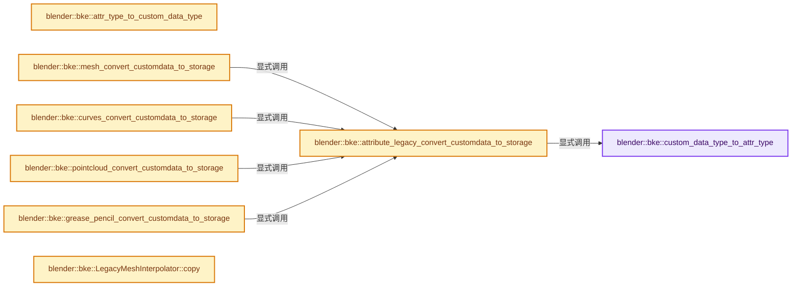
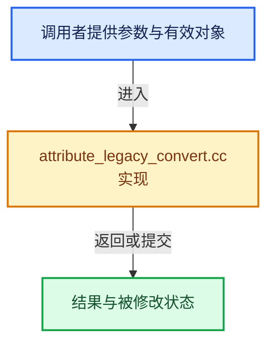

# 实现依赖专题：source/blender/blenkernel/intern/attribute_legacy_convert.cc

[方向导航](README.md) · [符号索引](../%E7%AC%A6%E5%8F%B7%E4%BE%9D%E8%B5%96%E4%B8%8E%E5%AE%9E%E7%8E%B0%E7%B4%A2%E5%BC%95.md)

本专题从正文实际调用进入，集中保存共享实现。函数有稳定锚点，可从调用处直接跳到对应完整函数；递归与互相调用通过回链组织。

## 本文件的实现关系






## 完整成员与函数实现

<a id="f-765b795490374bcf"></a>

### `blender::bke::custom_data_type_to_attr_type`

实现位置：[source/blender/blenkernel/intern/attribute_legacy_convert.cc](../../../../../source/blender/blenkernel/intern/attribute_legacy_convert.cc) · L25—L120。

接口参数：

- `const eCustomDataType data_type`

**教学注释版**

<!-- annotated:78661a3243777b -->

```cpp
std::optional<AttrType> custom_data_type_to_attr_type(const eCustomDataType data_type)
{
  switch (data_type) {
    /* These types are not used for actual #CustomData layers. */
    case CD_NUMTYPES:
    case CD_AUTO_FROM_NAME:
    case CD_TANGENT:
      BLI_assert_unreachable();
      return std::nullopt;

    /* These types are only used for versioning old files. */
    case CD_MVERT:
    case CD_MSTICKY:
    case CD_MEDGE:
    case CD_FACEMAP:
    case CD_MTEXPOLY:
    case CD_MLOOPUV:
    case CD_MPOLY:
    case CD_MLOOP:
    case CD_BWEIGHT:
    case CD_CREASE:
    case CD_PAINT_MASK:
    case CD_CUSTOMLOOPNORMAL:
    case CD_SCULPT_FACE_SETS:
    case CD_MTFACE:
    case CD_TESSLOOPNORMAL:
    case CD_FREESTYLE_EDGE:
    case CD_FREESTYLE_FACE:
    case CD_MVERT_SKIN:
      return std::nullopt;

    /* These types are only used for #BMesh. */
    case CD_SHAPEKEY:
    case CD_SHAPE_KEYINDEX:
    case CD_BM_ELEM_PYPTR:
      return std::nullopt;

    /* Only used for legacy #MFace data. */
    case CD_MFACE:
    case CD_ORIGSPACE:
    case CD_MCOL:
      return std::nullopt;

    /* Custom data on vertices. */
    case CD_MDEFORMVERT:
    case CD_ORCO:
    case CD_CLOTH_ORCO:
      return std::nullopt;

    /* Custom data on face corners. */
    case CD_NORMAL:
    case CD_MDISPS:
    case CD_ORIGSPACE_MLOOP:
    case CD_GRID_PAINT_MASK:
      return std::nullopt;

    /* Use for editing/selecting original data from evaluated mesh (vertices, edges, faces). */
    case CD_ORIGINDEX:
      return std::nullopt;

    /* Used as a cache of tangents for current RNA API (face corners). */
    case CD_MLOOPTANGENT:
      return std::nullopt;

    /* Attribute types. */
    case CD_PROP_FLOAT:
      return AttrType::Float;
    case CD_PROP_INT32:
      return AttrType::Int32;
    case CD_PROP_BYTE_COLOR:
      return AttrType::ColorByte;
    case CD_PROP_FLOAT4X4:
      return AttrType::Float4x4;
    case CD_PROP_INT16_2D:
      return AttrType::Int16_2D;
    case CD_PROP_INT8:
      return AttrType::Int8;
    case CD_PROP_INT32_2D:
      return AttrType::Int32_2D;
    case CD_PROP_COLOR:
      return AttrType::ColorFloat;
    case CD_PROP_FLOAT3:
      return AttrType::Float3;
    case CD_PROP_FLOAT4:
      return AttrType::Float4;
    case CD_PROP_FLOAT2:
      return AttrType::Float2;
    case CD_PROP_BOOL:
      return AttrType::Bool;
    case CD_PROP_STRING:
      return AttrType::String;
    case CD_PROP_QUATERNION:
      return AttrType::Quaternion;
  }
  return std::nullopt;
}
```

<details>
<summary>核对原始源码：source/blender/blenkernel/intern/attribute_legacy_convert.cc · L25—L120</summary>

<!-- original:78661a3243777b:source/blender/blenkernel/intern/attribute_legacy_convert.cc:25:120 -->

```cpp
std::optional<AttrType> custom_data_type_to_attr_type(const eCustomDataType data_type)
{
  switch (data_type) {
    /* These types are not used for actual #CustomData layers. */
    case CD_NUMTYPES:
    case CD_AUTO_FROM_NAME:
    case CD_TANGENT:
      BLI_assert_unreachable();
      return std::nullopt;

    /* These types are only used for versioning old files. */
    case CD_MVERT:
    case CD_MSTICKY:
    case CD_MEDGE:
    case CD_FACEMAP:
    case CD_MTEXPOLY:
    case CD_MLOOPUV:
    case CD_MPOLY:
    case CD_MLOOP:
    case CD_BWEIGHT:
    case CD_CREASE:
    case CD_PAINT_MASK:
    case CD_CUSTOMLOOPNORMAL:
    case CD_SCULPT_FACE_SETS:
    case CD_MTFACE:
    case CD_TESSLOOPNORMAL:
    case CD_FREESTYLE_EDGE:
    case CD_FREESTYLE_FACE:
    case CD_MVERT_SKIN:
      return std::nullopt;

    /* These types are only used for #BMesh. */
    case CD_SHAPEKEY:
    case CD_SHAPE_KEYINDEX:
    case CD_BM_ELEM_PYPTR:
      return std::nullopt;

    /* Only used for legacy #MFace data. */
    case CD_MFACE:
    case CD_ORIGSPACE:
    case CD_MCOL:
      return std::nullopt;

    /* Custom data on vertices. */
    case CD_MDEFORMVERT:
    case CD_ORCO:
    case CD_CLOTH_ORCO:
      return std::nullopt;

    /* Custom data on face corners. */
    case CD_NORMAL:
    case CD_MDISPS:
    case CD_ORIGSPACE_MLOOP:
    case CD_GRID_PAINT_MASK:
      return std::nullopt;

    /* Use for editing/selecting original data from evaluated mesh (vertices, edges, faces). */
    case CD_ORIGINDEX:
      return std::nullopt;

    /* Used as a cache of tangents for current RNA API (face corners). */
    case CD_MLOOPTANGENT:
      return std::nullopt;

    /* Attribute types. */
    case CD_PROP_FLOAT:
      return AttrType::Float;
    case CD_PROP_INT32:
      return AttrType::Int32;
    case CD_PROP_BYTE_COLOR:
      return AttrType::ColorByte;
    case CD_PROP_FLOAT4X4:
      return AttrType::Float4x4;
    case CD_PROP_INT16_2D:
      return AttrType::Int16_2D;
    case CD_PROP_INT8:
      return AttrType::Int8;
    case CD_PROP_INT32_2D:
      return AttrType::Int32_2D;
    case CD_PROP_COLOR:
      return AttrType::ColorFloat;
    case CD_PROP_FLOAT3:
      return AttrType::Float3;
    case CD_PROP_FLOAT4:
      return AttrType::Float4;
    case CD_PROP_FLOAT2:
      return AttrType::Float2;
    case CD_PROP_BOOL:
      return AttrType::Bool;
    case CD_PROP_STRING:
      return AttrType::String;
    case CD_PROP_QUATERNION:
      return AttrType::Quaternion;
  }
  return std::nullopt;
}
```

</details>

**结果出口**

- `return std::nullopt;`
- `return AttrType::Float;`
- `return AttrType::Int32;`
- `return AttrType::ColorByte;`
- `return AttrType::Float4x4;`
- `return AttrType::Int16_2D;`
- `return AttrType::Int8;`
- `return AttrType::Int32_2D;`
- `return AttrType::ColorFloat;`
- `return AttrType::Float3;`
- `return AttrType::Float4;`
- `return AttrType::Float2;`
- `return AttrType::Bool;`
- `return AttrType::String;`
- `return AttrType::Quaternion;`

**继续追踪实现**

- `BLI_assert_unreachable` → [BLI_assert_unreachable · L77](../01-%E5%9F%BA%E7%A1%80%E5%AE%B9%E5%99%A8%E4%B8%8E%E7%8E%B0%E4%BB%A3CPP/%E4%BE%9D%E8%B5%96-BLI_assert-cc98e8.md#m-7a2d91a67d8e)。宏定义由构建条件选择。

<a id="f-8548aabfee562bec"></a>

### `blender::bke::attribute_legacy_convert_customdata_to_storage`

实现位置：[source/blender/blenkernel/intern/attribute_legacy_convert.cc](../../../../../source/blender/blenkernel/intern/attribute_legacy_convert.cc) · L131—L191。

接口参数：

- `const Map<AttrDomain, CustomDataAndSize> &domains`
- `AttributeStorage &storage`

**教学注释版**

<!-- annotated:660f224468787d -->

```cpp
static void attribute_legacy_convert_customdata_to_storage(
    const Map<AttrDomain, CustomDataAndSize> &domains, AttributeStorage &storage)
{
  struct AttributeToAdd {
    StringRef name;
    AttrDomain domain;
    AttrType type;
    void *array_data;
    int array_size;
    const ImplicitSharingInfo *sharing_info;
  };
  Map<AttrDomain, Vector<CustomDataLayer>> layers_to_keep;
  Vector<AttributeToAdd> attributes_to_add;
  for (const auto &item : domains.items()) {
    const AttrDomain domain = item.key;
    const CustomData &custom_data = item.value.data;
    const int domain_size = item.value.size;
    for (const CustomDataLayer &layer : MutableSpan(custom_data.layers, custom_data.totlayer)) {
      if (const std::optional<AttrType> attr_type = custom_data_type_to_attr_type(
              eCustomDataType(layer.type)))
      {
        /* Skip adding a user. This #CustomDataLayer is just freed below. */
        // [讲解] attributes_to_add.append：在尾部建立新元素，必要时先扩大存储。
        attributes_to_add.append(
            {layer.name, domain, *attr_type, layer.data, domain_size, layer.sharing_info});
      }
      else {
        layers_to_keep.lookup_or_add_default(domain).append(layer);
      }
    }
  }

  for (AttributeToAdd &attribute : attributes_to_add) {
    bke::Attribute::ArrayData array_data;
    array_data.data = attribute.array_data;
    array_data.size = attribute.array_size;
    array_data.sharing_info = ImplicitSharingPtr<>(attribute.sharing_info);
    if (storage.lookup(attribute.name)) {
      storage.remove(attribute.name);
    }
    storage.add(storage.unique_name_calc(attribute.name),
                attribute.domain,
                attribute.type,
                // [讲解] std::move：把表达式转换成可供移动重载选择的值类别；不保证真的移动，不结束源对象寿命，对const值可能选择复制。
                std::move(array_data));
  }

  for (const auto &[domain, custom_data] : domains.items()) {
    Vector layers_vector = layers_to_keep.pop_default(domain, {});
    MEM_SAFE_DELETE(custom_data.data.layers);
    custom_data.data.totlayer = 0;
    custom_data.data.maxlayer = 0;
    if (layers_vector.is_empty()) {
      CustomData_update_typemap(&custom_data.data);
      continue;
    }
    // [讲解] layers_vector.release：把底层数据及管理信息交出给调用者。
    VectorData data = layers_vector.release();
    custom_data.data.layers = data.data;
    custom_data.data.totlayer = data.size;
    custom_data.data.maxlayer = data.capacity;
    CustomData_update_typemap(&custom_data.data);
  }
}
```

<details>
<summary>核对原始源码：source/blender/blenkernel/intern/attribute_legacy_convert.cc · L131—L191</summary>

<!-- original:660f224468787d:source/blender/blenkernel/intern/attribute_legacy_convert.cc:131:191 -->

```cpp
static void attribute_legacy_convert_customdata_to_storage(
    const Map<AttrDomain, CustomDataAndSize> &domains, AttributeStorage &storage)
{
  struct AttributeToAdd {
    StringRef name;
    AttrDomain domain;
    AttrType type;
    void *array_data;
    int array_size;
    const ImplicitSharingInfo *sharing_info;
  };
  Map<AttrDomain, Vector<CustomDataLayer>> layers_to_keep;
  Vector<AttributeToAdd> attributes_to_add;
  for (const auto &item : domains.items()) {
    const AttrDomain domain = item.key;
    const CustomData &custom_data = item.value.data;
    const int domain_size = item.value.size;
    for (const CustomDataLayer &layer : MutableSpan(custom_data.layers, custom_data.totlayer)) {
      if (const std::optional<AttrType> attr_type = custom_data_type_to_attr_type(
              eCustomDataType(layer.type)))
      {
        /* Skip adding a user. This #CustomDataLayer is just freed below. */
        attributes_to_add.append(
            {layer.name, domain, *attr_type, layer.data, domain_size, layer.sharing_info});
      }
      else {
        layers_to_keep.lookup_or_add_default(domain).append(layer);
      }
    }
  }

  for (AttributeToAdd &attribute : attributes_to_add) {
    bke::Attribute::ArrayData array_data;
    array_data.data = attribute.array_data;
    array_data.size = attribute.array_size;
    array_data.sharing_info = ImplicitSharingPtr<>(attribute.sharing_info);
    if (storage.lookup(attribute.name)) {
      storage.remove(attribute.name);
    }
    storage.add(storage.unique_name_calc(attribute.name),
                attribute.domain,
                attribute.type,
                std::move(array_data));
  }

  for (const auto &[domain, custom_data] : domains.items()) {
    Vector layers_vector = layers_to_keep.pop_default(domain, {});
    MEM_SAFE_DELETE(custom_data.data.layers);
    custom_data.data.totlayer = 0;
    custom_data.data.maxlayer = 0;
    if (layers_vector.is_empty()) {
      CustomData_update_typemap(&custom_data.data);
      continue;
    }
    VectorData data = layers_vector.release();
    custom_data.data.layers = data.data;
    custom_data.data.totlayer = data.size;
    custom_data.data.maxlayer = data.capacity;
    CustomData_update_typemap(&custom_data.data);
  }
}
```

</details>

**沿实际写入检查状态**

- `array_data.data = attribute.array_data;`
- `array_data.size = attribute.array_size;`
- `array_data.sharing_info = ImplicitSharingPtr<>(attribute.sharing_info);`
- `custom_data.data.totlayer = 0;`
- `custom_data.data.maxlayer = 0;`
- `custom_data.data.layers = data.data;`
- `custom_data.data.totlayer = data.size;`
- `custom_data.data.maxlayer = data.capacity;`

**继续追踪实现**

- `domains.items` → [blender::Map::items · L902](../02-%E5%93%88%E5%B8%8C%E8%A1%A8%E4%B8%8E%E5%85%B3%E8%81%94%E6%95%B0%E6%8D%AE%E7%BB%93%E6%9E%84/06-%E5%88%A0%E9%99%A4%E5%A2%93%E7%A2%91%E4%B8%8E%E5%80%BC%E9%94%80%E6%AF%81.md#f-9ef4f6f70cba8f81)；[blender::Map::items · L913](../02-%E5%93%88%E5%B8%8C%E8%A1%A8%E4%B8%8E%E5%85%B3%E8%81%94%E6%95%B0%E6%8D%AE%E7%BB%93%E6%9E%84/06-%E5%88%A0%E9%99%A4%E5%A2%93%E7%A2%91%E4%B8%8E%E5%80%BC%E9%94%80%E6%AF%81.md#f-0a69f4e73db8973e)；[blender::Map::items · L926](../02-%E5%93%88%E5%B8%8C%E8%A1%A8%E4%B8%8E%E5%85%B3%E8%81%94%E6%95%B0%E6%8D%AE%E7%BB%93%E6%9E%84/06-%E5%88%A0%E9%99%A4%E5%A2%93%E7%A2%91%E4%B8%8E%E5%80%BC%E9%94%80%E6%AF%81.md#f-092add737130dcfb)；[blender::Map::items · L927](../02-%E5%93%88%E5%B8%8C%E8%A1%A8%E4%B8%8E%E5%85%B3%E8%81%94%E6%95%B0%E6%8D%AE%E7%BB%93%E6%9E%84/06-%E5%88%A0%E9%99%A4%E5%A2%93%E7%A2%91%E4%B8%8E%E5%80%BC%E9%94%80%E6%AF%81.md#f-4bfc999f60cdede4)。同名重载需按实参类型选择。
- `MutableSpan` → [blender::MutableSpan::MutableSpan · L462](../01-%E5%9F%BA%E7%A1%80%E5%AE%B9%E5%99%A8%E4%B8%8E%E7%8E%B0%E4%BB%A3CPP/06-MutableSpan%E5%8F%AF%E5%86%99%E8%A7%86%E5%9B%BE.md#f-0f07034aaffc3384)；[blender::MutableSpan::MutableSpan · L464](../01-%E5%9F%BA%E7%A1%80%E5%AE%B9%E5%99%A8%E4%B8%8E%E7%8E%B0%E4%BB%A3CPP/06-MutableSpan%E5%8F%AF%E5%86%99%E8%A7%86%E5%9B%BE.md#f-39977234ad0ce192)；[blender::MutableSpan::MutableSpan · L466](../01-%E5%9F%BA%E7%A1%80%E5%AE%B9%E5%99%A8%E4%B8%8E%E7%8E%B0%E4%BB%A3CPP/06-MutableSpan%E5%8F%AF%E5%86%99%E8%A7%86%E5%9B%BE.md#f-ee249b5042dd38aa)；[blender::MutableSpan::MutableSpan · L468](../01-%E5%9F%BA%E7%A1%80%E5%AE%B9%E5%99%A8%E4%B8%8E%E7%8E%B0%E4%BB%A3CPP/06-MutableSpan%E5%8F%AF%E5%86%99%E8%A7%86%E5%9B%BE.md#f-479c5f85921e531f)；[blender::MutableSpan::MutableSpan · L477](../01-%E5%9F%BA%E7%A1%80%E5%AE%B9%E5%99%A8%E4%B8%8E%E7%8E%B0%E4%BB%A3CPP/06-MutableSpan%E5%8F%AF%E5%86%99%E8%A7%86%E5%9B%BE.md#f-afcce5325e6f19e0)。同名重载需按实参类型选择。
- `custom_data_type_to_attr_type` → [blender::bke::custom_data_type_to_attr_type · L25](%E4%BE%9D%E8%B5%96-attribute_legacy_convert-5c03a1.md#f-765b795490374bcf)。
- `eCustomDataType` → [blender::eCustomDataType](%E4%BE%9D%E8%B5%96-DNA_customdata_types-f584e8.md#t-dfbf4a4ce0e1)。
- `attributes_to_add.append` → [blender::Vector::append · L498](../01-%E5%9F%BA%E7%A1%80%E5%AE%B9%E5%99%A8%E4%B8%8E%E7%8E%B0%E4%BB%A3CPP/11-Vector%E6%8F%92%E5%85%A5%E5%88%A0%E9%99%A4%E4%B8%8E%E9%87%8D%E6%8E%92.md#f-5bde268a69e443ec)；[blender::Vector::append · L502](../01-%E5%9F%BA%E7%A1%80%E5%AE%B9%E5%99%A8%E4%B8%8E%E7%8E%B0%E4%BB%A3CPP/11-Vector%E6%8F%92%E5%85%A5%E5%88%A0%E9%99%A4%E4%B8%8E%E9%87%8D%E6%8E%92.md#f-591e0b15e6308532)。同名重载需按实参类型选择。
- `layers_to_keep.lookup_or_add_default(domain).append` → [调用协议](../%E6%A8%A1%E6%9D%BF%E5%AE%8F%E4%B8%8E%E5%8A%A8%E6%80%81%E5%88%86%E6%B4%BE%E5%8D%8F%E8%AE%AE.md)：接收对象类型依赖auto、返回值或模板实例；不按同名猜测目标。调用位置L157。
- `layers_to_keep.lookup_or_add_default` → [blender::Map::lookup_or_add_default · L639](../02-%E5%93%88%E5%B8%8C%E8%A1%A8%E4%B8%8E%E5%85%B3%E8%81%94%E6%95%B0%E6%8D%AE%E7%BB%93%E6%9E%84/05-Map%E6%8F%92%E5%85%A5%E4%B8%8E%E5%9B%9E%E8%B0%83.md#f-e8d33f0bfe1f3153)；[blender::Map::lookup_or_add_default · L643](../02-%E5%93%88%E5%B8%8C%E8%A1%A8%E4%B8%8E%E5%85%B3%E8%81%94%E6%95%B0%E6%8D%AE%E7%BB%93%E6%9E%84/05-Map%E6%8F%92%E5%85%A5%E4%B8%8E%E5%9B%9E%E8%B0%83.md#f-d67ab6e12fd0a267)。同名重载需按实参类型选择。
- `ImplicitSharingPtr<>` → [blender::ImplicitSharingPtr::ImplicitSharingPtr · L32](../06-%E9%9A%90%E5%BC%8F%E5%85%B1%E4%BA%AB%E4%B8%8E%E7%BC%93%E5%AD%98%E7%B3%BB%E7%BB%9F/03-Mixin%E4%B8%8E%E5%85%B1%E4%BA%AB%E6%8C%87%E9%92%88%E5%B0%81%E8%A3%85.md#f-d28a43dbb5ed8c05)；[blender::ImplicitSharingPtr::ImplicitSharingPtr · L34](../06-%E9%9A%90%E5%BC%8F%E5%85%B1%E4%BA%AB%E4%B8%8E%E7%BC%93%E5%AD%98%E7%B3%BB%E7%BB%9F/03-Mixin%E4%B8%8E%E5%85%B1%E4%BA%AB%E6%8C%87%E9%92%88%E5%B0%81%E8%A3%85.md#f-d27d5ebf676e244a)；[blender::ImplicitSharingPtr::ImplicitSharingPtr · L37](../06-%E9%9A%90%E5%BC%8F%E5%85%B1%E4%BA%AB%E4%B8%8E%E7%BC%93%E5%AD%98%E7%B3%BB%E7%BB%9F/03-Mixin%E4%B8%8E%E5%85%B1%E4%BA%AB%E6%8C%87%E9%92%88%E5%B0%81%E8%A3%85.md#f-17d0c5fe2b03a664)；[blender::ImplicitSharingPtr::ImplicitSharingPtr · L39](../06-%E9%9A%90%E5%BC%8F%E5%85%B1%E4%BA%AB%E4%B8%8E%E7%BC%93%E5%AD%98%E7%B3%BB%E7%BB%9F/03-Mixin%E4%B8%8E%E5%85%B1%E4%BA%AB%E6%8C%87%E9%92%88%E5%B0%81%E8%A3%85.md#f-1c8729ae57532370)；[blender::ImplicitSharingPtr::ImplicitSharingPtr · L44](../06-%E9%9A%90%E5%BC%8F%E5%85%B1%E4%BA%AB%E4%B8%8E%E7%BC%93%E5%AD%98%E7%B3%BB%E7%BB%9F/03-Mixin%E4%B8%8E%E5%85%B1%E4%BA%AB%E6%8C%87%E9%92%88%E5%B0%81%E8%A3%85.md#f-0b6be0142b98009e)；[blender::ImplicitSharingPtr::ImplicitSharingPtr · L49](../06-%E9%9A%90%E5%BC%8F%E5%85%B1%E4%BA%AB%E4%B8%8E%E7%BC%93%E5%AD%98%E7%B3%BB%E7%BB%9F/03-Mixin%E4%B8%8E%E5%85%B1%E4%BA%AB%E6%8C%87%E9%92%88%E5%B0%81%E8%A3%85.md#f-90c601ed9ed99045)；[blender::ImplicitSharingPtr::ImplicitSharingPtr · L57](../06-%E9%9A%90%E5%BC%8F%E5%85%B1%E4%BA%AB%E4%B8%8E%E7%BC%93%E5%AD%98%E7%B3%BB%E7%BB%9F/03-Mixin%E4%B8%8E%E5%85%B1%E4%BA%AB%E6%8C%87%E9%92%88%E5%B0%81%E8%A3%85.md#f-1625179ceae7a66d)。同名重载需按实参类型选择。
- `storage.lookup` → [blender::bke::AttributeStorage::lookup · L218](%E4%BE%9D%E8%B5%96-attribute_storage-1cb73b.md#f-7fdc83fb77004833)；[blender::bke::AttributeStorage::lookup · L228](%E4%BE%9D%E8%B5%96-attribute_storage-1cb73b.md#f-4c9ec35a31afcd06)。同名重载需按实参类型选择。
- `storage.remove` → [blender::bke::AttributeStorage::remove · L255](%E4%BE%9D%E8%B5%96-attribute_storage-1cb73b.md#f-65b1c61b542236ae)；[blender::bke::AttributeStorage::remove · L270](%E4%BE%9D%E8%B5%96-attribute_storage-1cb73b.md#f-10bfcc160f8e979a)；[blender::bke::AttributeStorage::remove · L277](%E4%BE%9D%E8%B5%96-attribute_storage-1cb73b.md#f-be56394a344a175b)。同名重载需按实参类型选择。
- `storage.add` → [blender::bke::AttributeStorage::add · L238](%E4%BE%9D%E8%B5%96-attribute_storage-1cb73b.md#f-b78aa43de4dafd5f)。
- `storage.unique_name_calc` → [blender::bke::AttributeStorage::unique_name_calc · L292](%E4%BE%9D%E8%B5%96-attribute_storage-1cb73b.md#f-629d4fb141fc76c1)。
- `std::move` → [外部契约](https://eel.is/c++draft/utility.forward)：把表达式转换成可供移动重载选择的值类别；不保证真的移动，不结束源对象寿命，对const值可能选择复制。
- `layers_to_keep.pop_default` → [blender::Map::pop_default · L439](../02-%E5%93%88%E5%B8%8C%E8%A1%A8%E4%B8%8E%E5%85%B3%E8%81%94%E6%95%B0%E6%8D%AE%E7%BB%93%E6%9E%84/04-Map%E6%9F%A5%E6%89%BE%E4%B8%8E%E9%94%AE%E8%AE%BF%E9%97%AE.md#f-9dd656831c024785)；[blender::Map::pop_default · L443](../02-%E5%93%88%E5%B8%8C%E8%A1%A8%E4%B8%8E%E5%85%B3%E8%81%94%E6%95%B0%E6%8D%AE%E7%BB%93%E6%9E%84/04-Map%E6%9F%A5%E6%89%BE%E4%B8%8E%E9%94%AE%E8%AE%BF%E9%97%AE.md#f-f0e4b7971e882c92)。同名重载需按实参类型选择。
- `MEM_SAFE_DELETE` → [MEM_SAFE_DELETE · L436](../03-%E5%86%85%E5%AD%98%E5%88%86%E9%85%8D%E4%B8%8E%E8%BF%90%E8%A1%8C%E6%97%B6%E7%B1%BB%E5%9E%8B/%E4%BE%9D%E8%B5%96-MEM_guardedalloc-b54eca.md#m-eadb3bc5b902)。宏定义由构建条件选择。
- `layers_vector.is_empty` → [blender::Vector::is_empty · L792](../01-%E5%9F%BA%E7%A1%80%E5%AE%B9%E5%99%A8%E4%B8%8E%E7%8E%B0%E4%BB%A3CPP/11-Vector%E6%8F%92%E5%85%A5%E5%88%A0%E9%99%A4%E4%B8%8E%E9%87%8D%E6%8E%92.md#f-937bbd9cb80bdcc8)。
- `CustomData_update_typemap` → [blender::CustomData_update_typemap · L2149](%E4%BE%9D%E8%B5%96-customdata-2eef81.md#f-3dab2a9f34d99eba)。
- `layers_vector.release` → [blender::Vector::release · L1060](../01-%E5%9F%BA%E7%A1%80%E5%AE%B9%E5%99%A8%E4%B8%8E%E7%8E%B0%E4%BB%A3CPP/12-Vector%E5%BC%82%E5%B8%B8%E5%AE%89%E5%85%A8%E4%B8%8E%E8%BE%B9%E7%95%8C.md#f-beccf028a70f67dd)。

<a id="f-bb0105aef27ae3a3"></a>

### `blender::bke::attr_type_to_custom_data_type`

实现位置：[source/blender/blenkernel/intern/attribute_legacy_convert.cc](../../../../../source/blender/blenkernel/intern/attribute_legacy_convert.cc) · L193—L226。

接口参数：

- `const AttrType attr_type`

**教学注释版**

<!-- annotated:f9f64e411c5997 -->

```cpp
std::optional<eCustomDataType> attr_type_to_custom_data_type(const AttrType attr_type)
{
  switch (attr_type) {
    case AttrType::Bool:
      return CD_PROP_BOOL;
    case AttrType::Int8:
      return CD_PROP_INT8;
    case AttrType::Int16_2D:
      return CD_PROP_INT16_2D;
    case AttrType::Int32:
      return CD_PROP_INT32;
    case AttrType::Int32_2D:
      return CD_PROP_INT32_2D;
    case AttrType::Float:
      return CD_PROP_FLOAT;
    case AttrType::Float2:
      return CD_PROP_FLOAT2;
    case AttrType::Float3:
      return CD_PROP_FLOAT3;
    case AttrType::Float4:
      return CD_PROP_FLOAT4;
    case AttrType::Float4x4:
      return CD_PROP_FLOAT4X4;
    case AttrType::ColorByte:
      return CD_PROP_BYTE_COLOR;
    case AttrType::ColorFloat:
      return CD_PROP_COLOR;
    case AttrType::Quaternion:
      return CD_PROP_QUATERNION;
    case AttrType::String:
      return CD_PROP_STRING;
  }
  return std::nullopt;
}
```

<details>
<summary>核对原始源码：source/blender/blenkernel/intern/attribute_legacy_convert.cc · L193—L226</summary>

<!-- original:f9f64e411c5997:source/blender/blenkernel/intern/attribute_legacy_convert.cc:193:226 -->

```cpp
std::optional<eCustomDataType> attr_type_to_custom_data_type(const AttrType attr_type)
{
  switch (attr_type) {
    case AttrType::Bool:
      return CD_PROP_BOOL;
    case AttrType::Int8:
      return CD_PROP_INT8;
    case AttrType::Int16_2D:
      return CD_PROP_INT16_2D;
    case AttrType::Int32:
      return CD_PROP_INT32;
    case AttrType::Int32_2D:
      return CD_PROP_INT32_2D;
    case AttrType::Float:
      return CD_PROP_FLOAT;
    case AttrType::Float2:
      return CD_PROP_FLOAT2;
    case AttrType::Float3:
      return CD_PROP_FLOAT3;
    case AttrType::Float4:
      return CD_PROP_FLOAT4;
    case AttrType::Float4x4:
      return CD_PROP_FLOAT4X4;
    case AttrType::ColorByte:
      return CD_PROP_BYTE_COLOR;
    case AttrType::ColorFloat:
      return CD_PROP_COLOR;
    case AttrType::Quaternion:
      return CD_PROP_QUATERNION;
    case AttrType::String:
      return CD_PROP_STRING;
  }
  return std::nullopt;
}
```

</details>

**结果出口**

- `return CD_PROP_BOOL;`
- `return CD_PROP_INT8;`
- `return CD_PROP_INT16_2D;`
- `return CD_PROP_INT32;`
- `return CD_PROP_INT32_2D;`
- `return CD_PROP_FLOAT;`
- `return CD_PROP_FLOAT2;`
- `return CD_PROP_FLOAT3;`
- `return CD_PROP_FLOAT4;`
- `return CD_PROP_FLOAT4X4;`
- `return CD_PROP_BYTE_COLOR;`
- `return CD_PROP_COLOR;`
- `return CD_PROP_QUATERNION;`
- `return CD_PROP_STRING;`
- `return std::nullopt;`

**继续追踪实现**

本实现没有需要继续展开的显式调用；检查返回表达式、对象转换和调用者前置条件。

<a id="f-72a0d56a18af837a"></a>

### `blender::bke::mesh_convert_customdata_to_storage`

实现位置：[source/blender/blenkernel/intern/attribute_legacy_convert.cc](../../../../../source/blender/blenkernel/intern/attribute_legacy_convert.cc) · L228—L236。

接口参数：

- `Mesh &mesh`

**教学注释版**

<!-- annotated:812ab42061f77f -->

```cpp
void mesh_convert_customdata_to_storage(Mesh &mesh)
{
  bke::attribute_legacy_convert_customdata_to_storage(
      {{AttrDomain::Point, {mesh.vert_data, mesh.verts_num}},
       {AttrDomain::Edge, {mesh.edge_data, mesh.edges_num}},
       {AttrDomain::Face, {mesh.face_data, mesh.faces_num}},
       {AttrDomain::Corner, {mesh.corner_data, mesh.corners_num}}},
      mesh.attribute_storage.wrap());
}
```

<details>
<summary>核对原始源码：source/blender/blenkernel/intern/attribute_legacy_convert.cc · L228—L236</summary>

<!-- original:812ab42061f77f:source/blender/blenkernel/intern/attribute_legacy_convert.cc:228:236 -->

```cpp
void mesh_convert_customdata_to_storage(Mesh &mesh)
{
  bke::attribute_legacy_convert_customdata_to_storage(
      {{AttrDomain::Point, {mesh.vert_data, mesh.verts_num}},
       {AttrDomain::Edge, {mesh.edge_data, mesh.edges_num}},
       {AttrDomain::Face, {mesh.face_data, mesh.faces_num}},
       {AttrDomain::Corner, {mesh.corner_data, mesh.corners_num}}},
      mesh.attribute_storage.wrap());
}
```

</details>

**继续追踪实现**

- `bke::attribute_legacy_convert_customdata_to_storage` → [blender::bke::attribute_legacy_convert_customdata_to_storage · L131](%E4%BE%9D%E8%B5%96-attribute_legacy_convert-5c03a1.md#f-8548aabfee562bec)。
- `mesh.attribute_storage.wrap` → [调用协议](../%E6%A8%A1%E6%9D%BF%E5%AE%8F%E4%B8%8E%E5%8A%A8%E6%80%81%E5%88%86%E6%B4%BE%E5%8D%8F%E8%AE%AE.md)：接收对象类型依赖auto、返回值或模板实例；不按同名猜测目标。调用位置L235。

<a id="f-bea626ee7a6fc925"></a>

### `blender::bke::curves_convert_customdata_to_storage`

实现位置：[source/blender/blenkernel/intern/attribute_legacy_convert.cc](../../../../../source/blender/blenkernel/intern/attribute_legacy_convert.cc) · L238—L248。

接口参数：

- `CurvesGeometry &curves`

**教学注释版**

<!-- annotated:5fcba13a90f8f4 -->

```cpp
void curves_convert_customdata_to_storage(CurvesGeometry &curves)
{
  attribute_legacy_convert_customdata_to_storage(
      {{AttrDomain::Point, {curves.point_data, curves.points_num()}},
       {AttrDomain::Curve, {curves.curve_data_legacy, curves.curves_num()}}},
      curves.attribute_storage.wrap());
  CustomData_reset(&curves.curve_data_legacy);
  /* Update the curve type count again (the first time was done on file-read, where
   * #AttributeStorage data doesn't exist yet for older files). */
  curves.update_curve_types();
}
```

<details>
<summary>核对原始源码：source/blender/blenkernel/intern/attribute_legacy_convert.cc · L238—L248</summary>

<!-- original:5fcba13a90f8f4:source/blender/blenkernel/intern/attribute_legacy_convert.cc:238:248 -->

```cpp
void curves_convert_customdata_to_storage(CurvesGeometry &curves)
{
  attribute_legacy_convert_customdata_to_storage(
      {{AttrDomain::Point, {curves.point_data, curves.points_num()}},
       {AttrDomain::Curve, {curves.curve_data_legacy, curves.curves_num()}}},
      curves.attribute_storage.wrap());
  CustomData_reset(&curves.curve_data_legacy);
  /* Update the curve type count again (the first time was done on file-read, where
   * #AttributeStorage data doesn't exist yet for older files). */
  curves.update_curve_types();
}
```

</details>

**继续追踪实现**

- `attribute_legacy_convert_customdata_to_storage` → [blender::bke::attribute_legacy_convert_customdata_to_storage · L131](%E4%BE%9D%E8%B5%96-attribute_legacy_convert-5c03a1.md#f-8548aabfee562bec)。
- `curves.points_num` → [blender::bke::CurvesGeometry::points_num · L1001](04-CurvesGeometry%E5%AD%98%E5%82%A8.md#f-049421b1f643c700)。
- `curves.curves_num` → [blender::bke::CurvesGeometry::curves_num · L1005](04-CurvesGeometry%E5%AD%98%E5%82%A8.md#f-eabb3f0e5d3c57be)。
- `curves.attribute_storage.wrap` → [调用协议](../%E6%A8%A1%E6%9D%BF%E5%AE%8F%E4%B8%8E%E5%8A%A8%E6%80%81%E5%88%86%E6%B4%BE%E5%8D%8F%E8%AE%AE.md)：接收对象类型依赖auto、返回值或模板实例；不按同名猜测目标。调用位置L243。
- `CustomData_reset` → [blender::CustomData_reset · L2495](%E4%BE%9D%E8%B5%96-customdata-2eef81.md#f-b5d2fd143bcd64b1)。
- `curves.update_curve_types` → [blender::bke::CurvesGeometry::update_curve_types · L318](%E4%BE%9D%E8%B5%96-curves_geometry-ad7f9f.md#f-f7155d4f5776d2ad)。

<a id="f-a28cbfd989769bab"></a>

### `blender::bke::pointcloud_convert_customdata_to_storage`

实现位置：[source/blender/blenkernel/intern/attribute_legacy_convert.cc](../../../../../source/blender/blenkernel/intern/attribute_legacy_convert.cc) · L250—L256。

接口参数：

- `PointCloud &pointcloud`

**教学注释版**

<!-- annotated:a1312389c24ab4 -->

```cpp
void pointcloud_convert_customdata_to_storage(PointCloud &pointcloud)
{
  attribute_legacy_convert_customdata_to_storage(
      {{AttrDomain::Point, {pointcloud.pdata_legacy, pointcloud.totpoint}}},
      pointcloud.attribute_storage.wrap());
  CustomData_reset(&pointcloud.pdata_legacy);
}
```

<details>
<summary>核对原始源码：source/blender/blenkernel/intern/attribute_legacy_convert.cc · L250—L256</summary>

<!-- original:a1312389c24ab4:source/blender/blenkernel/intern/attribute_legacy_convert.cc:250:256 -->

```cpp
void pointcloud_convert_customdata_to_storage(PointCloud &pointcloud)
{
  attribute_legacy_convert_customdata_to_storage(
      {{AttrDomain::Point, {pointcloud.pdata_legacy, pointcloud.totpoint}}},
      pointcloud.attribute_storage.wrap());
  CustomData_reset(&pointcloud.pdata_legacy);
}
```

</details>

**继续追踪实现**

- `attribute_legacy_convert_customdata_to_storage` → [blender::bke::attribute_legacy_convert_customdata_to_storage · L131](%E4%BE%9D%E8%B5%96-attribute_legacy_convert-5c03a1.md#f-8548aabfee562bec)。
- `pointcloud.attribute_storage.wrap` → [调用协议](../%E6%A8%A1%E6%9D%BF%E5%AE%8F%E4%B8%8E%E5%8A%A8%E6%80%81%E5%88%86%E6%B4%BE%E5%8D%8F%E8%AE%AE.md)：接收对象类型依赖auto、返回值或模板实例；不按同名猜测目标。调用位置L254。
- `CustomData_reset` → [blender::CustomData_reset · L2495](%E4%BE%9D%E8%B5%96-customdata-2eef81.md#f-b5d2fd143bcd64b1)。

<a id="f-1028189324e99672"></a>

### `blender::bke::grease_pencil_convert_customdata_to_storage`

实现位置：[source/blender/blenkernel/intern/attribute_legacy_convert.cc](../../../../../source/blender/blenkernel/intern/attribute_legacy_convert.cc) · L258—L265。

接口参数：

- `GreasePencil &grease_pencil`

**教学注释版**

<!-- annotated:2dbe50eb131ce4 -->

```cpp
void grease_pencil_convert_customdata_to_storage(GreasePencil &grease_pencil)
{
  attribute_legacy_convert_customdata_to_storage(
      {{AttrDomain::Layer,
        {grease_pencil.layers_data_legacy, int(grease_pencil.layers().size())}}},
      grease_pencil.attribute_storage.wrap());
  CustomData_reset(&grease_pencil.layers_data_legacy);
}
```

<details>
<summary>核对原始源码：source/blender/blenkernel/intern/attribute_legacy_convert.cc · L258—L265</summary>

<!-- original:2dbe50eb131ce4:source/blender/blenkernel/intern/attribute_legacy_convert.cc:258:265 -->

```cpp
void grease_pencil_convert_customdata_to_storage(GreasePencil &grease_pencil)
{
  attribute_legacy_convert_customdata_to_storage(
      {{AttrDomain::Layer,
        {grease_pencil.layers_data_legacy, int(grease_pencil.layers().size())}}},
      grease_pencil.attribute_storage.wrap());
  CustomData_reset(&grease_pencil.layers_data_legacy);
}
```

</details>

**继续追踪实现**

- `attribute_legacy_convert_customdata_to_storage` → [blender::bke::attribute_legacy_convert_customdata_to_storage · L131](%E4%BE%9D%E8%B5%96-attribute_legacy_convert-5c03a1.md#f-8548aabfee562bec)。
- `grease_pencil.layers().size` → [调用协议](../%E6%A8%A1%E6%9D%BF%E5%AE%8F%E4%B8%8E%E5%8A%A8%E6%80%81%E5%88%86%E6%B4%BE%E5%8D%8F%E8%AE%AE.md)：接收对象类型依赖auto、返回值或模板实例；不按同名猜测目标。调用位置L262。
- `grease_pencil.layers` → [blender::GreasePencil::layers · L3983](%E4%BE%9D%E8%B5%96-grease_pencil-f750d6.md#f-15d64ed11a2babc0)。
- `grease_pencil.attribute_storage.wrap` → [调用协议](../%E6%A8%A1%E6%9D%BF%E5%AE%8F%E4%B8%8E%E5%8A%A8%E6%80%81%E5%88%86%E6%B4%BE%E5%8D%8F%E8%AE%AE.md)：接收对象类型依赖auto、返回值或模板实例；不按同名猜测目标。调用位置L263。
- `CustomData_reset` → [blender::CustomData_reset · L2495](%E4%BE%9D%E8%B5%96-customdata-2eef81.md#f-b5d2fd143bcd64b1)。

<a id="f-4e462b4a9febc9f7"></a>

### `blender::bke::LegacyMeshInterpolator::copy`

实现位置：[source/blender/blenkernel/intern/attribute_legacy_convert.cc](../../../../../source/blender/blenkernel/intern/attribute_legacy_convert.cc) · L348—L359。

接口参数：

- `const int src_index`
- `const int dst_index`
- `const int count`

**教学注释版**

<!-- annotated:7ed04446cb00fe -->

```cpp
void LegacyMeshInterpolator::copy(const int src_index, const int dst_index, const int count) const
{
  if (count == 0) {
    return;
  }
  CustomData_copy_data(&cd_src_, &cd_dst_, src_index, dst_index, count);
  for (const int i : attrs_src_.index_range()) {
    const GVArraySpan &src = attrs_src_[i];
    GMutableSpan dst = attrs_dst_[i];
    src.type().copy_construct_compressed(src.data(), dst[dst_index], IndexRange(src_index, count));
  }
}
```

<details>
<summary>核对原始源码：source/blender/blenkernel/intern/attribute_legacy_convert.cc · L348—L359</summary>

<!-- original:7ed04446cb00fe:source/blender/blenkernel/intern/attribute_legacy_convert.cc:348:359 -->

```cpp
void LegacyMeshInterpolator::copy(const int src_index, const int dst_index, const int count) const
{
  if (count == 0) {
    return;
  }
  CustomData_copy_data(&cd_src_, &cd_dst_, src_index, dst_index, count);
  for (const int i : attrs_src_.index_range()) {
    const GVArraySpan &src = attrs_src_[i];
    GMutableSpan dst = attrs_dst_[i];
    src.type().copy_construct_compressed(src.data(), dst[dst_index], IndexRange(src_index, count));
  }
}
```

</details>

**继续追踪实现**

- `CustomData_copy_data` → [blender::CustomData_copy_data · L3115](%E4%BE%9D%E8%B5%96-customdata-2eef81.md#f-02b97940f7d20d25)。
- `attrs_src_.index_range` → [调用协议](../%E6%A8%A1%E6%9D%BF%E5%AE%8F%E4%B8%8E%E5%8A%A8%E6%80%81%E5%88%86%E6%B4%BE%E5%8D%8F%E8%AE%AE.md)：接收对象类型依赖auto、返回值或模板实例；不按同名猜测目标。调用位置L354。
- `src.type().copy_construct_compressed` → [调用协议](../%E6%A8%A1%E6%9D%BF%E5%AE%8F%E4%B8%8E%E5%8A%A8%E6%80%81%E5%88%86%E6%B4%BE%E5%8D%8F%E8%AE%AE.md)：接收对象类型依赖auto、返回值或模板实例；不按同名猜测目标。调用位置L357。
- `src.type` → [blender::bke::GeometryComponent::type · L86](../06-%E9%9A%90%E5%BC%8F%E5%85%B1%E4%BA%AB%E4%B8%8E%E7%BC%93%E5%AD%98%E7%B3%BB%E7%BB%9F/05-GeometrySet%E8%AF%BB%E5%86%99%E4%B8%8E%E5%A4%8D%E5%88%B6.md#f-f73336c224943890)。
- `src.data` → [blender::bke::Attribute::data · L296](10-%E5%B8%83%E5%B1%80%E5%85%BC%E5%AE%B9%E4%B8%8E%E5%87%A0%E4%BD%95%E5%AE%9E%E6%88%98.md#f-1d913000744fef94)。
- `IndexRange` → [blender::IndexRange](../01-%E5%9F%BA%E7%A1%80%E5%AE%B9%E5%99%A8%E4%B8%8E%E7%8E%B0%E4%BB%A3CPP/%E4%BE%9D%E8%B5%96-BLI_index_range-7d7cc5.md#t-caa3466d6776)；[blender::gpu::shader::parser::IndexRange](%E4%BE%9D%E8%B5%96-utils-06433d.md#t-82d2bd4ea71c)；[blender::IndexRange](%E4%BE%9D%E8%B5%96-DNA_node_types-6708b9.md#t-0448cc889d39)。

<a id="f-59ea8c9036b7e7f8"></a>

### `blender::bke::LegacyMeshInterpolator::mix`

实现位置：[source/blender/blenkernel/intern/attribute_legacy_convert.cc](../../../../../source/blender/blenkernel/intern/attribute_legacy_convert.cc) · L361—L385。

接口参数：

- `Span<int> src_indices`
- `const std::optional<Span<float>> weights`
- `const int dst_index`

**教学注释版**

<!-- annotated:cf534a9cb32ecc -->

```cpp
void LegacyMeshInterpolator::mix(Span<int> src_indices,
                                 const std::optional<Span<float>> weights,
                                 const int dst_index) const
{
  CustomData_interp(&cd_src_,
                    &cd_dst_,
                    // [讲解] src_indices.data：返回借用范围的地址。
                    src_indices.data(),
                    weights ? weights->data() : nullptr,
                    // [讲解] src_indices.size：查询视图长度或生成对应有效索引区间。
                    src_indices.size(),
                    dst_index);
  for (const int attr_index : attrs_src_.index_range()) {
    attribute_math::to_static_type(attrs_src_[attr_index].type(), [&]<typename T>() {
      if constexpr (!std::is_void_v<bke::attribute_math::DefaultMixer<T>>) {
        const Span src = attrs_src_[attr_index].typed<T>();
        MutableSpan dst = attrs_dst_[attr_index].typed<T>();
        if (weights) {
          dst[dst_index] = attribute_math::mix_indices(src, src_indices, *weights);
        }
        else {
          dst[dst_index] = attribute_math::mix_indices(src, src_indices);
        }
      }
    });
  }
}
```

<details>
<summary>核对原始源码：source/blender/blenkernel/intern/attribute_legacy_convert.cc · L361—L385</summary>

<!-- original:cf534a9cb32ecc:source/blender/blenkernel/intern/attribute_legacy_convert.cc:361:385 -->

```cpp
void LegacyMeshInterpolator::mix(Span<int> src_indices,
                                 const std::optional<Span<float>> weights,
                                 const int dst_index) const
{
  CustomData_interp(&cd_src_,
                    &cd_dst_,
                    src_indices.data(),
                    weights ? weights->data() : nullptr,
                    src_indices.size(),
                    dst_index);
  for (const int attr_index : attrs_src_.index_range()) {
    attribute_math::to_static_type(attrs_src_[attr_index].type(), [&]<typename T>() {
      if constexpr (!std::is_void_v<bke::attribute_math::DefaultMixer<T>>) {
        const Span src = attrs_src_[attr_index].typed<T>();
        MutableSpan dst = attrs_dst_[attr_index].typed<T>();
        if (weights) {
          dst[dst_index] = attribute_math::mix_indices(src, src_indices, *weights);
        }
        else {
          dst[dst_index] = attribute_math::mix_indices(src, src_indices);
        }
      }
    });
  }
}
```

</details>

**沿实际写入检查状态**

- `dst[dst_index] = attribute_math::mix_indices(src, src_indices, *weights);`
- `dst[dst_index] = attribute_math::mix_indices(src, src_indices);`

**继续追踪实现**

- `CustomData_interp` → [blender::CustomData_interp · L3190](%E4%BE%9D%E8%B5%96-customdata-2eef81.md#f-78310dc61e827f17)。
- `src_indices.data` → [blender::Span::data · L219](../01-%E5%9F%BA%E7%A1%80%E5%AE%B9%E5%99%A8%E4%B8%8E%E7%8E%B0%E4%BB%A3CPP/05-Span%E5%8F%AA%E8%AF%BB%E8%BF%9E%E7%BB%AD%E8%A7%86%E5%9B%BE.md#f-10c5889198935800)。
- `weights->data` → [外部契约](https://eel.is/c++draft/)：这个边界按实际表达式及所属类型核对参数、返回值、寿命与失败行为。这里提供接口入口，不声称已解释该第三方版本的内部实现。
- `src_indices.size` → [blender::Span::size · L256](../01-%E5%9F%BA%E7%A1%80%E5%AE%B9%E5%99%A8%E4%B8%8E%E7%8E%B0%E4%BB%A3CPP/05-Span%E5%8F%AA%E8%AF%BB%E8%BF%9E%E7%BB%AD%E8%A7%86%E5%9B%BE.md#f-5f80fa006089c998)。
- `attrs_src_.index_range` → [调用协议](../%E6%A8%A1%E6%9D%BF%E5%AE%8F%E4%B8%8E%E5%8A%A8%E6%80%81%E5%88%86%E6%B4%BE%E5%8D%8F%E8%AE%AE.md)：接收对象类型依赖auto、返回值或模板实例；不按同名猜测目标。调用位置L371。
- `attribute_math::to_static_type` → [blender::bke::attribute_math::to_static_type · L35](%E4%BE%9D%E8%B5%96-BKE_attribute_math-ac7998.md#f-fdfaf0b86a24f278)；[blender::bke::attribute_math::to_static_type · L52](%E4%BE%9D%E8%B5%96-BKE_attribute_math-ac7998.md#f-5346ade4e816ebd6)。同名重载需按实参类型选择。
- `attrs_src_[attr_index].type` → [调用协议](../%E6%A8%A1%E6%9D%BF%E5%AE%8F%E4%B8%8E%E5%8A%A8%E6%80%81%E5%88%86%E6%B4%BE%E5%8D%8F%E8%AE%AE.md)：接收对象类型依赖auto、返回值或模板实例；不按同名猜测目标。调用位置L372。
- `attrs_src_[attr_index].typed<T>` → [调用协议](../%E6%A8%A1%E6%9D%BF%E5%AE%8F%E4%B8%8E%E5%8A%A8%E6%80%81%E5%88%86%E6%B4%BE%E5%8D%8F%E8%AE%AE.md)：接收对象类型依赖auto、返回值或模板实例；不按同名猜测目标。调用位置L374。
- `attrs_dst_[attr_index].typed<T>` → [调用协议](../%E6%A8%A1%E6%9D%BF%E5%AE%8F%E4%B8%8E%E5%8A%A8%E6%80%81%E5%88%86%E6%B4%BE%E5%8D%8F%E8%AE%AE.md)：接收对象类型依赖auto、返回值或模板实例；不按同名猜测目标。调用位置L375。
- `attribute_math::mix_indices` → [blender::bke::attribute_math::mix_indices · L269](%E4%BE%9D%E8%B5%96-attribute_math-ecaf96.md#f-978d103f10db6b9e)；[blender::bke::attribute_math::mix_indices · L303](%E4%BE%9D%E8%B5%96-attribute_math-ecaf96.md#f-c70ce50573c8df8b)。同名重载需按实参类型选择。
