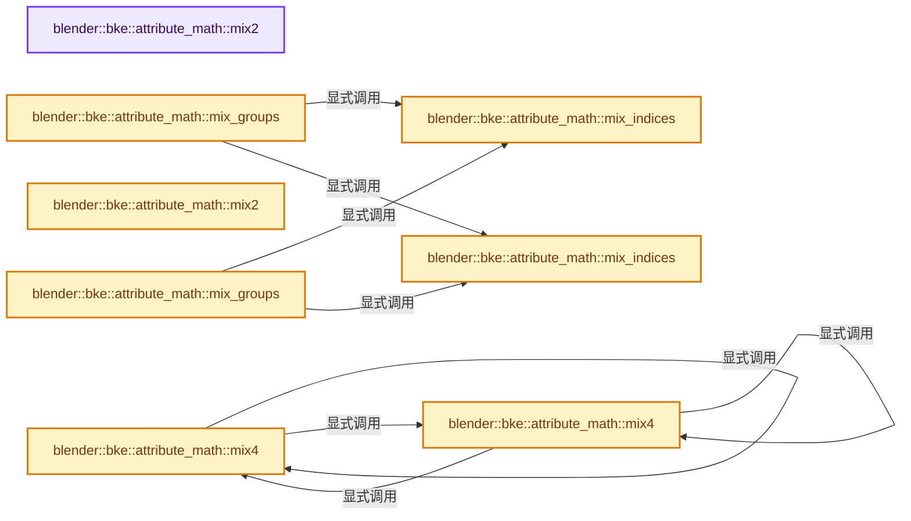
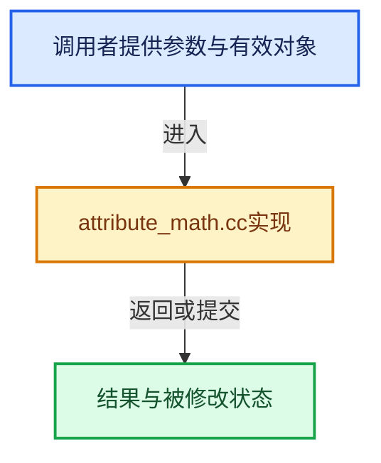

# 实现依赖专题：source/blender/blenkernel/intern/attribute_math.cc

[方向导航](README.md) · [符号索引](../%E7%AC%A6%E5%8F%B7%E4%BE%9D%E8%B5%96%E4%B8%8E%E5%AE%9E%E7%8E%B0%E7%B4%A2%E5%BC%95.md)

本专题从正文实际调用进入，集中保存共享实现。函数有稳定锚点，可从调用处直接跳到对应完整函数；递归与互相调用通过回链组织。

## 本文件的实现关系






## 完整成员与函数实现

<a id="f-c2b7b4b88dd0f972"></a>

### `blender::bke::attribute_math::mix2`

实现位置：[source/blender/blenkernel/intern/attribute_math.cc](../../../../../source/blender/blenkernel/intern/attribute_math.cc) · L22—L26。

接口参数：

- `const float factor`
- `const math::Quaternion &a`
- `const math::Quaternion &b`

**教学注释版**

<!-- annotated:e8f438f4c2177b -->

```cpp
template<>
math::Quaternion mix2(const float factor, const math::Quaternion &a, const math::Quaternion &b)
{
  return math::interpolate(a, b, factor);
}
```

<details>
<summary>核对原始源码：source/blender/blenkernel/intern/attribute_math.cc · L22—L26</summary>

<!-- original:e8f438f4c2177b:source/blender/blenkernel/intern/attribute_math.cc:22:26 -->

```cpp
template<>
math::Quaternion mix2(const float factor, const math::Quaternion &a, const math::Quaternion &b)
{
  return math::interpolate(a, b, factor);
}
```

</details>

**结果出口**

- `return math::interpolate(a, b, factor);`

**继续追踪实现**

- `math::interpolate` → [blender::math::interpolate · L335](../12-%E7%A9%BA%E9%97%B4%E6%95%B0%E6%8D%AE%E7%BB%93%E6%9E%84%E4%B8%8E%E5%87%A0%E4%BD%95%E7%AE%97%E6%B3%95/%E4%BE%9D%E8%B5%96-math_matrix-d7d8ee.md#f-91e7f517ebd72fb5)；[blender::math::interpolate · L379](../12-%E7%A9%BA%E9%97%B4%E6%95%B0%E6%8D%AE%E7%BB%93%E6%9E%84%E4%B8%8E%E5%87%A0%E4%BD%95%E7%AE%97%E6%B3%95/%E4%BE%9D%E8%B5%96-math_matrix-d7d8ee.md#f-a1be14e86ce595c2)；[blender::math::interpolate · L636](../12-%E7%A9%BA%E9%97%B4%E6%95%B0%E6%8D%AE%E7%BB%93%E6%9E%84%E4%B8%8E%E5%87%A0%E4%BD%95%E7%AE%97%E6%B3%95/%E4%BE%9D%E8%B5%96-BLI_math_vector-906a87.md#f-d612b6d6ab1b6e7c)；[blender::math::interpolate · L303](../12-%E7%A9%BA%E9%97%B4%E6%95%B0%E6%8D%AE%E7%BB%93%E6%9E%84%E4%B8%8E%E5%87%A0%E4%BD%95%E7%AE%97%E6%B3%95/%E4%BE%9D%E8%B5%96-BLI_math_quaternion-cf105d.md#f-48b9ace2a9c6185c)；[blender::math::interpolate · L17](../12-%E7%A9%BA%E9%97%B4%E6%95%B0%E6%8D%AE%E7%BB%93%E6%9E%84%E4%B8%8E%E5%87%A0%E4%BD%95%E7%AE%97%E6%B3%95/%E4%BE%9D%E8%B5%96-BLI_math_color-f3a6ea.md#f-eb5ef92b0f8c0926)；[blender::math::interpolate · L28](../12-%E7%A9%BA%E9%97%B4%E6%95%B0%E6%8D%AE%E7%BB%93%E6%9E%84%E4%B8%8E%E5%87%A0%E4%BD%95%E7%AE%97%E6%B3%95/%E4%BE%9D%E8%B5%96-BLI_math_color-f3a6ea.md#f-2a9e33ec55979ab6)；[blender::math::interpolate · L278](../12-%E7%A9%BA%E9%97%B4%E6%95%B0%E6%8D%AE%E7%BB%93%E6%9E%84%E4%B8%8E%E5%87%A0%E4%BD%95%E7%AE%97%E6%B3%95/%E4%BE%9D%E8%B5%96-BLI_math_base-0728eb.md#f-2629b871528f6528)。同名重载需按实参类型选择。

<a id="f-13453bec65a9c9e6"></a>

### `blender::bke::attribute_math::mix4`

实现位置：[source/blender/blenkernel/intern/attribute_math.cc](../../../../../source/blender/blenkernel/intern/attribute_math.cc) · L38—L47。

接口参数：

- `const float4 &weights`
- `const math::Quaternion &v0`
- `const math::Quaternion &v1`
- `const math::Quaternion &v2`
- `const math::Quaternion &v3`

**教学注释版**

<!-- annotated:b64f9d7a0c80c3 -->

```cpp
template<>
math::Quaternion mix4(const float4 &weights,
                      const math::Quaternion &v0,
                      const math::Quaternion &v1,
                      const math::Quaternion &v2,
                      const math::Quaternion &v3)
{
  const float3 expmap_mixed = mix4(weights, v0.expmap(), v1.expmap(), v2.expmap(), v3.expmap());
  return math::Quaternion::expmap(expmap_mixed);
}
```

<details>
<summary>核对原始源码：source/blender/blenkernel/intern/attribute_math.cc · L38—L47</summary>

<!-- original:b64f9d7a0c80c3:source/blender/blenkernel/intern/attribute_math.cc:38:47 -->

```cpp
template<>
math::Quaternion mix4(const float4 &weights,
                      const math::Quaternion &v0,
                      const math::Quaternion &v1,
                      const math::Quaternion &v2,
                      const math::Quaternion &v3)
{
  const float3 expmap_mixed = mix4(weights, v0.expmap(), v1.expmap(), v2.expmap(), v3.expmap());
  return math::Quaternion::expmap(expmap_mixed);
}
```

</details>

**结果出口**

- `return math::Quaternion::expmap(expmap_mixed);`

**继续追踪实现**

- `mix4` → [blender::bke::attribute_math::mix4 · L38](%E4%BE%9D%E8%B5%96-attribute_math-ecaf96.md#f-13453bec65a9c9e6)；[blender::bke::attribute_math::mix4 · L67](%E4%BE%9D%E8%B5%96-attribute_math-ecaf96.md#f-10d75be822f5ff6d)。同名重载需按实参类型选择。
- `v0.expmap` → [调用协议](../%E6%A8%A1%E6%9D%BF%E5%AE%8F%E4%B8%8E%E5%8A%A8%E6%80%81%E5%88%86%E6%B4%BE%E5%8D%8F%E8%AE%AE.md)：由接收对象具体类型或运行时策略提供实现。调用位置L45。
- `v1.expmap` → [调用协议](../%E6%A8%A1%E6%9D%BF%E5%AE%8F%E4%B8%8E%E5%8A%A8%E6%80%81%E5%88%86%E6%B4%BE%E5%8D%8F%E8%AE%AE.md)：由接收对象具体类型或运行时策略提供实现。调用位置L45。
- `v2.expmap` → [调用协议](../%E6%A8%A1%E6%9D%BF%E5%AE%8F%E4%B8%8E%E5%8A%A8%E6%80%81%E5%88%86%E6%B4%BE%E5%8D%8F%E8%AE%AE.md)：由接收对象具体类型或运行时策略提供实现。调用位置L45。
- `v3.expmap` → [调用协议](../%E6%A8%A1%E6%9D%BF%E5%AE%8F%E4%B8%8E%E5%8A%A8%E6%80%81%E5%88%86%E6%B4%BE%E5%8D%8F%E8%AE%AE.md)：由接收对象具体类型或运行时策略提供实现。调用位置L45。
- `math::Quaternion::expmap` → [调用协议](../%E6%A8%A1%E6%9D%BF%E5%AE%8F%E4%B8%8E%E5%8A%A8%E6%80%81%E5%88%86%E6%B4%BE%E5%8D%8F%E8%AE%AE.md)：函数指针、局部可调用对象或未展开的宏；必须结合调用者环境。调用位置L46。

<a id="f-14302ad73c537ec9"></a>

### `blender::bke::attribute_math::mix2`

实现位置：[source/blender/blenkernel/intern/attribute_math.cc](../../../../../source/blender/blenkernel/intern/attribute_math.cc) · L49—L52。

接口参数：

- `const float factor`
- `const float4x4 &a`
- `const float4x4 &b`

**教学注释版**

<!-- annotated:bea2a3ad1191d1 -->

```cpp
template<> float4x4 mix2(const float factor, const float4x4 &a, const float4x4 &b)
{
  return math::interpolate(a, b, factor);
}
```

<details>
<summary>核对原始源码：source/blender/blenkernel/intern/attribute_math.cc · L49—L52</summary>

<!-- original:bea2a3ad1191d1:source/blender/blenkernel/intern/attribute_math.cc:49:52 -->

```cpp
template<> float4x4 mix2(const float factor, const float4x4 &a, const float4x4 &b)
{
  return math::interpolate(a, b, factor);
}
```

</details>

**结果出口**

- `return math::interpolate(a, b, factor);`

**继续追踪实现**

- `math::interpolate` → [blender::math::interpolate · L335](../12-%E7%A9%BA%E9%97%B4%E6%95%B0%E6%8D%AE%E7%BB%93%E6%9E%84%E4%B8%8E%E5%87%A0%E4%BD%95%E7%AE%97%E6%B3%95/%E4%BE%9D%E8%B5%96-math_matrix-d7d8ee.md#f-91e7f517ebd72fb5)；[blender::math::interpolate · L379](../12-%E7%A9%BA%E9%97%B4%E6%95%B0%E6%8D%AE%E7%BB%93%E6%9E%84%E4%B8%8E%E5%87%A0%E4%BD%95%E7%AE%97%E6%B3%95/%E4%BE%9D%E8%B5%96-math_matrix-d7d8ee.md#f-a1be14e86ce595c2)；[blender::math::interpolate · L636](../12-%E7%A9%BA%E9%97%B4%E6%95%B0%E6%8D%AE%E7%BB%93%E6%9E%84%E4%B8%8E%E5%87%A0%E4%BD%95%E7%AE%97%E6%B3%95/%E4%BE%9D%E8%B5%96-BLI_math_vector-906a87.md#f-d612b6d6ab1b6e7c)；[blender::math::interpolate · L303](../12-%E7%A9%BA%E9%97%B4%E6%95%B0%E6%8D%AE%E7%BB%93%E6%9E%84%E4%B8%8E%E5%87%A0%E4%BD%95%E7%AE%97%E6%B3%95/%E4%BE%9D%E8%B5%96-BLI_math_quaternion-cf105d.md#f-48b9ace2a9c6185c)；[blender::math::interpolate · L17](../12-%E7%A9%BA%E9%97%B4%E6%95%B0%E6%8D%AE%E7%BB%93%E6%9E%84%E4%B8%8E%E5%87%A0%E4%BD%95%E7%AE%97%E6%B3%95/%E4%BE%9D%E8%B5%96-BLI_math_color-f3a6ea.md#f-eb5ef92b0f8c0926)；[blender::math::interpolate · L28](../12-%E7%A9%BA%E9%97%B4%E6%95%B0%E6%8D%AE%E7%BB%93%E6%9E%84%E4%B8%8E%E5%87%A0%E4%BD%95%E7%AE%97%E6%B3%95/%E4%BE%9D%E8%B5%96-BLI_math_color-f3a6ea.md#f-2a9e33ec55979ab6)；[blender::math::interpolate · L278](../12-%E7%A9%BA%E9%97%B4%E6%95%B0%E6%8D%AE%E7%BB%93%E6%9E%84%E4%B8%8E%E5%87%A0%E4%BD%95%E7%AE%97%E6%B3%95/%E4%BE%9D%E8%B5%96-BLI_math_base-0728eb.md#f-2629b871528f6528)。同名重载需按实参类型选择。

<a id="f-10d75be822f5ff6d"></a>

### `blender::bke::attribute_math::mix4`

实现位置：[source/blender/blenkernel/intern/attribute_math.cc](../../../../../source/blender/blenkernel/intern/attribute_math.cc) · L67—L84。

接口参数：

- `const float4 &weights`
- `const float4x4 &v0`
- `const float4x4 &v1`
- `const float4x4 &v2`
- `const float4x4 &v3`

**教学注释版**

<!-- annotated:820daff167096e -->

```cpp
template<>
float4x4 mix4(const float4 &weights,
              const float4x4 &v0,
              const float4x4 &v1,
              const float4x4 &v2,
              const float4x4 &v3)
{
  const float3 location = mix4(
      weights, v0.location(), v1.location(), v2.location(), v3.location());
  const math::Quaternion rotation = mix4(weights,
                                         math::to_quaternion(v0),
                                         math::to_quaternion(v1),
                                         math::to_quaternion(v2),
                                         math::to_quaternion(v3));
  const float3 scale = mix4(
      weights, math::to_scale(v0), math::to_scale(v1), math::to_scale(v2), math::to_scale(v3));
  return math::from_loc_rot_scale<float4x4>(location, rotation, scale);
}
```

<details>
<summary>核对原始源码：source/blender/blenkernel/intern/attribute_math.cc · L67—L84</summary>

<!-- original:820daff167096e:source/blender/blenkernel/intern/attribute_math.cc:67:84 -->

```cpp
template<>
float4x4 mix4(const float4 &weights,
              const float4x4 &v0,
              const float4x4 &v1,
              const float4x4 &v2,
              const float4x4 &v3)
{
  const float3 location = mix4(
      weights, v0.location(), v1.location(), v2.location(), v3.location());
  const math::Quaternion rotation = mix4(weights,
                                         math::to_quaternion(v0),
                                         math::to_quaternion(v1),
                                         math::to_quaternion(v2),
                                         math::to_quaternion(v3));
  const float3 scale = mix4(
      weights, math::to_scale(v0), math::to_scale(v1), math::to_scale(v2), math::to_scale(v3));
  return math::from_loc_rot_scale<float4x4>(location, rotation, scale);
}
```

</details>

**结果出口**

- `return math::from_loc_rot_scale<float4x4>(location, rotation, scale);`

**继续追踪实现**

- `mix4` → [blender::bke::attribute_math::mix4 · L38](%E4%BE%9D%E8%B5%96-attribute_math-ecaf96.md#f-13453bec65a9c9e6)；[blender::bke::attribute_math::mix4 · L67](%E4%BE%9D%E8%B5%96-attribute_math-ecaf96.md#f-10d75be822f5ff6d)。同名重载需按实参类型选择。
- `v0.location` → [调用协议](../%E6%A8%A1%E6%9D%BF%E5%AE%8F%E4%B8%8E%E5%8A%A8%E6%80%81%E5%88%86%E6%B4%BE%E5%8D%8F%E8%AE%AE.md)：由接收对象具体类型或运行时策略提供实现。调用位置L75。
- `v1.location` → [调用协议](../%E6%A8%A1%E6%9D%BF%E5%AE%8F%E4%B8%8E%E5%8A%A8%E6%80%81%E5%88%86%E6%B4%BE%E5%8D%8F%E8%AE%AE.md)：由接收对象具体类型或运行时策略提供实现。调用位置L75。
- `v2.location` → [调用协议](../%E6%A8%A1%E6%9D%BF%E5%AE%8F%E4%B8%8E%E5%8A%A8%E6%80%81%E5%88%86%E6%B4%BE%E5%8D%8F%E8%AE%AE.md)：由接收对象具体类型或运行时策略提供实现。调用位置L75。
- `v3.location` → [调用协议](../%E6%A8%A1%E6%9D%BF%E5%AE%8F%E4%B8%8E%E5%8A%A8%E6%80%81%E5%88%86%E6%B4%BE%E5%8D%8F%E8%AE%AE.md)：由接收对象具体类型或运行时策略提供实现。调用位置L75。
- `math::to_quaternion` → [blender::math::to_quaternion · L400](../12-%E7%A9%BA%E9%97%B4%E6%95%B0%E6%8D%AE%E7%BB%93%E6%9E%84%E4%B8%8E%E5%87%A0%E4%BD%95%E7%AE%97%E6%B3%95/%E4%BE%9D%E8%B5%96-BLI_math_rotation-f8b98a.md#f-8368957aa016c3c4)；[blender::math::to_quaternion · L50](../12-%E7%A9%BA%E9%97%B4%E6%95%B0%E6%8D%AE%E7%BB%93%E6%9E%84%E4%B8%8E%E5%87%A0%E4%BD%95%E7%AE%97%E6%B3%95/%E4%BE%9D%E8%B5%96-BLI_math_euler-8ad87a.md#f-dfb9029b915ba7ec)；[blender::math::to_quaternion · L75](../12-%E7%A9%BA%E9%97%B4%E6%95%B0%E6%8D%AE%E7%BB%93%E6%9E%84%E4%B8%8E%E5%87%A0%E4%BD%95%E7%AE%97%E6%B3%95/%E4%BE%9D%E8%B5%96-BLI_math_euler-8ad87a.md#f-e3803542ea9383ea)；[blender::math::to_quaternion · L70](../12-%E7%A9%BA%E9%97%B4%E6%95%B0%E6%8D%AE%E7%BB%93%E6%9E%84%E4%B8%8E%E5%87%A0%E4%BD%95%E7%AE%97%E6%B3%95/%E4%BE%9D%E8%B5%96-BLI_math_axis_angle-623a67.md#f-a87213edc1fe438e)。同名重载需按实参类型选择。
- `math::to_scale` → [调用协议](../%E6%A8%A1%E6%9D%BF%E5%AE%8F%E4%B8%8E%E5%8A%A8%E6%80%81%E5%88%86%E6%B4%BE%E5%8D%8F%E8%AE%AE.md)：函数指针、局部可调用对象或未展开的宏；必须结合调用者环境。调用位置L82。
- `math::from_loc_rot_scale<float4x4>` → [调用协议](../%E6%A8%A1%E6%9D%BF%E5%AE%8F%E4%B8%8E%E5%8A%A8%E6%80%81%E5%88%86%E6%B4%BE%E5%8D%8F%E8%AE%AE.md)：函数指针、局部可调用对象或未展开的宏；必须结合调用者环境。调用位置L83。

<a id="f-978d103f10db6b9e"></a>

### `blender::bke::attribute_math::mix_indices`

实现位置：[source/blender/blenkernel/intern/attribute_math.cc](../../../../../source/blender/blenkernel/intern/attribute_math.cc) · L269—L288。

接口参数：

- `const Span<float4x4> src`
- `const Span<int> indices`

**教学注释版**

<!-- annotated:b963e6d3b26f49 -->

```cpp
float4x4 mix_indices(const Span<float4x4> src, const Span<int> indices)
{
  float3 location_accum(0);
  float3 expmap_accum(0);
  float3 scale_accum(0);
  for (const int i : indices) {
    float3 location;
    math::Quaternion rotation;
    float3 scale;
    math::to_loc_rot_scale_safe<true>(src[i], location, rotation, scale);
    location_accum += location;
    expmap_accum += rotation.expmap();
    scale_accum += scale;
  }

  // [讲解] indices.size：查询视图长度或生成对应有效索引区间。
  const float weight_inv = math::safe_rcp(float(indices.size()));
  return math::from_loc_rot_scale<float4x4>(location_accum * weight_inv,
                                            math::Quaternion::expmap(expmap_accum * weight_inv),
                                            scale_accum * weight_inv);
}
```

<details>
<summary>核对原始源码：source/blender/blenkernel/intern/attribute_math.cc · L269—L288</summary>

<!-- original:b963e6d3b26f49:source/blender/blenkernel/intern/attribute_math.cc:269:288 -->

```cpp
float4x4 mix_indices(const Span<float4x4> src, const Span<int> indices)
{
  float3 location_accum(0);
  float3 expmap_accum(0);
  float3 scale_accum(0);
  for (const int i : indices) {
    float3 location;
    math::Quaternion rotation;
    float3 scale;
    math::to_loc_rot_scale_safe<true>(src[i], location, rotation, scale);
    location_accum += location;
    expmap_accum += rotation.expmap();
    scale_accum += scale;
  }

  const float weight_inv = math::safe_rcp(float(indices.size()));
  return math::from_loc_rot_scale<float4x4>(location_accum * weight_inv,
                                            math::Quaternion::expmap(expmap_accum * weight_inv),
                                            scale_accum * weight_inv);
}
```

</details>

**沿实际写入检查状态**

- `location_accum += location;`
- `expmap_accum += rotation.expmap();`
- `scale_accum += scale;`

**结果出口**

- `return math::from_loc_rot_scale<float4x4>(location_accum * weight_inv,`

**继续追踪实现**

- `math::to_loc_rot_scale_safe<true>` → [blender::math::detail::to_loc_rot_scale_safe · L1406](../12-%E7%A9%BA%E9%97%B4%E6%95%B0%E6%8D%AE%E7%BB%93%E6%9E%84%E4%B8%8E%E5%87%A0%E4%BD%95%E7%AE%97%E6%B3%95/%E4%BE%9D%E8%B5%96-BLI_math_matrix-b7b2b4.md#f-e49993b2853b7640)。
- `rotation.expmap` → [调用协议](../%E6%A8%A1%E6%9D%BF%E5%AE%8F%E4%B8%8E%E5%8A%A8%E6%80%81%E5%88%86%E6%B4%BE%E5%8D%8F%E8%AE%AE.md)：由接收对象具体类型或运行时策略提供实现。调用位置L280。
- `math::safe_rcp` → [blender::math::safe_rcp · L412](../12-%E7%A9%BA%E9%97%B4%E6%95%B0%E6%8D%AE%E7%BB%93%E6%9E%84%E4%B8%8E%E5%87%A0%E4%BD%95%E7%AE%97%E6%B3%95/%E4%BE%9D%E8%B5%96-BLI_math_vector-906a87.md#f-2ab396fe1193778b)；[blender::math::safe_rcp · L168](../12-%E7%A9%BA%E9%97%B4%E6%95%B0%E6%8D%AE%E7%BB%93%E6%9E%84%E4%B8%8E%E5%87%A0%E4%BD%95%E7%AE%97%E6%B3%95/%E4%BE%9D%E8%B5%96-BLI_math_base-0728eb.md#f-f06a817fcc49e8a6)。同名重载需按实参类型选择。
- `indices.size` → [blender::Span::size · L256](../01-%E5%9F%BA%E7%A1%80%E5%AE%B9%E5%99%A8%E4%B8%8E%E7%8E%B0%E4%BB%A3CPP/05-Span%E5%8F%AA%E8%AF%BB%E8%BF%9E%E7%BB%AD%E8%A7%86%E5%9B%BE.md#f-5f80fa006089c998)。
- `math::from_loc_rot_scale<float4x4>` → [调用协议](../%E6%A8%A1%E6%9D%BF%E5%AE%8F%E4%B8%8E%E5%8A%A8%E6%80%81%E5%88%86%E6%B4%BE%E5%8D%8F%E8%AE%AE.md)：函数指针、局部可调用对象或未展开的宏；必须结合调用者环境。调用位置L285。
- `math::Quaternion::expmap` → [调用协议](../%E6%A8%A1%E6%9D%BF%E5%AE%8F%E4%B8%8E%E5%8A%A8%E6%80%81%E5%88%86%E6%B4%BE%E5%8D%8F%E8%AE%AE.md)：函数指针、局部可调用对象或未展开的宏；必须结合调用者环境。调用位置L286。

<a id="f-049a79a9aa129b44"></a>

### `blender::bke::attribute_math::mix_groups`

实现位置：[source/blender/blenkernel/intern/attribute_math.cc](../../../../../source/blender/blenkernel/intern/attribute_math.cc) · L290—L301。

接口参数：

- `const Span<T> src`
- `const OffsetIndices<int> groups`
- `const Span<int> all_indices`
- `const IndexMask &dst_mask`
- `MutableSpan<T> dst`

**教学注释版**

<!-- annotated:7e31b9b58c1141 -->

```cpp
template<typename T>
void mix_groups(const Span<T> src,
                const OffsetIndices<int> groups,
                const Span<int> all_indices,
                const IndexMask &dst_mask,
                MutableSpan<T> dst)
{
  PRF_scope_with_name("attribute_math::mix_groups", ProfileCategory::Default);
  dst_mask.foreach_index([&](const int dst_i, const int group_i) {
    // [讲解] all_indices.slice：建立原连续范围的子视图。
    dst[dst_i] = mix_indices(src, all_indices.slice(groups[group_i]));
  });
}
```

<details>
<summary>核对原始源码：source/blender/blenkernel/intern/attribute_math.cc · L290—L301</summary>

<!-- original:7e31b9b58c1141:source/blender/blenkernel/intern/attribute_math.cc:290:301 -->

```cpp
template<typename T>
void mix_groups(const Span<T> src,
                const OffsetIndices<int> groups,
                const Span<int> all_indices,
                const IndexMask &dst_mask,
                MutableSpan<T> dst)
{
  PRF_scope_with_name("attribute_math::mix_groups", ProfileCategory::Default);
  dst_mask.foreach_index([&](const int dst_i, const int group_i) {
    dst[dst_i] = mix_indices(src, all_indices.slice(groups[group_i]));
  });
}
```

</details>

**沿实际写入检查状态**

- `dst[dst_i] = mix_indices(src, all_indices.slice(groups[group_i]));`

**继续追踪实现**

- `PRF_scope_with_name` → [PRF_scope_with_name · L52](%E4%BE%9D%E8%B5%96-PRF_profile-5a3577.md#m-adc22c3a3f8c)；[PRF_scope_with_name · L91](%E4%BE%9D%E8%B5%96-PRF_profile-5a3577.md#m-3cbbaddb89c4)。宏定义由构建条件选择。
- `dst_mask.foreach_index` → [blender::index_mask::IndexMask::foreach_index · L855](../04-%E8%99%9A%E6%8B%9F%E6%95%B0%E7%BB%84%E4%B8%8E%E7%B4%A2%E5%BC%95%E9%80%89%E6%8B%A9/09-%E5%88%86%E6%AE%B5%E5%AD%98%E5%82%A8%E4%B8%8E%E9%81%8D%E5%8E%86.md#f-cd6cd317e2e2812c)。
- `mix_indices` → [blender::bke::attribute_math::mix_indices · L269](%E4%BE%9D%E8%B5%96-attribute_math-ecaf96.md#f-978d103f10db6b9e)；[blender::bke::attribute_math::mix_indices · L303](%E4%BE%9D%E8%B5%96-attribute_math-ecaf96.md#f-c70ce50573c8df8b)。同名重载需按实参类型选择。
- `all_indices.slice` → [blender::Span::slice · L141](../01-%E5%9F%BA%E7%A1%80%E5%AE%B9%E5%99%A8%E4%B8%8E%E7%8E%B0%E4%BB%A3CPP/05-Span%E5%8F%AA%E8%AF%BB%E8%BF%9E%E7%BB%AD%E8%A7%86%E5%9B%BE.md#f-380a0e8fdcbd53cc)；[blender::Span::slice · L149](../01-%E5%9F%BA%E7%A1%80%E5%AE%B9%E5%99%A8%E4%B8%8E%E7%8E%B0%E4%BB%A3CPP/05-Span%E5%8F%AA%E8%AF%BB%E8%BF%9E%E7%BB%AD%E8%A7%86%E5%9B%BE.md#f-9b9c15e78dd54eec)。同名重载需按实参类型选择。

<a id="f-c70ce50573c8df8b"></a>

### `blender::bke::attribute_math::mix_indices`

实现位置：[source/blender/blenkernel/intern/attribute_math.cc](../../../../../source/blender/blenkernel/intern/attribute_math.cc) · L303—L325。

接口参数：

- `const Span<float4x4> src`
- `const Span<int> indices`
- `const Span<float> weights`

**教学注释版**

<!-- annotated:47a1379bda739c -->

```cpp
float4x4 mix_indices(const Span<float4x4> src, const Span<int> indices, const Span<float> weights)
{
  float3 location_accum(0);
  float3 expmap_accum(0);
  float3 scale_accum(0);
  float total_weight = 0.0f;
  // [讲解] indices.index_range：查询视图长度或生成对应有效索引区间。
  for (const int i : indices.index_range()) {
    const float weight = weights[i];
    float3 location;
    math::Quaternion rotation;
    float3 scale;
    math::to_loc_rot_scale_safe<true>(src[indices[i]], location, rotation, scale);
    location_accum += location * weight;
    expmap_accum += rotation.expmap() * weight;
    scale_accum += scale * weight;
    total_weight += weight;
  }

  const float weight_inv = math::safe_rcp(total_weight);
  return math::from_loc_rot_scale<float4x4>(location_accum * weight_inv,
                                            math::Quaternion::expmap(expmap_accum * weight_inv),
                                            scale_accum * weight_inv);
}
```

<details>
<summary>核对原始源码：source/blender/blenkernel/intern/attribute_math.cc · L303—L325</summary>

<!-- original:47a1379bda739c:source/blender/blenkernel/intern/attribute_math.cc:303:325 -->

```cpp
float4x4 mix_indices(const Span<float4x4> src, const Span<int> indices, const Span<float> weights)
{
  float3 location_accum(0);
  float3 expmap_accum(0);
  float3 scale_accum(0);
  float total_weight = 0.0f;
  for (const int i : indices.index_range()) {
    const float weight = weights[i];
    float3 location;
    math::Quaternion rotation;
    float3 scale;
    math::to_loc_rot_scale_safe<true>(src[indices[i]], location, rotation, scale);
    location_accum += location * weight;
    expmap_accum += rotation.expmap() * weight;
    scale_accum += scale * weight;
    total_weight += weight;
  }

  const float weight_inv = math::safe_rcp(total_weight);
  return math::from_loc_rot_scale<float4x4>(location_accum * weight_inv,
                                            math::Quaternion::expmap(expmap_accum * weight_inv),
                                            scale_accum * weight_inv);
}
```

</details>

**沿实际写入检查状态**

- `location_accum += location * weight;`
- `expmap_accum += rotation.expmap() * weight;`
- `scale_accum += scale * weight;`
- `total_weight += weight;`

**结果出口**

- `return math::from_loc_rot_scale<float4x4>(location_accum * weight_inv,`

**继续追踪实现**

- `indices.index_range` → [blender::Span::index_range · L405](../01-%E5%9F%BA%E7%A1%80%E5%AE%B9%E5%99%A8%E4%B8%8E%E7%8E%B0%E4%BB%A3CPP/05-Span%E5%8F%AA%E8%AF%BB%E8%BF%9E%E7%BB%AD%E8%A7%86%E5%9B%BE.md#f-caaa9b06e13e53e0)。
- `math::to_loc_rot_scale_safe<true>` → [blender::math::detail::to_loc_rot_scale_safe · L1406](../12-%E7%A9%BA%E9%97%B4%E6%95%B0%E6%8D%AE%E7%BB%93%E6%9E%84%E4%B8%8E%E5%87%A0%E4%BD%95%E7%AE%97%E6%B3%95/%E4%BE%9D%E8%B5%96-BLI_math_matrix-b7b2b4.md#f-e49993b2853b7640)。
- `rotation.expmap` → [调用协议](../%E6%A8%A1%E6%9D%BF%E5%AE%8F%E4%B8%8E%E5%8A%A8%E6%80%81%E5%88%86%E6%B4%BE%E5%8D%8F%E8%AE%AE.md)：由接收对象具体类型或运行时策略提供实现。调用位置L316。
- `math::safe_rcp` → [blender::math::safe_rcp · L412](../12-%E7%A9%BA%E9%97%B4%E6%95%B0%E6%8D%AE%E7%BB%93%E6%9E%84%E4%B8%8E%E5%87%A0%E4%BD%95%E7%AE%97%E6%B3%95/%E4%BE%9D%E8%B5%96-BLI_math_vector-906a87.md#f-2ab396fe1193778b)；[blender::math::safe_rcp · L168](../12-%E7%A9%BA%E9%97%B4%E6%95%B0%E6%8D%AE%E7%BB%93%E6%9E%84%E4%B8%8E%E5%87%A0%E4%BD%95%E7%AE%97%E6%B3%95/%E4%BE%9D%E8%B5%96-BLI_math_base-0728eb.md#f-f06a817fcc49e8a6)。同名重载需按实参类型选择。
- `math::from_loc_rot_scale<float4x4>` → [调用协议](../%E6%A8%A1%E6%9D%BF%E5%AE%8F%E4%B8%8E%E5%8A%A8%E6%80%81%E5%88%86%E6%B4%BE%E5%8D%8F%E8%AE%AE.md)：函数指针、局部可调用对象或未展开的宏；必须结合调用者环境。调用位置L322。
- `math::Quaternion::expmap` → [调用协议](../%E6%A8%A1%E6%9D%BF%E5%AE%8F%E4%B8%8E%E5%8A%A8%E6%80%81%E5%88%86%E6%B4%BE%E5%8D%8F%E8%AE%AE.md)：函数指针、局部可调用对象或未展开的宏；必须结合调用者环境。调用位置L323。

<a id="f-be28245bea119bfd"></a>

### `blender::bke::attribute_math::mix_groups`

实现位置：[source/blender/blenkernel/intern/attribute_math.cc](../../../../../source/blender/blenkernel/intern/attribute_math.cc) · L327—L340。

接口参数：

- `const Span<T> src`
- `const OffsetIndices<int> groups`
- `const Span<int> all_indices`
- `const Span<float> all_weights`
- `const IndexMask &dst_mask`
- `MutableSpan<T> dst`

**教学注释版**

<!-- annotated:b9d9fb4c0d6412 -->

```cpp
template<typename T>
void mix_groups(const Span<T> src,
                const OffsetIndices<int> groups,
                const Span<int> all_indices,
                const Span<float> all_weights,
                const IndexMask &dst_mask,
                MutableSpan<T> dst)
{
  PRF_scope_with_name("attribute_math::mix_groups", ProfileCategory::Default);
  dst_mask.foreach_index([&](const int dst_i, const int group_i) {
    dst[dst_i] = mix_indices(
        // [讲解] all_indices.slice：建立原连续范围的子视图。
        src, all_indices.slice(groups[group_i]), all_weights.slice(groups[group_i]));
  });
}
```

<details>
<summary>核对原始源码：source/blender/blenkernel/intern/attribute_math.cc · L327—L340</summary>

<!-- original:b9d9fb4c0d6412:source/blender/blenkernel/intern/attribute_math.cc:327:340 -->

```cpp
template<typename T>
void mix_groups(const Span<T> src,
                const OffsetIndices<int> groups,
                const Span<int> all_indices,
                const Span<float> all_weights,
                const IndexMask &dst_mask,
                MutableSpan<T> dst)
{
  PRF_scope_with_name("attribute_math::mix_groups", ProfileCategory::Default);
  dst_mask.foreach_index([&](const int dst_i, const int group_i) {
    dst[dst_i] = mix_indices(
        src, all_indices.slice(groups[group_i]), all_weights.slice(groups[group_i]));
  });
}
```

</details>

**沿实际写入检查状态**

- `dst[dst_i] = mix_indices(`

**继续追踪实现**

- `PRF_scope_with_name` → [PRF_scope_with_name · L52](%E4%BE%9D%E8%B5%96-PRF_profile-5a3577.md#m-adc22c3a3f8c)；[PRF_scope_with_name · L91](%E4%BE%9D%E8%B5%96-PRF_profile-5a3577.md#m-3cbbaddb89c4)。宏定义由构建条件选择。
- `dst_mask.foreach_index` → [blender::index_mask::IndexMask::foreach_index · L855](../04-%E8%99%9A%E6%8B%9F%E6%95%B0%E7%BB%84%E4%B8%8E%E7%B4%A2%E5%BC%95%E9%80%89%E6%8B%A9/09-%E5%88%86%E6%AE%B5%E5%AD%98%E5%82%A8%E4%B8%8E%E9%81%8D%E5%8E%86.md#f-cd6cd317e2e2812c)。
- `mix_indices` → [blender::bke::attribute_math::mix_indices · L269](%E4%BE%9D%E8%B5%96-attribute_math-ecaf96.md#f-978d103f10db6b9e)；[blender::bke::attribute_math::mix_indices · L303](%E4%BE%9D%E8%B5%96-attribute_math-ecaf96.md#f-c70ce50573c8df8b)。同名重载需按实参类型选择。
- `all_indices.slice` → [blender::Span::slice · L141](../01-%E5%9F%BA%E7%A1%80%E5%AE%B9%E5%99%A8%E4%B8%8E%E7%8E%B0%E4%BB%A3CPP/05-Span%E5%8F%AA%E8%AF%BB%E8%BF%9E%E7%BB%AD%E8%A7%86%E5%9B%BE.md#f-380a0e8fdcbd53cc)；[blender::Span::slice · L149](../01-%E5%9F%BA%E7%A1%80%E5%AE%B9%E5%99%A8%E4%B8%8E%E7%8E%B0%E4%BB%A3CPP/05-Span%E5%8F%AA%E8%AF%BB%E8%BF%9E%E7%BB%AD%E8%A7%86%E5%9B%BE.md#f-9b9c15e78dd54eec)。同名重载需按实参类型选择。
- `all_weights.slice` → [blender::Span::slice · L141](../01-%E5%9F%BA%E7%A1%80%E5%AE%B9%E5%99%A8%E4%B8%8E%E7%8E%B0%E4%BB%A3CPP/05-Span%E5%8F%AA%E8%AF%BB%E8%BF%9E%E7%BB%AD%E8%A7%86%E5%9B%BE.md#f-380a0e8fdcbd53cc)；[blender::Span::slice · L149](../01-%E5%9F%BA%E7%A1%80%E5%AE%B9%E5%99%A8%E4%B8%8E%E7%8E%B0%E4%BB%A3CPP/05-Span%E5%8F%AA%E8%AF%BB%E8%BF%9E%E7%BB%AD%E8%A7%86%E5%9B%BE.md#f-9b9c15e78dd54eec)。同名重载需按实参类型选择。

<a id="f-c57e6de692715e84"></a>

### `blender::bke::attribute_math::mix_groups`

实现位置：[source/blender/blenkernel/intern/attribute_math.cc](../../../../../source/blender/blenkernel/intern/attribute_math.cc) · L342—L350。

接口参数：

- `const GSpan src`
- `const OffsetIndices<int> groups`
- `const Span<int> all_indices`
- `const std::optional<Span<float>> all_weights`
- `GMutableSpan dst`

**教学注释版**

<!-- annotated:01bc4797d776b5 -->

```cpp
void mix_groups(const GSpan src,
                const OffsetIndices<int> groups,
                const Span<int> all_indices,
                const std::optional<Span<float>> all_weights,
                GMutableSpan dst)
{
  // [讲解] groups.size：读取连续区间或分组的边界信息。
  BLI_assert(groups.size() == dst.size());
  mix_groups(src, groups, all_indices, all_weights, IndexMask(dst.size()), dst);
}
```

<details>
<summary>核对原始源码：source/blender/blenkernel/intern/attribute_math.cc · L342—L350</summary>

<!-- original:01bc4797d776b5:source/blender/blenkernel/intern/attribute_math.cc:342:350 -->

```cpp
void mix_groups(const GSpan src,
                const OffsetIndices<int> groups,
                const Span<int> all_indices,
                const std::optional<Span<float>> all_weights,
                GMutableSpan dst)
{
  BLI_assert(groups.size() == dst.size());
  mix_groups(src, groups, all_indices, all_weights, IndexMask(dst.size()), dst);
}
```

</details>

**继续追踪实现**

- `BLI_assert` → [BLI_assert · L48](../01-%E5%9F%BA%E7%A1%80%E5%AE%B9%E5%99%A8%E4%B8%8E%E7%8E%B0%E4%BB%A3CPP/%E4%BE%9D%E8%B5%96-BLI_assert-cc98e8.md#m-57a88495704d)；[BLI_assert · L63](../01-%E5%9F%BA%E7%A1%80%E5%AE%B9%E5%99%A8%E4%B8%8E%E7%8E%B0%E4%BB%A3CPP/%E4%BE%9D%E8%B5%96-BLI_assert-cc98e8.md#m-d07050020cb5)。宏定义由构建条件选择。
- `groups.size` → [blender::offset_indices::OffsetIndices::size · L67](02-OffsetIndices%E5%AE%8C%E6%95%B4%E6%8E%A5%E5%8F%A3.md#f-e238abc62ed42abd)。
- `dst.size` → [blender::GMutableSpan::size · L198](../03-%E5%86%85%E5%AD%98%E5%88%86%E9%85%8D%E4%B8%8E%E8%BF%90%E8%A1%8C%E6%97%B6%E7%B1%BB%E5%9E%8B/11-GSpan%E4%B8%8EGArray.md#f-ecf8873167fb66c8)。
- `mix_groups` → [blender::bke::attribute_math::mix_groups · L290](%E4%BE%9D%E8%B5%96-attribute_math-ecaf96.md#f-049a79a9aa129b44)；[blender::bke::attribute_math::mix_groups · L327](%E4%BE%9D%E8%B5%96-attribute_math-ecaf96.md#f-be28245bea119bfd)；[blender::bke::attribute_math::mix_groups · L342](%E4%BE%9D%E8%B5%96-attribute_math-ecaf96.md#f-c57e6de692715e84)；[blender::bke::attribute_math::mix_groups · L352](%E4%BE%9D%E8%B5%96-attribute_math-ecaf96.md#f-dde639221bbf2e24)。同名重载需按实参类型选择。
- `IndexMask` → [blender::index_mask::IndexMask::IndexMask · L704](../04-%E8%99%9A%E6%8B%9F%E6%95%B0%E7%BB%84%E4%B8%8E%E7%B4%A2%E5%BC%95%E9%80%89%E6%8B%A9/09-%E5%88%86%E6%AE%B5%E5%AD%98%E5%82%A8%E4%B8%8E%E9%81%8D%E5%8E%86.md#f-8c95440e4c5fec78)；[blender::index_mask::IndexMask::IndexMask · L709](../04-%E8%99%9A%E6%8B%9F%E6%95%B0%E7%BB%84%E4%B8%8E%E7%B4%A2%E5%BC%95%E9%80%89%E6%8B%A9/09-%E5%88%86%E6%AE%B5%E5%AD%98%E5%82%A8%E4%B8%8E%E9%81%8D%E5%8E%86.md#f-fdd9dc18868bc0cd)；[blender::index_mask::IndexMask::IndexMask · L722](../04-%E8%99%9A%E6%8B%9F%E6%95%B0%E7%BB%84%E4%B8%8E%E7%B4%A2%E5%BC%95%E9%80%89%E6%8B%A9/09-%E5%88%86%E6%AE%B5%E5%AD%98%E5%82%A8%E4%B8%8E%E9%81%8D%E5%8E%86.md#f-4b32f3ba3de66d05)。同名重载需按实参类型选择。

<a id="f-dde639221bbf2e24"></a>

### `blender::bke::attribute_math::mix_groups`

实现位置：[source/blender/blenkernel/intern/attribute_math.cc](../../../../../source/blender/blenkernel/intern/attribute_math.cc) · L352—L390。

接口参数：

- `const GSpan src`
- `const OffsetIndices<int> groups`
- `const Span<int> all_indices`
- `const std::optional<Span<float>> all_weights`
- `const IndexMask &dst_mask`
- `GMutableSpan dst`

**教学注释版**

<!-- annotated:8d597ce180c6c6 -->

```cpp
void mix_groups(const GSpan src,
                const OffsetIndices<int> groups,
                const Span<int> all_indices,
                const std::optional<Span<float>> all_weights,
                const IndexMask &dst_mask,
                GMutableSpan dst)
{
  // [讲解] groups.size：读取连续区间或分组的边界信息。
  BLI_assert(groups.size() == dst_mask.size());
  BLI_assert(groups.total_size() == all_indices.size());
  BLI_assert(!all_weights || groups.total_size() == all_weights->size());

  to_static_type(src.type(), [&]<typename T>() {
    if constexpr (!std::is_same_v<T, std::string>) {
      threading::parallel_for(
          groups.index_range(),
          2048,
          [&](const IndexRange range) {
            const IndexMask dst_mask_slice = dst_mask.slice(range);
            if (all_weights) {
              mix_groups(src.typed<T>(),
                         // [讲解] groups.slice：从已有范围生成子范围。
                         groups.slice(range),
                         all_indices,
                         *all_weights,
                         dst_mask_slice,
                         dst.typed<T>());
            }
            else {
              mix_groups(src.typed<T>(),
                         groups.slice(range),
                         all_indices,
                         dst_mask_slice,
                         dst.typed<T>());
            }
          },
          threading::accumulated_task_sizes(
              [&](const IndexRange range) { return groups[range].size(); }));
    }
  });
}
```

<details>
<summary>核对原始源码：source/blender/blenkernel/intern/attribute_math.cc · L352—L390</summary>

<!-- original:8d597ce180c6c6:source/blender/blenkernel/intern/attribute_math.cc:352:390 -->

```cpp
void mix_groups(const GSpan src,
                const OffsetIndices<int> groups,
                const Span<int> all_indices,
                const std::optional<Span<float>> all_weights,
                const IndexMask &dst_mask,
                GMutableSpan dst)
{
  BLI_assert(groups.size() == dst_mask.size());
  BLI_assert(groups.total_size() == all_indices.size());
  BLI_assert(!all_weights || groups.total_size() == all_weights->size());

  to_static_type(src.type(), [&]<typename T>() {
    if constexpr (!std::is_same_v<T, std::string>) {
      threading::parallel_for(
          groups.index_range(),
          2048,
          [&](const IndexRange range) {
            const IndexMask dst_mask_slice = dst_mask.slice(range);
            if (all_weights) {
              mix_groups(src.typed<T>(),
                         groups.slice(range),
                         all_indices,
                         *all_weights,
                         dst_mask_slice,
                         dst.typed<T>());
            }
            else {
              mix_groups(src.typed<T>(),
                         groups.slice(range),
                         all_indices,
                         dst_mask_slice,
                         dst.typed<T>());
            }
          },
          threading::accumulated_task_sizes(
              [&](const IndexRange range) { return groups[range].size(); }));
    }
  });
}
```

</details>

**继续追踪实现**

- `BLI_assert` → [BLI_assert · L48](../01-%E5%9F%BA%E7%A1%80%E5%AE%B9%E5%99%A8%E4%B8%8E%E7%8E%B0%E4%BB%A3CPP/%E4%BE%9D%E8%B5%96-BLI_assert-cc98e8.md#m-57a88495704d)；[BLI_assert · L63](../01-%E5%9F%BA%E7%A1%80%E5%AE%B9%E5%99%A8%E4%B8%8E%E7%8E%B0%E4%BB%A3CPP/%E4%BE%9D%E8%B5%96-BLI_assert-cc98e8.md#m-d07050020cb5)。宏定义由构建条件选择。
- `groups.size` → [blender::offset_indices::OffsetIndices::size · L67](02-OffsetIndices%E5%AE%8C%E6%95%B4%E6%8E%A5%E5%8F%A3.md#f-e238abc62ed42abd)。
- `dst_mask.size` → [blender::index_mask::IndexMask::size · L743](../04-%E8%99%9A%E6%8B%9F%E6%95%B0%E7%BB%84%E4%B8%8E%E7%B4%A2%E5%BC%95%E9%80%89%E6%8B%A9/09-%E5%88%86%E6%AE%B5%E5%AD%98%E5%82%A8%E4%B8%8E%E9%81%8D%E5%8E%86.md#f-0163b32abc9a0d9c)。
- `groups.total_size` → [blender::offset_indices::OffsetIndices::total_size · L58](02-OffsetIndices%E5%AE%8C%E6%95%B4%E6%8E%A5%E5%8F%A3.md#f-c111ffdac7a19248)。
- `all_indices.size` → [blender::Span::size · L256](../01-%E5%9F%BA%E7%A1%80%E5%AE%B9%E5%99%A8%E4%B8%8E%E7%8E%B0%E4%BB%A3CPP/05-Span%E5%8F%AA%E8%AF%BB%E8%BF%9E%E7%BB%AD%E8%A7%86%E5%9B%BE.md#f-5f80fa006089c998)。
- `all_weights->size` → [外部契约](https://eel.is/c++draft/)：这个边界按实际表达式及所属类型核对参数、返回值、寿命与失败行为。这里提供接口入口，不声称已解释该第三方版本的内部实现。
- `to_static_type` → [blender::bke::attribute_math::to_static_type · L35](%E4%BE%9D%E8%B5%96-BKE_attribute_math-ac7998.md#f-fdfaf0b86a24f278)；[blender::bke::attribute_math::to_static_type · L52](%E4%BE%9D%E8%B5%96-BKE_attribute_math-ac7998.md#f-5346ade4e816ebd6)。同名重载需按实参类型选择。
- `src.type` → [blender::GSpan::type · L55](../03-%E5%86%85%E5%AD%98%E5%88%86%E9%85%8D%E4%B8%8E%E8%BF%90%E8%A1%8C%E6%97%B6%E7%B1%BB%E5%9E%8B/11-GSpan%E4%B8%8EGArray.md#f-4c44cc0364dcf191)。
- `threading::parallel_for` → [blender::threading::parallel_for · L68](../11-Depsgraph%E4%B8%8E%E5%B9%B6%E8%A1%8C%E4%BB%BB%E5%8A%A1%E7%B3%BB%E7%BB%9F/07-%E4%BB%BB%E5%8A%A1%E6%B1%A0%E4%B8%8ETBB%E6%8E%A5%E5%85%A5.md#f-838294754c24426c)。
- `groups.index_range` → [blender::offset_indices::OffsetIndices::index_range · L77](02-OffsetIndices%E5%AE%8C%E6%95%B4%E6%8E%A5%E5%8F%A3.md#f-19b5ca1456de007d)。
- `dst_mask.slice` → [blender::index_mask::IndexMask::slice · L845](../04-%E8%99%9A%E6%8B%9F%E6%95%B0%E7%BB%84%E4%B8%8E%E7%B4%A2%E5%BC%95%E9%80%89%E6%8B%A9/09-%E5%88%86%E6%AE%B5%E5%AD%98%E5%82%A8%E4%B8%8E%E9%81%8D%E5%8E%86.md#f-8c3ef56b66c5f123)；[blender::index_mask::IndexMask::slice · L125](../04-%E8%99%9A%E6%8B%9F%E6%95%B0%E7%BB%84%E4%B8%8E%E7%B4%A2%E5%BC%95%E9%80%89%E6%8B%A9/10-IndexMask%E6%9E%84%E5%BB%BA%E4%B8%8E%E5%B9%B6%E8%A1%8C.md#f-ff79fd755a945991)；[blender::index_mask::IndexMask::slice · L144](../04-%E8%99%9A%E6%8B%9F%E6%95%B0%E7%BB%84%E4%B8%8E%E7%B4%A2%E5%BC%95%E9%80%89%E6%8B%A9/10-IndexMask%E6%9E%84%E5%BB%BA%E4%B8%8E%E5%B9%B6%E8%A1%8C.md#f-c8b1c9029be81481)。同名重载需按实参类型选择。
- `mix_groups` → [blender::bke::attribute_math::mix_groups · L290](%E4%BE%9D%E8%B5%96-attribute_math-ecaf96.md#f-049a79a9aa129b44)；[blender::bke::attribute_math::mix_groups · L327](%E4%BE%9D%E8%B5%96-attribute_math-ecaf96.md#f-be28245bea119bfd)；[blender::bke::attribute_math::mix_groups · L342](%E4%BE%9D%E8%B5%96-attribute_math-ecaf96.md#f-c57e6de692715e84)；[blender::bke::attribute_math::mix_groups · L352](%E4%BE%9D%E8%B5%96-attribute_math-ecaf96.md#f-dde639221bbf2e24)。同名重载需按实参类型选择。
- `src.typed<T>` → [blender::GSpan::typed · L92](../03-%E5%86%85%E5%AD%98%E5%88%86%E9%85%8D%E4%B8%8E%E8%BF%90%E8%A1%8C%E6%97%B6%E7%B1%BB%E5%9E%8B/11-GSpan%E4%B8%8EGArray.md#f-aa54cf0d7a8dae2b)。
- `groups.slice` → [blender::offset_indices::OffsetIndices::slice · L103](02-OffsetIndices%E5%AE%8C%E6%95%B4%E6%8E%A5%E5%8F%A3.md#f-79800a807858620a)。
- `dst.typed<T>` → [blender::GMutableSpan::typed · L220](../03-%E5%86%85%E5%AD%98%E5%88%86%E9%85%8D%E4%B8%8E%E8%BF%90%E8%A1%8C%E6%97%B6%E7%B1%BB%E5%9E%8B/11-GSpan%E4%B8%8EGArray.md#f-d66e288b393f6545)。
- `threading::accumulated_task_sizes` → [blender::threading::accumulated_task_sizes · L177](../01-%E5%9F%BA%E7%A1%80%E5%AE%B9%E5%99%A8%E4%B8%8E%E7%8E%B0%E4%BB%A3CPP/%E4%BE%9D%E8%B5%96-BLI_task_size_hints-5d752d.md#f-6cdaf1aaed56993c)。
- `groups[range].size` → [调用协议](../%E6%A8%A1%E6%9D%BF%E5%AE%8F%E4%B8%8E%E5%8A%A8%E6%80%81%E5%88%86%E6%B4%BE%E5%8D%8F%E8%AE%AE.md)：接收对象类型依赖auto、返回值或模板实例；不按同名猜测目标。调用位置L387。

<a id="f-b6baceb74af92359"></a>

### `blender::bke::attribute_math::gather`

实现位置：[source/blender/blenkernel/intern/attribute_math.cc](../../../../../source/blender/blenkernel/intern/attribute_math.cc) · L423—L426。

接口参数：

- `const GSpan src`
- `const Span<int> map`
- `GMutableSpan dst`

**教学注释版**

<!-- annotated:97d9ef7126d43b -->

```cpp
void gather(const GSpan src, const Span<int> map, GMutableSpan dst)
{
  gather(GVArray::from_span(src), map, IndexRange(dst.size()), dst);
}
```

<details>
<summary>核对原始源码：source/blender/blenkernel/intern/attribute_math.cc · L423—L426</summary>

<!-- original:97d9ef7126d43b:source/blender/blenkernel/intern/attribute_math.cc:423:426 -->

```cpp
void gather(const GSpan src, const Span<int> map, GMutableSpan dst)
{
  gather(GVArray::from_span(src), map, IndexRange(dst.size()), dst);
}
```

</details>

**继续追踪实现**

- `gather` → [blender::bke::attribute_math::gather · L423](%E4%BE%9D%E8%B5%96-attribute_math-ecaf96.md#f-b6baceb74af92359)；[blender::bke::attribute_math::gather · L428](%E4%BE%9D%E8%B5%96-attribute_math-ecaf96.md#f-2516f95595549791)；[blender::bke::attribute_math::gather · L433](%E4%BE%9D%E8%B5%96-attribute_math-ecaf96.md#f-a5162715f16ef3e5)；[blender::bke::attribute_math::gather · L438](%E4%BE%9D%E8%B5%96-attribute_math-ecaf96.md#f-dda898f8cb8735c3)。同名重载需按实参类型选择。
- `GVArray::from_span` → [blender::GVArray::from_span · L895](../04-%E8%99%9A%E6%8B%9F%E6%95%B0%E7%BB%84%E4%B8%8E%E7%B4%A2%E5%BC%95%E9%80%89%E6%8B%A9/05-GVArray%E8%BF%90%E8%A1%8C%E6%97%B6%E7%B1%BB%E5%9E%8B.md#f-e8b978ca15febb67)。
- `IndexRange` → [blender::IndexRange](../01-%E5%9F%BA%E7%A1%80%E5%AE%B9%E5%99%A8%E4%B8%8E%E7%8E%B0%E4%BB%A3CPP/%E4%BE%9D%E8%B5%96-BLI_index_range-7d7cc5.md#t-caa3466d6776)；[blender::gpu::shader::parser::IndexRange](%E4%BE%9D%E8%B5%96-utils-06433d.md#t-82d2bd4ea71c)；[blender::IndexRange](%E4%BE%9D%E8%B5%96-DNA_node_types-6708b9.md#t-0448cc889d39)。
- `dst.size` → [blender::GMutableSpan::size · L198](../03-%E5%86%85%E5%AD%98%E5%88%86%E9%85%8D%E4%B8%8E%E8%BF%90%E8%A1%8C%E6%97%B6%E7%B1%BB%E5%9E%8B/11-GSpan%E4%B8%8EGArray.md#f-ecf8873167fb66c8)。

<a id="f-2516f95595549791"></a>

### `blender::bke::attribute_math::gather`

实现位置：[source/blender/blenkernel/intern/attribute_math.cc](../../../../../source/blender/blenkernel/intern/attribute_math.cc) · L428—L431。

接口参数：

- `const GVArray &src`
- `const Span<int> map`
- `GMutableSpan dst`

**教学注释版**

<!-- annotated:9139355c618f88 -->

```cpp
void gather(const GVArray &src, const Span<int> map, GMutableSpan dst)
{
  gather(src, map, IndexRange(dst.size()), dst);
}
```

<details>
<summary>核对原始源码：source/blender/blenkernel/intern/attribute_math.cc · L428—L431</summary>

<!-- original:9139355c618f88:source/blender/blenkernel/intern/attribute_math.cc:428:431 -->

```cpp
void gather(const GVArray &src, const Span<int> map, GMutableSpan dst)
{
  gather(src, map, IndexRange(dst.size()), dst);
}
```

</details>

**继续追踪实现**

- `gather` → [blender::bke::attribute_math::gather · L423](%E4%BE%9D%E8%B5%96-attribute_math-ecaf96.md#f-b6baceb74af92359)；[blender::bke::attribute_math::gather · L428](%E4%BE%9D%E8%B5%96-attribute_math-ecaf96.md#f-2516f95595549791)；[blender::bke::attribute_math::gather · L433](%E4%BE%9D%E8%B5%96-attribute_math-ecaf96.md#f-a5162715f16ef3e5)；[blender::bke::attribute_math::gather · L438](%E4%BE%9D%E8%B5%96-attribute_math-ecaf96.md#f-dda898f8cb8735c3)。同名重载需按实参类型选择。
- `IndexRange` → [blender::IndexRange](../01-%E5%9F%BA%E7%A1%80%E5%AE%B9%E5%99%A8%E4%B8%8E%E7%8E%B0%E4%BB%A3CPP/%E4%BE%9D%E8%B5%96-BLI_index_range-7d7cc5.md#t-caa3466d6776)；[blender::gpu::shader::parser::IndexRange](%E4%BE%9D%E8%B5%96-utils-06433d.md#t-82d2bd4ea71c)；[blender::IndexRange](%E4%BE%9D%E8%B5%96-DNA_node_types-6708b9.md#t-0448cc889d39)。
- `dst.size` → [blender::GMutableSpan::size · L198](../03-%E5%86%85%E5%AD%98%E5%88%86%E9%85%8D%E4%B8%8E%E8%BF%90%E8%A1%8C%E6%97%B6%E7%B1%BB%E5%9E%8B/11-GSpan%E4%B8%8EGArray.md#f-ecf8873167fb66c8)。

<a id="f-a5162715f16ef3e5"></a>

### `blender::bke::attribute_math::gather`

实现位置：[source/blender/blenkernel/intern/attribute_math.cc](../../../../../source/blender/blenkernel/intern/attribute_math.cc) · L433—L436。

接口参数：

- `const GSpan src`
- `const Span<int> map`
- `const IndexMask &dst_mask`
- `GMutableSpan dst`

**教学注释版**

<!-- annotated:f82b165993d66c -->

```cpp
void gather(const GSpan src, const Span<int> map, const IndexMask &dst_mask, GMutableSpan dst)
{
  gather(GVArray::from_span(src), map, dst_mask, dst);
}
```

<details>
<summary>核对原始源码：source/blender/blenkernel/intern/attribute_math.cc · L433—L436</summary>

<!-- original:f82b165993d66c:source/blender/blenkernel/intern/attribute_math.cc:433:436 -->

```cpp
void gather(const GSpan src, const Span<int> map, const IndexMask &dst_mask, GMutableSpan dst)
{
  gather(GVArray::from_span(src), map, dst_mask, dst);
}
```

</details>

**继续追踪实现**

- `gather` → [blender::bke::attribute_math::gather · L423](%E4%BE%9D%E8%B5%96-attribute_math-ecaf96.md#f-b6baceb74af92359)；[blender::bke::attribute_math::gather · L428](%E4%BE%9D%E8%B5%96-attribute_math-ecaf96.md#f-2516f95595549791)；[blender::bke::attribute_math::gather · L433](%E4%BE%9D%E8%B5%96-attribute_math-ecaf96.md#f-a5162715f16ef3e5)；[blender::bke::attribute_math::gather · L438](%E4%BE%9D%E8%B5%96-attribute_math-ecaf96.md#f-dda898f8cb8735c3)。同名重载需按实参类型选择。
- `GVArray::from_span` → [blender::GVArray::from_span · L895](../04-%E8%99%9A%E6%8B%9F%E6%95%B0%E7%BB%84%E4%B8%8E%E7%B4%A2%E5%BC%95%E9%80%89%E6%8B%A9/05-GVArray%E8%BF%90%E8%A1%8C%E6%97%B6%E7%B1%BB%E5%9E%8B.md#f-e8b978ca15febb67)。

<a id="f-dda898f8cb8735c3"></a>

### `blender::bke::attribute_math::gather`

实现位置：[source/blender/blenkernel/intern/attribute_math.cc](../../../../../source/blender/blenkernel/intern/attribute_math.cc) · L438—L443。

接口参数：

- `const GVArray &src`
- `const Span<int> map`
- `const IndexMask &dst_mask`
- `GMutableSpan dst`

**教学注释版**

<!-- annotated:dd0065b54ab296 -->

```cpp
void gather(const GVArray &src, const Span<int> map, const IndexMask &dst_mask, GMutableSpan dst)
{
  to_static_type(src.type(), [&]<typename T>() {
    array_utils::gather(src.typed<T>(), map, dst_mask, dst.typed<T>());
  });
}
```

<details>
<summary>核对原始源码：source/blender/blenkernel/intern/attribute_math.cc · L438—L443</summary>

<!-- original:dd0065b54ab296:source/blender/blenkernel/intern/attribute_math.cc:438:443 -->

```cpp
void gather(const GVArray &src, const Span<int> map, const IndexMask &dst_mask, GMutableSpan dst)
{
  to_static_type(src.type(), [&]<typename T>() {
    array_utils::gather(src.typed<T>(), map, dst_mask, dst.typed<T>());
  });
}
```

</details>

**继续追踪实现**

- `to_static_type` → [blender::bke::attribute_math::to_static_type · L35](%E4%BE%9D%E8%B5%96-BKE_attribute_math-ac7998.md#f-fdfaf0b86a24f278)；[blender::bke::attribute_math::to_static_type · L52](%E4%BE%9D%E8%B5%96-BKE_attribute_math-ac7998.md#f-5346ade4e816ebd6)。同名重载需按实参类型选择。
- `src.type` → [调用协议](../%E6%A8%A1%E6%9D%BF%E5%AE%8F%E4%B8%8E%E5%8A%A8%E6%80%81%E5%88%86%E6%B4%BE%E5%8D%8F%E8%AE%AE.md)：由接收对象具体类型或运行时策略提供实现。调用位置L440。
- `array_utils::gather` → [blender::bke::attribute_math::gather · L423](%E4%BE%9D%E8%B5%96-attribute_math-ecaf96.md#f-b6baceb74af92359)；[blender::bke::attribute_math::gather · L428](%E4%BE%9D%E8%B5%96-attribute_math-ecaf96.md#f-2516f95595549791)；[blender::bke::attribute_math::gather · L433](%E4%BE%9D%E8%B5%96-attribute_math-ecaf96.md#f-a5162715f16ef3e5)；[blender::bke::attribute_math::gather · L438](%E4%BE%9D%E8%B5%96-attribute_math-ecaf96.md#f-dda898f8cb8735c3)。同名重载需按实参类型选择。
- `src.typed<T>` → [blender::GVArray::typed · L913](../04-%E8%99%9A%E6%8B%9F%E6%95%B0%E7%BB%84%E4%B8%8E%E7%B4%A2%E5%BC%95%E9%80%89%E6%8B%A9/05-GVArray%E8%BF%90%E8%A1%8C%E6%97%B6%E7%B1%BB%E5%9E%8B.md#f-c17d1cd75ef41a17)。
- `dst.typed<T>` → [blender::GMutableSpan::typed · L220](../03-%E5%86%85%E5%AD%98%E5%88%86%E9%85%8D%E4%B8%8E%E8%BF%90%E8%A1%8C%E6%97%B6%E7%B1%BB%E5%9E%8B/11-GSpan%E4%B8%8EGArray.md#f-d66e288b393f6545)。

<a id="f-9beedc1f88433da1"></a>

### `blender::bke::attribute_math::gather_group_to_group`

实现位置：[source/blender/blenkernel/intern/attribute_math.cc](../../../../../source/blender/blenkernel/intern/attribute_math.cc) · L445—L455。

接口参数：

- `const OffsetIndices<int> src_offsets`
- `const OffsetIndices<int> dst_offsets`
- `const IndexMask &selection`
- `const GSpan src`
- `GMutableSpan dst`

**教学注释版**

<!-- annotated:b70f2b5fb3e13e -->

```cpp
void gather_group_to_group(const OffsetIndices<int> src_offsets,
                           const OffsetIndices<int> dst_offsets,
                           const IndexMask &selection,
                           const GSpan src,
                           GMutableSpan dst)
{
  to_static_type(src.type(), [&]<typename T>() {
    array_utils::gather_group_to_group(
        src_offsets, dst_offsets, selection, src.typed<T>(), dst.typed<T>());
  });
}
```

<details>
<summary>核对原始源码：source/blender/blenkernel/intern/attribute_math.cc · L445—L455</summary>

<!-- original:b70f2b5fb3e13e:source/blender/blenkernel/intern/attribute_math.cc:445:455 -->

```cpp
void gather_group_to_group(const OffsetIndices<int> src_offsets,
                           const OffsetIndices<int> dst_offsets,
                           const IndexMask &selection,
                           const GSpan src,
                           GMutableSpan dst)
{
  to_static_type(src.type(), [&]<typename T>() {
    array_utils::gather_group_to_group(
        src_offsets, dst_offsets, selection, src.typed<T>(), dst.typed<T>());
  });
}
```

</details>

**继续追踪实现**

- `to_static_type` → [blender::bke::attribute_math::to_static_type · L35](%E4%BE%9D%E8%B5%96-BKE_attribute_math-ac7998.md#f-fdfaf0b86a24f278)；[blender::bke::attribute_math::to_static_type · L52](%E4%BE%9D%E8%B5%96-BKE_attribute_math-ac7998.md#f-5346ade4e816ebd6)。同名重载需按实参类型选择。
- `src.type` → [blender::GSpan::type · L55](../03-%E5%86%85%E5%AD%98%E5%88%86%E9%85%8D%E4%B8%8E%E8%BF%90%E8%A1%8C%E6%97%B6%E7%B1%BB%E5%9E%8B/11-GSpan%E4%B8%8EGArray.md#f-4c44cc0364dcf191)。
- `array_utils::gather_group_to_group` → [blender::bke::attribute_math::gather_group_to_group · L445](%E4%BE%9D%E8%B5%96-attribute_math-ecaf96.md#f-9beedc1f88433da1)。
- `src.typed<T>` → [blender::GSpan::typed · L92](../03-%E5%86%85%E5%AD%98%E5%88%86%E9%85%8D%E4%B8%8E%E8%BF%90%E8%A1%8C%E6%97%B6%E7%B1%BB%E5%9E%8B/11-GSpan%E4%B8%8EGArray.md#f-aa54cf0d7a8dae2b)。
- `dst.typed<T>` → [blender::GMutableSpan::typed · L220](../03-%E5%86%85%E5%AD%98%E5%88%86%E9%85%8D%E4%B8%8E%E8%BF%90%E8%A1%8C%E6%97%B6%E7%B1%BB%E5%9E%8B/11-GSpan%E4%B8%8EGArray.md#f-d66e288b393f6545)。

<a id="f-c3bbe4a1f7605be1"></a>

### `blender::bke::attribute_math::gather_to_groups`

实现位置：[source/blender/blenkernel/intern/attribute_math.cc](../../../../../source/blender/blenkernel/intern/attribute_math.cc) · L474—L482。

接口参数：

- `const OffsetIndices<int> dst_offsets`
- `const IndexMask &src_selection`
- `const GSpan src`
- `GMutableSpan dst`

**教学注释版**

<!-- annotated:e86b04ad492085 -->

```cpp
void gather_to_groups(const OffsetIndices<int> dst_offsets,
                      const IndexMask &src_selection,
                      const GSpan src,
                      GMutableSpan dst)
{
  to_static_type(src.type(), [&]<typename T>() {
    array_utils::gather_to_groups(dst_offsets, src_selection, src.typed<T>(), dst.typed<T>());
  });
}
```

<details>
<summary>核对原始源码：source/blender/blenkernel/intern/attribute_math.cc · L474—L482</summary>

<!-- original:e86b04ad492085:source/blender/blenkernel/intern/attribute_math.cc:474:482 -->

```cpp
void gather_to_groups(const OffsetIndices<int> dst_offsets,
                      const IndexMask &src_selection,
                      const GSpan src,
                      GMutableSpan dst)
{
  to_static_type(src.type(), [&]<typename T>() {
    array_utils::gather_to_groups(dst_offsets, src_selection, src.typed<T>(), dst.typed<T>());
  });
}
```

</details>

**继续追踪实现**

- `to_static_type` → [blender::bke::attribute_math::to_static_type · L35](%E4%BE%9D%E8%B5%96-BKE_attribute_math-ac7998.md#f-fdfaf0b86a24f278)；[blender::bke::attribute_math::to_static_type · L52](%E4%BE%9D%E8%B5%96-BKE_attribute_math-ac7998.md#f-5346ade4e816ebd6)。同名重载需按实参类型选择。
- `src.type` → [blender::GSpan::type · L55](../03-%E5%86%85%E5%AD%98%E5%88%86%E9%85%8D%E4%B8%8E%E8%BF%90%E8%A1%8C%E6%97%B6%E7%B1%BB%E5%9E%8B/11-GSpan%E4%B8%8EGArray.md#f-4c44cc0364dcf191)。
- `array_utils::gather_to_groups` → [blender::bke::attribute_math::gather_to_groups · L474](%E4%BE%9D%E8%B5%96-attribute_math-ecaf96.md#f-c3bbe4a1f7605be1)。
- `src.typed<T>` → [blender::GSpan::typed · L92](../03-%E5%86%85%E5%AD%98%E5%88%86%E9%85%8D%E4%B8%8E%E8%BF%90%E8%A1%8C%E6%97%B6%E7%B1%BB%E5%9E%8B/11-GSpan%E4%B8%8EGArray.md#f-aa54cf0d7a8dae2b)。
- `dst.typed<T>` → [blender::GMutableSpan::typed · L220](../03-%E5%86%85%E5%AD%98%E5%88%86%E9%85%8D%E4%B8%8E%E8%BF%90%E8%A1%8C%E6%97%B6%E7%B1%BB%E5%9E%8B/11-GSpan%E4%B8%8EGArray.md#f-d66e288b393f6545)。
