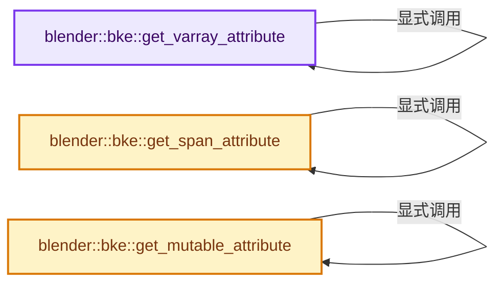
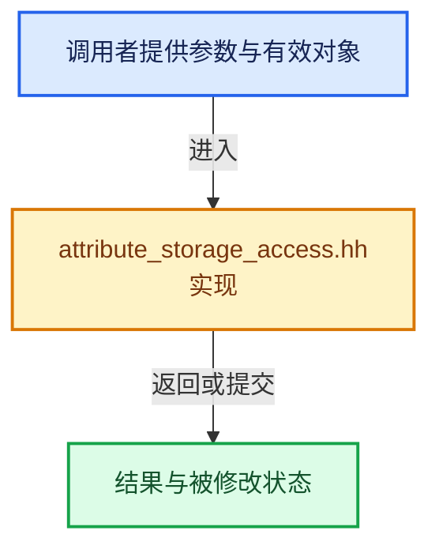

# 实现依赖专题：source/blender/blenkernel/intern/attribute_storage_access.hh

[方向导航](README.md) · [符号索引](../%E7%AC%A6%E5%8F%B7%E4%BE%9D%E8%B5%96%E4%B8%8E%E5%AE%9E%E7%8E%B0%E7%B4%A2%E5%BC%95.md)

本专题从正文实际调用进入，集中保存共享实现。函数有稳定锚点，可从调用处直接跳到对应完整函数；递归与互相调用通过回链组织。

## 本文件的实现关系






## 完整成员与函数实现

<a id="f-0df9ea62fe11ae5b"></a>

### `blender::bke::get_varray_attribute`

实现位置：[source/blender/blenkernel/intern/attribute_storage_access.hh](../../../../../source/blender/blenkernel/intern/attribute_storage_access.hh) · L51—L61。

接口参数：

- `const AttributeStorage &storage`
- `const AttrDomain domain`
- `const StringRef name`
- `const int64_t domain_size`
- `const T &default_value`

**教学注释版**

<!-- annotated:cea5266d2bc897 -->

```cpp
template<typename T>
inline VArray<T> get_varray_attribute(const AttributeStorage &storage,
                                      const AttrDomain domain,
                                      const StringRef name,
                                      const int64_t domain_size,
                                      const T &default_value)
{
  GVArray varray = get_varray_attribute(
      storage, domain, CPPType::get<T>(), name, domain_size, &default_value);
  return varray.typed<T>();
}
```

<details>
<summary>核对原始源码：source/blender/blenkernel/intern/attribute_storage_access.hh · L51—L61</summary>

<!-- original:cea5266d2bc897:source/blender/blenkernel/intern/attribute_storage_access.hh:51:61 -->

```cpp
template<typename T>
inline VArray<T> get_varray_attribute(const AttributeStorage &storage,
                                      const AttrDomain domain,
                                      const StringRef name,
                                      const int64_t domain_size,
                                      const T &default_value)
{
  GVArray varray = get_varray_attribute(
      storage, domain, CPPType::get<T>(), name, domain_size, &default_value);
  return varray.typed<T>();
}
```

</details>

**结果出口**

- `return varray.typed<T>();`

**继续追踪实现**

- `get_varray_attribute` → [blender::bke::get_varray_attribute · L51](%E4%BE%9D%E8%B5%96-attribute_storage_access-8d5498.md#f-0df9ea62fe11ae5b)。
- `CPPType::get<T>` → [blender::CPPType::get · L481](../03-%E5%86%85%E5%AD%98%E5%88%86%E9%85%8D%E4%B8%8E%E8%BF%90%E8%A1%8C%E6%97%B6%E7%B1%BB%E5%9E%8B/08-CPPType%E6%9E%84%E9%80%A0%E4%B8%8E%E6%9E%90%E6%9E%84.md#f-0cc10a3783d6abdb)。
- `varray.typed<T>` → [blender::GVArray::typed · L913](../04-%E8%99%9A%E6%8B%9F%E6%95%B0%E7%BB%84%E4%B8%8E%E7%B4%A2%E5%BC%95%E9%80%89%E6%8B%A9/05-GVArray%E8%BF%90%E8%A1%8C%E6%97%B6%E7%B1%BB%E5%9E%8B.md#f-c17d1cd75ef41a17)。

<a id="f-31bf92bc55779d80"></a>

### `blender::bke::get_span_attribute`

实现位置：[source/blender/blenkernel/intern/attribute_storage_access.hh](../../../../../source/blender/blenkernel/intern/attribute_storage_access.hh) · L69—L81。

接口参数：

- `const AttributeStorage &storage`
- `const AttrDomain domain`
- `const StringRef name`
- `const int64_t domain_size`

**教学注释版**

<!-- annotated:69000fc97a3d2c -->

```cpp
template<typename T>
inline std::optional<Span<T>> get_span_attribute(const AttributeStorage &storage,
                                                 const AttrDomain domain,
                                                 const StringRef name,
                                                 const int64_t domain_size)
{
  const std::optional<GSpan> span = get_span_attribute(
      storage, domain, CPPType::get<T>(), name, domain_size);
  if (!span) {
    return std::nullopt;
  }
  return span->typed<T>();
}
```

<details>
<summary>核对原始源码：source/blender/blenkernel/intern/attribute_storage_access.hh · L69—L81</summary>

<!-- original:69000fc97a3d2c:source/blender/blenkernel/intern/attribute_storage_access.hh:69:81 -->

```cpp
template<typename T>
inline std::optional<Span<T>> get_span_attribute(const AttributeStorage &storage,
                                                 const AttrDomain domain,
                                                 const StringRef name,
                                                 const int64_t domain_size)
{
  const std::optional<GSpan> span = get_span_attribute(
      storage, domain, CPPType::get<T>(), name, domain_size);
  if (!span) {
    return std::nullopt;
  }
  return span->typed<T>();
}
```

</details>

**结果出口**

- `return std::nullopt;`
- `return span->typed<T>();`

**继续追踪实现**

- `get_span_attribute` → [blender::bke::get_span_attribute · L69](%E4%BE%9D%E8%B5%96-attribute_storage_access-8d5498.md#f-31bf92bc55779d80)。
- `CPPType::get<T>` → [blender::CPPType::get · L481](../03-%E5%86%85%E5%AD%98%E5%88%86%E9%85%8D%E4%B8%8E%E8%BF%90%E8%A1%8C%E6%97%B6%E7%B1%BB%E5%9E%8B/08-CPPType%E6%9E%84%E9%80%A0%E4%B8%8E%E6%9E%90%E6%9E%84.md#f-0cc10a3783d6abdb)。
- `span->typed<T>` → [外部契约](https://eel.is/c++draft/)：这个边界按实际表达式及所属类型核对参数、返回值、寿命与失败行为。这里提供接口入口，不声称已解释该第三方版本的内部实现。

<a id="f-94948323441578df"></a>

### `blender::bke::get_mutable_attribute`

实现位置：[source/blender/blenkernel/intern/attribute_storage_access.hh](../../../../../source/blender/blenkernel/intern/attribute_storage_access.hh) · L90—L100。

接口参数：

- `AttributeStorage &storage`
- `const AttrDomain domain`
- `const StringRef name`
- `const int64_t domain_size`
- `const T &default_value = T()`

**教学注释版**

<!-- annotated:9b27c528166b8f -->

```cpp
template<typename T>
inline MutableSpan<T> get_mutable_attribute(AttributeStorage &storage,
                                            const AttrDomain domain,
                                            const StringRef name,
                                            const int64_t domain_size,
                                            const T &default_value = T())
{
  const GMutableSpan span = get_mutable_attribute(
      storage, domain, CPPType::get<T>(), name, domain_size, &default_value);
  return span.typed<T>();
}
```

<details>
<summary>核对原始源码：source/blender/blenkernel/intern/attribute_storage_access.hh · L90—L100</summary>

<!-- original:9b27c528166b8f:source/blender/blenkernel/intern/attribute_storage_access.hh:90:100 -->

```cpp
template<typename T>
inline MutableSpan<T> get_mutable_attribute(AttributeStorage &storage,
                                            const AttrDomain domain,
                                            const StringRef name,
                                            const int64_t domain_size,
                                            const T &default_value = T())
{
  const GMutableSpan span = get_mutable_attribute(
      storage, domain, CPPType::get<T>(), name, domain_size, &default_value);
  return span.typed<T>();
}
```

</details>

**结果出口**

- `return span.typed<T>();`

**继续追踪实现**

- `get_mutable_attribute` → [blender::bke::get_mutable_attribute · L90](%E4%BE%9D%E8%B5%96-attribute_storage_access-8d5498.md#f-94948323441578df)。
- `CPPType::get<T>` → [blender::CPPType::get · L481](../03-%E5%86%85%E5%AD%98%E5%88%86%E9%85%8D%E4%B8%8E%E8%BF%90%E8%A1%8C%E6%97%B6%E7%B1%BB%E5%9E%8B/08-CPPType%E6%9E%84%E9%80%A0%E4%B8%8E%E6%9E%90%E6%9E%84.md#f-0cc10a3783d6abdb)。
- `span.typed<T>` → [blender::GMutableSpan::typed · L220](../03-%E5%86%85%E5%AD%98%E5%88%86%E9%85%8D%E4%B8%8E%E8%BF%90%E8%A1%8C%E6%97%B6%E7%B1%BB%E5%9E%8B/11-GSpan%E4%B8%8EGArray.md#f-d66e288b393f6545)。
