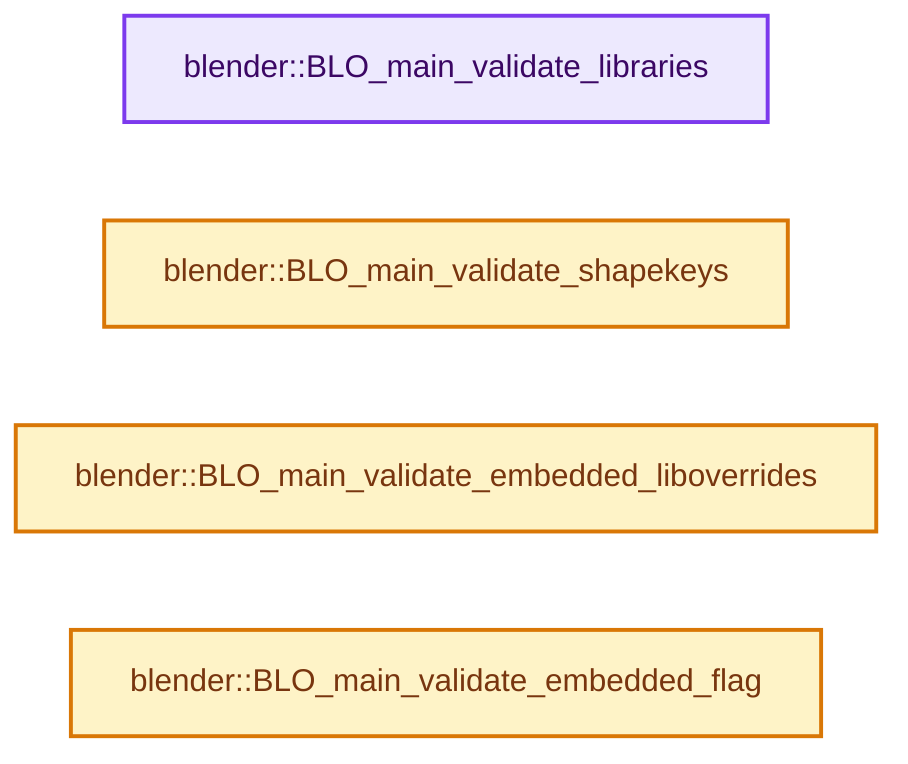
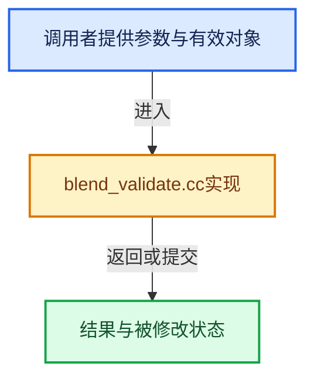

# 实现依赖专题：source/blender/blenloader/intern/blend_validate.cc

[方向导航](README.md) · [符号索引](../%E7%AC%A6%E5%8F%B7%E4%BE%9D%E8%B5%96%E4%B8%8E%E5%AE%9E%E7%8E%B0%E7%B4%A2%E5%BC%95.md)

本专题从正文实际调用进入，集中保存共享实现。函数有稳定锚点，可从调用处直接跳到对应完整函数；递归与互相调用通过回链组织。

## 本文件的实现关系






## 完整成员与函数实现

<a id="f-b4e163e5e5a0432a"></a>

### `blender::BLO_main_validate_libraries`

实现位置：[source/blender/blenloader/intern/blend_validate.cc](../../../../../source/blender/blenloader/intern/blend_validate.cc) · L43—L159。

接口参数：

- `Main *bmain`
- `ReportList *reports`

**教学注释版**

<!-- annotated:7d3dd3eeb44171 -->

```cpp
bool BLO_main_validate_libraries(Main *bmain, ReportList *reports)
{
  blo_split_main(bmain);
  BLI_assert(bmain->split_mains);
  VectorSet<Main *> &split_mains = *bmain->split_mains;
  BLI_assert(split_mains[0] == bmain);
  bool is_valid = true;

  BKE_main_lock(bmain);

  MainListsArray lbarray = BKE_main_lists_get(*bmain);
  int i = lbarray.size();
  while (i--) {
    for (ID *id = lbarray[i]->first(); id != nullptr; id = static_cast<ID *>(id->next)) {
      if (ID_IS_LINKED(id)) {
        is_valid = false;
        BKE_reportf(reports,
                    RPT_ERROR,
                    "ID %s is in local database while being linked from library %s!",
                    id->name,
                    id->lib->filepath);
      }
    }
  }

  for (Main *curmain : split_mains) {
    if (curmain == bmain) {
      continue;
    }
    Library *curlib = curmain->curlib;
    if (curlib == nullptr) {
      BKE_report(reports, RPT_ERROR, "Library database with null library data-block pointer!");
      continue;
    }

    BKE_library_filepath_set(bmain, curlib, curlib->filepath);
    BlendFileReadReport bf_reports{};
    bf_reports.reports = reports;
    BlendHandle *bh = BLO_blendhandle_from_file(curlib->runtime->filepath_abs, &bf_reports);

    if (bh == nullptr) {
      BKE_reportf(reports,
                  RPT_ERROR,
                  "Library ID %s not found at expected path %s!",
                  curlib->id.name,
                  curlib->runtime->filepath_abs);
      continue;
    }

    lbarray = BKE_main_lists_get(*curmain);
    i = lbarray.size();
    while (i--) {
      ID *id = lbarray[i]->first();
      if (id == nullptr) {
        continue;
      }

      if (id->id_type() == ID_LI) {
        is_valid = false;
        BKE_reportf(reports,
                    RPT_ERROR,
                    "Library ID %s in library %s, this should not happen!",
                    id->name,
                    curlib->filepath);
        continue;
      }

      int totnames = 0;
      LinkNode *names = BLO_blendhandle_get_datablock_names(bh, id->id_type(), false, &totnames);
      for (; id != nullptr; id = static_cast<ID *>(id->next)) {
        if (!ID_IS_LINKED(id)) {
          is_valid = false;
          BKE_reportf(reports,
                      RPT_ERROR,
                      "ID %s has null lib pointer while being in library %s!",
                      id->name,
                      curlib->filepath);
          continue;
        }
        if (id->lib != curlib) {
          is_valid = false;
          BKE_reportf(reports, RPT_ERROR, "ID %s has mismatched lib pointer!", id->name);
          continue;
        }

        LinkNode *name = names;
        for (; name; name = name->next) {
          const char *str_name = static_cast<const char *>(name->link);
          if (id->name[2] == str_name[0] && STREQ(str_name, id->name + 2)) {
            break;
          }
        }

        if (name == nullptr) {
          is_valid = false;
          BKE_reportf(reports,
                      RPT_ERROR,
                      "ID %s not found in library %s anymore!",
                      id->name,
                      id->lib->filepath);
          continue;
        }
      }

      BLI_linklist_freeN(names);
    }

    BLO_blendhandle_close(bh);
  }

  blo_join_main(bmain);
  BLI_assert(!bmain->split_mains);

  BKE_main_unlock(bmain);

  return is_valid;
}
```

<details>
<summary>核对原始源码：source/blender/blenloader/intern/blend_validate.cc · L43—L159</summary>

<!-- original:7d3dd3eeb44171:source/blender/blenloader/intern/blend_validate.cc:43:159 -->

```cpp
bool BLO_main_validate_libraries(Main *bmain, ReportList *reports)
{
  blo_split_main(bmain);
  BLI_assert(bmain->split_mains);
  VectorSet<Main *> &split_mains = *bmain->split_mains;
  BLI_assert(split_mains[0] == bmain);
  bool is_valid = true;

  BKE_main_lock(bmain);

  MainListsArray lbarray = BKE_main_lists_get(*bmain);
  int i = lbarray.size();
  while (i--) {
    for (ID *id = lbarray[i]->first(); id != nullptr; id = static_cast<ID *>(id->next)) {
      if (ID_IS_LINKED(id)) {
        is_valid = false;
        BKE_reportf(reports,
                    RPT_ERROR,
                    "ID %s is in local database while being linked from library %s!",
                    id->name,
                    id->lib->filepath);
      }
    }
  }

  for (Main *curmain : split_mains) {
    if (curmain == bmain) {
      continue;
    }
    Library *curlib = curmain->curlib;
    if (curlib == nullptr) {
      BKE_report(reports, RPT_ERROR, "Library database with null library data-block pointer!");
      continue;
    }

    BKE_library_filepath_set(bmain, curlib, curlib->filepath);
    BlendFileReadReport bf_reports{};
    bf_reports.reports = reports;
    BlendHandle *bh = BLO_blendhandle_from_file(curlib->runtime->filepath_abs, &bf_reports);

    if (bh == nullptr) {
      BKE_reportf(reports,
                  RPT_ERROR,
                  "Library ID %s not found at expected path %s!",
                  curlib->id.name,
                  curlib->runtime->filepath_abs);
      continue;
    }

    lbarray = BKE_main_lists_get(*curmain);
    i = lbarray.size();
    while (i--) {
      ID *id = lbarray[i]->first();
      if (id == nullptr) {
        continue;
      }

      if (id->id_type() == ID_LI) {
        is_valid = false;
        BKE_reportf(reports,
                    RPT_ERROR,
                    "Library ID %s in library %s, this should not happen!",
                    id->name,
                    curlib->filepath);
        continue;
      }

      int totnames = 0;
      LinkNode *names = BLO_blendhandle_get_datablock_names(bh, id->id_type(), false, &totnames);
      for (; id != nullptr; id = static_cast<ID *>(id->next)) {
        if (!ID_IS_LINKED(id)) {
          is_valid = false;
          BKE_reportf(reports,
                      RPT_ERROR,
                      "ID %s has null lib pointer while being in library %s!",
                      id->name,
                      curlib->filepath);
          continue;
        }
        if (id->lib != curlib) {
          is_valid = false;
          BKE_reportf(reports, RPT_ERROR, "ID %s has mismatched lib pointer!", id->name);
          continue;
        }

        LinkNode *name = names;
        for (; name; name = name->next) {
          const char *str_name = static_cast<const char *>(name->link);
          if (id->name[2] == str_name[0] && STREQ(str_name, id->name + 2)) {
            break;
          }
        }

        if (name == nullptr) {
          is_valid = false;
          BKE_reportf(reports,
                      RPT_ERROR,
                      "ID %s not found in library %s anymore!",
                      id->name,
                      id->lib->filepath);
          continue;
        }
      }

      BLI_linklist_freeN(names);
    }

    BLO_blendhandle_close(bh);
  }

  blo_join_main(bmain);
  BLI_assert(!bmain->split_mains);

  BKE_main_unlock(bmain);

  return is_valid;
}
```

</details>

**沿实际写入检查状态**

- `is_valid = false;`
- `bf_reports.reports = reports;`
- `lbarray = BKE_main_lists_get(*curmain);`
- `i = lbarray.size();`

**结果出口**

- `return is_valid;`

**继续追踪实现**

- `blo_split_main` → [blender::blo_split_main · L440](%E4%BE%9D%E8%B5%96-readfile-05cc37.md#f-e630905327ded67c)。
- `BLI_assert` → [BLI_assert · L48](../01-%E5%9F%BA%E7%A1%80%E5%AE%B9%E5%99%A8%E4%B8%8E%E7%8E%B0%E4%BB%A3CPP/%E4%BE%9D%E8%B5%96-BLI_assert-cc98e8.md#m-57a88495704d)；[BLI_assert · L63](../01-%E5%9F%BA%E7%A1%80%E5%AE%B9%E5%99%A8%E4%B8%8E%E7%8E%B0%E4%BB%A3CPP/%E4%BE%9D%E8%B5%96-BLI_assert-cc98e8.md#m-d07050020cb5)。宏定义由构建条件选择。
- `BKE_main_lock` → [blender::BKE_main_lock · L661](%E4%BE%9D%E8%B5%96-main-ffa8b3.md#f-3f480bfb076dd87d)。
- `BKE_main_lists_get` → [blender::BKE_main_lists_get · L1158](%E4%BE%9D%E8%B5%96-main-ffa8b3.md#f-908cb8449aa99c35)。
- `lbarray.size` → [blender::Bounds<T>::size · L543](../12-%E7%A9%BA%E9%97%B4%E6%95%B0%E6%8D%AE%E7%BB%93%E6%9E%84%E4%B8%8E%E5%87%A0%E4%BD%95%E7%AE%97%E6%B3%95/07-Bounds%E4%B8%8EBVH%E5%AF%B9%E6%AF%94.md#f-fcce88c0824fcd97)；[blender::GVArrayImpl::size · L651](../04-%E8%99%9A%E6%8B%9F%E6%95%B0%E7%BB%84%E4%B8%8E%E7%B4%A2%E5%BC%95%E9%80%89%E6%8B%A9/05-GVArray%E8%BF%90%E8%A1%8C%E6%97%B6%E7%B1%BB%E5%9E%8B.md#f-f23d3d1f3b110f1e)；[blender::GVArrayCommon::size · L759](../04-%E8%99%9A%E6%8B%9F%E6%95%B0%E7%BB%84%E4%B8%8E%E7%B4%A2%E5%BC%95%E9%80%89%E6%8B%A9/05-GVArray%E8%BF%90%E8%A1%8C%E6%97%B6%E7%B1%BB%E5%9E%8B.md#f-0856784f4e4fd3c9)；[blender::StringRefBase::size · L196](../01-%E5%9F%BA%E7%A1%80%E5%AE%B9%E5%99%A8%E4%B8%8E%E7%8E%B0%E4%BB%A3CPP/15-StringRef%E5%AD%97%E7%AC%A6%E4%B8%B2%E8%A7%86%E5%9B%BE.md#f-60d4631c74931d2e)；[blender::KDTreeNew<T>::size · L493](../12-%E7%A9%BA%E9%97%B4%E6%95%B0%E6%8D%AE%E7%BB%93%E6%9E%84%E4%B8%8E%E5%87%A0%E4%BD%95%E7%AE%97%E6%B3%95/05-K%E8%BF%91%E9%82%BB%E4%B8%8E%E8%8C%83%E5%9B%B4%E6%9F%A5%E8%AF%A2.md#f-233c05ce6d5c8d39)；[blender::MainAllIDsIterator::size · L1291](%E4%BE%9D%E8%B5%96-main-ffa8b3.md#f-520d1311c646452f)；[blender::GLSourcesBaked::size · L1541](%E4%BE%9D%E8%B5%96-gl_shader-766737.md#f-5b5b539d533c6792)。同名重载需按实参类型选择。
- `lbarray[i]->first` → [调用协议](../%E6%A8%A1%E6%9D%BF%E5%AE%8F%E4%B8%8E%E5%8A%A8%E6%80%81%E5%88%86%E6%B4%BE%E5%8D%8F%E8%AE%AE.md)：接收对象类型依赖auto、返回值或模板实例；不按同名猜测目标。调用位置L56。
- `ID_IS_LINKED` → [ID_IS_LINKED · L697](%E4%BE%9D%E8%B5%96-DNA_ID-3eb091.md#m-7e1e1e9b20e6)。宏定义由构建条件选择。
- `BKE_reportf` → [blender::BKE_reportf · L191](%E4%BE%9D%E8%B5%96-report-f916fd.md#f-e776fc632ffb42b3)。
- `BKE_report` → [blender::BKE_report · L162](%E4%BE%9D%E8%B5%96-report-f916fd.md#f-56816f68adfe537b)。
- `BKE_library_filepath_set` → [blender::BKE_library_filepath_set · L250](%E4%BE%9D%E8%B5%96-library-b754fe.md#f-31e6eba9cf41ea03)。
- `BLO_blendhandle_from_file` → [blender::BLO_blendhandle_from_file · L61](%E4%BE%9D%E8%B5%96-readblenentry-9e660c.md#f-829b88c9d3187dde)。
- `id->id_type` → [blender::ID::id_type · L544](%E4%BE%9D%E8%B5%96-DNA_ID-3eb091.md#f-ee8fe63f3948aa47)。
- `BLO_blendhandle_get_datablock_names` → [blender::BLO_blendhandle_get_datablock_names · L120](%E4%BE%9D%E8%B5%96-readblenentry-9e660c.md#f-917b69a8a6f34d1e)。
- `STREQ` → [STREQ · L112](%E4%BE%9D%E8%B5%96-GHOST_utildefines-34b996.md#m-9549fb6aafd2)；[STREQ · L451](../01-%E5%9F%BA%E7%A1%80%E5%AE%B9%E5%99%A8%E4%B8%8E%E7%8E%B0%E4%BB%A3CPP/%E4%BE%9D%E8%B5%96-BLI_utildefines-293a0a.md#m-c7b745bcfad2)；[STREQ · L55](%E4%BE%9D%E8%B5%96-clog-a0bec8.md#m-96e78f386894)。宏定义由构建条件选择。
- `BLI_linklist_freeN` → [blender::BLI_linklist_freeN · L285](../01-%E5%9F%BA%E7%A1%80%E5%AE%B9%E5%99%A8%E4%B8%8E%E7%8E%B0%E4%BB%A3CPP/%E4%BE%9D%E8%B5%96-BLI_linklist-23c475.md#f-a6bee34b8fdcdf5a)。
- `BLO_blendhandle_close` → [blender::BLO_blendhandle_close · L339](%E4%BE%9D%E8%B5%96-readblenentry-9e660c.md#f-033840da4970db23)。
- `blo_join_main` → [blender::blo_join_main · L384](%E4%BE%9D%E8%B5%96-readfile-05cc37.md#f-f972c334c9e4e4e6)。
- `BKE_main_unlock` → [blender::BKE_main_unlock · L666](%E4%BE%9D%E8%B5%96-main-ffa8b3.md#f-abebed07b3cec04c)。

<a id="f-5c0e40fb50254d4e"></a>

### `blender::BLO_main_validate_shapekeys`

实现位置：[source/blender/blenloader/intern/blend_validate.cc](../../../../../source/blender/blenloader/intern/blend_validate.cc) · L161—L222。

接口参数：

- `Main *bmain`
- `ReportList *reports`

**教学注释版**

<!-- annotated:2fb561455e34f1 -->

```cpp
bool BLO_main_validate_shapekeys(Main *bmain, ReportList *reports)
{
  ListBaseT<ID> *lb;
  ID *id;
  bool is_valid = true;

  BKE_main_lock(bmain);

  FOREACH_MAIN_LISTBASE_BEGIN (bmain, lb) {
    FOREACH_MAIN_LISTBASE_ID_BEGIN (lb, id) {
      if (!BKE_key_idtype_support(id->id_type())) {
        break;
      }
      if (!ID_IS_LINKED(id)) {
        /* We assume lib data is valid... */
        Key *shapekey = BKE_key_from_id(id);
        if (shapekey != nullptr && shapekey->from != id) {
          is_valid = false;
          BKE_reportf(reports,
                      RPT_ERROR,
                      "ID %s uses shapekey %s, but its 'from' pointer is invalid (%p), fixing...",
                      id->name,
                      shapekey->id.name,
                      shapekey->from);
          shapekey->from = id;
        }
      }
    }
    FOREACH_MAIN_LISTBASE_ID_END;
  }
  FOREACH_MAIN_LISTBASE_END;

  BKE_main_unlock(bmain);

  /* NOTE: #BKE_id_delete also locks `bmain`, so we need to do this loop outside of the lock here.
   */
  for (Key &shapekey : bmain->shapekeys.items_mutable()) {
    if (shapekey.from != nullptr) {
      continue;
    }

    BKE_reportf(reports,
                RPT_ERROR,
                "ShapeKey %s has an invalid 'from' pointer (%p), it will be deleted",
                shapekey.id.name,
                shapekey.from);
    is_valid = false;

    BKE_id_delete(bmain,
                  &shapekey,
                  {/* NOTE: also need to remap UI data ID pointers here, since `bmain` is not the
                    * current `G_MAIN`, default UI-handling remapping callback (defined by call to
                    * `BKE_library_callback_remap_editor_id_reference_set`) won't work on expected
                    * data here. */
                   .extra_remapping_flags = ID_REMAP_FORCE_UI_POINTERS,
                   /* Do not attempt to update invariants from here, Main is not yet fully read and
                    * in a state allowing that kind of processes. */
                   .prevent_invariants_update = true});
  }

  return is_valid;
}
```

<details>
<summary>核对原始源码：source/blender/blenloader/intern/blend_validate.cc · L161—L222</summary>

<!-- original:2fb561455e34f1:source/blender/blenloader/intern/blend_validate.cc:161:222 -->

```cpp
bool BLO_main_validate_shapekeys(Main *bmain, ReportList *reports)
{
  ListBaseT<ID> *lb;
  ID *id;
  bool is_valid = true;

  BKE_main_lock(bmain);

  FOREACH_MAIN_LISTBASE_BEGIN (bmain, lb) {
    FOREACH_MAIN_LISTBASE_ID_BEGIN (lb, id) {
      if (!BKE_key_idtype_support(id->id_type())) {
        break;
      }
      if (!ID_IS_LINKED(id)) {
        /* We assume lib data is valid... */
        Key *shapekey = BKE_key_from_id(id);
        if (shapekey != nullptr && shapekey->from != id) {
          is_valid = false;
          BKE_reportf(reports,
                      RPT_ERROR,
                      "ID %s uses shapekey %s, but its 'from' pointer is invalid (%p), fixing...",
                      id->name,
                      shapekey->id.name,
                      shapekey->from);
          shapekey->from = id;
        }
      }
    }
    FOREACH_MAIN_LISTBASE_ID_END;
  }
  FOREACH_MAIN_LISTBASE_END;

  BKE_main_unlock(bmain);

  /* NOTE: #BKE_id_delete also locks `bmain`, so we need to do this loop outside of the lock here.
   */
  for (Key &shapekey : bmain->shapekeys.items_mutable()) {
    if (shapekey.from != nullptr) {
      continue;
    }

    BKE_reportf(reports,
                RPT_ERROR,
                "ShapeKey %s has an invalid 'from' pointer (%p), it will be deleted",
                shapekey.id.name,
                shapekey.from);
    is_valid = false;

    BKE_id_delete(bmain,
                  &shapekey,
                  {/* NOTE: also need to remap UI data ID pointers here, since `bmain` is not the
                    * current `G_MAIN`, default UI-handling remapping callback (defined by call to
                    * `BKE_library_callback_remap_editor_id_reference_set`) won't work on expected
                    * data here. */
                   .extra_remapping_flags = ID_REMAP_FORCE_UI_POINTERS,
                   /* Do not attempt to update invariants from here, Main is not yet fully read and
                    * in a state allowing that kind of processes. */
                   .prevent_invariants_update = true});
  }

  return is_valid;
}
```

</details>

**沿实际写入检查状态**

- `is_valid = false;`
- `shapekey->from = id;`
- `.extra_remapping_flags = ID_REMAP_FORCE_UI_POINTERS,`
- `.prevent_invariants_update = true});`

**结果出口**

- `return is_valid;`

**继续追踪实现**

- `BKE_main_lock` → [blender::BKE_main_lock · L661](%E4%BE%9D%E8%B5%96-main-ffa8b3.md#f-3f480bfb076dd87d)。
- `BKE_key_idtype_support` → [blender::BKE_key_idtype_support · L1254](%E4%BE%9D%E8%B5%96-key-2b3be3.md#f-034edf74ab81ce13)。
- `id->id_type` → [blender::ID::id_type · L544](%E4%BE%9D%E8%B5%96-DNA_ID-3eb091.md#f-ee8fe63f3948aa47)。
- `ID_IS_LINKED` → [ID_IS_LINKED · L697](%E4%BE%9D%E8%B5%96-DNA_ID-3eb091.md#m-7e1e1e9b20e6)。宏定义由构建条件选择。
- `BKE_key_from_id` → [blender::BKE_key_from_id · L1291](%E4%BE%9D%E8%B5%96-key-2b3be3.md#f-2050edb37f3ef7b0)。
- `BKE_reportf` → [blender::BKE_reportf · L191](%E4%BE%9D%E8%B5%96-report-f916fd.md#f-e776fc632ffb42b3)。
- `BKE_main_unlock` → [blender::BKE_main_unlock · L666](%E4%BE%9D%E8%B5%96-main-ffa8b3.md#f-abebed07b3cec04c)。
- `bmain->shapekeys.items_mutable` → [调用协议](../%E6%A8%A1%E6%9D%BF%E5%AE%8F%E4%B8%8E%E5%8A%A8%E6%80%81%E5%88%86%E6%B4%BE%E5%8D%8F%E8%AE%AE.md)：接收对象类型依赖auto、返回值或模板实例；不按同名猜测目标。调用位置L197。
- `BKE_id_delete` → [blender::BKE_id_delete · L406](%E4%BE%9D%E8%B5%96-lib_id_delete-0cb33f.md#f-1b08b3eb63e4686b)。

<a id="f-a715f3c4a0084e25"></a>

### `blender::BLO_main_validate_embedded_liboverrides`

实现位置：[source/blender/blenloader/intern/blend_validate.cc](../../../../../source/blender/blenloader/intern/blend_validate.cc) · L224—L247。

接口参数：

- `Main *bmain`
- `ReportList *`

**教学注释版**

<!-- annotated:279c51b8941e5a -->

```cpp
void BLO_main_validate_embedded_liboverrides(Main *bmain, ReportList * /*reports*/)
{
  ID *id_iter;
  FOREACH_MAIN_ID_BEGIN (bmain, id_iter) {
    bNodeTree *node_tree = bke::node_tree_from_id(id_iter);
    if (node_tree) {
      if (node_tree->id.flag & ID_FLAG_EMBEDDED_DATA_LIB_OVERRIDE) {
        if (!ID_IS_OVERRIDE_LIBRARY(id_iter)) {
          node_tree->id.flag &= ~ID_FLAG_EMBEDDED_DATA_LIB_OVERRIDE;
        }
      }
    }

    if (id_iter->id_type() == ID_SCE) {
      Scene *scene = reinterpret_cast<Scene *>(id_iter);
      if (scene->master_collection &&
          (scene->master_collection->id.flag & ID_FLAG_EMBEDDED_DATA_LIB_OVERRIDE))
      {
        scene->master_collection->id.flag &= ~ID_FLAG_EMBEDDED_DATA_LIB_OVERRIDE;
      }
    }
  }
  FOREACH_MAIN_ID_END;
}
```

<details>
<summary>核对原始源码：source/blender/blenloader/intern/blend_validate.cc · L224—L247</summary>

<!-- original:279c51b8941e5a:source/blender/blenloader/intern/blend_validate.cc:224:247 -->

```cpp
void BLO_main_validate_embedded_liboverrides(Main *bmain, ReportList * /*reports*/)
{
  ID *id_iter;
  FOREACH_MAIN_ID_BEGIN (bmain, id_iter) {
    bNodeTree *node_tree = bke::node_tree_from_id(id_iter);
    if (node_tree) {
      if (node_tree->id.flag & ID_FLAG_EMBEDDED_DATA_LIB_OVERRIDE) {
        if (!ID_IS_OVERRIDE_LIBRARY(id_iter)) {
          node_tree->id.flag &= ~ID_FLAG_EMBEDDED_DATA_LIB_OVERRIDE;
        }
      }
    }

    if (id_iter->id_type() == ID_SCE) {
      Scene *scene = reinterpret_cast<Scene *>(id_iter);
      if (scene->master_collection &&
          (scene->master_collection->id.flag & ID_FLAG_EMBEDDED_DATA_LIB_OVERRIDE))
      {
        scene->master_collection->id.flag &= ~ID_FLAG_EMBEDDED_DATA_LIB_OVERRIDE;
      }
    }
  }
  FOREACH_MAIN_ID_END;
}
```

</details>

**沿实际写入检查状态**

- `node_tree->id.flag &= ~ID_FLAG_EMBEDDED_DATA_LIB_OVERRIDE;`
- `scene->master_collection->id.flag &= ~ID_FLAG_EMBEDDED_DATA_LIB_OVERRIDE;`

**继续追踪实现**

- `bke::node_tree_from_id` → [blender::bke::node_tree_from_id · L5337](%E4%BE%9D%E8%B5%96-node-89d753.md#f-9bb7511df53d8493)。
- `ID_IS_OVERRIDE_LIBRARY` → [ID_IS_OVERRIDE_LIBRARY · L736](%E4%BE%9D%E8%B5%96-DNA_ID-3eb091.md#m-c84b86cfb14f)。宏定义由构建条件选择。
- `id_iter->id_type` → [blender::ID::id_type · L544](%E4%BE%9D%E8%B5%96-DNA_ID-3eb091.md#f-ee8fe63f3948aa47)。

<a id="f-521dc351d45239e0"></a>

### `blender::BLO_main_validate_embedded_flag`

实现位置：[source/blender/blenloader/intern/blend_validate.cc](../../../../../source/blender/blenloader/intern/blend_validate.cc) · L249—L282。

接口参数：

- `Main *bmain`
- `ReportList *`

**教学注释版**

<!-- annotated:420c1cc9b53d70 -->

```cpp
void BLO_main_validate_embedded_flag(Main *bmain, ReportList * /*reports*/)
{
  ID *id_iter;
  FOREACH_MAIN_ID_BEGIN (bmain, id_iter) {
    if (id_iter->flag & ID_FLAG_EMBEDDED_DATA) {
      CLOG_ERROR(
          &LOG, "ID %s is flagged as embedded, while existing in Main data-base", id_iter->name);
      id_iter->flag &= ~ID_FLAG_EMBEDDED_DATA;
    }

    bNodeTree *node_tree = bke::node_tree_from_id(id_iter);
    if (node_tree) {
      if ((node_tree->id.flag & ID_FLAG_EMBEDDED_DATA) == 0) {
        CLOG_ERROR(&LOG,
                   "ID %s has an embedded nodetree which is not flagged as embedded",
                   id_iter->name);
        node_tree->id.flag |= ID_FLAG_EMBEDDED_DATA;
      }
    }

    if (id_iter->id_type() == ID_SCE) {
      Scene *scene = reinterpret_cast<Scene *>(id_iter);
      if (scene->master_collection &&
          (scene->master_collection->id.flag & ID_FLAG_EMBEDDED_DATA) == 0)
      {
        CLOG_ERROR(&LOG,
                   "ID %s has an embedded Collection which is not flagged as embedded",
                   id_iter->name);
        scene->master_collection->id.flag |= ID_FLAG_EMBEDDED_DATA;
      }
    }
  }
  FOREACH_MAIN_ID_END;
}
```

<details>
<summary>核对原始源码：source/blender/blenloader/intern/blend_validate.cc · L249—L282</summary>

<!-- original:420c1cc9b53d70:source/blender/blenloader/intern/blend_validate.cc:249:282 -->

```cpp
void BLO_main_validate_embedded_flag(Main *bmain, ReportList * /*reports*/)
{
  ID *id_iter;
  FOREACH_MAIN_ID_BEGIN (bmain, id_iter) {
    if (id_iter->flag & ID_FLAG_EMBEDDED_DATA) {
      CLOG_ERROR(
          &LOG, "ID %s is flagged as embedded, while existing in Main data-base", id_iter->name);
      id_iter->flag &= ~ID_FLAG_EMBEDDED_DATA;
    }

    bNodeTree *node_tree = bke::node_tree_from_id(id_iter);
    if (node_tree) {
      if ((node_tree->id.flag & ID_FLAG_EMBEDDED_DATA) == 0) {
        CLOG_ERROR(&LOG,
                   "ID %s has an embedded nodetree which is not flagged as embedded",
                   id_iter->name);
        node_tree->id.flag |= ID_FLAG_EMBEDDED_DATA;
      }
    }

    if (id_iter->id_type() == ID_SCE) {
      Scene *scene = reinterpret_cast<Scene *>(id_iter);
      if (scene->master_collection &&
          (scene->master_collection->id.flag & ID_FLAG_EMBEDDED_DATA) == 0)
      {
        CLOG_ERROR(&LOG,
                   "ID %s has an embedded Collection which is not flagged as embedded",
                   id_iter->name);
        scene->master_collection->id.flag |= ID_FLAG_EMBEDDED_DATA;
      }
    }
  }
  FOREACH_MAIN_ID_END;
}
```

</details>

**沿实际写入检查状态**

- `id_iter->flag &= ~ID_FLAG_EMBEDDED_DATA;`
- `node_tree->id.flag |= ID_FLAG_EMBEDDED_DATA;`
- `scene->master_collection->id.flag |= ID_FLAG_EMBEDDED_DATA;`

**继续追踪实现**

- `CLOG_ERROR` → [CLOG_ERROR · L188](%E4%BE%9D%E8%B5%96-CLG_log-e9051b.md#m-081575cdc8d0)。宏定义由构建条件选择。
- `bke::node_tree_from_id` → [blender::bke::node_tree_from_id · L5337](%E4%BE%9D%E8%B5%96-node-89d753.md#f-9bb7511df53d8493)。
- `id_iter->id_type` → [blender::ID::id_type · L544](%E4%BE%9D%E8%B5%96-DNA_ID-3eb091.md#f-ee8fe63f3948aa47)。
