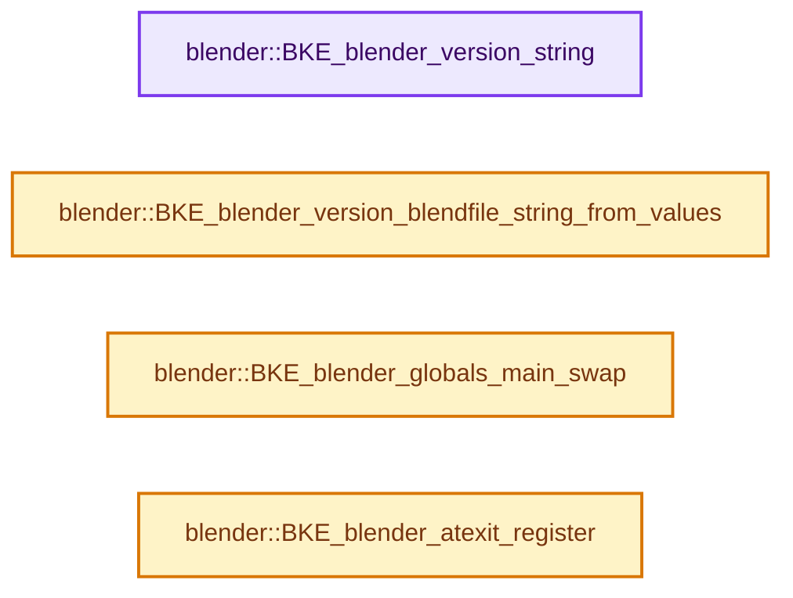
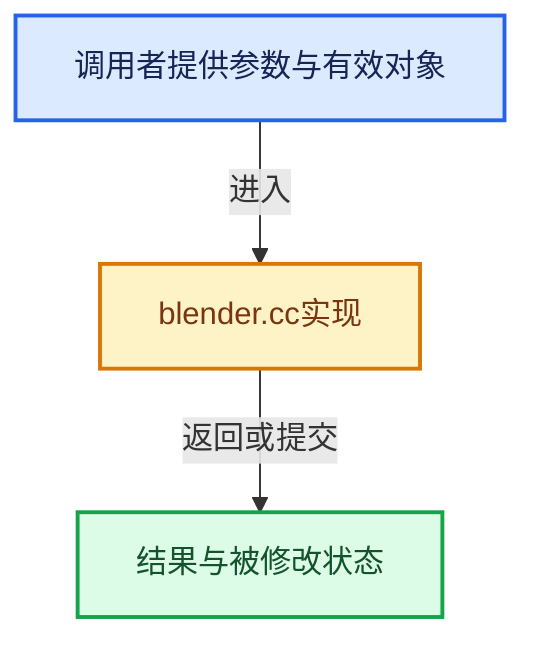

# 实现依赖专题：source/blender/blenkernel/intern/blender.cc

[方向导航](README.md) · [符号索引](../%E7%AC%A6%E5%8F%B7%E4%BE%9D%E8%B5%96%E4%B8%8E%E5%AE%9E%E7%8E%B0%E7%B4%A2%E5%BC%95.md)

本专题从正文实际调用进入，集中保存共享实现。函数有稳定锚点，可从调用处直接跳到对应完整函数；递归与互相调用通过回链组织。

## 本文件的实现关系






## 完整成员与函数实现

<a id="f-f8f50b9928d2bd67"></a>

### `blender::BKE_blender_version_string`

实现位置：[source/blender/blenkernel/intern/blender.cc](../../../../../source/blender/blenkernel/intern/blender.cc) · L147—L150。

**教学注释版**

<!-- annotated:7e226a2abea856 -->

```cpp
const char *BKE_blender_version_string()
{
  return blender_version_string;
}
```

<details>
<summary>核对原始源码：source/blender/blenkernel/intern/blender.cc · L147—L150</summary>

<!-- original:7e226a2abea856:source/blender/blenkernel/intern/blender.cc:147:150 -->

```cpp
const char *BKE_blender_version_string()
{
  return blender_version_string;
}
```

</details>

**结果出口**

- `return blender_version_string;`

**继续追踪实现**

本实现没有需要继续展开的显式调用；检查返回表达式、对象转换和调用者前置条件。

<a id="f-7fc80dc35750ab13"></a>

### `blender::BKE_blender_version_blendfile_string_from_values`

实现位置：[source/blender/blenkernel/intern/blender.cc](../../../../../source/blender/blenkernel/intern/blender.cc) · L157—L175。

接口参数：

- `char *str_buff`
- `const size_t str_buff_maxncpy`
- `const short file_version`
- `const short file_subversion`

**教学注释版**

<!-- annotated:7376bda567e1db -->

```cpp
void BKE_blender_version_blendfile_string_from_values(char *str_buff,
                                                      const size_t str_buff_maxncpy,
                                                      const short file_version,
                                                      const short file_subversion)
{
  const short file_version_major = file_version / 100;
  const short file_version_minor = file_version % 100;
  if (file_subversion >= 0) {
    BLI_snprintf_utf8(str_buff,
                      str_buff_maxncpy,
                      "%d.%d (sub %d)",
                      file_version_major,
                      file_version_minor,
                      file_subversion);
  }
  else {
    BLI_snprintf_utf8(str_buff, str_buff_maxncpy, "%d.%d", file_version_major, file_version_minor);
  }
}
```

<details>
<summary>核对原始源码：source/blender/blenkernel/intern/blender.cc · L157—L175</summary>

<!-- original:7376bda567e1db:source/blender/blenkernel/intern/blender.cc:157:175 -->

```cpp
void BKE_blender_version_blendfile_string_from_values(char *str_buff,
                                                      const size_t str_buff_maxncpy,
                                                      const short file_version,
                                                      const short file_subversion)
{
  const short file_version_major = file_version / 100;
  const short file_version_minor = file_version % 100;
  if (file_subversion >= 0) {
    BLI_snprintf_utf8(str_buff,
                      str_buff_maxncpy,
                      "%d.%d (sub %d)",
                      file_version_major,
                      file_version_minor,
                      file_subversion);
  }
  else {
    BLI_snprintf_utf8(str_buff, str_buff_maxncpy, "%d.%d", file_version_major, file_version_minor);
  }
}
```

</details>

**继续追踪实现**

- `BLI_snprintf_utf8` → [blender::BLI_snprintf_utf8 · L597](../01-%E5%9F%BA%E7%A1%80%E5%AE%B9%E5%99%A8%E4%B8%8E%E7%8E%B0%E4%BB%A3CPP/%E4%BE%9D%E8%B5%96-string_utf8-3c62ca.md#f-47c5b052ec665ff6)。

<a id="f-e9758a05e1d13d7b"></a>

### `blender::BKE_blender_globals_main_swap`

实现位置：[source/blender/blenkernel/intern/blender.cc](../../../../../source/blender/blenkernel/intern/blender.cc) · L234—L243。

接口参数：

- `Main *new_gmain`

**教学注释版**

<!-- annotated:18b66a535b5daa -->

```cpp
Main *BKE_blender_globals_main_swap(Main *new_gmain)
{
  Main *old_gmain = G_MAIN;
  BLI_assert(old_gmain->is_global_main);
  BLI_assert(!new_gmain->is_global_main);
  new_gmain->is_global_main = true;
  G_MAIN = new_gmain;
  old_gmain->is_global_main = false;
  return old_gmain;
}
```

<details>
<summary>核对原始源码：source/blender/blenkernel/intern/blender.cc · L234—L243</summary>

<!-- original:18b66a535b5daa:source/blender/blenkernel/intern/blender.cc:234:243 -->

```cpp
Main *BKE_blender_globals_main_swap(Main *new_gmain)
{
  Main *old_gmain = G_MAIN;
  BLI_assert(old_gmain->is_global_main);
  BLI_assert(!new_gmain->is_global_main);
  new_gmain->is_global_main = true;
  G_MAIN = new_gmain;
  old_gmain->is_global_main = false;
  return old_gmain;
}
```

</details>

**沿实际写入检查状态**

- `new_gmain->is_global_main = true;`
- `G_MAIN = new_gmain;`
- `old_gmain->is_global_main = false;`

**结果出口**

- `return old_gmain;`

**继续追踪实现**

- `BLI_assert` → [BLI_assert · L48](../01-%E5%9F%BA%E7%A1%80%E5%AE%B9%E5%99%A8%E4%B8%8E%E7%8E%B0%E4%BB%A3CPP/%E4%BE%9D%E8%B5%96-BLI_assert-cc98e8.md#m-57a88495704d)；[BLI_assert · L63](../01-%E5%9F%BA%E7%A1%80%E5%AE%B9%E5%99%A8%E4%B8%8E%E7%8E%B0%E4%BB%A3CPP/%E4%BE%9D%E8%B5%96-BLI_assert-cc98e8.md#m-d07050020cb5)。宏定义由构建条件选择。

<a id="f-1ba3799872943434"></a>

### `blender::BKE_blender_atexit_register`

实现位置：[source/blender/blenkernel/intern/blender.cc](../../../../../source/blender/blenkernel/intern/blender.cc) · L484—L491。

接口参数：

- `void (*func)(void *user_data)`
- `void *user_data`
- `void *user_data`

**教学注释版**

<!-- annotated:1b2e902ceae6bb -->

```cpp
void BKE_blender_atexit_register(void (*func)(void *user_data), void *user_data)
{
  // [讲解] malloc：取得原始存储，失败可返回空指针；不构造C++对象。必须与匹配释放接口及对象寿命管理结合。
  AtExitData *ae = static_cast<AtExitData *>(malloc(sizeof(*ae)));
  ae->next = g_atexit;
  ae->func = func;
  ae->user_data = user_data;
  g_atexit = ae;
}
```

<details>
<summary>核对原始源码：source/blender/blenkernel/intern/blender.cc · L484—L491</summary>

<!-- original:1b2e902ceae6bb:source/blender/blenkernel/intern/blender.cc:484:491 -->

```cpp
void BKE_blender_atexit_register(void (*func)(void *user_data), void *user_data)
{
  AtExitData *ae = static_cast<AtExitData *>(malloc(sizeof(*ae)));
  ae->next = g_atexit;
  ae->func = func;
  ae->user_data = user_data;
  g_atexit = ae;
}
```

</details>

**沿实际写入检查状态**

- `ae->next = g_atexit;`
- `ae->func = func;`
- `ae->user_data = user_data;`
- `g_atexit = ae;`

**继续追踪实现**

- `malloc` → [外部契约](https://eel.is/c++draft/c.malloc)：取得原始存储，失败可返回空指针；不构造C++对象。必须与匹配释放接口及对象寿命管理结合。
