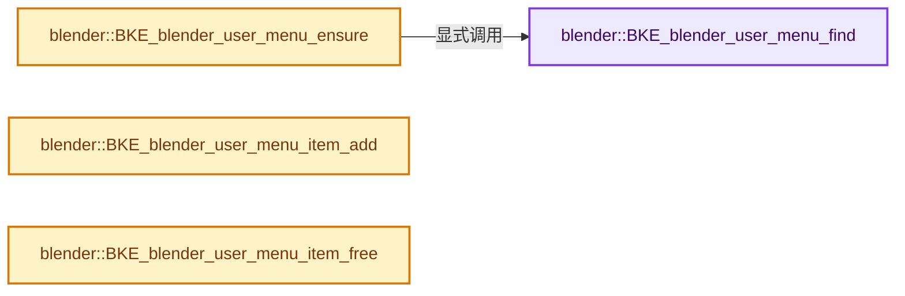
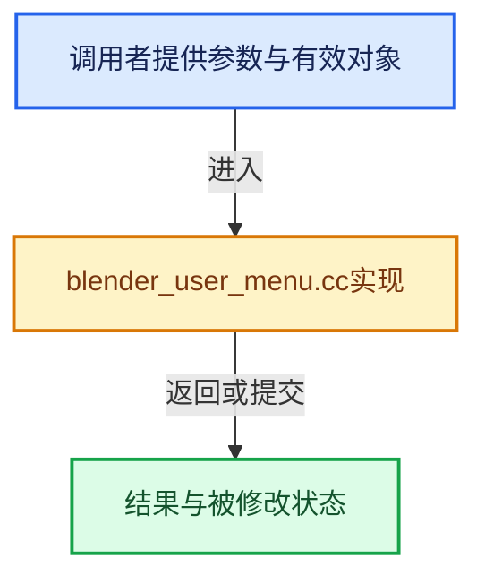

# 实现依赖专题：source/blender/blenkernel/intern/blender_user_menu.cc

[方向导航](README.md) · [符号索引](../%E7%AC%A6%E5%8F%B7%E4%BE%9D%E8%B5%96%E4%B8%8E%E5%AE%9E%E7%8E%B0%E7%B4%A2%E5%BC%95.md)

本专题从正文实际调用进入，集中保存共享实现。函数有稳定锚点，可从调用处直接跳到对应完整函数；递归与互相调用通过回链组织。

## 本文件的实现关系






## 完整成员与函数实现

<a id="f-f171528b1ea94f0e"></a>

### `blender::BKE_blender_user_menu_find`

实现位置：[source/blender/blenkernel/intern/blender_user_menu.cc](../../../../../source/blender/blenkernel/intern/blender_user_menu.cc) · L29—L39。

接口参数：

- `ListBaseT<bUserMenu> *lb`
- `char space_type`
- `const char *context`

**教学注释版**

<!-- annotated:cf7adbb093f8b1 -->

```cpp
bUserMenu *BKE_blender_user_menu_find(ListBaseT<bUserMenu> *lb,
                                      char space_type,
                                      const char *context)
{
  for (bUserMenu &um : *lb) {
    if ((space_type == um.space_type) && STREQ(context, um.context)) {
      return &um;
    }
  }
  return nullptr;
}
```

<details>
<summary>核对原始源码：source/blender/blenkernel/intern/blender_user_menu.cc · L29—L39</summary>

<!-- original:cf7adbb093f8b1:source/blender/blenkernel/intern/blender_user_menu.cc:29:39 -->

```cpp
bUserMenu *BKE_blender_user_menu_find(ListBaseT<bUserMenu> *lb,
                                      char space_type,
                                      const char *context)
{
  for (bUserMenu &um : *lb) {
    if ((space_type == um.space_type) && STREQ(context, um.context)) {
      return &um;
    }
  }
  return nullptr;
}
```

</details>

**结果出口**

- `return &um;`
- `return nullptr;`

**继续追踪实现**

- `STREQ` → [STREQ · L112](%E4%BE%9D%E8%B5%96-GHOST_utildefines-34b996.md#m-9549fb6aafd2)；[STREQ · L451](../01-%E5%9F%BA%E7%A1%80%E5%AE%B9%E5%99%A8%E4%B8%8E%E7%8E%B0%E4%BB%A3CPP/%E4%BE%9D%E8%B5%96-BLI_utildefines-293a0a.md#m-c7b745bcfad2)；[STREQ · L55](%E4%BE%9D%E8%B5%96-clog-a0bec8.md#m-96e78f386894)。宏定义由构建条件选择。

<a id="f-7a070c7cc5971cf4"></a>

### `blender::BKE_blender_user_menu_ensure`

实现位置：[source/blender/blenkernel/intern/blender_user_menu.cc](../../../../../source/blender/blenkernel/intern/blender_user_menu.cc) · L41—L53。

接口参数：

- `ListBaseT<bUserMenu> *lb`
- `char space_type`
- `const char *context`

**教学注释版**

<!-- annotated:067ea58515df1a -->

```cpp
bUserMenu *BKE_blender_user_menu_ensure(ListBaseT<bUserMenu> *lb,
                                        char space_type,
                                        const char *context)
{
  bUserMenu *um = BKE_blender_user_menu_find(lb, space_type, context);
  if (um == nullptr) {
    um = MEM_new<bUserMenu>(__func__);
    um->space_type = space_type;
    STRNCPY(um->context, context);
    BLI_addhead(lb, um);
  }
  return um;
}
```

<details>
<summary>核对原始源码：source/blender/blenkernel/intern/blender_user_menu.cc · L41—L53</summary>

<!-- original:067ea58515df1a:source/blender/blenkernel/intern/blender_user_menu.cc:41:53 -->

```cpp
bUserMenu *BKE_blender_user_menu_ensure(ListBaseT<bUserMenu> *lb,
                                        char space_type,
                                        const char *context)
{
  bUserMenu *um = BKE_blender_user_menu_find(lb, space_type, context);
  if (um == nullptr) {
    um = MEM_new<bUserMenu>(__func__);
    um->space_type = space_type;
    STRNCPY(um->context, context);
    BLI_addhead(lb, um);
  }
  return um;
}
```

</details>

**沿实际写入检查状态**

- `um = MEM_new<bUserMenu>(__func__);`
- `um->space_type = space_type;`

**结果出口**

- `return um;`

**继续追踪实现**

- `BKE_blender_user_menu_find` → [blender::BKE_blender_user_menu_find · L29](%E4%BE%9D%E8%B5%96-blender_user_menu-51a71e.md#f-f171528b1ea94f0e)。
- `MEM_new<bUserMenu>` → [MEM_new · L351](../03-%E5%86%85%E5%AD%98%E5%88%86%E9%85%8D%E4%B8%8E%E8%BF%90%E8%A1%8C%E6%97%B6%E7%B1%BB%E5%9E%8B/%E4%BE%9D%E8%B5%96-MEM_guardedalloc-b54eca.md#f-115f9b6784f89912)。
- `STRNCPY` → [blender::STRNCPY · L690](../01-%E5%9F%BA%E7%A1%80%E5%AE%B9%E5%99%A8%E4%B8%8E%E7%8E%B0%E4%BB%A3CPP/%E4%BE%9D%E8%B5%96-BLI_string-b43058.md#f-6b2d861724026be6)。
- `BLI_addhead` → [blender::BLI_addhead · L98](../01-%E5%9F%BA%E7%A1%80%E5%AE%B9%E5%99%A8%E4%B8%8E%E7%8E%B0%E4%BB%A3CPP/%E4%BE%9D%E8%B5%96-listbase-2816d9.md#f-fed3ad483fcdfeb9)。

<a id="f-1ac7bc59f9edc1ac"></a>

### `blender::BKE_blender_user_menu_item_add`

实现位置：[source/blender/blenkernel/intern/blender_user_menu.cc](../../../../../source/blender/blenkernel/intern/blender_user_menu.cc) · L61—L85。

接口参数：

- `ListBaseT<bUserMenuItem> *lb`
- `eUserMenu_Type type`

**教学注释版**

<!-- annotated:4d7d5ace82da04 -->

```cpp
bUserMenuItem *BKE_blender_user_menu_item_add(ListBaseT<bUserMenuItem> *lb, eUserMenu_Type type)
{
  bUserMenuItem *umi;

  if (type == USER_MENU_TYPE_SEP) {
    umi = MEM_new<bUserMenuItem>(__func__);
  }
  else if (type == USER_MENU_TYPE_OPERATOR) {
    umi = reinterpret_cast<bUserMenuItem *>(MEM_new<bUserMenuItem_Op>(__func__));
  }
  else if (type == USER_MENU_TYPE_MENU) {
    umi = reinterpret_cast<bUserMenuItem *>(MEM_new<bUserMenuItem_Menu>(__func__));
  }
  else if (type == USER_MENU_TYPE_PROP) {
    umi = reinterpret_cast<bUserMenuItem *>(MEM_new<bUserMenuItem_Prop>(__func__));
  }
  else {
    umi = MEM_new<bUserMenuItem>(__func__);
    BLI_assert(0);
  }

  umi->type = type;
  BLI_addtail(lb, umi);
  return umi;
}
```

<details>
<summary>核对原始源码：source/blender/blenkernel/intern/blender_user_menu.cc · L61—L85</summary>

<!-- original:4d7d5ace82da04:source/blender/blenkernel/intern/blender_user_menu.cc:61:85 -->

```cpp
bUserMenuItem *BKE_blender_user_menu_item_add(ListBaseT<bUserMenuItem> *lb, eUserMenu_Type type)
{
  bUserMenuItem *umi;

  if (type == USER_MENU_TYPE_SEP) {
    umi = MEM_new<bUserMenuItem>(__func__);
  }
  else if (type == USER_MENU_TYPE_OPERATOR) {
    umi = reinterpret_cast<bUserMenuItem *>(MEM_new<bUserMenuItem_Op>(__func__));
  }
  else if (type == USER_MENU_TYPE_MENU) {
    umi = reinterpret_cast<bUserMenuItem *>(MEM_new<bUserMenuItem_Menu>(__func__));
  }
  else if (type == USER_MENU_TYPE_PROP) {
    umi = reinterpret_cast<bUserMenuItem *>(MEM_new<bUserMenuItem_Prop>(__func__));
  }
  else {
    umi = MEM_new<bUserMenuItem>(__func__);
    BLI_assert(0);
  }

  umi->type = type;
  BLI_addtail(lb, umi);
  return umi;
}
```

</details>

**沿实际写入检查状态**

- `umi = MEM_new<bUserMenuItem>(__func__);`
- `umi = reinterpret_cast<bUserMenuItem *>(MEM_new<bUserMenuItem_Op>(__func__));`
- `umi = reinterpret_cast<bUserMenuItem *>(MEM_new<bUserMenuItem_Menu>(__func__));`
- `umi = reinterpret_cast<bUserMenuItem *>(MEM_new<bUserMenuItem_Prop>(__func__));`
- `umi->type = type;`

**结果出口**

- `return umi;`

**继续追踪实现**

- `MEM_new<bUserMenuItem>` → [MEM_new · L351](../03-%E5%86%85%E5%AD%98%E5%88%86%E9%85%8D%E4%B8%8E%E8%BF%90%E8%A1%8C%E6%97%B6%E7%B1%BB%E5%9E%8B/%E4%BE%9D%E8%B5%96-MEM_guardedalloc-b54eca.md#f-115f9b6784f89912)。
- `MEM_new<bUserMenuItem_Op>` → [MEM_new · L351](../03-%E5%86%85%E5%AD%98%E5%88%86%E9%85%8D%E4%B8%8E%E8%BF%90%E8%A1%8C%E6%97%B6%E7%B1%BB%E5%9E%8B/%E4%BE%9D%E8%B5%96-MEM_guardedalloc-b54eca.md#f-115f9b6784f89912)。
- `MEM_new<bUserMenuItem_Menu>` → [MEM_new · L351](../03-%E5%86%85%E5%AD%98%E5%88%86%E9%85%8D%E4%B8%8E%E8%BF%90%E8%A1%8C%E6%97%B6%E7%B1%BB%E5%9E%8B/%E4%BE%9D%E8%B5%96-MEM_guardedalloc-b54eca.md#f-115f9b6784f89912)。
- `MEM_new<bUserMenuItem_Prop>` → [MEM_new · L351](../03-%E5%86%85%E5%AD%98%E5%88%86%E9%85%8D%E4%B8%8E%E8%BF%90%E8%A1%8C%E6%97%B6%E7%B1%BB%E5%9E%8B/%E4%BE%9D%E8%B5%96-MEM_guardedalloc-b54eca.md#f-115f9b6784f89912)。
- `BLI_assert` → [BLI_assert · L48](../01-%E5%9F%BA%E7%A1%80%E5%AE%B9%E5%99%A8%E4%B8%8E%E7%8E%B0%E4%BB%A3CPP/%E4%BE%9D%E8%B5%96-BLI_assert-cc98e8.md#m-57a88495704d)；[BLI_assert · L63](../01-%E5%9F%BA%E7%A1%80%E5%AE%B9%E5%99%A8%E4%B8%8E%E7%8E%B0%E4%BB%A3CPP/%E4%BE%9D%E8%B5%96-BLI_assert-cc98e8.md#m-d07050020cb5)。宏定义由构建条件选择。
- `BLI_addtail` → [blender::BLI_addtail · L118](../01-%E5%9F%BA%E7%A1%80%E5%AE%B9%E5%99%A8%E4%B8%8E%E7%8E%B0%E4%BB%A3CPP/%E4%BE%9D%E8%B5%96-listbase-2816d9.md#f-4fb027713fa3115b)。

<a id="f-31a0329012ed9401"></a>

### `blender::BKE_blender_user_menu_item_free`

实现位置：[source/blender/blenkernel/intern/blender_user_menu.cc](../../../../../source/blender/blenkernel/intern/blender_user_menu.cc) · L87—L96。

接口参数：

- `bUserMenuItem *umi`

**教学注释版**

<!-- annotated:5742798dcb010c -->

```cpp
void BKE_blender_user_menu_item_free(bUserMenuItem *umi)
{
  if (umi->type == USER_MENU_TYPE_OPERATOR) {
    bUserMenuItem_Op *umi_op = reinterpret_cast<bUserMenuItem_Op *>(umi);
    if (umi_op->prop) {
      IDP_FreeProperty(umi_op->prop);
    }
  }
  MEM_delete(umi);
}
```

<details>
<summary>核对原始源码：source/blender/blenkernel/intern/blender_user_menu.cc · L87—L96</summary>

<!-- original:5742798dcb010c:source/blender/blenkernel/intern/blender_user_menu.cc:87:96 -->

```cpp
void BKE_blender_user_menu_item_free(bUserMenuItem *umi)
{
  if (umi->type == USER_MENU_TYPE_OPERATOR) {
    bUserMenuItem_Op *umi_op = reinterpret_cast<bUserMenuItem_Op *>(umi);
    if (umi_op->prop) {
      IDP_FreeProperty(umi_op->prop);
    }
  }
  MEM_delete(umi);
}
```

</details>

**继续追踪实现**

- `IDP_FreeProperty` → [blender::IDP_FreeProperty · L1403](%E4%BE%9D%E8%B5%96-idprop-006c65.md#f-389134a630df1bed)。
- `MEM_delete` → [MEM_delete · L400](../03-%E5%86%85%E5%AD%98%E5%88%86%E9%85%8D%E4%B8%8E%E8%BF%90%E8%A1%8C%E6%97%B6%E7%B1%BB%E5%9E%8B/%E4%BE%9D%E8%B5%96-MEM_guardedalloc-b54eca.md#f-9049ffdd1682887c)。
