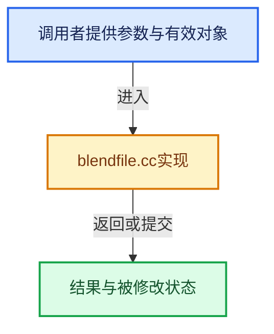

# 实现依赖专题：source/blender/blenkernel/intern/blendfile.cc

[方向导航](README.md) · [符号索引](../%E7%AC%A6%E5%8F%B7%E4%BE%9D%E8%B5%96%E4%B8%8E%E5%AE%9E%E7%8E%B0%E7%B4%A2%E5%BC%95.md)

本专题从正文实际调用进入，集中保存共享实现。函数有稳定锚点，可从调用处直接跳到对应完整函数；递归与互相调用通过回链组织。

## 本文件的实现关系





## 完整成员与函数实现

<a id="f-fe93e843ac753cce"></a>

### `blender::BKE_blendfile_extension_check`

实现位置：[source/blender/blenkernel/intern/blendfile.cc](../../../../../source/blender/blenkernel/intern/blendfile.cc) · L88—L92。

接口参数：

- `const char *str`

**教学注释版**

<!-- annotated:eba0c21361c5d9 -->

```cpp
bool BKE_blendfile_extension_check(const char *str)
{
  const char *ext_test[4] = {".blend", ".ble", ".blend.gz", nullptr};
  return BLI_path_extension_check_array(str, ext_test);
}
```

<details>
<summary>核对原始源码：source/blender/blenkernel/intern/blendfile.cc · L88—L92</summary>

<!-- original:eba0c21361c5d9:source/blender/blenkernel/intern/blendfile.cc:88:92 -->

```cpp
bool BKE_blendfile_extension_check(const char *str)
{
  const char *ext_test[4] = {".blend", ".ble", ".blend.gz", nullptr};
  return BLI_path_extension_check_array(str, ext_test);
}
```

</details>

**结果出口**

- `return BLI_path_extension_check_array(str, ext_test);`

**继续追踪实现**

- `BLI_path_extension_check_array` → [BLI_path_extension_check_array · L1505](../01-%E5%9F%BA%E7%A1%80%E5%AE%B9%E5%99%A8%E4%B8%8E%E7%8E%B0%E4%BB%A3CPP/%E4%BE%9D%E8%B5%96-path_utils-b4d26a.md#f-6c9c1f20eacc5647)。

<a id="f-51da01625288f1a6"></a>

### `blender::BKE_blendfile_library_path_explode`

实现位置：[source/blender/blenkernel/intern/blendfile.cc](../../../../../source/blender/blenkernel/intern/blendfile.cc) · L94—L155。

接口参数：

- `const char *path`
- `char *r_dir`
- `char **r_group`
- `char **r_name`

**教学注释版**

<!-- annotated:2f58c10cdeac1c -->

```cpp
bool BKE_blendfile_library_path_explode(const char *path,
                                        char *r_dir,
                                        char **r_group,
                                        char **r_name)
{
  /* We might get some data names with slashes,
   * so we have to go up in path until we find blend file itself,
   * then we know next path item is group, and everything else is data name. */
  char *slash = nullptr, *prev_slash = nullptr, c = '\0';

  r_dir[0] = '\0';
  if (r_group) {
    *r_group = nullptr;
  }
  if (r_name) {
    *r_name = nullptr;
  }

  /* if path leads to an existing directory, we can be sure we're not (in) a library */
  if (BLI_is_dir(path)) {
    return false;
  }

  BLI_strncpy(r_dir, path, FILE_MAX_LIBEXTRA);

  while ((slash = const_cast<char *>(BLI_path_slash_rfind(r_dir)))) {
    char tc = *slash;
    *slash = '\0';
    if (BKE_blendfile_extension_check(r_dir) && BLI_is_file(r_dir)) {
      break;
    }
    if (STREQ(r_dir, BLO_EMBEDDED_STARTUP_BLEND)) {
      break;
    }

    if (prev_slash) {
      *prev_slash = c;
    }
    prev_slash = slash;
    c = tc;
  }

  if (!slash) {
    return false;
  }

  if (slash[1] != '\0') {
    BLI_assert(strlen(slash + 1) < BLO_GROUP_MAX);
    if (r_group) {
      *r_group = slash + 1;
    }
  }

  if (prev_slash && (prev_slash[1] != '\0')) {
    BLI_assert(strlen(prev_slash + 1) < MAX_ID_NAME - 2);
    if (r_name) {
      *r_name = prev_slash + 1;
    }
  }

  return true;
}
```

<details>
<summary>核对原始源码：source/blender/blenkernel/intern/blendfile.cc · L94—L155</summary>

<!-- original:2f58c10cdeac1c:source/blender/blenkernel/intern/blendfile.cc:94:155 -->

```cpp
bool BKE_blendfile_library_path_explode(const char *path,
                                        char *r_dir,
                                        char **r_group,
                                        char **r_name)
{
  /* We might get some data names with slashes,
   * so we have to go up in path until we find blend file itself,
   * then we know next path item is group, and everything else is data name. */
  char *slash = nullptr, *prev_slash = nullptr, c = '\0';

  r_dir[0] = '\0';
  if (r_group) {
    *r_group = nullptr;
  }
  if (r_name) {
    *r_name = nullptr;
  }

  /* if path leads to an existing directory, we can be sure we're not (in) a library */
  if (BLI_is_dir(path)) {
    return false;
  }

  BLI_strncpy(r_dir, path, FILE_MAX_LIBEXTRA);

  while ((slash = const_cast<char *>(BLI_path_slash_rfind(r_dir)))) {
    char tc = *slash;
    *slash = '\0';
    if (BKE_blendfile_extension_check(r_dir) && BLI_is_file(r_dir)) {
      break;
    }
    if (STREQ(r_dir, BLO_EMBEDDED_STARTUP_BLEND)) {
      break;
    }

    if (prev_slash) {
      *prev_slash = c;
    }
    prev_slash = slash;
    c = tc;
  }

  if (!slash) {
    return false;
  }

  if (slash[1] != '\0') {
    BLI_assert(strlen(slash + 1) < BLO_GROUP_MAX);
    if (r_group) {
      *r_group = slash + 1;
    }
  }

  if (prev_slash && (prev_slash[1] != '\0')) {
    BLI_assert(strlen(prev_slash + 1) < MAX_ID_NAME - 2);
    if (r_name) {
      *r_name = prev_slash + 1;
    }
  }

  return true;
}
```

</details>

**沿实际写入检查状态**

- `r_dir[0] = '\0';`
- `prev_slash = slash;`
- `c = tc;`

**结果出口**

- `return false;`
- `return true;`

**继续追踪实现**

- `BLI_is_dir` → [blender::BLI_is_dir · L457](../01-%E5%9F%BA%E7%A1%80%E5%AE%B9%E5%99%A8%E4%B8%8E%E7%8E%B0%E4%BB%A3CPP/%E4%BE%9D%E8%B5%96-storage-bda15e.md#f-eedeb1fd6a515977)。
- `BLI_strncpy` → [blender::BLI_strncpy · L70](../01-%E5%9F%BA%E7%A1%80%E5%AE%B9%E5%99%A8%E4%B8%8E%E7%8E%B0%E4%BB%A3CPP/%E4%BE%9D%E8%B5%96-string-1d986f.md#f-6324147b0d116da1)。
- `BLI_path_slash_rfind` → [BLI_path_slash_rfind · L1991](../01-%E5%9F%BA%E7%A1%80%E5%AE%B9%E5%99%A8%E4%B8%8E%E7%8E%B0%E4%BB%A3CPP/%E4%BE%9D%E8%B5%96-path_utils-b4d26a.md#f-31df87a0b5777d08)。
- `BKE_blendfile_extension_check` → [blender::BKE_blendfile_extension_check · L88](%E4%BE%9D%E8%B5%96-blendfile-94979c.md#f-fe93e843ac753cce)。
- `BLI_is_file` → [blender::BLI_is_file · L469](../01-%E5%9F%BA%E7%A1%80%E5%AE%B9%E5%99%A8%E4%B8%8E%E7%8E%B0%E4%BB%A3CPP/%E4%BE%9D%E8%B5%96-storage-bda15e.md#f-6a62623bad8d76d2)。
- `STREQ` → [STREQ · L112](%E4%BE%9D%E8%B5%96-GHOST_utildefines-34b996.md#m-9549fb6aafd2)；[STREQ · L451](../01-%E5%9F%BA%E7%A1%80%E5%AE%B9%E5%99%A8%E4%B8%8E%E7%8E%B0%E4%BB%A3CPP/%E4%BE%9D%E8%B5%96-BLI_utildefines-293a0a.md#m-c7b745bcfad2)；[STREQ · L55](%E4%BE%9D%E8%B5%96-clog-a0bec8.md#m-96e78f386894)。宏定义由构建条件选择。
- `BLI_assert` → [BLI_assert · L48](../01-%E5%9F%BA%E7%A1%80%E5%AE%B9%E5%99%A8%E4%B8%8E%E7%8E%B0%E4%BB%A3CPP/%E4%BE%9D%E8%B5%96-BLI_assert-cc98e8.md#m-57a88495704d)；[BLI_assert · L63](../01-%E5%9F%BA%E7%A1%80%E5%AE%B9%E5%99%A8%E4%B8%8E%E7%8E%B0%E4%BB%A3CPP/%E4%BE%9D%E8%B5%96-BLI_assert-cc98e8.md#m-d07050020cb5)。宏定义由构建条件选择。
- `strlen` → [外部契约](https://eel.is/c++draft/)：这个边界按实际表达式及所属类型核对参数、返回值、寿命与失败行为。这里提供接口入口，不声称已解释该第三方版本的内部实现。
