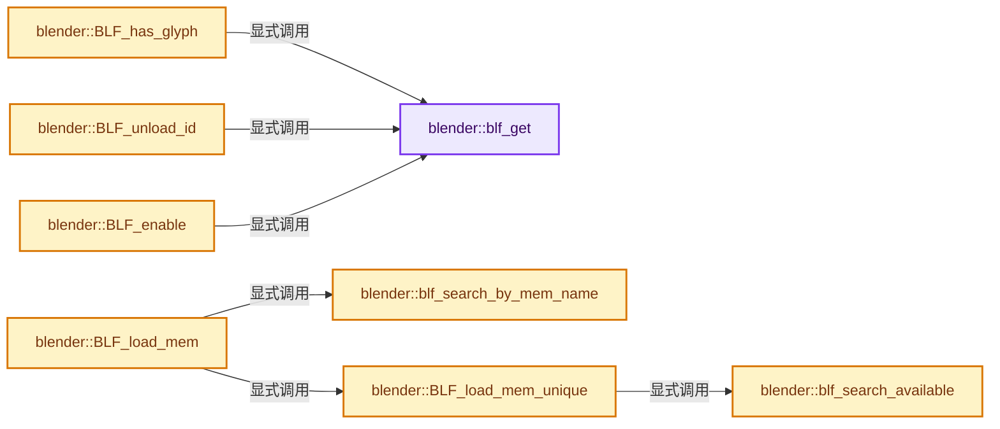
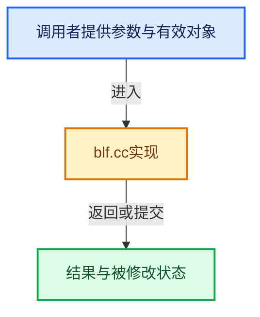

# 实现依赖专题：source/blender/blenfont/intern/blf.cc

[方向导航](README.md) · [符号索引](../%E7%AC%A6%E5%8F%B7%E4%BE%9D%E8%B5%96%E4%B8%8E%E5%AE%9E%E7%8E%B0%E7%B4%A2%E5%BC%95.md)

本专题从正文实际调用进入，集中保存共享实现。函数有稳定锚点，可从调用处直接跳到对应完整函数；递归与互相调用通过回链组织。

## 本文件的实现关系






<a id="m-72f7a3c6df41"></a>

## 宏 `BLF_RESULT_CHECK_INIT`

<!-- annotated:b755d485a31729 -->

```cpp
#define BLF_RESULT_CHECK_INIT(r_info) \
  if (r_info) { \
    memset(r_info, 0, sizeof(*(r_info))); \
  } \
  ((void)0)

```

<details>
<summary>核对原始源码：source/blender/blenfont/intern/blf.cc · L40—L45</summary>

<!-- original:b755d485a31729:source/blender/blenfont/intern/blf.cc:40:45 -->

```cpp
#define BLF_RESULT_CHECK_INIT(r_info) \
  if (r_info) { \
    memset(r_info, 0, sizeof(*(r_info))); \
  } \
  ((void)0)

```

</details>

宏在预处理阶段展开，参数替换、重复求值和条件编译应直接从该定义检查。与普通函数不同，宏不会自动提供参数类型检查；构建配置选择哪个定义需结合外围条件。

## 完整成员与函数实现

<a id="f-5deb0bd2962713a5"></a>

### `blender::blf_get`

实现位置：[source/blender/blenfont/intern/blf.cc](../../../../../source/blender/blenfont/intern/blf.cc) · L55—L61。

接口参数：

- `int fontid`

**教学注释版**

<!-- annotated:026c69681532e9 -->

```cpp
static FontBLF *blf_get(int fontid)
{
  if (fontid >= 0 && fontid < BLF_MAX_FONT) {
    return global_font[fontid];
  }
  return nullptr;
}
```

<details>
<summary>核对原始源码：source/blender/blenfont/intern/blf.cc · L55—L61</summary>

<!-- original:026c69681532e9:source/blender/blenfont/intern/blf.cc:55:61 -->

```cpp
static FontBLF *blf_get(int fontid)
{
  if (fontid >= 0 && fontid < BLF_MAX_FONT) {
    return global_font[fontid];
  }
  return nullptr;
}
```

</details>

**结果出口**

- `return global_font[fontid];`
- `return nullptr;`

**继续追踪实现**

本实现没有需要继续展开的显式调用；检查返回表达式、对象转换和调用者前置条件。

<a id="f-c6d2e188b71a4754"></a>

### `blender::blf_search_by_mem_name`

实现位置：[source/blender/blenfont/intern/blf.cc](../../../../../source/blender/blenfont/intern/blf.cc) · L110—L124。

接口参数：

- `const char *mem_name`

**教学注释版**

<!-- annotated:72f662f34b6eb1 -->

```cpp
static int blf_search_by_mem_name(const char *mem_name)
{
  std::lock_guard lock(g_blf_load_mutex);
  for (int i = 0; i < BLF_MAX_FONT; i++) {
    const FontBLF *font = global_font[i];
    if ((font == nullptr) || (font->mem_name == nullptr)) {
      continue;
    }
    if (STREQ(font->mem_name, mem_name)) {
      return i;
    }
  }

  return -1;
}
```

<details>
<summary>核对原始源码：source/blender/blenfont/intern/blf.cc · L110—L124</summary>

<!-- original:72f662f34b6eb1:source/blender/blenfont/intern/blf.cc:110:124 -->

```cpp
static int blf_search_by_mem_name(const char *mem_name)
{
  std::lock_guard lock(g_blf_load_mutex);
  for (int i = 0; i < BLF_MAX_FONT; i++) {
    const FontBLF *font = global_font[i];
    if ((font == nullptr) || (font->mem_name == nullptr)) {
      continue;
    }
    if (STREQ(font->mem_name, mem_name)) {
      return i;
    }
  }

  return -1;
}
```

</details>

**结果出口**

- `return i;`
- `return -1;`

**继续追踪实现**

- `STREQ` → [STREQ · L112](%E4%BE%9D%E8%B5%96-GHOST_utildefines-34b996.md#m-9549fb6aafd2)；[STREQ · L451](../01-%E5%9F%BA%E7%A1%80%E5%AE%B9%E5%99%A8%E4%B8%8E%E7%8E%B0%E4%BB%A3CPP/%E4%BE%9D%E8%B5%96-BLI_utildefines-293a0a.md#m-c7b745bcfad2)；[STREQ · L55](%E4%BE%9D%E8%B5%96-clog-a0bec8.md#m-96e78f386894)。宏定义由构建条件选择。

<a id="f-4fd4aef3ea083ed9"></a>

### `blender::blf_search_available`

实现位置：[source/blender/blenfont/intern/blf.cc](../../../../../source/blender/blenfont/intern/blf.cc) · L142—L151。

**教学注释版**

<!-- annotated:0806e0a8e19a5a -->

```cpp
static int blf_search_available()
{
  for (int i = 0; i < BLF_MAX_FONT; i++) {
    if (!global_font[i]) {
      return i;
    }
  }

  return -1;
}
```

<details>
<summary>核对原始源码：source/blender/blenfont/intern/blf.cc · L142—L151</summary>

<!-- original:0806e0a8e19a5a:source/blender/blenfont/intern/blf.cc:142:151 -->

```cpp
static int blf_search_available()
{
  for (int i = 0; i < BLF_MAX_FONT; i++) {
    if (!global_font[i]) {
      return i;
    }
  }

  return -1;
}
```

</details>

**结果出口**

- `return i;`
- `return -1;`

**继续追踪实现**

本实现没有需要继续展开的显式调用；检查返回表达式、对象转换和调用者前置条件。

<a id="f-15c0b520834b5f0c"></a>

### `blender::BLF_has_glyph`

实现位置：[source/blender/blenfont/intern/blf.cc](../../../../../source/blender/blenfont/intern/blf.cc) · L153—L160。

接口参数：

- `int fontid`
- `uint unicode`

**教学注释版**

<!-- annotated:e6f359b67bbb40 -->

```cpp
bool BLF_has_glyph(int fontid, uint unicode)
{
  FontBLF *font = blf_get(fontid);
  if (font) {
    return blf_get_char_index(font, unicode) != FT_Err_Ok;
  }
  return false;
}
```

<details>
<summary>核对原始源码：source/blender/blenfont/intern/blf.cc · L153—L160</summary>

<!-- original:e6f359b67bbb40:source/blender/blenfont/intern/blf.cc:153:160 -->

```cpp
bool BLF_has_glyph(int fontid, uint unicode)
{
  FontBLF *font = blf_get(fontid);
  if (font) {
    return blf_get_char_index(font, unicode) != FT_Err_Ok;
  }
  return false;
}
```

</details>

**结果出口**

- `return blf_get_char_index(font, unicode) != FT_Err_Ok;`
- `return false;`

**继续追踪实现**

- `blf_get` → [blender::blf_get · L55](%E4%BE%9D%E8%B5%96-blf-1ee3d6.md#f-5deb0bd2962713a5)。
- `blf_get_char_index` → [blender::blf_get_char_index · L155](%E4%BE%9D%E8%B5%96-blf_font-763011.md#f-237e23d2167805c0)。

<a id="f-18ea699241fbf7e5"></a>

### `blender::BLF_load_mem`

实现位置：[source/blender/blenfont/intern/blf.cc](../../../../../source/blender/blenfont/intern/blf.cc) · L227—L234。

接口参数：

- `const char *name`
- `const uchar *mem`
- `int mem_size`

**教学注释版**

<!-- annotated:f69f8e15f4fcc7 -->

```cpp
int BLF_load_mem(const char *name, const uchar *mem, int mem_size)
{
  int i = blf_search_by_mem_name(name);
  if (i >= 0) {
    return i;
  }
  return BLF_load_mem_unique(name, mem, mem_size);
}
```

<details>
<summary>核对原始源码：source/blender/blenfont/intern/blf.cc · L227—L234</summary>

<!-- original:f69f8e15f4fcc7:source/blender/blenfont/intern/blf.cc:227:234 -->

```cpp
int BLF_load_mem(const char *name, const uchar *mem, int mem_size)
{
  int i = blf_search_by_mem_name(name);
  if (i >= 0) {
    return i;
  }
  return BLF_load_mem_unique(name, mem, mem_size);
}
```

</details>

**结果出口**

- `return i;`
- `return BLF_load_mem_unique(name, mem, mem_size);`

**继续追踪实现**

- `blf_search_by_mem_name` → [blender::blf_search_by_mem_name · L110](%E4%BE%9D%E8%B5%96-blf-1ee3d6.md#f-c6d2e188b71a4754)。
- `BLF_load_mem_unique` → [blender::BLF_load_mem_unique · L236](%E4%BE%9D%E8%B5%96-blf-1ee3d6.md#f-c6c284c47a4f2efd)。

<a id="f-c6c284c47a4f2efd"></a>

### `blender::BLF_load_mem_unique`

实现位置：[source/blender/blenfont/intern/blf.cc](../../../../../source/blender/blenfont/intern/blf.cc) · L236—L259。

接口参数：

- `const char *name`
- `const uchar *mem`
- `int mem_size`

**教学注释版**

<!-- annotated:12e05994924cfb -->

```cpp
int BLF_load_mem_unique(const char *name, const uchar *mem, int mem_size)
{
  std::lock_guard lock(g_blf_load_mutex);
  int i = blf_search_available();
  if (i == -1) {
    printf("Too many fonts!!!\n");
    return -1;
  }

  if (!mem_size) {
    printf("Can't load font: %s from memory!!\n", name);
    return -1;
  }

  FontBLF *font = blf_font_new_from_mem(name, mem, mem_size);
  if (!font) {
    printf("Can't load font: %s from memory!!\n", name);
    return -1;
  }

  font->reference_count = 1;
  global_font[i] = font;
  return i;
}
```

<details>
<summary>核对原始源码：source/blender/blenfont/intern/blf.cc · L236—L259</summary>

<!-- original:12e05994924cfb:source/blender/blenfont/intern/blf.cc:236:259 -->

```cpp
int BLF_load_mem_unique(const char *name, const uchar *mem, int mem_size)
{
  std::lock_guard lock(g_blf_load_mutex);
  int i = blf_search_available();
  if (i == -1) {
    printf("Too many fonts!!!\n");
    return -1;
  }

  if (!mem_size) {
    printf("Can't load font: %s from memory!!\n", name);
    return -1;
  }

  FontBLF *font = blf_font_new_from_mem(name, mem, mem_size);
  if (!font) {
    printf("Can't load font: %s from memory!!\n", name);
    return -1;
  }

  font->reference_count = 1;
  global_font[i] = font;
  return i;
}
```

</details>

**沿实际写入检查状态**

- `font->reference_count = 1;`
- `global_font[i] = font;`

**结果出口**

- `return -1;`
- `return i;`

**继续追踪实现**

- `blf_search_available` → [blender::blf_search_available · L142](%E4%BE%9D%E8%B5%96-blf-1ee3d6.md#f-4fd4aef3ea083ed9)。
- `printf` → [外部契约](https://eel.is/c++draft/)：这个边界按实际表达式及所属类型核对参数、返回值、寿命与失败行为。这里提供接口入口，不声称已解释该第三方版本的内部实现。
- `blf_font_new_from_mem` → [blender::blf_font_new_from_mem · L2261](%E4%BE%9D%E8%B5%96-blf_font-763011.md#f-b545f203d59c6cb6)。

<a id="f-df017f0eba27fc8e"></a>

### `blender::BLF_unload_id`

实现位置：[source/blender/blenfont/intern/blf.cc](../../../../../source/blender/blenfont/intern/blf.cc) · L282—L297。

接口参数：

- `int fontid`

**教学注释版**

<!-- annotated:dcf22f9090c98a -->

```cpp
bool BLF_unload_id(int fontid)
{
  std::lock_guard lock(g_blf_load_mutex);
  FontBLF *font = blf_get(fontid);
  if (font) {
    BLI_assert(font->reference_count > 0);
    font->reference_count--;

    if (font->reference_count == 0) {
      blf_font_free(font);
      global_font[fontid] = nullptr;
      return true;
    }
  }
  return false;
}
```

<details>
<summary>核对原始源码：source/blender/blenfont/intern/blf.cc · L282—L297</summary>

<!-- original:dcf22f9090c98a:source/blender/blenfont/intern/blf.cc:282:297 -->

```cpp
bool BLF_unload_id(int fontid)
{
  std::lock_guard lock(g_blf_load_mutex);
  FontBLF *font = blf_get(fontid);
  if (font) {
    BLI_assert(font->reference_count > 0);
    font->reference_count--;

    if (font->reference_count == 0) {
      blf_font_free(font);
      global_font[fontid] = nullptr;
      return true;
    }
  }
  return false;
}
```

</details>

**沿实际写入检查状态**

- `global_font[fontid] = nullptr;`

**结果出口**

- `return true;`
- `return false;`

**继续追踪实现**

- `blf_get` → [blender::blf_get · L55](%E4%BE%9D%E8%B5%96-blf-1ee3d6.md#f-5deb0bd2962713a5)。
- `BLI_assert` → [BLI_assert · L48](../01-%E5%9F%BA%E7%A1%80%E5%AE%B9%E5%99%A8%E4%B8%8E%E7%8E%B0%E4%BB%A3CPP/%E4%BE%9D%E8%B5%96-BLI_assert-cc98e8.md#m-57a88495704d)；[BLI_assert · L63](../01-%E5%9F%BA%E7%A1%80%E5%AE%B9%E5%99%A8%E4%B8%8E%E7%8E%B0%E4%BB%A3CPP/%E4%BE%9D%E8%B5%96-BLI_assert-cc98e8.md#m-d07050020cb5)。宏定义由构建条件选择。
- `blf_font_free` → [blender::blf_font_free · L2278](%E4%BE%9D%E8%B5%96-blf_font-763011.md#f-b372e435bc64abc6)。

<a id="f-76d6d46072c5f3af"></a>

### `blender::BLF_enable`

实现位置：[source/blender/blenfont/intern/blf.cc](../../../../../source/blender/blenfont/intern/blf.cc) · L322—L329。

接口参数：

- `int fontid`
- `FontFlags flag`

**教学注释版**

<!-- annotated:83271e9ca334a4 -->

```cpp
void BLF_enable(int fontid, FontFlags flag)
{
  FontBLF *font = blf_get(fontid);

  if (font) {
    font->flags |= flag;
  }
}
```

<details>
<summary>核对原始源码：source/blender/blenfont/intern/blf.cc · L322—L329</summary>

<!-- original:83271e9ca334a4:source/blender/blenfont/intern/blf.cc:322:329 -->

```cpp
void BLF_enable(int fontid, FontFlags flag)
{
  FontBLF *font = blf_get(fontid);

  if (font) {
    font->flags |= flag;
  }
}
```

</details>

**沿实际写入检查状态**

- `font->flags |= flag;`

**继续追踪实现**

- `blf_get` → [blender::blf_get · L55](%E4%BE%9D%E8%B5%96-blf-1ee3d6.md#f-5deb0bd2962713a5)。

<a id="f-cecdcdd6bdf5b9ab"></a>

### `blender::BLF_disable`

实现位置：[source/blender/blenfont/intern/blf.cc](../../../../../source/blender/blenfont/intern/blf.cc) · L331—L338。

接口参数：

- `int fontid`
- `FontFlags flag`

**教学注释版**

<!-- annotated:df5430d0506b89 -->

```cpp
void BLF_disable(int fontid, FontFlags flag)
{
  FontBLF *font = blf_get(fontid);

  if (font) {
    font->flags &= ~flag;
  }
}
```

<details>
<summary>核对原始源码：source/blender/blenfont/intern/blf.cc · L331—L338</summary>

<!-- original:df5430d0506b89:source/blender/blenfont/intern/blf.cc:331:338 -->

```cpp
void BLF_disable(int fontid, FontFlags flag)
{
  FontBLF *font = blf_get(fontid);

  if (font) {
    font->flags &= ~flag;
  }
}
```

</details>

**沿实际写入检查状态**

- `font->flags &= ~flag;`

**继续追踪实现**

- `blf_get` → [blender::blf_get · L55](%E4%BE%9D%E8%B5%96-blf-1ee3d6.md#f-5deb0bd2962713a5)。

<a id="f-c54c5317361b03c9"></a>

### `blender::BLF_character_weight`

实现位置：[source/blender/blenfont/intern/blf.cc](../../../../../source/blender/blenfont/intern/blf.cc) · L349—L355。

接口参数：

- `int fontid`
- `int weight`

**教学注释版**

<!-- annotated:b68dc7322a9c9e -->

```cpp
void BLF_character_weight(int fontid, int weight)
{
  FontBLF *font = blf_get(fontid);
  if (font) {
    font->char_weight = weight;
  }
}
```

<details>
<summary>核对原始源码：source/blender/blenfont/intern/blf.cc · L349—L355</summary>

<!-- original:b68dc7322a9c9e:source/blender/blenfont/intern/blf.cc:349:355 -->

```cpp
void BLF_character_weight(int fontid, int weight)
{
  FontBLF *font = blf_get(fontid);
  if (font) {
    font->char_weight = weight;
  }
}
```

</details>

**沿实际写入检查状态**

- `font->char_weight = weight;`

**继续追踪实现**

- `blf_get` → [blender::blf_get · L55](%E4%BE%9D%E8%B5%96-blf-1ee3d6.md#f-5deb0bd2962713a5)。

<a id="f-a933064b70db1da3"></a>

### `blender::BLF_position`

实现位置：[source/blender/blenfont/intern/blf.cc](../../../../../source/blender/blenfont/intern/blf.cc) · L390—L443。

接口参数：

- `int fontid`
- `float x`
- `float y`
- `float z`

**教学注释版**

<!-- annotated:ee6a1477311c7c -->

```cpp
void BLF_position(int fontid, float x, float y, float z)
{
  FontBLF *font = blf_get(fontid);

  if (font) {
    float xa, ya, za;
    float remainder;

    if (font->flags & BLF_ASPECT) {
      xa = font->aspect[0];
      ya = font->aspect[1];
      za = font->aspect[2];
    }
    else {
      xa = 1.0f;
      ya = 1.0f;
      za = 1.0f;
    }

    remainder = x - floorf(x);
    if (remainder > 0.4f && remainder < 0.6f) {
      if (remainder < 0.5f) {
        x -= 0.1f * xa;
      }
      else {
        x += 0.1f * xa;
      }
    }

    remainder = y - floorf(y);
    if (remainder > 0.4f && remainder < 0.6f) {
      if (remainder < 0.5f) {
        y -= 0.1f * ya;
      }
      else {
        y += 0.1f * ya;
      }
    }

    remainder = z - floorf(z);
    if (remainder > 0.4f && remainder < 0.6f) {
      if (remainder < 0.5f) {
        z -= 0.1f * za;
      }
      else {
        z += 0.1f * za;
      }
    }

    font->pos[0] = round_fl_to_int(x);
    font->pos[1] = round_fl_to_int(y);
    font->pos[2] = round_fl_to_int(z);
  }
}
```

<details>
<summary>核对原始源码：source/blender/blenfont/intern/blf.cc · L390—L443</summary>

<!-- original:ee6a1477311c7c:source/blender/blenfont/intern/blf.cc:390:443 -->

```cpp
void BLF_position(int fontid, float x, float y, float z)
{
  FontBLF *font = blf_get(fontid);

  if (font) {
    float xa, ya, za;
    float remainder;

    if (font->flags & BLF_ASPECT) {
      xa = font->aspect[0];
      ya = font->aspect[1];
      za = font->aspect[2];
    }
    else {
      xa = 1.0f;
      ya = 1.0f;
      za = 1.0f;
    }

    remainder = x - floorf(x);
    if (remainder > 0.4f && remainder < 0.6f) {
      if (remainder < 0.5f) {
        x -= 0.1f * xa;
      }
      else {
        x += 0.1f * xa;
      }
    }

    remainder = y - floorf(y);
    if (remainder > 0.4f && remainder < 0.6f) {
      if (remainder < 0.5f) {
        y -= 0.1f * ya;
      }
      else {
        y += 0.1f * ya;
      }
    }

    remainder = z - floorf(z);
    if (remainder > 0.4f && remainder < 0.6f) {
      if (remainder < 0.5f) {
        z -= 0.1f * za;
      }
      else {
        z += 0.1f * za;
      }
    }

    font->pos[0] = round_fl_to_int(x);
    font->pos[1] = round_fl_to_int(y);
    font->pos[2] = round_fl_to_int(z);
  }
}
```

</details>

**沿实际写入检查状态**

- `xa = font->aspect[0];`
- `ya = font->aspect[1];`
- `za = font->aspect[2];`
- `xa = 1.0f;`
- `ya = 1.0f;`
- `za = 1.0f;`
- `remainder = x - floorf(x);`
- `x -= 0.1f * xa;`
- `x += 0.1f * xa;`
- `remainder = y - floorf(y);`
- `y -= 0.1f * ya;`
- `y += 0.1f * ya;`
- `remainder = z - floorf(z);`
- `z -= 0.1f * za;`
- `z += 0.1f * za;`
- `font->pos[0] = round_fl_to_int(x);`
- `font->pos[1] = round_fl_to_int(y);`
- `font->pos[2] = round_fl_to_int(z);`

**继续追踪实现**

- `blf_get` → [blender::blf_get · L55](%E4%BE%9D%E8%B5%96-blf-1ee3d6.md#f-5deb0bd2962713a5)。
- `floorf` → [floorf · L22](%E4%BE%9D%E8%B5%96-radial_tiling_shared-98abf9.md#m-fb64dda1b0f0)；[floorf · L44](%E4%BE%9D%E8%B5%96-radial_tiling_shared-98abf9.md#m-25e4a157b53d)；[floorf · L75](%E4%BE%9D%E8%B5%96-radial_tiling_shared-98abf9.md#m-e128f662cbe8)；[floorf · L26](../01-%E5%9F%BA%E7%A1%80%E5%AE%B9%E5%99%A8%E4%B8%8E%E7%8E%B0%E4%BB%A3CPP/%E4%BE%9D%E8%B5%96-radial_tiling_shared-7989a4.md#m-ebadf845d492)；[floorf · L48](../01-%E5%9F%BA%E7%A1%80%E5%AE%B9%E5%99%A8%E4%B8%8E%E7%8E%B0%E4%BB%A3CPP/%E4%BE%9D%E8%B5%96-radial_tiling_shared-7989a4.md#m-efe0b148573a)；[floorf · L79](../01-%E5%9F%BA%E7%A1%80%E5%AE%B9%E5%99%A8%E4%B8%8E%E7%8E%B0%E4%BB%A3CPP/%E4%BE%9D%E8%B5%96-radial_tiling_shared-7989a4.md#m-9df2f26758e8)；[floorf · L22](%E4%BE%9D%E8%B5%96-node_radial_tiling_shared-b14bc2.md#m-6b2e29ad4b19)；[floorf · L44](%E4%BE%9D%E8%B5%96-node_radial_tiling_shared-b14bc2.md#m-f90222d9b445)；[floorf · L75](%E4%BE%9D%E8%B5%96-node_radial_tiling_shared-b14bc2.md#m-938380992bb5)；[floorf · L172](%E4%BE%9D%E8%B5%96-compat-56205c.md#m-176475a253a6)；[floorf · L270](%E4%BE%9D%E8%B5%96-compat-efe0e9.md#m-fb37dbc77698)；[floorf · L49](%E4%BE%9D%E8%B5%96-GPU_shader_shared_utils-0adda3.md#m-e7115fdd7560)；[floorf · L70](%E4%BE%9D%E8%B5%96-GPU_shader_shared_utils-0adda3.md#m-aee5f6a438e4)。宏定义由构建条件选择。
- `round_fl_to_int` → [blender::round_fl_to_int · L193](../12-%E7%A9%BA%E9%97%B4%E6%95%B0%E6%8D%AE%E7%BB%93%E6%9E%84%E4%B8%8E%E5%87%A0%E4%BD%95%E7%AE%97%E6%B3%95/%E4%BE%9D%E8%B5%96-math_base_inline-546b00.md#f-ce88de51b67ea3e6)。

<a id="f-055ce2de2d1684fd"></a>

### `blender::BLF_size`

实现位置：[source/blender/blenfont/intern/blf.cc](../../../../../source/blender/blenfont/intern/blf.cc) · L445—L452。

接口参数：

- `int fontid`
- `float size`

**教学注释版**

<!-- annotated:8620f15e2f29b0 -->

```cpp
void BLF_size(int fontid, float size)
{
  FontBLF *font = blf_get(fontid);

  if (font) {
    blf_font_size(font, size);
  }
}
```

<details>
<summary>核对原始源码：source/blender/blenfont/intern/blf.cc · L445—L452</summary>

<!-- original:8620f15e2f29b0:source/blender/blenfont/intern/blf.cc:445:452 -->

```cpp
void BLF_size(int fontid, float size)
{
  FontBLF *font = blf_get(fontid);

  if (font) {
    blf_font_size(font, size);
  }
}
```

</details>

**继续追踪实现**

- `blf_get` → [blender::blf_get · L55](%E4%BE%9D%E8%B5%96-blf-1ee3d6.md#f-5deb0bd2962713a5)。
- `blf_font_size` → [blender::blf_font_size · L2333](%E4%BE%9D%E8%B5%96-blf_font-763011.md#f-e5fe848ac7014368)。

<a id="f-56cc04db9e5ccbe0"></a>

### `blender::BLF_color4ubv`

实现位置：[source/blender/blenfont/intern/blf.cc](../../../../../source/blender/blenfont/intern/blf.cc) · L454—L464。

接口参数：

- `int fontid`
- `const uchar rgba[4]`

**教学注释版**

<!-- annotated:c58ec6ae2eca4c -->

```cpp
void BLF_color4ubv(int fontid, const uchar rgba[4])
{
  FontBLF *font = blf_get(fontid);

  if (font) {
    font->color[0] = rgba[0];
    font->color[1] = rgba[1];
    font->color[2] = rgba[2];
    font->color[3] = rgba[3];
  }
}
```

<details>
<summary>核对原始源码：source/blender/blenfont/intern/blf.cc · L454—L464</summary>

<!-- original:c58ec6ae2eca4c:source/blender/blenfont/intern/blf.cc:454:464 -->

```cpp
void BLF_color4ubv(int fontid, const uchar rgba[4])
{
  FontBLF *font = blf_get(fontid);

  if (font) {
    font->color[0] = rgba[0];
    font->color[1] = rgba[1];
    font->color[2] = rgba[2];
    font->color[3] = rgba[3];
  }
}
```

</details>

**沿实际写入检查状态**

- `font->color[0] = rgba[0];`
- `font->color[1] = rgba[1];`
- `font->color[2] = rgba[2];`
- `font->color[3] = rgba[3];`

**继续追踪实现**

- `blf_get` → [blender::blf_get · L55](%E4%BE%9D%E8%B5%96-blf-1ee3d6.md#f-5deb0bd2962713a5)。

<a id="f-0e835b46e900620c"></a>

### `blender::BLF_color4fv`

实现位置：[source/blender/blenfont/intern/blf.cc](../../../../../source/blender/blenfont/intern/blf.cc) · L507—L514。

接口参数：

- `int fontid`
- `const float rgba[4]`

**教学注释版**

<!-- annotated:2bfef6dacae633 -->

```cpp
void BLF_color4fv(int fontid, const float rgba[4])
{
  FontBLF *font = blf_get(fontid);

  if (font) {
    rgba_float_to_uchar(font->color, rgba);
  }
}
```

<details>
<summary>核对原始源码：source/blender/blenfont/intern/blf.cc · L507—L514</summary>

<!-- original:2bfef6dacae633:source/blender/blenfont/intern/blf.cc:507:514 -->

```cpp
void BLF_color4fv(int fontid, const float rgba[4])
{
  FontBLF *font = blf_get(fontid);

  if (font) {
    rgba_float_to_uchar(font->color, rgba);
  }
}
```

</details>

**继续追踪实现**

- `blf_get` → [blender::blf_get · L55](%E4%BE%9D%E8%B5%96-blf-1ee3d6.md#f-5deb0bd2962713a5)。
- `rgba_float_to_uchar` → [blender::rgba_float_to_uchar · L150](../12-%E7%A9%BA%E9%97%B4%E6%95%B0%E6%8D%AE%E7%BB%93%E6%9E%84%E4%B8%8E%E5%87%A0%E4%BD%95%E7%AE%97%E6%B3%95/%E4%BE%9D%E8%B5%96-math_color_inline-48fb4c.md#f-00fd745fcb2e3dd8)。

<a id="f-9c5c944e8edab4fb"></a>

### `blender::BLF_batch_draw_begin`

实现位置：[source/blender/blenfont/intern/blf.cc](../../../../../source/blender/blenfont/intern/blf.cc) · L536—L540。

**教学注释版**

<!-- annotated:11544e0a8e842f -->

```cpp
void BLF_batch_draw_begin()
{
  BLI_assert(g_batch.enabled == false);
  g_batch.enabled = true;
}
```

<details>
<summary>核对原始源码：source/blender/blenfont/intern/blf.cc · L536—L540</summary>

<!-- original:11544e0a8e842f:source/blender/blenfont/intern/blf.cc:536:540 -->

```cpp
void BLF_batch_draw_begin()
{
  BLI_assert(g_batch.enabled == false);
  g_batch.enabled = true;
}
```

</details>

**沿实际写入检查状态**

- `g_batch.enabled = true;`

**继续追踪实现**

- `BLI_assert` → [BLI_assert · L48](../01-%E5%9F%BA%E7%A1%80%E5%AE%B9%E5%99%A8%E4%B8%8E%E7%8E%B0%E4%BB%A3CPP/%E4%BE%9D%E8%B5%96-BLI_assert-cc98e8.md#m-57a88495704d)；[BLI_assert · L63](../01-%E5%9F%BA%E7%A1%80%E5%AE%B9%E5%99%A8%E4%B8%8E%E7%8E%B0%E4%BB%A3CPP/%E4%BE%9D%E8%B5%96-BLI_assert-cc98e8.md#m-d07050020cb5)。宏定义由构建条件选择。

<a id="f-ca60419fb9c0680e"></a>

### `blender::BLF_batch_draw_end`

实现位置：[source/blender/blenfont/intern/blf.cc](../../../../../source/blender/blenfont/intern/blf.cc) · L549—L554。

**教学注释版**

<!-- annotated:0627db9b3609a0 -->

```cpp
void BLF_batch_draw_end()
{
  BLI_assert(g_batch.enabled == true);
  blf_batch_draw(); /* Draw remaining glyphs */
  g_batch.enabled = false;
}
```

<details>
<summary>核对原始源码：source/blender/blenfont/intern/blf.cc · L549—L554</summary>

<!-- original:0627db9b3609a0:source/blender/blenfont/intern/blf.cc:549:554 -->

```cpp
void BLF_batch_draw_end()
{
  BLI_assert(g_batch.enabled == true);
  blf_batch_draw(); /* Draw remaining glyphs */
  g_batch.enabled = false;
}
```

</details>

**沿实际写入检查状态**

- `g_batch.enabled = false;`

**继续追踪实现**

- `BLI_assert` → [BLI_assert · L48](../01-%E5%9F%BA%E7%A1%80%E5%AE%B9%E5%99%A8%E4%B8%8E%E7%8E%B0%E4%BB%A3CPP/%E4%BE%9D%E8%B5%96-BLI_assert-cc98e8.md#m-57a88495704d)；[BLI_assert · L63](../01-%E5%9F%BA%E7%A1%80%E5%AE%B9%E5%99%A8%E4%B8%8E%E7%8E%B0%E4%BB%A3CPP/%E4%BE%9D%E8%B5%96-BLI_assert-cc98e8.md#m-d07050020cb5)。宏定义由构建条件选择。
- `blf_batch_draw` → [blender::blf_batch_draw · L307](%E4%BE%9D%E8%B5%96-blf_font-763011.md#f-d6efca597f7785fa)。

<a id="f-cbd79933dc7b2839"></a>

### `blender::blf_draw_gpu__start`

实现位置：[source/blender/blenfont/intern/blf.cc](../../../../../source/blender/blenfont/intern/blf.cc) · L556—L578。

接口参数：

- `const FontBLF *font`

**教学注释版**

<!-- annotated:56bc66cdbd6f98 -->

```cpp
static void blf_draw_gpu__start(const FontBLF *font)
{
  /*
   * The pixmap alignment hack is handle
   * in BLF_position (old ui_rasterpos_safe).
   */

  if ((font->flags & (BLF_ROTATION | BLF_ASPECT)) == 0) {
    return; /* glyphs will be translated individually and batched. */
  }

  GPU_matrix_push();

  GPU_matrix_translate_3f(font->pos[0], font->pos[1], font->pos[2]);

  if (font->flags & BLF_ASPECT) {
    GPU_matrix_scale_3fv(font->aspect);
  }

  if (font->flags & BLF_ROTATION) {
    GPU_matrix_rotate_2d(RAD2DEG(font->angle));
  }
}
```

<details>
<summary>核对原始源码：source/blender/blenfont/intern/blf.cc · L556—L578</summary>

<!-- original:56bc66cdbd6f98:source/blender/blenfont/intern/blf.cc:556:578 -->

```cpp
static void blf_draw_gpu__start(const FontBLF *font)
{
  /*
   * The pixmap alignment hack is handle
   * in BLF_position (old ui_rasterpos_safe).
   */

  if ((font->flags & (BLF_ROTATION | BLF_ASPECT)) == 0) {
    return; /* glyphs will be translated individually and batched. */
  }

  GPU_matrix_push();

  GPU_matrix_translate_3f(font->pos[0], font->pos[1], font->pos[2]);

  if (font->flags & BLF_ASPECT) {
    GPU_matrix_scale_3fv(font->aspect);
  }

  if (font->flags & BLF_ROTATION) {
    GPU_matrix_rotate_2d(RAD2DEG(font->angle));
  }
}
```

</details>

**继续追踪实现**

- `GPU_matrix_push` → [blender::GPU_matrix_push · L120](%E4%BE%9D%E8%B5%96-gpu_matrix-f7dc40.md#f-4461e6dee642cd0b)。
- `GPU_matrix_translate_3f` → [blender::GPU_matrix_translate_3f · L189](%E4%BE%9D%E8%B5%96-gpu_matrix-f7dc40.md#f-c5a90c747407f665)。
- `GPU_matrix_scale_3fv` → [blender::GPU_matrix_scale_3fv · L242](%E4%BE%9D%E8%B5%96-gpu_matrix-f7dc40.md#f-ec03ab640b39d713)。
- `GPU_matrix_rotate_2d` → [blender::GPU_matrix_rotate_2d · L254](%E4%BE%9D%E8%B5%96-gpu_matrix-f7dc40.md#f-84dca34af3858aa5)。
- `RAD2DEG` → [RAD2DEG · L71](../12-%E7%A9%BA%E9%97%B4%E6%95%B0%E6%8D%AE%E7%BB%93%E6%9E%84%E4%B8%8E%E5%87%A0%E4%BD%95%E7%AE%97%E6%B3%95/%E4%BE%9D%E8%B5%96-BLI_math_constants-44e144.md#m-a970540d6180)。宏定义由构建条件选择。

<a id="f-be7711c2f401bd04"></a>

### `blender::blf_draw_gpu__end`

实现位置：[source/blender/blenfont/intern/blf.cc](../../../../../source/blender/blenfont/intern/blf.cc) · L580—L585。

接口参数：

- `const FontBLF *font`

**教学注释版**

<!-- annotated:fe8150b11c60d4 -->

```cpp
static void blf_draw_gpu__end(const FontBLF *font)
{
  if ((font->flags & (BLF_ROTATION | BLF_ASPECT)) != 0) {
    GPU_matrix_pop();
  }
}
```

<details>
<summary>核对原始源码：source/blender/blenfont/intern/blf.cc · L580—L585</summary>

<!-- original:fe8150b11c60d4:source/blender/blenfont/intern/blf.cc:580:585 -->

```cpp
static void blf_draw_gpu__end(const FontBLF *font)
{
  if ((font->flags & (BLF_ROTATION | BLF_ASPECT)) != 0) {
    GPU_matrix_pop();
  }
}
```

</details>

**继续追踪实现**

- `GPU_matrix_pop` → [blender::GPU_matrix_pop · L127](%E4%BE%9D%E8%B5%96-gpu_matrix-f7dc40.md#f-873c4cfc32b18384)。

<a id="f-f80f5339621971cc"></a>

### `blender::BLF_draw`

实现位置：[source/blender/blenfont/intern/blf.cc](../../../../../source/blender/blenfont/intern/blf.cc) · L587—L607。

接口参数：

- `int fontid`
- `const char *str`
- `const size_t str_len`
- `ResultBLF *r_info`

**教学注释版**

<!-- annotated:fd1642321b32f2 -->

```cpp
void BLF_draw(int fontid, const char *str, const size_t str_len, ResultBLF *r_info)
{
  BLF_RESULT_CHECK_INIT(r_info);

  if (str_len == 0 || str[0] == '\0') {
    return;
  }

  FontBLF *font = blf_get(fontid);

  if (font) {
    blf_draw_gpu__start(font);
    if (font->flags & BLF_WORD_WRAP) {
      blf_font_draw__wrap(font, str, str_len, r_info);
    }
    else {
      blf_font_draw(font, str, str_len, r_info);
    }
    blf_draw_gpu__end(font);
  }
}
```

<details>
<summary>核对原始源码：source/blender/blenfont/intern/blf.cc · L587—L607</summary>

<!-- original:fd1642321b32f2:source/blender/blenfont/intern/blf.cc:587:607 -->

```cpp
void BLF_draw(int fontid, const char *str, const size_t str_len, ResultBLF *r_info)
{
  BLF_RESULT_CHECK_INIT(r_info);

  if (str_len == 0 || str[0] == '\0') {
    return;
  }

  FontBLF *font = blf_get(fontid);

  if (font) {
    blf_draw_gpu__start(font);
    if (font->flags & BLF_WORD_WRAP) {
      blf_font_draw__wrap(font, str, str_len, r_info);
    }
    else {
      blf_font_draw(font, str, str_len, r_info);
    }
    blf_draw_gpu__end(font);
  }
}
```

</details>

**继续追踪实现**

- `BLF_RESULT_CHECK_INIT` → [BLF_RESULT_CHECK_INIT · L40](%E4%BE%9D%E8%B5%96-blf-1ee3d6.md#m-72f7a3c6df41)。宏定义由构建条件选择。
- `blf_get` → [blender::blf_get · L55](%E4%BE%9D%E8%B5%96-blf-1ee3d6.md#f-5deb0bd2962713a5)。
- `blf_draw_gpu__start` → [blender::blf_draw_gpu__start · L556](%E4%BE%9D%E8%B5%96-blf-1ee3d6.md#f-cbd79933dc7b2839)。
- `blf_font_draw__wrap` → [blender::blf_font_draw__wrap · L1618](%E4%BE%9D%E8%B5%96-blf_font-763011.md#f-fc4580dc6747ea64)。
- `blf_font_draw` → [blender::blf_font_draw · L627](%E4%BE%9D%E8%B5%96-blf_font-763011.md#f-24ba82f1370609c6)。
- `blf_draw_gpu__end` → [blender::blf_draw_gpu__end · L580](%E4%BE%9D%E8%B5%96-blf-1ee3d6.md#f-be7711c2f401bd04)。

<a id="f-e48aedaae99a9c66"></a>

### `blender::BLF_str_offset_from_cursor_position`

实现位置：[source/blender/blenfont/intern/blf.cc](../../../../../source/blender/blenfont/intern/blf.cc) · L713—L723。

接口参数：

- `int fontid`
- `const char *str`
- `size_t str_len`
- `int location_x`

**教学注释版**

<!-- annotated:b1343025538422 -->

```cpp
size_t BLF_str_offset_from_cursor_position(int fontid,
                                           const char *str,
                                           size_t str_len,
                                           int location_x)
{
  FontBLF *font = blf_get(fontid);
  if (font) {
    return blf_str_offset_from_cursor_position(font, str, str_len, location_x);
  }
  return 0;
}
```

<details>
<summary>核对原始源码：source/blender/blenfont/intern/blf.cc · L713—L723</summary>

<!-- original:b1343025538422:source/blender/blenfont/intern/blf.cc:713:723 -->

```cpp
size_t BLF_str_offset_from_cursor_position(int fontid,
                                           const char *str,
                                           size_t str_len,
                                           int location_x)
{
  FontBLF *font = blf_get(fontid);
  if (font) {
    return blf_str_offset_from_cursor_position(font, str, str_len, location_x);
  }
  return 0;
}
```

</details>

**结果出口**

- `return blf_str_offset_from_cursor_position(font, str, str_len, location_x);`
- `return 0;`

**继续追踪实现**

- `blf_get` → [blender::blf_get · L55](%E4%BE%9D%E8%B5%96-blf-1ee3d6.md#f-5deb0bd2962713a5)。
- `blf_str_offset_from_cursor_position` → [blender::blf_str_offset_from_cursor_position · L1309](%E4%BE%9D%E8%B5%96-blf_font-763011.md#f-029d6e06499e6571)。

<a id="f-5a3d5b80e418409f"></a>

### `blender::BLF_width`

实现位置：[source/blender/blenfont/intern/blf.cc](../../../../../source/blender/blenfont/intern/blf.cc) · L835—L846。

接口参数：

- `int fontid`
- `const char *str`
- `const size_t str_len`
- `ResultBLF *r_info`

**教学注释版**

<!-- annotated:27616f1c891aff -->

```cpp
float BLF_width(int fontid, const char *str, const size_t str_len, ResultBLF *r_info)
{
  FontBLF *font = blf_get(fontid);

  BLF_RESULT_CHECK_INIT(r_info);

  if (font) {
    return blf_font_width(font, str, str_len, r_info);
  }

  return 0.0f;
}
```

<details>
<summary>核对原始源码：source/blender/blenfont/intern/blf.cc · L835—L846</summary>

<!-- original:27616f1c891aff:source/blender/blenfont/intern/blf.cc:835:846 -->

```cpp
float BLF_width(int fontid, const char *str, const size_t str_len, ResultBLF *r_info)
{
  FontBLF *font = blf_get(fontid);

  BLF_RESULT_CHECK_INIT(r_info);

  if (font) {
    return blf_font_width(font, str, str_len, r_info);
  }

  return 0.0f;
}
```

</details>

**结果出口**

- `return blf_font_width(font, str, str_len, r_info);`
- `return 0.0f;`

**继续追踪实现**

- `blf_get` → [blender::blf_get · L55](%E4%BE%9D%E8%B5%96-blf-1ee3d6.md#f-5deb0bd2962713a5)。
- `BLF_RESULT_CHECK_INIT` → [BLF_RESULT_CHECK_INIT · L40](%E4%BE%9D%E8%B5%96-blf-1ee3d6.md#m-72f7a3c6df41)。宏定义由构建条件选择。
- `blf_font_width` → [blender::blf_font_width · L1157](%E4%BE%9D%E8%B5%96-blf_font-763011.md#f-21cd7ea2465573fc)。

<a id="f-1cb95d9e86ed0d39"></a>

### `blender::BLF_height_max`

实现位置：[source/blender/blenfont/intern/blf.cc](../../../../../source/blender/blenfont/intern/blf.cc) · L883—L892。

接口参数：

- `int fontid`

**教学注释版**

<!-- annotated:9be71f816e8237 -->

```cpp
int BLF_height_max(int fontid)
{
  FontBLF *font = blf_get(fontid);

  if (font) {
    return blf_font_height_max(font);
  }

  return 0;
}
```

<details>
<summary>核对原始源码：source/blender/blenfont/intern/blf.cc · L883—L892</summary>

<!-- original:9be71f816e8237:source/blender/blenfont/intern/blf.cc:883:892 -->

```cpp
int BLF_height_max(int fontid)
{
  FontBLF *font = blf_get(fontid);

  if (font) {
    return blf_font_height_max(font);
  }

  return 0;
}
```

</details>

**结果出口**

- `return blf_font_height_max(font);`
- `return 0;`

**继续追踪实现**

- `blf_get` → [blender::blf_get · L55](%E4%BE%9D%E8%B5%96-blf-1ee3d6.md#f-5deb0bd2962713a5)。
- `blf_font_height_max` → [blender::blf_font_height_max · L1738](%E4%BE%9D%E8%B5%96-blf_font-763011.md#f-9f60d1074526af5a)。

<a id="f-2482389a2c09112b"></a>

### `blender::BLF_descender`

实现位置：[source/blender/blenfont/intern/blf.cc](../../../../../source/blender/blenfont/intern/blf.cc) · L905—L914。

接口参数：

- `int fontid`

**教学注释版**

<!-- annotated:f2443949141d92 -->

```cpp
int BLF_descender(int fontid)
{
  FontBLF *font = blf_get(fontid);

  if (font) {
    return blf_font_descender(font);
  }

  return 0;
}
```

<details>
<summary>核对原始源码：source/blender/blenfont/intern/blf.cc · L905—L914</summary>

<!-- original:f2443949141d92:source/blender/blenfont/intern/blf.cc:905:914 -->

```cpp
int BLF_descender(int fontid)
{
  FontBLF *font = blf_get(fontid);

  if (font) {
    return blf_font_descender(font);
  }

  return 0;
}
```

</details>

**结果出口**

- `return blf_font_descender(font);`
- `return 0;`

**继续追踪实现**

- `blf_get` → [blender::blf_get · L55](%E4%BE%9D%E8%B5%96-blf-1ee3d6.md#f-5deb0bd2962713a5)。
- `blf_font_descender` → [blender::blf_font_descender · L1756](%E4%BE%9D%E8%B5%96-blf_font-763011.md#f-f994c0c3f51cdfd7)。

<a id="f-1e02b696338b7463"></a>

### `blender::BLF_ascender`

实现位置：[source/blender/blenfont/intern/blf.cc](../../../../../source/blender/blenfont/intern/blf.cc) · L916—L925。

接口参数：

- `int fontid`

**教学注释版**

<!-- annotated:118679d03b8f01 -->

```cpp
int BLF_ascender(int fontid)
{
  FontBLF *font = blf_get(fontid);

  if (font) {
    return blf_font_ascender(font);
  }

  return 0.0f;
}
```

<details>
<summary>核对原始源码：source/blender/blenfont/intern/blf.cc · L916—L925</summary>

<!-- original:118679d03b8f01:source/blender/blenfont/intern/blf.cc:916:925 -->

```cpp
int BLF_ascender(int fontid)
{
  FontBLF *font = blf_get(fontid);

  if (font) {
    return blf_font_ascender(font);
  }

  return 0.0f;
}
```

</details>

**结果出口**

- `return blf_font_ascender(font);`
- `return 0.0f;`

**继续追踪实现**

- `blf_get` → [blender::blf_get · L55](%E4%BE%9D%E8%B5%96-blf-1ee3d6.md#f-5deb0bd2962713a5)。
- `blf_font_ascender` → [blender::blf_font_ascender · L1763](%E4%BE%9D%E8%B5%96-blf_font-763011.md#f-e3f336062b829b72)。

<a id="f-7ab9a8139030f6db"></a>

### `blender::BLF_shadow`

实现位置：[source/blender/blenfont/intern/blf.cc](../../../../../source/blender/blenfont/intern/blf.cc) · L967—L977。

接口参数：

- `int fontid`
- `FontShadowType type`
- `const float rgba[4]`

**教学注释版**

<!-- annotated:f7eee2fddbc808 -->

```cpp
void BLF_shadow(int fontid, FontShadowType type, const float rgba[4])
{
  FontBLF *font = blf_get(fontid);

  if (font) {
    font->shadow = type;
    if (rgba) {
      rgba_float_to_uchar(font->shadow_color, rgba);
    }
  }
}
```

<details>
<summary>核对原始源码：source/blender/blenfont/intern/blf.cc · L967—L977</summary>

<!-- original:f7eee2fddbc808:source/blender/blenfont/intern/blf.cc:967:977 -->

```cpp
void BLF_shadow(int fontid, FontShadowType type, const float rgba[4])
{
  FontBLF *font = blf_get(fontid);

  if (font) {
    font->shadow = type;
    if (rgba) {
      rgba_float_to_uchar(font->shadow_color, rgba);
    }
  }
}
```

</details>

**沿实际写入检查状态**

- `font->shadow = type;`

**继续追踪实现**

- `blf_get` → [blender::blf_get · L55](%E4%BE%9D%E8%B5%96-blf-1ee3d6.md#f-5deb0bd2962713a5)。
- `rgba_float_to_uchar` → [blender::rgba_float_to_uchar · L150](../12-%E7%A9%BA%E9%97%B4%E6%95%B0%E6%8D%AE%E7%BB%93%E6%9E%84%E4%B8%8E%E5%87%A0%E4%BD%95%E7%AE%97%E6%B3%95/%E4%BE%9D%E8%B5%96-math_color_inline-48fb4c.md#f-00fd745fcb2e3dd8)。

<a id="f-8f025513b281a2e2"></a>

### `blender::BLF_shadow_offset`

实现位置：[source/blender/blenfont/intern/blf.cc](../../../../../source/blender/blenfont/intern/blf.cc) · L979—L987。

接口参数：

- `int fontid`
- `int x`
- `int y`

**教学注释版**

<!-- annotated:e57a48b245ba31 -->

```cpp
void BLF_shadow_offset(int fontid, int x, int y)
{
  FontBLF *font = blf_get(fontid);

  if (font) {
    font->shadow_x = x;
    font->shadow_y = y;
  }
}
```

<details>
<summary>核对原始源码：source/blender/blenfont/intern/blf.cc · L979—L987</summary>

<!-- original:e57a48b245ba31:source/blender/blenfont/intern/blf.cc:979:987 -->

```cpp
void BLF_shadow_offset(int fontid, int x, int y)
{
  FontBLF *font = blf_get(fontid);

  if (font) {
    font->shadow_x = x;
    font->shadow_y = y;
  }
}
```

</details>

**沿实际写入检查状态**

- `font->shadow_x = x;`
- `font->shadow_y = y;`

**继续追踪实现**

- `blf_get` → [blender::blf_get · L55](%E4%BE%9D%E8%B5%96-blf-1ee3d6.md#f-5deb0bd2962713a5)。

<a id="f-3705d66d552c8999"></a>

### `blender::BLF_string_wrap`

实现位置：[source/blender/blenfont/intern/blf.cc](../../../../../source/blender/blenfont/intern/blf.cc) · L1103—L1113。

接口参数：

- `int fontid`
- `StringRef str`
- `const int max_pixel_width`
- `BLFWrapMode mode`

**教学注释版**

<!-- annotated:69db300c7475ec -->

```cpp
Vector<StringRef> BLF_string_wrap(int fontid,
                                  StringRef str,
                                  const int max_pixel_width,
                                  BLFWrapMode mode)
{
  FontBLF *font = blf_get(fontid);
  if (!font) {
    return {};
  }
  return blf_font_string_wrap(font, str, max_pixel_width, mode);
}
```

<details>
<summary>核对原始源码：source/blender/blenfont/intern/blf.cc · L1103—L1113</summary>

<!-- original:69db300c7475ec:source/blender/blenfont/intern/blf.cc:1103:1113 -->

```cpp
Vector<StringRef> BLF_string_wrap(int fontid,
                                  StringRef str,
                                  const int max_pixel_width,
                                  BLFWrapMode mode)
{
  FontBLF *font = blf_get(fontid);
  if (!font) {
    return {};
  }
  return blf_font_string_wrap(font, str, max_pixel_width, mode);
}
```

</details>

**结果出口**

- `return {};`
- `return blf_font_string_wrap(font, str, max_pixel_width, mode);`

**继续追踪实现**

- `blf_get` → [blender::blf_get · L55](%E4%BE%9D%E8%B5%96-blf-1ee3d6.md#f-5deb0bd2962713a5)。
- `blf_font_string_wrap` → [blender::blf_font_string_wrap · L1707](%E4%BE%9D%E8%B5%96-blf_font-763011.md#f-d797f46a7cbdfac7)。

<a id="f-2499c0e8d490137f"></a>

### `blender::BLF_display_name_from_id`

实现位置：[source/blender/blenfont/intern/blf.cc](../../../../../source/blender/blenfont/intern/blf.cc) · L1135—L1143。

接口参数：

- `int fontid`

**教学注释版**

<!-- annotated:4a80209ea19fa2 -->

```cpp
char *BLF_display_name_from_id(int fontid)
{
  FontBLF *font = blf_get(fontid);
  if (!font) {
    return nullptr;
  }

  return blf_display_name(font);
}
```

<details>
<summary>核对原始源码：source/blender/blenfont/intern/blf.cc · L1135—L1143</summary>

<!-- original:4a80209ea19fa2:source/blender/blenfont/intern/blf.cc:1135:1143 -->

```cpp
char *BLF_display_name_from_id(int fontid)
{
  FontBLF *font = blf_get(fontid);
  if (!font) {
    return nullptr;
  }

  return blf_display_name(font);
}
```

</details>

**结果出口**

- `return nullptr;`
- `return blf_display_name(font);`

**继续追踪实现**

- `blf_get` → [blender::blf_get · L55](%E4%BE%9D%E8%B5%96-blf-1ee3d6.md#f-5deb0bd2962713a5)。
- `blf_display_name` → [blender::blf_display_name · L1783](%E4%BE%9D%E8%B5%96-blf_font-763011.md#f-d09f5ece905032c5)。

<a id="f-d08f84aa51c2f8b0"></a>

### `blender::BLF_get_vfont_metrics`

实现位置：[source/blender/blenfont/intern/blf.cc](../../../../../source/blender/blenfont/intern/blf.cc) · L1145—L1186。

接口参数：

- `int fontid`
- `float *ascend_ratio`
- `float *em_ratio`
- `float *scale`

**教学注释版**

<!-- annotated:4ee0d1973299bb -->

```cpp
bool BLF_get_vfont_metrics(int fontid, float *ascend_ratio, float *em_ratio, float *scale)
{
  FontBLF *font = blf_get(fontid);
  if (!font) {
    return false;
  }

  if (!blf_ensure_face(font)) {
    return false;
  }

  /* Copied without change from vfontdata_freetype.cc to ensure consistent sizing. */

  /* Blender default BFont is not "complete". */
  const bool complete_font = (font->face->ascender != 0) && (font->face->descender != 0) &&
                             (font->face->ascender != font->face->descender);

  if (complete_font) {
    /* We can get descender as well, but we simple store descender in relation to the ascender.
     * Also note that descender is stored as a negative number. */
    *ascend_ratio = float(font->face->ascender) / (font->face->ascender - font->face->descender);
  }
  else {
    *ascend_ratio = BLF_VFONT_METRICS_ASCEND_RATIO_DEFAULT;
    *em_ratio = BLF_VFONT_METRICS_EM_RATIO_DEFAULT;
  }

  /* Adjust font size */
  if (font->face->bbox.yMax != font->face->bbox.yMin) {
    *scale = float(1.0 / double(font->face->bbox.yMax - font->face->bbox.yMin));

    if (complete_font) {
      *em_ratio = float(font->face->ascender - font->face->descender) /
                  (font->face->bbox.yMax - font->face->bbox.yMin);
    }
  }
  else {
    *scale = BLF_VFONT_METRICS_SCALE_DEFAULT;
  }

  return true;
}
```

<details>
<summary>核对原始源码：source/blender/blenfont/intern/blf.cc · L1145—L1186</summary>

<!-- original:4ee0d1973299bb:source/blender/blenfont/intern/blf.cc:1145:1186 -->

```cpp
bool BLF_get_vfont_metrics(int fontid, float *ascend_ratio, float *em_ratio, float *scale)
{
  FontBLF *font = blf_get(fontid);
  if (!font) {
    return false;
  }

  if (!blf_ensure_face(font)) {
    return false;
  }

  /* Copied without change from vfontdata_freetype.cc to ensure consistent sizing. */

  /* Blender default BFont is not "complete". */
  const bool complete_font = (font->face->ascender != 0) && (font->face->descender != 0) &&
                             (font->face->ascender != font->face->descender);

  if (complete_font) {
    /* We can get descender as well, but we simple store descender in relation to the ascender.
     * Also note that descender is stored as a negative number. */
    *ascend_ratio = float(font->face->ascender) / (font->face->ascender - font->face->descender);
  }
  else {
    *ascend_ratio = BLF_VFONT_METRICS_ASCEND_RATIO_DEFAULT;
    *em_ratio = BLF_VFONT_METRICS_EM_RATIO_DEFAULT;
  }

  /* Adjust font size */
  if (font->face->bbox.yMax != font->face->bbox.yMin) {
    *scale = float(1.0 / double(font->face->bbox.yMax - font->face->bbox.yMin));

    if (complete_font) {
      *em_ratio = float(font->face->ascender - font->face->descender) /
                  (font->face->bbox.yMax - font->face->bbox.yMin);
    }
  }
  else {
    *scale = BLF_VFONT_METRICS_SCALE_DEFAULT;
  }

  return true;
}
```

</details>

**结果出口**

- `return false;`
- `return true;`

**继续追踪实现**

- `blf_get` → [blender::blf_get · L55](%E4%BE%9D%E8%B5%96-blf-1ee3d6.md#f-5deb0bd2962713a5)。
- `blf_ensure_face` → [blender::blf_ensure_face · L2088](%E4%BE%9D%E8%B5%96-blf_font-763011.md#f-0bb1cc482e8c851f)。

<a id="f-3df691c5f7b79581"></a>

### `blender::BLF_character_to_curves`

实现位置：[source/blender/blenfont/intern/blf.cc](../../../../../source/blender/blenfont/intern/blf.cc) · L1188—L1202。

接口参数：

- `int fontid`
- `uint unicode`
- `ListBaseT<Nurb> *nurbsbase`
- `const float scale`
- `bool use_fallback`
- `float *r_advance`
- `rctf *r_bounds`

**教学注释版**

<!-- annotated:1cee0f60e8d470 -->

```cpp
bool BLF_character_to_curves(int fontid,
                             uint unicode,
                             ListBaseT<Nurb> *nurbsbase,
                             const float scale,
                             bool use_fallback,
                             float *r_advance,
                             rctf *r_bounds)
{
  FontBLF *font = blf_get(fontid);
  if (!font) {
    return false;
  }
  return blf_character_to_curves(
      font, unicode, nurbsbase, scale, use_fallback, r_advance, r_bounds);
}
```

<details>
<summary>核对原始源码：source/blender/blenfont/intern/blf.cc · L1188—L1202</summary>

<!-- original:1cee0f60e8d470:source/blender/blenfont/intern/blf.cc:1188:1202 -->

```cpp
bool BLF_character_to_curves(int fontid,
                             uint unicode,
                             ListBaseT<Nurb> *nurbsbase,
                             const float scale,
                             bool use_fallback,
                             float *r_advance,
                             rctf *r_bounds)
{
  FontBLF *font = blf_get(fontid);
  if (!font) {
    return false;
  }
  return blf_character_to_curves(
      font, unicode, nurbsbase, scale, use_fallback, r_advance, r_bounds);
}
```

</details>

**结果出口**

- `return false;`
- `return blf_character_to_curves(`

**继续追踪实现**

- `blf_get` → [blender::blf_get · L55](%E4%BE%9D%E8%B5%96-blf-1ee3d6.md#f-5deb0bd2962713a5)。
- `blf_character_to_curves` → [blender::blf_character_to_curves · L379](%E4%BE%9D%E8%B5%96-blf_glyph_curves-46ff02.md#f-25abfac3eccb283b)。
