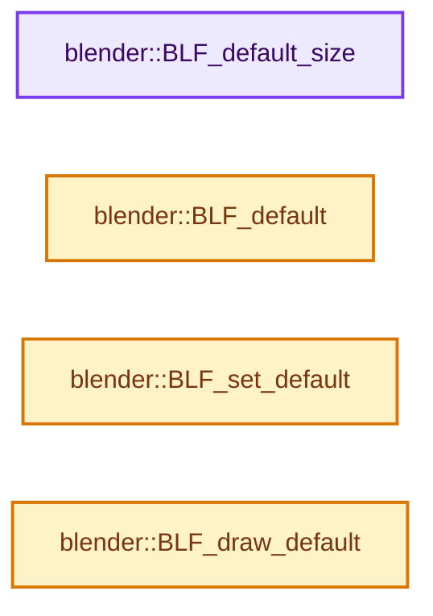
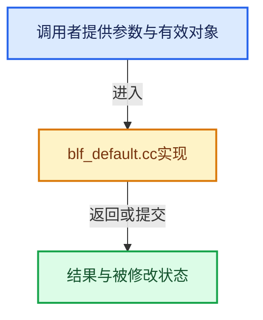

# 实现依赖专题：source/blender/blenfont/intern/blf_default.cc

[方向导航](README.md) · [符号索引](../%E7%AC%A6%E5%8F%B7%E4%BE%9D%E8%B5%96%E4%B8%8E%E5%AE%9E%E7%8E%B0%E7%B4%A2%E5%BC%95.md)

本专题从正文实际调用进入，集中保存共享实现。函数有稳定锚点，可从调用处直接跳到对应完整函数；递归与互相调用通过回链组织。

## 本文件的实现关系






## 完整成员与函数实现

<a id="f-a73aea8992a68441"></a>

### `blender::BLF_default_size`

实现位置：[source/blender/blenfont/intern/blf_default.cc](../../../../../source/blender/blenfont/intern/blf_default.cc) · L27—L30。

接口参数：

- `const float size`

**教学注释版**

<!-- annotated:6b910950289795 -->

```cpp
void BLF_default_size(const float size)
{
  global_font_size = size;
}
```

<details>
<summary>核对原始源码：source/blender/blenfont/intern/blf_default.cc · L27—L30</summary>

<!-- original:6b910950289795:source/blender/blenfont/intern/blf_default.cc:27:30 -->

```cpp
void BLF_default_size(const float size)
{
  global_font_size = size;
}
```

</details>

**沿实际写入检查状态**

- `global_font_size = size;`

**继续追踪实现**

本实现没有需要继续展开的显式调用；检查返回表达式、对象转换和调用者前置条件。

<a id="f-bf89d50f903b84ce"></a>

### `blender::BLF_default`

实现位置：[source/blender/blenfont/intern/blf_default.cc](../../../../../source/blender/blenfont/intern/blf_default.cc) · L39—L43。

**教学注释版**

<!-- annotated:196401fa18735c -->

```cpp
int BLF_default()
{
  ASSERT_DEFAULT_SET;
  return global_font_default;
}
```

<details>
<summary>核对原始源码：source/blender/blenfont/intern/blf_default.cc · L39—L43</summary>

<!-- original:196401fa18735c:source/blender/blenfont/intern/blf_default.cc:39:43 -->

```cpp
int BLF_default()
{
  ASSERT_DEFAULT_SET;
  return global_font_default;
}
```

</details>

**结果出口**

- `return global_font_default;`

**继续追踪实现**

本实现没有需要继续展开的显式调用；检查返回表达式、对象转换和调用者前置条件。

<a id="f-0257e1852a11a712"></a>

### `blender::BLF_set_default`

实现位置：[source/blender/blenfont/intern/blf_default.cc](../../../../../source/blender/blenfont/intern/blf_default.cc) · L45—L52。

**教学注释版**

<!-- annotated:0dc1bb4ae22e16 -->

```cpp
int BLF_set_default()
{
  ASSERT_DEFAULT_SET;

  BLF_size(global_font_default, global_font_size * UI_SCALE_FAC);

  return global_font_default;
}
```

<details>
<summary>核对原始源码：source/blender/blenfont/intern/blf_default.cc · L45—L52</summary>

<!-- original:0dc1bb4ae22e16:source/blender/blenfont/intern/blf_default.cc:45:52 -->

```cpp
int BLF_set_default()
{
  ASSERT_DEFAULT_SET;

  BLF_size(global_font_default, global_font_size * UI_SCALE_FAC);

  return global_font_default;
}
```

</details>

**结果出口**

- `return global_font_default;`

**继续追踪实现**

- `BLF_size` → [blender::BLF_size · L445](%E4%BE%9D%E8%B5%96-blf-1ee3d6.md#f-055ce2de2d1684fd)。

<a id="f-81cd8e5978455a73"></a>

### `blender::BLF_draw_default`

实现位置：[source/blender/blenfont/intern/blf_default.cc](../../../../../source/blender/blenfont/intern/blf_default.cc) · L54—L61。

接口参数：

- `const float x`
- `const float y`
- `const float z`
- `const char *str`
- `const size_t str_len`

**教学注释版**

<!-- annotated:80d07f37336f66 -->

```cpp
void BLF_draw_default(
    const float x, const float y, const float z, const char *str, const size_t str_len)
{
  ASSERT_DEFAULT_SET;
  BLF_size(global_font_default, global_font_size * UI_SCALE_FAC);
  BLF_position(global_font_default, x, y, z);
  BLF_draw(global_font_default, str, str_len);
}
```

<details>
<summary>核对原始源码：source/blender/blenfont/intern/blf_default.cc · L54—L61</summary>

<!-- original:80d07f37336f66:source/blender/blenfont/intern/blf_default.cc:54:61 -->

```cpp
void BLF_draw_default(
    const float x, const float y, const float z, const char *str, const size_t str_len)
{
  ASSERT_DEFAULT_SET;
  BLF_size(global_font_default, global_font_size * UI_SCALE_FAC);
  BLF_position(global_font_default, x, y, z);
  BLF_draw(global_font_default, str, str_len);
}
```

</details>

**继续追踪实现**

- `BLF_size` → [blender::BLF_size · L445](%E4%BE%9D%E8%B5%96-blf-1ee3d6.md#f-055ce2de2d1684fd)。
- `BLF_position` → [blender::BLF_position · L390](%E4%BE%9D%E8%B5%96-blf-1ee3d6.md#f-a933064b70db1da3)。
- `BLF_draw` → [blender::BLF_draw · L587](%E4%BE%9D%E8%B5%96-blf-1ee3d6.md#f-f80f5339621971cc)。
