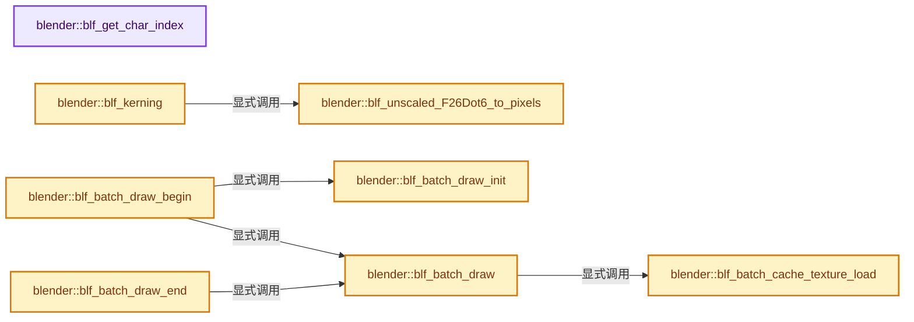
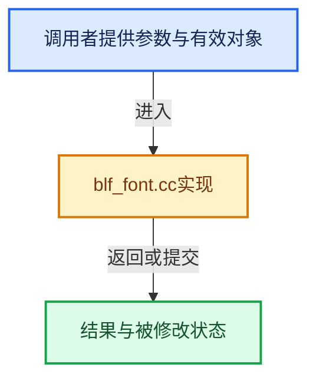

# 实现依赖专题：source/blender/blenfont/intern/blf_font.cc

[方向导航](README.md) · [符号索引](../%E7%AC%A6%E5%8F%B7%E4%BE%9D%E8%B5%96%E4%B8%8E%E5%AE%9E%E7%8E%B0%E7%B4%A2%E5%BC%95.md)

本专题从正文实际调用进入，集中保存共享实现。函数有稳定锚点，可从调用处直接跳到对应完整函数；递归与互相调用通过回链组织。

## 本文件的实现关系






<a id="m-967d28cee2ec"></a>

## 宏 `FT_New_Face`

<!-- annotated:cf85f918150d7f -->

```cpp
#  define FT_New_Face FT_New_Face__win32_compat
#endif
```

<details>
<summary>核对原始源码：source/blender/blenfont/intern/blf_font.cc · L56—L57</summary>

<!-- original:cf85f918150d7f:source/blender/blenfont/intern/blf_font.cc:56:57 -->

```cpp
#  define FT_New_Face FT_New_Face__win32_compat
#endif
```

</details>

宏在预处理阶段展开，参数替换、重复求值和条件编译应直接从该定义检查。与普通函数不同，宏不会自动提供参数类型检查；构建配置选择哪个定义需结合外围条件。

## 完整成员与函数实现

<a id="f-237e23d2167805c0"></a>

### `blender::blf_get_char_index`

实现位置：[source/blender/blenfont/intern/blf_font.cc](../../../../../source/blender/blenfont/intern/blf_font.cc) · L155—L158。

接口参数：

- `FontBLF *font`
- `const uint charcode`

**教学注释版**

<!-- annotated:0d12d367a0bc94 -->

```cpp
uint blf_get_char_index(FontBLF *font, const uint charcode)
{
  return FTC_CMapCache_Lookup(ftc_charmap_cache, font, -1, charcode);
}
```

<details>
<summary>核对原始源码：source/blender/blenfont/intern/blf_font.cc · L155—L158</summary>

<!-- original:0d12d367a0bc94:source/blender/blenfont/intern/blf_font.cc:155:158 -->

```cpp
uint blf_get_char_index(FontBLF *font, const uint charcode)
{
  return FTC_CMapCache_Lookup(ftc_charmap_cache, font, -1, charcode);
}
```

</details>

**结果出口**

- `return FTC_CMapCache_Lookup(ftc_charmap_cache, font, -1, charcode);`

**继续追踪实现**

- `FTC_CMapCache_Lookup` → [调用协议](../%E6%A8%A1%E6%9D%BF%E5%AE%8F%E4%B8%8E%E5%8A%A8%E6%80%81%E5%88%86%E6%B4%BE%E5%8D%8F%E8%AE%AE.md)：函数指针、局部可调用对象或未展开的宏；必须结合调用者环境。调用位置L157。

<a id="f-94fa394f0071a07b"></a>

### `blender::blf_unscaled_F26Dot6_to_pixels`

实现位置：[source/blender/blenfont/intern/blf_font.cc](../../../../../source/blender/blenfont/intern/blf_font.cc) · L161—L176。

接口参数：

- `FontBLF *font`
- `const FT_Pos value`

**教学注释版**

<!-- annotated:db4801bd3ff05d -->

```cpp
static ft_pix blf_unscaled_F26Dot6_to_pixels(FontBLF *font, const FT_Pos value)
{
  std::lock_guard lock(ft_cache_size_mutex);
  blf_ensure_size(font);

  /* Scale value by font size using integer-optimized multiplication. */
  FT_Long scaled = FT_MulFix(value, font->ft_size->metrics.x_scale);

  /* Copied from FreeType's FT_Get_Kerning (with FT_KERNING_DEFAULT), scaling down. */
  /* Kerning distances at small PPEM values so that they don't become too big. */
  if (font->ft_size->metrics.x_ppem < 25) {
    scaled = FT_MulDiv(scaled, font->ft_size->metrics.x_ppem, 25);
  }

  return ft_pix(scaled);
}
```

<details>
<summary>核对原始源码：source/blender/blenfont/intern/blf_font.cc · L161—L176</summary>

<!-- original:db4801bd3ff05d:source/blender/blenfont/intern/blf_font.cc:161:176 -->

```cpp
static ft_pix blf_unscaled_F26Dot6_to_pixels(FontBLF *font, const FT_Pos value)
{
  std::lock_guard lock(ft_cache_size_mutex);
  blf_ensure_size(font);

  /* Scale value by font size using integer-optimized multiplication. */
  FT_Long scaled = FT_MulFix(value, font->ft_size->metrics.x_scale);

  /* Copied from FreeType's FT_Get_Kerning (with FT_KERNING_DEFAULT), scaling down. */
  /* Kerning distances at small PPEM values so that they don't become too big. */
  if (font->ft_size->metrics.x_ppem < 25) {
    scaled = FT_MulDiv(scaled, font->ft_size->metrics.x_ppem, 25);
  }

  return ft_pix(scaled);
}
```

</details>

**沿实际写入检查状态**

- `scaled = FT_MulDiv(scaled, font->ft_size->metrics.x_ppem, 25);`

**结果出口**

- `return ft_pix(scaled);`

**继续追踪实现**

- `blf_ensure_size` → [blender::blf_ensure_size · L2311](%E4%BE%9D%E8%B5%96-blf_font-763011.md#f-ec8e29eb74197fe4)。
- `FT_MulFix` → [调用协议](../%E6%A8%A1%E6%9D%BF%E5%AE%8F%E4%B8%8E%E5%8A%A8%E6%80%81%E5%88%86%E6%B4%BE%E5%8D%8F%E8%AE%AE.md)：函数指针、局部可调用对象或未展开的宏；必须结合调用者环境。调用位置L167。
- `FT_MulDiv` → [调用协议](../%E6%A8%A1%E6%9D%BF%E5%AE%8F%E4%B8%8E%E5%8A%A8%E6%80%81%E5%88%86%E6%B4%BE%E5%8D%8F%E8%AE%AE.md)：函数指针、局部可调用对象或未展开的宏；必须结合调用者环境。调用位置L172。
- `ft_pix` → [调用协议](../%E6%A8%A1%E6%9D%BF%E5%AE%8F%E4%B8%8E%E5%8A%A8%E6%80%81%E5%88%86%E6%B4%BE%E5%8D%8F%E8%AE%AE.md)：函数指针、局部可调用对象或未展开的宏；必须结合调用者环境。调用位置L175。

<a id="f-264b2246686207c0"></a>

### `blender::blf_batch_draw_init`

实现位置：[source/blender/blenfont/intern/blf_font.cc](../../../../../source/blender/blenfont/intern/blf_font.cc) · L190—L197。

**教学注释版**

<!-- annotated:1f75e9c568de9d -->

```cpp
static void blf_batch_draw_init()
{
  g_batch.glyph_buf = GPU_storagebuf_create_ex(
      sizeof(g_batch.glyph_data), nullptr, GPU_USAGE_STREAM, __func__);
  g_batch.glyph_len = 0;
  /* We render a quad as a triangle strip and instance it for each glyph. */
  g_batch.batch = GPU_batch_create_procedural(GPU_PRIM_TRI_STRIP, 4);
}
```

<details>
<summary>核对原始源码：source/blender/blenfont/intern/blf_font.cc · L190—L197</summary>

<!-- original:1f75e9c568de9d:source/blender/blenfont/intern/blf_font.cc:190:197 -->

```cpp
static void blf_batch_draw_init()
{
  g_batch.glyph_buf = GPU_storagebuf_create_ex(
      sizeof(g_batch.glyph_data), nullptr, GPU_USAGE_STREAM, __func__);
  g_batch.glyph_len = 0;
  /* We render a quad as a triangle strip and instance it for each glyph. */
  g_batch.batch = GPU_batch_create_procedural(GPU_PRIM_TRI_STRIP, 4);
}
```

</details>

**沿实际写入检查状态**

- `g_batch.glyph_buf = GPU_storagebuf_create_ex(`
- `g_batch.glyph_len = 0;`
- `g_batch.batch = GPU_batch_create_procedural(GPU_PRIM_TRI_STRIP, 4);`

**继续追踪实现**

- `GPU_storagebuf_create_ex` → [blender::GPU_storagebuf_create_ex · L59](%E4%BE%9D%E8%B5%96-gpu_storage_buffer-1706c5.md#f-4042921669abadf8)。
- `GPU_batch_create_procedural` → [blender::GPU_batch_create_procedural · L85](%E4%BE%9D%E8%B5%96-gpu_batch-25aed8.md#f-51d07c94d3ff291d)。

<a id="f-686732fafceaee34"></a>

### `blender::blf_batch_draw_begin`

实现位置：[source/blender/blenfont/intern/blf_font.cc](../../../../../source/blender/blenfont/intern/blf_font.cc) · L207—L265。

接口参数：

- `FontBLF *font`

**教学注释版**

<!-- annotated:fee2f4d026c71a -->

```cpp
void blf_batch_draw_begin(FontBLF *font)
{
  if (g_batch.batch == nullptr) {
    blf_batch_draw_init();
  }

  const bool font_changed = (g_batch.font != font);
  const bool simple_shader = ((font->flags & (BLF_ROTATION | BLF_ASPECT)) == 0);
  const bool shader_changed = (simple_shader != g_batch.simple_shader);

  g_batch.active = g_batch.enabled && simple_shader;

  if (simple_shader) {
    /* Offset is applied to each glyph. */
    g_batch.ofs[0] = font->pos[0];
    g_batch.ofs[1] = font->pos[1];
  }
  else {
    /* Offset is baked in model-view matrix. */
    zero_v2_int(g_batch.ofs);
  }

  if (g_batch.active) {
    float gpumat[4][4];
    GPU_matrix_model_view_get(gpumat);

    bool mat_changed = equals_m4m4(gpumat, g_batch.mat) == false;

    if (mat_changed) {
      /* Model view matrix is no longer the same.
       * Flush cache but with the previous matrix. */
      GPU_matrix_push();
      GPU_matrix_set(g_batch.mat);
    }

    /* Flush cache if configuration is not the same. */
    if (mat_changed || font_changed || shader_changed) {
      blf_batch_draw();
      g_batch.simple_shader = simple_shader;
      g_batch.font = font;
    }
    else {
      /* Nothing changed continue batching. */
      return;
    }

    if (mat_changed) {
      GPU_matrix_pop();
      /* Save for next `memcmp`. */
      // [讲解] memcpy：复制字节，源与目标不应重叠。类型生命周期、对齐和可复制表示须由调用者证明，不是任意对象的复制构造。
      memcpy(g_batch.mat, gpumat, sizeof(g_batch.mat));
    }
  }
  else {
    /* Flush cache. */
    blf_batch_draw();
    g_batch.font = font;
    g_batch.simple_shader = simple_shader;
  }
}
```

<details>
<summary>核对原始源码：source/blender/blenfont/intern/blf_font.cc · L207—L265</summary>

<!-- original:fee2f4d026c71a:source/blender/blenfont/intern/blf_font.cc:207:265 -->

```cpp
void blf_batch_draw_begin(FontBLF *font)
{
  if (g_batch.batch == nullptr) {
    blf_batch_draw_init();
  }

  const bool font_changed = (g_batch.font != font);
  const bool simple_shader = ((font->flags & (BLF_ROTATION | BLF_ASPECT)) == 0);
  const bool shader_changed = (simple_shader != g_batch.simple_shader);

  g_batch.active = g_batch.enabled && simple_shader;

  if (simple_shader) {
    /* Offset is applied to each glyph. */
    g_batch.ofs[0] = font->pos[0];
    g_batch.ofs[1] = font->pos[1];
  }
  else {
    /* Offset is baked in model-view matrix. */
    zero_v2_int(g_batch.ofs);
  }

  if (g_batch.active) {
    float gpumat[4][4];
    GPU_matrix_model_view_get(gpumat);

    bool mat_changed = equals_m4m4(gpumat, g_batch.mat) == false;

    if (mat_changed) {
      /* Model view matrix is no longer the same.
       * Flush cache but with the previous matrix. */
      GPU_matrix_push();
      GPU_matrix_set(g_batch.mat);
    }

    /* Flush cache if configuration is not the same. */
    if (mat_changed || font_changed || shader_changed) {
      blf_batch_draw();
      g_batch.simple_shader = simple_shader;
      g_batch.font = font;
    }
    else {
      /* Nothing changed continue batching. */
      return;
    }

    if (mat_changed) {
      GPU_matrix_pop();
      /* Save for next `memcmp`. */
      memcpy(g_batch.mat, gpumat, sizeof(g_batch.mat));
    }
  }
  else {
    /* Flush cache. */
    blf_batch_draw();
    g_batch.font = font;
    g_batch.simple_shader = simple_shader;
  }
}
```

</details>

**沿实际写入检查状态**

- `g_batch.active = g_batch.enabled && simple_shader;`
- `g_batch.ofs[0] = font->pos[0];`
- `g_batch.ofs[1] = font->pos[1];`
- `g_batch.simple_shader = simple_shader;`
- `g_batch.font = font;`

**继续追踪实现**

- `blf_batch_draw_init` → [blender::blf_batch_draw_init · L190](%E4%BE%9D%E8%B5%96-blf_font-763011.md#f-264b2246686207c0)。
- `zero_v2_int` → [blender::zero_v2_int · L116](../12-%E7%A9%BA%E9%97%B4%E6%95%B0%E6%8D%AE%E7%BB%93%E6%9E%84%E4%B8%8E%E5%87%A0%E4%BD%95%E7%AE%97%E6%B3%95/%E4%BE%9D%E8%B5%96-math_vector_inline-0c8541.md#f-ebe908fda728b78d)。
- `GPU_matrix_model_view_get` → [blender::GPU_matrix_model_view_get · L553](%E4%BE%9D%E8%B5%96-gpu_matrix-f7dc40.md#f-fa882bc99cef8a30)。
- `equals_m4m4` → [blender::equals_m4m4 · L2315](../12-%E7%A9%BA%E9%97%B4%E6%95%B0%E6%8D%AE%E7%BB%93%E6%9E%84%E4%B8%8E%E5%87%A0%E4%BD%95%E7%AE%97%E6%B3%95/%E4%BE%9D%E8%B5%96-math_matrix_c-004123.md#f-5e2c69f820c10292)。
- `GPU_matrix_push` → [blender::GPU_matrix_push · L120](%E4%BE%9D%E8%B5%96-gpu_matrix-f7dc40.md#f-4461e6dee642cd0b)。
- `GPU_matrix_set` → [blender::GPU_matrix_set · L148](%E4%BE%9D%E8%B5%96-gpu_matrix-f7dc40.md#f-9a0e204d1b913771)。
- `blf_batch_draw` → [blender::blf_batch_draw · L307](%E4%BE%9D%E8%B5%96-blf_font-763011.md#f-d6efca597f7785fa)。
- `GPU_matrix_pop` → [blender::GPU_matrix_pop · L127](%E4%BE%9D%E8%B5%96-gpu_matrix-f7dc40.md#f-873c4cfc32b18384)。
- `memcpy` → [外部契约](https://eel.is/c++draft/cstring.syn)：复制字节，源与目标不应重叠。类型生命周期、对齐和可复制表示须由调用者证明，不是任意对象的复制构造。

<a id="f-9450cb08409702c4"></a>

### `blender::blf_batch_cache_texture_load`

实现位置：[source/blender/blenfont/intern/blf_font.cc](../../../../../source/blender/blenfont/intern/blf_font.cc) · L267—L305。

**教学注释版**

<!-- annotated:50cd3687f99c27 -->

```cpp
static gpu::Texture *blf_batch_cache_texture_load()
{
  GlyphCacheBLF *gc = g_batch.glyph_cache;
  BLI_assert(gc);
  BLI_assert(gc->bitmap_len > 0);

  if (gc->bitmap_len > gc->bitmap_len_landed) {
    const int tex_width = GPU_texture_width(gc->texture);

    int bitmap_len_landed = gc->bitmap_len_landed;
    int remain = gc->bitmap_len - bitmap_len_landed;
    int offset_x = bitmap_len_landed % tex_width;
    int offset_y = bitmap_len_landed / tex_width;

    /* TODO(@germano): Update more than one row in a single call. */
    while (remain) {
      int remain_row = tex_width - offset_x;
      int width = remain > remain_row ? remain_row : remain;
      GPU_texture_update_sub(gc->texture,
                             GPU_DATA_UBYTE,
                             &gc->bitmap_result[bitmap_len_landed],
                             offset_x,
                             offset_y,
                             0,
                             width,
                             1,
                             0);

      bitmap_len_landed += width;
      remain -= width;
      offset_x = 0;
      offset_y += 1;
    }

    gc->bitmap_len_landed = bitmap_len_landed;
  }

  return gc->texture;
}
```

<details>
<summary>核对原始源码：source/blender/blenfont/intern/blf_font.cc · L267—L305</summary>

<!-- original:50cd3687f99c27:source/blender/blenfont/intern/blf_font.cc:267:305 -->

```cpp
static gpu::Texture *blf_batch_cache_texture_load()
{
  GlyphCacheBLF *gc = g_batch.glyph_cache;
  BLI_assert(gc);
  BLI_assert(gc->bitmap_len > 0);

  if (gc->bitmap_len > gc->bitmap_len_landed) {
    const int tex_width = GPU_texture_width(gc->texture);

    int bitmap_len_landed = gc->bitmap_len_landed;
    int remain = gc->bitmap_len - bitmap_len_landed;
    int offset_x = bitmap_len_landed % tex_width;
    int offset_y = bitmap_len_landed / tex_width;

    /* TODO(@germano): Update more than one row in a single call. */
    while (remain) {
      int remain_row = tex_width - offset_x;
      int width = remain > remain_row ? remain_row : remain;
      GPU_texture_update_sub(gc->texture,
                             GPU_DATA_UBYTE,
                             &gc->bitmap_result[bitmap_len_landed],
                             offset_x,
                             offset_y,
                             0,
                             width,
                             1,
                             0);

      bitmap_len_landed += width;
      remain -= width;
      offset_x = 0;
      offset_y += 1;
    }

    gc->bitmap_len_landed = bitmap_len_landed;
  }

  return gc->texture;
}
```

</details>

**沿实际写入检查状态**

- `bitmap_len_landed += width;`
- `remain -= width;`
- `offset_x = 0;`
- `offset_y += 1;`
- `gc->bitmap_len_landed = bitmap_len_landed;`

**结果出口**

- `return gc->texture;`

**继续追踪实现**

- `BLI_assert` → [BLI_assert · L48](../01-%E5%9F%BA%E7%A1%80%E5%AE%B9%E5%99%A8%E4%B8%8E%E7%8E%B0%E4%BB%A3CPP/%E4%BE%9D%E8%B5%96-BLI_assert-cc98e8.md#m-57a88495704d)；[BLI_assert · L63](../01-%E5%9F%BA%E7%A1%80%E5%AE%B9%E5%99%A8%E4%B8%8E%E7%8E%B0%E4%BB%A3CPP/%E4%BE%9D%E8%B5%96-BLI_assert-cc98e8.md#m-d07050020cb5)。宏定义由构建条件选择。
- `GPU_texture_width` → [blender::GPU_texture_width · L773](%E4%BE%9D%E8%B5%96-gpu_texture-234bda.md#f-0f5cbfbefa217516)。
- `GPU_texture_update_sub` → [blender::GPU_texture_update_sub · L507](%E4%BE%9D%E8%B5%96-gpu_texture-234bda.md#f-2c901e7b4602b08e)。

<a id="f-d6efca597f7785fa"></a>

### `blender::blf_batch_draw`

实现位置：[source/blender/blenfont/intern/blf_font.cc](../../../../../source/blender/blenfont/intern/blf_font.cc) · L307—L339。

**教学注释版**

<!-- annotated:4de2829fb69c3d -->

```cpp
void blf_batch_draw()
{
  if (g_batch.glyph_len == 0) {
    return;
  }

  GPU_blend(GPU_BLEND_ALPHA);

  /* We need to flush widget base first to ensure correct ordering. */
  if (blf_draw_cache_flush != nullptr) {
    blf_draw_cache_flush();
  }

  gpu::Texture *texture = blf_batch_cache_texture_load();
  GPU_storagebuf_usage_size_set(g_batch.glyph_buf, size_t(g_batch.glyph_len) * sizeof(GlyphQuad));
  GPU_storagebuf_update(g_batch.glyph_buf, g_batch.glyph_data);
  GPU_storagebuf_bind(g_batch.glyph_buf, 0);

  GPU_batch_program_set_builtin(g_batch.batch, GPU_SHADER_TEXT);
  GPU_batch_texture_bind(g_batch.batch, "glyph", texture);
  /* Setup texture width mask and shift, so that shader can avoid costly divisions. */
  int tex_width = GPU_texture_width(texture);
  BLI_assert_msg(is_power_of_2_i(tex_width), "Font texture width must be power of two");
  int width_shift = 31 - bitscan_reverse_i(tex_width);
  GPU_batch_uniform_1i(g_batch.batch, "glyph_tex_width_mask", tex_width - 1);
  GPU_batch_uniform_1i(g_batch.batch, "glyph_tex_width_shift", width_shift);
  GPU_batch_draw_advanced(g_batch.batch, 0, 4, 0, g_batch.glyph_len);

  GPU_blend(GPU_BLEND_NONE);

  GPU_texture_unbind(texture);
  g_batch.glyph_len = 0;
}
```

<details>
<summary>核对原始源码：source/blender/blenfont/intern/blf_font.cc · L307—L339</summary>

<!-- original:4de2829fb69c3d:source/blender/blenfont/intern/blf_font.cc:307:339 -->

```cpp
void blf_batch_draw()
{
  if (g_batch.glyph_len == 0) {
    return;
  }

  GPU_blend(GPU_BLEND_ALPHA);

  /* We need to flush widget base first to ensure correct ordering. */
  if (blf_draw_cache_flush != nullptr) {
    blf_draw_cache_flush();
  }

  gpu::Texture *texture = blf_batch_cache_texture_load();
  GPU_storagebuf_usage_size_set(g_batch.glyph_buf, size_t(g_batch.glyph_len) * sizeof(GlyphQuad));
  GPU_storagebuf_update(g_batch.glyph_buf, g_batch.glyph_data);
  GPU_storagebuf_bind(g_batch.glyph_buf, 0);

  GPU_batch_program_set_builtin(g_batch.batch, GPU_SHADER_TEXT);
  GPU_batch_texture_bind(g_batch.batch, "glyph", texture);
  /* Setup texture width mask and shift, so that shader can avoid costly divisions. */
  int tex_width = GPU_texture_width(texture);
  BLI_assert_msg(is_power_of_2_i(tex_width), "Font texture width must be power of two");
  int width_shift = 31 - bitscan_reverse_i(tex_width);
  GPU_batch_uniform_1i(g_batch.batch, "glyph_tex_width_mask", tex_width - 1);
  GPU_batch_uniform_1i(g_batch.batch, "glyph_tex_width_shift", width_shift);
  GPU_batch_draw_advanced(g_batch.batch, 0, 4, 0, g_batch.glyph_len);

  GPU_blend(GPU_BLEND_NONE);

  GPU_texture_unbind(texture);
  g_batch.glyph_len = 0;
}
```

</details>

**沿实际写入检查状态**

- `g_batch.glyph_len = 0;`

**继续追踪实现**

- `GPU_blend` → [blender::GPU_blend · L44](%E4%BE%9D%E8%B5%96-gpu_state-82c525.md#f-aa74e4560c194f83)。
- `blf_draw_cache_flush` → [调用协议](../%E6%A8%A1%E6%9D%BF%E5%AE%8F%E4%B8%8E%E5%8A%A8%E6%80%81%E5%88%86%E6%B4%BE%E5%8D%8F%E8%AE%AE.md)：函数指针、局部可调用对象或未展开的宏；必须结合调用者环境。调用位置L317。
- `blf_batch_cache_texture_load` → [blender::blf_batch_cache_texture_load · L267](%E4%BE%9D%E8%B5%96-blf_font-763011.md#f-9450cb08409702c4)。
- `GPU_storagebuf_usage_size_set` → [blender::GPU_storagebuf_usage_size_set · L84](%E4%BE%9D%E8%B5%96-gpu_storage_buffer-1706c5.md#f-86d98ca0ca4307ab)。
- `GPU_storagebuf_update` → [blender::GPU_storagebuf_update · L89](%E4%BE%9D%E8%B5%96-gpu_storage_buffer-1706c5.md#f-6dc36991891ed610)。
- `GPU_storagebuf_bind` → [blender::GPU_storagebuf_bind · L94](%E4%BE%9D%E8%B5%96-gpu_storage_buffer-1706c5.md#f-e795e74fcc758ac4)。
- `GPU_batch_program_set_builtin` → [blender::GPU_batch_program_set_builtin · L503](%E4%BE%9D%E8%B5%96-gpu_batch-25aed8.md#f-c304e4bdc1ab3afb)。
- `GPU_batch_texture_bind` → [GPU_batch_texture_bind · L284](%E4%BE%9D%E8%B5%96-GPU_batch-98c422.md#m-13cc70bfc150)。宏定义由构建条件选择。
- `GPU_texture_width` → [blender::GPU_texture_width · L773](%E4%BE%9D%E8%B5%96-gpu_texture-234bda.md#f-0f5cbfbefa217516)。
- `BLI_assert_msg` → [BLI_assert_msg · L55](../01-%E5%9F%BA%E7%A1%80%E5%AE%B9%E5%99%A8%E4%B8%8E%E7%8E%B0%E4%BB%A3CPP/%E4%BE%9D%E8%B5%96-BLI_assert-cc98e8.md#m-695eed20dceb)；[BLI_assert_msg · L64](../01-%E5%9F%BA%E7%A1%80%E5%AE%B9%E5%99%A8%E4%B8%8E%E7%8E%B0%E4%BB%A3CPP/%E4%BE%9D%E8%B5%96-BLI_assert-cc98e8.md#m-7de5563de4db)。宏定义由构建条件选择。
- `is_power_of_2_i` → [blender::is_power_of_2_i · L105](../12-%E7%A9%BA%E9%97%B4%E6%95%B0%E6%8D%AE%E7%BB%93%E6%9E%84%E4%B8%8E%E5%87%A0%E4%BD%95%E7%AE%97%E6%B3%95/%E4%BE%9D%E8%B5%96-math_base_inline-546b00.md#f-122f291f1e7250f2)。
- `bitscan_reverse_i` → [blender::bitscan_reverse_i · L92](../12-%E7%A9%BA%E9%97%B4%E6%95%B0%E6%8D%AE%E7%BB%93%E6%9E%84%E4%B8%8E%E5%87%A0%E4%BD%95%E7%AE%97%E6%B3%95/%E4%BE%9D%E8%B5%96-math_bits_inline-8a26f2.md#f-788184778f8bba1c)。
- `GPU_batch_uniform_1i` → [GPU_batch_uniform_1i · L265](%E4%BE%9D%E8%B5%96-GPU_batch-98c422.md#m-97bf204d309c)。宏定义由构建条件选择。
- `GPU_batch_draw_advanced` → [blender::GPU_batch_draw_advanced · L426](%E4%BE%9D%E8%B5%96-gpu_batch-25aed8.md#f-99e145dd871a8ecd)。
- `GPU_texture_unbind` → [blender::GPU_texture_unbind · L639](%E4%BE%9D%E8%B5%96-gpu_texture-234bda.md#f-4bd2dd4244c18f3f)。

<a id="f-03eaec8094993e12"></a>

### `blender::blf_batch_draw_end`

实现位置：[source/blender/blenfont/intern/blf_font.cc](../../../../../source/blender/blenfont/intern/blf_font.cc) · L341—L346。

**教学注释版**

<!-- annotated:5e8aefd8d5b695 -->

```cpp
static void blf_batch_draw_end()
{
  if (!g_batch.active) {
    blf_batch_draw();
  }
}
```

<details>
<summary>核对原始源码：source/blender/blenfont/intern/blf_font.cc · L341—L346</summary>

<!-- original:5e8aefd8d5b695:source/blender/blenfont/intern/blf_font.cc:341:346 -->

```cpp
static void blf_batch_draw_end()
{
  if (!g_batch.active) {
    blf_batch_draw();
  }
}
```

</details>

**继续追踪实现**

- `blf_batch_draw` → [blender::blf_batch_draw · L307](%E4%BE%9D%E8%B5%96-blf_font-763011.md#f-d6efca597f7785fa)。

<a id="f-263537b760f5881f"></a>

### `blender::blf_kerning`

实现位置：[source/blender/blenfont/intern/blf_font.cc](../../../../../source/blender/blenfont/intern/blf_font.cc) · L363—L396。

接口参数：

- `FontBLF *font`
- `const GlyphBLF *g_prev`
- `const GlyphBLF *g`

**教学注释版**

<!-- annotated:b0aa708e132c98 -->

```cpp
BLI_INLINE ft_pix blf_kerning(FontBLF *font, const GlyphBLF *g_prev, const GlyphBLF *g)
{
  ft_pix adjustment = 0;

  /* Small adjust if there is hinting. */
  adjustment += g->lsb_delta - ((g_prev) ? g_prev->rsb_delta : 0);

  if (FT_HAS_KERNING(font) && g_prev) {
    FT_Vector delta = {KERNING_ENTRY_UNSET};

    /* Get unscaled kerning value from our cache if ASCII. */
    if ((g_prev->c < KERNING_CACHE_TABLE_SIZE) && (g->c < KERNING_CACHE_TABLE_SIZE)) {
      delta.x = font->kerning_cache->ascii_table[g->c][g_prev->c];
    }

    /* If not ASCII or not found in cache, ask FreeType for kerning. */
    if (font->face && delta.x == KERNING_ENTRY_UNSET) [[unlikely]] {
      /* Note that this function sets delta values to zero on any error. */
      FT_Get_Kerning(font->face, g_prev->idx, g->idx, FT_KERNING_UNSCALED, &delta);
    }

    /* If ASCII we save this value to our cache for quicker access next time. */
    if ((g_prev->c < KERNING_CACHE_TABLE_SIZE) && (g->c < KERNING_CACHE_TABLE_SIZE)) {
      font->kerning_cache->ascii_table[g->c][g_prev->c] = int(delta.x);
    }

    if (delta.x != 0) {
      /* Convert unscaled design units to pixels and move pen. */
      adjustment += blf_unscaled_F26Dot6_to_pixels(font, delta.x);
    }
  }

  return adjustment;
}
```

<details>
<summary>核对原始源码：source/blender/blenfont/intern/blf_font.cc · L363—L396</summary>

<!-- original:b0aa708e132c98:source/blender/blenfont/intern/blf_font.cc:363:396 -->

```cpp
BLI_INLINE ft_pix blf_kerning(FontBLF *font, const GlyphBLF *g_prev, const GlyphBLF *g)
{
  ft_pix adjustment = 0;

  /* Small adjust if there is hinting. */
  adjustment += g->lsb_delta - ((g_prev) ? g_prev->rsb_delta : 0);

  if (FT_HAS_KERNING(font) && g_prev) {
    FT_Vector delta = {KERNING_ENTRY_UNSET};

    /* Get unscaled kerning value from our cache if ASCII. */
    if ((g_prev->c < KERNING_CACHE_TABLE_SIZE) && (g->c < KERNING_CACHE_TABLE_SIZE)) {
      delta.x = font->kerning_cache->ascii_table[g->c][g_prev->c];
    }

    /* If not ASCII or not found in cache, ask FreeType for kerning. */
    if (font->face && delta.x == KERNING_ENTRY_UNSET) [[unlikely]] {
      /* Note that this function sets delta values to zero on any error. */
      FT_Get_Kerning(font->face, g_prev->idx, g->idx, FT_KERNING_UNSCALED, &delta);
    }

    /* If ASCII we save this value to our cache for quicker access next time. */
    if ((g_prev->c < KERNING_CACHE_TABLE_SIZE) && (g->c < KERNING_CACHE_TABLE_SIZE)) {
      font->kerning_cache->ascii_table[g->c][g_prev->c] = int(delta.x);
    }

    if (delta.x != 0) {
      /* Convert unscaled design units to pixels and move pen. */
      adjustment += blf_unscaled_F26Dot6_to_pixels(font, delta.x);
    }
  }

  return adjustment;
}
```

</details>

**沿实际写入检查状态**

- `adjustment += g->lsb_delta - ((g_prev) ? g_prev->rsb_delta : 0);`
- `delta.x = font->kerning_cache->ascii_table[g->c][g_prev->c];`
- `font->kerning_cache->ascii_table[g->c][g_prev->c] = int(delta.x);`
- `adjustment += blf_unscaled_F26Dot6_to_pixels(font, delta.x);`

**结果出口**

- `return adjustment;`

**继续追踪实现**

- `FT_HAS_KERNING` → [调用协议](../%E6%A8%A1%E6%9D%BF%E5%AE%8F%E4%B8%8E%E5%8A%A8%E6%80%81%E5%88%86%E6%B4%BE%E5%8D%8F%E8%AE%AE.md)：函数指针、局部可调用对象或未展开的宏；必须结合调用者环境。调用位置L370。
- `FT_Get_Kerning` → [调用协议](../%E6%A8%A1%E6%9D%BF%E5%AE%8F%E4%B8%8E%E5%8A%A8%E6%80%81%E5%88%86%E6%B4%BE%E5%8D%8F%E8%AE%AE.md)：函数指针、局部可调用对象或未展开的宏；必须结合调用者环境。调用位置L381。
- `blf_unscaled_F26Dot6_to_pixels` → [blender::blf_unscaled_F26Dot6_to_pixels · L161](%E4%BE%9D%E8%B5%96-blf_font-763011.md#f-94fa394f0071a07b)。

<a id="f-ec9f01597f3d2ee7"></a>

### `blender::blf_glyph_from_utf8_and_step`

实现位置：[source/blender/blenfont/intern/blf_font.cc](../../../../../source/blender/blenfont/intern/blf_font.cc) · L398—L427。

接口参数：

- `FontBLF *font`
- `GlyphCacheBLF *gc`
- `const GlyphBLF *g_prev`
- `const char *str`
- `const size_t str_len`
- `size_t *i_p`
- `int32_t *pen_x`

**教学注释版**

<!-- annotated:3c91bb6274ff84 -->

```cpp
BLI_INLINE GlyphBLF *blf_glyph_from_utf8_and_step(FontBLF *font,
                                                  GlyphCacheBLF *gc,
                                                  const GlyphBLF *g_prev,
                                                  const char *str,
                                                  const size_t str_len,
                                                  size_t *i_p,
                                                  int32_t *pen_x)
{
  uint charcode = BLI_str_utf8_as_unicode_step_safe(str, str_len, i_p);
  /* Invalid unicode sequences return the byte value, stepping forward one.
   * This allows `latin1` to display (which is sometimes used for file-paths). */
  BLI_assert(charcode != BLI_UTF8_ERR);
  GlyphBLF *g = blf_glyph_ensure(font, gc, charcode);
  if (g && pen_x && !(font->flags & BLF_MONOSPACED)) {
    *pen_x += blf_kerning(font, g_prev, g);

#ifdef BLF_SUBPIXEL_POSITION
    if (!(font->flags & BLF_RENDER_SUBPIXELAA)) {
      *pen_x = FT_PIX_ROUND(*pen_x);
    }
#else
    *pen_x = FT_PIX_ROUND(*pen_x);
#endif

#ifdef BLF_SUBPIXEL_AA
    g = blf_glyph_ensure_subpixel(font, gc, g, *pen_x);
#endif
  }
  return g;
}
```

<details>
<summary>核对原始源码：source/blender/blenfont/intern/blf_font.cc · L398—L427</summary>

<!-- original:3c91bb6274ff84:source/blender/blenfont/intern/blf_font.cc:398:427 -->

```cpp
BLI_INLINE GlyphBLF *blf_glyph_from_utf8_and_step(FontBLF *font,
                                                  GlyphCacheBLF *gc,
                                                  const GlyphBLF *g_prev,
                                                  const char *str,
                                                  const size_t str_len,
                                                  size_t *i_p,
                                                  int32_t *pen_x)
{
  uint charcode = BLI_str_utf8_as_unicode_step_safe(str, str_len, i_p);
  /* Invalid unicode sequences return the byte value, stepping forward one.
   * This allows `latin1` to display (which is sometimes used for file-paths). */
  BLI_assert(charcode != BLI_UTF8_ERR);
  GlyphBLF *g = blf_glyph_ensure(font, gc, charcode);
  if (g && pen_x && !(font->flags & BLF_MONOSPACED)) {
    *pen_x += blf_kerning(font, g_prev, g);

#ifdef BLF_SUBPIXEL_POSITION
    if (!(font->flags & BLF_RENDER_SUBPIXELAA)) {
      *pen_x = FT_PIX_ROUND(*pen_x);
    }
#else
    *pen_x = FT_PIX_ROUND(*pen_x);
#endif

#ifdef BLF_SUBPIXEL_AA
    g = blf_glyph_ensure_subpixel(font, gc, g, *pen_x);
#endif
  }
  return g;
}
```

</details>

**沿实际写入检查状态**

- `g = blf_glyph_ensure_subpixel(font, gc, g, *pen_x);`

**结果出口**

- `return g;`

**继续追踪实现**

- `BLI_str_utf8_as_unicode_step_safe` → [blender::BLI_str_utf8_as_unicode_step_safe · L1138](../01-%E5%9F%BA%E7%A1%80%E5%AE%B9%E5%99%A8%E4%B8%8E%E7%8E%B0%E4%BB%A3CPP/%E4%BE%9D%E8%B5%96-string_utf8-3c62ca.md#f-9cd1556ac128b983)。
- `BLI_assert` → [BLI_assert · L48](../01-%E5%9F%BA%E7%A1%80%E5%AE%B9%E5%99%A8%E4%B8%8E%E7%8E%B0%E4%BB%A3CPP/%E4%BE%9D%E8%B5%96-BLI_assert-cc98e8.md#m-57a88495704d)；[BLI_assert · L63](../01-%E5%9F%BA%E7%A1%80%E5%AE%B9%E5%99%A8%E4%B8%8E%E7%8E%B0%E4%BB%A3CPP/%E4%BE%9D%E8%B5%96-BLI_assert-cc98e8.md#m-d07050020cb5)。宏定义由构建条件选择。
- `blf_glyph_ensure` → [blender::blf_glyph_ensure · L1353](%E4%BE%9D%E8%B5%96-blf_glyph-e4ad17.md#f-a8b5ece493668b30)。
- `blf_kerning` → [blender::blf_kerning · L363](%E4%BE%9D%E8%B5%96-blf_font-763011.md#f-263537b760f5881f)。
- `FT_PIX_ROUND` → [FT_PIX_ROUND · L75](%E4%BE%9D%E8%B5%96-blf_internal_types-828120.md#m-1bb7dca8cfe9)。宏定义由构建条件选择。
- `blf_glyph_ensure_subpixel` → [blender::blf_glyph_ensure_subpixel · L1413](%E4%BE%9D%E8%B5%96-blf_glyph-e4ad17.md#f-cf6cbda449708902)。

<a id="f-90463a5c910407ef"></a>

### `blender::blf_glyph_is_combining`

实现位置：[source/blender/blenfont/intern/blf_font.cc](../../../../../source/blender/blenfont/intern/blf_font.cc) · L437—L440。

接口参数：

- `const GlyphBLF *g`

**教学注释版**

<!-- annotated:b24d61d7e7a527 -->

```cpp
BLI_INLINE bool blf_glyph_is_combining(const GlyphBLF *g)
{
  return (g->advance_x == 0) && (BLI_wcwidth_or_error(char32_t(g->c)) == 0);
}
```

<details>
<summary>核对原始源码：source/blender/blenfont/intern/blf_font.cc · L437—L440</summary>

<!-- original:b24d61d7e7a527:source/blender/blenfont/intern/blf_font.cc:437:440 -->

```cpp
BLI_INLINE bool blf_glyph_is_combining(const GlyphBLF *g)
{
  return (g->advance_x == 0) && (BLI_wcwidth_or_error(char32_t(g->c)) == 0);
}
```

</details>

**结果出口**

- `return (g->advance_x == 0) && (BLI_wcwidth_or_error(char32_t(g->c)) == 0);`

**继续追踪实现**

- `BLI_wcwidth_or_error` → [blender::BLI_wcwidth_or_error · L627](../01-%E5%9F%BA%E7%A1%80%E5%AE%B9%E5%99%A8%E4%B8%8E%E7%8E%B0%E4%BB%A3CPP/%E4%BE%9D%E8%B5%96-string_utf8-3c62ca.md#f-cbf3fdea0d578194)。
- `char32_t` → [调用协议](../%E6%A8%A1%E6%9D%BF%E5%AE%8F%E4%B8%8E%E5%8A%A8%E6%80%81%E5%88%86%E6%B4%BE%E5%8D%8F%E8%AE%AE.md)：函数指针、局部可调用对象或未展开的宏；必须结合调用者环境。调用位置L439。

<a id="f-f627afdf170fdb93"></a>

### `blender::blf_glyph_step`

实现位置：[source/blender/blenfont/intern/blf_font.cc](../../../../../source/blender/blenfont/intern/blf_font.cc) · L471—L549。

接口参数：

- `FontBLF *font`
- `GlyphCacheBLF *gc`
- `GlyphStepData &step`
- `const char *str`
- `const size_t str_len`

**教学注释版**

<!-- annotated:4e8f2e34fac57c -->

```cpp
BLI_INLINE bool blf_glyph_step(
    FontBLF *font, GlyphCacheBLF *gc, GlyphStepData &step, const char *str, const size_t str_len)
{
  const ft_pix pen_x_prev = step.pen_x_right;
  step.g = blf_glyph_from_utf8_and_step(
      font, gc, step.g_kerning, str, str_len, &step.i, &step.pen_x_right);
  if (step.g != nullptr) {
    if (!blf_glyph_is_combining(step.g)) {
      /* Common case, advancing to the next character. */
      step.pen_x_base = step.pen_x_right;
      step.pen_x = step.pen_x_right;
      step.pen_x_right += step.g->advance_x;
      step.g_kerning = step.g;
      step.offset_y = 0;
      step.base_ymax_accum = step.g->box_ymax;
      step.base_ymin_accum = step.g->box_ymin;
    }
    else {
      /* Combining character: center the mark over the previous base character.
       *
       * Without GPOS data (which requires a shaping engine such as HarfBuzz),
       * combining glyphs have no base-relative positioning. We follow the
       * fallback algorithm used by HarfBuzz when GPOS tables are absent
       * (see `hb-ot-shape-fallback.cc`, `position_mark`):
       *
       * - X: center the mark bitmap over the base character's advance width.
       * - Y: place the mark at the accumulated top (above) or bottom (below)
       *   of the base, with a small gap. Successive marks stack.
       *   If the offset would push the mark the wrong direction, dampen it.
       *
       * Above/below is determined from glyph bounding boxes: the mark's
       * vertical center vs the base glyph's vertical midpoint. */
      step.pen_x_right = pen_x_prev;

      /* Horizontal: center align (matches HarfBuzz ABOVE / BELOW default). */
      const int base_center = (ft_pix_to_int(step.pen_x_base) + ft_pix_to_int(pen_x_prev)) / 2;
      const int mark_center_offset = step.g->pos[0] + step.g->dims[0] / 2;
      step.pen_x = ft_pix_from_int(base_center - mark_center_offset);

      /* Vertical: reposition above/below marks (follows HarfBuzz `position_mark`). */
      step.offset_y = 0;
      if (step.g_kerning) {
        const ft_pix mark_ymin = step.g->box_ymin;
        const ft_pix mark_ymax = step.g->box_ymax;
        const ft_pix mark_height = mark_ymax - mark_ymin;
        const ft_pix base_mid = (step.g_kerning->box_ymin + step.g_kerning->box_ymax) / 2;
        const ft_pix mark_mid = (mark_ymin + mark_ymax) / 2;
        /* Gap matches HarfBuzz `y_gap = font->y_scale / 16`. */
        const ft_pix y_gap = ft_pix_from_float(gc->size) / 16;

        if (mark_mid > base_mid) {
          /* Above mark. */
          step.base_ymax_accum += y_gap;
          step.offset_y = step.base_ymax_accum - mark_ymin;
          /* Don't shift down "above" marks too much (HarfBuzz dampening). */
          if ((y_gap > 0) != (step.offset_y > 0)) {
            const ft_pix correction = -step.offset_y / 2;
            step.base_ymax_accum += correction;
            step.offset_y += correction;
          }
          step.base_ymax_accum += mark_height;
        }
        else {
          /* Below mark. */
          step.base_ymin_accum -= y_gap;
          step.offset_y = step.base_ymin_accum - mark_ymax;
          /* Never shift up "below" marks (HarfBuzz dampening). */
          if ((y_gap > 0) == (step.offset_y > 0)) {
            step.base_ymin_accum -= step.offset_y;
            step.offset_y = 0;
          }
          step.base_ymin_accum -= mark_height;
        }
      }
    }
    return true;
  }
  return false;
}
```

<details>
<summary>核对原始源码：source/blender/blenfont/intern/blf_font.cc · L471—L549</summary>

<!-- original:4e8f2e34fac57c:source/blender/blenfont/intern/blf_font.cc:471:549 -->

```cpp
BLI_INLINE bool blf_glyph_step(
    FontBLF *font, GlyphCacheBLF *gc, GlyphStepData &step, const char *str, const size_t str_len)
{
  const ft_pix pen_x_prev = step.pen_x_right;
  step.g = blf_glyph_from_utf8_and_step(
      font, gc, step.g_kerning, str, str_len, &step.i, &step.pen_x_right);
  if (step.g != nullptr) {
    if (!blf_glyph_is_combining(step.g)) {
      /* Common case, advancing to the next character. */
      step.pen_x_base = step.pen_x_right;
      step.pen_x = step.pen_x_right;
      step.pen_x_right += step.g->advance_x;
      step.g_kerning = step.g;
      step.offset_y = 0;
      step.base_ymax_accum = step.g->box_ymax;
      step.base_ymin_accum = step.g->box_ymin;
    }
    else {
      /* Combining character: center the mark over the previous base character.
       *
       * Without GPOS data (which requires a shaping engine such as HarfBuzz),
       * combining glyphs have no base-relative positioning. We follow the
       * fallback algorithm used by HarfBuzz when GPOS tables are absent
       * (see `hb-ot-shape-fallback.cc`, `position_mark`):
       *
       * - X: center the mark bitmap over the base character's advance width.
       * - Y: place the mark at the accumulated top (above) or bottom (below)
       *   of the base, with a small gap. Successive marks stack.
       *   If the offset would push the mark the wrong direction, dampen it.
       *
       * Above/below is determined from glyph bounding boxes: the mark's
       * vertical center vs the base glyph's vertical midpoint. */
      step.pen_x_right = pen_x_prev;

      /* Horizontal: center align (matches HarfBuzz ABOVE / BELOW default). */
      const int base_center = (ft_pix_to_int(step.pen_x_base) + ft_pix_to_int(pen_x_prev)) / 2;
      const int mark_center_offset = step.g->pos[0] + step.g->dims[0] / 2;
      step.pen_x = ft_pix_from_int(base_center - mark_center_offset);

      /* Vertical: reposition above/below marks (follows HarfBuzz `position_mark`). */
      step.offset_y = 0;
      if (step.g_kerning) {
        const ft_pix mark_ymin = step.g->box_ymin;
        const ft_pix mark_ymax = step.g->box_ymax;
        const ft_pix mark_height = mark_ymax - mark_ymin;
        const ft_pix base_mid = (step.g_kerning->box_ymin + step.g_kerning->box_ymax) / 2;
        const ft_pix mark_mid = (mark_ymin + mark_ymax) / 2;
        /* Gap matches HarfBuzz `y_gap = font->y_scale / 16`. */
        const ft_pix y_gap = ft_pix_from_float(gc->size) / 16;

        if (mark_mid > base_mid) {
          /* Above mark. */
          step.base_ymax_accum += y_gap;
          step.offset_y = step.base_ymax_accum - mark_ymin;
          /* Don't shift down "above" marks too much (HarfBuzz dampening). */
          if ((y_gap > 0) != (step.offset_y > 0)) {
            const ft_pix correction = -step.offset_y / 2;
            step.base_ymax_accum += correction;
            step.offset_y += correction;
          }
          step.base_ymax_accum += mark_height;
        }
        else {
          /* Below mark. */
          step.base_ymin_accum -= y_gap;
          step.offset_y = step.base_ymin_accum - mark_ymax;
          /* Never shift up "below" marks (HarfBuzz dampening). */
          if ((y_gap > 0) == (step.offset_y > 0)) {
            step.base_ymin_accum -= step.offset_y;
            step.offset_y = 0;
          }
          step.base_ymin_accum -= mark_height;
        }
      }
    }
    return true;
  }
  return false;
}
```

</details>

**沿实际写入检查状态**

- `step.g = blf_glyph_from_utf8_and_step(`
- `step.pen_x_base = step.pen_x_right;`
- `step.pen_x = step.pen_x_right;`
- `step.pen_x_right += step.g->advance_x;`
- `step.g_kerning = step.g;`
- `step.offset_y = 0;`
- `step.base_ymax_accum = step.g->box_ymax;`
- `step.base_ymin_accum = step.g->box_ymin;`
- `step.pen_x_right = pen_x_prev;`
- `step.pen_x = ft_pix_from_int(base_center - mark_center_offset);`
- `step.base_ymax_accum += y_gap;`
- `step.offset_y = step.base_ymax_accum - mark_ymin;`
- `step.base_ymax_accum += correction;`
- `step.offset_y += correction;`
- `step.base_ymax_accum += mark_height;`
- `step.base_ymin_accum -= y_gap;`
- `step.offset_y = step.base_ymin_accum - mark_ymax;`
- `step.base_ymin_accum -= step.offset_y;`
- `step.base_ymin_accum -= mark_height;`

**结果出口**

- `return true;`
- `return false;`

**继续追踪实现**

- `blf_glyph_from_utf8_and_step` → [blender::blf_glyph_from_utf8_and_step · L398](%E4%BE%9D%E8%B5%96-blf_font-763011.md#f-ec9f01597f3d2ee7)。
- `blf_glyph_is_combining` → [blender::blf_glyph_is_combining · L437](%E4%BE%9D%E8%B5%96-blf_font-763011.md#f-90463a5c910407ef)。
- `ft_pix_to_int` → [blender::ft_pix_to_int · L78](%E4%BE%9D%E8%B5%96-blf_internal_types-828120.md#f-8513f2178301e2c7)。
- `ft_pix_from_int` → [blender::ft_pix_from_int · L93](%E4%BE%9D%E8%B5%96-blf_internal_types-828120.md#f-42af8957e0cf7e45)。
- `ft_pix_from_float` → [blender::ft_pix_from_float · L98](%E4%BE%9D%E8%B5%96-blf_internal_types-828120.md#f-22b763516a00ff40)。

<a id="f-894ccc6d86c21f45"></a>

### `blender::blf_glyph_step_reset_for_newline`

实现位置：[source/blender/blenfont/intern/blf_font.cc](../../../../../source/blender/blenfont/intern/blf_font.cc) · L555—L565。

接口参数：

- `GlyphStepData &step`

**教学注释版**

<!-- annotated:ad1b08482d0721 -->

```cpp
BLI_INLINE void blf_glyph_step_reset_for_newline(GlyphStepData &step)
{
  step.g = nullptr;
  step.g_kerning = nullptr;
  step.pen_x = 0;
  step.pen_x_right = 0;
  step.pen_x_base = 0;
  step.offset_y = 0;
  step.base_ymax_accum = 0;
  step.base_ymin_accum = 0;
}
```

<details>
<summary>核对原始源码：source/blender/blenfont/intern/blf_font.cc · L555—L565</summary>

<!-- original:ad1b08482d0721:source/blender/blenfont/intern/blf_font.cc:555:565 -->

```cpp
BLI_INLINE void blf_glyph_step_reset_for_newline(GlyphStepData &step)
{
  step.g = nullptr;
  step.g_kerning = nullptr;
  step.pen_x = 0;
  step.pen_x_right = 0;
  step.pen_x_base = 0;
  step.offset_y = 0;
  step.base_ymax_accum = 0;
  step.base_ymin_accum = 0;
}
```

</details>

**沿实际写入检查状态**

- `step.g = nullptr;`
- `step.g_kerning = nullptr;`
- `step.pen_x = 0;`
- `step.pen_x_right = 0;`
- `step.pen_x_base = 0;`
- `step.offset_y = 0;`
- `step.base_ymax_accum = 0;`
- `step.base_ymin_accum = 0;`

**继续追踪实现**

本实现没有需要继续展开的显式调用；检查返回表达式、对象转换和调用者前置条件。

<a id="f-bd0c4b6f6ea675c1"></a>

### `blender::blf_font_draw_ex`

实现位置：[source/blender/blenfont/intern/blf_font.cc](../../../../../source/blender/blenfont/intern/blf_font.cc) · L592—L626。

接口参数：

- `FontBLF *font`
- `GlyphCacheBLF *gc`
- `const char *str`
- `const size_t str_len`
- `ResultBLF *r_info`
- `const ft_pix pen_y`

**教学注释版**

<!-- annotated:8f290547476ec7 -->

```cpp
static void blf_font_draw_ex(FontBLF *font,
                             GlyphCacheBLF *gc,
                             const char *str,
                             const size_t str_len,
                             ResultBLF *r_info,
                             const ft_pix pen_y)
{
  if (str_len == 0) {
    /* Early exit, don't do any immediate-mode GPU operations. */
    return;
  }

  GlyphStepData step = {};

  blf_batch_draw_begin(font);

  while ((step.i < str_len) && str[step.i]) {
    if (!blf_glyph_step(font, gc, step, str, str_len)) {
      continue;
    }
    /* Do not return this loop if clipped, we want every character tested. */
    blf_glyph_draw(font,
                   gc,
                   step.g,
                   ft_pix_to_int_floor(step.pen_x),
                   ft_pix_to_int_floor(pen_y + step.offset_y));
  }

  blf_batch_draw_end();

  if (r_info) {
    r_info->lines = 1;
    r_info->width = ft_pix_to_int(step.pen_x_right);
  }
}
```

<details>
<summary>核对原始源码：source/blender/blenfont/intern/blf_font.cc · L592—L626</summary>

<!-- original:8f290547476ec7:source/blender/blenfont/intern/blf_font.cc:592:626 -->

```cpp
static void blf_font_draw_ex(FontBLF *font,
                             GlyphCacheBLF *gc,
                             const char *str,
                             const size_t str_len,
                             ResultBLF *r_info,
                             const ft_pix pen_y)
{
  if (str_len == 0) {
    /* Early exit, don't do any immediate-mode GPU operations. */
    return;
  }

  GlyphStepData step = {};

  blf_batch_draw_begin(font);

  while ((step.i < str_len) && str[step.i]) {
    if (!blf_glyph_step(font, gc, step, str, str_len)) {
      continue;
    }
    /* Do not return this loop if clipped, we want every character tested. */
    blf_glyph_draw(font,
                   gc,
                   step.g,
                   ft_pix_to_int_floor(step.pen_x),
                   ft_pix_to_int_floor(pen_y + step.offset_y));
  }

  blf_batch_draw_end();

  if (r_info) {
    r_info->lines = 1;
    r_info->width = ft_pix_to_int(step.pen_x_right);
  }
}
```

</details>

**沿实际写入检查状态**

- `r_info->lines = 1;`
- `r_info->width = ft_pix_to_int(step.pen_x_right);`

**继续追踪实现**

- `blf_batch_draw_begin` → [blender::blf_batch_draw_begin · L207](%E4%BE%9D%E8%B5%96-blf_font-763011.md#f-686732fafceaee34)。
- `blf_glyph_step` → [blender::blf_glyph_step · L471](%E4%BE%9D%E8%B5%96-blf_font-763011.md#f-f627afdf170fdb93)。
- `blf_glyph_draw` → [blender::blf_glyph_draw · L1504](%E4%BE%9D%E8%B5%96-blf_glyph-e4ad17.md#f-a50471bb22e7dba0)。
- `ft_pix_to_int_floor` → [blender::ft_pix_to_int_floor · L83](%E4%BE%9D%E8%B5%96-blf_internal_types-828120.md#f-d51cc0f44335d003)。
- `blf_batch_draw_end` → [blender::blf_batch_draw_end · L341](%E4%BE%9D%E8%B5%96-blf_font-763011.md#f-03eaec8094993e12)。
- `ft_pix_to_int` → [blender::ft_pix_to_int · L78](%E4%BE%9D%E8%B5%96-blf_internal_types-828120.md#f-8513f2178301e2c7)。

<a id="f-24ba82f1370609c6"></a>

### `blender::blf_font_draw`

实现位置：[source/blender/blenfont/intern/blf_font.cc](../../../../../source/blender/blenfont/intern/blf_font.cc) · L627—L632。

接口参数：

- `FontBLF *font`
- `const char *str`
- `const size_t str_len`
- `ResultBLF *r_info`

**教学注释版**

<!-- annotated:668025ecb9a27a -->

```cpp
void blf_font_draw(FontBLF *font, const char *str, const size_t str_len, ResultBLF *r_info)
{
  GlyphCacheBLF *gc = blf_glyph_cache_acquire(font);
  blf_font_draw_ex(font, gc, str, str_len, r_info, 0);
  blf_glyph_cache_release(font);
}
```

<details>
<summary>核对原始源码：source/blender/blenfont/intern/blf_font.cc · L627—L632</summary>

<!-- original:668025ecb9a27a:source/blender/blenfont/intern/blf_font.cc:627:632 -->

```cpp
void blf_font_draw(FontBLF *font, const char *str, const size_t str_len, ResultBLF *r_info)
{
  GlyphCacheBLF *gc = blf_glyph_cache_acquire(font);
  blf_font_draw_ex(font, gc, str, str_len, r_info, 0);
  blf_glyph_cache_release(font);
}
```

</details>

**继续追踪实现**

- `blf_glyph_cache_acquire` → [blender::blf_glyph_cache_acquire · L132](%E4%BE%9D%E8%B5%96-blf_glyph-e4ad17.md#f-7fefc84b8c6eb8ea)。
- `blf_font_draw_ex` → [blender::blf_font_draw_ex · L592](%E4%BE%9D%E8%B5%96-blf_font-763011.md#f-bd0c4b6f6ea675c1)。
- `blf_glyph_cache_release` → [blender::blf_glyph_cache_release · L145](%E4%BE%9D%E8%B5%96-blf_glyph-e4ad17.md#f-41bd99c45b149f01)。

<a id="f-a140d54a29d7c932"></a>

### `blender::blf_font_boundbox_ex`

实现位置：[source/blender/blenfont/intern/blf_font.cc](../../../../../source/blender/blenfont/intern/blf_font.cc) · L1068—L1119。

接口参数：

- `FontBLF *font`
- `GlyphCacheBLF *gc`
- `const char *str`
- `const size_t str_len`
- `rcti *r_box`
- `ResultBLF *r_info`
- `ft_pix pen_y`

**教学注释版**

<!-- annotated:76fcf6fac4729c -->

```cpp
static void blf_font_boundbox_ex(FontBLF *font,
                                 GlyphCacheBLF *gc,
                                 const char *str,
                                 const size_t str_len,
                                 rcti *r_box,
                                 ResultBLF *r_info,
                                 ft_pix pen_y)
{
  GlyphStepData step = {};

  ft_pix box_xmin = ft_pix_from_int(32000);
  ft_pix box_xmax = ft_pix_from_int(-32000);
  ft_pix box_ymin = ft_pix_from_int(32000);
  ft_pix box_ymax = ft_pix_from_int(-32000);

  while ((step.i < str_len) && str[step.i]) {
    if (!blf_glyph_step(font, gc, step, str, str_len)) {
      continue;
    }

    // [讲解] std::min：按比较关系选取较小值；截断范围时还需先满足非负和可表示范围，min本身不会证明边界安全。
    const ft_pix gbox_xmin = std::min(step.pen_x, step.pen_x + step.g->box_xmin);
    /* Mono-spaced characters should only use advance. See #130385. */
    const ft_pix gbox_xmax = (font->flags & BLF_MONOSPACED) ?
                                 step.pen_x_right :
                                 // [讲解] std::max：按比较关系选取较大值。本讲解中的增长公式同时满足最低请求和几何增长；若保存返回引用，还需注意实参寿命。
                                 std::max(step.pen_x_right, step.pen_x + step.g->box_xmax);
    const ft_pix gbox_ymin = step.g->box_ymin + pen_y + step.offset_y;
    const ft_pix gbox_ymax = step.g->box_ymax + pen_y + step.offset_y;

    box_xmin = std::min(gbox_xmin, box_xmin);
    box_ymin = std::min(gbox_ymin, box_ymin);

    box_xmax = std::max(gbox_xmax, box_xmax);
    box_ymax = std::max(gbox_ymax, box_ymax);
  }

  if (box_xmin > box_xmax) {
    box_xmin = 0;
    box_ymin = 0;
    box_xmax = 0;
    box_ymax = 0;
  }

  r_box->xmin = ft_pix_to_int_floor(box_xmin);
  r_box->xmax = ft_pix_to_int_ceil(box_xmax);
  r_box->ymin = ft_pix_to_int_floor(box_ymin);
  r_box->ymax = ft_pix_to_int_ceil(box_ymax);

  if (r_info) {
    r_info->lines = 1;
    r_info->width = ft_pix_to_int(step.pen_x_right);
  }
}
```

<details>
<summary>核对原始源码：source/blender/blenfont/intern/blf_font.cc · L1068—L1119</summary>

<!-- original:76fcf6fac4729c:source/blender/blenfont/intern/blf_font.cc:1068:1119 -->

```cpp
static void blf_font_boundbox_ex(FontBLF *font,
                                 GlyphCacheBLF *gc,
                                 const char *str,
                                 const size_t str_len,
                                 rcti *r_box,
                                 ResultBLF *r_info,
                                 ft_pix pen_y)
{
  GlyphStepData step = {};

  ft_pix box_xmin = ft_pix_from_int(32000);
  ft_pix box_xmax = ft_pix_from_int(-32000);
  ft_pix box_ymin = ft_pix_from_int(32000);
  ft_pix box_ymax = ft_pix_from_int(-32000);

  while ((step.i < str_len) && str[step.i]) {
    if (!blf_glyph_step(font, gc, step, str, str_len)) {
      continue;
    }

    const ft_pix gbox_xmin = std::min(step.pen_x, step.pen_x + step.g->box_xmin);
    /* Mono-spaced characters should only use advance. See #130385. */
    const ft_pix gbox_xmax = (font->flags & BLF_MONOSPACED) ?
                                 step.pen_x_right :
                                 std::max(step.pen_x_right, step.pen_x + step.g->box_xmax);
    const ft_pix gbox_ymin = step.g->box_ymin + pen_y + step.offset_y;
    const ft_pix gbox_ymax = step.g->box_ymax + pen_y + step.offset_y;

    box_xmin = std::min(gbox_xmin, box_xmin);
    box_ymin = std::min(gbox_ymin, box_ymin);

    box_xmax = std::max(gbox_xmax, box_xmax);
    box_ymax = std::max(gbox_ymax, box_ymax);
  }

  if (box_xmin > box_xmax) {
    box_xmin = 0;
    box_ymin = 0;
    box_xmax = 0;
    box_ymax = 0;
  }

  r_box->xmin = ft_pix_to_int_floor(box_xmin);
  r_box->xmax = ft_pix_to_int_ceil(box_xmax);
  r_box->ymin = ft_pix_to_int_floor(box_ymin);
  r_box->ymax = ft_pix_to_int_ceil(box_ymax);

  if (r_info) {
    r_info->lines = 1;
    r_info->width = ft_pix_to_int(step.pen_x_right);
  }
}
```

</details>

**沿实际写入检查状态**

- `box_xmin = std::min(gbox_xmin, box_xmin);`
- `box_ymin = std::min(gbox_ymin, box_ymin);`
- `box_xmax = std::max(gbox_xmax, box_xmax);`
- `box_ymax = std::max(gbox_ymax, box_ymax);`
- `box_xmin = 0;`
- `box_ymin = 0;`
- `box_xmax = 0;`
- `box_ymax = 0;`
- `r_box->xmin = ft_pix_to_int_floor(box_xmin);`
- `r_box->xmax = ft_pix_to_int_ceil(box_xmax);`
- `r_box->ymin = ft_pix_to_int_floor(box_ymin);`
- `r_box->ymax = ft_pix_to_int_ceil(box_ymax);`
- `r_info->lines = 1;`
- `r_info->width = ft_pix_to_int(step.pen_x_right);`

**继续追踪实现**

- `ft_pix_from_int` → [blender::ft_pix_from_int · L93](%E4%BE%9D%E8%B5%96-blf_internal_types-828120.md#f-42af8957e0cf7e45)。
- `blf_glyph_step` → [blender::blf_glyph_step · L471](%E4%BE%9D%E8%B5%96-blf_font-763011.md#f-f627afdf170fdb93)。
- `std::min` → [外部契约](https://eel.is/c++draft/alg.min.max)：按比较关系选取较小值；截断范围时还需先满足非负和可表示范围，min本身不会证明边界安全。
- `std::max` → [外部契约](https://eel.is/c++draft/alg.min.max)：按比较关系选取较大值。本讲解中的增长公式同时满足最低请求和几何增长；若保存返回引用，还需注意实参寿命。
- `ft_pix_to_int_floor` → [blender::ft_pix_to_int_floor · L83](%E4%BE%9D%E8%B5%96-blf_internal_types-828120.md#f-d51cc0f44335d003)。
- `ft_pix_to_int_ceil` → [blender::ft_pix_to_int_ceil · L88](%E4%BE%9D%E8%B5%96-blf_internal_types-828120.md#f-706f6379e152cd4d)。
- `ft_pix_to_int` → [blender::ft_pix_to_int · L78](%E4%BE%9D%E8%B5%96-blf_internal_types-828120.md#f-8513f2178301e2c7)。

<a id="f-2009189bf9321126"></a>

### `blender::blf_font_boundbox`

实现位置：[source/blender/blenfont/intern/blf_font.cc](../../../../../source/blender/blenfont/intern/blf_font.cc) · L1120—L1126。

接口参数：

- `FontBLF *font`
- `const char *str`
- `const size_t str_len`
- `rcti *r_box`
- `ResultBLF *r_info`

**教学注释版**

<!-- annotated:dab2e998c134e3 -->

```cpp
void blf_font_boundbox(
    FontBLF *font, const char *str, const size_t str_len, rcti *r_box, ResultBLF *r_info)
{
  GlyphCacheBLF *gc = blf_glyph_cache_acquire(font);
  blf_font_boundbox_ex(font, gc, str, str_len, r_box, r_info, 0);
  blf_glyph_cache_release(font);
}
```

<details>
<summary>核对原始源码：source/blender/blenfont/intern/blf_font.cc · L1120—L1126</summary>

<!-- original:dab2e998c134e3:source/blender/blenfont/intern/blf_font.cc:1120:1126 -->

```cpp
void blf_font_boundbox(
    FontBLF *font, const char *str, const size_t str_len, rcti *r_box, ResultBLF *r_info)
{
  GlyphCacheBLF *gc = blf_glyph_cache_acquire(font);
  blf_font_boundbox_ex(font, gc, str, str_len, r_box, r_info, 0);
  blf_glyph_cache_release(font);
}
```

</details>

**继续追踪实现**

- `blf_glyph_cache_acquire` → [blender::blf_glyph_cache_acquire · L132](%E4%BE%9D%E8%B5%96-blf_glyph-e4ad17.md#f-7fefc84b8c6eb8ea)。
- `blf_font_boundbox_ex` → [blender::blf_font_boundbox_ex · L1068](%E4%BE%9D%E8%B5%96-blf_font-763011.md#f-a140d54a29d7c932)。
- `blf_glyph_cache_release` → [blender::blf_glyph_cache_release · L145](%E4%BE%9D%E8%B5%96-blf_glyph-e4ad17.md#f-41bd99c45b149f01)。

<a id="f-21cd7ea2465573fc"></a>

### `blender::blf_font_width`

实现位置：[source/blender/blenfont/intern/blf_font.cc](../../../../../source/blender/blenfont/intern/blf_font.cc) · L1157—L1176。

接口参数：

- `FontBLF *font`
- `const char *str`
- `const size_t str_len`
- `ResultBLF *r_info`

**教学注释版**

<!-- annotated:f51173cef28f83 -->

```cpp
float blf_font_width(FontBLF *font, const char *str, const size_t str_len, ResultBLF *r_info)
{
  float xa;
  rcti box;

  if (font->flags & BLF_ASPECT) {
    xa = font->aspect[0];
  }
  else {
    xa = 1.0f;
  }

  if (font->flags & BLF_WORD_WRAP) {
    blf_font_boundbox__wrap(font, str, str_len, &box, r_info);
  }
  else {
    blf_font_boundbox(font, str, str_len, &box, r_info);
  }
  return float(BLI_rcti_size_x(&box)) * xa;
}
```

<details>
<summary>核对原始源码：source/blender/blenfont/intern/blf_font.cc · L1157—L1176</summary>

<!-- original:f51173cef28f83:source/blender/blenfont/intern/blf_font.cc:1157:1176 -->

```cpp
float blf_font_width(FontBLF *font, const char *str, const size_t str_len, ResultBLF *r_info)
{
  float xa;
  rcti box;

  if (font->flags & BLF_ASPECT) {
    xa = font->aspect[0];
  }
  else {
    xa = 1.0f;
  }

  if (font->flags & BLF_WORD_WRAP) {
    blf_font_boundbox__wrap(font, str, str_len, &box, r_info);
  }
  else {
    blf_font_boundbox(font, str, str_len, &box, r_info);
  }
  return float(BLI_rcti_size_x(&box)) * xa;
}
```

</details>

**沿实际写入检查状态**

- `xa = font->aspect[0];`
- `xa = 1.0f;`

**结果出口**

- `return float(BLI_rcti_size_x(&box)) * xa;`

**继续追踪实现**

- `blf_font_boundbox__wrap` → [blender::blf_font_boundbox__wrap · L1644](%E4%BE%9D%E8%B5%96-blf_font-763011.md#f-b538c8a82d0ea8b7)。
- `blf_font_boundbox` → [blender::blf_font_boundbox · L1120](%E4%BE%9D%E8%B5%96-blf_font-763011.md#f-2009189bf9321126)。
- `BLI_rcti_size_x` → [blender::BLI_rcti_size_x · L203](../01-%E5%9F%BA%E7%A1%80%E5%AE%B9%E5%99%A8%E4%B8%8E%E7%8E%B0%E4%BB%A3CPP/%E4%BE%9D%E8%B5%96-BLI_rect-2996c6.md#f-7a8fb2c54a829be6)。

<a id="f-8ab01399caeb9b80"></a>

### `blender::blf_font_boundbox_foreach_glyph`

实现位置：[source/blender/blenfont/intern/blf_font.cc](../../../../../source/blender/blenfont/intern/blf_font.cc) · L1224—L1260。

接口参数：

- `FontBLF *font`
- `const char *str`
- `const size_t str_len`
- `BLF_GlyphBoundsFn user_fn`
- `void *user_data`

**教学注释版**

<!-- annotated:40db7c310e7b76 -->

```cpp
void blf_font_boundbox_foreach_glyph(FontBLF *font,
                                     const char *str,
                                     const size_t str_len,
                                     BLF_GlyphBoundsFn user_fn,
                                     void *user_data)
{
  if (str_len == 0 || str[0] == 0) {
    /* Early exit. */
    return;
  }

  GlyphStepData step = {};

  GlyphCacheBLF *gc = blf_glyph_cache_acquire(font);

  while ((step.i < str_len) && str[step.i]) {
    const size_t i_curr = step.i;
    if (!blf_glyph_step(font, gc, step, str, str_len)) {
      continue;
    }
    if (blf_glyph_is_combining(step.g)) [[unlikely]] {
      /* Ignore combining characters like diacritical marks. */
      continue;
    }
    rcti bounds;
    bounds.xmin = ft_pix_to_int_floor(step.pen_x) + ft_pix_to_int_floor(step.g->box_xmin);
    bounds.xmax = ft_pix_to_int_floor(step.pen_x) + ft_pix_to_int_ceil(step.g->box_xmax);
    bounds.ymin = ft_pix_to_int_floor(step.g->box_ymin);
    bounds.ymax = ft_pix_to_int_ceil(step.g->box_ymax);

    if (user_fn(str, i_curr, &bounds, user_data) == false) {
      break;
    }
  }

  blf_glyph_cache_release(font);
}
```

<details>
<summary>核对原始源码：source/blender/blenfont/intern/blf_font.cc · L1224—L1260</summary>

<!-- original:40db7c310e7b76:source/blender/blenfont/intern/blf_font.cc:1224:1260 -->

```cpp
void blf_font_boundbox_foreach_glyph(FontBLF *font,
                                     const char *str,
                                     const size_t str_len,
                                     BLF_GlyphBoundsFn user_fn,
                                     void *user_data)
{
  if (str_len == 0 || str[0] == 0) {
    /* Early exit. */
    return;
  }

  GlyphStepData step = {};

  GlyphCacheBLF *gc = blf_glyph_cache_acquire(font);

  while ((step.i < str_len) && str[step.i]) {
    const size_t i_curr = step.i;
    if (!blf_glyph_step(font, gc, step, str, str_len)) {
      continue;
    }
    if (blf_glyph_is_combining(step.g)) [[unlikely]] {
      /* Ignore combining characters like diacritical marks. */
      continue;
    }
    rcti bounds;
    bounds.xmin = ft_pix_to_int_floor(step.pen_x) + ft_pix_to_int_floor(step.g->box_xmin);
    bounds.xmax = ft_pix_to_int_floor(step.pen_x) + ft_pix_to_int_ceil(step.g->box_xmax);
    bounds.ymin = ft_pix_to_int_floor(step.g->box_ymin);
    bounds.ymax = ft_pix_to_int_ceil(step.g->box_ymax);

    if (user_fn(str, i_curr, &bounds, user_data) == false) {
      break;
    }
  }

  blf_glyph_cache_release(font);
}
```

</details>

**沿实际写入检查状态**

- `bounds.xmin = ft_pix_to_int_floor(step.pen_x) + ft_pix_to_int_floor(step.g->box_xmin);`
- `bounds.xmax = ft_pix_to_int_floor(step.pen_x) + ft_pix_to_int_ceil(step.g->box_xmax);`
- `bounds.ymin = ft_pix_to_int_floor(step.g->box_ymin);`
- `bounds.ymax = ft_pix_to_int_ceil(step.g->box_ymax);`

**继续追踪实现**

- `blf_glyph_cache_acquire` → [blender::blf_glyph_cache_acquire · L132](%E4%BE%9D%E8%B5%96-blf_glyph-e4ad17.md#f-7fefc84b8c6eb8ea)。
- `blf_glyph_step` → [blender::blf_glyph_step · L471](%E4%BE%9D%E8%B5%96-blf_font-763011.md#f-f627afdf170fdb93)。
- `blf_glyph_is_combining` → [blender::blf_glyph_is_combining · L437](%E4%BE%9D%E8%B5%96-blf_font-763011.md#f-90463a5c910407ef)。
- `ft_pix_to_int_floor` → [blender::ft_pix_to_int_floor · L83](%E4%BE%9D%E8%B5%96-blf_internal_types-828120.md#f-d51cc0f44335d003)。
- `ft_pix_to_int_ceil` → [blender::ft_pix_to_int_ceil · L88](%E4%BE%9D%E8%B5%96-blf_internal_types-828120.md#f-706f6379e152cd4d)。
- `user_fn` → [调用协议](../%E6%A8%A1%E6%9D%BF%E5%AE%8F%E4%B8%8E%E5%8A%A8%E6%80%81%E5%88%86%E6%B4%BE%E5%8D%8F%E8%AE%AE.md)：局部可调用对象，须结合其初始化与捕获环境。调用位置L1254。
- `blf_glyph_cache_release` → [blender::blf_glyph_cache_release · L145](%E4%BE%9D%E8%B5%96-blf_glyph-e4ad17.md#f-41bd99c45b149f01)。

<a id="f-029d6e06499e6571"></a>

### `blender::blf_str_offset_from_cursor_position`

实现位置：[source/blender/blenfont/intern/blf_font.cc](../../../../../source/blender/blenfont/intern/blf_font.cc) · L1309—L1339。

接口参数：

- `FontBLF *font`
- `const char *str`
- `size_t str_len`
- `int location_x`

**教学注释版**

<!-- annotated:01836752afc7cf -->

```cpp
size_t blf_str_offset_from_cursor_position(FontBLF *font,
                                           const char *str,
                                           size_t str_len,
                                           int location_x)
{
  /* Do not early exit if location_x <= 0, as this can result in an incorrect
   * offset for RTL text. Instead of offset of character responsible for first
   * glyph you'd get offset of first character, which could be the last glyph. */
  if (!str || !str[0] || !str_len) {
    return 0;
  }

  CursorPositionForeachGlyph_Data data{};
  data.location_x = location_x;
  data.r_offset = size_t(-1);

  blf_font_boundbox_foreach_glyph(font, str, str_len, blf_cursor_position_foreach_glyph, &data);

  if (data.r_offset == size_t(-1)) {
    /* We are to the right of the string, so return position of null terminator. */
    data.r_offset = BLI_strnlen(str, str_len);
  }
  else if (BLI_str_utf8_char_width_or_error(&str[data.r_offset]) == 0) {
    /* This is a combining character, so move to previous visible valid char. */
    int offset = int(data.r_offset);
    BLI_str_cursor_step_prev_utf8(str, int(str_len), &offset);
    data.r_offset = size_t(offset);
  }

  return data.r_offset;
}
```

<details>
<summary>核对原始源码：source/blender/blenfont/intern/blf_font.cc · L1309—L1339</summary>

<!-- original:01836752afc7cf:source/blender/blenfont/intern/blf_font.cc:1309:1339 -->

```cpp
size_t blf_str_offset_from_cursor_position(FontBLF *font,
                                           const char *str,
                                           size_t str_len,
                                           int location_x)
{
  /* Do not early exit if location_x <= 0, as this can result in an incorrect
   * offset for RTL text. Instead of offset of character responsible for first
   * glyph you'd get offset of first character, which could be the last glyph. */
  if (!str || !str[0] || !str_len) {
    return 0;
  }

  CursorPositionForeachGlyph_Data data{};
  data.location_x = location_x;
  data.r_offset = size_t(-1);

  blf_font_boundbox_foreach_glyph(font, str, str_len, blf_cursor_position_foreach_glyph, &data);

  if (data.r_offset == size_t(-1)) {
    /* We are to the right of the string, so return position of null terminator. */
    data.r_offset = BLI_strnlen(str, str_len);
  }
  else if (BLI_str_utf8_char_width_or_error(&str[data.r_offset]) == 0) {
    /* This is a combining character, so move to previous visible valid char. */
    int offset = int(data.r_offset);
    BLI_str_cursor_step_prev_utf8(str, int(str_len), &offset);
    data.r_offset = size_t(offset);
  }

  return data.r_offset;
}
```

</details>

**沿实际写入检查状态**

- `data.location_x = location_x;`
- `data.r_offset = size_t(-1);`
- `data.r_offset = BLI_strnlen(str, str_len);`
- `data.r_offset = size_t(offset);`

**结果出口**

- `return 0;`
- `return data.r_offset;`

**继续追踪实现**

- `blf_font_boundbox_foreach_glyph` → [blender::blf_font_boundbox_foreach_glyph · L1224](%E4%BE%9D%E8%B5%96-blf_font-763011.md#f-8ab01399caeb9b80)。
- `BLI_strnlen` → [blender::BLI_strnlen · L919](../01-%E5%9F%BA%E7%A1%80%E5%AE%B9%E5%99%A8%E4%B8%8E%E7%8E%B0%E4%BB%A3CPP/%E4%BE%9D%E8%B5%96-string-1d986f.md#f-137cab173af92dd4)。
- `BLI_str_utf8_char_width_or_error` → [blender::BLI_str_utf8_char_width_or_error · L650](../01-%E5%9F%BA%E7%A1%80%E5%AE%B9%E5%99%A8%E4%B8%8E%E7%8E%B0%E4%BB%A3CPP/%E4%BE%9D%E8%B5%96-string_utf8-3c62ca.md#f-0ee28402fda78152)。
- `BLI_str_cursor_step_prev_utf8` → [blender::BLI_str_cursor_step_prev_utf8 · L162](../01-%E5%9F%BA%E7%A1%80%E5%AE%B9%E5%99%A8%E4%B8%8E%E7%8E%B0%E4%BB%A3CPP/%E4%BE%9D%E8%B5%96-string_cursor_utf8-8eefe2.md#f-a1e64edfe848a3ef)。

<a id="f-7158a486ec97af03"></a>

### `blender::blf_font_wrap_apply`

实现位置：[source/blender/blenfont/intern/blf_font.cc](../../../../../source/blender/blenfont/intern/blf_font.cc) · L1442—L1606。

接口参数：

- `FontBLF *font`
- `const char *str`
- `const size_t str_len`
- `const int max_pixel_width`
- `BLFWrapMode mode`
- `ResultBLF *r_info`
- `void (*callback)(FontBLF *font,
                                                  GlyphCacheBLF *gc,
                                                  const char *str,
                                                  const size_t str_len,
                                                  ft_pix pen_y,
                                                  void *userdata)`
- `FontBLF *font`
- `GlyphCacheBLF *gc`
- `const char *str`
- `const size_t str_len`
- `ft_pix pen_y`
- `void *userdata`
- `void *userdata`

**教学注释版**

<!-- annotated:9aafff4ed44273 -->

```cpp
static void blf_font_wrap_apply(FontBLF *font,
                                const char *str,
                                const size_t str_len,
                                const int max_pixel_width,
                                BLFWrapMode mode,
                                ResultBLF *r_info,
                                void (*callback)(FontBLF *font,
                                                 GlyphCacheBLF *gc,
                                                 const char *str,
                                                 const size_t str_len,
                                                 ft_pix pen_y,
                                                 void *userdata),
                                void *userdata)
{
  GlyphStepData step = {};
  const GlyphBLF *g_prev = nullptr;
  ft_pix pen_y = 0;
  ft_pix line_width = 0;
  int lines = 0;

  /* Size of characters not shown at the end of the wrapped line. */
  size_t clip_bytes = 0;

  ft_pix line_height = blf_font_height_max_ft_pix(font);

  GlyphCacheBLF *gc = blf_glyph_cache_acquire(font);

  struct WordWrapVars {
    ft_pix wrap_width;
    size_t start, last[2];
  } wrap = {max_pixel_width != -1 ? ft_pix_from_int(max_pixel_width) : INT_MAX, 0, {0, 0}};

  // printf("%s wrapping (%d, %d) `%s`:\n", __func__, str_len, strlen(str), str);
  while ((step.i < str_len) && str[step.i]) {

    /* Wrap variables. */
    const size_t i_curr = step.i;
    bool do_draw = false;

    /* Step through even when the glyph is null (e.g. line feed), since control characters
     * like `\n` still drive wrapping. `step.i` is always advanced by `blf_glyph_step`. */
    blf_glyph_step(font, gc, step, str, str_len);

    const ft_pix advance_x = step.g ? step.g->advance_x : 0;
    const uint codepoint = BLI_str_utf8_as_unicode_safe(&str[i_curr]);
    const uint codepoint_prev = g_prev ? g_prev->c : 0;

    /**
     * Implementation Detail (UTF8).
     *
     * Take care with single byte offsets here,
     * since this is UTF8 we can't be sure a single byte is a single character.
     *
     * This is _only_ done when we know for sure the character is ASCII (newline or a space).
     */
    /* Ensure at least one character in the wrapped line.
     * Null glyphs (control characters) contribute no width so cannot cause overflow. */
    const bool overflows = (step.g != nullptr) && step.pen_x_right >= wrap.wrap_width &&
                           step.pen_x != 0;

    if (overflows && (wrap.start != wrap.last[0])) [[unlikely]] {
      do_draw = true;
    }
    else if (bool(mode & BLFWrapMode::HardLimit) && overflows && (advance_x != 0)) [[unlikely]] {
      wrap.last[0] = i_curr;
      wrap.last[1] = i_curr;
      do_draw = true;
      clip_bytes = 0;
    }
    else if (((step.i < str_len) && str[step.i]) == 0) [[unlikely]] {
      /* Need check here for trailing newline, else we draw it. */
      wrap.last[0] = step.i + ((codepoint != '\n') ? 1 : 0);
      wrap.last[1] = step.i;
      do_draw = true;
      clip_bytes = 0;
    }
    else if (codepoint == '\n') [[unlikely]] {
      wrap.last[0] = i_curr + 1;
      wrap.last[1] = step.i;
      do_draw = true;
      clip_bytes = 1;
    }
    else if (codepoint != ' ' && (g_prev ? g_prev->c == ' ' : false)) [[unlikely]] {
      wrap.last[0] = i_curr;
      wrap.last[1] = i_curr;
      clip_bytes = 1;
    }
    else if (bool(mode & BLFWrapMode::Path)) [[unlikely]] {
      if (ELEM(codepoint, SEP, ' ', '?', '&', '=')) {
        /* Break and leave at the end of line. */
        wrap.last[0] = step.i;
        wrap.last[1] = step.i;
        clip_bytes = 0;
      }
      else if (ELEM(codepoint, '-', '_', '.', '%')) {
        /* Break and move to the next line. */
        wrap.last[0] = i_curr;
        wrap.last[1] = i_curr;
        clip_bytes = 0;
      }
    }
    else if (bool(mode & BLFWrapMode::Typographical) &&
             !BLI_str_utf32_char_is_breaking_space(codepoint) &&
             BLI_str_utf32_char_is_breaking_space(codepoint_prev)) [[unlikely]]
    {
      /* Optional break after space, removing it. */
      wrap.last[0] = i_curr;
      wrap.last[1] = i_curr;
      clip_bytes = BLI_str_utf8_from_unicode_len(codepoint_prev);
    }
    else if (bool(mode & BLFWrapMode::Typographical) &&
             BLI_str_utf32_char_is_optional_break_after(codepoint, codepoint_prev)) [[unlikely]]
    {
      /* Optional break after various characters, keeping it. */
      wrap.last[0] = step.i;
      wrap.last[1] = step.i;
      clip_bytes = 0;
    }
    else if (bool(mode & BLFWrapMode::Typographical) &&
             BLI_str_utf32_char_is_optional_break_before(codepoint, codepoint_prev)) [[unlikely]]
    {
      /* Optional break before various characters. */
      wrap.last[0] = i_curr;
      wrap.last[1] = i_curr;
      clip_bytes = 0;
    }

    if (do_draw) [[unlikely]] {
#if 0
      printf("(%03d..%03d)  `%.*s`\n",
             wrap.start,
             wrap.last[0],
             (wrap.last[0] - wrap.start) - 1,
             &str[wrap.start]);
#endif

      callback(font,
               gc,
               &str[wrap.start],
               // [讲解] std::min：按比较关系选取较小值；截断范围时还需先满足非负和可表示范围，min本身不会证明边界安全。
               std::min(wrap.last[0] - wrap.start - clip_bytes, str_len - wrap.start),
               pen_y,
               userdata);
      line_width = step.pen_x_right;
      wrap.start = wrap.last[0];
      blf_glyph_step_reset_for_newline(step);
      step.i = wrap.last[1];
      pen_y -= line_height;
      g_prev = nullptr;
      lines += 1;
      continue;
    }

    g_prev = step.g;
  }

  // printf("done! lines: %d, width, %d\n", lines, step.pen_x_right);

  if (r_info) {
    r_info->lines = lines;
    /* Width of last line only (with wrapped lines). */
    r_info->width = ft_pix_to_int(line_width);
  }

  blf_glyph_cache_release(font);
}
```

<details>
<summary>核对原始源码：source/blender/blenfont/intern/blf_font.cc · L1442—L1606</summary>

<!-- original:9aafff4ed44273:source/blender/blenfont/intern/blf_font.cc:1442:1606 -->

```cpp
static void blf_font_wrap_apply(FontBLF *font,
                                const char *str,
                                const size_t str_len,
                                const int max_pixel_width,
                                BLFWrapMode mode,
                                ResultBLF *r_info,
                                void (*callback)(FontBLF *font,
                                                 GlyphCacheBLF *gc,
                                                 const char *str,
                                                 const size_t str_len,
                                                 ft_pix pen_y,
                                                 void *userdata),
                                void *userdata)
{
  GlyphStepData step = {};
  const GlyphBLF *g_prev = nullptr;
  ft_pix pen_y = 0;
  ft_pix line_width = 0;
  int lines = 0;

  /* Size of characters not shown at the end of the wrapped line. */
  size_t clip_bytes = 0;

  ft_pix line_height = blf_font_height_max_ft_pix(font);

  GlyphCacheBLF *gc = blf_glyph_cache_acquire(font);

  struct WordWrapVars {
    ft_pix wrap_width;
    size_t start, last[2];
  } wrap = {max_pixel_width != -1 ? ft_pix_from_int(max_pixel_width) : INT_MAX, 0, {0, 0}};

  // printf("%s wrapping (%d, %d) `%s`:\n", __func__, str_len, strlen(str), str);
  while ((step.i < str_len) && str[step.i]) {

    /* Wrap variables. */
    const size_t i_curr = step.i;
    bool do_draw = false;

    /* Step through even when the glyph is null (e.g. line feed), since control characters
     * like `\n` still drive wrapping. `step.i` is always advanced by `blf_glyph_step`. */
    blf_glyph_step(font, gc, step, str, str_len);

    const ft_pix advance_x = step.g ? step.g->advance_x : 0;
    const uint codepoint = BLI_str_utf8_as_unicode_safe(&str[i_curr]);
    const uint codepoint_prev = g_prev ? g_prev->c : 0;

    /**
     * Implementation Detail (UTF8).
     *
     * Take care with single byte offsets here,
     * since this is UTF8 we can't be sure a single byte is a single character.
     *
     * This is _only_ done when we know for sure the character is ASCII (newline or a space).
     */
    /* Ensure at least one character in the wrapped line.
     * Null glyphs (control characters) contribute no width so cannot cause overflow. */
    const bool overflows = (step.g != nullptr) && step.pen_x_right >= wrap.wrap_width &&
                           step.pen_x != 0;

    if (overflows && (wrap.start != wrap.last[0])) [[unlikely]] {
      do_draw = true;
    }
    else if (bool(mode & BLFWrapMode::HardLimit) && overflows && (advance_x != 0)) [[unlikely]] {
      wrap.last[0] = i_curr;
      wrap.last[1] = i_curr;
      do_draw = true;
      clip_bytes = 0;
    }
    else if (((step.i < str_len) && str[step.i]) == 0) [[unlikely]] {
      /* Need check here for trailing newline, else we draw it. */
      wrap.last[0] = step.i + ((codepoint != '\n') ? 1 : 0);
      wrap.last[1] = step.i;
      do_draw = true;
      clip_bytes = 0;
    }
    else if (codepoint == '\n') [[unlikely]] {
      wrap.last[0] = i_curr + 1;
      wrap.last[1] = step.i;
      do_draw = true;
      clip_bytes = 1;
    }
    else if (codepoint != ' ' && (g_prev ? g_prev->c == ' ' : false)) [[unlikely]] {
      wrap.last[0] = i_curr;
      wrap.last[1] = i_curr;
      clip_bytes = 1;
    }
    else if (bool(mode & BLFWrapMode::Path)) [[unlikely]] {
      if (ELEM(codepoint, SEP, ' ', '?', '&', '=')) {
        /* Break and leave at the end of line. */
        wrap.last[0] = step.i;
        wrap.last[1] = step.i;
        clip_bytes = 0;
      }
      else if (ELEM(codepoint, '-', '_', '.', '%')) {
        /* Break and move to the next line. */
        wrap.last[0] = i_curr;
        wrap.last[1] = i_curr;
        clip_bytes = 0;
      }
    }
    else if (bool(mode & BLFWrapMode::Typographical) &&
             !BLI_str_utf32_char_is_breaking_space(codepoint) &&
             BLI_str_utf32_char_is_breaking_space(codepoint_prev)) [[unlikely]]
    {
      /* Optional break after space, removing it. */
      wrap.last[0] = i_curr;
      wrap.last[1] = i_curr;
      clip_bytes = BLI_str_utf8_from_unicode_len(codepoint_prev);
    }
    else if (bool(mode & BLFWrapMode::Typographical) &&
             BLI_str_utf32_char_is_optional_break_after(codepoint, codepoint_prev)) [[unlikely]]
    {
      /* Optional break after various characters, keeping it. */
      wrap.last[0] = step.i;
      wrap.last[1] = step.i;
      clip_bytes = 0;
    }
    else if (bool(mode & BLFWrapMode::Typographical) &&
             BLI_str_utf32_char_is_optional_break_before(codepoint, codepoint_prev)) [[unlikely]]
    {
      /* Optional break before various characters. */
      wrap.last[0] = i_curr;
      wrap.last[1] = i_curr;
      clip_bytes = 0;
    }

    if (do_draw) [[unlikely]] {
#if 0
      printf("(%03d..%03d)  `%.*s`\n",
             wrap.start,
             wrap.last[0],
             (wrap.last[0] - wrap.start) - 1,
             &str[wrap.start]);
#endif

      callback(font,
               gc,
               &str[wrap.start],
               std::min(wrap.last[0] - wrap.start - clip_bytes, str_len - wrap.start),
               pen_y,
               userdata);
      line_width = step.pen_x_right;
      wrap.start = wrap.last[0];
      blf_glyph_step_reset_for_newline(step);
      step.i = wrap.last[1];
      pen_y -= line_height;
      g_prev = nullptr;
      lines += 1;
      continue;
    }

    g_prev = step.g;
  }

  // printf("done! lines: %d, width, %d\n", lines, step.pen_x_right);

  if (r_info) {
    r_info->lines = lines;
    /* Width of last line only (with wrapped lines). */
    r_info->width = ft_pix_to_int(line_width);
  }

  blf_glyph_cache_release(font);
}
```

</details>

**沿实际写入检查状态**

- `do_draw = true;`
- `wrap.last[0] = i_curr;`
- `wrap.last[1] = i_curr;`
- `clip_bytes = 0;`
- `wrap.last[0] = step.i + ((codepoint != '\n') ? 1 : 0);`
- `wrap.last[1] = step.i;`
- `wrap.last[0] = i_curr + 1;`
- `clip_bytes = 1;`
- `wrap.last[0] = step.i;`
- `clip_bytes = BLI_str_utf8_from_unicode_len(codepoint_prev);`
- `line_width = step.pen_x_right;`
- `wrap.start = wrap.last[0];`
- `step.i = wrap.last[1];`
- `pen_y -= line_height;`
- `g_prev = nullptr;`
- `lines += 1;`
- `g_prev = step.g;`
- `r_info->lines = lines;`
- `r_info->width = ft_pix_to_int(line_width);`

**继续追踪实现**

- `blf_font_height_max_ft_pix` → [blender::blf_font_height_max_ft_pix · L1730](%E4%BE%9D%E8%B5%96-blf_font-763011.md#f-ca0978d30e2f698e)。
- `blf_glyph_cache_acquire` → [blender::blf_glyph_cache_acquire · L132](%E4%BE%9D%E8%B5%96-blf_glyph-e4ad17.md#f-7fefc84b8c6eb8ea)。
- `ft_pix_from_int` → [blender::ft_pix_from_int · L93](%E4%BE%9D%E8%B5%96-blf_internal_types-828120.md#f-42af8957e0cf7e45)。
- `blf_glyph_step` → [blender::blf_glyph_step · L471](%E4%BE%9D%E8%B5%96-blf_font-763011.md#f-f627afdf170fdb93)。
- `BLI_str_utf8_as_unicode_safe` → [blender::BLI_str_utf8_as_unicode_safe · L1105](../01-%E5%9F%BA%E7%A1%80%E5%AE%B9%E5%99%A8%E4%B8%8E%E7%8E%B0%E4%BB%A3CPP/%E4%BE%9D%E8%B5%96-string_utf8-3c62ca.md#f-384d343348fb3f24)。
- `ELEM` → [ELEM · L88](%E4%BE%9D%E8%B5%96-GHOST_utildefines-34b996.md#m-d28724a15928)；[ELEM · L135](../01-%E5%9F%BA%E7%A1%80%E5%AE%B9%E5%99%A8%E4%B8%8E%E7%8E%B0%E4%BB%A3CPP/%E4%BE%9D%E8%B5%96-BLI_utildefines-293a0a.md#m-d6572de7cae0)。宏定义由构建条件选择。
- `BLI_str_utf32_char_is_breaking_space` → [blender::BLI_str_utf32_char_is_breaking_space · L906](../01-%E5%9F%BA%E7%A1%80%E5%AE%B9%E5%99%A8%E4%B8%8E%E7%8E%B0%E4%BB%A3CPP/%E4%BE%9D%E8%B5%96-string_utf8-3c62ca.md#f-52d849a9d1651d83)。
- `BLI_str_utf8_from_unicode_len` → [blender::BLI_str_utf8_from_unicode_len · L1180](../01-%E5%9F%BA%E7%A1%80%E5%AE%B9%E5%99%A8%E4%B8%8E%E7%8E%B0%E4%BB%A3CPP/%E4%BE%9D%E8%B5%96-string_utf8-3c62ca.md#f-c8c0b6ff63769def)。
- `BLI_str_utf32_char_is_optional_break_after` → [blender::BLI_str_utf32_char_is_optional_break_after · L928](../01-%E5%9F%BA%E7%A1%80%E5%AE%B9%E5%99%A8%E4%B8%8E%E7%8E%B0%E4%BB%A3CPP/%E4%BE%9D%E8%B5%96-string_utf8-3c62ca.md#f-74c7407fe2d35ceb)。
- `BLI_str_utf32_char_is_optional_break_before` → [blender::BLI_str_utf32_char_is_optional_break_before · L969](../01-%E5%9F%BA%E7%A1%80%E5%AE%B9%E5%99%A8%E4%B8%8E%E7%8E%B0%E4%BB%A3CPP/%E4%BE%9D%E8%B5%96-string_utf8-3c62ca.md#f-7f95283c9c41a28c)。
- `printf` → [外部契约](https://eel.is/c++draft/)：这个边界按实际表达式及所属类型核对参数、返回值、寿命与失败行为。这里提供接口入口，不声称已解释该第三方版本的内部实现。
- `callback` → [调用协议](../%E6%A8%A1%E6%9D%BF%E5%AE%8F%E4%B8%8E%E5%8A%A8%E6%80%81%E5%88%86%E6%B4%BE%E5%8D%8F%E8%AE%AE.md)：局部可调用对象，须结合其初始化与捕获环境。调用位置L1578。
- `std::min` → [外部契约](https://eel.is/c++draft/alg.min.max)：按比较关系选取较小值；截断范围时还需先满足非负和可表示范围，min本身不会证明边界安全。
- `blf_glyph_step_reset_for_newline` → [blender::blf_glyph_step_reset_for_newline · L555](%E4%BE%9D%E8%B5%96-blf_font-763011.md#f-894ccc6d86c21f45)。
- `ft_pix_to_int` → [blender::ft_pix_to_int · L78](%E4%BE%9D%E8%B5%96-blf_internal_types-828120.md#f-8513f2178301e2c7)。
- `blf_glyph_cache_release` → [blender::blf_glyph_cache_release · L145](%E4%BE%9D%E8%B5%96-blf_glyph-e4ad17.md#f-41bd99c45b149f01)。

<a id="f-fc4580dc6747ea64"></a>

### `blender::blf_font_draw__wrap`

实现位置：[source/blender/blenfont/intern/blf_font.cc](../../../../../source/blender/blenfont/intern/blf_font.cc) · L1618—L1628。

接口参数：

- `FontBLF *font`
- `const char *str`
- `const size_t str_len`
- `ResultBLF *r_info`

**教学注释版**

<!-- annotated:d500b1ab7b027e -->

```cpp
void blf_font_draw__wrap(FontBLF *font, const char *str, const size_t str_len, ResultBLF *r_info)
{
  blf_font_wrap_apply(font,
                      str,
                      str_len,
                      font->wrap_width,
                      font->wrap_mode,
                      r_info,
                      blf_font_draw__wrap_cb,
                      nullptr);
}
```

<details>
<summary>核对原始源码：source/blender/blenfont/intern/blf_font.cc · L1618—L1628</summary>

<!-- original:d500b1ab7b027e:source/blender/blenfont/intern/blf_font.cc:1618:1628 -->

```cpp
void blf_font_draw__wrap(FontBLF *font, const char *str, const size_t str_len, ResultBLF *r_info)
{
  blf_font_wrap_apply(font,
                      str,
                      str_len,
                      font->wrap_width,
                      font->wrap_mode,
                      r_info,
                      blf_font_draw__wrap_cb,
                      nullptr);
}
```

</details>

**继续追踪实现**

- `blf_font_wrap_apply` → [blender::blf_font_wrap_apply · L1442](%E4%BE%9D%E8%B5%96-blf_font-763011.md#f-7158a486ec97af03)。

<a id="f-b538c8a82d0ea8b7"></a>

### `blender::blf_font_boundbox__wrap`

实现位置：[source/blender/blenfont/intern/blf_font.cc](../../../../../source/blender/blenfont/intern/blf_font.cc) · L1644—L1667。

接口参数：

- `FontBLF *font`
- `const char *str`
- `const size_t str_len`
- `rcti *r_box`
- `ResultBLF *r_info`

**教学注释版**

<!-- annotated:0efed55594d5bd -->

```cpp
void blf_font_boundbox__wrap(
    FontBLF *font, const char *str, const size_t str_len, rcti *r_box, ResultBLF *r_info)
{
  r_box->xmin = 32000;
  r_box->xmax = -32000;
  r_box->ymin = 32000;
  r_box->ymax = -32000;

  blf_font_wrap_apply(font,
                      str,
                      str_len,
                      font->wrap_width,
                      font->wrap_mode,
                      r_info,
                      blf_font_boundbox_wrap_cb,
                      r_box);

  if (r_box->xmin > r_box->xmax) {
    r_box->xmin = 0;
    r_box->ymin = 0;
    r_box->xmax = 0;
    r_box->ymax = 0;
  }
}
```

<details>
<summary>核对原始源码：source/blender/blenfont/intern/blf_font.cc · L1644—L1667</summary>

<!-- original:0efed55594d5bd:source/blender/blenfont/intern/blf_font.cc:1644:1667 -->

```cpp
void blf_font_boundbox__wrap(
    FontBLF *font, const char *str, const size_t str_len, rcti *r_box, ResultBLF *r_info)
{
  r_box->xmin = 32000;
  r_box->xmax = -32000;
  r_box->ymin = 32000;
  r_box->ymax = -32000;

  blf_font_wrap_apply(font,
                      str,
                      str_len,
                      font->wrap_width,
                      font->wrap_mode,
                      r_info,
                      blf_font_boundbox_wrap_cb,
                      r_box);

  if (r_box->xmin > r_box->xmax) {
    r_box->xmin = 0;
    r_box->ymin = 0;
    r_box->xmax = 0;
    r_box->ymax = 0;
  }
}
```

</details>

**沿实际写入检查状态**

- `r_box->xmin = 32000;`
- `r_box->xmax = -32000;`
- `r_box->ymin = 32000;`
- `r_box->ymax = -32000;`
- `r_box->xmin = 0;`
- `r_box->ymin = 0;`
- `r_box->xmax = 0;`
- `r_box->ymax = 0;`

**继续追踪实现**

- `blf_font_wrap_apply` → [blender::blf_font_wrap_apply · L1442](%E4%BE%9D%E8%B5%96-blf_font-763011.md#f-7158a486ec97af03)。

<a id="f-d797f46a7cbdfac7"></a>

### `blender::blf_font_string_wrap`

实现位置：[source/blender/blenfont/intern/blf_font.cc](../../../../../source/blender/blenfont/intern/blf_font.cc) · L1707—L1722。

接口参数：

- `FontBLF *font`
- `StringRef str`
- `int max_pixel_width`
- `BLFWrapMode mode`

**教学注释版**

<!-- annotated:22250fcdae22fa -->

```cpp
Vector<StringRef> blf_font_string_wrap(FontBLF *font,
                                       StringRef str,
                                       int max_pixel_width,
                                       BLFWrapMode mode)
{
  Vector<StringRef> list;
  blf_font_wrap_apply(font,
                      str.data(),
                      size_t(str.size()),
                      max_pixel_width,
                      mode,
                      nullptr,
                      blf_font_string_wrap_cb,
                      &list);
  return list;
}
```

<details>
<summary>核对原始源码：source/blender/blenfont/intern/blf_font.cc · L1707—L1722</summary>

<!-- original:22250fcdae22fa:source/blender/blenfont/intern/blf_font.cc:1707:1722 -->

```cpp
Vector<StringRef> blf_font_string_wrap(FontBLF *font,
                                       StringRef str,
                                       int max_pixel_width,
                                       BLFWrapMode mode)
{
  Vector<StringRef> list;
  blf_font_wrap_apply(font,
                      str.data(),
                      size_t(str.size()),
                      max_pixel_width,
                      mode,
                      nullptr,
                      blf_font_string_wrap_cb,
                      &list);
  return list;
}
```

</details>

**结果出口**

- `return list;`

**继续追踪实现**

- `blf_font_wrap_apply` → [blender::blf_font_wrap_apply · L1442](%E4%BE%9D%E8%B5%96-blf_font-763011.md#f-7158a486ec97af03)。
- `str.data` → [blender::StringRefBase::data · L209](../01-%E5%9F%BA%E7%A1%80%E5%AE%B9%E5%99%A8%E4%B8%8E%E7%8E%B0%E4%BB%A3CPP/15-StringRef%E5%AD%97%E7%AC%A6%E4%B8%B2%E8%A7%86%E5%9B%BE.md#f-cced1a1ccd124155)。
- `str.size` → [blender::Bounds<T>::size · L543](../12-%E7%A9%BA%E9%97%B4%E6%95%B0%E6%8D%AE%E7%BB%93%E6%9E%84%E4%B8%8E%E5%87%A0%E4%BD%95%E7%AE%97%E6%B3%95/07-Bounds%E4%B8%8EBVH%E5%AF%B9%E6%AF%94.md#f-fcce88c0824fcd97)；[blender::GVArrayImpl::size · L651](../04-%E8%99%9A%E6%8B%9F%E6%95%B0%E7%BB%84%E4%B8%8E%E7%B4%A2%E5%BC%95%E9%80%89%E6%8B%A9/05-GVArray%E8%BF%90%E8%A1%8C%E6%97%B6%E7%B1%BB%E5%9E%8B.md#f-f23d3d1f3b110f1e)；[blender::GVArrayCommon::size · L759](../04-%E8%99%9A%E6%8B%9F%E6%95%B0%E7%BB%84%E4%B8%8E%E7%B4%A2%E5%BC%95%E9%80%89%E6%8B%A9/05-GVArray%E8%BF%90%E8%A1%8C%E6%97%B6%E7%B1%BB%E5%9E%8B.md#f-0856784f4e4fd3c9)；[blender::StringRefBase::size · L196](../01-%E5%9F%BA%E7%A1%80%E5%AE%B9%E5%99%A8%E4%B8%8E%E7%8E%B0%E4%BB%A3CPP/15-StringRef%E5%AD%97%E7%AC%A6%E4%B8%B2%E8%A7%86%E5%9B%BE.md#f-60d4631c74931d2e)；[blender::KDTreeNew<T>::size · L493](../12-%E7%A9%BA%E9%97%B4%E6%95%B0%E6%8D%AE%E7%BB%93%E6%9E%84%E4%B8%8E%E5%87%A0%E4%BD%95%E7%AE%97%E6%B3%95/05-K%E8%BF%91%E9%82%BB%E4%B8%8E%E8%8C%83%E5%9B%B4%E6%9F%A5%E8%AF%A2.md#f-233c05ce6d5c8d39)；[blender::MainAllIDsIterator::size · L1291](%E4%BE%9D%E8%B5%96-main-ffa8b3.md#f-520d1311c646452f)；[blender::GLSourcesBaked::size · L1541](%E4%BE%9D%E8%B5%96-gl_shader-766737.md#f-5b5b539d533c6792)。同名重载需按实参类型选择。

<a id="f-ca0978d30e2f698e"></a>

### `blender::blf_font_height_max_ft_pix`

实现位置：[source/blender/blenfont/intern/blf_font.cc](../../../../../source/blender/blenfont/intern/blf_font.cc) · L1730—L1736。

接口参数：

- `FontBLF *font`

**教学注释版**

<!-- annotated:71ab264f1e0e0e -->

```cpp
static ft_pix blf_font_height_max_ft_pix(FontBLF *font)
{
  std::lock_guard lock(ft_cache_size_mutex);
  blf_ensure_size(font);
  /* #Metrics::height is rounded to pixel. Force minimum of one pixel. */
  // [讲解] std::max：按比较关系选取较大值。本讲解中的增长公式同时满足最低请求和几何增长；若保存返回引用，还需注意实参寿命。
  return std::max(ft_pix(font->ft_size->metrics.height), ft_pix_from_int(1));
}
```

<details>
<summary>核对原始源码：source/blender/blenfont/intern/blf_font.cc · L1730—L1736</summary>

<!-- original:71ab264f1e0e0e:source/blender/blenfont/intern/blf_font.cc:1730:1736 -->

```cpp
static ft_pix blf_font_height_max_ft_pix(FontBLF *font)
{
  std::lock_guard lock(ft_cache_size_mutex);
  blf_ensure_size(font);
  /* #Metrics::height is rounded to pixel. Force minimum of one pixel. */
  return std::max(ft_pix(font->ft_size->metrics.height), ft_pix_from_int(1));
}
```

</details>

**结果出口**

- `return std::max(ft_pix(font->ft_size->metrics.height), ft_pix_from_int(1));`

**继续追踪实现**

- `blf_ensure_size` → [blender::blf_ensure_size · L2311](%E4%BE%9D%E8%B5%96-blf_font-763011.md#f-ec8e29eb74197fe4)。
- `std::max` → [外部契约](https://eel.is/c++draft/alg.min.max)：按比较关系选取较大值。本讲解中的增长公式同时满足最低请求和几何增长；若保存返回引用，还需注意实参寿命。
- `ft_pix` → [调用协议](../%E6%A8%A1%E6%9D%BF%E5%AE%8F%E4%B8%8E%E5%8A%A8%E6%80%81%E5%88%86%E6%B4%BE%E5%8D%8F%E8%AE%AE.md)：函数指针、局部可调用对象或未展开的宏；必须结合调用者环境。调用位置L1735。
- `ft_pix_from_int` → [blender::ft_pix_from_int · L93](%E4%BE%9D%E8%B5%96-blf_internal_types-828120.md#f-42af8957e0cf7e45)。

<a id="f-9f60d1074526af5a"></a>

### `blender::blf_font_height_max`

实现位置：[source/blender/blenfont/intern/blf_font.cc](../../../../../source/blender/blenfont/intern/blf_font.cc) · L1738—L1741。

接口参数：

- `FontBLF *font`

**教学注释版**

<!-- annotated:6bf6e05f9cebef -->

```cpp
int blf_font_height_max(FontBLF *font)
{
  return ft_pix_to_int(blf_font_height_max_ft_pix(font));
}
```

<details>
<summary>核对原始源码：source/blender/blenfont/intern/blf_font.cc · L1738—L1741</summary>

<!-- original:6bf6e05f9cebef:source/blender/blenfont/intern/blf_font.cc:1738:1741 -->

```cpp
int blf_font_height_max(FontBLF *font)
{
  return ft_pix_to_int(blf_font_height_max_ft_pix(font));
}
```

</details>

**结果出口**

- `return ft_pix_to_int(blf_font_height_max_ft_pix(font));`

**继续追踪实现**

- `ft_pix_to_int` → [blender::ft_pix_to_int · L78](%E4%BE%9D%E8%B5%96-blf_internal_types-828120.md#f-8513f2178301e2c7)。
- `blf_font_height_max_ft_pix` → [blender::blf_font_height_max_ft_pix · L1730](%E4%BE%9D%E8%B5%96-blf_font-763011.md#f-ca0978d30e2f698e)。

<a id="f-f994c0c3f51cdfd7"></a>

### `blender::blf_font_descender`

实现位置：[source/blender/blenfont/intern/blf_font.cc](../../../../../source/blender/blenfont/intern/blf_font.cc) · L1756—L1761。

接口参数：

- `FontBLF *font`

**教学注释版**

<!-- annotated:14e28dfc77caa2 -->

```cpp
int blf_font_descender(FontBLF *font)
{
  std::lock_guard lock(ft_cache_size_mutex);
  blf_ensure_size(font);
  return ft_pix_to_int(ft_pix(font->ft_size->metrics.descender));
}
```

<details>
<summary>核对原始源码：source/blender/blenfont/intern/blf_font.cc · L1756—L1761</summary>

<!-- original:14e28dfc77caa2:source/blender/blenfont/intern/blf_font.cc:1756:1761 -->

```cpp
int blf_font_descender(FontBLF *font)
{
  std::lock_guard lock(ft_cache_size_mutex);
  blf_ensure_size(font);
  return ft_pix_to_int(ft_pix(font->ft_size->metrics.descender));
}
```

</details>

**结果出口**

- `return ft_pix_to_int(ft_pix(font->ft_size->metrics.descender));`

**继续追踪实现**

- `blf_ensure_size` → [blender::blf_ensure_size · L2311](%E4%BE%9D%E8%B5%96-blf_font-763011.md#f-ec8e29eb74197fe4)。
- `ft_pix_to_int` → [blender::ft_pix_to_int · L78](%E4%BE%9D%E8%B5%96-blf_internal_types-828120.md#f-8513f2178301e2c7)。
- `ft_pix` → [调用协议](../%E6%A8%A1%E6%9D%BF%E5%AE%8F%E4%B8%8E%E5%8A%A8%E6%80%81%E5%88%86%E6%B4%BE%E5%8D%8F%E8%AE%AE.md)：函数指针、局部可调用对象或未展开的宏；必须结合调用者环境。调用位置L1760。

<a id="f-e3f336062b829b72"></a>

### `blender::blf_font_ascender`

实现位置：[source/blender/blenfont/intern/blf_font.cc](../../../../../source/blender/blenfont/intern/blf_font.cc) · L1763—L1768。

接口参数：

- `FontBLF *font`

**教学注释版**

<!-- annotated:bf1cdf35d823da -->

```cpp
int blf_font_ascender(FontBLF *font)
{
  std::lock_guard lock(ft_cache_size_mutex);
  blf_ensure_size(font);
  return ft_pix_to_int(ft_pix(font->ft_size->metrics.ascender));
}
```

<details>
<summary>核对原始源码：source/blender/blenfont/intern/blf_font.cc · L1763—L1768</summary>

<!-- original:bf1cdf35d823da:source/blender/blenfont/intern/blf_font.cc:1763:1768 -->

```cpp
int blf_font_ascender(FontBLF *font)
{
  std::lock_guard lock(ft_cache_size_mutex);
  blf_ensure_size(font);
  return ft_pix_to_int(ft_pix(font->ft_size->metrics.ascender));
}
```

</details>

**结果出口**

- `return ft_pix_to_int(ft_pix(font->ft_size->metrics.ascender));`

**继续追踪实现**

- `blf_ensure_size` → [blender::blf_ensure_size · L2311](%E4%BE%9D%E8%B5%96-blf_font-763011.md#f-ec8e29eb74197fe4)。
- `ft_pix_to_int` → [blender::ft_pix_to_int · L78](%E4%BE%9D%E8%B5%96-blf_internal_types-828120.md#f-8513f2178301e2c7)。
- `ft_pix` → [调用协议](../%E6%A8%A1%E6%9D%BF%E5%AE%8F%E4%B8%8E%E5%8A%A8%E6%80%81%E5%88%86%E6%B4%BE%E5%8D%8F%E8%AE%AE.md)：函数指针、局部可调用对象或未展开的宏；必须结合调用者环境。调用位置L1767。

<a id="f-d09f5ece905032c5"></a>

### `blender::blf_display_name`

实现位置：[source/blender/blenfont/intern/blf_font.cc](../../../../../source/blender/blenfont/intern/blf_font.cc) · L1783—L1789。

接口参数：

- `FontBLF *font`

**教学注释版**

<!-- annotated:52a5f8db2832f3 -->

```cpp
char *blf_display_name(FontBLF *font)
{
  if (!blf_ensure_face(font) || !font->face->family_name) {
    return nullptr;
  }
  return BLI_sprintfN("%s %s", font->face->family_name, font->face->style_name);
}
```

<details>
<summary>核对原始源码：source/blender/blenfont/intern/blf_font.cc · L1783—L1789</summary>

<!-- original:52a5f8db2832f3:source/blender/blenfont/intern/blf_font.cc:1783:1789 -->

```cpp
char *blf_display_name(FontBLF *font)
{
  if (!blf_ensure_face(font) || !font->face->family_name) {
    return nullptr;
  }
  return BLI_sprintfN("%s %s", font->face->family_name, font->face->style_name);
}
```

</details>

**结果出口**

- `return nullptr;`
- `return BLI_sprintfN("%s %s", font->face->family_name, font->face->style_name);`

**继续追踪实现**

- `blf_ensure_face` → [blender::blf_ensure_face · L2088](%E4%BE%9D%E8%B5%96-blf_font-763011.md#f-0bb1cc482e8c851f)。
- `BLI_sprintfN` → [blender::BLI_sprintfN · L296](../01-%E5%9F%BA%E7%A1%80%E5%AE%B9%E5%99%A8%E4%B8%8E%E7%8E%B0%E4%BB%A3CPP/%E4%BE%9D%E8%B5%96-string-1d986f.md#f-bfbc2f7076298fc0)。

<a id="f-a162e0755cbd8b8a"></a>

### `blender::blf_font_fill`

实现位置：[source/blender/blenfont/intern/blf_font.cc](../../../../../source/blender/blenfont/intern/blf_font.cc) · L1840—L1879。

接口参数：

- `FontBLF *font`

**教学注释版**

<!-- annotated:90e2a9c74763f7 -->

```cpp
static void blf_font_fill(FontBLF *font)
{
  font->aspect[0] = 1.0f;
  font->aspect[1] = 1.0f;
  font->aspect[2] = 1.0f;
  font->pos[0] = 0;
  font->pos[1] = 0;
  font->angle = 0.0f;

  /* Use an easily identifiable bright color (yellow)
   * so its clear when #BLF_color calls are missing. */
  font->color[0] = 255;
  font->color[1] = 255;
  font->color[2] = 0;
  font->color[3] = 255;

  font->clip_rec.xmin = 0;
  font->clip_rec.xmax = 0;
  font->clip_rec.ymin = 0;
  font->clip_rec.ymax = 0;
  font->flags = BLF_NONE;
  font->size = 0;
  font->char_weight = 400;
  font->char_slant = 0.0f;
  font->char_width = 1.0f;
  font->char_spacing = 0.0f;

  font->kerning_cache = nullptr;
  font->tex_size_max = -1;

  font->buf_info.fbuf = nullptr;
  font->buf_info.cbuf = nullptr;
  font->buf_info.dims[0] = 0;
  font->buf_info.dims[1] = 0;
  font->buf_info.channel_count = 4;
  font->buf_info.col_init[0] = 0;
  font->buf_info.col_init[1] = 0;
  font->buf_info.col_init[2] = 0;
  font->buf_info.col_init[3] = 0;
}
```

<details>
<summary>核对原始源码：source/blender/blenfont/intern/blf_font.cc · L1840—L1879</summary>

<!-- original:90e2a9c74763f7:source/blender/blenfont/intern/blf_font.cc:1840:1879 -->

```cpp
static void blf_font_fill(FontBLF *font)
{
  font->aspect[0] = 1.0f;
  font->aspect[1] = 1.0f;
  font->aspect[2] = 1.0f;
  font->pos[0] = 0;
  font->pos[1] = 0;
  font->angle = 0.0f;

  /* Use an easily identifiable bright color (yellow)
   * so its clear when #BLF_color calls are missing. */
  font->color[0] = 255;
  font->color[1] = 255;
  font->color[2] = 0;
  font->color[3] = 255;

  font->clip_rec.xmin = 0;
  font->clip_rec.xmax = 0;
  font->clip_rec.ymin = 0;
  font->clip_rec.ymax = 0;
  font->flags = BLF_NONE;
  font->size = 0;
  font->char_weight = 400;
  font->char_slant = 0.0f;
  font->char_width = 1.0f;
  font->char_spacing = 0.0f;

  font->kerning_cache = nullptr;
  font->tex_size_max = -1;

  font->buf_info.fbuf = nullptr;
  font->buf_info.cbuf = nullptr;
  font->buf_info.dims[0] = 0;
  font->buf_info.dims[1] = 0;
  font->buf_info.channel_count = 4;
  font->buf_info.col_init[0] = 0;
  font->buf_info.col_init[1] = 0;
  font->buf_info.col_init[2] = 0;
  font->buf_info.col_init[3] = 0;
}
```

</details>

**沿实际写入检查状态**

- `font->aspect[0] = 1.0f;`
- `font->aspect[1] = 1.0f;`
- `font->aspect[2] = 1.0f;`
- `font->pos[0] = 0;`
- `font->pos[1] = 0;`
- `font->angle = 0.0f;`
- `font->color[0] = 255;`
- `font->color[1] = 255;`
- `font->color[2] = 0;`
- `font->color[3] = 255;`
- `font->clip_rec.xmin = 0;`
- `font->clip_rec.xmax = 0;`
- `font->clip_rec.ymin = 0;`
- `font->clip_rec.ymax = 0;`
- `font->flags = BLF_NONE;`
- `font->size = 0;`
- `font->char_weight = 400;`
- `font->char_slant = 0.0f;`
- `font->char_width = 1.0f;`
- `font->char_spacing = 0.0f;`
- `font->kerning_cache = nullptr;`
- `font->tex_size_max = -1;`
- `font->buf_info.fbuf = nullptr;`
- `font->buf_info.cbuf = nullptr;`
- `font->buf_info.dims[0] = 0;`
- `font->buf_info.dims[1] = 0;`
- `font->buf_info.channel_count = 4;`
- `font->buf_info.col_init[0] = 0;`
- `font->buf_info.col_init[1] = 0;`
- `font->buf_info.col_init[2] = 0;`
- `font->buf_info.col_init[3] = 0;`

**继续追踪实现**

本实现没有需要继续展开的显式调用；检查返回表达式、对象转换和调用者前置条件。

<a id="f-e68ad2fe06c3d314"></a>

### `blender::blf_font_metrics`

实现位置：[source/blender/blenfont/intern/blf_font.cc](../../../../../source/blender/blenfont/intern/blf_font.cc) · L1885—L2049。

接口参数：

- `FT_Face face`
- `FontMetrics *metrics`

**教学注释版**

<!-- annotated:a883db78f8bdc1 -->

```cpp
static void blf_font_metrics(FT_Face face, FontMetrics *metrics)
{
  /* Members with non-zero defaults. */
  metrics->weight = 400;
  metrics->width = 1.0f;

  const TT_OS2 *os2_table = static_cast<const TT_OS2 *>(FT_Get_Sfnt_Table(face, FT_SFNT_OS2));
  if (os2_table) {
    /* The default (resting) font weight. */
    if (os2_table->usWeightClass >= 1 && os2_table->usWeightClass <= 1000) {
      metrics->weight = short(os2_table->usWeightClass);
    }

    /* Width value is one of integers 1-9 with known values. */
    if (os2_table->usWidthClass >= 1 && os2_table->usWidthClass <= 9) {
      switch (os2_table->usWidthClass) {
        case 1:
          metrics->width = 0.5f;
          break;
        case 2:
          metrics->width = 0.625f;
          break;
        case 3:
          metrics->width = 0.75f;
          break;
        case 4:
          metrics->width = 0.875f;
          break;
        case 5:
          metrics->width = 1.0f;
          break;
        case 6:
          metrics->width = 1.125f;
          break;
        case 7:
          metrics->width = 1.25f;
          break;
        case 8:
          metrics->width = 1.5f;
          break;
        case 9:
          metrics->width = 2.0f;
          break;
      }
    }

    metrics->strikeout_position = short(os2_table->yStrikeoutPosition);
    metrics->strikeout_thickness = short(os2_table->yStrikeoutSize);
    metrics->subscript_size = short(os2_table->ySubscriptYSize);
    metrics->subscript_xoffset = short(os2_table->ySubscriptXOffset);
    metrics->subscript_yoffset = short(os2_table->ySubscriptYOffset);
    metrics->superscript_size = short(os2_table->ySuperscriptYSize);
    metrics->superscript_xoffset = short(os2_table->ySuperscriptXOffset);
    metrics->superscript_yoffset = short(os2_table->ySuperscriptYOffset);
    metrics->family_class = short(os2_table->sFamilyClass);
    metrics->selection_flags = short(os2_table->fsSelection);
    metrics->first_charindex = short(os2_table->usFirstCharIndex);
    metrics->last_charindex = short(os2_table->usLastCharIndex);
    if (os2_table->version > 1) {
      metrics->cap_height = short(os2_table->sCapHeight);
      metrics->x_height = short(os2_table->sxHeight);
    }
  }

  /* The Post table usually contains a slant value, but in counter-clockwise degrees. */
  const TT_Postscript *post_table = static_cast<const TT_Postscript *>(
      FT_Get_Sfnt_Table(face, FT_SFNT_POST));
  if (post_table) {
    if (post_table->italicAngle != 0) {
      metrics->slant = float(post_table->italicAngle) / -65536.0f;
    }
  }

  /* Metrics copied from those gathered by FreeType. */
  metrics->units_per_EM = short(face->units_per_EM);
  metrics->ascender = short(face->ascender);
  metrics->descender = short(face->descender);
  metrics->line_height = short(face->height);
  metrics->max_advance_width = short(face->max_advance_width);
  metrics->max_advance_height = short(face->max_advance_height);
  metrics->underline_position = short(face->underline_position);
  metrics->underline_thickness = short(face->underline_thickness);
  metrics->num_glyphs = int(face->num_glyphs);

  if (metrics->cap_height == 0) {
    /* Calculate or guess cap height if it is not set in the font. */
    FT_UInt gi = FT_Get_Char_Index(face, uint('H'));
    if (gi && FT_Load_Glyph(face, gi, FT_LOAD_NO_SCALE | FT_LOAD_NO_BITMAP) == FT_Err_Ok) {
      metrics->cap_height = short(face->glyph->metrics.height);
    }
    else {
      metrics->cap_height = short(float(metrics->units_per_EM) * 0.7f);
    }
  }

  if (metrics->x_height == 0) {
    /* Calculate or guess x-height if it is not set in the font. */
    FT_UInt gi = FT_Get_Char_Index(face, uint('x'));
    if (gi && FT_Load_Glyph(face, gi, FT_LOAD_NO_SCALE | FT_LOAD_NO_BITMAP) == FT_Err_Ok) {
      metrics->x_height = short(face->glyph->metrics.height);
    }
    else {
      metrics->x_height = short(float(metrics->units_per_EM) * 0.5f);
    }
  }

  FT_UInt gi = FT_Get_Char_Index(face, uint('o'));
  if (gi && FT_Load_Glyph(face, gi, FT_LOAD_NO_SCALE | FT_LOAD_NO_BITMAP) == FT_Err_Ok) {
    metrics->o_proportion = float(face->glyph->metrics.width) / float(face->glyph->metrics.height);
  }

  if (metrics->ascender == 0) {
    /* Set a sane value for ascender if not set in the font. */
    metrics->ascender = short(float(metrics->units_per_EM) * 0.8f);
  }

  if (metrics->descender == 0) {
    /* Set a sane value for descender if not set in the font. */
    metrics->descender = metrics->ascender - metrics->units_per_EM;
  }

  if (metrics->weight == 400 && face->style_flags & FT_STYLE_FLAG_BOLD) {
    /* Normal weight yet this is an bold font, so set a sane weight value. */
    metrics->weight = 700;
  }

  if (metrics->slant == 0.0f && face->style_flags & FT_STYLE_FLAG_ITALIC) {
    /* No slant yet this is an italic font, so set a sane slant value. */
    metrics->slant = 8.0f;
  }

  if (metrics->underline_position == 0) {
    metrics->underline_position = short(float(metrics->units_per_EM) * -0.2f);
  }

  if (metrics->underline_thickness == 0) {
    metrics->underline_thickness = short(float(metrics->units_per_EM) * 0.07f);
  }

  if (metrics->strikeout_position == 0) {
    metrics->strikeout_position = short(float(metrics->x_height) * 0.6f);
  }

  if (metrics->strikeout_thickness == 0) {
    metrics->strikeout_thickness = metrics->underline_thickness;
  }

  if (metrics->subscript_size == 0) {
    metrics->subscript_size = short(float(metrics->units_per_EM) * 0.6f);
  }

  if (metrics->subscript_yoffset == 0) {
    metrics->subscript_yoffset = short(float(metrics->units_per_EM) * 0.075f);
  }

  if (metrics->superscript_size == 0) {
    metrics->superscript_size = short(float(metrics->units_per_EM) * 0.6f);
  }

  if (metrics->superscript_yoffset == 0) {
    metrics->superscript_yoffset = short(float(metrics->units_per_EM) * 0.35f);
  }

  metrics->valid = true;
}
```

<details>
<summary>核对原始源码：source/blender/blenfont/intern/blf_font.cc · L1885—L2049</summary>

<!-- original:a883db78f8bdc1:source/blender/blenfont/intern/blf_font.cc:1885:2049 -->

```cpp
static void blf_font_metrics(FT_Face face, FontMetrics *metrics)
{
  /* Members with non-zero defaults. */
  metrics->weight = 400;
  metrics->width = 1.0f;

  const TT_OS2 *os2_table = static_cast<const TT_OS2 *>(FT_Get_Sfnt_Table(face, FT_SFNT_OS2));
  if (os2_table) {
    /* The default (resting) font weight. */
    if (os2_table->usWeightClass >= 1 && os2_table->usWeightClass <= 1000) {
      metrics->weight = short(os2_table->usWeightClass);
    }

    /* Width value is one of integers 1-9 with known values. */
    if (os2_table->usWidthClass >= 1 && os2_table->usWidthClass <= 9) {
      switch (os2_table->usWidthClass) {
        case 1:
          metrics->width = 0.5f;
          break;
        case 2:
          metrics->width = 0.625f;
          break;
        case 3:
          metrics->width = 0.75f;
          break;
        case 4:
          metrics->width = 0.875f;
          break;
        case 5:
          metrics->width = 1.0f;
          break;
        case 6:
          metrics->width = 1.125f;
          break;
        case 7:
          metrics->width = 1.25f;
          break;
        case 8:
          metrics->width = 1.5f;
          break;
        case 9:
          metrics->width = 2.0f;
          break;
      }
    }

    metrics->strikeout_position = short(os2_table->yStrikeoutPosition);
    metrics->strikeout_thickness = short(os2_table->yStrikeoutSize);
    metrics->subscript_size = short(os2_table->ySubscriptYSize);
    metrics->subscript_xoffset = short(os2_table->ySubscriptXOffset);
    metrics->subscript_yoffset = short(os2_table->ySubscriptYOffset);
    metrics->superscript_size = short(os2_table->ySuperscriptYSize);
    metrics->superscript_xoffset = short(os2_table->ySuperscriptXOffset);
    metrics->superscript_yoffset = short(os2_table->ySuperscriptYOffset);
    metrics->family_class = short(os2_table->sFamilyClass);
    metrics->selection_flags = short(os2_table->fsSelection);
    metrics->first_charindex = short(os2_table->usFirstCharIndex);
    metrics->last_charindex = short(os2_table->usLastCharIndex);
    if (os2_table->version > 1) {
      metrics->cap_height = short(os2_table->sCapHeight);
      metrics->x_height = short(os2_table->sxHeight);
    }
  }

  /* The Post table usually contains a slant value, but in counter-clockwise degrees. */
  const TT_Postscript *post_table = static_cast<const TT_Postscript *>(
      FT_Get_Sfnt_Table(face, FT_SFNT_POST));
  if (post_table) {
    if (post_table->italicAngle != 0) {
      metrics->slant = float(post_table->italicAngle) / -65536.0f;
    }
  }

  /* Metrics copied from those gathered by FreeType. */
  metrics->units_per_EM = short(face->units_per_EM);
  metrics->ascender = short(face->ascender);
  metrics->descender = short(face->descender);
  metrics->line_height = short(face->height);
  metrics->max_advance_width = short(face->max_advance_width);
  metrics->max_advance_height = short(face->max_advance_height);
  metrics->underline_position = short(face->underline_position);
  metrics->underline_thickness = short(face->underline_thickness);
  metrics->num_glyphs = int(face->num_glyphs);

  if (metrics->cap_height == 0) {
    /* Calculate or guess cap height if it is not set in the font. */
    FT_UInt gi = FT_Get_Char_Index(face, uint('H'));
    if (gi && FT_Load_Glyph(face, gi, FT_LOAD_NO_SCALE | FT_LOAD_NO_BITMAP) == FT_Err_Ok) {
      metrics->cap_height = short(face->glyph->metrics.height);
    }
    else {
      metrics->cap_height = short(float(metrics->units_per_EM) * 0.7f);
    }
  }

  if (metrics->x_height == 0) {
    /* Calculate or guess x-height if it is not set in the font. */
    FT_UInt gi = FT_Get_Char_Index(face, uint('x'));
    if (gi && FT_Load_Glyph(face, gi, FT_LOAD_NO_SCALE | FT_LOAD_NO_BITMAP) == FT_Err_Ok) {
      metrics->x_height = short(face->glyph->metrics.height);
    }
    else {
      metrics->x_height = short(float(metrics->units_per_EM) * 0.5f);
    }
  }

  FT_UInt gi = FT_Get_Char_Index(face, uint('o'));
  if (gi && FT_Load_Glyph(face, gi, FT_LOAD_NO_SCALE | FT_LOAD_NO_BITMAP) == FT_Err_Ok) {
    metrics->o_proportion = float(face->glyph->metrics.width) / float(face->glyph->metrics.height);
  }

  if (metrics->ascender == 0) {
    /* Set a sane value for ascender if not set in the font. */
    metrics->ascender = short(float(metrics->units_per_EM) * 0.8f);
  }

  if (metrics->descender == 0) {
    /* Set a sane value for descender if not set in the font. */
    metrics->descender = metrics->ascender - metrics->units_per_EM;
  }

  if (metrics->weight == 400 && face->style_flags & FT_STYLE_FLAG_BOLD) {
    /* Normal weight yet this is an bold font, so set a sane weight value. */
    metrics->weight = 700;
  }

  if (metrics->slant == 0.0f && face->style_flags & FT_STYLE_FLAG_ITALIC) {
    /* No slant yet this is an italic font, so set a sane slant value. */
    metrics->slant = 8.0f;
  }

  if (metrics->underline_position == 0) {
    metrics->underline_position = short(float(metrics->units_per_EM) * -0.2f);
  }

  if (metrics->underline_thickness == 0) {
    metrics->underline_thickness = short(float(metrics->units_per_EM) * 0.07f);
  }

  if (metrics->strikeout_position == 0) {
    metrics->strikeout_position = short(float(metrics->x_height) * 0.6f);
  }

  if (metrics->strikeout_thickness == 0) {
    metrics->strikeout_thickness = metrics->underline_thickness;
  }

  if (metrics->subscript_size == 0) {
    metrics->subscript_size = short(float(metrics->units_per_EM) * 0.6f);
  }

  if (metrics->subscript_yoffset == 0) {
    metrics->subscript_yoffset = short(float(metrics->units_per_EM) * 0.075f);
  }

  if (metrics->superscript_size == 0) {
    metrics->superscript_size = short(float(metrics->units_per_EM) * 0.6f);
  }

  if (metrics->superscript_yoffset == 0) {
    metrics->superscript_yoffset = short(float(metrics->units_per_EM) * 0.35f);
  }

  metrics->valid = true;
}
```

</details>

**沿实际写入检查状态**

- `metrics->weight = 400;`
- `metrics->width = 1.0f;`
- `metrics->weight = short(os2_table->usWeightClass);`
- `metrics->width = 0.5f;`
- `metrics->width = 0.625f;`
- `metrics->width = 0.75f;`
- `metrics->width = 0.875f;`
- `metrics->width = 1.125f;`
- `metrics->width = 1.25f;`
- `metrics->width = 1.5f;`
- `metrics->width = 2.0f;`
- `metrics->strikeout_position = short(os2_table->yStrikeoutPosition);`
- `metrics->strikeout_thickness = short(os2_table->yStrikeoutSize);`
- `metrics->subscript_size = short(os2_table->ySubscriptYSize);`
- `metrics->subscript_xoffset = short(os2_table->ySubscriptXOffset);`
- `metrics->subscript_yoffset = short(os2_table->ySubscriptYOffset);`
- `metrics->superscript_size = short(os2_table->ySuperscriptYSize);`
- `metrics->superscript_xoffset = short(os2_table->ySuperscriptXOffset);`
- `metrics->superscript_yoffset = short(os2_table->ySuperscriptYOffset);`
- `metrics->family_class = short(os2_table->sFamilyClass);`
- `metrics->selection_flags = short(os2_table->fsSelection);`
- `metrics->first_charindex = short(os2_table->usFirstCharIndex);`
- `metrics->last_charindex = short(os2_table->usLastCharIndex);`
- `metrics->cap_height = short(os2_table->sCapHeight);`
- `metrics->x_height = short(os2_table->sxHeight);`
- `metrics->slant = float(post_table->italicAngle) / -65536.0f;`
- `metrics->units_per_EM = short(face->units_per_EM);`
- `metrics->ascender = short(face->ascender);`
- `metrics->descender = short(face->descender);`
- `metrics->line_height = short(face->height);`
- `metrics->max_advance_width = short(face->max_advance_width);`
- `metrics->max_advance_height = short(face->max_advance_height);`
- `metrics->underline_position = short(face->underline_position);`
- `metrics->underline_thickness = short(face->underline_thickness);`
- `metrics->num_glyphs = int(face->num_glyphs);`
- `metrics->cap_height = short(face->glyph->metrics.height);`
- `metrics->cap_height = short(float(metrics->units_per_EM) * 0.7f);`
- `metrics->x_height = short(face->glyph->metrics.height);`
- `metrics->x_height = short(float(metrics->units_per_EM) * 0.5f);`
- `metrics->o_proportion = float(face->glyph->metrics.width) / float(face->glyph->metrics.height);`
- `metrics->ascender = short(float(metrics->units_per_EM) * 0.8f);`
- `metrics->descender = metrics->ascender - metrics->units_per_EM;`
- `metrics->weight = 700;`
- `metrics->slant = 8.0f;`
- `metrics->underline_position = short(float(metrics->units_per_EM) * -0.2f);`
- `metrics->underline_thickness = short(float(metrics->units_per_EM) * 0.07f);`
- `metrics->strikeout_position = short(float(metrics->x_height) * 0.6f);`
- `metrics->strikeout_thickness = metrics->underline_thickness;`
- `metrics->subscript_size = short(float(metrics->units_per_EM) * 0.6f);`
- `metrics->subscript_yoffset = short(float(metrics->units_per_EM) * 0.075f);`
- `metrics->superscript_size = short(float(metrics->units_per_EM) * 0.6f);`
- `metrics->superscript_yoffset = short(float(metrics->units_per_EM) * 0.35f);`
- `metrics->valid = true;`

**继续追踪实现**

- `FT_Get_Sfnt_Table` → [调用协议](../%E6%A8%A1%E6%9D%BF%E5%AE%8F%E4%B8%8E%E5%8A%A8%E6%80%81%E5%88%86%E6%B4%BE%E5%8D%8F%E8%AE%AE.md)：函数指针、局部可调用对象或未展开的宏；必须结合调用者环境。调用位置L1891。
- `FT_Get_Char_Index` → [调用协议](../%E6%A8%A1%E6%9D%BF%E5%AE%8F%E4%B8%8E%E5%8A%A8%E6%80%81%E5%88%86%E6%B4%BE%E5%8D%8F%E8%AE%AE.md)：函数指针、局部可调用对象或未展开的宏；必须结合调用者环境。调用位置L1971。
- `FT_Load_Glyph` → [调用协议](../%E6%A8%A1%E6%9D%BF%E5%AE%8F%E4%B8%8E%E5%8A%A8%E6%80%81%E5%88%86%E6%B4%BE%E5%8D%8F%E8%AE%AE.md)：函数指针、局部可调用对象或未展开的宏；必须结合调用者环境。调用位置L1972。

<a id="f-9c9e4cca8a14091d"></a>

### `blender::blf_setup_face`

实现位置：[source/blender/blenfont/intern/blf_font.cc](../../../../../source/blender/blenfont/intern/blf_font.cc) · L2055—L2086。

接口参数：

- `FontBLF *font`

**教学注释版**

<!-- annotated:5d6fec6df3890f -->

```cpp
static bool blf_setup_face(FontBLF *font)
{
  font->face_flags = font->face->face_flags;

  if (FT_HAS_MULTIPLE_MASTERS(font) && !font->variations) {
    FT_Get_MM_Var(font->face, &(font->variations));
  }

  if (!font->metrics.valid) {
    blf_font_metrics(font->face, &font->metrics);
    font->char_weight = font->metrics.weight;
    font->char_slant = font->metrics.slant;
    font->char_width = font->metrics.width;
    font->char_spacing = font->metrics.spacing;
  }

  if (FT_IS_FIXED_WIDTH(font)) {
    font->flags |= BLF_MONOSPACED;
  }

  if (FT_HAS_KERNING(font) && !font->kerning_cache) {
    /* Create kerning cache table and fill with value indicating "unset". */
    font->kerning_cache = MEM_new_uninitialized<KerningCacheBLF>(__func__);
    for (uint i = 0; i < KERNING_CACHE_TABLE_SIZE; i++) {
      for (uint j = 0; j < KERNING_CACHE_TABLE_SIZE; j++) {
        font->kerning_cache->ascii_table[i][j] = KERNING_ENTRY_UNSET;
      }
    }
  }

  return true;
}
```

<details>
<summary>核对原始源码：source/blender/blenfont/intern/blf_font.cc · L2055—L2086</summary>

<!-- original:5d6fec6df3890f:source/blender/blenfont/intern/blf_font.cc:2055:2086 -->

```cpp
static bool blf_setup_face(FontBLF *font)
{
  font->face_flags = font->face->face_flags;

  if (FT_HAS_MULTIPLE_MASTERS(font) && !font->variations) {
    FT_Get_MM_Var(font->face, &(font->variations));
  }

  if (!font->metrics.valid) {
    blf_font_metrics(font->face, &font->metrics);
    font->char_weight = font->metrics.weight;
    font->char_slant = font->metrics.slant;
    font->char_width = font->metrics.width;
    font->char_spacing = font->metrics.spacing;
  }

  if (FT_IS_FIXED_WIDTH(font)) {
    font->flags |= BLF_MONOSPACED;
  }

  if (FT_HAS_KERNING(font) && !font->kerning_cache) {
    /* Create kerning cache table and fill with value indicating "unset". */
    font->kerning_cache = MEM_new_uninitialized<KerningCacheBLF>(__func__);
    for (uint i = 0; i < KERNING_CACHE_TABLE_SIZE; i++) {
      for (uint j = 0; j < KERNING_CACHE_TABLE_SIZE; j++) {
        font->kerning_cache->ascii_table[i][j] = KERNING_ENTRY_UNSET;
      }
    }
  }

  return true;
}
```

</details>

**沿实际写入检查状态**

- `font->face_flags = font->face->face_flags;`
- `font->char_weight = font->metrics.weight;`
- `font->char_slant = font->metrics.slant;`
- `font->char_width = font->metrics.width;`
- `font->char_spacing = font->metrics.spacing;`
- `font->flags |= BLF_MONOSPACED;`
- `font->kerning_cache = MEM_new_uninitialized<KerningCacheBLF>(__func__);`
- `font->kerning_cache->ascii_table[i][j] = KERNING_ENTRY_UNSET;`

**结果出口**

- `return true;`

**继续追踪实现**

- `FT_HAS_MULTIPLE_MASTERS` → [调用协议](../%E6%A8%A1%E6%9D%BF%E5%AE%8F%E4%B8%8E%E5%8A%A8%E6%80%81%E5%88%86%E6%B4%BE%E5%8D%8F%E8%AE%AE.md)：函数指针、局部可调用对象或未展开的宏；必须结合调用者环境。调用位置L2059。
- `FT_Get_MM_Var` → [调用协议](../%E6%A8%A1%E6%9D%BF%E5%AE%8F%E4%B8%8E%E5%8A%A8%E6%80%81%E5%88%86%E6%B4%BE%E5%8D%8F%E8%AE%AE.md)：函数指针、局部可调用对象或未展开的宏；必须结合调用者环境。调用位置L2060。
- `blf_font_metrics` → [blender::blf_font_metrics · L1885](%E4%BE%9D%E8%B5%96-blf_font-763011.md#f-e68ad2fe06c3d314)。
- `FT_IS_FIXED_WIDTH` → [调用协议](../%E6%A8%A1%E6%9D%BF%E5%AE%8F%E4%B8%8E%E5%8A%A8%E6%80%81%E5%88%86%E6%B4%BE%E5%8D%8F%E8%AE%AE.md)：函数指针、局部可调用对象或未展开的宏；必须结合调用者环境。调用位置L2071。
- `FT_HAS_KERNING` → [调用协议](../%E6%A8%A1%E6%9D%BF%E5%AE%8F%E4%B8%8E%E5%8A%A8%E6%80%81%E5%88%86%E6%B4%BE%E5%8D%8F%E8%AE%AE.md)：函数指针、局部可调用对象或未展开的宏；必须结合调用者环境。调用位置L2075。
- `MEM_new_uninitialized<KerningCacheBLF>` → [MEM_new_uninitialized · L590](../03-%E5%86%85%E5%AD%98%E5%88%86%E9%85%8D%E4%B8%8E%E8%BF%90%E8%A1%8C%E6%97%B6%E7%B1%BB%E5%9E%8B/%E4%BE%9D%E8%B5%96-MEM_guardedalloc-b54eca.md#f-c773b2e5b8fe70e4)；[MEM_new_uninitialized · L124](../03-%E5%86%85%E5%AD%98%E5%88%86%E9%85%8D%E4%B8%8E%E8%BF%90%E8%A1%8C%E6%97%B6%E7%B1%BB%E5%9E%8B/%E4%BE%9D%E8%B5%96-mallocn-afdcd4.md#f-28a7e00a1e67f699)。同名重载需按实参类型选择。

<a id="f-0bb1cc482e8c851f"></a>

### `blender::blf_ensure_face`

实现位置：[source/blender/blenfont/intern/blf_font.cc](../../../../../source/blender/blenfont/intern/blf_font.cc) · L2088—L2145。

接口参数：

- `FontBLF *font`

**教学注释版**

<!-- annotated:db6275cd5bbaa3 -->

```cpp
bool blf_ensure_face(FontBLF *font)
{
  if (font->face) {
    return true;
  }

  if (font->flags & BLF_BAD_FONT) {
    return false;
  }

  FT_Error err = FTC_Manager_LookupFace(ftc_manager, font, &font->face);

  if (err) {
    if (ELEM(err, FT_Err_Unknown_File_Format, FT_Err_Unimplemented_Feature)) {
      printf("Format of this font file is not supported\n");
    }
    else {
      printf("Error encountered while opening font file\n");
    }
    font->flags |= BLF_BAD_FONT;
    return false;
  }

  if (font->face && !(font->face->face_flags & FT_FACE_FLAG_SCALABLE)) {
    printf("Font is not scalable\n");
    return false;
  }

  err = FT_Select_Charmap(font->face, FT_ENCODING_UNICODE);
  if (err) {
    err = FT_Select_Charmap(font->face, FT_ENCODING_APPLE_ROMAN);
  }
  if (err && font->face->num_charmaps > 0) {
    err = FT_Select_Charmap(font->face, font->face->charmaps[0]->encoding);
  }
  if (err) {
    printf("Can't set a character map!\n");
    font->flags |= BLF_BAD_FONT;
    return false;
  }

  if (font->filepath) {
    char *mfile = blf_dir_metrics_search(font->filepath);
    if (mfile) {
      err = FT_Attach_File(font->face, mfile);
      if (err) {
        fprintf(stderr,
                "FT_Attach_File failed to load '%s' with error %d\n",
                font->filepath,
                int(err));
      }
      MEM_delete(mfile);
    }
  }

  /* Setup Font details that require having a Face. */
  return blf_setup_face(font);
}
```

<details>
<summary>核对原始源码：source/blender/blenfont/intern/blf_font.cc · L2088—L2145</summary>

<!-- original:db6275cd5bbaa3:source/blender/blenfont/intern/blf_font.cc:2088:2145 -->

```cpp
bool blf_ensure_face(FontBLF *font)
{
  if (font->face) {
    return true;
  }

  if (font->flags & BLF_BAD_FONT) {
    return false;
  }

  FT_Error err = FTC_Manager_LookupFace(ftc_manager, font, &font->face);

  if (err) {
    if (ELEM(err, FT_Err_Unknown_File_Format, FT_Err_Unimplemented_Feature)) {
      printf("Format of this font file is not supported\n");
    }
    else {
      printf("Error encountered while opening font file\n");
    }
    font->flags |= BLF_BAD_FONT;
    return false;
  }

  if (font->face && !(font->face->face_flags & FT_FACE_FLAG_SCALABLE)) {
    printf("Font is not scalable\n");
    return false;
  }

  err = FT_Select_Charmap(font->face, FT_ENCODING_UNICODE);
  if (err) {
    err = FT_Select_Charmap(font->face, FT_ENCODING_APPLE_ROMAN);
  }
  if (err && font->face->num_charmaps > 0) {
    err = FT_Select_Charmap(font->face, font->face->charmaps[0]->encoding);
  }
  if (err) {
    printf("Can't set a character map!\n");
    font->flags |= BLF_BAD_FONT;
    return false;
  }

  if (font->filepath) {
    char *mfile = blf_dir_metrics_search(font->filepath);
    if (mfile) {
      err = FT_Attach_File(font->face, mfile);
      if (err) {
        fprintf(stderr,
                "FT_Attach_File failed to load '%s' with error %d\n",
                font->filepath,
                int(err));
      }
      MEM_delete(mfile);
    }
  }

  /* Setup Font details that require having a Face. */
  return blf_setup_face(font);
}
```

</details>

**沿实际写入检查状态**

- `font->flags |= BLF_BAD_FONT;`
- `err = FT_Select_Charmap(font->face, FT_ENCODING_UNICODE);`
- `err = FT_Select_Charmap(font->face, FT_ENCODING_APPLE_ROMAN);`
- `err = FT_Select_Charmap(font->face, font->face->charmaps[0]->encoding);`
- `err = FT_Attach_File(font->face, mfile);`

**结果出口**

- `return true;`
- `return false;`
- `return blf_setup_face(font);`

**继续追踪实现**

- `FTC_Manager_LookupFace` → [调用协议](../%E6%A8%A1%E6%9D%BF%E5%AE%8F%E4%B8%8E%E5%8A%A8%E6%80%81%E5%88%86%E6%B4%BE%E5%8D%8F%E8%AE%AE.md)：函数指针、局部可调用对象或未展开的宏；必须结合调用者环境。调用位置L2098。
- `ELEM` → [ELEM · L88](%E4%BE%9D%E8%B5%96-GHOST_utildefines-34b996.md#m-d28724a15928)；[ELEM · L135](../01-%E5%9F%BA%E7%A1%80%E5%AE%B9%E5%99%A8%E4%B8%8E%E7%8E%B0%E4%BB%A3CPP/%E4%BE%9D%E8%B5%96-BLI_utildefines-293a0a.md#m-d6572de7cae0)。宏定义由构建条件选择。
- `printf` → [外部契约](https://eel.is/c++draft/)：这个边界按实际表达式及所属类型核对参数、返回值、寿命与失败行为。这里提供接口入口，不声称已解释该第三方版本的内部实现。
- `FT_Select_Charmap` → [调用协议](../%E6%A8%A1%E6%9D%BF%E5%AE%8F%E4%B8%8E%E5%8A%A8%E6%80%81%E5%88%86%E6%B4%BE%E5%8D%8F%E8%AE%AE.md)：函数指针、局部可调用对象或未展开的宏；必须结合调用者环境。调用位置L2116。
- `blf_dir_metrics_search` → [blender::blf_dir_metrics_search · L28](%E4%BE%9D%E8%B5%96-blf_dir-569dc6.md#f-28a24303abda27b1)。
- `FT_Attach_File` → [调用协议](../%E6%A8%A1%E6%9D%BF%E5%AE%8F%E4%B8%8E%E5%8A%A8%E6%80%81%E5%88%86%E6%B4%BE%E5%8D%8F%E8%AE%AE.md)：函数指针、局部可调用对象或未展开的宏；必须结合调用者环境。调用位置L2132。
- `fprintf` → [外部契约](https://eel.is/c++draft/)：这个边界按实际表达式及所属类型核对参数、返回值、寿命与失败行为。这里提供接口入口，不声称已解释该第三方版本的内部实现。
- `MEM_delete` → [MEM_delete · L400](../03-%E5%86%85%E5%AD%98%E5%88%86%E9%85%8D%E4%B8%8E%E8%BF%90%E8%A1%8C%E6%97%B6%E7%B1%BB%E5%9E%8B/%E4%BE%9D%E8%B5%96-MEM_guardedalloc-b54eca.md#f-9049ffdd1682887c)。
- `blf_setup_face` → [blender::blf_setup_face · L2055](%E4%BE%9D%E8%B5%96-blf_font-763011.md#f-9c9e4cca8a14091d)。

<a id="f-38d621b2a8ad55fd"></a>

### `blender::blf_font_new_impl`

实现位置：[source/blender/blenfont/intern/blf_font.cc](../../../../../source/blender/blenfont/intern/blf_font.cc) · L2195—L2254。

接口参数：

- `const char *filepath`
- `const char *mem_name`
- `const uchar *mem`
- `const size_t mem_size`

**教学注释版**

<!-- annotated:5663cb8f4a7cb2 -->

```cpp
static FontBLF *blf_font_new_impl(const char *filepath,
                                  const char *mem_name,
                                  const uchar *mem,
                                  const size_t mem_size)
{
  FontBLF *font = MEM_new<FontBLF>(__func__);

  font->mem_name = mem_name ? BLI_strdup(mem_name) : nullptr;
  font->filepath = filepath ? BLI_strdup(filepath) : nullptr;
  if (mem) {
    font->mem = mem;
    font->mem_size = mem_size;
  }
  blf_font_fill(font);
  font->ft_lib = ft_lib;

  /* If we have static details about this font file, we don't have to load the Face yet. */
  bool face_needed = true;

  if (font->filepath) {
    const char *filename = BLI_path_basename(font->filepath);
    for (int i = 0; i < int(ARRAY_SIZE(static_face_details)); i++) {
      if (BLI_path_cmp(static_face_details[i].filename, filename) == 0) {
        const FaceDetails *static_details = &static_face_details[i];
        font->unicode_ranges[0] = static_details->coverage1;
        font->unicode_ranges[1] = static_details->coverage2;
        font->unicode_ranges[2] = static_details->coverage3;
        font->unicode_ranges[3] = static_details->coverage4;
        face_needed = false;
        break;
      }
    }
  }

  if (face_needed) {
    if (!blf_ensure_face(font)) {
      blf_font_free(font);
      return nullptr;
    }

    /* Save TrueType table with bits to quickly test most unicode block coverage. */
    const TT_OS2 *os2_table = static_cast<const TT_OS2 *>(
        FT_Get_Sfnt_Table(font->face, FT_SFNT_OS2));
    if (os2_table) {
      font->unicode_ranges[0] = uint(os2_table->ulUnicodeRange1);
      font->unicode_ranges[1] = uint(os2_table->ulUnicodeRange2);
      font->unicode_ranges[2] = uint(os2_table->ulUnicodeRange3);
      font->unicode_ranges[3] = uint(os2_table->ulUnicodeRange4);
    }
  }

  /* Detect "Last resort" fonts. They have everything. Usually except last 5 bits. */
  if (font->unicode_ranges[0] == 0xffffffffU && font->unicode_ranges[1] == 0xffffffffU &&
      font->unicode_ranges[2] == 0xffffffffU && font->unicode_ranges[3] >= 0x7FFFFFFU)
  {
    font->flags |= BLF_LAST_RESORT;
  }

  return font;
}
```

<details>
<summary>核对原始源码：source/blender/blenfont/intern/blf_font.cc · L2195—L2254</summary>

<!-- original:5663cb8f4a7cb2:source/blender/blenfont/intern/blf_font.cc:2195:2254 -->

```cpp
static FontBLF *blf_font_new_impl(const char *filepath,
                                  const char *mem_name,
                                  const uchar *mem,
                                  const size_t mem_size)
{
  FontBLF *font = MEM_new<FontBLF>(__func__);

  font->mem_name = mem_name ? BLI_strdup(mem_name) : nullptr;
  font->filepath = filepath ? BLI_strdup(filepath) : nullptr;
  if (mem) {
    font->mem = mem;
    font->mem_size = mem_size;
  }
  blf_font_fill(font);
  font->ft_lib = ft_lib;

  /* If we have static details about this font file, we don't have to load the Face yet. */
  bool face_needed = true;

  if (font->filepath) {
    const char *filename = BLI_path_basename(font->filepath);
    for (int i = 0; i < int(ARRAY_SIZE(static_face_details)); i++) {
      if (BLI_path_cmp(static_face_details[i].filename, filename) == 0) {
        const FaceDetails *static_details = &static_face_details[i];
        font->unicode_ranges[0] = static_details->coverage1;
        font->unicode_ranges[1] = static_details->coverage2;
        font->unicode_ranges[2] = static_details->coverage3;
        font->unicode_ranges[3] = static_details->coverage4;
        face_needed = false;
        break;
      }
    }
  }

  if (face_needed) {
    if (!blf_ensure_face(font)) {
      blf_font_free(font);
      return nullptr;
    }

    /* Save TrueType table with bits to quickly test most unicode block coverage. */
    const TT_OS2 *os2_table = static_cast<const TT_OS2 *>(
        FT_Get_Sfnt_Table(font->face, FT_SFNT_OS2));
    if (os2_table) {
      font->unicode_ranges[0] = uint(os2_table->ulUnicodeRange1);
      font->unicode_ranges[1] = uint(os2_table->ulUnicodeRange2);
      font->unicode_ranges[2] = uint(os2_table->ulUnicodeRange3);
      font->unicode_ranges[3] = uint(os2_table->ulUnicodeRange4);
    }
  }

  /* Detect "Last resort" fonts. They have everything. Usually except last 5 bits. */
  if (font->unicode_ranges[0] == 0xffffffffU && font->unicode_ranges[1] == 0xffffffffU &&
      font->unicode_ranges[2] == 0xffffffffU && font->unicode_ranges[3] >= 0x7FFFFFFU)
  {
    font->flags |= BLF_LAST_RESORT;
  }

  return font;
}
```

</details>

**沿实际写入检查状态**

- `font->mem_name = mem_name ? BLI_strdup(mem_name) : nullptr;`
- `font->filepath = filepath ? BLI_strdup(filepath) : nullptr;`
- `font->mem = mem;`
- `font->mem_size = mem_size;`
- `font->ft_lib = ft_lib;`
- `font->unicode_ranges[0] = static_details->coverage1;`
- `font->unicode_ranges[1] = static_details->coverage2;`
- `font->unicode_ranges[2] = static_details->coverage3;`
- `font->unicode_ranges[3] = static_details->coverage4;`
- `face_needed = false;`
- `font->unicode_ranges[0] = uint(os2_table->ulUnicodeRange1);`
- `font->unicode_ranges[1] = uint(os2_table->ulUnicodeRange2);`
- `font->unicode_ranges[2] = uint(os2_table->ulUnicodeRange3);`
- `font->unicode_ranges[3] = uint(os2_table->ulUnicodeRange4);`
- `font->flags |= BLF_LAST_RESORT;`

**结果出口**

- `return nullptr;`
- `return font;`

**继续追踪实现**

- `MEM_new<FontBLF>` → [MEM_new · L351](../03-%E5%86%85%E5%AD%98%E5%88%86%E9%85%8D%E4%B8%8E%E8%BF%90%E8%A1%8C%E6%97%B6%E7%B1%BB%E5%9E%8B/%E4%BE%9D%E8%B5%96-MEM_guardedalloc-b54eca.md#f-115f9b6784f89912)。
- `BLI_strdup` → [blender::BLI_strdup · L43](../01-%E5%9F%BA%E7%A1%80%E5%AE%B9%E5%99%A8%E4%B8%8E%E7%8E%B0%E4%BB%A3CPP/%E4%BE%9D%E8%B5%96-string-1d986f.md#f-7e6d5c696c20c0e1)。
- `blf_font_fill` → [blender::blf_font_fill · L1840](%E4%BE%9D%E8%B5%96-blf_font-763011.md#f-a162e0755cbd8b8a)。
- `BLI_path_basename` → [BLI_path_basename · L1847](../01-%E5%9F%BA%E7%A1%80%E5%AE%B9%E5%99%A8%E4%B8%8E%E7%8E%B0%E4%BB%A3CPP/%E4%BE%9D%E8%B5%96-path_utils-b4d26a.md#f-1b9bc48bebf9dfcd)。
- `ARRAY_SIZE` → [blender::ARRAY_SIZE · L608](../01-%E5%9F%BA%E7%A1%80%E5%AE%B9%E5%99%A8%E4%B8%8E%E7%8E%B0%E4%BB%A3CPP/%E4%BE%9D%E8%B5%96-BLI_utildefines-293a0a.md#f-eaec3a7e47b85c7c)。
- `BLI_path_cmp` → [BLI_path_cmp · L542](../01-%E5%9F%BA%E7%A1%80%E5%AE%B9%E5%99%A8%E4%B8%8E%E7%8E%B0%E4%BB%A3CPP/%E4%BE%9D%E8%B5%96-BLI_path_utils-130405.md#m-fb8e9adb1664)；[BLI_path_cmp · L545](../01-%E5%9F%BA%E7%A1%80%E5%AE%B9%E5%99%A8%E4%B8%8E%E7%8E%B0%E4%BB%A3CPP/%E4%BE%9D%E8%B5%96-BLI_path_utils-130405.md#m-babc26dbf6dd)。宏定义由构建条件选择。
- `blf_ensure_face` → [blender::blf_ensure_face · L2088](%E4%BE%9D%E8%B5%96-blf_font-763011.md#f-0bb1cc482e8c851f)。
- `blf_font_free` → [blender::blf_font_free · L2278](%E4%BE%9D%E8%B5%96-blf_font-763011.md#f-b372e435bc64abc6)。
- `FT_Get_Sfnt_Table` → [调用协议](../%E6%A8%A1%E6%9D%BF%E5%AE%8F%E4%B8%8E%E5%8A%A8%E6%80%81%E5%88%86%E6%B4%BE%E5%8D%8F%E8%AE%AE.md)：函数指针、局部可调用对象或未展开的宏；必须结合调用者环境。调用位置L2237。

<a id="f-b545f203d59c6cb6"></a>

### `blender::blf_font_new_from_mem`

实现位置：[source/blender/blenfont/intern/blf_font.cc](../../../../../source/blender/blenfont/intern/blf_font.cc) · L2261—L2264。

接口参数：

- `const char *mem_name`
- `const uchar *mem`
- `const size_t mem_size`

**教学注释版**

<!-- annotated:a21ebbbac4700b -->

```cpp
FontBLF *blf_font_new_from_mem(const char *mem_name, const uchar *mem, const size_t mem_size)
{
  return blf_font_new_impl(nullptr, mem_name, mem, mem_size);
}
```

<details>
<summary>核对原始源码：source/blender/blenfont/intern/blf_font.cc · L2261—L2264</summary>

<!-- original:a21ebbbac4700b:source/blender/blenfont/intern/blf_font.cc:2261:2264 -->

```cpp
FontBLF *blf_font_new_from_mem(const char *mem_name, const uchar *mem, const size_t mem_size)
{
  return blf_font_new_impl(nullptr, mem_name, mem, mem_size);
}
```

</details>

**结果出口**

- `return blf_font_new_impl(nullptr, mem_name, mem, mem_size);`

**继续追踪实现**

- `blf_font_new_impl` → [blender::blf_font_new_impl · L2195](%E4%BE%9D%E8%B5%96-blf_font-763011.md#f-38d621b2a8ad55fd)。

<a id="f-b372e435bc64abc6"></a>

### `blender::blf_font_free`

实现位置：[source/blender/blenfont/intern/blf_font.cc](../../../../../source/blender/blenfont/intern/blf_font.cc) · L2278—L2303。

接口参数：

- `FontBLF *font`

**教学注释版**

<!-- annotated:3c6f03d8e49886 -->

```cpp
void blf_font_free(FontBLF *font)
{
  blf_glyph_cache_clear(font);

  if (font->kerning_cache) {
    MEM_delete(font->kerning_cache);
  }

  if (font->variations) {
    FT_Done_MM_Var(font->ft_lib, font->variations);
  }

  if (font->face) {
    std::scoped_lock lock(ft_face_load_mutex);
    FTC_Manager_RemoveFaceID(ftc_manager, font);
    font->face = nullptr;
  }
  if (font->filepath) {
    MEM_delete(font->filepath);
  }
  if (font->mem_name) {
    MEM_delete(font->mem_name);
  }

  MEM_delete(font);
}
```

<details>
<summary>核对原始源码：source/blender/blenfont/intern/blf_font.cc · L2278—L2303</summary>

<!-- original:3c6f03d8e49886:source/blender/blenfont/intern/blf_font.cc:2278:2303 -->

```cpp
void blf_font_free(FontBLF *font)
{
  blf_glyph_cache_clear(font);

  if (font->kerning_cache) {
    MEM_delete(font->kerning_cache);
  }

  if (font->variations) {
    FT_Done_MM_Var(font->ft_lib, font->variations);
  }

  if (font->face) {
    std::scoped_lock lock(ft_face_load_mutex);
    FTC_Manager_RemoveFaceID(ftc_manager, font);
    font->face = nullptr;
  }
  if (font->filepath) {
    MEM_delete(font->filepath);
  }
  if (font->mem_name) {
    MEM_delete(font->mem_name);
  }

  MEM_delete(font);
}
```

</details>

**沿实际写入检查状态**

- `font->face = nullptr;`

**继续追踪实现**

- `blf_glyph_cache_clear` → [blender::blf_glyph_cache_clear · L161](%E4%BE%9D%E8%B5%96-blf_glyph-e4ad17.md#f-2d5fb2110c31aee7)。
- `MEM_delete` → [MEM_delete · L400](../03-%E5%86%85%E5%AD%98%E5%88%86%E9%85%8D%E4%B8%8E%E8%BF%90%E8%A1%8C%E6%97%B6%E7%B1%BB%E5%9E%8B/%E4%BE%9D%E8%B5%96-MEM_guardedalloc-b54eca.md#f-9049ffdd1682887c)。
- `FT_Done_MM_Var` → [调用协议](../%E6%A8%A1%E6%9D%BF%E5%AE%8F%E4%B8%8E%E5%8A%A8%E6%80%81%E5%88%86%E6%B4%BE%E5%8D%8F%E8%AE%AE.md)：函数指针、局部可调用对象或未展开的宏；必须结合调用者环境。调用位置L2287。
- `FTC_Manager_RemoveFaceID` → [调用协议](../%E6%A8%A1%E6%9D%BF%E5%AE%8F%E4%B8%8E%E5%8A%A8%E6%80%81%E5%88%86%E6%B4%BE%E5%8D%8F%E8%AE%AE.md)：函数指针、局部可调用对象或未展开的宏；必须结合调用者环境。调用位置L2292。

<a id="f-ec8e29eb74197fe4"></a>

### `blender::blf_ensure_size`

实现位置：[source/blender/blenfont/intern/blf_font.cc](../../../../../source/blender/blenfont/intern/blf_font.cc) · L2311—L2331。

接口参数：

- `FontBLF *font`

**教学注释版**

<!-- annotated:28ab7a462d4c39 -->

```cpp
void blf_ensure_size(FontBLF *font)
{
  if (font->ft_size) {
    return;
  }

  FTC_ScalerRec scaler = {nullptr};
  scaler.face_id = font;
  scaler.width = 0;
  scaler.height = round_fl_to_uint(font->size * 64.0f);
  scaler.pixel = 0;
  scaler.x_res = BLF_DPI;
  scaler.y_res = BLF_DPI;
  if (FTC_Manager_LookupSize(ftc_manager, &scaler, &font->ft_size) == FT_Err_Ok) {
    font->ft_size->generic.data = static_cast<void *>(font);
    font->ft_size->generic.finalizer = blf_size_finalizer;
    return;
  }

  BLI_assert_unreachable();
}
```

<details>
<summary>核对原始源码：source/blender/blenfont/intern/blf_font.cc · L2311—L2331</summary>

<!-- original:28ab7a462d4c39:source/blender/blenfont/intern/blf_font.cc:2311:2331 -->

```cpp
void blf_ensure_size(FontBLF *font)
{
  if (font->ft_size) {
    return;
  }

  FTC_ScalerRec scaler = {nullptr};
  scaler.face_id = font;
  scaler.width = 0;
  scaler.height = round_fl_to_uint(font->size * 64.0f);
  scaler.pixel = 0;
  scaler.x_res = BLF_DPI;
  scaler.y_res = BLF_DPI;
  if (FTC_Manager_LookupSize(ftc_manager, &scaler, &font->ft_size) == FT_Err_Ok) {
    font->ft_size->generic.data = static_cast<void *>(font);
    font->ft_size->generic.finalizer = blf_size_finalizer;
    return;
  }

  BLI_assert_unreachable();
}
```

</details>

**沿实际写入检查状态**

- `scaler.face_id = font;`
- `scaler.width = 0;`
- `scaler.height = round_fl_to_uint(font->size * 64.0f);`
- `scaler.pixel = 0;`
- `scaler.x_res = BLF_DPI;`
- `scaler.y_res = BLF_DPI;`
- `font->ft_size->generic.data = static_cast<void *>(font);`
- `font->ft_size->generic.finalizer = blf_size_finalizer;`

**继续追踪实现**

- `round_fl_to_uint` → [blender::round_fl_to_uint · L193](../12-%E7%A9%BA%E9%97%B4%E6%95%B0%E6%8D%AE%E7%BB%93%E6%9E%84%E4%B8%8E%E5%87%A0%E4%BD%95%E7%AE%97%E6%B3%95/%E4%BE%9D%E8%B5%96-math_base_inline-546b00.md#f-837f33a0a1bbcd07)。
- `FTC_Manager_LookupSize` → [调用协议](../%E6%A8%A1%E6%9D%BF%E5%AE%8F%E4%B8%8E%E5%8A%A8%E6%80%81%E5%88%86%E6%B4%BE%E5%8D%8F%E8%AE%AE.md)：函数指针、局部可调用对象或未展开的宏；必须结合调用者环境。调用位置L2324。
- `BLI_assert_unreachable` → [BLI_assert_unreachable · L77](../01-%E5%9F%BA%E7%A1%80%E5%AE%B9%E5%99%A8%E4%B8%8E%E7%8E%B0%E4%BB%A3CPP/%E4%BE%9D%E8%B5%96-BLI_assert-cc98e8.md#m-7a2d91a67d8e)。宏定义由构建条件选择。

<a id="f-e5fe848ac7014368"></a>

### `blender::blf_font_size`

实现位置：[source/blender/blenfont/intern/blf_font.cc](../../../../../source/blender/blenfont/intern/blf_font.cc) · L2333—L2362。

接口参数：

- `FontBLF *font`
- `float size`

**教学注释版**

<!-- annotated:5f715448fbca31 -->

```cpp
bool blf_font_size(FontBLF *font, float size)
{
  if (!blf_ensure_face(font)) {
    return false;
  }

  /* FreeType uses fixed-point integers in 64ths. */
  FT_UInt ft_size = round_fl_to_uint(size * 64.0f);
  /* Adjust our new size to be on even 64ths. */
  size = float(ft_size) / 64.0f;

  if (font->size != size) {
    std::lock_guard lock(ft_cache_size_mutex);
    FTC_ScalerRec scaler = {nullptr};
    scaler.face_id = font;
    scaler.width = 0;
    scaler.height = ft_size;
    scaler.pixel = 0;
    scaler.x_res = BLF_DPI;
    scaler.y_res = BLF_DPI;
    if (FTC_Manager_LookupSize(ftc_manager, &scaler, &font->ft_size) != FT_Err_Ok) {
      return false;
    }
    font->ft_size->generic.data = static_cast<void *>(font);
    font->ft_size->generic.finalizer = blf_size_finalizer;
  }

  font->size = size;
  return true;
}
```

<details>
<summary>核对原始源码：source/blender/blenfont/intern/blf_font.cc · L2333—L2362</summary>

<!-- original:5f715448fbca31:source/blender/blenfont/intern/blf_font.cc:2333:2362 -->

```cpp
bool blf_font_size(FontBLF *font, float size)
{
  if (!blf_ensure_face(font)) {
    return false;
  }

  /* FreeType uses fixed-point integers in 64ths. */
  FT_UInt ft_size = round_fl_to_uint(size * 64.0f);
  /* Adjust our new size to be on even 64ths. */
  size = float(ft_size) / 64.0f;

  if (font->size != size) {
    std::lock_guard lock(ft_cache_size_mutex);
    FTC_ScalerRec scaler = {nullptr};
    scaler.face_id = font;
    scaler.width = 0;
    scaler.height = ft_size;
    scaler.pixel = 0;
    scaler.x_res = BLF_DPI;
    scaler.y_res = BLF_DPI;
    if (FTC_Manager_LookupSize(ftc_manager, &scaler, &font->ft_size) != FT_Err_Ok) {
      return false;
    }
    font->ft_size->generic.data = static_cast<void *>(font);
    font->ft_size->generic.finalizer = blf_size_finalizer;
  }

  font->size = size;
  return true;
}
```

</details>

**沿实际写入检查状态**

- `size = float(ft_size) / 64.0f;`
- `scaler.face_id = font;`
- `scaler.width = 0;`
- `scaler.height = ft_size;`
- `scaler.pixel = 0;`
- `scaler.x_res = BLF_DPI;`
- `scaler.y_res = BLF_DPI;`
- `font->ft_size->generic.data = static_cast<void *>(font);`
- `font->ft_size->generic.finalizer = blf_size_finalizer;`
- `font->size = size;`

**结果出口**

- `return false;`
- `return true;`

**继续追踪实现**

- `blf_ensure_face` → [blender::blf_ensure_face · L2088](%E4%BE%9D%E8%B5%96-blf_font-763011.md#f-0bb1cc482e8c851f)。
- `round_fl_to_uint` → [blender::round_fl_to_uint · L193](../12-%E7%A9%BA%E9%97%B4%E6%95%B0%E6%8D%AE%E7%BB%93%E6%9E%84%E4%B8%8E%E5%87%A0%E4%BD%95%E7%AE%97%E6%B3%95/%E4%BE%9D%E8%B5%96-math_base_inline-546b00.md#f-837f33a0a1bbcd07)。
- `FTC_Manager_LookupSize` → [调用协议](../%E6%A8%A1%E6%9D%BF%E5%AE%8F%E4%B8%8E%E5%8A%A8%E6%80%81%E5%88%86%E6%B4%BE%E5%8D%8F%E8%AE%AE.md)：函数指针、局部可调用对象或未展开的宏；必须结合调用者环境。调用位置L2353。
