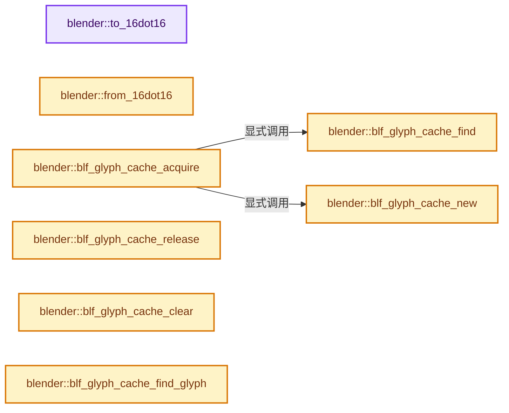
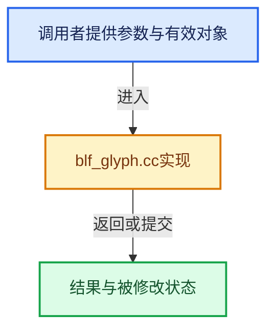

# 实现依赖专题：source/blender/blenfont/intern/blf_glyph.cc

[方向导航](README.md) · [符号索引](../%E7%AC%A6%E5%8F%B7%E4%BE%9D%E8%B5%96%E4%B8%8E%E5%AE%9E%E7%8E%B0%E7%B4%A2%E5%BC%95.md)

本专题从正文实际调用进入，集中保存共享实现。函数有稳定锚点，可从调用处直接跳到对应完整函数；递归与互相调用通过回链组织。

## 本文件的实现关系






## 完整成员与函数实现

<a id="f-6f2792268d9c4e01"></a>

### `blender::to_16dot16`

实现位置：[source/blender/blenfont/intern/blf_glyph.cc](../../../../../source/blender/blenfont/intern/blf_glyph.cc) · L66—L69。

接口参数：

- `const double val`

**教学注释版**

<!-- annotated:3d955762b891b0 -->

```cpp
static FT_Fixed to_16dot16(const double val)
{
  return FT_Fixed(lround(val * 65536.0));
}
```

<details>
<summary>核对原始源码：source/blender/blenfont/intern/blf_glyph.cc · L66—L69</summary>

<!-- original:3d955762b891b0:source/blender/blenfont/intern/blf_glyph.cc:66:69 -->

```cpp
static FT_Fixed to_16dot16(const double val)
{
  return FT_Fixed(lround(val * 65536.0));
}
```

</details>

**结果出口**

- `return FT_Fixed(lround(val * 65536.0));`

**继续追踪实现**

- `FT_Fixed` → [调用协议](../%E6%A8%A1%E6%9D%BF%E5%AE%8F%E4%B8%8E%E5%8A%A8%E6%80%81%E5%88%86%E6%B4%BE%E5%8D%8F%E8%AE%AE.md)：函数指针、局部可调用对象或未展开的宏；必须结合调用者环境。调用位置L68。
- `lround` → [lround · L49](%E4%BE%9D%E8%B5%96-numeric-03255c.md#f-c5c613b2e026681d)。

<a id="f-a3a39414c27b8b41"></a>

### `blender::from_16dot16`

实现位置：[source/blender/blenfont/intern/blf_glyph.cc](../../../../../source/blender/blenfont/intern/blf_glyph.cc) · L74—L77。

接口参数：

- `const FT_Fixed value`

**教学注释版**

<!-- annotated:f58a62ebee28a6 -->

```cpp
static float from_16dot16(const FT_Fixed value)
{
  return float(value) / 65536.0f;
}
```

<details>
<summary>核对原始源码：source/blender/blenfont/intern/blf_glyph.cc · L74—L77</summary>

<!-- original:f58a62ebee28a6:source/blender/blenfont/intern/blf_glyph.cc:74:77 -->

```cpp
static float from_16dot16(const FT_Fixed value)
{
  return float(value) / 65536.0f;
}
```

</details>

**结果出口**

- `return float(value) / 65536.0f;`

**继续追踪实现**

本实现没有需要继续展开的显式调用；检查返回表达式、对象转换和调用者前置条件。

<a id="f-5ea759c9256de217"></a>

### `blender::blf_glyph_cache_find`

实现位置：[source/blender/blenfont/intern/blf_glyph.cc](../../../../../source/blender/blenfont/intern/blf_glyph.cc) · L85—L97。

接口参数：

- `const FontBLF *font`

**教学注释版**

<!-- annotated:b482e5b1b9873d -->

```cpp
static GlyphCacheBLF *blf_glyph_cache_find(const FontBLF *font)
{
  for (const std::unique_ptr<GlyphCacheBLF> &gc : font->cache) {
    if (gc->size == font->size && (gc->bold == ((font->flags & BLF_BOLD) != 0)) &&
        (gc->italic == ((font->flags & BLF_ITALIC) != 0)) &&
        (gc->char_weight == font->char_weight) && (gc->char_slant == font->char_slant) &&
        (gc->char_width == font->char_width) && (gc->char_spacing == font->char_spacing))
    {
      return gc.get();
    }
  }
  return nullptr;
}
```

<details>
<summary>核对原始源码：source/blender/blenfont/intern/blf_glyph.cc · L85—L97</summary>

<!-- original:b482e5b1b9873d:source/blender/blenfont/intern/blf_glyph.cc:85:97 -->

```cpp
static GlyphCacheBLF *blf_glyph_cache_find(const FontBLF *font)
{
  for (const std::unique_ptr<GlyphCacheBLF> &gc : font->cache) {
    if (gc->size == font->size && (gc->bold == ((font->flags & BLF_BOLD) != 0)) &&
        (gc->italic == ((font->flags & BLF_ITALIC) != 0)) &&
        (gc->char_weight == font->char_weight) && (gc->char_slant == font->char_slant) &&
        (gc->char_width == font->char_width) && (gc->char_spacing == font->char_spacing))
    {
      return gc.get();
    }
  }
  return nullptr;
}
```

</details>

**结果出口**

- `return gc.get();`
- `return nullptr;`

**继续追踪实现**

- `gc.get` → [调用协议](../%E6%A8%A1%E6%9D%BF%E5%AE%8F%E4%B8%8E%E5%8A%A8%E6%80%81%E5%88%86%E6%B4%BE%E5%8D%8F%E8%AE%AE.md)：接收对象类型依赖auto、返回值或模板实例；不按同名猜测目标。调用位置L93。

<a id="f-759e794d1dbdc01a"></a>

### `blender::blf_glyph_cache_new`

实现位置：[source/blender/blenfont/intern/blf_glyph.cc](../../../../../source/blender/blenfont/intern/blf_glyph.cc) · L99—L130。

接口参数：

- `FontBLF *font`

**教学注释版**

<!-- annotated:07ee86014f62c9 -->

```cpp
static GlyphCacheBLF *blf_glyph_cache_new(FontBLF *font)
{
  // [讲解] std::make_unique<GlyphCacheBLF>：创建独占拥有的对象，拥有关系可移动，get返回的借用指针不自动延长寿命。
  std::unique_ptr<GlyphCacheBLF> gc = std::make_unique<GlyphCacheBLF>();

  gc->size = font->size;
  gc->bold = ((font->flags & BLF_BOLD) != 0);
  gc->italic = ((font->flags & BLF_ITALIC) != 0);
  gc->char_weight = font->char_weight;
  gc->char_slant = font->char_slant;
  gc->char_width = font->char_width;
  gc->char_spacing = font->char_spacing;

  blf_ensure_size(font);

  /* Determine ideal fixed-width size for monospaced output. */
  FT_UInt gindex = blf_get_char_index(font, U'0');
  if (gindex && font->face) {
    FT_Fixed advance = 0;
    FT_Get_Advance(font->face, gindex, FT_LOAD_NO_HINTING, &advance);
    /* Use CSS 'ch unit' width, advance of zero character. */
    gc->fixed_width = int(advance >> 16);
  }
  else {
    /* Font does not have a face or does not contain "0" so use CSS fallback of 1/2 of em. */
    gc->fixed_width = int((font->ft_size->metrics.height / 2) >> 6);
  }
  // [讲解] std::max：按比较关系选取较大值。本讲解中的增长公式同时满足最低请求和几何增长；若保存返回引用，还需注意实参寿命。
  gc->fixed_width = std::max(gc->fixed_width, 1);

  // [讲解] std::move：把表达式转换成可供移动重载选择的值类别；不保证真的移动，不结束源对象寿命，对const值可能选择复制。
  font->cache.append(std::move(gc));

  return font->cache.last().get();
}
```

<details>
<summary>核对原始源码：source/blender/blenfont/intern/blf_glyph.cc · L99—L130</summary>

<!-- original:07ee86014f62c9:source/blender/blenfont/intern/blf_glyph.cc:99:130 -->

```cpp
static GlyphCacheBLF *blf_glyph_cache_new(FontBLF *font)
{
  std::unique_ptr<GlyphCacheBLF> gc = std::make_unique<GlyphCacheBLF>();

  gc->size = font->size;
  gc->bold = ((font->flags & BLF_BOLD) != 0);
  gc->italic = ((font->flags & BLF_ITALIC) != 0);
  gc->char_weight = font->char_weight;
  gc->char_slant = font->char_slant;
  gc->char_width = font->char_width;
  gc->char_spacing = font->char_spacing;

  blf_ensure_size(font);

  /* Determine ideal fixed-width size for monospaced output. */
  FT_UInt gindex = blf_get_char_index(font, U'0');
  if (gindex && font->face) {
    FT_Fixed advance = 0;
    FT_Get_Advance(font->face, gindex, FT_LOAD_NO_HINTING, &advance);
    /* Use CSS 'ch unit' width, advance of zero character. */
    gc->fixed_width = int(advance >> 16);
  }
  else {
    /* Font does not have a face or does not contain "0" so use CSS fallback of 1/2 of em. */
    gc->fixed_width = int((font->ft_size->metrics.height / 2) >> 6);
  }
  gc->fixed_width = std::max(gc->fixed_width, 1);

  font->cache.append(std::move(gc));

  return font->cache.last().get();
}
```

</details>

**沿实际写入检查状态**

- `gc->size = font->size;`
- `gc->bold = ((font->flags & BLF_BOLD) != 0);`
- `gc->italic = ((font->flags & BLF_ITALIC) != 0);`
- `gc->char_weight = font->char_weight;`
- `gc->char_slant = font->char_slant;`
- `gc->char_width = font->char_width;`
- `gc->char_spacing = font->char_spacing;`
- `gc->fixed_width = int(advance >> 16);`
- `gc->fixed_width = int((font->ft_size->metrics.height / 2) >> 6);`
- `gc->fixed_width = std::max(gc->fixed_width, 1);`

**结果出口**

- `return font->cache.last().get();`

**继续追踪实现**

- `std::make_unique<GlyphCacheBLF>` → [外部契约](https://eel.is/c++draft/unique.ptr.create)：创建独占拥有的对象，拥有关系可移动，get返回的借用指针不自动延长寿命。
- `blf_ensure_size` → [blender::blf_ensure_size · L2311](%E4%BE%9D%E8%B5%96-blf_font-763011.md#f-ec8e29eb74197fe4)。
- `blf_get_char_index` → [blender::blf_get_char_index · L155](%E4%BE%9D%E8%B5%96-blf_font-763011.md#f-237e23d2167805c0)。
- `FT_Get_Advance` → [调用协议](../%E6%A8%A1%E6%9D%BF%E5%AE%8F%E4%B8%8E%E5%8A%A8%E6%80%81%E5%88%86%E6%B4%BE%E5%8D%8F%E8%AE%AE.md)：函数指针、局部可调用对象或未展开的宏；必须结合调用者环境。调用位置L117。
- `std::max` → [外部契约](https://eel.is/c++draft/alg.min.max)：按比较关系选取较大值。本讲解中的增长公式同时满足最低请求和几何增长；若保存返回引用，还需注意实参寿命。
- `font->cache.append` → [调用协议](../%E6%A8%A1%E6%9D%BF%E5%AE%8F%E4%B8%8E%E5%8A%A8%E6%80%81%E5%88%86%E6%B4%BE%E5%8D%8F%E8%AE%AE.md)：接收对象类型依赖auto、返回值或模板实例；不按同名猜测目标。调用位置L127。
- `std::move` → [外部契约](https://eel.is/c++draft/utility.forward)：把表达式转换成可供移动重载选择的值类别；不保证真的移动，不结束源对象寿命，对const值可能选择复制。
- `font->cache.last().get` → [调用协议](../%E6%A8%A1%E6%9D%BF%E5%AE%8F%E4%B8%8E%E5%8A%A8%E6%80%81%E5%88%86%E6%B4%BE%E5%8D%8F%E8%AE%AE.md)：接收对象类型依赖auto、返回值或模板实例；不按同名猜测目标。调用位置L129。
- `font->cache.last` → [调用协议](../%E6%A8%A1%E6%9D%BF%E5%AE%8F%E4%B8%8E%E5%8A%A8%E6%80%81%E5%88%86%E6%B4%BE%E5%8D%8F%E8%AE%AE.md)：接收对象类型依赖auto、返回值或模板实例；不按同名猜测目标。调用位置L129。

<a id="f-7fefc84b8c6eb8ea"></a>

### `blender::blf_glyph_cache_acquire`

实现位置：[source/blender/blenfont/intern/blf_glyph.cc](../../../../../source/blender/blenfont/intern/blf_glyph.cc) · L132—L143。

接口参数：

- `FontBLF *font`

**教学注释版**

<!-- annotated:aacb077bec9136 -->

```cpp
GlyphCacheBLF *blf_glyph_cache_acquire(FontBLF *font)
{
  font->glyph_cache_mutex.lock();

  GlyphCacheBLF *gc = blf_glyph_cache_find(font);

  if (!gc) {
    gc = blf_glyph_cache_new(font);
  }

  return gc;
}
```

<details>
<summary>核对原始源码：source/blender/blenfont/intern/blf_glyph.cc · L132—L143</summary>

<!-- original:aacb077bec9136:source/blender/blenfont/intern/blf_glyph.cc:132:143 -->

```cpp
GlyphCacheBLF *blf_glyph_cache_acquire(FontBLF *font)
{
  font->glyph_cache_mutex.lock();

  GlyphCacheBLF *gc = blf_glyph_cache_find(font);

  if (!gc) {
    gc = blf_glyph_cache_new(font);
  }

  return gc;
}
```

</details>

**沿实际写入检查状态**

- `gc = blf_glyph_cache_new(font);`

**结果出口**

- `return gc;`

**继续追踪实现**

- `font->glyph_cache_mutex.lock` → [调用协议](../%E6%A8%A1%E6%9D%BF%E5%AE%8F%E4%B8%8E%E5%8A%A8%E6%80%81%E5%88%86%E6%B4%BE%E5%8D%8F%E8%AE%AE.md)：接收对象类型依赖auto、返回值或模板实例；不按同名猜测目标。调用位置L134。
- `blf_glyph_cache_find` → [blender::blf_glyph_cache_find · L85](%E4%BE%9D%E8%B5%96-blf_glyph-e4ad17.md#f-5ea759c9256de217)。
- `blf_glyph_cache_new` → [blender::blf_glyph_cache_new · L99](%E4%BE%9D%E8%B5%96-blf_glyph-e4ad17.md#f-759e794d1dbdc01a)。

<a id="f-41bd99c45b149f01"></a>

### `blender::blf_glyph_cache_release`

实现位置：[source/blender/blenfont/intern/blf_glyph.cc](../../../../../source/blender/blenfont/intern/blf_glyph.cc) · L145—L148。

接口参数：

- `FontBLF *font`

**教学注释版**

<!-- annotated:f7b2e4b9804892 -->

```cpp
void blf_glyph_cache_release(FontBLF *font)
{
  font->glyph_cache_mutex.unlock();
}
```

<details>
<summary>核对原始源码：source/blender/blenfont/intern/blf_glyph.cc · L145—L148</summary>

<!-- original:f7b2e4b9804892:source/blender/blenfont/intern/blf_glyph.cc:145:148 -->

```cpp
void blf_glyph_cache_release(FontBLF *font)
{
  font->glyph_cache_mutex.unlock();
}
```

</details>

**继续追踪实现**

- `font->glyph_cache_mutex.unlock` → [调用协议](../%E6%A8%A1%E6%9D%BF%E5%AE%8F%E4%B8%8E%E5%8A%A8%E6%80%81%E5%88%86%E6%B4%BE%E5%8D%8F%E8%AE%AE.md)：接收对象类型依赖auto、返回值或模板实例；不按同名猜测目标。调用位置L147。

<a id="f-2d5fb2110c31aee7"></a>

### `blender::blf_glyph_cache_clear`

实现位置：[source/blender/blenfont/intern/blf_glyph.cc](../../../../../source/blender/blenfont/intern/blf_glyph.cc) · L161—L165。

接口参数：

- `FontBLF *font`

**教学注释版**

<!-- annotated:59c87c7277fd71 -->

```cpp
void blf_glyph_cache_clear(FontBLF *font)
{
  std::lock_guard lock{font->glyph_cache_mutex};
  font->cache.clear_and_shrink();
}
```

<details>
<summary>核对原始源码：source/blender/blenfont/intern/blf_glyph.cc · L161—L165</summary>

<!-- original:59c87c7277fd71:source/blender/blenfont/intern/blf_glyph.cc:161:165 -->

```cpp
void blf_glyph_cache_clear(FontBLF *font)
{
  std::lock_guard lock{font->glyph_cache_mutex};
  font->cache.clear_and_shrink();
}
```

</details>

**继续追踪实现**

- `font->cache.clear_and_shrink` → [调用协议](../%E6%A8%A1%E6%9D%BF%E5%AE%8F%E4%B8%8E%E5%8A%A8%E6%80%81%E5%88%86%E6%B4%BE%E5%8D%8F%E8%AE%AE.md)：接收对象类型依赖auto、返回值或模板实例；不按同名猜测目标。调用位置L164。

<a id="f-19e88ca0dd3b8e6b"></a>

### `blender::blf_glyph_cache_find_glyph`

实现位置：[source/blender/blenfont/intern/blf_glyph.cc](../../../../../source/blender/blenfont/intern/blf_glyph.cc) · L172—L182。

接口参数：

- `const GlyphCacheBLF *gc`
- `const uint charcode`
- `const uint8_t subpixel`

**教学注释版**

<!-- annotated:18c9af4d1a06c6 -->

```cpp
static GlyphBLF *blf_glyph_cache_find_glyph(const GlyphCacheBLF *gc,
                                            const uint charcode,
                                            const uint8_t subpixel)
{
  const std::unique_ptr<GlyphBLF> *ptr = gc->glyphs.lookup_ptr_as(
      GlyphCacheKey{charcode, subpixel});
  if (ptr != nullptr) {
    return ptr->get();
  }
  return nullptr;
}
```

<details>
<summary>核对原始源码：source/blender/blenfont/intern/blf_glyph.cc · L172—L182</summary>

<!-- original:18c9af4d1a06c6:source/blender/blenfont/intern/blf_glyph.cc:172:182 -->

```cpp
static GlyphBLF *blf_glyph_cache_find_glyph(const GlyphCacheBLF *gc,
                                            const uint charcode,
                                            const uint8_t subpixel)
{
  const std::unique_ptr<GlyphBLF> *ptr = gc->glyphs.lookup_ptr_as(
      GlyphCacheKey{charcode, subpixel});
  if (ptr != nullptr) {
    return ptr->get();
  }
  return nullptr;
}
```

</details>

**结果出口**

- `return ptr->get();`
- `return nullptr;`

**继续追踪实现**

- `gc->glyphs.lookup_ptr_as` → [调用协议](../%E6%A8%A1%E6%9D%BF%E5%AE%8F%E4%B8%8E%E5%8A%A8%E6%80%81%E5%88%86%E6%B4%BE%E5%8D%8F%E8%AE%AE.md)：接收对象类型依赖auto、返回值或模板实例；不按同名猜测目标。调用位置L176。
- `ptr->get` → [外部契约](https://eel.is/c++draft/)：这个边界按实际表达式及所属类型核对参数、返回值、寿命与失败行为。这里提供接口入口，不声称已解释该第三方版本的内部实现。

<a id="f-150ca154def26c72"></a>

### `blender::blf_glyph_gamma`

实现位置：[source/blender/blenfont/intern/blf_glyph.cc](../../../../../source/blender/blenfont/intern/blf_glyph.cc) · L197—L217。

接口参数：

- `const uchar c`

**教学注释版**

<!-- annotated:9444a8dfde3a9b -->

```cpp
static uchar blf_glyph_gamma(const uchar c)
{
  /* The following is `char(powf(c / 256.0f, 1.0f / 1.43f) * 256.0f)`. */
  static const uchar gamma[256] = {
      0,   5,   9,   11,  14,  16,  19,  21,  23,  25,  26,  28,  30,  32,  34,  35,  37,  38,
      40,  41,  43,  44,  46,  47,  49,  50,  52,  53,  54,  56,  57,  58,  60,  61,  62,  64,
      65,  66,  67,  69,  70,  71,  72,  73,  75,  76,  77,  78,  79,  80,  82,  83,  84,  85,
      86,  87,  88,  89,  91,  92,  93,  94,  95,  96,  97,  98,  99,  100, 101, 102, 103, 104,
      105, 106, 107, 108, 109, 110, 111, 112, 113, 114, 115, 116, 117, 118, 119, 120, 121, 122,
      123, 124, 125, 126, 127, 128, 129, 130, 131, 132, 133, 133, 134, 135, 136, 137, 138, 139,
      140, 141, 142, 143, 143, 144, 145, 146, 147, 148, 149, 150, 151, 151, 152, 153, 154, 155,
      156, 157, 157, 158, 159, 160, 161, 162, 163, 163, 164, 165, 166, 167, 168, 168, 169, 170,
      171, 172, 173, 173, 174, 175, 176, 177, 178, 178, 179, 180, 181, 182, 182, 183, 184, 185,
      186, 186, 187, 188, 189, 190, 190, 191, 192, 193, 194, 194, 195, 196, 197, 198, 198, 199,
      200, 201, 201, 202, 203, 204, 205, 205, 206, 207, 208, 208, 209, 210, 211, 211, 212, 213,
      214, 214, 215, 216, 217, 217, 218, 219, 220, 220, 221, 222, 223, 223, 224, 225, 226, 226,
      227, 228, 229, 229, 230, 231, 231, 232, 233, 234, 234, 235, 236, 237, 237, 238, 239, 239,
      240, 241, 242, 242, 243, 244, 244, 245, 246, 247, 247, 248, 249, 249, 250, 251, 251, 252,
      253, 254, 254, 255};
  return gamma[c];
}
```

<details>
<summary>核对原始源码：source/blender/blenfont/intern/blf_glyph.cc · L197—L217</summary>

<!-- original:9444a8dfde3a9b:source/blender/blenfont/intern/blf_glyph.cc:197:217 -->

```cpp
static uchar blf_glyph_gamma(const uchar c)
{
  /* The following is `char(powf(c / 256.0f, 1.0f / 1.43f) * 256.0f)`. */
  static const uchar gamma[256] = {
      0,   5,   9,   11,  14,  16,  19,  21,  23,  25,  26,  28,  30,  32,  34,  35,  37,  38,
      40,  41,  43,  44,  46,  47,  49,  50,  52,  53,  54,  56,  57,  58,  60,  61,  62,  64,
      65,  66,  67,  69,  70,  71,  72,  73,  75,  76,  77,  78,  79,  80,  82,  83,  84,  85,
      86,  87,  88,  89,  91,  92,  93,  94,  95,  96,  97,  98,  99,  100, 101, 102, 103, 104,
      105, 106, 107, 108, 109, 110, 111, 112, 113, 114, 115, 116, 117, 118, 119, 120, 121, 122,
      123, 124, 125, 126, 127, 128, 129, 130, 131, 132, 133, 133, 134, 135, 136, 137, 138, 139,
      140, 141, 142, 143, 143, 144, 145, 146, 147, 148, 149, 150, 151, 151, 152, 153, 154, 155,
      156, 157, 157, 158, 159, 160, 161, 162, 163, 163, 164, 165, 166, 167, 168, 168, 169, 170,
      171, 172, 173, 173, 174, 175, 176, 177, 178, 178, 179, 180, 181, 182, 182, 183, 184, 185,
      186, 186, 187, 188, 189, 190, 190, 191, 192, 193, 194, 194, 195, 196, 197, 198, 198, 199,
      200, 201, 201, 202, 203, 204, 205, 205, 206, 207, 208, 208, 209, 210, 211, 211, 212, 213,
      214, 214, 215, 216, 217, 217, 218, 219, 220, 220, 221, 222, 223, 223, 224, 225, 226, 226,
      227, 228, 229, 229, 230, 231, 231, 232, 233, 234, 234, 235, 236, 237, 237, 238, 239, 239,
      240, 241, 242, 242, 243, 244, 244, 245, 246, 247, 247, 248, 249, 249, 250, 251, 251, 252,
      253, 254, 254, 255};
  return gamma[c];
}
```

</details>

**结果出口**

- `return gamma[c];`

**继续追踪实现**

本实现没有需要继续展开的显式调用；检查返回表达式、对象转换和调用者前置条件。

<a id="f-df1861627ffdf2ee"></a>

### `blender::blf_glyph_cache_add_glyph`

实现位置：[source/blender/blenfont/intern/blf_glyph.cc](../../../../../source/blender/blenfont/intern/blf_glyph.cc) · L224—L340。

接口参数：

- `GlyphCacheBLF *gc`
- `const FT_GlyphSlot glyph`
- `const uint charcode`
- `const FT_UInt glyph_index`
- `const uint8_t subpixel`

**教学注释版**

<!-- annotated:59a2b0ccb1d4f2 -->

```cpp
static GlyphBLF *blf_glyph_cache_add_glyph(GlyphCacheBLF *gc,
                                           const FT_GlyphSlot glyph,
                                           const uint charcode,
                                           const FT_UInt glyph_index,
                                           const uint8_t subpixel)
{
  // [讲解] std::make_unique<GlyphBLF>：创建独占拥有的对象，拥有关系可移动，get返回的借用指针不自动延长寿命。
  std::unique_ptr<GlyphBLF> g = std::make_unique<GlyphBLF>();
  g->c = charcode;
  g->idx = glyph_index;
  g->advance_x = ft_pix(glyph->advance.x);
  g->subpixel = subpixel;

  FT_BBox bbox;
  FT_Outline_Get_CBox(&(glyph->outline), &bbox);
  g->box_xmin = ft_pix(bbox.xMin);
  g->box_xmax = ft_pix(bbox.xMax);
  g->box_ymin = ft_pix(bbox.yMin);
  g->box_ymax = ft_pix(bbox.yMax);

  /* Used to improve advance when hinting is enabled. */
  g->lsb_delta = ft_pix(glyph->lsb_delta);
  g->rsb_delta = ft_pix(glyph->rsb_delta);

  if (glyph->format == FT_GLYPH_FORMAT_BITMAP) {
    /* This has been rendered and we have a bitmap. */
    g->pos[0] = glyph->bitmap_left;
    g->pos[1] = glyph->bitmap_top;
    g->dims[0] = int(glyph->bitmap.width);
    g->dims[1] = int(glyph->bitmap.rows);
    g->pitch = glyph->bitmap.pitch;
    g->num_channels = 1;

    switch (glyph->bitmap.pixel_mode) {
      case FT_PIXEL_MODE_LCD:
        g->num_channels = 3;
        g->dims[0] /= 3;
        break;
      case FT_PIXEL_MODE_LCD_V:
        g->num_channels = 3;
        g->dims[1] /= 3;
        g->pitch *= 3;
        break;
      case FT_PIXEL_MODE_BGRA:
        g->num_channels = 4;
        break;
    }

    const int buffer_size = g->dims[0] * g->dims[1] * g->num_channels;
    g->bitmap = MEM_new_array_uninitialized<uchar>(size_t(buffer_size), "glyph bitmap");

    if (ELEM(glyph->bitmap.pixel_mode,
             FT_PIXEL_MODE_GRAY,
             FT_PIXEL_MODE_GRAY2,
             FT_PIXEL_MODE_GRAY4))
    {
      /* Scale 1, 2, 4-bit gray to 8-bit. */
      const char scale = char(255 / (glyph->bitmap.num_grays - 1));
      for (int i = 0; i < buffer_size; i++) {
#ifdef BLF_GAMMA_CORRECT_GLYPHS
        /* Convert coverage amounts to perceptually-improved lightness values. */
        g->bitmap[i] = blf_glyph_gamma(glyph->bitmap.buffer[i] * scale);
#else
        g->bitmap[i] = glyph->bitmap.buffer[i] * scale;
#endif /* BLF_GAMMA_CORRECT_GLYPHS */
      }
    }
    else if (glyph->bitmap.pixel_mode == FT_PIXEL_MODE_LCD) {
      /* RGB (BGR) in successive columns. */
      for (size_t y = 0; y < size_t(g->dims[1]); y++) {
        for (size_t x = 0; x < size_t(g->dims[0]); x++) {
          size_t offs_in = (y * size_t(glyph->bitmap.pitch)) + (x * size_t(g->num_channels));
          size_t offs_out = (y * size_t(g->dims[0]) * size_t(g->num_channels)) +
                            (x * size_t(g->num_channels));
          g->bitmap[offs_out + 0] = glyph->bitmap.buffer[offs_in + 2];
          g->bitmap[offs_out + 1] = glyph->bitmap.buffer[offs_in + 1];
          g->bitmap[offs_out + 2] = glyph->bitmap.buffer[offs_in + 0];
        }
      }
    }
    else if (glyph->bitmap.pixel_mode == FT_PIXEL_MODE_LCD_V) {
      /* RGB (BGR) in successive ROWS. */
      for (size_t y = 0; y < size_t(g->dims[1]); y++) {
        for (size_t x = 0; x < size_t(g->dims[0]); x++) {
          size_t offs_in = (y * size_t(glyph->bitmap.pitch) * size_t(g->num_channels)) + x;
          size_t offs_out = (y * size_t(g->dims[0]) * size_t(g->num_channels)) +
                            (x * size_t(g->num_channels));
          g->bitmap[offs_out + 2] = glyph->bitmap.buffer[offs_in];
          g->bitmap[offs_out + 1] = glyph->bitmap.buffer[offs_in + size_t(glyph->bitmap.pitch)];
          g->bitmap[offs_out + 0] = glyph->bitmap.buffer[offs_in + size_t(glyph->bitmap.pitch) +
                                                         size_t(glyph->bitmap.pitch)];
        }
      }
    }
    else if (glyph->bitmap.pixel_mode == FT_PIXEL_MODE_BGRA) {
      /* Convert from BGRA to RGBA. */
      for (size_t y = 0; y < size_t(g->dims[1]); y++) {
        for (size_t x = 0; x < size_t(g->dims[0]); x++) {
          size_t offs_in = (y * size_t(g->pitch)) + (x * size_t(g->num_channels));
          size_t offs_out = (y * size_t(g->dims[0]) * size_t(g->num_channels)) +
                            (x * size_t(g->num_channels));
          g->bitmap[offs_out + 0] = glyph->bitmap.buffer[offs_in + 2];
          g->bitmap[offs_out + 1] = glyph->bitmap.buffer[offs_in + 1];
          g->bitmap[offs_out + 2] = glyph->bitmap.buffer[offs_in + 0];
          g->bitmap[offs_out + 3] = glyph->bitmap.buffer[offs_in + 3];
        }
      }
    }
    else {
      // [讲解] memcpy：复制字节，源与目标不应重叠。类型生命周期、对齐和可复制表示须由调用者证明，不是任意对象的复制构造。
      memcpy(g->bitmap, glyph->bitmap.buffer, size_t(buffer_size));
    }
  }

  GlyphBLF *result = g.get();
  GlyphCacheKey key = {charcode, subpixel};
  // [讲解] std::move：把表达式转换成可供移动重载选择的值类别；不保证真的移动，不结束源对象寿命，对const值可能选择复制。
  gc->glyphs.add(key, std::move(g));
  return result;
}
```

<details>
<summary>核对原始源码：source/blender/blenfont/intern/blf_glyph.cc · L224—L340</summary>

<!-- original:59a2b0ccb1d4f2:source/blender/blenfont/intern/blf_glyph.cc:224:340 -->

```cpp
static GlyphBLF *blf_glyph_cache_add_glyph(GlyphCacheBLF *gc,
                                           const FT_GlyphSlot glyph,
                                           const uint charcode,
                                           const FT_UInt glyph_index,
                                           const uint8_t subpixel)
{
  std::unique_ptr<GlyphBLF> g = std::make_unique<GlyphBLF>();
  g->c = charcode;
  g->idx = glyph_index;
  g->advance_x = ft_pix(glyph->advance.x);
  g->subpixel = subpixel;

  FT_BBox bbox;
  FT_Outline_Get_CBox(&(glyph->outline), &bbox);
  g->box_xmin = ft_pix(bbox.xMin);
  g->box_xmax = ft_pix(bbox.xMax);
  g->box_ymin = ft_pix(bbox.yMin);
  g->box_ymax = ft_pix(bbox.yMax);

  /* Used to improve advance when hinting is enabled. */
  g->lsb_delta = ft_pix(glyph->lsb_delta);
  g->rsb_delta = ft_pix(glyph->rsb_delta);

  if (glyph->format == FT_GLYPH_FORMAT_BITMAP) {
    /* This has been rendered and we have a bitmap. */
    g->pos[0] = glyph->bitmap_left;
    g->pos[1] = glyph->bitmap_top;
    g->dims[0] = int(glyph->bitmap.width);
    g->dims[1] = int(glyph->bitmap.rows);
    g->pitch = glyph->bitmap.pitch;
    g->num_channels = 1;

    switch (glyph->bitmap.pixel_mode) {
      case FT_PIXEL_MODE_LCD:
        g->num_channels = 3;
        g->dims[0] /= 3;
        break;
      case FT_PIXEL_MODE_LCD_V:
        g->num_channels = 3;
        g->dims[1] /= 3;
        g->pitch *= 3;
        break;
      case FT_PIXEL_MODE_BGRA:
        g->num_channels = 4;
        break;
    }

    const int buffer_size = g->dims[0] * g->dims[1] * g->num_channels;
    g->bitmap = MEM_new_array_uninitialized<uchar>(size_t(buffer_size), "glyph bitmap");

    if (ELEM(glyph->bitmap.pixel_mode,
             FT_PIXEL_MODE_GRAY,
             FT_PIXEL_MODE_GRAY2,
             FT_PIXEL_MODE_GRAY4))
    {
      /* Scale 1, 2, 4-bit gray to 8-bit. */
      const char scale = char(255 / (glyph->bitmap.num_grays - 1));
      for (int i = 0; i < buffer_size; i++) {
#ifdef BLF_GAMMA_CORRECT_GLYPHS
        /* Convert coverage amounts to perceptually-improved lightness values. */
        g->bitmap[i] = blf_glyph_gamma(glyph->bitmap.buffer[i] * scale);
#else
        g->bitmap[i] = glyph->bitmap.buffer[i] * scale;
#endif /* BLF_GAMMA_CORRECT_GLYPHS */
      }
    }
    else if (glyph->bitmap.pixel_mode == FT_PIXEL_MODE_LCD) {
      /* RGB (BGR) in successive columns. */
      for (size_t y = 0; y < size_t(g->dims[1]); y++) {
        for (size_t x = 0; x < size_t(g->dims[0]); x++) {
          size_t offs_in = (y * size_t(glyph->bitmap.pitch)) + (x * size_t(g->num_channels));
          size_t offs_out = (y * size_t(g->dims[0]) * size_t(g->num_channels)) +
                            (x * size_t(g->num_channels));
          g->bitmap[offs_out + 0] = glyph->bitmap.buffer[offs_in + 2];
          g->bitmap[offs_out + 1] = glyph->bitmap.buffer[offs_in + 1];
          g->bitmap[offs_out + 2] = glyph->bitmap.buffer[offs_in + 0];
        }
      }
    }
    else if (glyph->bitmap.pixel_mode == FT_PIXEL_MODE_LCD_V) {
      /* RGB (BGR) in successive ROWS. */
      for (size_t y = 0; y < size_t(g->dims[1]); y++) {
        for (size_t x = 0; x < size_t(g->dims[0]); x++) {
          size_t offs_in = (y * size_t(glyph->bitmap.pitch) * size_t(g->num_channels)) + x;
          size_t offs_out = (y * size_t(g->dims[0]) * size_t(g->num_channels)) +
                            (x * size_t(g->num_channels));
          g->bitmap[offs_out + 2] = glyph->bitmap.buffer[offs_in];
          g->bitmap[offs_out + 1] = glyph->bitmap.buffer[offs_in + size_t(glyph->bitmap.pitch)];
          g->bitmap[offs_out + 0] = glyph->bitmap.buffer[offs_in + size_t(glyph->bitmap.pitch) +
                                                         size_t(glyph->bitmap.pitch)];
        }
      }
    }
    else if (glyph->bitmap.pixel_mode == FT_PIXEL_MODE_BGRA) {
      /* Convert from BGRA to RGBA. */
      for (size_t y = 0; y < size_t(g->dims[1]); y++) {
        for (size_t x = 0; x < size_t(g->dims[0]); x++) {
          size_t offs_in = (y * size_t(g->pitch)) + (x * size_t(g->num_channels));
          size_t offs_out = (y * size_t(g->dims[0]) * size_t(g->num_channels)) +
                            (x * size_t(g->num_channels));
          g->bitmap[offs_out + 0] = glyph->bitmap.buffer[offs_in + 2];
          g->bitmap[offs_out + 1] = glyph->bitmap.buffer[offs_in + 1];
          g->bitmap[offs_out + 2] = glyph->bitmap.buffer[offs_in + 0];
          g->bitmap[offs_out + 3] = glyph->bitmap.buffer[offs_in + 3];
        }
      }
    }
    else {
      memcpy(g->bitmap, glyph->bitmap.buffer, size_t(buffer_size));
    }
  }

  GlyphBLF *result = g.get();
  GlyphCacheKey key = {charcode, subpixel};
  gc->glyphs.add(key, std::move(g));
  return result;
}
```

</details>

**沿实际写入检查状态**

- `g->c = charcode;`
- `g->idx = glyph_index;`
- `g->advance_x = ft_pix(glyph->advance.x);`
- `g->subpixel = subpixel;`
- `g->box_xmin = ft_pix(bbox.xMin);`
- `g->box_xmax = ft_pix(bbox.xMax);`
- `g->box_ymin = ft_pix(bbox.yMin);`
- `g->box_ymax = ft_pix(bbox.yMax);`
- `g->lsb_delta = ft_pix(glyph->lsb_delta);`
- `g->rsb_delta = ft_pix(glyph->rsb_delta);`
- `g->pos[0] = glyph->bitmap_left;`
- `g->pos[1] = glyph->bitmap_top;`
- `g->dims[0] = int(glyph->bitmap.width);`
- `g->dims[1] = int(glyph->bitmap.rows);`
- `g->pitch = glyph->bitmap.pitch;`
- `g->num_channels = 1;`
- `g->num_channels = 3;`
- `g->pitch *= 3;`
- `g->num_channels = 4;`
- `g->bitmap = MEM_new_array_uninitialized<uchar>(size_t(buffer_size), "glyph bitmap");`
- `g->bitmap[i] = blf_glyph_gamma(glyph->bitmap.buffer[i] * scale);`
- `g->bitmap[i] = glyph->bitmap.buffer[i] * scale;`

**结果出口**

- `return result;`

**继续追踪实现**

- `std::make_unique<GlyphBLF>` → [外部契约](https://eel.is/c++draft/unique.ptr.create)：创建独占拥有的对象，拥有关系可移动，get返回的借用指针不自动延长寿命。
- `ft_pix` → [调用协议](../%E6%A8%A1%E6%9D%BF%E5%AE%8F%E4%B8%8E%E5%8A%A8%E6%80%81%E5%88%86%E6%B4%BE%E5%8D%8F%E8%AE%AE.md)：函数指针、局部可调用对象或未展开的宏；必须结合调用者环境。调用位置L233。
- `FT_Outline_Get_CBox` → [调用协议](../%E6%A8%A1%E6%9D%BF%E5%AE%8F%E4%B8%8E%E5%8A%A8%E6%80%81%E5%88%86%E6%B4%BE%E5%8D%8F%E8%AE%AE.md)：函数指针、局部可调用对象或未展开的宏；必须结合调用者环境。调用位置L237。
- `MEM_new_array_uninitialized<uchar>` → [MEM_new_array_uninitialized · L608](../03-%E5%86%85%E5%AD%98%E5%88%86%E9%85%8D%E4%B8%8E%E8%BF%90%E8%A1%8C%E6%97%B6%E7%B1%BB%E5%9E%8B/%E4%BE%9D%E8%B5%96-MEM_guardedalloc-b54eca.md#f-b7103eae8eb57b05)；[MEM_new_array_uninitialized · L129](../03-%E5%86%85%E5%AD%98%E5%88%86%E9%85%8D%E4%B8%8E%E8%BF%90%E8%A1%8C%E6%97%B6%E7%B1%BB%E5%9E%8B/%E4%BE%9D%E8%B5%96-mallocn-afdcd4.md#f-bf6ef4ddcfb6e5df)。同名重载需按实参类型选择。
- `ELEM` → [ELEM · L88](%E4%BE%9D%E8%B5%96-GHOST_utildefines-34b996.md#m-d28724a15928)；[ELEM · L135](../01-%E5%9F%BA%E7%A1%80%E5%AE%B9%E5%99%A8%E4%B8%8E%E7%8E%B0%E4%BB%A3CPP/%E4%BE%9D%E8%B5%96-BLI_utildefines-293a0a.md#m-d6572de7cae0)。宏定义由构建条件选择。
- `blf_glyph_gamma` → [blender::blf_glyph_gamma · L197](%E4%BE%9D%E8%B5%96-blf_glyph-e4ad17.md#f-150ca154def26c72)。
- `memcpy` → [外部契约](https://eel.is/c++draft/cstring.syn)：复制字节，源与目标不应重叠。类型生命周期、对齐和可复制表示须由调用者证明，不是任意对象的复制构造。
- `g.get` → [外部契约](https://eel.is/c++draft/)：这个边界按实际表达式及所属类型核对参数、返回值、寿命与失败行为。这里提供接口入口，不声称已解释该第三方版本的内部实现。
- `gc->glyphs.add` → [调用协议](../%E6%A8%A1%E6%9D%BF%E5%AE%8F%E4%B8%8E%E5%8A%A8%E6%80%81%E5%88%86%E6%B4%BE%E5%8D%8F%E8%AE%AE.md)：接收对象类型依赖auto、返回值或模板实例；不按同名猜测目标。调用位置L338。
- `std::move` → [外部契约](https://eel.is/c++draft/utility.forward)：把表达式转换成可供移动重载选择的值类别；不保证真的移动，不结束源对象寿命，对const值可能选择复制。

<a id="f-36748f8d034418f7"></a>

### `blender::blf_glyph_cache_add_blank`

实现位置：[source/blender/blenfont/intern/blf_glyph.cc](../../../../../source/blender/blenfont/intern/blf_glyph.cc) · L343—L353。

接口参数：

- `GlyphCacheBLF *gc`
- `const uint charcode`

**教学注释版**

<!-- annotated:01d3ceb6adb7b1 -->

```cpp
static GlyphBLF *blf_glyph_cache_add_blank(GlyphCacheBLF *gc, const uint charcode)
{
  /* Add an empty GlyphBLF to the cache and return it. With
   * zero dimensions it will be skipped by blf_glyph_draw. */
  // [讲解] std::make_unique<GlyphBLF>：创建独占拥有的对象，拥有关系可移动，get返回的借用指针不自动延长寿命。
  std::unique_ptr<GlyphBLF> g = std::make_unique<GlyphBLF>();
  g->c = charcode;
  GlyphBLF *result = g.get();
  GlyphCacheKey key = {charcode, 0};
  // [讲解] std::move：把表达式转换成可供移动重载选择的值类别；不保证真的移动，不结束源对象寿命，对const值可能选择复制。
  gc->glyphs.add(key, std::move(g));
  return result;
}
```

<details>
<summary>核对原始源码：source/blender/blenfont/intern/blf_glyph.cc · L343—L353</summary>

<!-- original:01d3ceb6adb7b1:source/blender/blenfont/intern/blf_glyph.cc:343:353 -->

```cpp
static GlyphBLF *blf_glyph_cache_add_blank(GlyphCacheBLF *gc, const uint charcode)
{
  /* Add an empty GlyphBLF to the cache and return it. With
   * zero dimensions it will be skipped by blf_glyph_draw. */
  std::unique_ptr<GlyphBLF> g = std::make_unique<GlyphBLF>();
  g->c = charcode;
  GlyphBLF *result = g.get();
  GlyphCacheKey key = {charcode, 0};
  gc->glyphs.add(key, std::move(g));
  return result;
}
```

</details>

**沿实际写入检查状态**

- `g->c = charcode;`

**结果出口**

- `return result;`

**继续追踪实现**

- `std::make_unique<GlyphBLF>` → [外部契约](https://eel.is/c++draft/unique.ptr.create)：创建独占拥有的对象，拥有关系可移动，get返回的借用指针不自动延长寿命。
- `g.get` → [外部契约](https://eel.is/c++draft/)：这个边界按实际表达式及所属类型核对参数、返回值、寿命与失败行为。这里提供接口入口，不声称已解释该第三方版本的内部实现。
- `gc->glyphs.add` → [调用协议](../%E6%A8%A1%E6%9D%BF%E5%AE%8F%E4%B8%8E%E5%8A%A8%E6%80%81%E5%88%86%E6%B4%BE%E5%8D%8F%E8%AE%AE.md)：接收对象类型依赖auto、返回值或模板实例；不按同名猜测目标。调用位置L351。
- `std::move` → [外部契约](https://eel.is/c++draft/utility.forward)：把表达式转换成可供移动重载选择的值类别；不保证真的移动，不结束源对象寿命，对const值可能选择复制。

<a id="f-89f0569d69d72f30"></a>

### `blender::blf_glyph_cache_add_svg`

实现位置：[source/blender/blenfont/intern/blf_glyph.cc](../../../../../source/blender/blenfont/intern/blf_glyph.cc) · L355—L441。

接口参数：

- `GlyphCacheBLF *gc`
- `const uint charcode`
- `const bool color`
- `FunctionRef<void(std::string &)> edit_source_cb = nullptr`
- `std::string &`

**教学注释版**

<!-- annotated:4b94be263d99c4 -->

```cpp
static GlyphBLF *blf_glyph_cache_add_svg(GlyphCacheBLF *gc,
                                         const uint charcode,
                                         const bool color,
                                         FunctionRef<void(std::string &)> edit_source_cb = nullptr)
{
  std::string svg_source = blf_get_icon_svg(int(charcode) - BLF_ICON_OFFSET);
  if (edit_source_cb) {
    edit_source_cb(svg_source);
  }

  NSVGimage *image = nsvgParse(svg_source.data(), "px", 96.0f);

  if (image == nullptr) {
    return blf_glyph_cache_add_blank(gc, charcode);
  }

  if (image->width == 0 || image->height == 0) {
    nsvgDelete(image);
    return blf_glyph_cache_add_blank(gc, charcode);
  }

  NSVGrasterizer *rast = nsvgCreateRasterizer();
  if (rast == nullptr) {
    nsvgDelete(image);
    return blf_glyph_cache_add_blank(gc, charcode);
  }

  float scale = (gc->size / 1600.0f);
  const int dest_w = int(ceil(image->width * scale));
  const int dest_h = int(ceil(image->height * scale));
  scale = float(dest_w) / image->width;

  Array<uchar> render_bmp(dest_w * dest_h * 4);

  // [讲解] render_bmp.data：提供数组的借用访问入口。
  nsvgRasterize(rast, image, 0.0f, 0.0f, scale, render_bmp.data(), dest_w, dest_h, dest_w * 4);
  nsvgDeleteRasterizer(rast);

  /* Bitmaps vary in size, so calculate the offsets needed when drawn. */
  // [讲解] std::max：按比较关系选取较大值。本讲解中的增长公式同时满足最低请求和几何增长；若保存返回引用，还需注意实参寿命。
  const int offset_x = std::max(int(round((gc->size - (image->width * scale)) / 2.0f)),
                                int(-100.0f * scale));

  const int offset_y = std::max(int(ceil((gc->size + float(dest_h)) / 2.0f)),
                                dest_h - int(100.0f * scale));

  nsvgDelete(image);

  // [讲解] std::make_unique<GlyphBLF>：创建独占拥有的对象，拥有关系可移动，get返回的借用指针不自动延长寿命。
  std::unique_ptr<GlyphBLF> g = std::make_unique<GlyphBLF>();
  g->c = charcode;
  g->idx = 0;
  g->advance_x = dest_w * 64;
  g->subpixel = 0;
  g->box_xmin = 0;
  g->box_xmax = dest_w * 64;
  g->box_ymin = 0;
  g->box_ymax = dest_h * 64;
  g->lsb_delta = 0;
  g->rsb_delta = 0;
  g->pos[0] = offset_x;
  g->pos[1] = offset_y;
  g->dims[0] = dest_w;
  g->dims[1] = dest_h;
  g->pitch = dest_w;
  g->num_channels = color ? 4 : 1;

  const int buffer_size = g->dims[0] * g->dims[1] * g->num_channels;
  g->bitmap = MEM_new_array_uninitialized<uchar>(size_t(buffer_size), "glyph bitmap");

  if (color) {
    // [讲解] memcpy：复制字节，源与目标不应重叠。类型生命周期、对齐和可复制表示须由调用者证明，不是任意对象的复制构造。
    memcpy(g->bitmap, render_bmp.data(), size_t(buffer_size));
  }
  else {
    /* Convert from RGBA to coverage map. */
    for (int64_t y = 0; y < int64_t(g->dims[1]); y++) {
      for (int64_t x = 0; x < int64_t(g->dims[0]); x++) {
        int64_t offs_in = (y * int64_t(dest_w) * 4) + (x * 4);
        int64_t offs_out = (y * int64_t(g->dims[0]) + x);
        g->bitmap[offs_out] = uchar(float(srgb_to_grayscale_byte(&render_bmp[offs_in])) *
                                    (float(render_bmp[int64_t(offs_in + 3)]) / 255.0f));
      }
    }
  }

  GlyphBLF *result = g.get();
  GlyphCacheKey key = {charcode, 0};
  // [讲解] std::move：把表达式转换成可供移动重载选择的值类别；不保证真的移动，不结束源对象寿命，对const值可能选择复制。
  gc->glyphs.add(key, std::move(g));
  return result;
}
```

<details>
<summary>核对原始源码：source/blender/blenfont/intern/blf_glyph.cc · L355—L441</summary>

<!-- original:4b94be263d99c4:source/blender/blenfont/intern/blf_glyph.cc:355:441 -->

```cpp
static GlyphBLF *blf_glyph_cache_add_svg(GlyphCacheBLF *gc,
                                         const uint charcode,
                                         const bool color,
                                         FunctionRef<void(std::string &)> edit_source_cb = nullptr)
{
  std::string svg_source = blf_get_icon_svg(int(charcode) - BLF_ICON_OFFSET);
  if (edit_source_cb) {
    edit_source_cb(svg_source);
  }

  NSVGimage *image = nsvgParse(svg_source.data(), "px", 96.0f);

  if (image == nullptr) {
    return blf_glyph_cache_add_blank(gc, charcode);
  }

  if (image->width == 0 || image->height == 0) {
    nsvgDelete(image);
    return blf_glyph_cache_add_blank(gc, charcode);
  }

  NSVGrasterizer *rast = nsvgCreateRasterizer();
  if (rast == nullptr) {
    nsvgDelete(image);
    return blf_glyph_cache_add_blank(gc, charcode);
  }

  float scale = (gc->size / 1600.0f);
  const int dest_w = int(ceil(image->width * scale));
  const int dest_h = int(ceil(image->height * scale));
  scale = float(dest_w) / image->width;

  Array<uchar> render_bmp(dest_w * dest_h * 4);

  nsvgRasterize(rast, image, 0.0f, 0.0f, scale, render_bmp.data(), dest_w, dest_h, dest_w * 4);
  nsvgDeleteRasterizer(rast);

  /* Bitmaps vary in size, so calculate the offsets needed when drawn. */
  const int offset_x = std::max(int(round((gc->size - (image->width * scale)) / 2.0f)),
                                int(-100.0f * scale));

  const int offset_y = std::max(int(ceil((gc->size + float(dest_h)) / 2.0f)),
                                dest_h - int(100.0f * scale));

  nsvgDelete(image);

  std::unique_ptr<GlyphBLF> g = std::make_unique<GlyphBLF>();
  g->c = charcode;
  g->idx = 0;
  g->advance_x = dest_w * 64;
  g->subpixel = 0;
  g->box_xmin = 0;
  g->box_xmax = dest_w * 64;
  g->box_ymin = 0;
  g->box_ymax = dest_h * 64;
  g->lsb_delta = 0;
  g->rsb_delta = 0;
  g->pos[0] = offset_x;
  g->pos[1] = offset_y;
  g->dims[0] = dest_w;
  g->dims[1] = dest_h;
  g->pitch = dest_w;
  g->num_channels = color ? 4 : 1;

  const int buffer_size = g->dims[0] * g->dims[1] * g->num_channels;
  g->bitmap = MEM_new_array_uninitialized<uchar>(size_t(buffer_size), "glyph bitmap");

  if (color) {
    memcpy(g->bitmap, render_bmp.data(), size_t(buffer_size));
  }
  else {
    /* Convert from RGBA to coverage map. */
    for (int64_t y = 0; y < int64_t(g->dims[1]); y++) {
      for (int64_t x = 0; x < int64_t(g->dims[0]); x++) {
        int64_t offs_in = (y * int64_t(dest_w) * 4) + (x * 4);
        int64_t offs_out = (y * int64_t(g->dims[0]) + x);
        g->bitmap[offs_out] = uchar(float(srgb_to_grayscale_byte(&render_bmp[offs_in])) *
                                    (float(render_bmp[int64_t(offs_in + 3)]) / 255.0f));
      }
    }
  }

  GlyphBLF *result = g.get();
  GlyphCacheKey key = {charcode, 0};
  gc->glyphs.add(key, std::move(g));
  return result;
}
```

</details>

**沿实际写入检查状态**

- `scale = float(dest_w) / image->width;`
- `g->c = charcode;`
- `g->idx = 0;`
- `g->advance_x = dest_w * 64;`
- `g->subpixel = 0;`
- `g->box_xmin = 0;`
- `g->box_xmax = dest_w * 64;`
- `g->box_ymin = 0;`
- `g->box_ymax = dest_h * 64;`
- `g->lsb_delta = 0;`
- `g->rsb_delta = 0;`
- `g->pos[0] = offset_x;`
- `g->pos[1] = offset_y;`
- `g->dims[0] = dest_w;`
- `g->dims[1] = dest_h;`
- `g->pitch = dest_w;`
- `g->num_channels = color ? 4 : 1;`
- `g->bitmap = MEM_new_array_uninitialized<uchar>(size_t(buffer_size), "glyph bitmap");`
- `g->bitmap[offs_out] = uchar(float(srgb_to_grayscale_byte(&render_bmp[offs_in])) *`

**结果出口**

- `return blf_glyph_cache_add_blank(gc, charcode);`
- `return result;`

**继续追踪实现**

- `blf_get_icon_svg` → [调用协议](../%E6%A8%A1%E6%9D%BF%E5%AE%8F%E4%B8%8E%E5%8A%A8%E6%80%81%E5%88%86%E6%B4%BE%E5%8D%8F%E8%AE%AE.md)：函数指针、局部可调用对象或未展开的宏；必须结合调用者环境。调用位置L360。
- `edit_source_cb` → [调用协议](../%E6%A8%A1%E6%9D%BF%E5%AE%8F%E4%B8%8E%E5%8A%A8%E6%80%81%E5%88%86%E6%B4%BE%E5%8D%8F%E8%AE%AE.md)：函数指针、局部可调用对象或未展开的宏；必须结合调用者环境。调用位置L362。
- `nsvgParse` → [调用协议](../%E6%A8%A1%E6%9D%BF%E5%AE%8F%E4%B8%8E%E5%8A%A8%E6%80%81%E5%88%86%E6%B4%BE%E5%8D%8F%E8%AE%AE.md)：函数指针、局部可调用对象或未展开的宏；必须结合调用者环境。调用位置L365。
- `svg_source.data` → [外部契约](https://eel.is/c++draft/)：这个边界按实际表达式及所属类型核对参数、返回值、寿命与失败行为。这里提供接口入口，不声称已解释该第三方版本的内部实现。
- `blf_glyph_cache_add_blank` → [blender::blf_glyph_cache_add_blank · L343](%E4%BE%9D%E8%B5%96-blf_glyph-e4ad17.md#f-36748f8d034418f7)。
- `nsvgDelete` → [调用协议](../%E6%A8%A1%E6%9D%BF%E5%AE%8F%E4%B8%8E%E5%8A%A8%E6%80%81%E5%88%86%E6%B4%BE%E5%8D%8F%E8%AE%AE.md)：函数指针、局部可调用对象或未展开的宏；必须结合调用者环境。调用位置L372。
- `nsvgCreateRasterizer` → [调用协议](../%E6%A8%A1%E6%9D%BF%E5%AE%8F%E4%B8%8E%E5%8A%A8%E6%80%81%E5%88%86%E6%B4%BE%E5%8D%8F%E8%AE%AE.md)：函数指针、局部可调用对象或未展开的宏；必须结合调用者环境。调用位置L376。
- `ceil` → [外部契约](https://eel.is/c++draft/)：这个边界按实际表达式及所属类型核对参数、返回值、寿命与失败行为。这里提供接口入口，不声称已解释该第三方版本的内部实现。
- `nsvgRasterize` → [调用协议](../%E6%A8%A1%E6%9D%BF%E5%AE%8F%E4%B8%8E%E5%8A%A8%E6%80%81%E5%88%86%E6%B4%BE%E5%8D%8F%E8%AE%AE.md)：函数指针、局部可调用对象或未展开的宏；必须结合调用者环境。调用位置L389。
- `render_bmp.data` → [blender::Array::data · L323](../01-%E5%9F%BA%E7%A1%80%E5%AE%B9%E5%99%A8%E4%B8%8E%E7%8E%B0%E4%BB%A3CPP/08-Array%E5%A4%8D%E5%88%B6%E7%A7%BB%E5%8A%A8%E4%B8%8E%E9%94%80%E6%AF%81.md#f-95648c799002f4ba)；[blender::Array::data · L327](../01-%E5%9F%BA%E7%A1%80%E5%AE%B9%E5%99%A8%E4%B8%8E%E7%8E%B0%E4%BB%A3CPP/08-Array%E5%A4%8D%E5%88%B6%E7%A7%BB%E5%8A%A8%E4%B8%8E%E9%94%80%E6%AF%81.md#f-50c18301f8c40f9e)。同名重载需按实参类型选择。
- `nsvgDeleteRasterizer` → [调用协议](../%E6%A8%A1%E6%9D%BF%E5%AE%8F%E4%B8%8E%E5%8A%A8%E6%80%81%E5%88%86%E6%B4%BE%E5%8D%8F%E8%AE%AE.md)：函数指针、局部可调用对象或未展开的宏；必须结合调用者环境。调用位置L390。
- `std::max` → [外部契约](https://eel.is/c++draft/alg.min.max)：按比较关系选取较大值。本讲解中的增长公式同时满足最低请求和几何增长；若保存返回引用，还需注意实参寿命。
- `round` → [round · L117](%E4%BE%9D%E8%B5%96-gpu_shader_cxx_builtin-8ae191.md#m-46b6cdaedd36)。宏定义由构建条件选择。
- `std::make_unique<GlyphBLF>` → [外部契约](https://eel.is/c++draft/unique.ptr.create)：创建独占拥有的对象，拥有关系可移动，get返回的借用指针不自动延长寿命。
- `MEM_new_array_uninitialized<uchar>` → [MEM_new_array_uninitialized · L608](../03-%E5%86%85%E5%AD%98%E5%88%86%E9%85%8D%E4%B8%8E%E8%BF%90%E8%A1%8C%E6%97%B6%E7%B1%BB%E5%9E%8B/%E4%BE%9D%E8%B5%96-MEM_guardedalloc-b54eca.md#f-b7103eae8eb57b05)；[MEM_new_array_uninitialized · L129](../03-%E5%86%85%E5%AD%98%E5%88%86%E9%85%8D%E4%B8%8E%E8%BF%90%E8%A1%8C%E6%97%B6%E7%B1%BB%E5%9E%8B/%E4%BE%9D%E8%B5%96-mallocn-afdcd4.md#f-bf6ef4ddcfb6e5df)。同名重载需按实参类型选择。
- `memcpy` → [外部契约](https://eel.is/c++draft/cstring.syn)：复制字节，源与目标不应重叠。类型生命周期、对齐和可复制表示须由调用者证明，不是任意对象的复制构造。
- `uchar` → [调用协议](../%E6%A8%A1%E6%9D%BF%E5%AE%8F%E4%B8%8E%E5%8A%A8%E6%80%81%E5%88%86%E6%B4%BE%E5%8D%8F%E8%AE%AE.md)：函数指针、局部可调用对象或未展开的宏；必须结合调用者环境。调用位置L431。
- `srgb_to_grayscale_byte` → [blender::srgb_to_grayscale_byte · L213](../12-%E7%A9%BA%E9%97%B4%E6%95%B0%E6%8D%AE%E7%BB%93%E6%9E%84%E4%B8%8E%E5%87%A0%E4%BD%95%E7%AE%97%E6%B3%95/%E4%BE%9D%E8%B5%96-math_color_inline-48fb4c.md#f-781afdc66545d557)。
- `g.get` → [外部契约](https://eel.is/c++draft/)：这个边界按实际表达式及所属类型核对参数、返回值、寿命与失败行为。这里提供接口入口，不声称已解释该第三方版本的内部实现。
- `gc->glyphs.add` → [调用协议](../%E6%A8%A1%E6%9D%BF%E5%AE%8F%E4%B8%8E%E5%8A%A8%E6%80%81%E5%88%86%E6%B4%BE%E5%8D%8F%E8%AE%AE.md)：接收对象类型依赖auto、返回值或模板实例；不按同名猜测目标。调用位置L439。
- `std::move` → [外部契约](https://eel.is/c++draft/utility.forward)：把表达式转换成可供移动重载选择的值类别；不保证真的移动，不结束源对象寿命，对const值可能选择复制。

<a id="f-993a7556fc4ac308"></a>

### `blender::blf_charcode_to_unicode_block`

实现位置：[source/blender/blenfont/intern/blf_glyph.cc](../../../../../source/blender/blenfont/intern/blf_glyph.cc) · L723—L753。

接口参数：

- `const uint charcode`

**教学注释版**

<!-- annotated:e3a9c1495923dc -->

```cpp
static const UnicodeBlock *blf_charcode_to_unicode_block(const uint charcode)
{
  if (charcode < 0x80) {
    /* Shortcut to Basic Latin. */
    return &unicode_blocks[0];
  }

  /* Binary search for other blocks. */

  int min = 0;
  int max = int(ARRAY_SIZE(unicode_blocks)) - 1;

  if (charcode < unicode_blocks[0].first || charcode > unicode_blocks[max].last) {
    return nullptr;
  }

  while (max >= min) {
    const int mid = (min + max) / 2;
    if (charcode > unicode_blocks[mid].last) {
      min = mid + 1;
    }
    else if (charcode < unicode_blocks[mid].first) {
      max = mid - 1;
    }
    else {
      return &unicode_blocks[mid];
    }
  }

  return nullptr;
}
```

<details>
<summary>核对原始源码：source/blender/blenfont/intern/blf_glyph.cc · L723—L753</summary>

<!-- original:e3a9c1495923dc:source/blender/blenfont/intern/blf_glyph.cc:723:753 -->

```cpp
static const UnicodeBlock *blf_charcode_to_unicode_block(const uint charcode)
{
  if (charcode < 0x80) {
    /* Shortcut to Basic Latin. */
    return &unicode_blocks[0];
  }

  /* Binary search for other blocks. */

  int min = 0;
  int max = int(ARRAY_SIZE(unicode_blocks)) - 1;

  if (charcode < unicode_blocks[0].first || charcode > unicode_blocks[max].last) {
    return nullptr;
  }

  while (max >= min) {
    const int mid = (min + max) / 2;
    if (charcode > unicode_blocks[mid].last) {
      min = mid + 1;
    }
    else if (charcode < unicode_blocks[mid].first) {
      max = mid - 1;
    }
    else {
      return &unicode_blocks[mid];
    }
  }

  return nullptr;
}
```

</details>

**沿实际写入检查状态**

- `min = mid + 1;`
- `max = mid - 1;`

**结果出口**

- `return &unicode_blocks[0];`
- `return nullptr;`
- `return &unicode_blocks[mid];`

**继续追踪实现**

- `ARRAY_SIZE` → [blender::ARRAY_SIZE · L608](../01-%E5%9F%BA%E7%A1%80%E5%AE%B9%E5%99%A8%E4%B8%8E%E7%8E%B0%E4%BB%A3CPP/%E4%BE%9D%E8%B5%96-BLI_utildefines-293a0a.md#f-eaec3a7e47b85c7c)。

<a id="f-ad31a281b8bc0254"></a>

### `blender::blf_charcode_to_coverage_bit`

实现位置：[source/blender/blenfont/intern/blf_glyph.cc](../../../../../source/blender/blenfont/intern/blf_glyph.cc) · L755—L770。

接口参数：

- `const uint charcode`

**教学注释版**

<!-- annotated:c6f589f812232a -->

```cpp
static int blf_charcode_to_coverage_bit(const uint charcode)
{
  int coverage_bit = -1;
  const UnicodeBlock *block = blf_charcode_to_unicode_block(charcode);
  if (block) {
    coverage_bit = block->coverage_bit;
  }

  if (coverage_bit < 0 && charcode > 0xFFFF) {
    /* No coverage bit, but OpenType specs v.1.3+ says bit 57 implies that there
     * are code-points supported beyond the BMP, so only check fonts with this set. */
    coverage_bit = 57;
  }

  return coverage_bit;
}
```

<details>
<summary>核对原始源码：source/blender/blenfont/intern/blf_glyph.cc · L755—L770</summary>

<!-- original:c6f589f812232a:source/blender/blenfont/intern/blf_glyph.cc:755:770 -->

```cpp
static int blf_charcode_to_coverage_bit(const uint charcode)
{
  int coverage_bit = -1;
  const UnicodeBlock *block = blf_charcode_to_unicode_block(charcode);
  if (block) {
    coverage_bit = block->coverage_bit;
  }

  if (coverage_bit < 0 && charcode > 0xFFFF) {
    /* No coverage bit, but OpenType specs v.1.3+ says bit 57 implies that there
     * are code-points supported beyond the BMP, so only check fonts with this set. */
    coverage_bit = 57;
  }

  return coverage_bit;
}
```

</details>

**沿实际写入检查状态**

- `coverage_bit = block->coverage_bit;`
- `coverage_bit = 57;`

**结果出口**

- `return coverage_bit;`

**继续追踪实现**

- `blf_charcode_to_unicode_block` → [blender::blf_charcode_to_unicode_block · L723](%E4%BE%9D%E8%B5%96-blf_glyph-e4ad17.md#f-993a7556fc4ac308)。

<a id="f-cc179ea5bfb51454"></a>

### `blender::blf_font_has_coverage_bit`

实现位置：[source/blender/blenfont/intern/blf_glyph.cc](../../../../../source/blender/blenfont/intern/blf_glyph.cc) · L772—L778。

接口参数：

- `const FontBLF *font`
- `const int coverage_bit`

**教学注释版**

<!-- annotated:dc7aad27b61d83 -->

```cpp
static bool blf_font_has_coverage_bit(const FontBLF *font, const int coverage_bit)
{
  if (coverage_bit < 0) {
    return false;
  }
  return (font->unicode_ranges[uint(coverage_bit) >> 5] & (1u << (uint(coverage_bit) % 32)));
}
```

<details>
<summary>核对原始源码：source/blender/blenfont/intern/blf_glyph.cc · L772—L778</summary>

<!-- original:dc7aad27b61d83:source/blender/blenfont/intern/blf_glyph.cc:772:778 -->

```cpp
static bool blf_font_has_coverage_bit(const FontBLF *font, const int coverage_bit)
{
  if (coverage_bit < 0) {
    return false;
  }
  return (font->unicode_ranges[uint(coverage_bit) >> 5] & (1u << (uint(coverage_bit) % 32)));
}
```

</details>

**结果出口**

- `return false;`
- `return (font->unicode_ranges[uint(coverage_bit) >> 5] & (1u << (uint(coverage_bit) % 32)));`

**继续追踪实现**

本实现没有需要继续展开的显式调用；检查返回表达式、对象转换和调用者前置条件。

<a id="f-ca6f5dba5d375b16"></a>

### `blender::blf_glyph_index_from_charcode`

实现位置：[source/blender/blenfont/intern/blf_glyph.cc](../../../../../source/blender/blenfont/intern/blf_glyph.cc) · L784—L837。

接口参数：

- `FontBLF **font`
- `const uint charcode`

**教学注释版**

<!-- annotated:3d466bfdd221df -->

```cpp
FT_UInt blf_glyph_index_from_charcode(FontBLF **font, const uint charcode)
{
  FT_UInt glyph_index = blf_get_char_index(*font, charcode);
  if (glyph_index) {
    return glyph_index;
  }

  /* Fallback disabled. */
  if ((*font)->flags & BLF_NO_FALLBACK) {
    return 0;
  }

  /* First look in fonts that match the coverage bit. */
  int coverage_bit = blf_charcode_to_coverage_bit(charcode);
  for (int i = 0; i < BLF_MAX_FONT; i++) {
    FontBLF *f = global_font[i];
    if (!f || f == *font || !(f->flags & BLF_DEFAULT) ||
        (!((*font)->flags & BLF_MONOSPACED) && (f->flags & BLF_MONOSPACED)) ||
        f->flags & BLF_LAST_RESORT)
    {
      continue;
    }
    if (coverage_bit < 0 || blf_font_has_coverage_bit(f, coverage_bit)) {
      glyph_index = blf_get_char_index(f, charcode);
      if (glyph_index) {
        *font = f;
        return glyph_index;
      }
    }
  }

  /* Next look in the rest. */
  for (int i = 0; i < BLF_MAX_FONT; i++) {
    FontBLF *f = global_font[i];
    if (!f || f == *font || !(f->flags & BLF_DEFAULT)) {
      continue;
    }
    if (coverage_bit >= 0 && !blf_font_has_coverage_bit(f, coverage_bit)) {
      glyph_index = blf_get_char_index(f, charcode);
      if (glyph_index) {
        *font = f;
        return glyph_index;
      }
    }
  }

#ifndef NDEBUG
  /* Disable this print even in debug mode as it floods the console
   * when browsing a file-system containing unknown characters. */
  // printf("Unicode character U+%04X not found in loaded fonts. \n", charcode);
#endif

  return 0;
}
```

<details>
<summary>核对原始源码：source/blender/blenfont/intern/blf_glyph.cc · L784—L837</summary>

<!-- original:3d466bfdd221df:source/blender/blenfont/intern/blf_glyph.cc:784:837 -->

```cpp
FT_UInt blf_glyph_index_from_charcode(FontBLF **font, const uint charcode)
{
  FT_UInt glyph_index = blf_get_char_index(*font, charcode);
  if (glyph_index) {
    return glyph_index;
  }

  /* Fallback disabled. */
  if ((*font)->flags & BLF_NO_FALLBACK) {
    return 0;
  }

  /* First look in fonts that match the coverage bit. */
  int coverage_bit = blf_charcode_to_coverage_bit(charcode);
  for (int i = 0; i < BLF_MAX_FONT; i++) {
    FontBLF *f = global_font[i];
    if (!f || f == *font || !(f->flags & BLF_DEFAULT) ||
        (!((*font)->flags & BLF_MONOSPACED) && (f->flags & BLF_MONOSPACED)) ||
        f->flags & BLF_LAST_RESORT)
    {
      continue;
    }
    if (coverage_bit < 0 || blf_font_has_coverage_bit(f, coverage_bit)) {
      glyph_index = blf_get_char_index(f, charcode);
      if (glyph_index) {
        *font = f;
        return glyph_index;
      }
    }
  }

  /* Next look in the rest. */
  for (int i = 0; i < BLF_MAX_FONT; i++) {
    FontBLF *f = global_font[i];
    if (!f || f == *font || !(f->flags & BLF_DEFAULT)) {
      continue;
    }
    if (coverage_bit >= 0 && !blf_font_has_coverage_bit(f, coverage_bit)) {
      glyph_index = blf_get_char_index(f, charcode);
      if (glyph_index) {
        *font = f;
        return glyph_index;
      }
    }
  }

#ifndef NDEBUG
  /* Disable this print even in debug mode as it floods the console
   * when browsing a file-system containing unknown characters. */
  // printf("Unicode character U+%04X not found in loaded fonts. \n", charcode);
#endif

  return 0;
}
```

</details>

**沿实际写入检查状态**

- `glyph_index = blf_get_char_index(f, charcode);`

**结果出口**

- `return glyph_index;`
- `return 0;`

**继续追踪实现**

- `blf_get_char_index` → [blender::blf_get_char_index · L155](%E4%BE%9D%E8%B5%96-blf_font-763011.md#f-237e23d2167805c0)。
- `blf_charcode_to_coverage_bit` → [blender::blf_charcode_to_coverage_bit · L755](%E4%BE%9D%E8%B5%96-blf_glyph-e4ad17.md#f-ad31a281b8bc0254)。
- `blf_font_has_coverage_bit` → [blender::blf_font_has_coverage_bit · L772](%E4%BE%9D%E8%B5%96-blf_glyph-e4ad17.md#f-cc179ea5bfb51454)。

<a id="f-eb127a5e1521b930"></a>

### `blender::blf_glyph_load`

实现位置：[source/blender/blenfont/intern/blf_glyph.cc](../../../../../source/blender/blenfont/intern/blf_glyph.cc) · L848—L885。

接口参数：

- `FontBLF *font`
- `const FT_UInt glyph_index`
- `const bool outline_only`

**教学注释版**

<!-- annotated:749c8d3e914662 -->

```cpp
static FT_GlyphSlot blf_glyph_load(FontBLF *font,
                                   const FT_UInt glyph_index,
                                   const bool outline_only)
{
  int load_flags;

  if (outline_only) {
    load_flags = FT_LOAD_NO_SCALE | FT_LOAD_NO_BITMAP;
  }
  else if (font->flags & BLF_MONOCHROME) {
    load_flags = FT_LOAD_TARGET_MONO;
  }
  else {
    load_flags = FT_LOAD_NO_BITMAP;
    if (font->flags & BLF_HINTING_NONE) {
      load_flags |= FT_LOAD_TARGET_NORMAL | FT_LOAD_NO_HINTING;
    }
    else if (font->flags & BLF_HINTING_SLIGHT) {
      load_flags |= FT_LOAD_TARGET_LIGHT;
    }
    else if (font->flags & BLF_HINTING_FULL) {
      load_flags |= FT_LOAD_TARGET_NORMAL;
    }
    else {
      /* Default "Auto" is Slight (vertical only) hinting. */
      load_flags |= FT_LOAD_TARGET_LIGHT;
    }
  }

  if (!outline_only && FT_HAS_COLOR(font->face)) {
    load_flags |= FT_LOAD_COLOR;
  }

  if (FT_Load_Glyph(font->face, glyph_index, load_flags) == FT_Err_Ok) {
    return font->face->glyph;
  }
  return nullptr;
}
```

<details>
<summary>核对原始源码：source/blender/blenfont/intern/blf_glyph.cc · L848—L885</summary>

<!-- original:749c8d3e914662:source/blender/blenfont/intern/blf_glyph.cc:848:885 -->

```cpp
static FT_GlyphSlot blf_glyph_load(FontBLF *font,
                                   const FT_UInt glyph_index,
                                   const bool outline_only)
{
  int load_flags;

  if (outline_only) {
    load_flags = FT_LOAD_NO_SCALE | FT_LOAD_NO_BITMAP;
  }
  else if (font->flags & BLF_MONOCHROME) {
    load_flags = FT_LOAD_TARGET_MONO;
  }
  else {
    load_flags = FT_LOAD_NO_BITMAP;
    if (font->flags & BLF_HINTING_NONE) {
      load_flags |= FT_LOAD_TARGET_NORMAL | FT_LOAD_NO_HINTING;
    }
    else if (font->flags & BLF_HINTING_SLIGHT) {
      load_flags |= FT_LOAD_TARGET_LIGHT;
    }
    else if (font->flags & BLF_HINTING_FULL) {
      load_flags |= FT_LOAD_TARGET_NORMAL;
    }
    else {
      /* Default "Auto" is Slight (vertical only) hinting. */
      load_flags |= FT_LOAD_TARGET_LIGHT;
    }
  }

  if (!outline_only && FT_HAS_COLOR(font->face)) {
    load_flags |= FT_LOAD_COLOR;
  }

  if (FT_Load_Glyph(font->face, glyph_index, load_flags) == FT_Err_Ok) {
    return font->face->glyph;
  }
  return nullptr;
}
```

</details>

**沿实际写入检查状态**

- `load_flags = FT_LOAD_NO_SCALE | FT_LOAD_NO_BITMAP;`
- `load_flags = FT_LOAD_TARGET_MONO;`
- `load_flags = FT_LOAD_NO_BITMAP;`
- `load_flags |= FT_LOAD_TARGET_NORMAL | FT_LOAD_NO_HINTING;`
- `load_flags |= FT_LOAD_TARGET_LIGHT;`
- `load_flags |= FT_LOAD_TARGET_NORMAL;`
- `load_flags |= FT_LOAD_COLOR;`

**结果出口**

- `return font->face->glyph;`
- `return nullptr;`

**继续追踪实现**

- `FT_HAS_COLOR` → [调用协议](../%E6%A8%A1%E6%9D%BF%E5%AE%8F%E4%B8%8E%E5%8A%A8%E6%80%81%E5%88%86%E6%B4%BE%E5%8D%8F%E8%AE%AE.md)：函数指针、局部可调用对象或未展开的宏；必须结合调用者环境。调用位置L877。
- `FT_Load_Glyph` → [调用协议](../%E6%A8%A1%E6%9D%BF%E5%AE%8F%E4%B8%8E%E5%8A%A8%E6%80%81%E5%88%86%E6%B4%BE%E5%8D%8F%E8%AE%AE.md)：函数指针、局部可调用对象或未展开的宏；必须结合调用者环境。调用位置L881。

<a id="f-b28865065882dded"></a>

### `blender::blf_glyph_render_bitmap`

实现位置：[source/blender/blenfont/intern/blf_glyph.cc](../../../../../source/blender/blenfont/intern/blf_glyph.cc) · L896—L929。

接口参数：

- `FontBLF *font`
- `FT_GlyphSlot glyph`

**教学注释版**

<!-- annotated:040ab32d93782d -->

```cpp
static bool blf_glyph_render_bitmap(FontBLF *font, FT_GlyphSlot glyph)
{
  int render_mode;

  if (font->flags & BLF_MONOCHROME) {
    render_mode = FT_RENDER_MODE_MONO;
  }
  else if (font->flags & BLF_HINTING_SLIGHT) {
    render_mode = FT_RENDER_MODE_LIGHT;
  }
  else {
    render_mode = FT_RENDER_MODE_NORMAL;
  }

  /* Render the glyph curves to a bitmap. */
  FT_Error err = FT_Render_Glyph(glyph, FT_Render_Mode(render_mode));
  if (err != FT_Err_Ok) {
    return false;
  }

  if (ELEM(glyph->bitmap.pixel_mode, FT_PIXEL_MODE_MONO, FT_PIXEL_MODE_GRAY2, FT_PIXEL_MODE_GRAY4))
  {
    /* Convert to 8 bit per pixel */
    FT_Bitmap tempbitmap;
    FT_Bitmap_New(&tempbitmap);

    /* Does Blender use Pitch 1 always? It works so far */
    err += FT_Bitmap_Convert(font->ft_lib, &glyph->bitmap, &tempbitmap, 1);
    err += FT_Bitmap_Copy(font->ft_lib, &tempbitmap, &glyph->bitmap);
    err += FT_Bitmap_Done(font->ft_lib, &tempbitmap);
  }

  return (err == FT_Err_Ok);
}
```

<details>
<summary>核对原始源码：source/blender/blenfont/intern/blf_glyph.cc · L896—L929</summary>

<!-- original:040ab32d93782d:source/blender/blenfont/intern/blf_glyph.cc:896:929 -->

```cpp
static bool blf_glyph_render_bitmap(FontBLF *font, FT_GlyphSlot glyph)
{
  int render_mode;

  if (font->flags & BLF_MONOCHROME) {
    render_mode = FT_RENDER_MODE_MONO;
  }
  else if (font->flags & BLF_HINTING_SLIGHT) {
    render_mode = FT_RENDER_MODE_LIGHT;
  }
  else {
    render_mode = FT_RENDER_MODE_NORMAL;
  }

  /* Render the glyph curves to a bitmap. */
  FT_Error err = FT_Render_Glyph(glyph, FT_Render_Mode(render_mode));
  if (err != FT_Err_Ok) {
    return false;
  }

  if (ELEM(glyph->bitmap.pixel_mode, FT_PIXEL_MODE_MONO, FT_PIXEL_MODE_GRAY2, FT_PIXEL_MODE_GRAY4))
  {
    /* Convert to 8 bit per pixel */
    FT_Bitmap tempbitmap;
    FT_Bitmap_New(&tempbitmap);

    /* Does Blender use Pitch 1 always? It works so far */
    err += FT_Bitmap_Convert(font->ft_lib, &glyph->bitmap, &tempbitmap, 1);
    err += FT_Bitmap_Copy(font->ft_lib, &tempbitmap, &glyph->bitmap);
    err += FT_Bitmap_Done(font->ft_lib, &tempbitmap);
  }

  return (err == FT_Err_Ok);
}
```

</details>

**沿实际写入检查状态**

- `render_mode = FT_RENDER_MODE_MONO;`
- `render_mode = FT_RENDER_MODE_LIGHT;`
- `render_mode = FT_RENDER_MODE_NORMAL;`
- `err += FT_Bitmap_Convert(font->ft_lib, &glyph->bitmap, &tempbitmap, 1);`
- `err += FT_Bitmap_Copy(font->ft_lib, &tempbitmap, &glyph->bitmap);`
- `err += FT_Bitmap_Done(font->ft_lib, &tempbitmap);`

**结果出口**

- `return false;`
- `return (err == FT_Err_Ok);`

**继续追踪实现**

- `FT_Render_Glyph` → [调用协议](../%E6%A8%A1%E6%9D%BF%E5%AE%8F%E4%B8%8E%E5%8A%A8%E6%80%81%E5%88%86%E6%B4%BE%E5%8D%8F%E8%AE%AE.md)：函数指针、局部可调用对象或未展开的宏；必须结合调用者环境。调用位置L911。
- `FT_Render_Mode` → [调用协议](../%E6%A8%A1%E6%9D%BF%E5%AE%8F%E4%B8%8E%E5%8A%A8%E6%80%81%E5%88%86%E6%B4%BE%E5%8D%8F%E8%AE%AE.md)：函数指针、局部可调用对象或未展开的宏；必须结合调用者环境。调用位置L911。
- `ELEM` → [ELEM · L88](%E4%BE%9D%E8%B5%96-GHOST_utildefines-34b996.md#m-d28724a15928)；[ELEM · L135](../01-%E5%9F%BA%E7%A1%80%E5%AE%B9%E5%99%A8%E4%B8%8E%E7%8E%B0%E4%BB%A3CPP/%E4%BE%9D%E8%B5%96-BLI_utildefines-293a0a.md#m-d6572de7cae0)。宏定义由构建条件选择。
- `FT_Bitmap_New` → [调用协议](../%E6%A8%A1%E6%9D%BF%E5%AE%8F%E4%B8%8E%E5%8A%A8%E6%80%81%E5%88%86%E6%B4%BE%E5%8D%8F%E8%AE%AE.md)：函数指针、局部可调用对象或未展开的宏；必须结合调用者环境。调用位置L920。
- `FT_Bitmap_Convert` → [调用协议](../%E6%A8%A1%E6%9D%BF%E5%AE%8F%E4%B8%8E%E5%8A%A8%E6%80%81%E5%88%86%E6%B4%BE%E5%8D%8F%E8%AE%AE.md)：函数指针、局部可调用对象或未展开的宏；必须结合调用者环境。调用位置L923。
- `FT_Bitmap_Copy` → [调用协议](../%E6%A8%A1%E6%9D%BF%E5%AE%8F%E4%B8%8E%E5%8A%A8%E6%80%81%E5%88%86%E6%B4%BE%E5%8D%8F%E8%AE%AE.md)：函数指针、局部可调用对象或未展开的宏；必须结合调用者环境。调用位置L924。
- `FT_Bitmap_Done` → [调用协议](../%E6%A8%A1%E6%9D%BF%E5%AE%8F%E4%B8%8E%E5%8A%A8%E6%80%81%E5%88%86%E6%B4%BE%E5%8D%8F%E8%AE%AE.md)：函数指针、局部可调用对象或未展开的宏；必须结合调用者环境。调用位置L925。

<a id="f-5eda447ba0c66a1b"></a>

### `blender::blf_var_axis_by_tag`

实现位置：[source/blender/blenfont/intern/blf_glyph.cc](../../../../../source/blender/blenfont/intern/blf_glyph.cc) · L944—L959。

接口参数：

- `const FT_MM_Var *variations`
- `const uint32_t tag`
- `int *r_axis_index`

**教学注释版**

<!-- annotated:12ca87839a2a0b -->

```cpp
static const FT_Var_Axis *blf_var_axis_by_tag(const FT_MM_Var *variations,
                                              const uint32_t tag,
                                              int *r_axis_index)
{
  *r_axis_index = -1;
  if (!variations) {
    return nullptr;
  }
  for (int i = 0; i < int(variations->num_axis); i++) {
    if (variations->axis[i].tag == tag) {
      *r_axis_index = i;
      return &(variations->axis)[i];
    }
  }
  return nullptr;
}
```

<details>
<summary>核对原始源码：source/blender/blenfont/intern/blf_glyph.cc · L944—L959</summary>

<!-- original:12ca87839a2a0b:source/blender/blenfont/intern/blf_glyph.cc:944:959 -->

```cpp
static const FT_Var_Axis *blf_var_axis_by_tag(const FT_MM_Var *variations,
                                              const uint32_t tag,
                                              int *r_axis_index)
{
  *r_axis_index = -1;
  if (!variations) {
    return nullptr;
  }
  for (int i = 0; i < int(variations->num_axis); i++) {
    if (variations->axis[i].tag == tag) {
      *r_axis_index = i;
      return &(variations->axis)[i];
    }
  }
  return nullptr;
}
```

</details>

**结果出口**

- `return nullptr;`
- `return &(variations->axis)[i];`

**继续追踪实现**

本实现没有需要继续展开的显式调用；检查返回表达式、对象转换和调用者前置条件。

<a id="f-0dcbb1e17fda1b93"></a>

### `blender::blf_glyph_set_variation_float`

实现位置：[source/blender/blenfont/intern/blf_glyph.cc](../../../../../source/blender/blenfont/intern/blf_glyph.cc) · L1018—L1033。

接口参数：

- `const FontBLF *font`
- `FT_Fixed coords[]`
- `uint32_t tag`
- `float *value`

**教学注释版**

<!-- annotated:659a371ebbdedf -->

```cpp
static bool blf_glyph_set_variation_float(const FontBLF *font,
                                          FT_Fixed coords[],
                                          uint32_t tag,
                                          float *value)
{
  int axis_index;
  const FT_Var_Axis *axis = blf_var_axis_by_tag(font->variations, tag, &axis_index);
  if (axis && (axis_index < BLF_VARIATIONS_MAX)) {
    FT_Fixed int_value = to_16dot16(*value);
    CLAMP(int_value, axis->minimum, axis->maximum);
    coords[axis_index] = int_value;
    *value = from_16dot16(int_value);
    return true;
  }
  return false;
}
```

<details>
<summary>核对原始源码：source/blender/blenfont/intern/blf_glyph.cc · L1018—L1033</summary>

<!-- original:659a371ebbdedf:source/blender/blenfont/intern/blf_glyph.cc:1018:1033 -->

```cpp
static bool blf_glyph_set_variation_float(const FontBLF *font,
                                          FT_Fixed coords[],
                                          uint32_t tag,
                                          float *value)
{
  int axis_index;
  const FT_Var_Axis *axis = blf_var_axis_by_tag(font->variations, tag, &axis_index);
  if (axis && (axis_index < BLF_VARIATIONS_MAX)) {
    FT_Fixed int_value = to_16dot16(*value);
    CLAMP(int_value, axis->minimum, axis->maximum);
    coords[axis_index] = int_value;
    *value = from_16dot16(int_value);
    return true;
  }
  return false;
}
```

</details>

**沿实际写入检查状态**

- `coords[axis_index] = int_value;`

**结果出口**

- `return true;`
- `return false;`

**继续追踪实现**

- `blf_var_axis_by_tag` → [blender::blf_var_axis_by_tag · L944](%E4%BE%9D%E8%B5%96-blf_glyph-e4ad17.md#f-5eda447ba0c66a1b)。
- `to_16dot16` → [blender::to_16dot16 · L66](%E4%BE%9D%E8%B5%96-blf_glyph-e4ad17.md#f-6f2792268d9c4e01)。
- `CLAMP` → [CLAMP · L200](../01-%E5%9F%BA%E7%A1%80%E5%AE%B9%E5%99%A8%E4%B8%8E%E7%8E%B0%E4%BB%A3CPP/%E4%BE%9D%E8%B5%96-BLI_utildefines-293a0a.md#m-69703e497120)。宏定义由构建条件选择。
- `from_16dot16` → [blender::from_16dot16 · L74](%E4%BE%9D%E8%B5%96-blf_glyph-e4ad17.md#f-a3a39414c27b8b41)。

<a id="f-c33b3a8fe9c2cd47"></a>

### `blender::blf_glyph_set_variation_weight`

实现位置：[source/blender/blenfont/intern/blf_glyph.cc](../../../../../source/blender/blenfont/intern/blf_glyph.cc) · L1042—L1052。

接口参数：

- `const FontBLF *font`
- `FT_Fixed coords[]`
- `float current_weight`
- `float target_weight`

**教学注释版**

<!-- annotated:c86c77fdfb1526 -->

```cpp
static float blf_glyph_set_variation_weight(const FontBLF *font,
                                            FT_Fixed coords[],
                                            float current_weight,
                                            float target_weight)
{
  float value = target_weight;
  if (blf_glyph_set_variation_float(font, coords, BLF_VARIATION_AXIS_WEIGHT, &value)) {
    return value;
  }
  return current_weight;
}
```

<details>
<summary>核对原始源码：source/blender/blenfont/intern/blf_glyph.cc · L1042—L1052</summary>

<!-- original:c86c77fdfb1526:source/blender/blenfont/intern/blf_glyph.cc:1042:1052 -->

```cpp
static float blf_glyph_set_variation_weight(const FontBLF *font,
                                            FT_Fixed coords[],
                                            float current_weight,
                                            float target_weight)
{
  float value = target_weight;
  if (blf_glyph_set_variation_float(font, coords, BLF_VARIATION_AXIS_WEIGHT, &value)) {
    return value;
  }
  return current_weight;
}
```

</details>

**结果出口**

- `return value;`
- `return current_weight;`

**继续追踪实现**

- `blf_glyph_set_variation_float` → [blender::blf_glyph_set_variation_float · L1018](%E4%BE%9D%E8%B5%96-blf_glyph-e4ad17.md#f-0dcbb1e17fda1b93)。

<a id="f-6a15a776419e193a"></a>

### `blender::blf_glyph_set_variation_slant`

实现位置：[source/blender/blenfont/intern/blf_glyph.cc](../../../../../source/blender/blenfont/intern/blf_glyph.cc) · L1061—L1071。

接口参数：

- `const FontBLF *font`
- `FT_Fixed coords[]`
- `float current_degrees`
- `float target_degrees`

**教学注释版**

<!-- annotated:4a040a95fe2678 -->

```cpp
static float blf_glyph_set_variation_slant(const FontBLF *font,
                                           FT_Fixed coords[],
                                           float current_degrees,
                                           float target_degrees)
{
  float value = -target_degrees;
  if (blf_glyph_set_variation_float(font, coords, BLF_VARIATION_AXIS_SLANT, &value)) {
    return -value;
  }
  return current_degrees;
}
```

<details>
<summary>核对原始源码：source/blender/blenfont/intern/blf_glyph.cc · L1061—L1071</summary>

<!-- original:4a040a95fe2678:source/blender/blenfont/intern/blf_glyph.cc:1061:1071 -->

```cpp
static float blf_glyph_set_variation_slant(const FontBLF *font,
                                           FT_Fixed coords[],
                                           float current_degrees,
                                           float target_degrees)
{
  float value = -target_degrees;
  if (blf_glyph_set_variation_float(font, coords, BLF_VARIATION_AXIS_SLANT, &value)) {
    return -value;
  }
  return current_degrees;
}
```

</details>

**结果出口**

- `return -value;`
- `return current_degrees;`

**继续追踪实现**

- `blf_glyph_set_variation_float` → [blender::blf_glyph_set_variation_float · L1018](%E4%BE%9D%E8%B5%96-blf_glyph-e4ad17.md#f-0dcbb1e17fda1b93)。

<a id="f-710d334b2dadd333"></a>

### `blender::blf_glyph_set_variation_width`

实现位置：[source/blender/blenfont/intern/blf_glyph.cc](../../../../../source/blender/blenfont/intern/blf_glyph.cc) · L1080—L1090。

接口参数：

- `const FontBLF *font`
- `FT_Fixed coords[]`
- `float current_width`
- `float target_width`

**教学注释版**

<!-- annotated:a605dbe0a4457c -->

```cpp
static float blf_glyph_set_variation_width(const FontBLF *font,
                                           FT_Fixed coords[],
                                           float current_width,
                                           float target_width)
{
  float value = target_width * 100.0f;
  if (blf_glyph_set_variation_float(font, coords, BLF_VARIATION_AXIS_WIDTH, &value)) {
    return value / 100.0f;
  }
  return current_width;
}
```

<details>
<summary>核对原始源码：source/blender/blenfont/intern/blf_glyph.cc · L1080—L1090</summary>

<!-- original:a605dbe0a4457c:source/blender/blenfont/intern/blf_glyph.cc:1080:1090 -->

```cpp
static float blf_glyph_set_variation_width(const FontBLF *font,
                                           FT_Fixed coords[],
                                           float current_width,
                                           float target_width)
{
  float value = target_width * 100.0f;
  if (blf_glyph_set_variation_float(font, coords, BLF_VARIATION_AXIS_WIDTH, &value)) {
    return value / 100.0f;
  }
  return current_width;
}
```

</details>

**结果出口**

- `return value / 100.0f;`
- `return current_width;`

**继续追踪实现**

- `blf_glyph_set_variation_float` → [blender::blf_glyph_set_variation_float · L1018](%E4%BE%9D%E8%B5%96-blf_glyph-e4ad17.md#f-0dcbb1e17fda1b93)。

<a id="f-874366084082b198"></a>

### `blender::blf_glyph_set_variation_spacing`

实现位置：[source/blender/blenfont/intern/blf_glyph.cc](../../../../../source/blender/blenfont/intern/blf_glyph.cc) · L1099—L1109。

接口参数：

- `const FontBLF *font`
- `FT_Fixed coords[]`
- `float current_spacing`
- `float target_spacing`

**教学注释版**

<!-- annotated:44b34a3fcf9786 -->

```cpp
static float blf_glyph_set_variation_spacing(const FontBLF *font,
                                             FT_Fixed coords[],
                                             float current_spacing,
                                             float target_spacing)
{
  float value = target_spacing;
  if (blf_glyph_set_variation_float(font, coords, BLF_VARIATION_AXIS_SPACING, &value)) {
    return value;
  }
  return current_spacing;
}
```

<details>
<summary>核对原始源码：source/blender/blenfont/intern/blf_glyph.cc · L1099—L1109</summary>

<!-- original:44b34a3fcf9786:source/blender/blenfont/intern/blf_glyph.cc:1099:1109 -->

```cpp
static float blf_glyph_set_variation_spacing(const FontBLF *font,
                                             FT_Fixed coords[],
                                             float current_spacing,
                                             float target_spacing)
{
  float value = target_spacing;
  if (blf_glyph_set_variation_float(font, coords, BLF_VARIATION_AXIS_SPACING, &value)) {
    return value;
  }
  return current_spacing;
}
```

</details>

**结果出口**

- `return value;`
- `return current_spacing;`

**继续追踪实现**

- `blf_glyph_set_variation_float` → [blender::blf_glyph_set_variation_float · L1018](%E4%BE%9D%E8%B5%96-blf_glyph-e4ad17.md#f-0dcbb1e17fda1b93)。

<a id="f-495f0c18b256a172"></a>

### `blender::blf_glyph_set_variation_optical_size`

实现位置：[source/blender/blenfont/intern/blf_glyph.cc](../../../../../source/blender/blenfont/intern/blf_glyph.cc) · L1118—L1124。

接口参数：

- `const FontBLF *font`
- `FT_Fixed coords[]`
- `const float points`

**教学注释版**

<!-- annotated:92d5c8392e2136 -->

```cpp
static bool blf_glyph_set_variation_optical_size(const FontBLF *font,
                                                 FT_Fixed coords[],
                                                 const float points)
{
  float value = points;
  return blf_glyph_set_variation_float(font, coords, BLF_VARIATION_AXIS_OPTSIZE, &value);
}
```

<details>
<summary>核对原始源码：source/blender/blenfont/intern/blf_glyph.cc · L1118—L1124</summary>

<!-- original:92d5c8392e2136:source/blender/blenfont/intern/blf_glyph.cc:1118:1124 -->

```cpp
static bool blf_glyph_set_variation_optical_size(const FontBLF *font,
                                                 FT_Fixed coords[],
                                                 const float points)
{
  float value = points;
  return blf_glyph_set_variation_float(font, coords, BLF_VARIATION_AXIS_OPTSIZE, &value);
}
```

</details>

**结果出口**

- `return blf_glyph_set_variation_float(font, coords, BLF_VARIATION_AXIS_OPTSIZE, &value);`

**继续追踪实现**

- `blf_glyph_set_variation_float` → [blender::blf_glyph_set_variation_float · L1018](%E4%BE%9D%E8%B5%96-blf_glyph-e4ad17.md#f-0dcbb1e17fda1b93)。

<a id="f-4010d02e01874609"></a>

### `blender::blf_glyph_transform_weight`

实现位置：[source/blender/blenfont/intern/blf_glyph.cc](../../../../../source/blender/blenfont/intern/blf_glyph.cc) · L1138—L1157。

接口参数：

- `FT_GlyphSlot glyph`
- `float width`
- `bool monospaced`

**教学注释版**

<!-- annotated:475659c5fd7422 -->

```cpp
static bool blf_glyph_transform_weight(FT_GlyphSlot glyph, float width, bool monospaced)
{
  if (glyph->format == FT_GLYPH_FORMAT_OUTLINE) {
    const FontBLF *font = static_cast<FontBLF *>(glyph->face->generic.data);
    const FT_Pos average_width = font->ft_size->metrics.height;
    float factor = width * 0.000225f;
    FT_Pos change = FT_Pos(float(average_width) * factor);
    FT_Outline_EmboldenXY(&glyph->outline, change, 0);
    if (monospaced) {
      /* Widened fixed-pitch font needs a nudge left. */
      FT_Outline_Translate(&glyph->outline, change / -2, 0);
    }
    else {
      /* Need to increase horizontal advance. */
      glyph->advance.x += change / 2;
    }
    return true;
  }
  return false;
}
```

<details>
<summary>核对原始源码：source/blender/blenfont/intern/blf_glyph.cc · L1138—L1157</summary>

<!-- original:475659c5fd7422:source/blender/blenfont/intern/blf_glyph.cc:1138:1157 -->

```cpp
static bool blf_glyph_transform_weight(FT_GlyphSlot glyph, float width, bool monospaced)
{
  if (glyph->format == FT_GLYPH_FORMAT_OUTLINE) {
    const FontBLF *font = static_cast<FontBLF *>(glyph->face->generic.data);
    const FT_Pos average_width = font->ft_size->metrics.height;
    float factor = width * 0.000225f;
    FT_Pos change = FT_Pos(float(average_width) * factor);
    FT_Outline_EmboldenXY(&glyph->outline, change, 0);
    if (monospaced) {
      /* Widened fixed-pitch font needs a nudge left. */
      FT_Outline_Translate(&glyph->outline, change / -2, 0);
    }
    else {
      /* Need to increase horizontal advance. */
      glyph->advance.x += change / 2;
    }
    return true;
  }
  return false;
}
```

</details>

**沿实际写入检查状态**

- `glyph->advance.x += change / 2;`

**结果出口**

- `return true;`
- `return false;`

**继续追踪实现**

- `FT_Pos` → [调用协议](../%E6%A8%A1%E6%9D%BF%E5%AE%8F%E4%B8%8E%E5%8A%A8%E6%80%81%E5%88%86%E6%B4%BE%E5%8D%8F%E8%AE%AE.md)：函数指针、局部可调用对象或未展开的宏；必须结合调用者环境。调用位置L1144。
- `FT_Outline_EmboldenXY` → [调用协议](../%E6%A8%A1%E6%9D%BF%E5%AE%8F%E4%B8%8E%E5%8A%A8%E6%80%81%E5%88%86%E6%B4%BE%E5%8D%8F%E8%AE%AE.md)：函数指针、局部可调用对象或未展开的宏；必须结合调用者环境。调用位置L1145。
- `FT_Outline_Translate` → [调用协议](../%E6%A8%A1%E6%9D%BF%E5%AE%8F%E4%B8%8E%E5%8A%A8%E6%80%81%E5%88%86%E6%B4%BE%E5%8D%8F%E8%AE%AE.md)：函数指针、局部可调用对象或未展开的宏；必须结合调用者环境。调用位置L1148。

<a id="f-6a768bd3d863c1fb"></a>

### `blender::blf_glyph_transform_slant`

实现位置：[source/blender/blenfont/intern/blf_glyph.cc](../../../../../source/blender/blenfont/intern/blf_glyph.cc) · L1165—L1180。

接口参数：

- `FT_GlyphSlot glyph`
- `float degrees`

**教学注释版**

<!-- annotated:35176c4f870abf -->

```cpp
static bool blf_glyph_transform_slant(FT_GlyphSlot glyph, float degrees)
{
  if (glyph->format == FT_GLYPH_FORMAT_OUTLINE) {
    FT_Matrix transform = {to_16dot16(1), to_16dot16(degrees * 0.0225f), 0, to_16dot16(1)};
    FT_Outline_Transform(&glyph->outline, &transform);
    if (degrees < 0.0f) {
      /* Leftward slant could interfere with prior characters to nudge right. */
      const FontBLF *font = static_cast<FontBLF *>(glyph->face->generic.data);
      const FT_Pos average_width = font->ft_size->metrics.height;
      FT_Pos change = FT_Pos(float(average_width) * degrees * -0.01f);
      FT_Outline_Translate(&glyph->outline, change, 0);
    }
    return true;
  }
  return false;
}
```

<details>
<summary>核对原始源码：source/blender/blenfont/intern/blf_glyph.cc · L1165—L1180</summary>

<!-- original:35176c4f870abf:source/blender/blenfont/intern/blf_glyph.cc:1165:1180 -->

```cpp
static bool blf_glyph_transform_slant(FT_GlyphSlot glyph, float degrees)
{
  if (glyph->format == FT_GLYPH_FORMAT_OUTLINE) {
    FT_Matrix transform = {to_16dot16(1), to_16dot16(degrees * 0.0225f), 0, to_16dot16(1)};
    FT_Outline_Transform(&glyph->outline, &transform);
    if (degrees < 0.0f) {
      /* Leftward slant could interfere with prior characters to nudge right. */
      const FontBLF *font = static_cast<FontBLF *>(glyph->face->generic.data);
      const FT_Pos average_width = font->ft_size->metrics.height;
      FT_Pos change = FT_Pos(float(average_width) * degrees * -0.01f);
      FT_Outline_Translate(&glyph->outline, change, 0);
    }
    return true;
  }
  return false;
}
```

</details>

**结果出口**

- `return true;`
- `return false;`

**继续追踪实现**

- `to_16dot16` → [blender::to_16dot16 · L66](%E4%BE%9D%E8%B5%96-blf_glyph-e4ad17.md#f-6f2792268d9c4e01)。
- `FT_Outline_Transform` → [调用协议](../%E6%A8%A1%E6%9D%BF%E5%AE%8F%E4%B8%8E%E5%8A%A8%E6%80%81%E5%88%86%E6%B4%BE%E5%8D%8F%E8%AE%AE.md)：函数指针、局部可调用对象或未展开的宏；必须结合调用者环境。调用位置L1169。
- `FT_Pos` → [调用协议](../%E6%A8%A1%E6%9D%BF%E5%AE%8F%E4%B8%8E%E5%8A%A8%E6%80%81%E5%88%86%E6%B4%BE%E5%8D%8F%E8%AE%AE.md)：函数指针、局部可调用对象或未展开的宏；必须结合调用者环境。调用位置L1174。
- `FT_Outline_Translate` → [调用协议](../%E6%A8%A1%E6%9D%BF%E5%AE%8F%E4%B8%8E%E5%8A%A8%E6%80%81%E5%88%86%E6%B4%BE%E5%8D%8F%E8%AE%AE.md)：函数指针、局部可调用对象或未展开的宏；必须结合调用者环境。调用位置L1175。

<a id="f-b67447e4607077e1"></a>

### `blender::blf_glyph_transform_width`

实现位置：[source/blender/blenfont/intern/blf_glyph.cc](../../../../../source/blender/blenfont/intern/blf_glyph.cc) · L1188—L1198。

接口参数：

- `FT_GlyphSlot glyph`
- `float factor`

**教学注释版**

<!-- annotated:cab6c3197c888a -->

```cpp
static bool blf_glyph_transform_width(FT_GlyphSlot glyph, float factor)
{
  if (glyph->format == FT_GLYPH_FORMAT_OUTLINE) {
    float scale = factor + 1.0f;
    FT_Matrix matrix = {to_16dot16(scale), 0, 0, to_16dot16(1)};
    FT_Outline_Transform(&glyph->outline, &matrix);
    glyph->advance.x = FT_Pos(double(glyph->advance.x) * scale);
    return true;
  }
  return false;
}
```

<details>
<summary>核对原始源码：source/blender/blenfont/intern/blf_glyph.cc · L1188—L1198</summary>

<!-- original:cab6c3197c888a:source/blender/blenfont/intern/blf_glyph.cc:1188:1198 -->

```cpp
static bool blf_glyph_transform_width(FT_GlyphSlot glyph, float factor)
{
  if (glyph->format == FT_GLYPH_FORMAT_OUTLINE) {
    float scale = factor + 1.0f;
    FT_Matrix matrix = {to_16dot16(scale), 0, 0, to_16dot16(1)};
    FT_Outline_Transform(&glyph->outline, &matrix);
    glyph->advance.x = FT_Pos(double(glyph->advance.x) * scale);
    return true;
  }
  return false;
}
```

</details>

**沿实际写入检查状态**

- `glyph->advance.x = FT_Pos(double(glyph->advance.x) * scale);`

**结果出口**

- `return true;`
- `return false;`

**继续追踪实现**

- `to_16dot16` → [blender::to_16dot16 · L66](%E4%BE%9D%E8%B5%96-blf_glyph-e4ad17.md#f-6f2792268d9c4e01)。
- `FT_Outline_Transform` → [调用协议](../%E6%A8%A1%E6%9D%BF%E5%AE%8F%E4%B8%8E%E5%8A%A8%E6%80%81%E5%88%86%E6%B4%BE%E5%8D%8F%E8%AE%AE.md)：函数指针、局部可调用对象或未展开的宏；必须结合调用者环境。调用位置L1193。
- `FT_Pos` → [调用协议](../%E6%A8%A1%E6%9D%BF%E5%AE%8F%E4%B8%8E%E5%8A%A8%E6%80%81%E5%88%86%E6%B4%BE%E5%8D%8F%E8%AE%AE.md)：函数指针、局部可调用对象或未展开的宏；必须结合调用者环境。调用位置L1194。

<a id="f-13dd79a0fa1236d9"></a>

### `blender::blf_glyph_transform_spacing`

实现位置：[source/blender/blenfont/intern/blf_glyph.cc](../../../../../source/blender/blenfont/intern/blf_glyph.cc) · L1206—L1215。

接口参数：

- `FT_GlyphSlot glyph`
- `float factor`

**教学注释版**

<!-- annotated:d3a6f8cff1271f -->

```cpp
static bool blf_glyph_transform_spacing(FT_GlyphSlot glyph, float factor)
{
  if (glyph->advance.x > 0) {
    const FontBLF *font = static_cast<FontBLF *>(glyph->face->generic.data);
    const long int size = font->ft_size->metrics.height;
    glyph->advance.x += FT_Pos(factor * float(size) / 6.0f);
    return true;
  }
  return false;
}
```

<details>
<summary>核对原始源码：source/blender/blenfont/intern/blf_glyph.cc · L1206—L1215</summary>

<!-- original:d3a6f8cff1271f:source/blender/blenfont/intern/blf_glyph.cc:1206:1215 -->

```cpp
static bool blf_glyph_transform_spacing(FT_GlyphSlot glyph, float factor)
{
  if (glyph->advance.x > 0) {
    const FontBLF *font = static_cast<FontBLF *>(glyph->face->generic.data);
    const long int size = font->ft_size->metrics.height;
    glyph->advance.x += FT_Pos(factor * float(size) / 6.0f);
    return true;
  }
  return false;
}
```

</details>

**沿实际写入检查状态**

- `glyph->advance.x += FT_Pos(factor * float(size) / 6.0f);`

**结果出口**

- `return true;`
- `return false;`

**继续追踪实现**

- `FT_Pos` → [调用协议](../%E6%A8%A1%E6%9D%BF%E5%AE%8F%E4%B8%8E%E5%8A%A8%E6%80%81%E5%88%86%E6%B4%BE%E5%8D%8F%E8%AE%AE.md)：函数指针、局部可调用对象或未展开的宏；必须结合调用者环境。调用位置L1211。

<a id="f-1c11402636ae90eb"></a>

### `blender::blf_glyph_transform_monospace`

实现位置：[source/blender/blenfont/intern/blf_glyph.cc](../../../../../source/blender/blenfont/intern/blf_glyph.cc) · L1222—L1243。

接口参数：

- `FT_GlyphSlot glyph`
- `int width`

**教学注释版**

<!-- annotated:5ddad2858d02ad -->

```cpp
static bool blf_glyph_transform_monospace(FT_GlyphSlot glyph, int width)
{
  if (glyph->format == FT_GLYPH_FORMAT_OUTLINE) {
    FT_Fixed current = glyph->linearHoriAdvance;
    FT_Fixed target = FT_Fixed(width) << 16; /* Do math in 16.16 values. */
    if (target < current) {
      const FT_Pos embolden = FT_Pos((current - target) >> 13);
      /* Horizontally widen strokes to counteract narrowing. */
      FT_Outline_EmboldenXY(&glyph->outline, embolden, 0);
      const float scale = float(target - (embolden << 9)) / float(current);
      FT_Matrix matrix = {to_16dot16(scale), 0, 0, to_16dot16(1)};
      FT_Outline_Transform(&glyph->outline, &matrix);
    }
    else if (target > current) {
      /* Center narrow glyphs. */
      FT_Outline_Translate(&glyph->outline, FT_Pos((target - current) >> 11), 0);
    }
    glyph->advance.x = width << 6;
    return true;
  }
  return false;
}
```

<details>
<summary>核对原始源码：source/blender/blenfont/intern/blf_glyph.cc · L1222—L1243</summary>

<!-- original:5ddad2858d02ad:source/blender/blenfont/intern/blf_glyph.cc:1222:1243 -->

```cpp
static bool blf_glyph_transform_monospace(FT_GlyphSlot glyph, int width)
{
  if (glyph->format == FT_GLYPH_FORMAT_OUTLINE) {
    FT_Fixed current = glyph->linearHoriAdvance;
    FT_Fixed target = FT_Fixed(width) << 16; /* Do math in 16.16 values. */
    if (target < current) {
      const FT_Pos embolden = FT_Pos((current - target) >> 13);
      /* Horizontally widen strokes to counteract narrowing. */
      FT_Outline_EmboldenXY(&glyph->outline, embolden, 0);
      const float scale = float(target - (embolden << 9)) / float(current);
      FT_Matrix matrix = {to_16dot16(scale), 0, 0, to_16dot16(1)};
      FT_Outline_Transform(&glyph->outline, &matrix);
    }
    else if (target > current) {
      /* Center narrow glyphs. */
      FT_Outline_Translate(&glyph->outline, FT_Pos((target - current) >> 11), 0);
    }
    glyph->advance.x = width << 6;
    return true;
  }
  return false;
}
```

</details>

**沿实际写入检查状态**

- `glyph->advance.x = width << 6;`

**结果出口**

- `return true;`
- `return false;`

**继续追踪实现**

- `FT_Fixed` → [调用协议](../%E6%A8%A1%E6%9D%BF%E5%AE%8F%E4%B8%8E%E5%8A%A8%E6%80%81%E5%88%86%E6%B4%BE%E5%8D%8F%E8%AE%AE.md)：函数指针、局部可调用对象或未展开的宏；必须结合调用者环境。调用位置L1226。
- `FT_Pos` → [调用协议](../%E6%A8%A1%E6%9D%BF%E5%AE%8F%E4%B8%8E%E5%8A%A8%E6%80%81%E5%88%86%E6%B4%BE%E5%8D%8F%E8%AE%AE.md)：函数指针、局部可调用对象或未展开的宏；必须结合调用者环境。调用位置L1228。
- `FT_Outline_EmboldenXY` → [调用协议](../%E6%A8%A1%E6%9D%BF%E5%AE%8F%E4%B8%8E%E5%8A%A8%E6%80%81%E5%88%86%E6%B4%BE%E5%8D%8F%E8%AE%AE.md)：函数指针、局部可调用对象或未展开的宏；必须结合调用者环境。调用位置L1230。
- `to_16dot16` → [blender::to_16dot16 · L66](%E4%BE%9D%E8%B5%96-blf_glyph-e4ad17.md#f-6f2792268d9c4e01)。
- `FT_Outline_Transform` → [调用协议](../%E6%A8%A1%E6%9D%BF%E5%AE%8F%E4%B8%8E%E5%8A%A8%E6%80%81%E5%88%86%E6%B4%BE%E5%8D%8F%E8%AE%AE.md)：函数指针、局部可调用对象或未展开的宏；必须结合调用者环境。调用位置L1233。
- `FT_Outline_Translate` → [调用协议](../%E6%A8%A1%E6%9D%BF%E5%AE%8F%E4%B8%8E%E5%8A%A8%E6%80%81%E5%88%86%E6%B4%BE%E5%8D%8F%E8%AE%AE.md)：函数指针、局部可调用对象或未展开的宏；必须结合调用者环境。调用位置L1237。

<a id="f-a5f003fb6521b3c5"></a>

### `blender::blf_glyph_render`

实现位置：[source/blender/blenfont/intern/blf_glyph.cc](../../../../../source/blender/blenfont/intern/blf_glyph.cc) · L1254—L1341。

接口参数：

- `FontBLF *settings_font`
- `FontBLF *glyph_font`
- `FT_UInt glyph_index`
- `uint charcode`
- `uint8_t subpixel`
- `int fixed_width`
- `bool outline_only`

**教学注释版**

<!-- annotated:03165562d1e927 -->

```cpp
static FT_GlyphSlot blf_glyph_render(FontBLF *settings_font,
                                     FontBLF *glyph_font,
                                     FT_UInt glyph_index,
                                     uint charcode,
                                     uint8_t subpixel,
                                     int fixed_width,
                                     bool outline_only)
{
  if (glyph_font != settings_font) {
    blf_font_size(glyph_font, settings_font->size);
  }

  blf_ensure_size(glyph_font);

  /* Default style values of the font containing the glyph. */
  float weight = glyph_font->metrics.weight;
  float slant = glyph_font->metrics.slant;
  float width = glyph_font->metrics.width;
  float spacing = glyph_font->metrics.spacing;

  /* Style targets are on the settings_font. */
  float weight_target = float(settings_font->char_weight);
  if (settings_font->flags & BLF_BOLD) {
    // [讲解] std::min：按比较关系选取较小值；截断范围时还需先满足非负和可表示范围，min本身不会证明边界安全。
    weight_target = std::min(weight_target + 300.0f, 900.0f);
  }
  float slant_target = settings_font->char_slant;
  if (settings_font->flags & BLF_ITALIC) {
    slant_target = std::min(slant_target + 8.0f, 15.0f);
  }
  float width_target = settings_font->char_width;
  float spacing_target = settings_font->char_spacing;

  /* Font variations need to be set before glyph loading. Even if new value is zero. */

  if (glyph_font->variations) {
    FT_Fixed coords[BLF_VARIATIONS_MAX];
    /* Load current design coordinates. */
    FT_Get_Var_Design_Coordinates(glyph_font->face, BLF_VARIATIONS_MAX, &coords[0]);
    /* Update design coordinates with new values. */

    weight = blf_glyph_set_variation_weight(glyph_font, coords, weight, weight_target);
    slant = blf_glyph_set_variation_slant(glyph_font, coords, slant, slant_target);
    width = blf_glyph_set_variation_width(glyph_font, coords, width, width_target);
    spacing = blf_glyph_set_variation_spacing(glyph_font, coords, spacing, spacing_target);
    blf_glyph_set_variation_optical_size(glyph_font, coords, settings_font->size);

    /* Save updated design coordinates. */
    FT_Set_Var_Design_Coordinates(glyph_font->face, BLF_VARIATIONS_MAX, &coords[0]);
  }

  FT_GlyphSlot glyph = blf_glyph_load(glyph_font, glyph_index, outline_only);
  if (!glyph) {
    return nullptr;
  }

  if ((settings_font->flags & BLF_MONOSPACED) && (settings_font != glyph_font)) {
    const int col = BLI_wcwidth_or_error(char32_t(charcode));
    if (col > 0) {
      blf_glyph_transform_monospace(glyph, col * fixed_width);
    }
  }

  /* Fallback glyph transforms, but only if required and not yet done. */

  if (weight != weight_target) {
    blf_glyph_transform_weight(glyph, weight_target - weight, FT_IS_FIXED_WIDTH(glyph_font));
  }
  if (slant != slant_target) {
    blf_glyph_transform_slant(glyph, slant_target - slant);
  }
  if (width != width_target) {
    blf_glyph_transform_width(glyph, width_target - width);
  }
  if (spacing != spacing_target) {
    blf_glyph_transform_spacing(glyph, spacing_target - spacing);
  }

  if (outline_only) {
    return glyph;
  }

  FT_Outline_Translate(&glyph->outline, FT_Pos(subpixel), 0);

  if (blf_glyph_render_bitmap(glyph_font, glyph)) {
    return glyph;
  }
  return nullptr;
}
```

<details>
<summary>核对原始源码：source/blender/blenfont/intern/blf_glyph.cc · L1254—L1341</summary>

<!-- original:03165562d1e927:source/blender/blenfont/intern/blf_glyph.cc:1254:1341 -->

```cpp
static FT_GlyphSlot blf_glyph_render(FontBLF *settings_font,
                                     FontBLF *glyph_font,
                                     FT_UInt glyph_index,
                                     uint charcode,
                                     uint8_t subpixel,
                                     int fixed_width,
                                     bool outline_only)
{
  if (glyph_font != settings_font) {
    blf_font_size(glyph_font, settings_font->size);
  }

  blf_ensure_size(glyph_font);

  /* Default style values of the font containing the glyph. */
  float weight = glyph_font->metrics.weight;
  float slant = glyph_font->metrics.slant;
  float width = glyph_font->metrics.width;
  float spacing = glyph_font->metrics.spacing;

  /* Style targets are on the settings_font. */
  float weight_target = float(settings_font->char_weight);
  if (settings_font->flags & BLF_BOLD) {
    weight_target = std::min(weight_target + 300.0f, 900.0f);
  }
  float slant_target = settings_font->char_slant;
  if (settings_font->flags & BLF_ITALIC) {
    slant_target = std::min(slant_target + 8.0f, 15.0f);
  }
  float width_target = settings_font->char_width;
  float spacing_target = settings_font->char_spacing;

  /* Font variations need to be set before glyph loading. Even if new value is zero. */

  if (glyph_font->variations) {
    FT_Fixed coords[BLF_VARIATIONS_MAX];
    /* Load current design coordinates. */
    FT_Get_Var_Design_Coordinates(glyph_font->face, BLF_VARIATIONS_MAX, &coords[0]);
    /* Update design coordinates with new values. */

    weight = blf_glyph_set_variation_weight(glyph_font, coords, weight, weight_target);
    slant = blf_glyph_set_variation_slant(glyph_font, coords, slant, slant_target);
    width = blf_glyph_set_variation_width(glyph_font, coords, width, width_target);
    spacing = blf_glyph_set_variation_spacing(glyph_font, coords, spacing, spacing_target);
    blf_glyph_set_variation_optical_size(glyph_font, coords, settings_font->size);

    /* Save updated design coordinates. */
    FT_Set_Var_Design_Coordinates(glyph_font->face, BLF_VARIATIONS_MAX, &coords[0]);
  }

  FT_GlyphSlot glyph = blf_glyph_load(glyph_font, glyph_index, outline_only);
  if (!glyph) {
    return nullptr;
  }

  if ((settings_font->flags & BLF_MONOSPACED) && (settings_font != glyph_font)) {
    const int col = BLI_wcwidth_or_error(char32_t(charcode));
    if (col > 0) {
      blf_glyph_transform_monospace(glyph, col * fixed_width);
    }
  }

  /* Fallback glyph transforms, but only if required and not yet done. */

  if (weight != weight_target) {
    blf_glyph_transform_weight(glyph, weight_target - weight, FT_IS_FIXED_WIDTH(glyph_font));
  }
  if (slant != slant_target) {
    blf_glyph_transform_slant(glyph, slant_target - slant);
  }
  if (width != width_target) {
    blf_glyph_transform_width(glyph, width_target - width);
  }
  if (spacing != spacing_target) {
    blf_glyph_transform_spacing(glyph, spacing_target - spacing);
  }

  if (outline_only) {
    return glyph;
  }

  FT_Outline_Translate(&glyph->outline, FT_Pos(subpixel), 0);

  if (blf_glyph_render_bitmap(glyph_font, glyph)) {
    return glyph;
  }
  return nullptr;
}
```

</details>

**沿实际写入检查状态**

- `weight_target = std::min(weight_target + 300.0f, 900.0f);`
- `slant_target = std::min(slant_target + 8.0f, 15.0f);`
- `weight = blf_glyph_set_variation_weight(glyph_font, coords, weight, weight_target);`
- `slant = blf_glyph_set_variation_slant(glyph_font, coords, slant, slant_target);`
- `width = blf_glyph_set_variation_width(glyph_font, coords, width, width_target);`
- `spacing = blf_glyph_set_variation_spacing(glyph_font, coords, spacing, spacing_target);`

**结果出口**

- `return nullptr;`
- `return glyph;`

**继续追踪实现**

- `blf_font_size` → [blender::blf_font_size · L2333](%E4%BE%9D%E8%B5%96-blf_font-763011.md#f-e5fe848ac7014368)。
- `blf_ensure_size` → [blender::blf_ensure_size · L2311](%E4%BE%9D%E8%B5%96-blf_font-763011.md#f-ec8e29eb74197fe4)。
- `std::min` → [外部契约](https://eel.is/c++draft/alg.min.max)：按比较关系选取较小值；截断范围时还需先满足非负和可表示范围，min本身不会证明边界安全。
- `FT_Get_Var_Design_Coordinates` → [调用协议](../%E6%A8%A1%E6%9D%BF%E5%AE%8F%E4%B8%8E%E5%8A%A8%E6%80%81%E5%88%86%E6%B4%BE%E5%8D%8F%E8%AE%AE.md)：函数指针、局部可调用对象或未展开的宏；必须结合调用者环境。调用位置L1291。
- `blf_glyph_set_variation_weight` → [blender::blf_glyph_set_variation_weight · L1042](%E4%BE%9D%E8%B5%96-blf_glyph-e4ad17.md#f-c33b3a8fe9c2cd47)。
- `blf_glyph_set_variation_slant` → [blender::blf_glyph_set_variation_slant · L1061](%E4%BE%9D%E8%B5%96-blf_glyph-e4ad17.md#f-6a15a776419e193a)。
- `blf_glyph_set_variation_width` → [blender::blf_glyph_set_variation_width · L1080](%E4%BE%9D%E8%B5%96-blf_glyph-e4ad17.md#f-710d334b2dadd333)。
- `blf_glyph_set_variation_spacing` → [blender::blf_glyph_set_variation_spacing · L1099](%E4%BE%9D%E8%B5%96-blf_glyph-e4ad17.md#f-874366084082b198)。
- `blf_glyph_set_variation_optical_size` → [blender::blf_glyph_set_variation_optical_size · L1118](%E4%BE%9D%E8%B5%96-blf_glyph-e4ad17.md#f-495f0c18b256a172)。
- `FT_Set_Var_Design_Coordinates` → [调用协议](../%E6%A8%A1%E6%9D%BF%E5%AE%8F%E4%B8%8E%E5%8A%A8%E6%80%81%E5%88%86%E6%B4%BE%E5%8D%8F%E8%AE%AE.md)：函数指针、局部可调用对象或未展开的宏；必须结合调用者环境。调用位置L1301。
- `blf_glyph_load` → [blender::blf_glyph_load · L848](%E4%BE%9D%E8%B5%96-blf_glyph-e4ad17.md#f-eb127a5e1521b930)。
- `BLI_wcwidth_or_error` → [blender::BLI_wcwidth_or_error · L627](../01-%E5%9F%BA%E7%A1%80%E5%AE%B9%E5%99%A8%E4%B8%8E%E7%8E%B0%E4%BB%A3CPP/%E4%BE%9D%E8%B5%96-string_utf8-3c62ca.md#f-cbf3fdea0d578194)。
- `char32_t` → [调用协议](../%E6%A8%A1%E6%9D%BF%E5%AE%8F%E4%B8%8E%E5%8A%A8%E6%80%81%E5%88%86%E6%B4%BE%E5%8D%8F%E8%AE%AE.md)：函数指针、局部可调用对象或未展开的宏；必须结合调用者环境。调用位置L1310。
- `blf_glyph_transform_monospace` → [blender::blf_glyph_transform_monospace · L1222](%E4%BE%9D%E8%B5%96-blf_glyph-e4ad17.md#f-1c11402636ae90eb)。
- `blf_glyph_transform_weight` → [blender::blf_glyph_transform_weight · L1138](%E4%BE%9D%E8%B5%96-blf_glyph-e4ad17.md#f-4010d02e01874609)。
- `FT_IS_FIXED_WIDTH` → [调用协议](../%E6%A8%A1%E6%9D%BF%E5%AE%8F%E4%B8%8E%E5%8A%A8%E6%80%81%E5%88%86%E6%B4%BE%E5%8D%8F%E8%AE%AE.md)：函数指针、局部可调用对象或未展开的宏；必须结合调用者环境。调用位置L1319。
- `blf_glyph_transform_slant` → [blender::blf_glyph_transform_slant · L1165](%E4%BE%9D%E8%B5%96-blf_glyph-e4ad17.md#f-6a768bd3d863c1fb)。
- `blf_glyph_transform_width` → [blender::blf_glyph_transform_width · L1188](%E4%BE%9D%E8%B5%96-blf_glyph-e4ad17.md#f-b67447e4607077e1)。
- `blf_glyph_transform_spacing` → [blender::blf_glyph_transform_spacing · L1206](%E4%BE%9D%E8%B5%96-blf_glyph-e4ad17.md#f-13dd79a0fa1236d9)。
- `FT_Outline_Translate` → [调用协议](../%E6%A8%A1%E6%9D%BF%E5%AE%8F%E4%B8%8E%E5%8A%A8%E6%80%81%E5%88%86%E6%B4%BE%E5%8D%8F%E8%AE%AE.md)：函数指针、局部可调用对象或未展开的宏；必须结合调用者环境。调用位置L1335。
- `FT_Pos` → [调用协议](../%E6%A8%A1%E6%9D%BF%E5%AE%8F%E4%B8%8E%E5%8A%A8%E6%80%81%E5%88%86%E6%B4%BE%E5%8D%8F%E8%AE%AE.md)：函数指针、局部可调用对象或未展开的宏；必须结合调用者环境。调用位置L1335。
- `blf_glyph_render_bitmap` → [blender::blf_glyph_render_bitmap · L896](%E4%BE%9D%E8%B5%96-blf_glyph-e4ad17.md#f-b28865065882dded)。

<a id="f-3716a967831c4211"></a>

### `blender::blf_glyph_render_outline`

实现位置：[source/blender/blenfont/intern/blf_glyph.cc](../../../../../source/blender/blenfont/intern/blf_glyph.cc) · L1343—L1351。

接口参数：

- `FontBLF *settings_font`
- `FontBLF *glyph_font`
- `FT_UInt glyph_index`
- `uint charcode`
- `int fixed_width`

**教学注释版**

<!-- annotated:f375c4fa8cab4a -->

```cpp
FT_GlyphSlot blf_glyph_render_outline(FontBLF *settings_font,
                                      FontBLF *glyph_font,
                                      FT_UInt glyph_index,
                                      uint charcode,
                                      int fixed_width)
{
  /* Exposed for `blf_glyph_curves.cc`. */
  return blf_glyph_render(settings_font, glyph_font, glyph_index, charcode, 0, fixed_width, true);
}
```

<details>
<summary>核对原始源码：source/blender/blenfont/intern/blf_glyph.cc · L1343—L1351</summary>

<!-- original:f375c4fa8cab4a:source/blender/blenfont/intern/blf_glyph.cc:1343:1351 -->

```cpp
FT_GlyphSlot blf_glyph_render_outline(FontBLF *settings_font,
                                      FontBLF *glyph_font,
                                      FT_UInt glyph_index,
                                      uint charcode,
                                      int fixed_width)
{
  /* Exposed for `blf_glyph_curves.cc`. */
  return blf_glyph_render(settings_font, glyph_font, glyph_index, charcode, 0, fixed_width, true);
}
```

</details>

**结果出口**

- `return blf_glyph_render(settings_font, glyph_font, glyph_index, charcode, 0, fixed_width, true);`

**继续追踪实现**

- `blf_glyph_render` → [blender::blf_glyph_render · L1254](%E4%BE%9D%E8%B5%96-blf_glyph-e4ad17.md#f-a5f003fb6521b3c5)。

<a id="f-a8b5ece493668b30"></a>

### `blender::blf_glyph_ensure`

实现位置：[source/blender/blenfont/intern/blf_glyph.cc](../../../../../source/blender/blenfont/intern/blf_glyph.cc) · L1353—L1396。

接口参数：

- `FontBLF *font`
- `GlyphCacheBLF *gc`
- `const uint charcode`
- `uint8_t subpixel`

**教学注释版**

<!-- annotated:465bdbf2f854ad -->

```cpp
GlyphBLF *blf_glyph_ensure(FontBLF *font, GlyphCacheBLF *gc, const uint charcode, uint8_t subpixel)
{
  if (charcode < 32) {
    if (ELEM(charcode, '\n', '\r')) {
      /* Do not render line feed or carriage return. #134972. */
      return nullptr;
    }
    /* Other C0 controls (U+0000 - U+001F) can show as space. #135421. */
    /* TODO: Return all but TAB as ".notdef" character when we have our own. */
    return blf_glyph_ensure(font, gc, ' ');
  }

  GlyphBLF *g = blf_glyph_cache_find_glyph(gc, charcode, subpixel);
  if (g) {
    return g;
  }

  /* Glyph might not come from the initial font. */
  FontBLF *font_with_glyph = font;
  FT_UInt glyph_index = blf_glyph_index_from_charcode(&font_with_glyph, charcode);

  if (!glyph_index) {
    /* 1 = id of ICON_CHAR_NOTDEF */
#ifndef WITH_HEADLESS
    return blf_glyph_ensure_icon(gc, 1, false, nullptr);
#else
    return nullptr;
#endif
  }

  if (!blf_ensure_face(font_with_glyph)) {
    return nullptr;
  }

  FT_GlyphSlot glyph = blf_glyph_render(
      font, font_with_glyph, glyph_index, charcode, subpixel, gc->fixed_width, false);

  if (glyph) {
    /* Save this glyph in the initial font's cache. */
    g = blf_glyph_cache_add_glyph(gc, glyph, charcode, glyph_index, subpixel);
  }

  return g;
}
```

<details>
<summary>核对原始源码：source/blender/blenfont/intern/blf_glyph.cc · L1353—L1396</summary>

<!-- original:465bdbf2f854ad:source/blender/blenfont/intern/blf_glyph.cc:1353:1396 -->

```cpp
GlyphBLF *blf_glyph_ensure(FontBLF *font, GlyphCacheBLF *gc, const uint charcode, uint8_t subpixel)
{
  if (charcode < 32) {
    if (ELEM(charcode, '\n', '\r')) {
      /* Do not render line feed or carriage return. #134972. */
      return nullptr;
    }
    /* Other C0 controls (U+0000 - U+001F) can show as space. #135421. */
    /* TODO: Return all but TAB as ".notdef" character when we have our own. */
    return blf_glyph_ensure(font, gc, ' ');
  }

  GlyphBLF *g = blf_glyph_cache_find_glyph(gc, charcode, subpixel);
  if (g) {
    return g;
  }

  /* Glyph might not come from the initial font. */
  FontBLF *font_with_glyph = font;
  FT_UInt glyph_index = blf_glyph_index_from_charcode(&font_with_glyph, charcode);

  if (!glyph_index) {
    /* 1 = id of ICON_CHAR_NOTDEF */
#ifndef WITH_HEADLESS
    return blf_glyph_ensure_icon(gc, 1, false, nullptr);
#else
    return nullptr;
#endif
  }

  if (!blf_ensure_face(font_with_glyph)) {
    return nullptr;
  }

  FT_GlyphSlot glyph = blf_glyph_render(
      font, font_with_glyph, glyph_index, charcode, subpixel, gc->fixed_width, false);

  if (glyph) {
    /* Save this glyph in the initial font's cache. */
    g = blf_glyph_cache_add_glyph(gc, glyph, charcode, glyph_index, subpixel);
  }

  return g;
}
```

</details>

**沿实际写入检查状态**

- `g = blf_glyph_cache_add_glyph(gc, glyph, charcode, glyph_index, subpixel);`

**结果出口**

- `return nullptr;`
- `return blf_glyph_ensure(font, gc, ' ');`
- `return g;`
- `return blf_glyph_ensure_icon(gc, 1, false, nullptr);`

**继续追踪实现**

- `ELEM` → [ELEM · L88](%E4%BE%9D%E8%B5%96-GHOST_utildefines-34b996.md#m-d28724a15928)；[ELEM · L135](../01-%E5%9F%BA%E7%A1%80%E5%AE%B9%E5%99%A8%E4%B8%8E%E7%8E%B0%E4%BB%A3CPP/%E4%BE%9D%E8%B5%96-BLI_utildefines-293a0a.md#m-d6572de7cae0)。宏定义由构建条件选择。
- `blf_glyph_ensure` → [blender::blf_glyph_ensure · L1353](%E4%BE%9D%E8%B5%96-blf_glyph-e4ad17.md#f-a8b5ece493668b30)。
- `blf_glyph_cache_find_glyph` → [blender::blf_glyph_cache_find_glyph · L172](%E4%BE%9D%E8%B5%96-blf_glyph-e4ad17.md#f-19e88ca0dd3b8e6b)。
- `blf_glyph_index_from_charcode` → [blender::blf_glyph_index_from_charcode · L784](%E4%BE%9D%E8%B5%96-blf_glyph-e4ad17.md#f-ca6f5dba5d375b16)。
- `blf_glyph_ensure_icon` → [blender::blf_glyph_ensure_icon · L1399](%E4%BE%9D%E8%B5%96-blf_glyph-e4ad17.md#f-b66e506666cfc857)。
- `blf_ensure_face` → [blender::blf_ensure_face · L2088](%E4%BE%9D%E8%B5%96-blf_font-763011.md#f-0bb1cc482e8c851f)。
- `blf_glyph_render` → [blender::blf_glyph_render · L1254](%E4%BE%9D%E8%B5%96-blf_glyph-e4ad17.md#f-a5f003fb6521b3c5)。
- `blf_glyph_cache_add_glyph` → [blender::blf_glyph_cache_add_glyph · L224](%E4%BE%9D%E8%B5%96-blf_glyph-e4ad17.md#f-df1861627ffdf2ee)。

<a id="f-b66e506666cfc857"></a>

### `blender::blf_glyph_ensure_icon`

实现位置：[source/blender/blenfont/intern/blf_glyph.cc](../../../../../source/blender/blenfont/intern/blf_glyph.cc) · L1399—L1409。

接口参数：

- `GlyphCacheBLF *gc`
- `const uint icon_id`
- `bool color`
- `FunctionRef<void(std::string &)> edit_source_cb`
- `std::string &`

**教学注释版**

<!-- annotated:f002b24b44afd5 -->

```cpp
GlyphBLF *blf_glyph_ensure_icon(GlyphCacheBLF *gc,
                                const uint icon_id,
                                bool color,
                                FunctionRef<void(std::string &)> edit_source_cb)
{
  GlyphBLF *g = blf_glyph_cache_find_glyph(gc, icon_id + BLF_ICON_OFFSET, 0);
  if (g) {
    return g;
  }
  return blf_glyph_cache_add_svg(gc, icon_id + BLF_ICON_OFFSET, color, edit_source_cb);
}
```

<details>
<summary>核对原始源码：source/blender/blenfont/intern/blf_glyph.cc · L1399—L1409</summary>

<!-- original:f002b24b44afd5:source/blender/blenfont/intern/blf_glyph.cc:1399:1409 -->

```cpp
GlyphBLF *blf_glyph_ensure_icon(GlyphCacheBLF *gc,
                                const uint icon_id,
                                bool color,
                                FunctionRef<void(std::string &)> edit_source_cb)
{
  GlyphBLF *g = blf_glyph_cache_find_glyph(gc, icon_id + BLF_ICON_OFFSET, 0);
  if (g) {
    return g;
  }
  return blf_glyph_cache_add_svg(gc, icon_id + BLF_ICON_OFFSET, color, edit_source_cb);
}
```

</details>

**结果出口**

- `return g;`
- `return blf_glyph_cache_add_svg(gc, icon_id + BLF_ICON_OFFSET, color, edit_source_cb);`

**继续追踪实现**

- `blf_glyph_cache_find_glyph` → [blender::blf_glyph_cache_find_glyph · L172](%E4%BE%9D%E8%B5%96-blf_glyph-e4ad17.md#f-19e88ca0dd3b8e6b)。
- `blf_glyph_cache_add_svg` → [blender::blf_glyph_cache_add_svg · L355](%E4%BE%9D%E8%B5%96-blf_glyph-e4ad17.md#f-89f0569d69d72f30)。

<a id="f-cf6cbda449708902"></a>

### `blender::blf_glyph_ensure_subpixel`

实现位置：[source/blender/blenfont/intern/blf_glyph.cc](../../../../../source/blender/blenfont/intern/blf_glyph.cc) · L1413—L1432。

接口参数：

- `FontBLF *font`
- `GlyphCacheBLF *gc`
- `GlyphBLF *g`
- `int32_t pen_x`

**教学注释版**

<!-- annotated:1edcafad14f994 -->

```cpp
GlyphBLF *blf_glyph_ensure_subpixel(FontBLF *font, GlyphCacheBLF *gc, GlyphBLF *g, int32_t pen_x)
{
  if (!(font->flags & BLF_RENDER_SUBPIXELAA)) {
    /* Not if we are in mono mode (aliased) or the feature is turned off. */
    return g;
  }

  if (font->size > 35.0f || g->dims[0] == 0 || g->advance_x < 0) {
    /* Single position for large sizes, spaces, and combining characters. */
    return g;
  }

  /* Four sub-pixel positions up to 16 point, 2 until 35 points. */
  const uint8_t subpixel = uint8_t(pen_x & ((font->size > 16.0f) ? 32L : 48L));

  if (g->subpixel != subpixel) {
    g = blf_glyph_ensure(font, gc, g->c, subpixel);
  }
  return g;
}
```

<details>
<summary>核对原始源码：source/blender/blenfont/intern/blf_glyph.cc · L1413—L1432</summary>

<!-- original:1edcafad14f994:source/blender/blenfont/intern/blf_glyph.cc:1413:1432 -->

```cpp
GlyphBLF *blf_glyph_ensure_subpixel(FontBLF *font, GlyphCacheBLF *gc, GlyphBLF *g, int32_t pen_x)
{
  if (!(font->flags & BLF_RENDER_SUBPIXELAA)) {
    /* Not if we are in mono mode (aliased) or the feature is turned off. */
    return g;
  }

  if (font->size > 35.0f || g->dims[0] == 0 || g->advance_x < 0) {
    /* Single position for large sizes, spaces, and combining characters. */
    return g;
  }

  /* Four sub-pixel positions up to 16 point, 2 until 35 points. */
  const uint8_t subpixel = uint8_t(pen_x & ((font->size > 16.0f) ? 32L : 48L));

  if (g->subpixel != subpixel) {
    g = blf_glyph_ensure(font, gc, g->c, subpixel);
  }
  return g;
}
```

</details>

**沿实际写入检查状态**

- `g = blf_glyph_ensure(font, gc, g->c, subpixel);`

**结果出口**

- `return g;`

**继续追踪实现**

- `blf_glyph_ensure` → [blender::blf_glyph_ensure · L1353](%E4%BE%9D%E8%B5%96-blf_glyph-e4ad17.md#f-a8b5ece493668b30)。

<a id="f-ffa4cf8f9047d06d"></a>

### `blender::blf_glyph_calc_rect`

实现位置：[source/blender/blenfont/intern/blf_glyph.cc](../../../../../source/blender/blenfont/intern/blf_glyph.cc) · L1448—L1454。

接口参数：

- `const GlyphBLF *g`
- `const int x`
- `const int y`
- `rcti *r_rect`

**教学注释版**

<!-- annotated:32bf184f9fa273 -->

```cpp
static void blf_glyph_calc_rect(const GlyphBLF *g, const int x, const int y, rcti *r_rect)
{
  r_rect->xmin = x + g->pos[0];
  r_rect->xmax = r_rect->xmin + g->dims[0];
  r_rect->ymin = y + g->pos[1];
  r_rect->ymax = r_rect->ymin - g->dims[1];
}
```

<details>
<summary>核对原始源码：source/blender/blenfont/intern/blf_glyph.cc · L1448—L1454</summary>

<!-- original:32bf184f9fa273:source/blender/blenfont/intern/blf_glyph.cc:1448:1454 -->

```cpp
static void blf_glyph_calc_rect(const GlyphBLF *g, const int x, const int y, rcti *r_rect)
{
  r_rect->xmin = x + g->pos[0];
  r_rect->xmax = r_rect->xmin + g->dims[0];
  r_rect->ymin = y + g->pos[1];
  r_rect->ymax = r_rect->ymin - g->dims[1];
}
```

</details>

**沿实际写入检查状态**

- `r_rect->xmin = x + g->pos[0];`
- `r_rect->xmax = r_rect->xmin + g->dims[0];`
- `r_rect->ymin = y + g->pos[1];`
- `r_rect->ymax = r_rect->ymin - g->dims[1];`

**继续追踪实现**

本实现没有需要继续展开的显式调用；检查返回表达式、对象转换和调用者前置条件。

<a id="f-d4bcc3f60d7aacba"></a>

### `blender::blf_glyph_calc_rect_test`

实现位置：[source/blender/blenfont/intern/blf_glyph.cc](../../../../../source/blender/blenfont/intern/blf_glyph.cc) · L1456—L1465。

接口参数：

- `const GlyphBLF *g`
- `const int x`
- `const int y`
- `rcti *r_rect`

**教学注释版**

<!-- annotated:3982bd824d16ca -->

```cpp
static void blf_glyph_calc_rect_test(const GlyphBLF *g, const int x, const int y, rcti *r_rect)
{
  /* Intentionally check with `g->advance`, because this is the
   * width used by BLF_width. This allows that the text slightly
   * overlaps the clipping border to achieve better alignment. */
  r_rect->xmin = x + abs(g->pos[0]) + 1;
  // [讲解] std::min：按比较关系选取较小值；截断范围时还需先满足非负和可表示范围，min本身不会证明边界安全。
  r_rect->xmax = x + std::min(ft_pix_to_int(g->advance_x), g->dims[0]);
  r_rect->ymin = y;
  r_rect->ymax = r_rect->ymin - g->dims[1];
}
```

<details>
<summary>核对原始源码：source/blender/blenfont/intern/blf_glyph.cc · L1456—L1465</summary>

<!-- original:3982bd824d16ca:source/blender/blenfont/intern/blf_glyph.cc:1456:1465 -->

```cpp
static void blf_glyph_calc_rect_test(const GlyphBLF *g, const int x, const int y, rcti *r_rect)
{
  /* Intentionally check with `g->advance`, because this is the
   * width used by BLF_width. This allows that the text slightly
   * overlaps the clipping border to achieve better alignment. */
  r_rect->xmin = x + abs(g->pos[0]) + 1;
  r_rect->xmax = x + std::min(ft_pix_to_int(g->advance_x), g->dims[0]);
  r_rect->ymin = y;
  r_rect->ymax = r_rect->ymin - g->dims[1];
}
```

</details>

**沿实际写入检查状态**

- `r_rect->xmin = x + abs(g->pos[0]) + 1;`
- `r_rect->xmax = x + std::min(ft_pix_to_int(g->advance_x), g->dims[0]);`
- `r_rect->ymin = y;`
- `r_rect->ymax = r_rect->ymin - g->dims[1];`

**继续追踪实现**

- `abs` → [abs · L104](%E4%BE%9D%E8%B5%96-gpu_shader_cxx_builtin-8ae191.md#m-14b5712612c4)。宏定义由构建条件选择。
- `std::min` → [外部契约](https://eel.is/c++draft/alg.min.max)：按比较关系选取较小值；截断范围时还需先满足非负和可表示范围，min本身不会证明边界安全。
- `ft_pix_to_int` → [blender::ft_pix_to_int · L78](%E4%BE%9D%E8%B5%96-blf_internal_types-828120.md#f-8513f2178301e2c7)。

<a id="f-0ca6e0d3b0775905"></a>

### `blender::blf_glyph_calc_rect_shadow`

实现位置：[source/blender/blenfont/intern/blf_glyph.cc](../../../../../source/blender/blenfont/intern/blf_glyph.cc) · L1467—L1471。

接口参数：

- `const GlyphBLF *g`
- `const int x`
- `const int y`
- `const FontBLF *font`
- `rcti *r_rect`

**教学注释版**

<!-- annotated:83432d3802cbbc -->

```cpp
static void blf_glyph_calc_rect_shadow(
    const GlyphBLF *g, const int x, const int y, const FontBLF *font, rcti *r_rect)
{
  blf_glyph_calc_rect(g, x + font->shadow_x, y + font->shadow_y, r_rect);
}
```

<details>
<summary>核对原始源码：source/blender/blenfont/intern/blf_glyph.cc · L1467—L1471</summary>

<!-- original:83432d3802cbbc:source/blender/blenfont/intern/blf_glyph.cc:1467:1471 -->

```cpp
static void blf_glyph_calc_rect_shadow(
    const GlyphBLF *g, const int x, const int y, const FontBLF *font, rcti *r_rect)
{
  blf_glyph_calc_rect(g, x + font->shadow_x, y + font->shadow_y, r_rect);
}
```

</details>

**继续追踪实现**

- `blf_glyph_calc_rect` → [blender::blf_glyph_calc_rect · L1448](%E4%BE%9D%E8%B5%96-blf_glyph-e4ad17.md#f-ffa4cf8f9047d06d)。

<a id="f-9602354c442cc39d"></a>

### `blender::blf_texture_draw`

实现位置：[source/blender/blenfont/intern/blf_glyph.cc](../../../../../source/blender/blenfont/intern/blf_glyph.cc) · L1479—L1502。

接口参数：

- `const GlyphBLF *g`
- `const uchar color[4]`
- `const FontShadowType shadow`
- `const int x1`
- `const int y1`
- `const int x2`
- `const int y2`

**教学注释版**

<!-- annotated:f9398db06dba0d -->

```cpp
static void blf_texture_draw(const GlyphBLF *g,
                             const uchar color[4],
                             const FontShadowType shadow,
                             const int x1,
                             const int y1,
                             const int x2,
                             const int y2)
{
  BLI_assert(size_t(g_batch.glyph_len) < ARRAY_SIZE(g_batch.glyph_data));
  GlyphQuad &glyph_data = g_batch.glyph_data[g_batch.glyph_len++];
  /* One vertex per glyph, instancing expands it into a quad. */
  glyph_data.position = int4(
      x1 + g_batch.ofs[0], y1 + g_batch.ofs[1], x2 + g_batch.ofs[0], y2 + g_batch.ofs[1]);
  glyph_data.glyph_color = float4(UNPACK4(color)) / 255.0f;
  glyph_data.glyph_size = int2(g->dims);
  glyph_data.offset = g->offset;
  /* Glyph flags packs color channel count and shadow type. */
  glyph_data.flags = uint32_t(shadow) | (uint32_t(g->num_channels) << 4);

  /* Flush cache if it's full. */
  if (g_batch.glyph_len == BLF_BATCH_DRAW_LEN_MAX) {
    blf_batch_draw();
  }
}
```

<details>
<summary>核对原始源码：source/blender/blenfont/intern/blf_glyph.cc · L1479—L1502</summary>

<!-- original:f9398db06dba0d:source/blender/blenfont/intern/blf_glyph.cc:1479:1502 -->

```cpp
static void blf_texture_draw(const GlyphBLF *g,
                             const uchar color[4],
                             const FontShadowType shadow,
                             const int x1,
                             const int y1,
                             const int x2,
                             const int y2)
{
  BLI_assert(size_t(g_batch.glyph_len) < ARRAY_SIZE(g_batch.glyph_data));
  GlyphQuad &glyph_data = g_batch.glyph_data[g_batch.glyph_len++];
  /* One vertex per glyph, instancing expands it into a quad. */
  glyph_data.position = int4(
      x1 + g_batch.ofs[0], y1 + g_batch.ofs[1], x2 + g_batch.ofs[0], y2 + g_batch.ofs[1]);
  glyph_data.glyph_color = float4(UNPACK4(color)) / 255.0f;
  glyph_data.glyph_size = int2(g->dims);
  glyph_data.offset = g->offset;
  /* Glyph flags packs color channel count and shadow type. */
  glyph_data.flags = uint32_t(shadow) | (uint32_t(g->num_channels) << 4);

  /* Flush cache if it's full. */
  if (g_batch.glyph_len == BLF_BATCH_DRAW_LEN_MAX) {
    blf_batch_draw();
  }
}
```

</details>

**沿实际写入检查状态**

- `glyph_data.position = int4(`
- `glyph_data.glyph_color = float4(UNPACK4(color)) / 255.0f;`
- `glyph_data.glyph_size = int2(g->dims);`
- `glyph_data.offset = g->offset;`
- `glyph_data.flags = uint32_t(shadow) | (uint32_t(g->num_channels) << 4);`

**继续追踪实现**

- `BLI_assert` → [BLI_assert · L48](../01-%E5%9F%BA%E7%A1%80%E5%AE%B9%E5%99%A8%E4%B8%8E%E7%8E%B0%E4%BB%A3CPP/%E4%BE%9D%E8%B5%96-BLI_assert-cc98e8.md#m-57a88495704d)；[BLI_assert · L63](../01-%E5%9F%BA%E7%A1%80%E5%AE%B9%E5%99%A8%E4%B8%8E%E7%8E%B0%E4%BB%A3CPP/%E4%BE%9D%E8%B5%96-BLI_assert-cc98e8.md#m-d07050020cb5)。宏定义由构建条件选择。
- `ARRAY_SIZE` → [blender::ARRAY_SIZE · L608](../01-%E5%9F%BA%E7%A1%80%E5%AE%B9%E5%99%A8%E4%B8%8E%E7%8E%B0%E4%BB%A3CPP/%E4%BE%9D%E8%B5%96-BLI_utildefines-293a0a.md#f-eaec3a7e47b85c7c)。
- `int4` → [int4 · L645](%E4%BE%9D%E8%B5%96-smaa-b67bc2.md#m-98b3207edab6)。宏定义由构建条件选择。
- `float4` → [float4 · L56](%E4%BE%9D%E8%B5%96-radial_tiling_shared-98abf9.md#m-f0908e385c5b)；[float4 · L60](../01-%E5%9F%BA%E7%A1%80%E5%AE%B9%E5%99%A8%E4%B8%8E%E7%8E%B0%E4%BB%A3CPP/%E4%BE%9D%E8%B5%96-radial_tiling_shared-7989a4.md#m-7962dcdc288b)；[float4 · L56](%E4%BE%9D%E8%B5%96-node_radial_tiling_shared-b14bc2.md#m-adb8e9e87775)；[float4 · L642](%E4%BE%9D%E8%B5%96-smaa-b67bc2.md#m-9362daaa821c)。宏定义由构建条件选择。
- `UNPACK4` → [UNPACK4 · L24](%E4%BE%9D%E8%B5%96-GHOST_utildefines-34b996.md#m-b619f32aee40)；[UNPACK4 · L236](../01-%E5%9F%BA%E7%A1%80%E5%AE%B9%E5%99%A8%E4%B8%8E%E7%8E%B0%E4%BB%A3CPP/%E4%BE%9D%E8%B5%96-BLI_utildefines-293a0a.md#m-42ac26c4645f)；[UNPACK4 · L15](%E4%BE%9D%E8%B5%96-gpu_shader_utildefines.bsl-e9f199.md#m-7d8078767f53)。宏定义由构建条件选择。
- `int2` → [int2 · L643](%E4%BE%9D%E8%B5%96-smaa-b67bc2.md#m-8960c8e6139d)。宏定义由构建条件选择。
- `blf_batch_draw` → [blender::blf_batch_draw · L307](%E4%BE%9D%E8%B5%96-blf_font-763011.md#f-d6efca597f7785fa)。

<a id="f-a50471bb22e7dba0"></a>

### `blender::blf_glyph_draw`

实现位置：[source/blender/blenfont/intern/blf_glyph.cc](../../../../../source/blender/blenfont/intern/blf_glyph.cc) · L1504—L1586。

接口参数：

- `FontBLF *font`
- `GlyphCacheBLF *gc`
- `GlyphBLF *g`
- `const int x`
- `const int y`

**教学注释版**

<!-- annotated:7c0c253bb8b9e2 -->

```cpp
void blf_glyph_draw(FontBLF *font, GlyphCacheBLF *gc, GlyphBLF *g, const int x, const int y)
{
  if ((!g->dims[0]) || (!g->dims[1])) {
    return;
  }

  if (g->glyph_cache == nullptr) {
    if (font->tex_size_max == -1) {
      font->tex_size_max = GPU_max_texture_size();
    }

    g->offset = gc->bitmap_len;

    int buff_size = g->dims[0] * g->dims[1] * g->num_channels;
    int bitmap_len = gc->bitmap_len + buff_size;

    if (bitmap_len > gc->bitmap_len_alloc) {
      int w = font->tex_size_max;
      int h = bitmap_len / w + 1;

      gc->bitmap_len_alloc = w * h;
      gc->bitmap_result = static_cast<char *>(
          MEM_realloc_uninitialized(gc->bitmap_result, size_t(gc->bitmap_len_alloc)));

      /* Keep in sync with the texture. */
      if (gc->texture) {
        GPU_texture_free(gc->texture);
      }
      gc->texture = GPU_texture_create_2d(
          __func__, w, h, 1, gpu::TextureFormat::UNORM_8, GPU_TEXTURE_USAGE_SHADER_READ, nullptr);

      gc->bitmap_len_landed = 0;
    }

    // [讲解] memcpy：复制字节，源与目标不应重叠。类型生命周期、对齐和可复制表示须由调用者证明，不是任意对象的复制构造。
    memcpy(&gc->bitmap_result[gc->bitmap_len], g->bitmap, size_t(buff_size));
    gc->bitmap_len = bitmap_len;

    g->glyph_cache = gc;
  }

  if (font->flags & BLF_CLIPPING) {
    float xa, ya;

    if (font->flags & BLF_ASPECT) {
      xa = font->aspect[0];
      ya = font->aspect[1];
    }
    else {
      xa = 1.0f;
      ya = 1.0f;
    }

    rcti rect_test;
    blf_glyph_calc_rect_test(g, int(float(x) * xa), int(float(y) * ya), &rect_test);
    BLI_rcti_translate(&rect_test, font->pos[0], font->pos[1]);
    if (!BLI_rcti_inside_rcti(&font->clip_rec, &rect_test)) {
      return;
    }
  }

  if (g_batch.glyph_cache != g->glyph_cache) {
    blf_batch_draw();
    g_batch.glyph_cache = g->glyph_cache;
  }

  if (font->flags & BLF_SHADOW) {
    rcti rect_ofs;
    blf_glyph_calc_rect_shadow(g, x, y, font, &rect_ofs);

    blf_texture_draw(g,
                     font->shadow_color,
                     font->shadow,
                     rect_ofs.xmin,
                     rect_ofs.ymin,
                     rect_ofs.xmax,
                     rect_ofs.ymax);
  }

  rcti rect;
  blf_glyph_calc_rect(g, x, y, &rect);
  blf_texture_draw(
      g, font->color, FontShadowType::None, rect.xmin, rect.ymin, rect.xmax, rect.ymax);
}
```

<details>
<summary>核对原始源码：source/blender/blenfont/intern/blf_glyph.cc · L1504—L1586</summary>

<!-- original:7c0c253bb8b9e2:source/blender/blenfont/intern/blf_glyph.cc:1504:1586 -->

```cpp
void blf_glyph_draw(FontBLF *font, GlyphCacheBLF *gc, GlyphBLF *g, const int x, const int y)
{
  if ((!g->dims[0]) || (!g->dims[1])) {
    return;
  }

  if (g->glyph_cache == nullptr) {
    if (font->tex_size_max == -1) {
      font->tex_size_max = GPU_max_texture_size();
    }

    g->offset = gc->bitmap_len;

    int buff_size = g->dims[0] * g->dims[1] * g->num_channels;
    int bitmap_len = gc->bitmap_len + buff_size;

    if (bitmap_len > gc->bitmap_len_alloc) {
      int w = font->tex_size_max;
      int h = bitmap_len / w + 1;

      gc->bitmap_len_alloc = w * h;
      gc->bitmap_result = static_cast<char *>(
          MEM_realloc_uninitialized(gc->bitmap_result, size_t(gc->bitmap_len_alloc)));

      /* Keep in sync with the texture. */
      if (gc->texture) {
        GPU_texture_free(gc->texture);
      }
      gc->texture = GPU_texture_create_2d(
          __func__, w, h, 1, gpu::TextureFormat::UNORM_8, GPU_TEXTURE_USAGE_SHADER_READ, nullptr);

      gc->bitmap_len_landed = 0;
    }

    memcpy(&gc->bitmap_result[gc->bitmap_len], g->bitmap, size_t(buff_size));
    gc->bitmap_len = bitmap_len;

    g->glyph_cache = gc;
  }

  if (font->flags & BLF_CLIPPING) {
    float xa, ya;

    if (font->flags & BLF_ASPECT) {
      xa = font->aspect[0];
      ya = font->aspect[1];
    }
    else {
      xa = 1.0f;
      ya = 1.0f;
    }

    rcti rect_test;
    blf_glyph_calc_rect_test(g, int(float(x) * xa), int(float(y) * ya), &rect_test);
    BLI_rcti_translate(&rect_test, font->pos[0], font->pos[1]);
    if (!BLI_rcti_inside_rcti(&font->clip_rec, &rect_test)) {
      return;
    }
  }

  if (g_batch.glyph_cache != g->glyph_cache) {
    blf_batch_draw();
    g_batch.glyph_cache = g->glyph_cache;
  }

  if (font->flags & BLF_SHADOW) {
    rcti rect_ofs;
    blf_glyph_calc_rect_shadow(g, x, y, font, &rect_ofs);

    blf_texture_draw(g,
                     font->shadow_color,
                     font->shadow,
                     rect_ofs.xmin,
                     rect_ofs.ymin,
                     rect_ofs.xmax,
                     rect_ofs.ymax);
  }

  rcti rect;
  blf_glyph_calc_rect(g, x, y, &rect);
  blf_texture_draw(
      g, font->color, FontShadowType::None, rect.xmin, rect.ymin, rect.xmax, rect.ymax);
}
```

</details>

**沿实际写入检查状态**

- `font->tex_size_max = GPU_max_texture_size();`
- `g->offset = gc->bitmap_len;`
- `gc->bitmap_len_alloc = w * h;`
- `gc->bitmap_result = static_cast<char *>(`
- `gc->texture = GPU_texture_create_2d(`
- `gc->bitmap_len_landed = 0;`
- `gc->bitmap_len = bitmap_len;`
- `g->glyph_cache = gc;`
- `xa = font->aspect[0];`
- `ya = font->aspect[1];`
- `xa = 1.0f;`
- `ya = 1.0f;`
- `g_batch.glyph_cache = g->glyph_cache;`

**继续追踪实现**

- `GPU_max_texture_size` → [blender::GPU_max_texture_size · L34](%E4%BE%9D%E8%B5%96-gpu_capabilities-508ffd.md#f-7f18d601f37c1adc)。
- `MEM_realloc_uninitialized` → [MEM_realloc_uninitialized · L118](../03-%E5%86%85%E5%AD%98%E5%88%86%E9%85%8D%E4%B8%8E%E8%BF%90%E8%A1%8C%E6%97%B6%E7%B1%BB%E5%9E%8B/%E4%BE%9D%E8%B5%96-MEM_guardedalloc-b54eca.md#m-813b7cd3fcff)。宏定义由构建条件选择。
- `GPU_texture_free` → [blender::GPU_texture_free · L735](%E4%BE%9D%E8%B5%96-gpu_texture-234bda.md#f-3f23c7904f8ea87f)。
- `GPU_texture_create_2d` → [blender::GPU_texture_create_2d · L308](%E4%BE%9D%E8%B5%96-gpu_texture-234bda.md#f-5aa2a42234aebbda)。
- `memcpy` → [外部契约](https://eel.is/c++draft/cstring.syn)：复制字节，源与目标不应重叠。类型生命周期、对齐和可复制表示须由调用者证明，不是任意对象的复制构造。
- `blf_glyph_calc_rect_test` → [blender::blf_glyph_calc_rect_test · L1456](%E4%BE%9D%E8%B5%96-blf_glyph-e4ad17.md#f-d4bcc3f60d7aacba)。
- `BLI_rcti_translate` → [blender::BLI_rcti_translate · L580](../01-%E5%9F%BA%E7%A1%80%E5%AE%B9%E5%99%A8%E4%B8%8E%E7%8E%B0%E4%BB%A3CPP/%E4%BE%9D%E8%B5%96-rct-6e7349.md#f-31c762127669dc4c)。
- `BLI_rcti_inside_rcti` → [blender::BLI_rcti_inside_rcti · L200](../01-%E5%9F%BA%E7%A1%80%E5%AE%B9%E5%99%A8%E4%B8%8E%E7%8E%B0%E4%BB%A3CPP/%E4%BE%9D%E8%B5%96-rct-6e7349.md#f-88996451d7f75ae4)。
- `blf_batch_draw` → [blender::blf_batch_draw · L307](%E4%BE%9D%E8%B5%96-blf_font-763011.md#f-d6efca597f7785fa)。
- `blf_glyph_calc_rect_shadow` → [blender::blf_glyph_calc_rect_shadow · L1467](%E4%BE%9D%E8%B5%96-blf_glyph-e4ad17.md#f-0ca6e0d3b0775905)。
- `blf_texture_draw` → [blender::blf_texture_draw · L1479](%E4%BE%9D%E8%B5%96-blf_glyph-e4ad17.md#f-9602354c442cc39d)。
- `blf_glyph_calc_rect` → [blender::blf_glyph_calc_rect · L1448](%E4%BE%9D%E8%B5%96-blf_glyph-e4ad17.md#f-ffa4cf8f9047d06d)。
